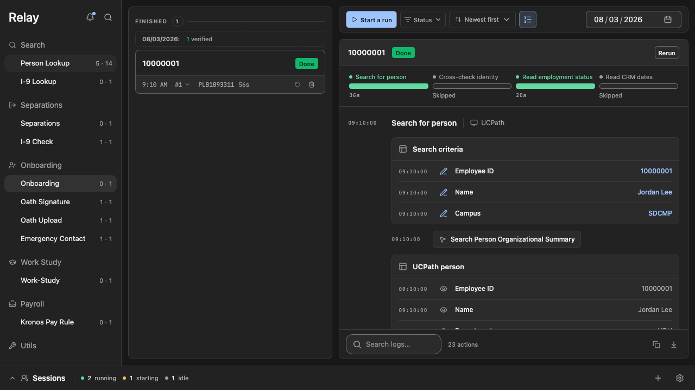
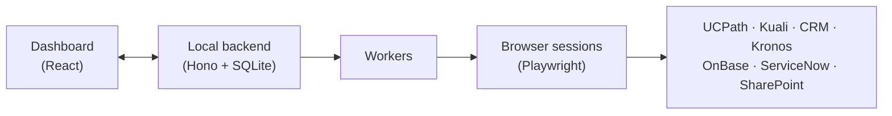

# Relay

Relay automates the repetitive HR work my team at UC San Diego does every day: looking people up,
processing separations, onboarding new hires, reading scanned forms and filing documents across a
handful of university systems.

I'm a student worker in Human Resources at UC San Diego. A lot of our work means reading
information in one system and typing it into another, over and over: UCPath, Kuali, our onboarding
CRM, Kronos, OnBase, ServiceNow. I started building this on my own to take that work off my team's
plate, and to learn how to build this kind of software properly.

> Relay is a personal project. It is not affiliated with or endorsed by UC San Diego, and this
> repository contains no real employee data.



## Two repositories, one project

[`hr-automation`](https://github.com/julianthant/hr-automation) is my first pass, started in March
2026. It worked, and it taught me what the job actually needs. It also grew fast, and I kept running
into the same kinds of problems: pieces that depended on each other in surprising ways, and failures
that didn't look like failures. A CRM search that broke could show up as "not found", and a search
that matched several people could quietly pick the first one.

Relay is the rebuild, started in July 2026. It keeps everything the first version taught me about
each workflow and system, and redesigns the rest: one clear home for each piece, failures that are
always visible, strict protections around anything that changes an HR record, and a dashboard
that's tested down to its screenshots. The first version still runs our workflows while Relay
replaces it one workflow at a time.

## What it automates

| Workflow | What it does | Systems |
| --- | --- | --- |
| Person Lookup | Finds an employee by name, employee ID, or name with date of birth and SSN, and reports whether they're active | UCPath, CRM |
| Separations | Processes separation requests end to end: reads the request, checks timecards, files the termination, and completes the request | Kuali, Kronos, UCPath |
| Onboarding | Pulls a new hire's onboarding record, finds them in UCPath and starts their I-9 | CRM, UCPath, I-9 Complete |
| OCR | Reads scanned PDFs into structured records that I review and approve before anything else runs | ChatGPT (operator's subscription) |
| Emergency Contact | Turns emergency-contact forms into UCPath updates | UCPath |
| OnBase Import | Files HR documents into OnBase, one page per person | OnBase |
| Oath Signature | Records an employee's oath signature date | UCPath |
| Oath Upload | Submits signed oath forms through ServiceNow | ServiceNow, UCPath |
| I-9 Lookup | Finds who signed Section 2 of an employee's I-9 | I-9 Complete |
| I-9 Check | Checks a scanned I-9 packet against UCPath and updates the retention tracking sheet | UCPath |
| Work-Study | Files a work-study update for an employee | UCPath |
| Kronos Pay Rule | Updates timekeeping pay rules from an election roster | Kronos |
| Old Kronos Reports | Downloads time detail reports from the old Kronos system | Kronos |
| CRM Document Download | Downloads documents from an employee's onboarding record | CRM |
| SharePoint Download | Pulls roster files from SharePoint for other workflows | SharePoint |

## How it works

Relay runs on one computer, for one person. I start work from the dashboard, and Relay does the
clicking and typing in each system's website the way I would, while I watch it happen.



- **Queue:** every person or document becomes a row in a queue. Several people in one request
  become one group.
- **Logs:** each run shows its steps in order. Every value Relay types, every button it clicks,
  every value it reads back, and screenshots as evidence.
- **Explorer:** shows each workflow's steps and branches, generated from the workflow's own
  definition.
- **Review:** anything uncertain stops and waits for me, such as an identity that needs confirming or
  OCR results that need checking.
- **OCR:** scanned forms are read with my own ChatGPT subscription, connected through OpenAI's
  "Sign in with ChatGPT". It's the only AI in the system.

## Built to be careful with real HR records

These workflows change real people's employment records, so being correct matters more than being
fast.

- **Dry runs** walk through a workflow without submitting anything.
- **Every write is recorded before it happens.** If a submission's result is unclear, the run stops
  and waits for me instead of guessing.
- **It never retries a submission whose outcome is unknown**, so nothing gets filed twice.
- **Failures are always visible.** A system error never turns into "not found", a missing value never
  becomes a quiet default, and every failure has its own error code and message.
- **Every run keeps its evidence:** what was read, what was typed, and screenshots of each system.
- **Only the operator uses it.** There's no outside API. Credentials stay on the machine and never
  appear in logs.

## Tech stack

- **Language:** TypeScript on Node.js 26
- **Dashboard:** React, Vite, Tailwind CSS
- **Backend:** Hono, SQLite, server-sent events for live updates
- **Browser automation:** Playwright
- **Validation:** Zod schemas shared by the dashboard and the backend
- **Testing:** Vitest for unit, integration and architecture tests; Playwright screenshot tests for
  every key state of the dashboard

## Status

The rebuild is in progress. The dashboard is designed and frozen, and the backend is being connected
to it piece by piece. Person Lookup is the first workflow moving over, then Separations, then the
rest. The [roadmap](docs/roadmap/roadmap.md) lists the key milestones.

## Running it

Relay is built around my team's systems and needs UC San Diego accounts to do anything real, so
it's mostly here to read. To start the dashboard locally:

```bash
npm install
npm run dashboard
```

## License

[MIT](LICENSE)
