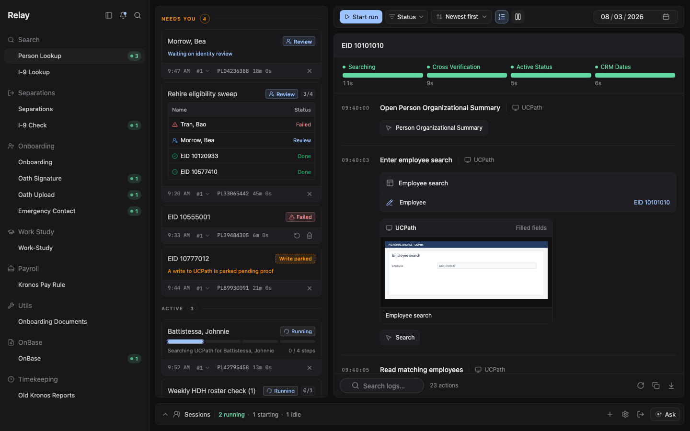
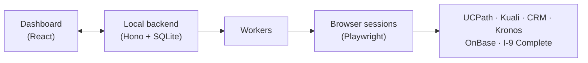

# Relay

Relay automates the repetitive HR work my team at UC San Diego does every day: looking people up,
processing separations, onboarding new hires, and turning scanned forms into record updates across
several university systems.

I'm a student worker in Human Resources at UC San Diego. Much of our work is reading information in
one system and typing it into another: UCPath, Kuali, our onboarding CRM, Kronos, OnBase, I-9
Complete. I built Relay to take that work off my team's plate, and to learn how to build this kind
of software properly.

> Relay is a personal project. It is not affiliated with or endorsed by UC San Diego, and this
> repository contains no real employee data.



## What it does

I start work from a dashboard on my own computer. Relay opens each system's website and does the
clicking and typing the way I would, while the dashboard shows every step as it happens.

| Workflow | What it does | Systems | Status |
| --- | --- | --- | --- |
| Person Lookup | Finds an employee by name or employee ID and reports whether they are active | UCPath, CRM | Running |
| Separations | Processes a separation request end to end: reads the request, checks timecards, files the termination, completes the request | Kuali, Kronos, UCPath | Running |
| Emergency Contact | Reads scanned emergency-contact forms, waits for my review, then updates each person's record and files the form | UCPath, OnBase | In review |
| Onboarding | Pulls a new hire's onboarding record, finds them in UCPath and starts their I-9 | CRM, UCPath, I-9 Complete | In review |
| I-9 Check | Checks a scanned I-9 packet against UCPath and looks up who signed Section 2 | UCPath, I-9 Complete | In review |
| CRM Document Download | Downloads the documents on an employee's onboarding record | CRM | Built |

"Running" means I can start it from the dashboard today. "In review" means the workflow is built
and waiting on a full dry run against the real systems before it is switched on.

## How it works



- **Queue:** every person or document becomes a row. Several people in one request become one
  group.
- **Logs:** each run shows its steps in order: what Relay read, what it typed, what it clicked, and
  screenshots as evidence.
- **Review:** anything uncertain stops and waits for me, such as an identity that needs confirming
  or scanned text that needs checking.
- **Spreadsheets:** rosters and tracking sheets live in one library that workflows read from and
  write to.
- **Scanned forms:** PDFs are read with my own ChatGPT subscription, connected through OpenAI's
  "Sign in with ChatGPT". I approve the result before any workflow uses it.

Everything runs locally. There is no server and no outside API. Each person who signs in on a
machine gets their own database, and credentials never leave the machine or appear in logs.

## Built to be careful with real HR records

These workflows change real employment records, so being correct matters more than being fast.

- **Dry runs** walk through a workflow without submitting anything.
- **Every write is recorded before it happens.** If a submission's result is unclear, the run stops
  and waits for me.
- **A submission with an unknown outcome is never retried**, so nothing is filed twice.
- **Failures are always visible.** A system error never turns into "not found", a missing value
  never becomes a quiet default, and every failure has its own code and message.
- **Every run keeps its evidence:** what was read, what was typed, and screenshots of each system.

## Where it came from

[`hr-automation`](https://github.com/julianthant/hr-automation) was my first version, started in
March 2026. It worked, and it taught me what the job needs. It also showed me the problems of
growing fast: parts that depended on each other in surprising ways, and failures that did not look
like failures. Relay is the rebuild, started in July 2026. It keeps what the first version learned
about each workflow and redesigns the rest. The first version still runs our workflows while Relay
takes them over one at a time.

## Tech stack

| Area | Tools |
| --- | --- |
| Language | TypeScript on Node.js 26 |
| Dashboard | React 19, Vite 8, Tailwind CSS 4 |
| Backend | Hono, SQLite (Node's built-in driver), server-sent events |
| Browser automation | Playwright |
| Validation | Zod schemas shared by the dashboard and the backend |
| Testing | Vitest across more than 1,500 test files; 400 Playwright reference screenshots of the dashboard |

## Running it

Relay is built around my team's systems and needs UC San Diego accounts to do anything real, so it
is mostly here to read. To start the dashboard locally:

```bash
npm install
npm run dashboard
```

`npm run backend` and `npm run web` start the two halves in separate terminals. Windows setup is in
[docs/guides/windows.md](docs/guides/windows.md).

## Learn more

- [Architecture](docs/ARCHITECTURE.md)
- [Codebase map](docs/reference/codebase-structure.md)
- [Writing a workflow](docs/guides/workflow-authoring.md)

## License

[MIT](LICENSE)
