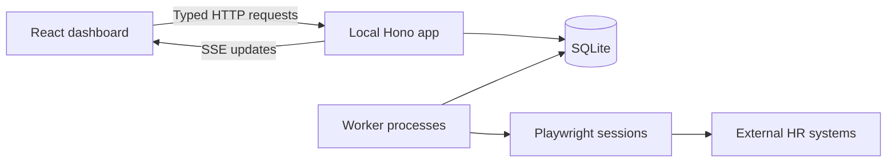
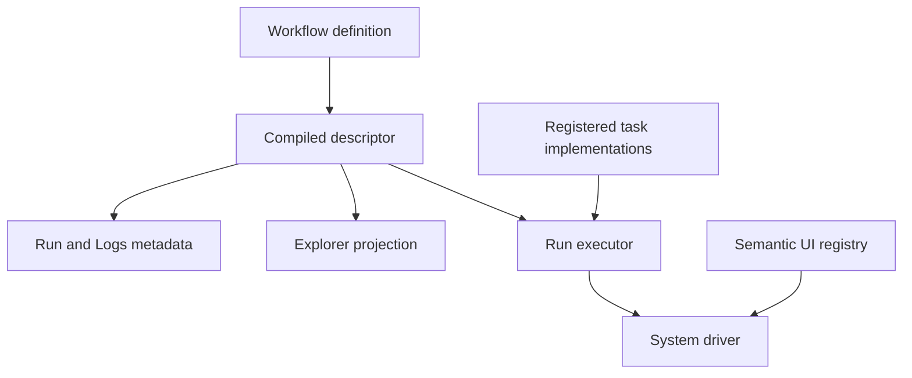
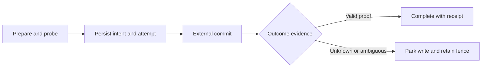
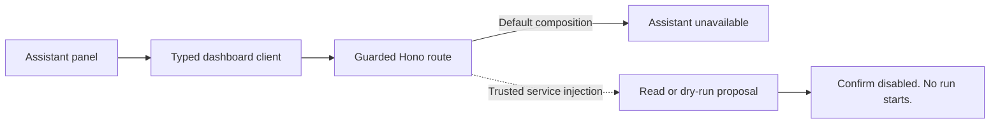

# Relay architecture

Relay is a local HR automation rebuild for one operator. Its core design question is how to make browser automation inspectable and recoverable when a mistake can change an employment record. The project keeps workflow declarations, browser effects, and durable write authority separate. [Product constraints](../AGENTS.md#backend), [write sequencer](../src/backend/runtime/writes/write-sequencer.ts).

This checkpoint retains the baseline explanation at `30031d66b269e651aacd4af997e5eedf30a40f63` and refreshes the bounded C1 facts from accepted source `6cd3f054c78819d5e1a5a4a39f42787a5fef17a6`, tree `313b48611951d354b0490f88ca9102de06adf882`. C1 source links refer to that accepted tree; retained baseline links refer to the earlier pin. This documentation branch does not import C1 implementation. **Implemented** means code exists. **Integrated** means the checked-in composition connects it. **Verified** requires evidence from checks or live operation on a named candidate. The imported C1 evidence establishes the scoped synthetic checks described below. Broader integration and operator acceptance remain pending. This is a checkpoint refresh, not final whole-app sign-off.

## One machine, explicit boundaries

The React dashboard uses a typed client to call a local Hono app over HTTP and receive server-sent events. The HTTP server restricts its bind address to loopback. SQLite repositories hold runs, commands, settings, and write records. Workers use Playwright browser sessions to interact with external systems. [Client](../src/dashboard/client/index.ts), [SSE subscription](../src/backend/transports/http/subscriptions/dashboard-stream.ts), [Hono routes](../src/backend/transports/http/routes/api.ts), [HTTP server](../src/backend/transports/http/http-server.ts), [SQLite authority](../src/backend/storage/sqlite/authority-database.ts), [worker resources](../src/backend/app/composition/worker/run-resources.ts).

One operator and one machine make local persistence and process coordination a better fit than a hosted service. That choice still needs request admission: browser mutations pass Host and Origin guards before their bodies or effects are processed. Browser-safe schemas live in `src/models/`, pure decisions in `src/rules/`, and effectful work in `src/backend/`. [Constraints](../AGENTS.md#backend), [mutation ingress](../src/backend/transports/http/routes/operator-mutation-ingress.ts), [source boundaries](rebuild/reference/codebase-structure.md#workflow-ownership-and-imports).

## A workflow declaration connects execution and explanation

A workflow definition declares inputs, graph nodes, task contracts, presentation metadata, and outcomes. Compilation produces a descriptor. Backend registration combines that descriptor with executable task stores. Steps organize the workflow; tasks provide the operations they use. System tasks own browser work, processing tasks own document and data work, and workflow tasks own workflow-specific decisions. [Person Lookup definition](../src/workflows/person-lookup/workflow.ts), [compiler](../src/workflow-kit/workflow-definition.ts), [workflow registry](../src/backend/app/registries/workflow-registry.ts), [task registry](../src/backend/app/registries/task-registry.ts).

Explorer derives its ordered timeline from the registered definition and checks it against the compiled graph. Run-detail queries also use descriptor metadata. The driver layer translates semantic operations into browser interactions. UI registries classify elements as observations, navigation, preparation, or external commits. Keeping these declarations separate makes workflow intent inspectable without loading browser implementations into the dashboard. [Explorer query](../src/backend/runs/queries/explorer.ts), [run detail](../src/backend/runs/queries/run-detail.ts), [UI effect lookup](../src/backend/systems/browser-shared/semantic-ui-effect.ts), [UCPath registry](../src/backend/systems/ucpath/driver/ui-registry.ts).

Integration is deliberately narrower than registration. Person Lookup and Separations are registered, and the static source policy serves both. Other workflow screens use mocks. A served failure must remain a failure; the policy has no runtime fallback to mocks. [Registered modules](../src/backend/app/registries/workflow-registry.ts), [source policy](../config/dashboard-workflow-sources.json), [source selection](../src/dashboard/app/workflow-sources.ts), [dashboard contract](../src/dashboard/AGENTS.md#rules).

Person Lookup now declares five additional fields as Logs-only: "How found" in Search and Cross-check, "CRM" in Cross-check, and "UCPath" and "CRM" in Employment status. Explorer's canonical projection omits them from fictional example rows while retaining definition/preview agreement. Logs metadata retains their sources, declaration order, and typed display cases. The Logs query reads retained observations and refuses unmapped display values. Visibility changes explanation, not task execution. [Declaration](../src/workflows/person-lookup/workflow.ts), [Explorer projection](../src/dashboard/state/explorer-wiring-adapter.ts), [Logs metadata](../src/backend/app/composition/dashboard/run-detail-descriptors.ts), [Logs query](../src/backend/runs/queries/run-logs.ts).

Ordinary operator commands use a separate durable path: HTTP validates the request and actor, operator ingress fixes provenance and replay identity, and the command service calls the kernel. The kernel journals and audits accepted application within SQLite authority transactions. Start planning binds inputs and configuration before enqueue. Keeping this path separate from assistant replies prevents a proposal from becoming execution authority merely because it rendered successfully. [Command route](../src/backend/transports/http/routes/commands.ts), [ingress](../src/backend/runs/commands/operator-command-ingress.ts), [service](../src/backend/runs/commands/command-service.ts), [kernel](../src/backend/runs/commands/command-kernel.ts), [start planner](../src/backend/runs/start/plan.ts).

## A recorded intent precedes an external write

The transaction sequencer separates preparation from commitment. Its dry-run path previews preparation without creating a write intent, acquiring a write fence, or calling the external commit. The real path independently rejects both a dry-run execution context and a durable dry-run envelope. Dry runs can still retain local run evidence. [Sequencer](../src/backend/runtime/writes/write-sequencer.ts), [dry-run results](../src/backend/runs/provenance/evidence-receipt.ts).

Before a real commit, the sequencer persists an `attempting` intent and attempt under the run claim. Only a successful fence permits it to mint the mutation capability passed to the commit task. The intent binds the business key, run, attempt, generation, and subject evidence. This is the journal-before-write boundary. [Fence and capability](../src/backend/runtime/writes/write-sequencer.ts), [write contracts](../src/rules/write-safety/write-safety.ts).

SQLite cannot atomically commit an action in another website. If a click's result is UNKNOWN, the system parks the write rather than assume failure and click again. Generic retry refuses parked intents. Recovery can accept valid positive proof or, where the contract permits it, stabilized negative evidence before granting a fresh generation. Operator resolution also requires typed evidence. A receipt records the supported outcome; it is not a claim that the remote action and SQLite shared a transaction. [Intent policy](../src/backend/runtime/policies/durable-intent.ts), [recovery](../src/backend/runtime/writes/write-recovery.ts), [saved verification](../src/backend/runtime/writes/mandatory-saved-verification.ts), [receipt derivation](../src/backend/runs/provenance/evidence-receipt.ts).

## Restart safety includes workers and configuration

Workers renew the exact run claim on a cadence. Losing the claim aborts execution. Worker leases, pool membership, and browser ownership carry identities and generations so replacing a process does not silently inherit an earlier process's authority. [Worker loop](../src/backend/runtime/workers/worker-loop.ts), [worker slots](../src/backend/storage/sqlite/worker-slots.ts), [process locks](../src/backend/storage/sqlite/runtime-process-locks.ts).

Ordinary startup accepts the current database schema, version 6 at this pin. An explicit stopped upgrade validates the old authority, obtains and verifies a backup, then applies the migration. Backup verification checks bytes, checksum, source identity, and database contents. Startup does not replace an incompatible database with an empty one. [Schema](../src/backend/storage/sqlite/migrations.ts), [boot state](../src/backend/storage/sqlite/authority-boot.ts), [upgrade](../src/backend/storage/maintenance/upgrade.ts), [backup verification](../src/backend/storage/sqlite/backup-service.ts).

Settings belong to the same authority as the database. Readers authenticate saved settings against commands, audits, and configuration snapshots. Worker resources use the run's retained snapshot and verify its fingerprint. Private credentials have a separate local file store; database backup and restore do not replace that credential authority. [Settings storage](../src/backend/storage/sqlite/settings-storage.ts), [run resources](../src/backend/app/composition/worker/run-resources.ts), [credential store](../src/backend/storage/configuration/credential-store.ts), [configuration contract](rebuild/reference/clock-config-secrets.md).

## Account integration, OCR custody, and assistant limits

The account service implements OAuth authorization-code sign-in with PKCE S256, state and nonce checks, a loopback callback, token refresh, and a Responses OCR request. Tokens remain in the private credential repository. Dashboard composition and account routes connect the account service to Settings with token-free account projections. These are implemented and integrated account paths, without a fresh sign-in or live-provider verification claim. [Account service](../src/backend/accounts/chatgpt-account-service.ts), [credential repository](../src/backend/storage/configuration/chatgpt-credential-repository.ts), [composition](../src/backend/app/composition/dashboard/compose.ts), [routes](../src/backend/transports/http/routes/chatgpt-account.ts), [wire schemas](../src/models/dashboard/chatgpt-account.ts).

The OCR adapter validates request schema, source bytes and digest, singleton-PDF input, and invocation metadata. After admission and source checks, `ocr/extract-form-page` records exactly `formType`, `sourcePage`, `pageKind`, `pageFingerprint`, `record`, `source`, `readAt`, and `sourceSha256`. It no longer records the non-output `hasRecord` field. [Adapter](../src/backend/processing/providers/chatgpt-ocr-adapter.ts), [task](../src/backend/processing/ocr/tasks/extract-form-page.ts), [contract](../src/models/processing/ocr/extract-form-page.ts).

The executor classifies recorded observations, then finalizes provenance against the parsed output before constructing a checkpoint. Every output leaf needs matching recorded evidence. The SQLite repository persists the checkpoint with run, attempt, claim generation, schema and implementation fingerprints, provenance, and observation origins. Undeclared observations or contradictory recorded values cannot produce a successful checkpoint. [Observation classification](../src/backend/logs/observed-data.ts), [provenance](../src/backend/runs/provenance/task-provenance.ts), [executor](../src/backend/runtime/execution/run-executor.ts), [checkpoint repository](../src/backend/storage/sqlite/authority-database.ts).

Classification and custody serve different purposes. At the restrictive transform boundary, `record.answers` and `source.modelId` are sensitive HR values with `drop`; `record.blockingPaths` uses `count`. The classified local-evidence path retains complete admitted values, including read, absent, and unreadable answers. A diagnostic transform is therefore not evidence that the local checkpoint or observation store contains no sensitive values, and local custody grants no provider or public-export permission. [Classification](../src/models/trust/evidence-classification.ts), [transform and local retention](../src/rules/redaction/redaction.ts), [custody assertions](../tests/models/trust/evidence-classification.integration.test.ts).

The assistant panel now uses a controller and the dashboard-owned typed client to POST to a guarded Hono route. Cancellation and authority/account changes invalidate outstanding replies; source citations, proposals, and refusals use shared schemas. The default dashboard composition does not supply the optional assistant service, so the route returns `ASSISTANT_UNAVAILABLE`. Implemented service and planning adapters do not establish production model eligibility, consent, current public context, or subject authority. [Panel composition](../src/dashboard/app/dashboard-app.tsx), [controller](../src/dashboard/surfaces/assistant/assistant-controller-model.ts), [client](../src/dashboard/client/queries/assistant-queries.ts), [route](../src/backend/transports/http/routes/assistant.ts), [default composition](../src/backend/app/composition/dashboard/compose.ts), [service](../src/backend/assistant/service.ts), [context checks](../src/backend/assistant/context.ts).

With trusted injected dependencies, proposal preparation uses the existing start planner and rechecks subject, descriptor, configuration, input, expiry, and transaction stop-before-commit bindings. It admits only a single dry-run proposal, excluding protected inputs, reruns, and omissions. It reports that no workflow executed and no transaction committed. Confirm remains disabled in the panel, and the controller ignores confirm actions. There is no integrated assistant confirmation-to-command dispatch. [Planning adapters](../src/backend/app/composition/dashboard/assistant.ts), [proposal](../src/backend/assistant/proposal.ts), [panel](../src/dashboard/surfaces/assistant/assistant-panel.tsx), [controller](../src/dashboard/surfaces/assistant/assistant-controller-model.ts).

This diagram describes the implemented request path and its refusal boundary. OCR remains mock-selected, production worker providers do not bind the OCR adapter, and production child dispatch remains unbound. These independent integration obligations are not closed by account or C1 repair acceptance. [Source policy](../config/dashboard-workflow-sources.json), [worker providers](../src/backend/app/composition/worker/run-resources.ts), [worker composition](../src/backend/app/composition/worker-compose.ts).

## Verification and release are separate from implementation

Vitest declares unit, integration, architecture, performance, and local projects. The local project is operator-machine tests. Architecture guards enforce source boundaries and registration rules. Desktop parity checks compare the dashboard against screenshot references. These checks address different failure modes; their presence does not prove that a real HR workflow is accepted. [Test configuration](../vitest.config.ts), [architecture guards](../tests/architecture/), [parity runner](../scripts/verify-parity-json.ts), [performance checks](../tests/perf/).

The declared commands are `npm run typecheck`, `npm run lint`, `npm run test:unit`, `npm run test:integration`, `npm run test:architecture`, `npm run test:local`, `npm run test:parity`, `npm run test:coverage`, and `npm run test:perf`. Coverage selects the unit, integration, and architecture projects. CI runs unit, integration and architecture on Ubuntu, with macOS runners for the files that need macOS, and adds Desktop parity on macOS for pull requests into `main`. The release job builds the web bundle, runs coverage alone, then performance. [Package scripts](../package.json), [CI workflow](../.github/workflows/ci.yml).

The accepted C1 producer evidence records native Mac unit **3,386 tests / 440 files**, final integration **3,972 / 455**, and architecture **679 / 76**, all passing with zero failed or skipped tests. The independent review executed **261 focused tests / 16 files**: 43 OCR units, 33 Explorer units, 85 OCR/classification/privacy integrations, 49 Explorer/Logs integrations, and 51 architecture tests. These focused tests overlap the producer suites and are not additional coverage. The initial integration command exited successfully but its inventory and custody audits failed; a fresh unfiltered re-gate supplied the accepted complete proof. Independent review audited producer membership, sampled native custody, build binding, and generated closure rather than rerunning all full suites.

Seven synthetic executor/SQLite OCR positives cover oath, emergency contact, both I-9 sections, boilerplate, unrelated, and blank pages. Two negative controls refuse undeclared and contradictory observations. The unchanged generator's repeated output and independent in-memory comparisons close the combined OCR-task/Person-Lookup manifest delta; the accepted manifest contains 42 tasks and seven workflows. These are imported execution receipts at the named C1 pin, not checks run for this document. They establish neither live HR success nor browser/parity, coverage/performance, account/model/public-context authority, or release acceptance. [OCR integration assertions](../tests/backend/processing/providers/chatgpt-ocr-adapter.integration.test.ts), [Explorer assertions](../tests/dashboard/state/explorer-wiring-adapter.presentation.test.ts), [generated manifest](../src/workflow-kit/validation/generated-build-manifest.ts), [generator](../scripts/build/generate-workflow-manifest.ts).

The pinned policy is `feature/<slug>` → `npm run test:local`, typecheck and lint → push → pull request into `staging` that auto-merges with a merge commit when cloud checks and Cursor Bugbot are green → operator preview → release pull request with a merge commit into `main` on the operator's go, followed by syncing `main` back to `staging`. The owner fixes a red check. Push and the release merge require explicit operator instruction. Branch-protection configuration is an owner action, not something the CI file proves is enabled. [Git policy](../AGENTS.md#git), [repository governance](repository-governance.md).

## What the rebuild changes

The repository describes `hr-automation` as the first version and Relay as its replacement. The current code makes that evolution concrete: Person Lookup preserves multiple-match and failed-check states; workflow declarations drive execution metadata; the write sequencer records authority before external effects. The tradeoff is more explicit contracts and recovery work in exchange for fewer silent guesses. This is a comparison grounded in Relay's current source and its stated provenance, not an audit of the earlier repository. [Project provenance](../README.md#two-repositories-one-project), [identity rules](../src/rules/matching/person-lookup.ts), [workflow definition](../src/workflows/person-lookup/workflow.ts), [write sequencer](../src/backend/runtime/writes/write-sequencer.ts).

At whole-app freeze, recheck workflow ports and served activation, OCR and Records integration, assistant production service/model/public-context authority and confirmation-to-command settlement, and production child dispatch. Separate C2B/PLG assembly, approved HUB integration, sanitized public history, full final gates, operator read-through, and staging/release remain pending. The retained baseline contains a durable child executor behind an injected capability; it is absent from the C1 tree. C1 production worker composition still refuses run creation and supplies no child-dispatch binding. Final assembly must resolve this difference. The accepted private C1 repair composition closes none of those broader obligations. Historical privacy remains FAIL/private; a clean introduced range does not clear inherited history. [Current source policy](../config/dashboard-workflow-sources.json), [review-section refusal](../src/backend/runs/queries/run-sections.ts), [baseline child executor](../src/backend/runtime/execution/durable-child-executor.ts), [worker composition](../src/backend/app/composition/worker-compose.ts).

## Interview questions

**Why SQLite?** One local operator needs durable transactions and inspection without a hosted database. The difficult boundary is the external website, where the intent and recovery protocol matter. [Constraints](../AGENTS.md#backend), [authority](../src/backend/storage/sqlite/authority-database.ts), [sequencer](../src/backend/runtime/writes/write-sequencer.ts).

**How do you prevent duplicate submissions?** Persist the intent before the click, bind authority to a generation, retain uncertain outcomes, and refuse generic retry until the exact write is resolved. [Sequencer](../src/backend/runtime/writes/write-sequencer.ts), [intent policy](../src/backend/runtime/policies/durable-intent.ts).

**What is complete?** Separate implemented code, integrated composition, verified behavior, and operator acceptance. Person Lookup being served does not certify other workflows or the current availability of external systems. [Source policy](../config/dashboard-workflow-sources.json), [activation requirements](../AGENTS.md#what-to-build).
