# 00 · Phase 0 — design the foundation

This doc is the dedicated home of **Phase 0**, tree node `{#phase-0}`: its tasks, what is done and
what is left, its exit criteria; contracts it built live in `reference/`.

## Phase summary
<!-- roadmap: phase-0 -->

<!-- roadmap-status: phase-0 -->
<!-- /roadmap-status -->

_Moved from `reviews/2026-08-20-master-plan-dissolved.md` §3 (Phase 0 — foundation design) on 2026-08-20 (3b); this is the as-written record, the step-5 rewrite re-verifies it._

**Goal.** Every foundational contract is designed, adversarially reviewed, and operator-approved
before any rebuild code is built (charter §Process: nothing is built before its design part is
approved).

**Status (2026-07-31).** **COMPLETE.** Every reference spec is reconciled through Round 12 (D1–D94); the
operator ratified isolated coexistence, all-at-once cutover, the testing policy, and the later probe
gates, then directed (D93) that the rebuild live in its own repository rather than in-tree. Phase 1
has since completed in full: items 1a and 1b completed 2026-07-31, items 1c, 1d, and 1e completed
2026-08-01, and items 1f, 1g-spine, and 1i-spine completed 2026-08-04 with the D74 live exit test.

**What remains.** Nothing in Phase 0 and nothing in Phase 1. The program is at Phase 2's controlled
transaction proof; system-specific proof questions below remain mandatory only at their named
milestones (D92).

**Executable feasibility evidence (not implementation).** Disposable files outside the repository
were compiled/run with the project's actual Node 26, TypeScript 5.9, and Zod 4 dependencies. The
spike proved effect-specific contract overloads and negative type controls, provider-client
narrowing, canonical-input transform-once/revalidate-many behavior, strict command arms, target-
field mappings, typed child results, proof unions, a 40-node typed chain, post-write settlement,
SQLite permanent-key/atomic-outbox behavior, and native online backup/read-only verification. The
40-node compile completed in 0.68s at about 212 MB. This establishes feasibility only: D71 requires
the same controls against the real API as committed Phase-1 tests. One adversarial case initially
failed—pre-propagation negative evidence could contribute a vote—and is now closed by D69.

**Measured existing gate baseline (2026-07-31, legacy repo).** `typecheck:all`, source lint, dashboard build,
479 unit files / 4,619 tests, 11 serial files / 20 tests, and 23 architecture files / 129 tests all
pass. Test lint remains red at 1,344 errors + 2 warnings. D70/ref guards-and-tests §1.1 makes this explicit: new
rebuild source/tests are zero-warning from their first file; legacy test diagnostics are
fingerprinted, no-new-debt coexistence debt. It may remain non-zero through initial cutover; no plan
milestone may report `npm run lint:tests` green until it actually is.

## The base's dependency graph

_Moved from `reviews/2026-08-20-master-plan-dissolved.md` §1 on 2026-08-20 (3b); this is the as-written record, the step-5 rewrite re-verifies it._

The base/kernel is built along one critical path. Guard plumbing lands before the tree; the first
real rebuild `src/` leaf and every applicable type/lint/architecture arm activate in the same commit
(charter: "same quality umbrella from day one").

```mermaid
flowchart TD
  A["<b>1a</b> guard scaffold<br/><i>lands before the tree exists</i>"]
  B["<b>1b</b> strict domain + canonical input<br/>+ clock / config / secrets / dependency registry"]
  C["<b>1c</b> authority DB + backup / restore / doctor<br/>+ command &amp; write TYPE SHELL"]
  D["<b>1d</b> semantic UI registry + typed drivers<br/>+ task / provider contracts, stores, sessions"]
  E["<b>1e</b> typed workflow DAG<br/>+ results / delegation / completion / gates / scenarios"]
  F["<b>1f</b> core registry (composition root)<br/>+ executor / checkpoints / commands / write sequencer"]
  G["<b>1g-spine</b> spans + THE one projection"]
  H["<b>1i-spine</b> the four parity surfaces"]
  EXIT{{"<b>PHASE 1 EXIT</b><br/>person-lookup runs LIVE"}}

  TX["<b>Phase 2</b> controlled transaction proof<br/>dry-run · subject mismatch · commit · crash · recovery"]
  T1["<b>2g</b> evidence · failures · notifications · knowledge · ledger services"]
  T2["<b>2h</b> data services · intake mapping · manifests · capture · Edit Data"]
  T3["<b>2i</b> explorer · AI advisories · storage health · catalog UI"]
  T4["<b>2j</b> soak · restore drill · capability inventory · doc gate"]
  M(["<b>Phase 3+</b> per-workflow migration<br/>orders 0-9"])

  A --> B --> C --> D --> E --> F
  F --> G --> H --> EXIT
  EXIT --> TX --> T1 --> T2 --> T3 --> T4 --> M

  G -.->|"D81: every count reads<br/>this one projection"| H

  classDef spine stroke:#2980b9,stroke-width:2px,fill:#00000000;
  classDef tail stroke:#7f8c8d,stroke-dasharray:4 3,fill:#00000000;
  classDef gate stroke:#27ae60,stroke-width:2px,fill:#00000000;
  class A,B,C,D,E,F,G,H spine;
  class T1,T2,T3,T4 tail;
  class EXIT,TX gate;
```

**Blue = the spine** (Phase 1, D74): the minimum that can carry one workflow. **Green = the two
proofs** that falsify the design against reality — a live read, then a controlled write. **Grey
dashed = the tails**, deferred behind the first live proof so they are built against a proven base
and a real consumer rather than against fixtures.

**Critical path: guard → strict domain/config → authority/recovery → semantic driver/task store →
workflow graph/delegation → registry/executor/commands/events → trust services/dashboard.**
Justification:

- **11 (clock/config/secrets) is the root.** Every timestamp (spans, checkpoints, trace ids, fence),
  every URL/timeout/fiscal date, and every credential reads through it. Building 01+ on raw
  `new Date()`/`process.env` would require re-threading later; the `clock-single-source` and
  `secrets-single-source` guards must be green from the rebuild repo's first source file.
- **Write-safety types/storage precede commit task contracts.** `CommitTaskContract` cannot refer to
  a later-owned placeholder. The dependency-free `WriteSafety`/proof types and SQLite authority/
  outbox schema land first; sequencing behavior lands with the executor later.
- **Authority recovery precedes authority use.** Claims/checkpoints/dependencies/write intents are
  not rebuildable; creating them before backup/doctor/degraded-mode contracts would make Phase 1
  green on a database it cannot safely recover.
- **Semantic UI ids and typed drivers precede browser tasks.** Tasks must be authored against one
  canonical element/page-state/observation vocabulary from their first line; raw Page/selector debt
  is not ported into task implementations and “cleaned up later.”
- **01 before 02** — the descriptor (02) composes task contracts; the
  builder's `Steps` type map (D15) is typed against contracts.
- **The 02/03 completion seam lands together in 1e.** Ref dashboard-surfaces owns the bundle-safe completion-program
  union while ref workflow-model owns the descriptor/gate graph that contains it; both domain types land in the
  same work item. Ref dashboard-surfaces's event/storage/projection implementation waits until 1g, so neither side
  forward-declares a later contract.
- **Registry is above workflows.** `core/workflow-registry.ts` imports descriptors/stores; domain
  never imports workflows. The dashboard receives generated/server projections, never workflow modules.
- **Executor, command service, and events co-evolve after the graph.** The executor emits events and
  owns transaction sequencing; the command service owns every queue mutation/dependency target;
  durable authority/outbox contracts already exist, so no layer forward-declares another.
- **Trust records are base data, not dashboard decoration.** Failure/evidence/scenario/notification/
  knowledge schemas land before the UI that projects them. The read-only Workflow Explorer and
  closed presentation/policy editing both land only in Phase-2 tail 2i.
- **10 is orthogonal, not sequential** — it is built alongside every step (guards land as their
  target concepts appear), never "at the end." Its own meta-guard (`guard-manifest`) is what stops
  the umbrella silently shrinking.

The **data-service stores** (ref data-intake-and-edit-data's `extraction`/`normalization`/`ocr`/`roster` contract+impl, D4)
land in Phase-2 tail `2h`, after the live spine and controlled transaction proof. Their column
mapping, durable mobile capture, intake manifest/rerun, progressive Review, and Edit Data surfaces
land in the same end-to-end slice, so Phase 3 workflows consume a proven ingest contract rather
than inventing one mid-migration.

## ALWAYS-GATE identity approval
<!-- roadmap: phase0-always-gate -->

<!-- roadmap-status: phase0-always-gate -->
<!-- /roadmap-status -->

_Moved from `reviews/2026-08-20-master-plan-dissolved.md` §3.3 (the order-8 prerequisite block — the gate was pulled into Phase 0 by D77, so it is filed here rather than with the migration order) on 2026-08-20 (3b); this is the as-written record, the step-5 rewrite re-verifies it._

**Order-8 prerequisite — RESOLVED, and pulled into Phase 0 (D77).** This slot previously read "the
separations identity-approval GATE-NODE has no design yet." That was the sharpest priority
inversion in the plan: the single control that actually defends against the `T002173685`
**wrong-person** incident was undesigned and deferred to order 8, while the fence — which by its
own admission prevents a double-**file** and never a wrong-**person** (risk #4, D20) — had a full
design doc. The operator ratified the policy on 2026-07-24 (**ALWAYS-GATE**: manual approval on
every separation, both separation types, no auto-approve-on-match), and the gate is now designed
in **ref write-safety §14** during Phase 0, with its node mechanism owned by ref workflow-model §4. Order 8 inherits a
designed gate instead of owing one.

## Size model + delivery tiers
<!-- roadmap: phase0-size-model -->

<!-- roadmap-status: phase0-size-model -->
<!-- /roadmap-status -->

_Moved from `reviews/2026-08-20-master-plan-dissolved.md` §3.7 on 2026-08-20 (3b); this is the as-written record, the step-5 rewrite re-verifies it._

This plan previously contained **no sizing of any kind**. Sizing keeps the isolated coexistence
program reviewable and exposes overruns before they compound integration risk.

**Sizes are relative build sizes, not calendar** (unit and scale defined under the §2 phase
table: S ≈ 1 session, M ≈ 2–4, L ≈ 5–10, XL ≈ 10+). They are estimates offered for correction.

| Item | Size | What dominates it |
|---|---|---|
| 1a guard plumbing + honest baselines | **L** | not the guards—the D58 capability inventory, D90 isolation/change-accounting/preservation manifests, coverage activation, and diagnostic fingerprints over 1,344 test-lint errors + 2 warnings |
| 1b strict domain leaf + coverage activation | **L** | the exhaustive **bidirectional** runtime-dependency registry (D68 — every system endpoint, provider key, secret, feature flag, legacy env name, in both directions) |
| 1c authority storage + recovery + type shell | **XL** | backup/doctor/degraded-mode/**restore drill** is a subsystem, not a table; plus the full command family + proof union types |
| 1d semantic UI registry + drivers + task contracts | **XL** | inventorying every legacy selector key into one canonical-id registry with search terms and explicit `supersedes` links, then the driver boundary + effect overloads + capability + provider narrowing |
| 1e workflow DAG + delegation + completion | **XL** | starts with the real-scale type proof (below); delegation policy matrix + completion program are each substantial on their own |
| 1f registry + workers + commands + write sequencer | **XL** | the write sequence (probe→prepare→binding proof→fence→commit→proof→atomic outbox) plus one-item worker/session ownership and evidence-qualified negative recovery |
| 1g-spine spans + the one projection | **M** | thin by design — emission + one projection, no services |
| 1i-spine exact Person Lookup surface slice | **M** | thin by capability, exact by presentation — the target is already ratified and demoed (`?view=rebuild-demo`) |
| **Phase 1 total** | **XL** | four XL items on the critical path; this is the program's centre of mass |
| Phase 2 transaction proof | **L** | mostly protocol + crash matrix; needs a named live target (§3.8) |
| Phase 2 tails 2g / 2h / 2i / 2j | **L / XL / L / M** | 2h is the largest tail (four service stores + mapping + manifests + capture + Edit Data) |
| Migration orders 0–3 (reads, downloads, OCR pipeline) | **M** each | store population; high reuse payoff, low risk |
| Migration orders 4–7 (OCR fan-out, i9, single writes, ServiceNow/OnBase) | **L** each | first gates, first workflow-specific commits, first upload-verify |
| Migration orders 8–9 (separations, onboarding) | **XL** each | deepest write-safety proofs + the identity gate + roster ingest |

**Delivery tiers — what may slip without invalidating the base.** The charter lists 27
non-negotiables and every one is currently mandatory, with no articulated reduced-scope fallback
behind the stop-loss (§5.1). These tiers give a paused/reassessed rebuild a defined shape:

- **MUST (the spine — never cut).** Write-safety contract and the transaction sequence; authority
  storage + recovery; fail-loud/strict schemas; task/descriptor contracts; executor + command
  protocol; spans + the one projection; the four parity surfaces; the identity-approval gate. These
  are what the program exists for; cutting any of them makes the rebuild pointless or unsafe.
- **SHOULD (Phase-2 tails — build before the first migration, may reorder).** Evidence receipts +
  `explain run`; structured failures + diagnostic bundles; notification inbox; intake mapping +
  manifests; Edit Data; durable capture. Slipping one of these past order 0–2 costs operator
  convenience, not correctness.
- **LATER (may reorder within Phase 2, but must land before Phase 3).** Read-only Workflow Explorer;
  AI advisories; generated UI catalog UI; knowledge/fix-record tooling; activity-report demo.
  Nothing in the write path depends on any of them, but Phase 3 does not begin until 2i closes.

**Already-ratified trims folded in (D79).** DSL graph-authoring mode — cut (§Phase 2). Notification
lifecycle — read/unread + snooze, actor-keyed inbox, not a five-state lifecycle. Commands — keep
`version` + `actor` wire fields everywhere (multi-user seam, D75), enforce CAS only where a real
race exists (cancel-tree, edit-vs-resume, gate resolution, write-recovery). Capture crash-proofing
— durable sessions + one durable finalize outbox, not a restart-between-every-state matrix. Ledger
hash-chain — deferred until multi-user is real; the never-pruned ledger, atomic outbox, single
projector, and actor attribution all stay. Task authoring — a **lightweight tier** exists
(**ref task-contract §2.7** owns the three tiers, and the tier is *derived* from effect + store kind, never
self-declared): a `workflow:` mini-store pure read needs schemas + example only; browser reads add
freshness/provenance/subject; commits pay full fare. A **`scaffold new-task` / `scaffold new-workflow`
generator** is part of the base — the declaration toil is only acceptable if it is generated.

## Decisions this phase ratified

_Derived from `reference/decisions.md`'s round headings on 2026-08-20 (3b) — the
ratification act and the normative pointer stay in the ledger; this is the phase index._

| Rounds | Dates | D-range | What they settled |
|---|---|---|---|
| 1 (the D1–D16 block) | 2026-07-17/18 | D1–D16 | the ownership matrix (D1), task identity/contract split, gates as run-state (D5), `dryRun` on the envelope (D6), checkpoint freshness (D8), the one event schema (D10), the SQLite role (D14) |
| 2–3 | 2026-07-18 | D17–D25 | write-safety after the skeptic review: probe-then-park (D17), the same-key fence (D18), schema-validated backfill (D19) |
| 4 | 2026-07-21 | D26–D45 | the three task effects (D26), the workflow as a typed DAG (D27), descriptor exhaustiveness (D28) |
| 5 | 2026-07-22 | D46–D68 | the permanent-key/proof family (D48/D64), the D58 capability-closure inventory, the bidirectional dependency registry (D68) |
| 7 | 2026-07-22 | D69–D72 | executable feasibility + the honest gate baseline (D70/D71); pre-propagation negative evidence closed (D69) |
| 8 | 2026-07-23 → 07-26 | D73–D86 | **the load-bearing round for this phase**: D74 the spine + a live exit test, D76 the size model and MUST/SHOULD/LATER tiers, D77 the ALWAYS-GATE designed here rather than at order 8, D79 the trims (DSL mode cut), D80 the archive model, D81 the ONE projection, D82 the receipt's acceptance bar, D84 the reuse-leverage ordering |
| 9 | 2026-07-30 | D87 | the worker/session model |
| 10–12 | 2026-07-31 | D88–D94 | isolated coexistence (D88), ONE all-at-once cutover (D89), change accounting (D90/D94), the testing policy (D91), the probe gates (D92), and the two-repository address (D93) |

**D131 is a retired gap — never reuse it.**

## Exit criteria

_Moved from `reviews/2026-08-20-master-plan-dissolved.md` §3 (Phase 0's exit criteria) on 2026-08-20 (3b); this is the as-written record, the step-5 rewrite re-verifies it._

**Exit criteria.** **MET 2026-07-31.** Every reference spec and this build order are approved; every deferred
question has an owner, evidence needed, and resolution point.
