# 07 — Master Plan: the single phased build order for the rebuild repo

Status: **Plan ratified 2026-08-02 through Round 18 (amended through Round 20, 2026-08-03).
Phase 0 and ALL of Phase 1 are complete — 1a–1f, 1g-spine, 1i-spine, and the D74 live exit test
(2026-08-04).** This is the ONE plan the charter demands (§"One master plan"): every design doc
converges here, and there must never be a competing plan. The program proceeds at **Phase 2's
controlled transaction proof**, which precedes the 2g/2h/2i/2j tails.

**Round-18 amendment summary (Phase-1f contract ratification 2026-08-02).** D109–D118 close the
remaining executor/authority seams before implementation: planned ingress is atomically consumed;
minimal failures and terminal results are durable in 1f; beat ⑦ includes checkpoint/run/outboxes;
provider admission is split from 2h production consumers; the command kernel is exhaustive with
typed unavailable later arms; provenance collection, config-keyed session reuse, neutral
navigation, and recovery-before-requeue are mandatory.

**Round-12 amendment summary (operator ratification 2026-07-31).** D94 closes D93's accounting
mechanics: F1–F4 are ratified, records are commit-centred and blob-hash-bound, the legacy
`src/`/`tests/` worktree must be clean, and legacy maintenance is committed before its exact commit
and paths are accounted. §4 owns the sequence; doc 10 §3.13 owns the guard contract.

**Round-11 amendment summary (operator direction 2026-07-31).** D93 changes the rebuild's ADDRESS,
not its plan. The rebuild lives in its own repository — `hr-automation-rebuild`, fresh git history
seeded from the `feature/rebuild-phase1b` tip (that branch stays in the legacy repo as the pre-split
record) — with rebuild code at plain `src/`, rebuild tests at `tests/`, rebuild config at `config/`,
plan docs still at `docs/rebuild/`, and the plain `typecheck` / `lint` / `test` /
`test:architecture` gate family. The in-tree half of D88 is superseded: `temp_src/`, the `*:rebuild`
script names, the "present-but-empty tree fails" semantics, the bidirectional runtime-isolation
guard family, and the preservation manifest's same-tree strict-normal-form scanning of changed
legacy files all retire, because **isolation is now physical** — cross-runtime imports, invocation,
and state access are structurally impossible between two repositories. Everything else in D88–D92
survives: the legacy repo remains sole production authority; distinct state/artifact roots, ports,
process locks, and browser profiles/sessions are still REQUIRED (both worlds run on one machine);
D90 change accounting still runs, now cross-repo; porting is still copy-with-provenance.
**Phase definitions, gates, coverage numbers (D91), and live-probe gates (D92) are unchanged.**

**Round-10 amendment summary (operator ratification 2026-07-31).** D88–D92 supersede the
incompatible Round-8 migration assumptions while preserving the phase dependency order:

- **D88/D90 isolated coexistence** — existing legacy automation and tests remain live and
  maintainable; the rebuild is operationally isolated (as of D93, in its own repo); legacy change
  accounting replaces a freeze.
- **D89 one cutover** — workflow migrations are rebuild proofs, not production flips; the normal
  launcher changes once after full readiness, with the legacy repo preserved for rollback.
- **D91 testing** — 60/80 lines/statements/functions, Phase-2 50/70 branch gates, soft suite-size
  review, and no legacy-test deletion during rebuild/initial cutover.
- **D92 probes** — UCPath, ServiceNow, and OnBase proof remains mandatory at its named later gate,
  but none blocks Phase 1.

D74's Phase-1 spine, D76's build-speed tie-breaker, and D84's reuse-leverage ordering remain
binding; only their former manual-work/pause rationale is superseded.

**What this doc is.** It *sequences* and *indexes* the build. It states the order phases run in, the
dependencies between them, and the hard exit criteria for each. For every work item it names the
**owning doc** — the binding detail lives there, and this plan never redefines it.

**What this doc is NOT.** It is not a design doc. It owns no contract. If this plan and an owning doc
disagree on a contract's shape, the owning doc wins and this plan is stale (and must be corrected —
see governance §0.3).

---

## 0. Program overview + governance

### 0.1 The one-plan rule

Per charter §"One master plan": the owning design docs (01–06 and 09–13) are the binding detail; THIS doc is the
authoritative build order. No second plan, no per-workflow "alt plan," no execution doc that
re-sequences phases. Per-workflow *migration plan docs* (Phase 3+) are **children** of this plan —
they answer the §b questionnaire (§3.4) and record what a workflow reuses/adds; they never re-order
the program.

### 0.2 D1 ownership map — the quick index (concept → owning doc)

Every concept has exactly one owner (reconciliation `04` D1). Reference the owner; never redefine.

| Concept | Owner |
|---|---|
| Task contract (`defineTaskContract`/`defineTask`), contract/impl split (D3), task-namespace grammar + closed `SystemId` union (D2), error taxonomy, three effects/dry-run mechanics, retry, decoration, system/service stores + pure workflow mini-stores, session providers + login signature, `stores/common/` leaf homes | **Doc 01** |
| Workflow builder API (single), descriptor shape, `RunEnvelope`, run-state machine incl. gates/parks (D5), checkpoint/resume + freshness walk (D8), label precedence (D16) | **Doc 02** |
| Span/event wire schema (D10), notes stream, storage layout, SQLite projection role (D14), SSE wire shapes, completion (fan-out/approval) union (D11), cross-repo runtime boundary + one-time import rules (D88/D89/D93), the ONE run/queue projection every count reads (D81), run versioning + archive-on-bump (D80), run display names (D83) | **Doc 03** |
| Binding cross-doc reconciliation (D1–D118, through 2026-08-02 Round 18) | **Doc 04** |
| One-item workers, queue dispatch/backpressure, explicit browser-session boundaries + driver leases, speed/sleep-tax contract, page/subject-isolation invariant | **Doc 05** |
| Data-service systems: CSV/PDF extraction, typed contact/address normalization, roster matching, durable mobile capture, operator column mapping, immutable intake manifest/rerun, Edit Data checkpoint UI | **Doc 06** |
| Cross-cutting gap findings memo (owns nothing — a design input) | **Doc 08** |
| Write-safety contract, permanent-key intents, typed proof, atomic outboxes/recovery, serialized anchored ledger | **Doc 09** |
| Guard/test architecture suite: ratchet port map, safety guards, descriptor-coverage crosswalk, guard-of-guards manifest, TDD tiers, stub + live lanes | **Doc 10** |
| The Clock (sole time source), config resolver (env>settings>default), per-run prod/test instance (D6-adjacent), fiscal-year rollover, secrets accessor, environment/preflight registry | **Doc 11** |
| Semantic UI vocabulary + typed drivers, failures/diagnostic bundles/evidence receipts, scenario corpus, structured knowledge/fix history, durable trust/explain surfaces, workflow explorer/editor, local-first seams/safety floor, base capability inventory | **Doc 12** |
| Production dashboard composition boundary: bootstrap/day/detail resources, one typed client, cursor-based SSE, product command-family coverage, surface-to-authority matrix, visual-parity harness | **Doc 13** |

### 0.3 Standing rule — each completed phase documents itself

Charter §"One master plan": *the foundation's documentation is part of the foundation.* When a phase
completes, its owning docs are updated to describe **as-built** reality (not just design intent), and
this plan's phase table is checked off. A phase is not "done" until its doc delta is written. New
sub-systems get new docs or amend existing ones; stale prose is corrected, never layered.

---

## 1. Dependency graph of the base

The base/kernel is built along one critical path. Guard plumbing lands before the tree; the first
real rebuild `src/` leaf and every applicable type/lint/architecture arm activate in the same commit
(charter: "same quality umbrella from day one").

```mermaid
flowchart TD
  A["<b>1a</b> guard scaffold<br/><i>lands before the tree exists</i>"]
  B["<b>1b</b> strict domain + canonical input<br/>+ clock / config / secrets / dependency registry"]
  C["<b>1c</b> authority DB + backup / restore / doctor<br/>+ command &amp; write TYPE SHELL"]
  D["<b>1d</b> semantic UI registry + typed drivers<br/>+ task / provider contracts, stores, sessions"]
  E["<b>1e</b> typed workflow DAG<br/>+ results / delegation / completion / gates / scenarios"]
  F["<b>1f</b> core registry (composition root)<br/>+ executor / checkpoints / commands / write sequencer"]
  G["<b>1g-spine</b> spans + THE one projection"]
  H["<b>1i-spine</b> the four parity surfaces"]
  EXIT{{"<b>PHASE 1 EXIT</b><br/>person-lookup runs LIVE"}}

  TX["<b>Phase 2</b> controlled transaction proof<br/>dry-run · subject mismatch · commit · crash · recovery"]
  T1["<b>2g</b> evidence · failures · notifications · knowledge · ledger services"]
  T2["<b>2h</b> data services · intake mapping · manifests · capture · Edit Data"]
  T3["<b>2i</b> explorer · AI advisories · storage health · catalog UI"]
  T4["<b>2j</b> soak · restore drill · capability inventory · doc gate"]
  M(["<b>Phase 3+</b> per-workflow migration<br/>orders 0-9"])

  A --> B --> C --> D --> E --> F
  F --> G --> H --> EXIT
  EXIT --> TX --> T1 --> T2 --> T3 --> T4 --> M

  G -.->|"D81: every count reads<br/>this one projection"| H

  classDef spine stroke:#2980b9,stroke-width:2px,fill:#00000000;
  classDef tail stroke:#7f8c8d,stroke-dasharray:4 3,fill:#00000000;
  classDef gate stroke:#27ae60,stroke-width:2px,fill:#00000000;
  class A,B,C,D,E,F,G,H spine;
  class T1,T2,T3,T4 tail;
  class EXIT,TX gate;
```

**Blue = the spine** (Phase 1, D74): the minimum that can carry one workflow. **Green = the two
proofs** that falsify the design against reality — a live read, then a controlled write. **Grey
dashed = the tails**, deferred behind the first live proof so they are built against a proven base
and a real consumer rather than against fixtures.

**Critical path: guard → strict domain/config → authority/recovery → semantic driver/task store →
workflow graph/delegation → registry/executor/commands/events → trust services/dashboard.**
Justification:

- **11 (clock/config/secrets) is the root.** Every timestamp (spans, checkpoints, trace ids, fence),
  every URL/timeout/fiscal date, and every credential reads through it. Building 01+ on raw
  `new Date()`/`process.env` would require re-threading later; the `clock-single-source` and
  `secrets-single-source` guards must be green from the rebuild repo's first source file.
- **Write-safety types/storage precede commit task contracts.** `CommitTaskContract` cannot refer to
  a later-owned placeholder. The dependency-free `WriteSafety`/proof types and SQLite authority/
  outbox schema land first; sequencing behavior lands with the executor later.
- **Authority recovery precedes authority use.** Claims/checkpoints/dependencies/write intents are
  not rebuildable; creating them before backup/doctor/degraded-mode contracts would make Phase 1
  green on a database it cannot safely recover.
- **Semantic UI ids and typed drivers precede browser tasks.** Tasks must be authored against one
  canonical element/page-state/observation vocabulary from their first line; raw Page/selector debt
  is not ported into task implementations and “cleaned up later.”
- **01 before 02** — the descriptor (02) composes task contracts; the
  builder's `Steps` type map (D15) is typed against contracts.
- **The 02/03 completion seam lands together in 1e.** Doc 03 owns the bundle-safe completion-program
  union while doc 02 owns the descriptor/gate graph that contains it; both domain types land in the
  same work item. Doc 03's event/storage/projection implementation waits until 1g, so neither side
  forward-declares a later contract.
- **Registry is above workflows.** `core/workflow-registry.ts` imports descriptors/stores; domain
  never imports workflows. The dashboard receives generated/server projections, never workflow modules.
- **Executor, command service, and events co-evolve after the graph.** The executor emits events and
  owns transaction sequencing; the command service owns every queue mutation/dependency target;
  durable authority/outbox contracts already exist, so no layer forward-declares another.
- **Trust records are base data, not dashboard decoration.** Failure/evidence/scenario/notification/
  knowledge schemas land before the UI that projects them. The read-only Workflow Explorer and
  closed presentation/policy editing both land only in Phase-2 tail 2i.
- **10 is orthogonal, not sequential** — it is built alongside every step (guards land as their
  target concepts appear), never "at the end." Its own meta-guard (`guard-manifest`) is what stops
  the umbrella silently shrinking.

The **data-service stores** (doc 06's `extraction`/`normalization`/`ocr`/`roster` contract+impl, D4)
land in Phase-2 tail `2h`, after the live spine and controlled transaction proof. Their column
mapping, durable mobile capture, intake manifest/rerun, progressive Review, and Edit Data surfaces
land in the same end-to-end slice, so Phase 3 workflows consume a proven ingest contract rather
than inventing one mid-migration.

---

## 2. Phase table (at a glance)

| Phase | Headline deliverable | Gate to exit | Size |
|---|---|---|---|
| **0** | Corrected foundation design approved; empty rebuild repo | **COMPLETE 2026-07-31:** decisions reconciled through Round 12; testing policy ratified; executable feasibility + honest gate baseline recorded; write-proof probes carry explicit later milestone gates (§3.8) | **M** |
| **1** | **The SPINE** — the minimum base that can carry one workflow end to end (1a–1f + the span/projection slice + the queue-surface slice) | **COMPLETE 2026-08-04.** 1a + 1b COMPLETE 2026-07-31; 1c + 1d + 1e COMPLETE 2026-08-01; **1f + 1g-spine + 1i-spine COMPLETE 2026-08-04**. The phase exit — **person-lookup ran LIVE on the spine** (D74) against real UCPath + CRM, run `4ebf7275-0158-49af-a78f-1f37948efb27` / trace `pl-000619-4ebf` — is **MET**; full gates green; strict/subject/control/delegation/recovery/scenario fixtures pinned. Evidence and the carried-forward presentation defects are recorded under §Phase 1's exit criteria | **XL** |
| **2** | **Transaction proof, then the deferred base tails** — controlled real commit + crash/recovery, *then* trust tails, data services/intake/capture, explorer | subject-bound dry-run and controlled commit/crash/outbox/ledger proof green; then evidence/notification/knowledge, intake/capture/Edit-Data, and read-only explorer land against a proven spine | **XL** |
| **3+** | Per-workflow rebuild migration, one at a time (order §3.3), plus explicit non-workflow capability closure (§3.6) | each: §b questionnaire answered; isolated live dry-run + controlled write evidence where applicable; every capability inventory entry advances to native/replaced/retired; docs updated; legacy production remains authoritative until the final gate | **XL** |
| **Cutover** | One all-at-once production authority switch (D89) | every workflow/shared capability ready; legacy enqueues stopped; active/uncertain work reconciled; both states backed up; imports versioned/idempotent; launcher switches atomically; rollback bridge verified; legacy code/tests preserved | **L** |

**Reading the Size column.** These are relative build sizes, not calendar — the calendar depends
on session cadence, which the plan does not own. The unit is *work sessions of the kind this
program actually runs in*: **S** ≈ 1, **M** ≈ 2–4, **L** ≈ 5–10, **XL** ≈ 10+. They expose
delivery risk and help keep a long coexistence program tractable. Per-item sizes are in §3.7; they are estimates
offered for correction, not commitments.

---

## 3. Phased plan (detail)

### Phase 0 — foundation design

**Goal.** Every foundational contract is designed, adversarially reviewed, and operator-approved
before any rebuild code is built (charter §Process: nothing is built before its design part is
approved).

**Status (2026-07-31).** **COMPLETE.** Docs 00–13 are reconciled through Round 12 (D1–D94); the
operator ratified isolated coexistence, all-at-once cutover, the testing policy, and the later probe
gates, then directed (D93) that the rebuild live in its own repository rather than in-tree. Phase 1
has since completed in full: items 1a and 1b completed 2026-07-31, items 1c, 1d, and 1e completed
2026-08-01, and items 1f, 1g-spine, and 1i-spine completed 2026-08-04 with the D74 live exit test.

**What remains.** Nothing in Phase 0 and nothing in Phase 1. The program is at Phase 2's controlled
transaction proof; system-specific proof questions below remain mandatory only at their named
milestones (D92).

**Deferred decisions (logged, resolved at the named point).** OnBase
`upload-verify` vs `unverifiableByPage` (doc 09 OQ2—before order 7); per-workflow prewrite
probe policy/elapsed budget and pending-termination sweep modeling (09 OQ4/OQ5—each §b questionnaire).
Canonical EID is now settled as `/^10\d{6}$/` with a legacy-fixture audit; roster-match freshness is
settled at a 24h base maximum over immutable artifact observation time (doc 06 §1/§4). Checkpoint
retention is settled by D14—logical-item deletion only, never JSONL age. Ledger altitude, config
snapshots, one active item per worker, explicit fresh-session boundaries, and context-exclusive transactions are also settled defaults, not open
Phase-1 dependencies.

**Executable feasibility evidence (not implementation).** Disposable files outside the repository
were compiled/run with the project's actual Node 26, TypeScript 5.9, and Zod 4 dependencies. The
spike proved effect-specific contract overloads and negative type controls, provider-client
narrowing, canonical-input transform-once/revalidate-many behavior, strict command arms, target-
field mappings, typed child results, proof unions, a 40-node typed chain, post-write settlement,
SQLite permanent-key/atomic-outbox behavior, and native online backup/read-only verification. The
40-node compile completed in 0.68s at about 212 MB. This establishes feasibility only: D71 requires
the same controls against the real API as committed Phase-1 tests. One adversarial case initially
failed—pre-propagation negative evidence could contribute a vote—and is now closed by D69.

**Measured existing gate baseline (2026-07-31, legacy repo).** `typecheck:all`, source lint, dashboard build,
479 unit files / 4,619 tests, 11 serial files / 20 tests, and 23 architecture files / 129 tests all
pass. Test lint remains red at 1,344 errors + 2 warnings. D70/doc 10 §1.1 makes this explicit: new
rebuild source/tests are zero-warning from their first file; legacy test diagnostics are
fingerprinted, no-new-debt coexistence debt. It may remain non-zero through initial cutover; no plan
milestone may report `npm run lint:tests` green until it actually is.

**Exit criteria.** **MET 2026-07-31.** Docs 00–13 and this build order are approved; every deferred
question has an owner, evidence needed, and resolution point.

---

### Phase 1 — the SPINE (D74)

**Goal.** Build the minimum of the dependency graph (§1) that can carry **one real workflow end to
end**, in the rebuild repo's `src/`, inside that repo's own tsconfig project + unit tests +
`test:architecture` ratchets covering it from its first file (charter non-negotiable: no ungated
tree).

**What changed and why (D74, operator ACCEPTED 2026-07-23).** The prior plan built ten base work
items — including the whole trust layer, all data services, mobile capture, Edit Data, the
explorer, and the AI adapters — against **synthetic fixtures with no consumer**, and only then ran
a workflow. Two problems: a live run falsifies contracts a fixture cannot, and this plan's own
stop-loss trigger (b) — "a base contract flaw surfaces after ≥2 consumers depend on it" — is far
cheaper to hit with six work items built than with ten. So Phase 1 is now **1a–1f plus two thin
slices**, and its exit test is a live workflow. Everything cut from Phase 1 is *deferred, not
deleted*: it reappears in Phase 2 §"deferred base tails", where it is built against a proven spine
and a real consumer. **No contract in docs 01–06 changed — only delivery order.**

| In the spine | Deferred to the Phase-2 tails |
|---|---|
| 1a guard plumbing · 1b strict domain/clock/config/secrets · 1c authority storage + recovery + command/write type shell · 1d semantic UI registry + drivers + task/store/session contracts · 1e workflow DAG + delegation + completion + scenarios · 1f registry + workers + command service + write sequencer, including minimal failure/result authority and generic provider admission | Phase-2 tails: 2g (rich evidence receipts, diagnostic bundles, failure/explain projections, notifications, knowledge/fix records, ledger services over the 1f failure authority) · 2h (extraction/normalization/ocr/roster stores, production provider pools/consumers, column mapping, intake manifests, durable capture, Edit Data) · 2i (explorer, AI advisories, storage-health UI, generated catalog UI) · 2j soak/restore/doc gate |
| **1g-spine** — spans/notes emission + the run/queue projection only (what the queue surface reads) | |
| **1i-spine** — the four parity surfaces only: Queue Panel rows, Log Panel, Session Cards, Workflow Panel counts | |

**Ordered work items** (each cites its owning doc; each lands with its guards):

| # | Work item | Owner | Key guards that must be green at this step |
|---|---|---|---|
| 1a | **COMPLETE 2026-07-31 — Pre-tree guard plumbing + honest legacy baselines.** With no rebuild source yet, first extract shared walk/allowlist helpers as a zero-count-change commit; add the reviewed guard inventory, D58 capability baseline, and D90 legacy-change-accounting manifest, plus exact path/state-root isolation tests; generate the diagnostic-fingerprinted no-new-debt legacy-test lint manifest and zero-debt/non-vacuous rebuild lint/coverage commands. Install coverage tooling inertly; seed the baseline-plus-current legacy-test disposition inventory; do not add unmatched globs or pretend an absent tree was scanned. Acceptance hardening makes ratchet arms executable with adversarial fixtures, discovers nested guards recursively, gives coverage exclusions independent owner/status activation, and treats the rebuild repo's `tests/` root itself as the test-lane activation boundary. **D93 re-homing:** this item landed in-tree; the surviving inventories/manifests/commands move to the rebuild repo under `config/` and the plain gate names, while the bidirectional runtime-isolation guard family, the AST/call-site bridge scan, and the preservation manifest's strict-normal-form scanning of changed legacy files are retired (isolation is physical; legacy files are governed by the legacy repo's own gates) | **Docs 07/10 + ratified testing-system plan** | helper-refactor preserves architecture count; the legacy repo's `npm run lint` stays green; 1,344-error/2-warning fingerprints reproduce; touched legacy tests add/change no diagnostics; state/artifact roots, ports, locks, and browser profiles are isolated across the two repos; rebuild lint/coverage rejects warnings, empty sets, and exclusions drift; 60/80 line-statement-function floors encoded; branch report enabled; guard/capability/test inventories self-validate; no legacy path deletion |
| 1b | **COMPLETE 2026-07-31 — First strict domain leaf + full coverage activation.** Landed closed/branded ids, canonical JSON/absence/boundary types, injectable Clock, strict config/default/settings/env resolution with provenance/fingerprint, fail-loud fiscal/instance rules, typed environment/local-source/file secrets, redaction, exhaustive runtime-dependency + environment/preflight registries, base failure/evidence/scenario/knowledge schemas, and strict bootstrap/day/detail/artifact/subscription wire primitives. `ObservationId` is stable dotted semantic identity; UUID `EvidenceEntryId` owns dynamic receipt rows. Trace hours are `00–23`; the live 60s UKG timeout is reconciled; ngrok local-source absence/unreadability is descriptor-preflight visible. Whole-`src` ratchets/layering are active and the fail-loud catch arm covers multi-statement and block-bodied Promise handlers. Runtime status reports completed-through 1b / active 1c | **Docs 01/10/11/12/13** | **MET:** strict-boundary catalog + unknown-key fixtures; typecheck/lint/tests/architecture/coverage gates; clock/secrets/config/preflight/redaction canaries; defaults/env/settings provenance; bidirectional system/provider/endpoint/secret prerequisite coverage; adversarial ratchet fixtures; no open decision maps |
| 1c | **COMPLETE 2026-08-01 — Authority storage + recovery + command/write type shell.** Landed the private native `node:sqlite` authority adapter, exact authority/projection registry and immutable v1→v2 migration chain, savepoint-correct generation accounting, self-describing verified online backup with generation follow-up, strict authority-record validation, read-only doctor/degraded boot, one-time runtime/process-generation-bound stopped-system restore proof, full D95 command families, strict proof/settlement/binding/intent/attempt/dependency/manifest/gate/notification/outbox shells, permanent `(system,idempotency_key)` fencing, Clock-injected stabilized-negative settlement, and all-or-none intent+attempt+ledger+terminal-span commit. Runtime status reports completed-through 1c / active 1d. This is the authority/type shell: workers, browser mutation, command service, sequencer/projectors, HTTP/UI, and live writes remain later items | **Docs 03/09/11** | **MET:** exact v1 upgrade fixture, DDL/invariants and raw-`DatabaseSync` boundary; authority/projection enumeration; corrupt/foreign/newer/invariant/record-invalid boot fixtures; verified native backup + bounded follow-up; exact consumable stopped-proof restore and projection rebuild; sequential/competing-connection permanent-key dedupe; caught nested fence/commit rollback; observed-present zero attempt/write-outbox; exact Clock settlement boundaries; failure after every atomic storage step rolls back all rows and generation; no untyped command/proof/gate/notification/outcome arm; active `storage-recovery`, `permanent-key-dedupe`, `recovery-negative-proof-settlement`, and `atomic-write-outbox` guards; full gates and coverage green |
| 1d | **COMPLETE 2026-08-01 — Semantic UI registry, typed drivers, task + provider contracts and stores/sessions.** Landed the full legacy selector port map with pinned commit/blob provenance, the server-only closed recipe registry, the recipe-free generated `ui-catalog.json` + per-system `UI-CATALOG.md` projection and its `selector:search` consumer, the typed driver boundary, sealed read/prepare/commit contract overloads with subject specs, freshness/provenance, unforgeable `MutationCapability`, the crash-recoverable content-addressed artifact writer, capability-declared provider adapters with narrowed injected clients, and all nine browser stores with matching session providers and OnBase-only exclusivity. D98/D99/D101 (conjunctive fixture+live verification, UI-owned verification scenarios, imported semantic ids) and D96/D97/D100 (one `SessionNeed`, separate artifact/content identity, provider scope stops at the seam) are ratified in their owning docs. The first `stores/common/` leaf (Kronos timecard) is ported with provenance. Login wiring, session lifecycle, mutation-token minting, and worker execution remain 1f | **Docs 01/05/12** | **MET:** semantic-id uniqueness/dependencies/catalog; catalog omits recipes and captured values; premature commit implementations and capability forgery rejected; raw Page/Locator absent outside driver/session internals through AST plus transitive import-graph checks; remote I/O requires provider declaration and an infra adapter; effect/capability/subject/contract/impl/example/error/store/no-any/artifact/OnBase guards active; every published observation/recipe carries both a fixture and a read-only live evidence ref bound to the same port-map row |
| 1e | **COMPLETE 2026-08-01 — Complete workflow DAG + result/delegation/completion/scenario descriptor.** The mandated real-scale type-inference proof (21-node representative graph + sixteen `@ts-expect-error` controls; `tsc --extendedDiagnostics` 0.47s / 215 MiB against the 5s / 1 GiB budget); the bundle-safe node vocabulary and the ONE builder; the transform-free canonical-input validator with proven round-trip and fail-loud snapshot re-validation (D62); delegation fan-out planning, fingerprinted replay verification, and joins; graph-level scenario coverage derived from the node tuple; doc 03 §4's sealed completion program with its stage chain proven against a sample; the closed run-surface ingress specs and their exhaustive interpreters; descriptor assembly with derived steps/gates/systems/requires and build-manifest `contractFingerprint`; checkpoint storage (authority schema v3 `run_checkpoints`), checkpoint and canonical-snapshot migrations, and the D8 freshness walk; person-lookup registered as the first descriptor with its four contracts; `tests/scenario/`'s executable per-branch/gate/policy corpus; and all five architecture guards active. D102–D107 ratified in their owning docs | **Docs 02/03/12** | realistic graph type suite **MET**; transform-free canonical-input audit + round-trip **MET**; delegation matrix **MET**; no erased target **MET**; strict terminal/gate result **MET**; ingress→canonical round-trip over stored authority **MET**; transaction pairing **MET**; descriptor projection matrix **MET**; executable per-branch/gate/policy scenarios **MET** (`dry-run` and `subject-mismatch` are executor behaviours, pinned as 1f obligations and re-pointed at a real run there) |
| 1f | **COMPLETE 2026-08-04 — Core registry + workers/checkpoints/command service/write sequencer.** Landed the composition root above workflows; exact raw+canonical start plans and atomic consumption (D109, schema v6); one-item claims with unfinished-write recovery before requeue (D118); verified-neutral navigation and explicit fresh-session boundaries keyed by config fingerprint (D116/D117); the required non-no-op task provenance collector (D115); minimal durable `FailureRecord` and terminal `RunResultRecord` under pre-terminal authorization (D110/D114, schema v7→v8); D112/D119 generic provider admission/budgets (schema v9, 2026-08-03); one exhaustive command kernel with Phase-1 start/worker-browser/run/gate/write-resolution arms active and later arms typed `capability-unavailable` (D113); context-exclusive transactions; the probe→prepare→binding proof→fence→commit→proof→complete beat-⑦ checkpoint/run/outbox transaction (D111). D120 additionally made a session's authentication a content-level proof rather than a URL, live-verified on ucpath (~17s) and crm (~12s) including a real Duo ceremony | **Docs 01/02/03/05/09/10/11/12** | **MET:** atomic plan-consumption crash/conflict tests; command idempotency + typed unavailable zero-side-effect cases; one-active-item-per-worker; recovery-before-requeue; exact config-key session reuse; neutral-reset/fresh-boundary proof; live/derived provenance completeness; result/failure authority integrity; no visible-root fallback; dry-run commit-free; binding mismatch/unknown creates zero fence/click; provider admission; full beat-⑦ crash tests; `authentication-proof-not-url` |
| 1g-spine | **COMPLETE 2026-08-04 — Span emission + the ONE projection (slice only).** Landed strict spans/notes on the executor's paths and the single server-side run/queue projection that every surface reads, served by the in-process typed dashboard BFF on port 3938. **D81 holds as-built:** the live exit test's counts agreed across every surface (All 1 / Done 1 / workflow 1) because they are one projection, not three. Span folding is keyed by `(attempt, spanPath)` — a node re-run after a recovered failure is two real spans that share a path, and folding on the path alone erased one of them. Evidence receipts, diagnostic bundles, rich failure projections/explain, notifications, knowledge, and the ledger *services* remain deferred to Phase 2; 1f's minimal failure/result authority is available (the ledger *tables + atomic outbox* landed in 1c, so no write is unrecorded) | **Docs 03/09/12** | **MET:** boundary corruption; redaction canaries; atomic projection tests; one-projection guard (no count computed off a second path); run/task identity `(runId, attempt, spanPath)` plus worker/browser identity `(workerId, spanPath)` |
| 1i-spine | **COMPLETE 2026-08-04 — The exact Person Lookup capability slice in the approved shell.** Landed Queue Panel rows (three row types, eight statuses); run/member `Logs · Receipt`; persistent timeline; Context rail; typed Start Run; Session Cards; Workflow Panel/Status Bar/day counts — all rendered from the 1g-spine BFF at the contracted frontend port 5174, and all four parity surfaces verified headless against the live run. Review/People tabs, full trust/data surfaces, and the Archive/Explorer/Activity/Settings tails remain deferred. Three presentation defects the live run exposed were recorded and then all three closed the same day as D123/D124/D126 (see the exit-criteria block below) | **Docs 03/12/13** | **MET:** one typed transport client; finished wires only; no workflow-id switches; both-theme headless a11y + screenshot parity at reference viewports; browser-bundle purity (doc 13 §8.13 — no browser-reachable module statically imports a Node built-in) |

**Item 1e begins with a new real-scale type-inference proof.** The deleted spike covered only two
effects and three linear steps. The replacement must compile a representative 15–25-node graph with
read/prepare/commit, transaction pairing, output-dependent branch, fork/join, typed child runs,
external/children gates, heterogeneous completion stages, decorations, errors, and schema changes
that deliberately fail their consumers. No production builder or skeleton lands until the positive
and negative controls pass under the real toolchain with no `any`/`unknown` target erasure.
The D71 disposable 40-node simplified chain is a feasibility floor, not a substitute. The real
suite records `tsc --extendedDiagnostics` and fails if the representative file exceeds 5 seconds or
1 GiB on the same baseline machine; a regression outside that budget stops builder work for type-
shape simplification rather than being normalized as editor lag.

**Hard exit criteria (Phase 1) — ALL MET 2026-08-04.**

- **THE exit test — person-lookup runs LIVE on the spine (D74). MET 2026-08-04.** A submit-free live
  run against real UCPath + CRM (Duo cleared hands-off by Autopilot, charter §9) produced a correct
  person-lookup result on the new executor, and every projected surface (Queue Row, Log Panel,
  Session Card, Workflow Panel count) rendered from the descriptor via the single 1g-spine
  projection — verified headless with the `playwright-cli` seed→boot→assert loop (root
  `CLAUDE.md`). This criterion is not satisfiable by fixtures; that is the point of moving it here.
  Its `descriptor-coverage` guard is green, and the speed criterion — which budgets **fixed sleep
  time**, doc 05 §5 — is met at **zero**, with wall clock recorded beside it as an observation and
  not as a threshold.

  **The run.** `4ebf7275-0158-49af-a78f-1f37948efb27`, trace `pl-000619-4ebf`, workflow
  `person-lookup`, input EID `10873698`, terminal `done` **at attempt 2**. Node walk:
  `searching` done (22.5s) → `cross-verify` **cancelled** (262.9s — the CRM browser died) → run
  re-attempt → `cross-verify` done (12.8s) → `active-status` done → `crm-dates` **skipped**
  (`condition-false`).

  **The result is correct, not merely schema-valid.** `activeStatus.state = "active"`, `hdh = true`,
  reason *"UCPath reports active and CRM record a1ZVr000004Xoq9MAC matches…"*;
  `crmDates.state = "not-requested"`. The terminal dependencies record `active-status` resolved with
  full output/provenance fingerprints and `crm-dates` as `state: not-run, reason: condition-false` —
  a closed reason for a conditional node, exactly as D114 requires, never a silent omission.

  **Mid-run recovery worked unprompted.** The poisoned CRM session was closed, reopened, and the node
  re-ran under attempt 2 with no operator action. That is 1f's worker-owned browser lifecycle and
  D118's recovery-before-requeue behaving as designed against a real failure rather than a fixture.

  **The four parity surfaces, all from the ONE projection** (BFF 3938, frontend 5174), verified
  headless against this run: Queue row (*"EID 10873698 — done"*, trace `pl-000619-4ebf`, attempt 2);
  Workflow Panel count (1); Session Panel (*"0 working 1 idle"*, status Live, v0.1.0); Log Panel
  run-detail timeline showing all five events **including both Cross Verification entries**.
  Projection counts agreed across every surface (All 1 / Done 1 / workflow 1) — D81 proved by a real
  run, not only by its guard.

  **Speed sanity — what this criterion budgets is FIXED SLEEP, and it is zero (doc 05 §5).** Doc 05
  §5 is the speed contract, and the quantity it names is the *sleep tax*: fixed `waitForTimeout`
  sleeps are replaced by waits on real readiness predicates, and cumulative fixed-sleep time is
  recorded per task span. **Met exactly, and at the floor:** `sleepMs` is **absent on every task
  span** of the exit run. The executor emitted no fixed sleeps at all, because it waits on
  conditions and never on a hardcoded duration — so legacy's ~24s of `waitForTimeout` on this path
  is *removed*, not reduced, and there is no residual sleep budget to shrink later.

  **Wall clock is recorded as an OBSERVATION, not as a pass/fail threshold.** The UCPath person-org
  read took **22.5s end to end**, dominated by UCPath's own page loads. Stated plainly: **22.5s is
  not materially below the old ~24s**, and it must never be reported as though it were a speed win.
  The two numbers do not measure the same thing — 22.5s is total wall clock for the read, ~24s was
  legacy's *sleep alone* — so comparing them proves nothing in either direction, and **no exit
  criterion turns on the 22.5s.** What the measurement does establish is that removing the sleep tax
  cost nothing, and that the remaining time is real work on the far side of the network. Making that
  work faster is a Phase-2 concern and was not attempted here.

  Authentication is D120 content-level proof, live-verified at ~17s (ucpath) and ~12s (crm)
  including a real Duo ceremony — also observations, on the same footing.

  **Failure latency — root-caused and FIXED 2026-08-04 (D125).** The `cross-verify` cancellation took
  **262.9s** to surface. The run recovered correctly and no wrong data was produced, but 4m23s is the
  cost of discovering a dead browser session, and it was charged to the operator's wall clock. The
  hang was in session ACQUISITION, not in the read: `factory.open` succeeded (which is why the run's
  CRM close span reads `login-failed` with no matching start span), and the login recipe then chained
  steps that are each individually bounded while **nothing bounded the chain**. The only outer bound
  reaching that code was `timeouts.taskMs` (180 000 ms) — which must stay generous for the real read
  and never fired here anyway: the D118 claim sweep (wall-clock 60s staleness, 30s cadence) requeued
  the run first, the heartbeat then reported the claim lost, and the span closed `cancelled`. Claim
  expiry is recovery, not a liveness bound. The fix is a separate, much shorter acquisition bound —
  `timeouts.sessionAcquireMs`, default 60 000 ms — armed on the same kernel scheduler, failing loud
  and never retrying. See doc 05 §"Session acquisition is bounded separately from the task".

**Three presentation defects the exit run exposed — ALL THREE FIXED 2026-08-04.** All three are
presentation-only: the durable authority is correct in every case, which is why none of them
blocked the exit. They were logged here because this program's
charter is that a surface must never mislead the operator, and each of these did. Normative text
lives in doc 03's *Phase 1g/1i-spine as-built presentation deltas*.

1. **FIXED (D123) — a conditionally-skipped node rendered as "cancelled" in the run-detail
   timeline.** The `RunDetailWire` step-state enum (`src/domain/dashboard/run-detail.ts`) had no
   `skipped` arm, so `src/server/dashboard/queries/run-detail.ts` mapped `skipped → cancelled`. The
   durable result was right (`crm-dates` = `not-run / condition-false`); the timeline was not.
   "Cancelled" names an act someone took — doc 03 D-status vocabulary is explicit that it means
   *"You stopped it"* — and a branch that was never supposed to run is the opposite. The wire enum
   now has a `skipped` arm, every timeline event carries an explicit `notRun` reason-or-absence over
   the durable result's own closed vocabulary, the executor stamps that reason on the skip span, and
   the surface draws a skipped step with its own shape and its own accessible name.
2. **FIXED (D124) — the queue row's elapsed kept counting after a run went terminal.**
   `RowFooterLine` (`src/dashboard/surfaces/queue.tsx`) computed `now − startedAt` for every
   non-`queued` status, so the exit-test row displayed **2h 47m** for a run whose actual execution
   was ~14.5 minutes. It was **elapsed-since-start, not run duration**. The queue wire now serves an
   explicit terminal `endedAt`, an in-flight row may not carry one at all, and the row renders
   `took <endedAt − startedAt>` once terminal — or an explicit `duration unknown` with the server's
   reason if the instant is genuinely missing, never a silent fall back to `now`.
3. **FIXED (D126) — two status controls computed the same ACCESSIBLE name, "Done — n".**
   `verifiedDone` and `doneWarnings` in `src/dashboard/ds/primitives-status.tsx` both carry
   `label: "Done"`, so `StatusFilters` produced two buttons named `"Done — 1"` / `"Done — 0"` and
   two queue rows both ended `"— done"`. Put to the operator, who **ratified the visible design and
   refused to change it**: on screen the pair is *not* colour-only — `doneWarnings` draws an amber
   warning triangle with its count beside the pill and `verifiedDone` draws the bare green word, so
   icon + hue + count are three visible channels and the short word is the one that fits the header.
   The real defect was assistive-technology only. Doc 03's D22 is amended to record that as-built
   ground (icon + colour + a distinct accessible name, no longer "the word remains"), and the fix is
   a non-visual `accessibleLabel` channel — `doneWarnings` announces `Done with warnings` while the
   drawn word is untouched. Verified by re-freezing the parity corpus: **56 `.a11y.yml` references
   changed, zero `.png` files.**
- In the rebuild repo, `npm run typecheck`, `npm run lint`, `npm run test`, and
  `npm run test:architecture` are **all green**, with every guard inventoried and covering the
  rebuild `src/` and `tests/` roots. In the legacy repo, `npm run lint:legacy-tests-ratchet` is the
  honest gate while maintained legacy tests still exist; `npm run lint:tests` is reported truthfully
  but is not an initial-cutover gate. The manifest may remain or shrink, but any new/replaced
  fingerprint fails and touched legacy files cannot add debt. The rebuild repo's `test:coverage`
  gates 60/80 lines/statements/functions; branches are report-only.
- Write-safety fixtures pin simultaneous and later sequential same-key dedupe, proof validation for
  every completion arm, fresh subject binding, crash injection across atomic commit, and ledger
  projector concurrency/tail loss. Alternating-EID/file-digest mismatch produces zero fence/click.
- Command/delegation fixtures prove transactional enqueue policies, versioned/idempotent actions,
  scoped CAS only for real-race arms,
  authority-only cancel targets, zero/one/many/partial/cancel/retry/replay/multi-edge child behavior,
  and no duplicate active runs when authority lookup fails.
- Strict schema mutation tests cover every durable/wire/config/intake/evidence boundary recursively;
  raw Page/Locator/selector access exists only in driver/session internals; generated UI catalog has
  no duplicate ids, invalid `supersedes` references, or unresolved dependencies.
- A real-shaped copied authority DB passes corruption detection → read-only degraded mode → newest
  checksummed-backup restore → projection rebuild, preserving commands/dependencies/checkpoints/
  write intents/outboxes. Backup age/health is visible.
- Every task/workflow/UI dependency in the spine references executed scenarios (every branch, gate,
  delegation policy, and control path has one). *Evidence receipts, diagnostic bundles, and the
  notification inbox move to the Phase-2 tails — the spine emits spans and the ONE projection.*
- **D81 one-projection guard is green:** no count anywhere is computed by a second path.
- Zero new-code allowlist entries in any extended ratchet (ported leaves shrink-only, argued).
- Every activated guard arm resolves a non-empty file set; ESLint's CLI target and typed config block
  both cover the rebuild repo's `src/` and `tests/`. Missing paths and unmatched patterns are
  failures, not skips.
- **No external HR WRITE yet.** The exit test is a submit-free live read; existing selector
  knowledge maps from the maintained legacy registry, and newly introduced page-state/observation
  recipes receive read-only live verification as they enter the catalog. All external-write proof
  begins in Phase 2.

**Program invariant Phase 1 establishes — two isolated repositories, one production authority
(D88/D90, re-mechanized by D93).** The legacy repo keeps running and may receive production
maintenance. The rebuild repo cannot import, invoke, proxy, or read/write legacy live state — that
is now **structural**, not guarded: two repositories share no module graph. What still has to be
*chosen* and *proved*, because both worlds run on one machine, is operational separation:
commands/entrypoints, state/artifact roots, ports, process locks, and browser profiles/sessions are
distinct on both sides. Verified leaf knowledge is ported with provenance (legacy commit hash +
path). Every legacy change maps to affected capabilities and rebuild evidence in the rebuild repo's
`config/legacy-change-accounting.json`; legacy source/tests are preserved. The rebuild's own source
and tests use the full fail-closed strict normal form from their first file; legacy files are held
to the legacy repo's existing gates, whose new/touched test diagnostics cannot add debt. Phase 1
proves only inside the rebuild repo and never changes production routing.

---

### Phase 2 — the transaction proof, then the deferred base tails

**Goal.** Prove the half the spine could not: a page-scoped external-write transaction with fresh
subject binding, crash recovery, and durable dedupe. **Then**, and only then, build the base tails
that Phase 1 deferred — now against a proven spine and a real consumer instead of synthetic
fixtures.

**Order matters here.** The transaction proof comes FIRST, before the tails. It is the cheapest
possible falsification of the write-safety contract, and every tail (evidence receipts, Edit Data
over checkpoints, intake manifests) is shaped by what the write path actually turns out to need. A
tail built before the transaction proof is a tail built against a guess.

**The read half already happened.** Person-lookup was Phase 1's exit test (D74), so the spine
arrives here already proven end to end: descriptor → contracts → one-item worker → worker-owned
browser session → spans → the one projection → the four surfaces. Its worked example
is in doc 02 §8; mark it as-built when the exit test passes.

**Transactional work items.** Choose the smallest controlled test-instance or sacrificial test
record whose prepare and commit paths are real and whose outcome is independently queryable. Build
its transaction pair. First run dry-run and prove staged preview plus subject observation capability
with zero intent/commit. Inject a wrong displayed subject and prove zero fence/click. Then, only
under the explicit Phase-2 test protocol, perform one controlled commit, inject process crashes at
the supported seams in repeatable fixtures, and prove permanent-key dedupe, typed recovery proof,
atomic outboxes, serialized ledger projection, and context cleanup. The crash matrix includes an
early `absent`, repeated but not-yet-aged absence, conflicting observations, stabilized absence,
positive proof, malformed proof, and unavailable target; only the policy-qualified stabilized arm
may create a new intent generation, while every indeterminate arm parks. If no safe independently
verifiable target exists, Phase 2 is blocked; write-heavy workflow migration may not begin.
**Target status (§3.8):** Kuali is settled — docs 4444–4453 are operator-authorized and the
2026-07-23 probe proved a save round-trip is verifiable (D78). UCPath and ServiceNow targets are
being named by the operator; OnBase is gated on the next real upload.

**Then: the deferred base tails.** Each was a Phase-1 work item that D74 moved behind the first
live proof. They land in this order, because each is a consumer of the one before:

| Tail | Content | Owner |
|---|---|---|
| **2g** | Rest of the event/trust layer over 1f's minimal durable `FailureRecord` and terminal-result authorities: automatic redacted diagnostic bundles, rich failure/evidence projections, terminal run evidence receipts + `explain run`, durable actor-keyed notification inbox (read/unread + snooze per D79b), knowledge/fix records, and ordered actor-attributed ledger projection + recovery verification. **D82 acceptance test applies here:** the receipt must let the operator complete their double-check without opening UCPath | Docs 03/09/11/12 |
| **2h** | Data-service/intake foundation: extraction/normalization/ocr/roster stores; production provider pools/adapters/consumers over 1f's generic admission core; generic/duplicate-safe column mapping; strict validation/rejection; immutable intake manifests + rerun diff; durable capture sessions/photo artifacts/finalize outbox (crash matrix slimmed per D79d); Edit Data core; stable-keyed local artifact projector | Docs 01/03/06/12 |
| **2i** | Rest of the operator surface: evidence/failure/notification/run-explain views, storage health/backups, Edit Data + intake + capture UI, generated UI catalog, optional read-only AI advisories, and the **read-only Workflow Explorer** over tasks/delegation/scenarios/source links | Docs 03/06/12 |
| **2j** | Base integration/restore/soak + documentation gate: full scenario corpus, corruption→restore drill, dependency/control/capture concurrency matrix, worker teardown/multi-worker soak, redaction scan, capability-inventory validation, then update every owning doc to as-built | Docs 03/05/10/12 + this plan |

**Workflow editor scope (D79a — DSL mode TRIMMED).** The read-only explorer is 2i. Editing is
limited to presentation overrides (hot-applied through their strict atomic file) plus a closed set
of safe typed policy fields, each passing compile + scenario + diff + version-bump +
restart-gated atomic apply + rollback. **The DSL graph-authoring mode is cut entirely** — no
second authoring pipeline, no codegen, no exclusive source-vs-DSL mode, no synthetic workflow
built to prove it. §b Q12's own phrasing expected everything real to stay source-authored, and no
concrete DSL-authored workflow was ever named. Selectors, driver operations, schemas, bind
functions, and write-proof/subject rules stay code-only; anything the closed editor cannot express
generates a **code-change brief**, never partial config. Reinstating the mode requires a new,
explicit operator architecture decision; a migration questionnaire cannot enable it.

**Hard exit criteria (Phase 2).**
- *(Live person-lookup, `descriptor-coverage`, surface rendering, and speed sanity all moved to
  Phase 1's exit—see D74. The historical D13 live-lift parity gate remains rejected: D88 isolates
  the runtimes. New surfaces are validated by strict fixtures + isolated live proof, per §4.)*
- Docs updated: doc 02 §8 marked as-built; any contract flaw found is fixed in the owning doc first.
- Transaction dry-run shows prepare preview and zero commit span/intent. Controlled write proof
  records a fresh matching subject proof; the forced mismatch/unknown variants produce no intent or
  click. The controlled match yields one external transaction, one committed intent, one typed transaction-output checkpoint
  plus validated proof, one ledger entry,
  one terminal span; a later fresh same-key run performs no second click.
- Crash/outbox/projector fixtures and context-exclusive UCPath/OnBase lease tests remain green under
  multiple workers. Recovery demonstrates that one `absent` observation cannot retry, durable
  `not_before` scheduling occupies no worker, and only contract-qualified negative
  settlement may increment the generation.
- Read-only explorer accurately renders the as-built person-lookup graph/task/UI/scenario/result
  dependencies and exact source links. Every supported constrained edit passes compile+scenario+
  diff+version+restart-gated atomic apply+rollback; every prohibited code/selector/proof edit
  refuses loudly and generates a code-change brief. (No DSL authoring mode exists to test — D79a.)
- **Tail criteria** (formerly Phase-1 exits, now due here): every terminal fixture emits a complete
  evidence receipt/confidence or a structured failure + redacted diagnostic bundle, and **D82 is
  demonstrated on a real receipt** — the operator completes a double-check from the row alone.
  Failed OS notification delivery still leaves a durable unread inbox item. Capture fixtures prove
  open/finalizing sessions survive restart and that duplicate/reordered requests do not duplicate
  photos or handoffs; the phone origin cannot reach a non-capture route. AI-advisory fixtures prove
  redaction, strict output, explicit provider exhaustion, and zero authority edge. A real-shaped
  copied authority DB passes corruption → read-only degraded mode → checksummed-backup restore →
  projection rebuild with claims/dependencies/checkpoints/intents/outboxes/capture handoffs intact.
- **Archive model (D80) proven:** a version bump moves prior-version runs out of every active
  surface into the read-only Archive; an archived run renders from self-contained data with **zero
  old-version code paths**; the ledger is untouched by archiving; relaunch-from-archive starts a
  fresh current-version run; and a bump **refuses** while any prior-version run is non-terminal,
  listing them.

**What Phase 2 still does not prove.** Workflow-specific gates and each production system's receipt/
verify quality remain migration-specific. The foundation write sequence itself is no longer deferred
to order 6. One later checkpoint remains:
- **First-gate live checkpoint — order 4** (oath-signature/emergency-contact): the first live exercise
  of the completion union + an approval gate (park/resolve) end to end on the new base.
- **First workflow-specific production write checkpoint — order 6** validates that workflow's
  receipt/probe policy on top of the already-proven transaction kernel.

---

### Phase 3+ — per-workflow migration (one at a time)

**Goal.** Migrate the remaining workflows onto the new base, **one at a time**, slowly populating the
task stores with what each needs. Every workflow gets its own migration plan doc (a child of this
plan) answering the §b questionnaire and recording its reuse/additions. These are rebuild
capability milestones only; legacy source/tests remain production and rollback assets.

#### 3.1 Migration loop (per workflow)

1. **§b operator questionnaire** (§3.4) — asked and answered BEFORE building (charter §b: "cover
   everything for each workflow as we migrate").
2. **Author** — reuse store tasks (peer-to-peer, charter §1); add new tasks as reusable bases +
   name the workflow-specific customization (charter §3/§8); reuse/add canonical UI ids and driver
   operations first; write strict contracts + scenarios → impls → pure-logic unit tests (`fakeCtx`)
   → descriptor/result/delegation policies (doc 10 §6 red→green order).
3. **Safety guards fire** — strict schemas, driver boundary, scenario coverage, transaction pairing,
   subject-before-fence, dry-run commit-free, write safety/capability, permanent-key dedupe,
   command/delegation, provenance, graph/result typing, evidence, and stable identity all green.
4. **Live dry-run** reads the real path and asserts prepare previews exist while commit spans,
   write intents, and mutation helpers are absent.
5. **Controlled commit proof for write workflows.** Exercise each new commit/probe/verify against a
   configured test instance or a deliberately harmless, operator-approved canary. If neither exists,
   cutover is blocked—dry-run alone cannot prove landing, recovery, or dedupe. The §b questionnaire
   records target, cleanup/reversibility, expected proof, and stop condition before this test.
6. **Mark rebuild-ready; do not go live (D89).** Record the workflow's native evidence and
   capability closure, but leave production routing on `src`. There is no workflow-scoped flip,
   legacy proxy, engine generation, or mixed-engine production. All workflows switch together only
   after the whole-program cutover gate (§6).
7. **Close the learning loop.** Any failure discovered produces a regression scenario + structured
   knowledge/fix record; stale knowledge is superseded rather than appended beside the correction.
   Update affected D58 capability entries and the legacy-change-accounting map; preserve old source
   and tests; update the nearest CLAUDE.md + owning docs.

#### 3.2 Exit criteria (per workflow)

- §b questionnaire answered + recorded in the workflow's migration doc.
- the rebuild repo's `typecheck` + `lint` + `test` + `test:architecture` green; the workflow's descriptor passes
  `descriptor-coverage`; every commit contract passes `write-safety-contract` (its completion arm +
  probe + probe-policy) and transaction pairing.
- Workflow/task inputs, outputs, results, commands, details, and evidence parse strict; every UI id,
  scenario id, child result/policy, and subject observation resolves. No raw Page/Locator/selector
  appears outside the system driver.
- **Live dry-run** green against every real system it touches (submit-free).
- Every commit/probe/verify has controlled live evidence on the configured target; unavailable safe
  evidence blocks rebuild-ready status rather than converting dry-run success into a write-safety claim.
- Old per-system `src` code and tests remain runnable and preserved through initial cutover. A
  capability may become `candidate-for-later-retirement`, but deletion requires separate explicit
  operator authorization after cutover and rollback-window closure.
- Every old service/route/dashboard/CLI/tool capability touched by the workflow has an updated D58
  disposition; every native replacement has evidence. Under D93 the rebuild repo cannot import
  legacy source at all — the old runtime-isolation guard is retired because the property is
  structural. Preserved legacy paths are not deleted by this migration.

#### 3.3 Recommended migration order (by risk / complexity / reuse)

**The ordering objective, made explicit (D84, amended by D88/D89).** Production availability does
not vary by migration order because legacy automation remains authoritative until one final
cutover. The order optimizes **total rebuild delivery time** by maximizing reuse leverage—each
migration must make the next cheaper — which is what the risk-ordered sequence below already does
(reads populate the stores every later workflow draws from; the OCR service pipeline unblocks four
consumers; the write-heavy workflows land last on top of everything).

**The trade this makes, stated plainly.** Onboarding and separations migrate last (orders 8–9).
That is deliberate: they are the highest-stakes writes, they reuse the most, and doing
them early would mean proving the write-safety contract on the two workflows least able to absorb
a contract flaw. The existing workflows continue serving production while this sequence runs, and
the separations identity-approval gate (doc
09 §14) is designed in Phase 0 rather than at order 8, so nothing about that workflow is
discovered late. If a dependency or evidence target becomes the binding constraint, this order is
the thing to revisit.

Read-only and simple first (populate the read stores, low blast radius); OCR/approval flows next
(exercise the completion union + gates); write-heavy last (the write-safety contract's real test),
with the two **incident** workflows (onboarding duplicate-person, separations wrong-person) dead
last as the highest-stakes proofs.

| Order | Workflow(s) | Class | One-line justification |
|---|---|---|---|
| 0 | **person-lookup** | read | Phase 1 spine proof; runs live before any later migration |
| 1 | **person-lookup** (Search + Match modes), **i9-lookup** | read | Both Person Lookup questions and the signer lookup are pure UCPath reads; the two modes prove one workflow descriptor can preserve distinct system surfaces without a second workflow identity |
| 2 | **crm-doc-download**, **sharepoint-download**, **old-kronos-reports** | read/download | Single-system reads/downloads; stand up crm/sharepoint/old-kronos stores at low risk |
| 3 | **ocr** pipeline workflow (consumes the Phase-2h service stores) | service | No browser, no submit; the `extraction`/`normalization`/`ocr`/`roster` service stores are already built in **Phase 2h** (§3.5) — this order migrates the pipeline *workflow* on top of them, unblocking every OCR/contact/roster-dependent workflow below |
| 4 | **oath-signature**, **emergency-contact** | OCR fan-out + light write | Exercise the completion union (D11) + approval gates (D5) + operation-member fan-out; the write is a bounded UCPath enter/fill |
| 5 | **i9-check** | UCPath read + durable roster projection | Operation coordinator + member enqueue + display-only rows, but **no external submit**; its stable-keyed SQLite outbox + serialized workbook projector must prove retry-safe local materialization |
| 6 | **work-study**, **kronos-pay-rule** | single write | First workflow-specific production commits—small, isolated; validate receipt/save proof on the proven transaction kernel |
| 7 | **oath-upload**, **onbase** | write-heavy (ServiceNow + OnBase) | Prove ServiceNow `receipt`; resolve only OnBase OQ2 (`upload-verify` vs `unverifiableByPage`); oath-upload ports the born-at-upload fence |
| 8 | **separations** | write-heavy (UCPath term + Kuali) | Wrong-person incident (`T002173685`); needs UCPath `receipt` probe + pending-sweep + Kuali `save-verify` + identity-approval gate — the deepest write-safety proof |
| 9 | **onboarding** | write-heavy (UCPath hire) | Duplicate-person incident; the hire probe (no-EID key, `ProbeVerdict`-widened) + roster ingest — last, highest-stakes, most reuse of everything below it |

**OCR review UI lands WITH the OCR workflow (orders 3–4).** The OCR review/approve surface belongs
to the OCR workflow's own surface set and is built native together with the OCR pipeline (order 3)
and its first approval consumers (order 4), so the completion union + approval gates are exercised
by the real review UI. Per the 2026-07-24 layout ratification it renders as an **expanded page ↔
extracted-text pair** — each PDF page beside the fields extracted from it, never a collapsed
table. Production continues using the isolated legacy OCR surface until the single cutover.

**Order-8 prerequisite — RESOLVED, and pulled into Phase 0 (D77).** This slot previously read "the
separations identity-approval GATE-NODE has no design yet." That was the sharpest priority
inversion in the plan: the single control that actually defends against the `T002173685`
**wrong-person** incident was undesigned and deferred to order 8, while the fence — which by its
own admission prevents a double-**file** and never a wrong-**person** (risk #4, D20) — had a full
design doc. The operator ratified the policy on 2026-07-24 (**ALWAYS-GATE**: manual approval on
every separation, both separation types, no auto-approve-on-match), and the gate is now designed
in **doc 09 §14** during Phase 0, with its node mechanism owned by doc 02 §4. Order 8 inherits a
designed gate instead of owing one.

**Order-6 canonical-EID audit gate.** The base decision is already made: `Eid` is
`/^10\d{6}$/`; there is no `legacyEid`. Before work-study/separations rebuild-ready status, replay their real
stored/fixture inputs through the canonical schema and surface every rejection. If evidence reveals
a genuinely different source identifier, model it under a specific domain name/brand with an
explicit verified conversion to `Eid`; do not widen the canonical type. This is an evidence gate,
not an unresolved architecture choice.

#### 3.4 The §b migration questionnaire (reusable template)

Embed in **every** workflow's migration plan doc; answer with the operator BEFORE building
(charter §b). Grounded in docs 09 (write-safety) + 11 (freshness/instance) + 02 (gates).

1. **Real commits** — which actions mutate the external system? For each, define a prepare contract,
   commit contract, one transaction lease scope, stable idempotency key, expected subject,
   post-prepare semantic observation, normalizer/matcher, and mismatch/unknown evidence.
2. **Completion check per submit** — receipt (UCPath/ServiceNow: source of the confirmation/ticket
   number + its schema) | save-verify (Kuali: the read-back task) | upload-verify (OnBase: the
   positive read-back, OR an argued `unverifiableByPage`→always-park)? (Doc 09 §2.)
3. **Double-submit probe policy and age budget per transaction** — `"always"` or
   `"retries-and-recovery-only"` (may miss only an older external write on an unseen durable key)? Required, no default
   (doc 09 §5 / D17). What justified `probeToFenceMaxMs` bounds preparation after the live probe?
4. **Dry-run preview** — confirm what prepare evidence is shown and whether the run stops there;
   commit is structurally absent.
5. **Freshness maxAges — justify the *value*, not just its presence.** For each read whose output
   feeds a write, state default/field freshness limits, whether each non-identity field is
   `forbidden|audited` for override, and **why each is right**
   for this data's staleness risk — the guard only checks the field is *present*, never that the
   value is *correct*, so the operator owns justifying it (a too-large window silently reuses stale
   data into a live write). Identity, match/item, idempotency, and proof fields are never overridable;
   `Infinity` must be argued in a comment.
6. **Workflow-specific gates/data** — identity-approval gate? OCR approval gate? EID re-match?
   roster column mapping/intake manifest, mobile capture, or normalization approval (doc 06)?
   per-run test/prod instance need (doc 11 §4)?
7. **Reuse map** — which store tasks reused (peer-to-peer), which new, and for each new task: its
   reusable-base design + the workflow-specific customization (charter §3/§8). Which canonical
   UI element/page-state/observation ids and typed driver methods are reused or added? Are any names
   copied search terms or migrations rather than new concepts?
8. **Local artifact effects** — does a read download immutable bytes (content-addressed writer), or
   does the workflow update a mutable local file? Mutable targets require a stable-keyed blocking
   outbox projection, idempotent upsert semantics, and expected-version concurrent-edit policy—not a task
   append.
9. **Scenario inventory** — enumerate happy, no-match/empty, ambiguous, schema error, transient,
   permanent, every branch/gate/delegation/control path, subject mismatch, proof unknown, crash,
   retry, and discovered real-world variants that apply. Name truly impossible variants and why.
10. **Delegation and queue policy** — enqueue policy; standard actions; for every child edge: stable
    item id, typed result, cardinality/join, child failure, cancel, child retry/parent resume, and
    visibility. Include two-edge behavior when the workflow delegates more than once.
11. **Trust contract** — what evidence makes each terminal outcome `verified|partial|unknown`? What
    artifacts/screenshots/proofs are required, what is redacted, which failures/notifications fire,
    and how does `explain run` answer “what happened?”
12. **Authoring boundary** — workflows remain source-authored; DSL/codegen is cut. Which closed
    presentation/policy edits may the editor apply, and which requests must become a code-change
    brief? Selectors, schemas, bindings, proof, and graph structure always remain code work.

#### 3.5 Where the data systems slot

- **Service stores** (`extraction`/`normalization`/`ocr`/`roster` contract+impl) — **Phase 2h** (they need 01+11+12)
  so they exist before consumers; the **ocr pipeline workflow** migrates at **order 3** (before its
  OCR/roster consumers at orders 4–5, 9).
- **Provider infrastructure + advisory AI.** The capability-neutral admission/budget core lands in
  1f. Production model/key pools, adapters, and consumers land in 2h for OCR and normalization.
  Operator triage/sanity/selector/summary adapters land in 2i against redacted
  structured evidence but stay disabled for authority and cut over after Phase 2 proves the receipt/
  failure surfaces. Provider absence is an explicit advisory-unavailable result.
- **Column mapping + intake manifest + Edit-Data UI** (doc 06) — land in **Phase 2h/2i** as base
  capabilities over synthetic fixtures, even though their first production workflow consumer is
  work-study (order 6). This avoids inventing data/rerun/edit contracts during a high-risk write
  migration. Note **i9-check (order 5) does not exercise operator mapping**—it matches against a
  fixed retention roster—but it does exercise the same stable artifact/outbox/evidence machinery.
  Work-study and onboarding therefore validate an already-built mapping surface rather than owning it.
- **Mobile capture** backend/session recovery/bundle outbox lands in **2h** and its dashboard/phone UI
  in **2i** over synthetic handoffs. Legacy capture remains production-authoritative; rebuild
  capture uses isolated state and hands off only within the rebuild repo. Both switch together at final cutover.

#### 3.6 Non-workflow capability closure inventory (D58)

Workflow directories are only part of the old program. The rebuild repo's
`config/legacy-capabilities.json` is created in 1a from a legacy source inventory and maintained
through rebuild, cutover, and any later retirement. Every entry has a stable
capability id, non-empty source paths, kind (`service|route|dashboard|cli|export|codegen|maintenance|
dev-tool`), known consumers, one strict disposition, owner milestone, verification evidence, and
status. Dispositions are a discriminated union:

- `native { milestone, targetIds }` — equivalent/improved native capability exists;
- `replaced { milestone, replacement, differencesAccepted }` — intentionally solved another way;
- `retired { milestone, evidence, reason }` — proven unused/unwanted; “seems dead” is insufficient;
- `candidateForRetirement { evidence, requiresOperatorAuthorization: true }` — replacement proof is
  complete, but legacy source remains preserved until a later explicit retirement decision.

**D88/D93 boundary:** `proxy` is not a disposition. The rebuild never calls a legacy endpoint and the
legacy runtime never calls the rebuild. A capability is implemented native/replaced inside the
rebuild repo, deliberately retired in the target, or remains open; completed replacements may
be marked `candidateForRetirement` without deleting the production/rollback source.

The initial grouped decisions are:

| Legacy capability family | Binding disposition and milestone |
|---|---|
| `services/capture` + capture routes/components/ngrok | native durable capture foundation in 2h/2i; legacy route/service/UI preserved through cutover |
| `services/address` + `llm/normalize-contact` | replaced by `normalization` service contracts in 2h; OCR order 3 proves real contact normalization/approval parity |
| OCR vision provider pool/rate limits/key status | generic admission/budget core in 1f; production pool/key-status adapters + OCR store in 2h; OCR workflow/order 3 closes legacy provider consumers |
| LLM triage/sanity/selector/summarize routes + ops scripts | native optional advisory adapters in 2i after trust surfaces; deterministic explain/rules/catalog remain primary; no authority edge |
| `services/matching` | roster/domain identity contracts in 2h; each real consumer closes during orders 3–9; no hardcoded header matcher survives |
| `services/timecard` | pure Clock-injected domain range logic + semantic common driver helper in 1d; Old Kronos adapter closes at order 2, New Kronos at order 8 after its last separations consumer |
| queue/task/dependency/worker/browser/daemon control routes | native command/worker/session protocol in 1f and operator UI in 2i; legacy routes remain isolated rollback code |
| files, screenshots, search/failures, SSE/projection routes | native projection spine in 1g, then artifact/evidence/query UI in 2g/2i; no cross-runtime imports or route forwarding |
| settings, preflight, credentials reference | native strict config/secrets foundation in 1b and storage-health UI in 2i; no legacy proxy ships |
| workflow presentation/design/data-bank/modifier | read-only explorer and constrained editor/replacement in 2i; old generated design briefs remain preserved with `src`, while useful history may be copied with provenance and never becomes runtime authority |
| OCR review/approve/retry/research/discard routes | native OCR workflow/gates/commands at orders 3–4; legacy routes remain isolated and production-authoritative until cutover |
| oath-upload/sharepoint and other workflow-special routes | absorbed into descriptor start surfaces and standard commands at that workflow's migration; legacy routes remain rollback code |
| export to xlsx, setup, test-login, tracker clean/compact, schema/catalog/search codegen | native CLI/maintenance work items attached to 1b/1d/1g/2i as appropriate; behavioral CLI fixtures and help output required before cutover |
| one-off debug/dev helpers (for example Kronos debug and dashboard dev components) | port only if a named supported diagnostic remains; otherwise retire with zero-consumer search plus accepted replacement/evidence |
| general `utils`/infra helpers | no bulk copy; each consumer-driven port maps to domain/infra/store ownership, and the capability guard blocks an orphan at cutover |

At every workflow rebuild-ready milestone, the commit updates affected capability entries and the
legacy-change-accounting map. Before cutover, the guard requires zero undecided/missing entries,
every `retired` target decision has evidence, every native/replaced target resolves, every old
route/service/script/component path is covered exactly once, and the final CLI/help/dashboard
inventories match. Nothing in this inventory authorizes legacy deletion.

---

### 3.7 Size model and delivery tiers (added 2026-07-26 per D76)

This plan previously contained **no sizing of any kind**. Sizing keeps the isolated coexistence
program reviewable and exposes overruns before they compound integration risk.

**Sizes are relative build sizes, not calendar** (unit and scale defined under the §2 phase
table: S ≈ 1 session, M ≈ 2–4, L ≈ 5–10, XL ≈ 10+). They are estimates offered for correction.

| Item | Size | What dominates it |
|---|---|---|
| 1a guard plumbing + honest baselines | **L** | not the guards—the D58 capability inventory, D90 isolation/change-accounting/preservation manifests, coverage activation, and diagnostic fingerprints over 1,344 test-lint errors + 2 warnings |
| 1b strict domain leaf + coverage activation | **L** | the exhaustive **bidirectional** runtime-dependency registry (D68 — every system endpoint, provider key, secret, feature flag, legacy env name, in both directions) |
| 1c authority storage + recovery + type shell | **XL** | backup/doctor/degraded-mode/**restore drill** is a subsystem, not a table; plus the full command family + proof union types |
| 1d semantic UI registry + drivers + task contracts | **XL** | inventorying every legacy selector key into one canonical-id registry with search terms and explicit `supersedes` links, then the driver boundary + effect overloads + capability + provider narrowing |
| 1e workflow DAG + delegation + completion | **XL** | starts with the real-scale type proof (below); delegation policy matrix + completion program are each substantial on their own |
| 1f registry + workers + commands + write sequencer | **XL** | the write sequence (probe→prepare→binding proof→fence→commit→proof→atomic outbox) plus one-item worker/session ownership and evidence-qualified negative recovery |
| 1g-spine spans + the one projection | **M** | thin by design — emission + one projection, no services |
| 1i-spine exact Person Lookup surface slice | **M** | thin by capability, exact by presentation — the target is already ratified and demoed (`?view=rebuild-demo`) |
| **Phase 1 total** | **XL** | four XL items on the critical path; this is the program's centre of mass |
| Phase 2 transaction proof | **L** | mostly protocol + crash matrix; needs a named live target (§3.8) |
| Phase 2 tails 2g / 2h / 2i / 2j | **L / XL / L / M** | 2h is the largest tail (four service stores + mapping + manifests + capture + Edit Data) |
| Migration orders 0–3 (reads, downloads, OCR pipeline) | **M** each | store population; high reuse payoff, low risk |
| Migration orders 4–7 (OCR fan-out, i9, single writes, ServiceNow/OnBase) | **L** each | first gates, first workflow-specific commits, first upload-verify |
| Migration orders 8–9 (separations, onboarding) | **XL** each | deepest write-safety proofs + the identity gate + roster ingest |

**Delivery tiers — what may slip without invalidating the base.** The charter lists 27
non-negotiables and every one is currently mandatory, with no articulated reduced-scope fallback
behind the stop-loss (§5.1). These tiers give a paused/reassessed rebuild a defined shape:

- **MUST (the spine — never cut).** Write-safety contract and the transaction sequence; authority
  storage + recovery; fail-loud/strict schemas; task/descriptor contracts; executor + command
  protocol; spans + the one projection; the four parity surfaces; the identity-approval gate. These
  are what the program exists for; cutting any of them makes the rebuild pointless or unsafe.
- **SHOULD (Phase-2 tails — build before the first migration, may reorder).** Evidence receipts +
  `explain run`; structured failures + diagnostic bundles; notification inbox; intake mapping +
  manifests; Edit Data; durable capture. Slipping one of these past order 0–2 costs operator
  convenience, not correctness.
- **LATER (may reorder within Phase 2, but must land before Phase 3).** Read-only Workflow Explorer;
  AI advisories; generated UI catalog UI; knowledge/fix-record tooling; activity-report demo.
  Nothing in the write path depends on any of them, but Phase 3 does not begin until 2i closes.

**Already-ratified trims folded in (D79).** DSL graph-authoring mode — cut (§Phase 2). Notification
lifecycle — read/unread + snooze, actor-keyed inbox, not a five-state lifecycle. Commands — keep
`version` + `actor` wire fields everywhere (multi-user seam, D75), enforce CAS only where a real
race exists (cancel-tree, edit-vs-resume, gate resolution, write-recovery). Capture crash-proofing
— durable sessions + one durable finalize outbox, not a restart-between-every-state matrix. Ledger
hash-chain — deferred until multi-user is real; the never-pruned ledger, atomic outbox, single
projector, and actor attribution all stay. Task authoring — a **lightweight tier** exists
(**doc 01 §2.7** owns the three tiers, and the tier is *derived* from effect + store kind, never
self-declared): a `workflow:` mini-store pure read needs schemas + example only; browser reads add
freshness/provenance/subject; commits pay full fare. A **`scaffold new-task` / `scaffold new-workflow`
generator** is part of the base — the declaration toil is only acceptable if it is generated.

### 3.8 Live probe status (the design assumptions still unproven)

Doc 09's write-safety contract requires each system to produce a typed completion proof. For two
of four systems that is still an *assumption*. The Kuali probe showed how cheap it is to settle:
half a day of pre-authorized live access resolved a years-deep open question **and** produced four
design constraints (save is UI-silent so reload read-back is mandatory; date values render as
child text nodes; DOM refs change every reload so anchor on role + exact label; ~8–10s per
fill→save→reload→verify cycle) that would otherwise have been discovered mid-migration.

**D92 gate placement is ratified:** these probes are mandatory at the milestones below and are not
Phase-1 blockers. Deferral changes timing only; it does not waive proof.

| System | Completion arm | Status | Gate |
|---|---|---|---|
| **Kuali** | `save-verify` | ✅ **RESOLVED buildable** (live probe 2026-07-23, docs 4444/4453; read-only + a full write round-trip restored byte-identically) — **BUILT 2026-08-04** as `kuali/verify-timekeeper-annotation`, with its three element recipes ported and re-verified read-only the same day | — |
| **UCPath** | `receipt` (`T…` transaction number) | ⏳ operator naming a target | before Phase 2's controlled commit |
| **ServiceNow** | `receipt` (`HRC0…` from the post-submit redirect) | ⏳ operator naming a target | before order 7 |
| **OnBase** | `upload-verify` or `unverifiableByPage`→always-park | ⏸ **blocked — no probe target exists today**; gated on the next real document upload | before order 7 |

**A fifth Kuali constraint, found on the 2026-08-04 read-only re-verification (D122):** an
`actionId` is **not stable across workflow steps**. Doc 4453's 2026-07-23 action id no longer
resolved to a form — it silently redirected to the Action List. A deep link is reload-safe *within*
a step and nothing more, so a run carries the action id AND the document number, and the driver
proves the opened document's number from its level-1 heading before touching anything. The three
ported anchors (`EID*`, `Timekeeper Name:*`, `Save`) each resolved to exactly one live node, and
`Save` sits in one action group with `Send Back` and `Mark Complete` — which is why its port drops
legacy's three-deep `.or()` chain and keeps only the exact role+name branch.

Each probe is read-only-plus-restorable in the Kuali shape: read the completion surface, confirm a
deterministic anchor, and where a write is authorized, write → verify → restore. If OnBase lands
on `unverifiableByPage`, order-7 automation degrades to "operator manually confirms every upload"
— which changes the rebuilt workflow contract, so it must be settled at order 7 before readiness.

---

## 4. Two-repo coexistence and all-at-once cutover (D88–D94)

**The two addresses.** The **legacy repo** (`hr-automation`) holds the production automation and
remains the sole production authority — live-runnable, maintainable, and never deleted before
cutover. The **rebuild repo** (`hr-automation-rebuild`) holds the rebuild: source at plain `src/`,
tests at `tests/`, config at `config/`, plan docs at `docs/rebuild/` (kept at that path so every
cross-doc link in this program still resolves), gated by the plain `typecheck` / `lint` / `test` /
`test:architecture` family. Its history starts fresh, seeded from the `feature/rebuild-phase1b` tip;
that branch stays in the legacy repo as the pre-split record.

**Isolation is physical, so the guards that simulated it are retired.** Two repositories share no
module graph, no build, and no process: cross-runtime imports, invocation, proxying, and live-state
access are structurally impossible rather than banned-and-checked. D88's bidirectional
runtime-isolation guard family and the legacy preservation manifest's same-tree scanning — which
imposed the rebuild's strict normal form on changed legacy files — are therefore **retired by D93**;
legacy files are governed by the legacy repo's own existing gates, and the rebuild's own tree is
strict from its first file.

**What still has to be chosen and proved, because both worlds run on one machine:** distinct
commands/entrypoints, distinct state/artifact roots, distinct ports, distinct process locks, and
distinct browser profiles/sessions. These remain REQUIRED and remain gated — a shared port or a
shared browser profile is a real collision that no repository boundary prevents.

**Legacy maintenance continues, accounted cross-repo (D90/D94).** Production fixes and their
matching legacy tests stay allowed. The sequence is mandatory: commit the legacy `src/`/`tests/`
change first, then add schema-v2 records in the rebuild repo for every changed path under that exact
legacy commit. Records bind first-parent/commit blob hashes, affected capability ids (at least the
independent reviewed exact/prefix impact floor), non-empty impact rationale, and closed rebuild
recheck/evidence ids. The guard enumerates the complete commit/path history since the Phase-0
baseline in order and rejects omissions, extras, stale hashes, bad ancestry, or any dirty legacy
`src/`/`tests/` state—including staged and untracked changes. This intentional red interval is the
fail-closed handoff between the two commits, not permission to account an uncommitted tree. The
legacy root `CLAUDE.md` carries the same duty. Verified knowledge is ported by **copy with
provenance** (legacy commit hash + source path), never linked at runtime. Legacy source and tests
cannot be deleted during the rebuild or initial cutover; deletion is representable so the guard
can diagnose it, then always fails.

The following are forbidden: continuous tracker lift, legacy API proxy/remount, a compatibility
SPA, per-run engine/generation authority, workflow-scoped production flips, and any interval where
both engines accept production work. An optional historical importer is an explicit versioned,
idempotent one-time command over an immutable backup; it is never a runtime adapter.

**Single cutover procedure (D89):**

1. Pass every phase/workflow/capability gate, including 60/80 coverage, Phase-2 50/70 branches,
   live dry-runs, controlled write proofs, restore/soak, and the complete doc 13 surface matrix.
2. Stop new legacy enqueues; enumerate active/queued/gated/parked/unknown-write runs and drain,
   terminalize, park, or reconcile each explicitly. No uncertain write may be buried.
3. Back up legacy state/config and rebuild state/config; verify both backups. Run only approved
   versioned one-time imports, recording source digests and idempotent manifests.
4. Atomically repoint the normal production launcher at the **rebuild repo**; verify the legacy
   launch is disabled and rebuild health/read/write smoke gates pass. This is the same single
   authority switch D89 always specified — D93 only makes the switch a change of repository rather
   than an in-repo authority flip.
5. Preserve the **entire legacy repo** — source, commands, tests, and the state backup — as the
   rollback asset. Keeping a whole separate repository is strictly stronger than the in-tree
   preservation D89 originally assumed. After native writes, rollback requires intent/ledger
   reconciliation and dedupe proof before an atomic switch back. Deletion/retirement is outside this
   cutover and requires separate operator authorization.

---

## 5. Risk register (top sequencing risks)

| # | Risk | Why it bites | Mitigation |
|---|---|---|---|
| 1 | **A contract flaw surfaces late** | a fixture-proven base can be wrong in ways only a real run reveals | **D74 is the mitigation, and it worked**: person-lookup ran live as Phase 1's *exit* on 2026-08-04, and the live lane that produced it found four defects every fixture had passed — a login concluded from a URL (D120, 2026-08-03), a `node:path` import that reached the browser bundle (doc 13 §8.13), a span fold keyed on path alone that erased a re-run node, and a timeline seed that collided across run attempts. All four were fixed before the tails were built on them. Phase 2 now adds the controlled transaction proof with crash/outbox/dedupe evidence |
| 2 | **Phase 1 (XL) overruns** | a long isolated build increases integration drift and delays the single cutover | Phase 1 is cut to the spine (D74); §3.7 sizes each item; D79 trims are taken; D90 change accounting forces rebuild rechecks after legacy maintenance |
| 3 | **The two maintained repos drift** | a necessary legacy production fix changes knowledge already copy-ported into the rebuild repo, and D93's physical separation means nothing breaks loudly when it does | D90 accounting is now cross-repo and is the *only* drift detector: every legacy commit maps to capability ids and rebuild evidence in the rebuild repo's `config/legacy-change-accounting.json`, keyed by legacy commit hash (the legacy repo's root `CLAUDE.md` carries the standing duty); affected rebuild scenarios/ports must be reverified before readiness |
| 4 | **A target can make settlement unknowable** (write-safety residual) | UI-only systems may expose neither an idempotent API nor a trustworthy immediate negative read after a click; early absence can be eventual-consistency lag, and a positive match can still be for the wrong subject | D48/D64/D69/doc 09: permanent key fence; fresh binding proof; typed positive proof; every counted negative observation must occur after the target-specific propagation window and repeated authoritative checks must agree; unsettled/ambiguous evidence parks; per-probe live verification at migration. The guarantee is at most one unattended commit attempt per intent generation plus verified convergence—not unconditional distributed exactly-once |
| 5 | **Build context + operator-attention limits** | The program is long (15 workflow directories across 10 migration orders, plus shared capability closure); high WIP and oversized sessions cause ownership drift | One-at-a-time Phase 3, coherent local commits, explicit handoffs/checkpoints when needed, Phase-2 gates before scale, machine inventories/guards so review concentrates on live evidence; §3.7 sizes the work so attention is spent where the mass actually is |
| 11 | **Decisions drift ahead of the docs that own them** | *Observed 2026-07-26*: the 07-23/24 operator ratifications sat in a review file for four days while docs 00/07/09 still specified the world they replaced — the master plan would have had Phase 1 build a lift adapter, a parity harness, and a generation-authority stamp that the operator had already deleted | Charter standing rule: **a decision is not ratified until it lands in its owning doc, in the same commit that records the answer.** Doc 04 is a changelog with pointers, never a second spec; review files are history. A doc's amendment date must be ≥ the latest round that touched it |
| 6 | **Canonical UI registry becomes a second stale selector list** | Drivers change selectors but forget ids/catalog/scenarios, or obsolete ids multiply | registry is driver authority, generated catalog only, same-system dependency guard, selector verification metadata, non-identity search terms, explicit `supersedes` links, migration scenario before removal |
| 7 | **Authority backup exists but has never been restored** | Corruption is discovered during a real run and the “backup” is unusable | Phase-1 automated corruption/restore drill and recurring doctor/backup-health surface; degraded mode blocks mutations instead of creating an empty DB |
| 8 | **Evidence volume recreates an unreadable log pile** | screenshots/notes/bundles consume disk and hide decisive facts | structured indexes, on-demand bundles, 30d notes/30d spans, content-addressed dedupe, disk warnings/redaction |
| 9 | **The closed editor regrows DSL/codegen** | a UI edit changes graph, bind, selector, or proof semantics without code review | DSL/codegen remains absent; Phase-2 2i exposes a read-only explorer plus a closed presentation/policy edit union; prohibited changes emit only a code-change brief |
| 10 | **All workflows migrate but a shared capability is forgotten** | capture, AI assist, exports, settings, maintenance, or a special route blocks/degrades final cutover | D58 inventory covers old services/routes/UI/CLI/tools exactly once; cutover rejects undecided/unproven entries; no proxy disposition exists |

### 5.1 Program stop-loss / abort gate

The migration is reversible because production remains on the legacy repo until the single cutover. Rather than sink cost into a base
that is not holding, the program has **objective STOP-AND-REASSESS triggers**. Hitting any one
freezes rebuild migration—no new workflow is marked ready—and reassessment happens before proceeding:

- **(a) The Phase-1 live exit test fails twice.** Person-lookup fails to run correctly on the
  spine, is fixed, and fails again — the spine is not actually stable, and every tail built on it
  compounds the problem.
- **(b) A base contract needs a breaking change after 2+ migrations.** The task/span/write contract
  has to change shape once ≥2 workflows already depend on it — the "coupled by contract" thesis is
  not holding and the churn will compound downstream.
- **(c) Phase 1 exceeds twice its estimated size** (§3.7). Not a calendar date — a *size* overrun
  against the estimate this plan publishes. An overrun of that magnitude means sizing or scope is
  wrong and must be revisited.

*(The historical 60-day coexistence deadline remains rejected: evidence-based phase gates and the
single-cutover readiness checklist govern progress, while D90 continuously accounts for legacy
drift.)*

**Defined fallback when a trigger fires:** pause the rebuild and reassess **scope**, using §3.7's
tiers—cut LATER, then SHOULD, never MUST. The legacy repo continues in production normally; D90
accounting continues for any maintenance edits while the rebuild is paused.

---

## 6. Definition of done (whole program)

The rebuild is complete when **all** hold:

1. **Every workflow migrated** (§3.3 orders 0–9) and **live-verified** by a submit-free dry-run
   against every real system it touches; every commit/probe/verification path also has the controlled
   live evidence required by its migration exit gate.
2. **One all-at-once cutover is ready and executed** — D58 has zero undecided entries; legacy work
   is drained/parked/reconciled; both states are backed up; approved imports are versioned and
   idempotent; the normal launcher is repointed at the rebuild repo atomically; the whole legacy
   repo — source, commands, tests — and the state backup remain rollback assets. No deletion occurs.
3. **No compat layer was built** — under D88 the lift adapter (as a live layer), the
   golden-payload parity harness, the legacy-SPA fallback, and per-run generation authority were
   deleted from the plan rather than built and removed (§4). The dashboard serves entirely from the
   descriptor + span contract, all surfaces native. If a one-time historical import of old
   `.tracker` data was run, it is a script that ran once and left no runtime surface.
4. **All applicable guards green with isolated debt** — the rebuild repo's guard inventory covers
   its whole `src/` and `tests/` tree; its `lint`, `typecheck`, `test`, `test:architecture`, 60/80
   coverage, Phase-2 50/70 branch gates, operational-isolation (roots/ports/locks/browser profiles),
   and change-accounting guards pass. In the legacy repo, `lint:tests` may retain only fingerprinted
   pre-existing debt; no new/replaced fingerprint exists and touched legacy files add no debt.
5. **The docs match what is built** — every owning doc updated to as-built (charter: the foundation's
   documentation is part of the foundation), and this master plan's phase table fully checked off.
6. **The immutable ledger is live** — every real commit writes an atomic outbox projected by one
   serialized ordered writer into a never-pruned actor-attributed ledger; restart/reconciliation,
   ordering, missing/duplicate outbox, and recovery checks pass. Hash chain/tail anchor is deferred.
7. **Authority is recoverable** — current backup health is green; a restore drill has recovered the
   as-built DB schema while preserving claims/dependencies/checkpoints/commands/write intents/
   outboxes/capture handoffs; projection rebuild and unknown-post-backup handling pass.
8. **Runs are explainable and trustworthy** — every terminal run has a schema-valid evidence receipt
   with honest confidence; every failure has a structured redacted diagnostic bundle; durable
   notifications remain visible when desktop delivery fails; `explain run` needs no tracker-blob
   archaeology.
9. **Workflow knowledge is canonical** — UI ids/catalog, task/workflow results, scenario corpus,
   knowledge records, and fix records have no unresolved duplicates/orphans/stale references. Every
   migrated production bug has a regression scenario and supersedes conflicting lessons.
10. **Authoring tools respect their boundary** — the explorer renders the exact as-built graph and
    source links; presentation-only changes use the strict atomic override; graph/policy edits emit
    a reviewed patch scaffold; code-only selector/schema/subject/proof changes cannot be emitted by
    the editor, and no workflow has dual graph authority.
11. **Local-first scope remains true** — the operator server currently binds loopback and retains
    the actor/auth-checkpoint/credential-set/per-actor-notification seams without dormant RBAC or
    LAN mode. Diagnostic/backup/evidence permissions + redaction tests pass; the only remote
    listener is a live-session-scoped mobile-capture ingress whose deny-by-default route tests pass.

---

## 7. Frontend/backend integration amendment (2026-07-30)

`docs/rebuild/13-frontend-backend-integration.md` is now the owning companion for the composition
boundary between the approved rebuild frontend and docs 02/03/06/09/11/12's backend contracts. It
does **not** introduce another sequence; the delivery slices below amend the existing work items in
this plan.

### 7.1 Reconciled phase boundaries

- The approved target has panel-kind tabs: run/member `Logs · Receipt`, review
  `Review · Logs · Receipt`, group `People · Logs · Receipt`; Data is in the permanent Context rail
  and captures are inside Receipt/Review. Gate and Failure remain always visible in the centre.
- “Four parity surfaces” means the **exact Person Lookup capability slice inside the approved full
  shell**, not four approximate legacy components. It includes the typed Start Run surface,
  day/count/navigation shell, Context rail, Receipt placeholder, and live/reconnecting Session
  Panel states needed to operate that workflow.
- Data-service contract/impl work and its mapping/capture/Edit Data UI are deferred to `2h` under
  D74; only their boundary primitives and command type shells land earlier where required.
- Product Settings, Archive, Explorer, Activity, rich evidence/failure projections and bundles,
  intake/capture, and
  progressive Review remain Phase-2 tails; their wire primitives and command-family type shells
  land earlier only where `1b`/`1c`/`1e` need them to prevent later protocol breakage.

### 7.2 Required additions to existing work items

| Existing item | Integration addition | Exit evidence |
|---|---|---|
| **1b** | strict bootstrap/day/detail/subscription/artifact primitives, schema versions, revisions, projection cursors and explicit absence/error unions | every boundary schema parses fixtures and rejects unknown/invalid combinations |
| **1c** | durable command type shells for start, intake, worker/browser, atomic settings and version/archive targets in addition to run/gate/notification/capture arms; D95 reserves run `bump` for priority, names version actions `plan-version-bump`/`apply-version-bump`, and adds strict run `rename` | every product mutation has one idempotent actor-stamped command family before a route can exist; no discriminant means both priority and version work |
| **1e** | one complete client descriptor projection: start methods, dry-run/instance absence reasons, panel kind/sections, actions, graph summary and capability availability | no workflow/start/panel registry exists outside the descriptor projection |
| **1g-spine** | in-process typed dashboard BFF; bootstrap/day/run-detail queries; one transport client; resumable cursor-based SSE; Phase-1 start/run command route | snapshot + any valid patch sequence equals a fresh snapshot; gaps or schema/revision changes reset visibly |
| **1i-spine** | port the approved tokens/primitives and exact Person Lookup shell composition; wire Start, Queue, Detail/Context/Receipt, counts and Session Panel end to end | live Person Lookup plus both-theme Playwright a11y/screenshot parity at the reference viewports |
| **Phase-2 transaction proof** | wire preview, binding, fenced write, read-back, receipt/failure, write-parked resolution and command conflict through the same production client | the trust UI is backed by real intent/proof/ledger state, never fixture prose |
| **2g** | Receipt/Failure/captures over 1f's minimal durable failure/result authority, rerun diff, notifications/search, archive snapshot generation and lazy detail resources | terminal and archived runs remain explainable without live-system or old-code access |
| **2h** | descriptor upload/capture/spreadsheet starts, intake mapping/manifests, progressive Review records and Edit Data | complete upload→review→manifest/fan-out and correction→same-run/new-run flows |
| **2i** | Settings/doctor/storage, Archive/version bump, Explorer overlay, Activity, worker/session controls and remaining product shell states | every product surface in doc 13 §5 has query/patch/command/authority coverage |

### 7.3 Integration execution rule

Every surface lands as one vertical slice: strict schema → server query/projector → subscription
invalidation/patch → command path (when interactive) → production component → schema fixture →
Playwright a11y/screenshot proof. Building the whole React tree against mocks and wiring it later,
or building backend routes with no production surface consumer, does not satisfy a work item.

The demo remains the visual oracle but never becomes runtime infrastructure. It lives in the legacy
repo (`src/dashboard/components/dev/rebuild-demo/**`) and is unreachable from rebuild production
code by construction (D93); approved design-system and surface code is copy-ported with provenance
into the rebuild repo's `src/dashboard/`, while strict schema-valid fixture adapters remain
test-only.

### 7.4 Added program-wide exit criteria

Before definition-of-done item 2 (single cutover), all of doc 13 §10 must pass. In particular:

- production React has one typed transport client and no direct component `fetch`/`EventSource`;
- no raw legacy tracker/session/log row crosses the rebuilt API boundary;
- all authoritative counts and Activity aggregates come from the one run-projection family;
- every visible action is a served command/navigation descriptor or clearly local UI state;
- reconnect, cursor gap/reset, command conflict/idempotency and degraded read-only behavior are
  proven in the real built app;
- the complete reference route matrix matches the approved frontend in both themes; and
- the preserved legacy demo/mock wires stay in the legacy repo and are unreachable from the rebuild
  repo; removing them is not an integration or initial-cutover requirement.
