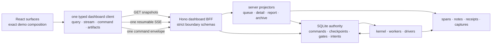

# 13 — Production frontend/backend integration contract

Status: **integration design ratified through Round 11; Phase 1b wire primitives implemented
2026-07-31; Phase 1c is next.**

This document is the production-wiring companion for the rebuild demo. It answers one question:
**how do we make the rebuilt product render the approved frontend exactly, while ensuring every
visible state and action is backed by durable, honest backend behavior?**

This is **not a second build order**. Doc 07 remains the only sequencer. The slices here map onto
`1g-spine`, `1i-spine`, and the Phase-2 tails in that plan. Contract ownership remains with docs
02/03/06/09/11/12; this document owns the composition boundary between those contracts and the
production React application. If a wire shape below needs to change, its owning document must be
amended before implementation.

Visual authority (all demo paths below are in the **legacy repo**, where the demo stays):

- `src/dashboard/components/dev/rebuild-demo/DESIGN.md` — design language and interaction rules;
- `src/dashboard/components/dev/rebuild-demo/ds/` — tokens and primitive behavior;
- `src/dashboard/components/dev/rebuild-demo/` — the rendered product target;
- `docs/rebuild/03-tracker-dashboard.md` §9 — ratified presentation decisions;
- `docs/rebuild/reviews/backend-capabilities-from-the-demo-2026-07-28.md` — backend discoveries
  made while building the target.

The demo is a **visual specification and contract fixture**, not production infrastructure. The
production app must not import the legacy repo's `src/dashboard/components/dev/rebuild-demo/**` —
since D93 that is structurally impossible across the repo boundary, not merely banned. Approved
surfaces and primitives are ported into the rebuild repo's `src/dashboard/`; mock wire factories
stay test-only and are preserved with the legacy/design-oracle tree through initial cutover. Ported
production code owns its own copies and provenance (legacy-repo commit hash + source path); no
runtime import or proxy is permitted.

---

## Phase 1b as-built integration subset (2026-07-31)

The rebuild now owns strict wire primitives for frontend bootstrap, day/queue projection, run
detail sections, artifact/capture resources, and topic snapshot/patch/subscription envelopes.
Versions, revisions, projection cursors, explicit capability availability/absence, closed status/
panel/topic unions, and nested unknown-key rejection are schema-pinned with fixtures. These are
transport-neutral domain contracts: 1b does not claim a BFF, SSE server, command routes, React
client, or rendered surface. Command type shells are next in 1c; the serving/wiring and exact shell
remain in `1g-spine` and `1i-spine`.

---

## 0. Outcome and non-negotiable decisions

The optimal foundation is a **typed dashboard backend-for-frontend (BFF) inside the rebuild repo's
own Hono process**, backed by rebuilt authoritative SQLite state and server-side
projections (doc 03). It is not a separate rebuild service and never shares the legacy Hono
process, routes, middleware, state, port, lock, or browser sessions.



The following are settled:

1. **The frontend renders finished read models.** It does not classify raw tracker rows, infer
   statuses, reconstruct timelines, merge logs, calculate authoritative counts, or decide which
   commands are safe.
2. **One strict client owns all transport.** Components do not call `fetch` or construct
   `EventSource` directly. Query, subscription, command, upload, error normalization, schema
   parsing, reconnect, and cancellation live behind one client boundary.
3. **REST snapshots + one resumable SSE stream + one command route.** This fits the local,
   single-operator product and the current append/project architecture better than GraphQL,
   WebSockets, or a client database. Large immutable bytes use dedicated artifact routes.
4. **Server facts, client composition.** The server owns facts, state, availability, policy,
   counts, capabilities, and actions. React owns exact layout, focus, responsive behavior,
   animation, local drafts, and the fixed visual mapping from closed wire enums to the approved
   design system.
5. **No optimistic authority.** After a command, the UI may show “request submitted,” but it does
   not locally turn Running into Done, remove a row, resolve a gate, or invent a receipt. The next
   server projection or an authoritative replacement returned with the command result does that.
6. **Build end-to-end slices.** A surface is not complete when its JSX exists. It is complete when
   its schema, projector/query, stream invalidation, command path, degraded/error state, fixture,
   and Playwright visual proof all exist.
7. **The demo remains the visual oracle until parity is complete.** We port its visual language;
   we do not redesign while wiring production data.
8. **The product does not explain itself.** General teaching copy lives in an accessible ⓘ
   popover; only a refusal, a genuine hazard, or a fact about the selected run may consume standing
   surface space (doc 03 D24).
9. **Two repos, one cutover (D88/D89/D93).** The legacy repo's dashboard remains the production UI
   throughout construction, while the rebuild is built in the standalone `hr-automation-rebuild`
   repo. The two share no module graph, build, or process, so neither side *can* proxy, import,
   invoke, or read the other's live state. What still needs deliberate separation — both run on one
   machine — is distinct commands, ports, state/artifact roots, locks, and browser
   profiles/sessions. No workflow or surface flips individually. After the complete integration
   matrix passes, the normal launcher is repointed at the rebuild repo once; the legacy repo is
   preserved wholesale as the rollback asset.

---

## 1. What the audit found

### 1.1 The production target is a complete product, not four panels

The current demo contains all of these production surfaces:

| Product area | Approved surface/state coverage |
|---|---|
| Shell | Graphite Warm/Paper Ink themes, history, Dashboard/Archive/Explorer/Activity switcher, search, day navigation, notifications, doctor, Settings, responsive Workflow Panel, Session Panel |
| Queue | one workflow at a time, eight statuses, Needs-you composite, three row types, server action placement, bulk selection, group/member/rejected/linked containment, run facts, row explanations |
| Detail | panel-kind tabs (`Logs · Receipt`, `Review · Logs · Receipt`, or `People · Logs · Receipt`), persistent equal-width timeline, Context rail, gates, outcomes, write-parked resolution, attempts and lineage |
| Review | progressive OCR records, page evidence, field provenance/confidence, operator corrections, candidate identity captures, approve/reject gates, retry/research/relookup actions |
| Evidence | receipts for every terminal outcome, staged/verified/unconfirmed writes, failure `writeState`, remediation, diagnostic bundles, capture kinds and dimensions, rerun diffs |
| Start | descriptor-driven typed/bare/upload/capture/spreadsheet methods, presets/options, dry-run truth, per-system prod/test hosts, capability absence reasons, preflight and enqueue refusals |
| Intake | upload, header-row choice, explicit column mapping, suggestions-only matching, validation, row correction/exclusion, immutable manifest, fan-out preview, same-data rerun diff |
| Workers | one-item worker cards, browser health/recovery, lease waits, spawn-count planning, per-worker spawn results, stop/recovery commands |
| Settings | sparse overrides with provenance, atomic multi-leaf save, environment facts, system URLs, performance budgets, preflight/doctor, storage health and recovery |
| Archive/versioning | searchable self-contained historical runs, old receipts/captures/timelines, integrity state, major/minor version planning, archive blockers and relaunch |
| Explorer | exact descriptor DAG, systems/tasks/gates/delegation, optional dry-run boundary, live-run overlay, checkpoints/failures/evidence and source links |
| Activity | day/range aggregates, workflow/category/status/outcome totals, durations and failure breakdowns |

The row/panel catalog and design-system kit behind the flask control are development scaffolding.
They become fixture routes or Storybook-like test pages, not product navigation.

### 1.2 The existing frontend shows why the rebuild needs a BFF boundary

The existing legacy dashboard currently has **271 frontend files, 30 hook modules, 59 direct `fetch(` call
sites, and 21 Hono route modules**. Those numbers are not defects by themselves; the coupling is:

- components and hooks know route paths and response quirks;
- multiple polling and SSE resources describe overlapping run state;
- the browser receives tracker-shaped data and owns merge/dedup/classification work;
- startability is split across workflow metadata, `INPUT_RUN_REGISTRY`, `RUN_MODAL_REGISTRY`, and
  workflow-specific routes;
- counts, selected-run snapshots, live entries, logs, screenshots, and failures can arrive from
  different freshness points;
- some backend reads still fall back from SQLite to JSONL, and `/api/entry-data` chooses a
  “richest” row instead of exposing one authoritative detail projection;
- the current SSE hub transports permissive payloads and relies on client JSON parsing/ignoring;
- several product mutations still have one-off route families instead of one audited command
  protocol.

The rebuild must not reproduce this as cleaner folder names. The replacement boundary is one
server-authored product model and one client that parses it.

### 1.3 Existing rebuild contracts are strong but not yet sufficient for the current target

Docs 02/03/06/09/11/12 already settle the hard backend foundation: descriptors, spans/notes,
authority vs projection storage, checkpoint edits, intake manifests, write fences, evidence,
archive-on-version-bump, explorer, notifications, and config provenance. The current target adds
or clarifies these integration requirements:

- a bootstrap document rather than several startup registries and requests;
- a resumable, sequenced subscription protocol rather than change-gated payloads without cursor
  semantics;
- panel-kind and available-section projection matching the approved tab/Context/Receipt layout;
- strict start planning and enqueue contracts for every descriptor method;
- command families for settings, workers, version changes, and intake—not route-local mutations;
- progressive per-record Review patches;
- month day-counts and Activity aggregates produced by the same projection family as queue counts;
- exact archive snapshots that never need old runtime code;
- per-candidate and per-capture evidence metadata;
- contextual command results keyed to the affected run/member/record, especially in bulk flows.

These are amendments for the owning documents, not reasons to introduce frontend workarounds.

---

## 2. Production module boundaries

The rebuild repo's production tree should make the desired dependency direction obvious:

```text
src/
├── domain/
│   └── dashboard/
│       ├── bootstrap.ts          # strict wire schemas; zero React/Node imports
│       ├── projection.ts         # dashboard/day/queue/session/status schemas
│       ├── run-detail.ts         # panel kind + section schemas
│       ├── commands.ts           # envelope/result/target-family schemas
│       ├── subscription.ts       # hello/snapshot/patch/reset/cursor schemas
│       └── artifacts.ts          # refs/manifests, never local paths
├── server/
│   └── dashboard/
│       ├── routes/               # thin parse/auth/dispatch boundary
│       ├── queries/              # bootstrap, day, run detail, archive, explorer, report
│       ├── projectors/           # authority/events -> finished read models
│       ├── commands/             # target-family handlers over authority services
│       └── subscriptions/        # cursor/outbox -> SSE envelopes
└── dashboard/
    ├── app/                      # routes, providers, error/degraded boundaries
    ├── client/                   # the only fetch/EventSource/upload implementation
    ├── state/                    # normalized server cache + client-only UI state
    ├── ds/                       # production port of approved tokens/primitives
    ├── surfaces/                 # shell, queue, detail, start, intake, etc.
    └── fixtures/                 # schema-valid test data; never product imports
```

Rules:

- `domain/dashboard/**` exports strict zod schemas and inferred types. There is no handwritten
  duplicate frontend interface.
- Route handlers parse input, call a query/command service, parse output, and return it. They do
  not contain workflow switches or projection logic.
- Projectors never import React. React never imports workflow modules, stores, SQLite, tracker
  readers, or server registries.
- `dashboard/client/**` is the only frontend folder allowed to use `fetch`, `EventSource`, or
  upload streams. An architecture guard enforces this.
- Product surfaces may import only strict wire types, the client facade, design-system primitives,
  and pure presentation helpers.
- The BFF remains in-process. Splitting it into a network service adds failure modes and gives this
  local-first tool no benefit.

---

## 3. Canonical transport contracts

The names below are integration roles. Docs 02/03/06/09/11/12 own the final strict shapes.

### 3.1 `FrontendBootstrapWire`

Fetched once at app boot and refetched when the subscription declares descriptor/config skew.

```ts
interface FrontendBootstrapWire {
  wireVersion: 1;
  appVersion: string;
  descriptorHash: Fingerprint;
  settingsSchemaHash: Fingerprint;
  projectionGeneration: number;
  actor: { id: ActorId; label: string };
  serverClock: { now: IsoInstant; zone: "America/Los_Angeles" };
  storage: StorageHealthSummaryWire;
  workflows: WorkflowClientProjection[];
  systemInstances: SystemInstanceProjection[];
  settingsSections: SettingsSectionProjection[];
  featureAvailability: FeatureAvailabilityWire[];
  preflight?: PreflightCheckWire[];
}
```

`preflight` is the doctor's standing summary — one entry per check, each carrying its verdict, its
detail, the named things its failure **blocks**, an optional remediation, and the instant it was
checked. The Top Bar owns it (§5): the stethoscope carries the worst verdict of the set, its popover
lists the checks, and "Run doctor again" is the paired command. It is **optional and unserved
today** — `buildBootstrap` composes no preflight service — and its absence is declared as
`FrontendBootstrapWireSchema#preflight` in `config/pending-wire-bindings.json`. The surface renders
the whole popover only when the field is present: a doctor indicator over checks nobody ran would
report a pass the server never made. The verdict itself is DERIVED on the client from the checks
(`fail` beats `warning` beats `pass`) and is never a second served field, so the glyph and the list
cannot disagree.

The workflow projection includes label/icon/category/code/version, panel kind, graph summary,
systems, start methods/options/presets, dry-run support or explicit absence reason, input subject,
status/verdict vocabulary, detail capabilities, action policy summary, and source availability.
The client derives navigation from this list; no parallel workflow registry survives.

**Category GROUPING is served raw and displayed by the client (R2 D17/D18).** The projection carries
each workflow's own `category` id and nothing else about grouping — there is no `workflowCategories`
projection, because the one this wire used to carry invented both of its fields (`label` was
`id.replace(/-/g, " ")`, `order` was the registry's first-seen index), so the Workflow Panel's
headings read `separation` in whatever order a module happened to import. Doc 03 §Shell is the
owner and it is explicit: *the frontend hardcodes only the display order, membership is the
descriptor's, an unlisted category appends, and an empty category drops.* The heading text and the
order therefore live in `src/dashboard/surfaces/workflow-category.ts`, typed
`Record<WorkflowCategory, …>` so a new category in the descriptor vocabulary fails `tsc` rather than
rendering a hole, and BOTH the Workflow Panel's rail and the Run Modal's picker call its one
`groupWorkflowsByCategory` — two surfaces that once held hand-copied copies of the same rule.

### 3.2 `DashboardDayWire`

One query provides the selected day’s coherent shell and queue state:

```ts
interface DashboardDayWire {
  day: LocalDate;
  descriptorHash: Fingerprint;
  projectionGeneration: number;
  snapshotCursor: ProjectionCursor;
  monthCounts: readonly DayCountWire[];
  workflowCounts: readonly WorkflowCountWire[];
  statusCounts: readonly StatusCountWire[];
  queueSurfaces: readonly QueueSurfaceWire[];
  workerCards: readonly WorkerCardWire[];
  notifications: readonly NotificationWire[];
}
```

`QueueSurfaceWire` remains flat. Group/member relationships use ids and `parentRunId`; the client
may join those ids for layout but may not reinterpret containment or status. Counts and rows are
folded from the same projection transaction/generation. The calendar, Workflow Panel, Status Bar,
queue header, and Activity query can therefore never disagree because of different source paths.

**`WorkflowCountWire` carries its own status dimension** — `{ workflowId, count, statusCounts[] }`,
the per-status counts summing to `count` by refinement (R2 D5–D12, R4-1). One `count` per workflow
could not answer the two questions the shell asks of it: the Workflow Panel's `active │ all` column
needs queued + running for THAT workflow, and the Status Bar's pills are scoped to the workflow the
queue below them is showing — so a day-wide fold put `Failed 3` above a queue with no failures. Both
are the same fact at two scopes and both come off this one array, filled in the projector's single
countable loop beside the day-wide totals it must agree with (D81). A client-side fold over
`queueSurfaces` is the second count path that rule exists to delete, and remains forbidden.

**A queue row states its ORDINAL, its CLASS and what it MADE** (D230/D231, 2026-08-19).
`QueueBaseFields` carries `runNumber` — durable on `RunRecord`, assigned per workflow at enqueue,
served with a D133 read-forward absent arm and never derived from a row's position in the day's
array; `priority` — read from the run envelope, which is what D95's `bump` rewrites, and a
deliberate enum mirror of `RunPrioritySchema` kept identical by §8.8's mirror joint because
`src/domain/run/envelope.ts` is outside the bundle's reach (§8.13); `containment`
(`root | member | linked`, projected from shape and lineage, with a refinement refusing every
disagreement with `lineage`/`surfaceKind` and no `rejected` arm until a producer writes such a row);
`linkedRuns[]` — each delegated child's id, workflow, label, panel kind and LIVE status, because a
client re-deriving the target's status from `queueSurfaces` is D81's forbidden second path and goes
blank the moment the target sits on another day; `facts[]` — the run's already-derived evidence
receipt's `output`, chipped only where the redacted value is `allowed` and primitive; and
`pipeline[].durationSec`/`executions`, summed over every execution of the node. An operation row
additionally carries `memberPreview`, composed from its members' own served titles. Every one of
these carries its absence as a reasoned arm rather than a zero, an empty band, or a plausible
number.

**A worker card IS the authority lease, joined with what its spans hold open** (D248, 2026-08-20).
`WorkerCardWireSchema` carries `workflowId`, `state`, `directive`, `startedAt`, `endedAt` +
`stopReason`, `browsers[]`, `leaseVersion` and `revision`. The card SET is authority's: every live
lease is a card, a settled lease is a card while the retained span stream still names its worker,
and a worker the spans name but authority does not is NOT a card — authority is what says a worker
exists. Until D248 the projector derived a worker's phase from whichever rows happened to be
claimed, which is exactly the inference doc 05 §3 says the lease exists to make unnecessary, and it
cost three of the six state arms the Session Panel drew: a daemon that had started and not yet
reported read as `idle`, and a worker whose PROCESS DIED was drawn identically to one the operator
had asked to stop.

Four rules travel with it. **`state` and `directive` are separate fields**, because
`src/domain/run/worker.ts` separates them: a command writes what was ASKED and the worker writes
what is TRUE, so folding a pending `pause` into the state word would let a card read `Paused` while
its worker is mid-transaction on a live HR system. **Every arm of both has a producer** — the
lifecycle's own `paused` and `stopping` states are NOT mirrored, because nothing reports them (the
worker's heartbeat writes `idle`/`busy` and its exit writes `stopped`), and the demo's `waiting`
arm is gone because this platform gives every worker its own browser session per system (doc 05 §1),
so there is no cross-worker lease to wait on and no holder to name. **`stopped` and `failed` split
the terminal lifecycle by its RECORDED reason** (`operator`/`shutdown` versus `crashed`/
`lease-expired`, the latter written by the recovery sweep), pinned by a refinement — that split is
the whole content of `failed`. And **`leaseVersion` is the lease's row version, never `revision`**,
which counts folded span events and is a patch cursor: binding the Stop control to it would have
fabricated the exact fact a version check exists to check.

`browsers[]` is the sessions a worker HOLDS — started, not yet closed, keyed by the session id its
span path carries — and a settled card holds none, because its process is gone and its Chromium
children went with it. It carries no `health` and no `url`: nothing in this build probes a live
session, so the only verdict available is "never probed" and a six-arm health enum would be five
unreachable arms; and no span, checkpoint or lease records a page address, so a URL would have to be
composed rather than observed. The tile therefore states which system a session speaks to and how
long it has been open, which is what the wire actually knows.

The approved queue contract must include:

- immutable identity, attempt/lineage, actor, descriptor/app/config versions and resolved instance;
- server-resolved title/subtitle/status/live message/run facts;
- final pipeline and open gates;
- member ids/rollups/containment and streamed-record rollups;
- server-authored action descriptors with placement and version/audit tokens; CAS is enforced only
  for the four real-race command families owned by doc 03;
- `panelKind` plus closed available-section keys;
- evidence/failure/receipt confidence pointers;
- a monotonic `rowRevision` used by commands and patches.

### 3.3 `RunDetailWire` and lazy sections

Opening a row fetches one small header plus only the selected panel section. A terminal 50-person
packet must not ship every note, capture, and facsimile in the day payload.

```ts
interface RunDetailWire {
  runId: RunId;
  rowRevision: number;
  panelKind: "run" | "member" | "review" | "group";
  header: RunIdentityWire;
  timeline: TimelineWire;
  gate?: GateDecisionWire;
  outcome?: OutcomeWire;
  context: ContextSummaryWire;
  availableSections: readonly RunDetailSection[];
}

type RunDetailSection =
  | "logs" | "receipt" | "review" | "people"
  | "context-data" | "context-evidence" | "context-attempts"
  | "failure" | "captures";
```

The fixed frontend mapping is:

| `panelKind` | Tabs | Always-visible adjacent content |
|---|---|---|
| `run` / `member` | Logs · Receipt | timeline, gate/outcome/failure, Context rail |
| `review` | Review · Logs · Receipt | timeline, gate/outcome/failure, Context rail |
| `group` | People · Logs · Receipt | timeline, gate/outcome/failure, Context rail |

Data lives in the Context rail. Captures live in Receipt and Review where relevant. A backend
capability may make a section empty/absent; it may not silently change the approved composition.

Logs/notes use cursor pagination and a per-run subscription. Review records use stable record ids
and record revisions so one page result can stream without replacing the whole run. People use
stable member ids and pagination/virtualization metadata for large groups. Receipt, failure, and
archive evidence are immutable once finalized.

### 3.4 One command protocol

All JSON mutations enter one route and one durable command journal:

```ts
interface DashboardCommandEnvelope<TTarget, TPayload> {
  wireVersion: 1;
  commandId: CommandId;
  type: DashboardCommandType;
  requestedAt: IsoInstant;
  requestedBy: ActorId;
  sourceSurface: SourceSurfaceId;
  target: TTarget;
  payload: TPayload;
}

type DashboardCommandResult =
  | { state: "applied" | "already-applied"; commandId: CommandId;
      projectionCursor?: ProjectionCursor; replacements?: readonly ProjectionReplacementWire[] }
  | { state: "conflict"; commandId: CommandId; message: string;
      currentRevision: number; replacement?: ProjectionReplacementWire }
  | { state: "rejected"; commandId: CommandId; code: CommandRejectionCode;
      message: string; fieldIssues?: readonly FieldIssueWire[] };
```

`requestedBy` is not a client-chosen identity. The client echoes the actor from bootstrap and the
server requires it to match the request’s identity checkpoint, then stamps the authoritative actor
and acceptance time on the durable command record. A mismatch rejects; request-body identity is
never trusted.

Target-family arms are closed and strict:

- run, gate, notification, capture, and checkpoint/write-resolution arms from doc 03;
- **start** — consumes a server-issued start-plan token and immutable input/artifact refs;
- **intake** — mapping confirmation, row correction/exclusion, validate, and manifest enqueue;
- **worker/browser** — plan/spawn count, stop, refresh, reopen, pause/resume recovery;
- **settings** — atomic N-leaf update against a settings revision;
- **version/archive** — validate/apply major or minor bump against a version-plan revision.

This requires doc 03’s command union to adopt the additional target families before `1c`. Dedicated
legacy mutation endpoints are not recreated. Multipart bytes are the sole exception to the JSON
command route: the upload endpoint validates and stores immutable bytes, then the command references
the returned `ArtifactRef`.

Bulk commands return one complete per-target vector. A partial result can never collapse to one
success toast. Server action descriptors are the only source for command availability, labels,
placement, confirmation copy, required forms, and revision tokens.

**A command whose target is not a run is composed beside the composer, not inside it** (D249,
2026-08-20). `composeCommandRequest` is exhaustive over the SERVED row-action vocabulary and every
one of its arms targets a `runId`; the Session Panel's `Stop` targets a worker lease, so widening
the shared `ActionTarget` to hold either would make every run arm accept a target it can never use.
`composeStopWorkerCommand` therefore stands beside it, composes the whole envelope from facts the
card already carries, and has no refusal arm — the two states where stopping is meaningless (a
settled lease, a worker already asked to stop) disable the control AT the card rather than being
discovered after a click. Its `expectedVersion` is the served `leaseVersion`; the kernel revalidates
the lease inside its own transaction and CASes on what it reads there, so the field states the
operator's BASIS rather than claiming to be the check — the shape doc 05 §"A capture command's
`expectedVersion` is not a CAS" already ratified.

**A served descriptor may also declare how much CEREMONY its command costs, and a surface obeys it
or refuses (D226, 2026-08-19).** The identity gate is the case that forced the rule: doc 09 §14.6
risk 1 makes `approvalShape` a SERVER computation precisely so a frontend cannot quietly turn a
risky approval into one click, and the `identity-gate` section serves it beside the packet and both
typed resolutions. Three obligations follow for any surface that renders such a control, and they
generalise to every future server-declared ceremony:

1. **Render the shape the server named, and only that one.** The control for a shape that asks the
   operator to CHOOSE carries no pre-selected option — a pre-selected radio is a one-click approve
   wearing a radio's clothes, which is the downgrade the server-side computation exists to prevent.
2. **A shape this build does not know draws a NAMED REFUSAL and blocks the send.** It may not fall
   back to the cheapest control it does know. A wire value can outrun a bundle — a server upgraded
   ahead of an open tab — and answering under a ceremony nobody implemented is worse than having no
   guard, because the server is still reporting that it asked a question.
3. **The operator supplies only what no served fact carries.** Every other leaf of the payload is
   read off the section — the schema hash, the evidence digest, and the label the server paired with
   each option. A client that derived any of them would be a second implementation of the
   descriptor's identity, and a client that INVENTED one would put a value nobody authored onto a
   durable record. Composition stays in the one composer; the surface hands it the human's answer.

The `RunDetailSectionResponse` arm this is stated over is `identity-gate`; doc 09 §14.11 owns the
gate's own ceremony table.

### 3.5 Resumable subscription protocol

One EventSource carries closed envelopes:

```ts
type DashboardStreamEnvelope =
  | { type: "hello"; wireVersion: 1; descriptorHash: Fingerprint;
      projectionGeneration: number; cursor: ProjectionCursor }
  | { type: "snapshot"; topic: TopicKey; cursor: ProjectionCursor;
      payload: DashboardTopicSnapshot }
  | { type: "patch"; topic: TopicKey; cursor: ProjectionCursor;
      payload: DashboardTopicPatch }
  | { type: "reset-required"; reason: "cursor-expired" | "generation-changed" |
      "descriptor-changed"; cursor: ProjectionCursor }
  | { type: "health"; state: "live" | "reconnecting" | "degraded" };
```

Rules:

- every envelope parses before entering client state; malformed payload is a visible protocol
  failure, never `console.warn` + ignore;
- cursors are monotonic and delivered as SSE ids; reconnect sends `Last-Event-ID`;
- duplicate cursors are idempotent, gaps force a snapshot, and an expired cursor gets
  `reset-required`;
- a descriptor hash or projection-generation change invalidates affected cached projections;
- queue patches replace one complete surface by `(runId,rowRevision)`; Review patches replace one
  complete record by `(recordId,recordRevision)`; note pages append by stable note id;
- stream payloads signal authoritative changes. They do not carry local UI state or draft edits;
- the server bounds subscriber buffers and tells the client to reset rather than silently dropping
  state-bearing messages.

### 3.6 Query and artifact surface

Concrete route layout (fresh rebuild API; no legacy compatibility layer):

```text
GET  /api/v1/bootstrap
GET  /api/v1/dashboard?day=YYYY-MM-DD
GET  /api/v1/calendar?month=YYYY-MM
GET  /api/v1/runs/:runId
GET  /api/v1/runs/:runId/{logs,receipt,review,people,failure,captures}
GET  /api/v1/archive
GET  /api/v1/archive/:runId
GET  /api/v1/workflows/:workflowId/explorer?runId=
GET  /api/v1/reports/activity?from=&to=
GET  /api/v1/settings
GET  /api/v1/storage/health
GET  /api/v1/search?q=
POST /api/v1/start-plans
POST /api/v1/intake-plans
POST /api/v1/uploads
POST /api/v1/commands
GET  /events/v1?topics=...&cursor=...
GET  /artifacts/v1/:artifactId
```

Route count is not the goal; coherent resources are. The exact split may be adjusted for lazy
loading, but there must be only one route per fact/command family and no workflow-specific API path
when a descriptor/schema can express the behavior.

Artifacts are fetched through opaque ids with media type, byte length, digest, dimensions/page
metadata, redaction/sensitivity policy, and explicit missing/purged state. The frontend never
receives a local filesystem path and never guesses capture aspect ratio.

---

## 4. State ownership

| State | Owner | Frontend rule |
|---|---|---|
| run/worker/capture/intake/settings/archive state | SQLite authority | never mutated locally |
| queue rows, status, counts, pipeline, gates, rollups | server projection | render verbatim; format only |
| actions and capability absence reasons | server policy projection | no status/workflow switches that re-enable actions |
| workflow metadata/start methods/system instances | descriptor/config projection | no parallel registries |
| receipts/failures/captures/provenance | evidence services | fetch by stable id; never synthesize missing proof |
| reports/month counts/search results | server query over projection family | do not scan browser caches to recreate them |
| selected page/workflow/row/tab, panel sizes, open dialogs | client URL/UI state | safe to update immediately |
| theme and Workflow Panel display mode | client preference | persist locally unless later promoted to actor settings |
| form/mapping/review edits before submit | client draft | retain across section switches; submit atomically with base revision |
| notification read/snooze | authority, actor-keyed | command-driven even though it feels presentational |
| elapsed time between server timestamps | client Clock calibrated from bootstrap | display-only; terminal durations remain server facts |

Pure presentation helpers may map a closed enum to an icon, token, tab order, or explanatory copy.
They may not decide whether a run is safe, complete, startable, reviewable, or actionable.

---

## 5. Surface-to-backend wiring matrix

This matrix is the completeness checklist. A production surface is not ready until every cell in
its row has an implementation and a test.

| Surface | Initial query/read model | Live patch/invalidation | Commands | Backend authority/owner |
|---|---|---|---|---|
| Top Bar + app shell | bootstrap, search, calendar month counts, notification summary, storage/preflight summary | descriptor/config/storage/notification patches | notification lifecycle; doctor rerun | descriptor registry, projection queries, notification/config/storage services |
| Workflow Panel + Status Bar | `DashboardDayWire` counts from the queue projection | changed count tuples in the same dashboard cursor | none; filters/navigation are local | doc 03 one run/queue projection |
| Queue Panel + rows | flat `QueueSurfaceWire[]` for selected day/workflow | complete row replacements and removals/tombstones | served row/bulk action descriptors | authority command state + span projection |
| Log Panel + Context rail | `RunDetailWire`, paged notes, context/evidence/attempt summaries | run/timeline/gate/outcome/note patches | gate, retry/cancel/hide/bump, checkpoint and write resolution | spans/notes, checkpoints, commands, write intents, evidence |
| Group People | paged members + rollup + containment | per-member replacement and rollup patch | contextual member and bulk commands | delegation manifests + run projection |
| OCR Review | record/page/capture projections with provenance and revision | progressive record replacements and OCR child state | approve/reject, retry page, re-research, relookup; one atomic correction list | OCR checkpoints/gates, evidence, commands |
| Receipt/Failure/Captures | immutable receipt/failure/capture refs | pending receipt becomes finalized; capture availability/purge state | remediation actions only when served | doc 12 evidence/failure store + doc 09 ledger/proof |
| Start Run | descriptor start capability + server start plan + preflight | descriptor/config/preflight invalidation | start command referencing plan token/artifact ids | descriptor parser, config resolver, enqueue authority |
| Spreadsheet Intake | artifact inspection, detected headers/samples, saved exact-fingerprint mapping, validation/manifest draft | parse/validation/finalize progress | confirm mapping, correct/exclude, validate, enqueue manifest | doc 06 artifact/mapping/intake authority |
| Mobile Capture | capture session + ordered immutable photo refs | session/photo/finalize/handoff patches | upload/replace/reorder/delete/finalize/retry/discard | doc 06 capture authority + artifact/finalize outbox |
| Session Panel | worker cards, browser health, current run, queue/wait reasons | worker/browser/run patches | plan/spawn/stop/refresh/reopen/pause/resume | worker/session authority and browser health services |
| Settings + doctor/storage | schema-driven sections, effective/default/override provenance, revision, health/backups | config/storage/preflight patches | atomic settings update; recovery actions when explicitly served | doc 11 config/preflight + doc 03 authority recovery |
| Archive + version bump | paged archive index, self-contained archived detail, integrity, version plan | version/archive job progress | plan/apply bump, relaunch as new run | doc 03 archive snapshots + descriptor/version service |
| Explorer | descriptor graph projection; optional run overlay | selected run overlay patches | navigation only in Phase A; safe edit commands later | docs 02/12 exact descriptor + spans/checkpoints |
| Activity | server aggregate by range/category/workflow/status/outcome, plus the write-ledger block (D236) | explicit refresh or range invalidation; no per-row stream required | CSV export, SERVED (D240) — `GET /api/v1/reports/activity.csv`, caveats inside the artifact | aggregation query over the same run projection/receipts, beside the one ledger read-through |

### 5.1 Critical user flows

**Open and follow a run**

1. Bootstrap validates hashes and renders shell vocabulary.
2. Day snapshot paints counts, rows, worker cards, and notification summary from one cursor.
3. Selecting a row fetches the detail header and default panel section.
4. The client subscribes to that run’s detail topics only while relevant.
5. Row/timeline/record patches replace strict units by revision; local selection and scroll survive.
6. A disconnect displays Reconnecting. Cursor resume either catches up or requests a new snapshot.

**Start a run**

1. The descriptor projection determines which start doors exist; absence includes the reason.
2. Upload bytes, when present, become immutable artifact refs before planning.
3. `start-plans` parses input, resolves prod/test hosts, evaluates dry-run support, preflight,
   identity/item id/enqueue policy, and returns the exact proposed run(s), warnings, refusals, and a
   short-lived plan token bound to all fingerprints.
4. The operator confirms. `start` command consumes that token idempotently.
5. The command atomically creates authority records, then returns applied/conflict/rejected.
6. The queue changes only from the authoritative projection replacement/patch.

**Resolve a Review gate**

1. Review records stream independently with provenance, confidence, page/candidate capture ids,
   and record revisions.
2. Field changes remain a draft and record the machine value they supersede.
3. Approval sends one gate command containing the full correction set and expected gate/review
   revision—not one request per field/member.
4. The backend reparses corrections, stores evidence and gate result atomically, and enqueues any
   descriptor-declared children/manifests in that same authority transaction.
5. Conflict returns the fresh record/gate projection; the client keeps the draft for comparison.

**Resolve an unknown write**

1. Durable intent state projects `Write parked`, its mandatory `writeState`, proof requirements,
   and only the two safe resolution actions.
2. The operator submits proof/presence or confirmed absence against intent generation + row
   revision.
3. The write-safety service validates evidence and either records proof, creates the permitted new
   generation, or rejects/keeps the run parked.
4. Generic retry is never reintroduced by the frontend.

**Intake and fan-out**

1. Upload returns an artifact ref; inspect returns columns and bounded samples.
2. Exact fingerprint reuse is visible; suggestions remain unbound until accepted.
3. Validate creates a revisioned plan with every row exactly valid/rejected/excluded.
4. Corrections/exclusions update that plan through commands; no source artifact is rewritten.
5. Final command atomically stores the immutable manifest, coordinator, members, and dependencies.
6. Group/member queue patches then follow the ordinary projection path.

#### D250 — the typed box DESCRIBES itself, and its examples are proved typeable (2026-08-20)

The demo's typed-input block carries three things this tree served none of (R8 finding 17): an
`Examples` row of buttons that fill the box, a value-noun on the Field's label, and a `parserLabel`
sentence under it. They close in **two different ways, and the split is the decision.**

**Derived, never authored: the value-noun, the separator phrase and the parser sentence.** The demo
authors `parserLabel` per method ("Kuali document IDs, comma-separated — 3 to 6 digits each") because
its parser is fixture code in the same file. Here the parser is a **closed spec** —
`InputParserSpec.split` plus an ordered `rules[]` over the closed `EntryPatternName` enum — so every
word that sentence needs is already declared. `src/domain/workflow/ingress.ts` exports
`inputRunValueNoun`, `inputRunSeparatorLabel` and `inputRunParserLabel` over a legend
(`ENTRY_PATTERN_NOUNS`) declared **beside `ENTRY_PATTERNS`**, so a pattern whose regex moves has its
words in the same diff and a guard pins the two key sets equal. An authored per-workflow string could
say a box takes document ids while its only rule matches EIDs; a lookup over the rule's own enum
cannot. Two arms are load-bearing rather than cosmetic: a spec whose only rule is `otherwise` reads
**"entries"** (the absence of a pattern claim, stated — not a guessed noun), and a spec with **no**
`otherwise` rule says so, because `parseInputRunText` then throws on the WHOLE text and an operator
never told that reads a correct refusal as a defect.

**Declared, and PROVED: `examples[]`.** `InputRunSurfaceSchema` grows optional
`examples: [{ key, label, text, note }]`. It carries the **exact text** the box receives, never the
demo's `values[]` that the surface re-joins with a separator character: reconstructing the delimiter
client-side re-implements `splitEntries` outside the boundary that owns it, and a client that split
differently would fill the box with something the server never receives — R8 finding 17's own
argument, from the writing side. `defineWorkflowDescriptor` refuses an example that does not
**parse under this surface's own parser** AND whose every entry does not **satisfy the workflow's own
input schema** — the two checks `services/start/plan.ts` performs on each submission, run at build
time. An example failing either is a button that fills the box with a guaranteed refusal, which
teaches the operator the modal lies about what it accepts. Absent examples render **no row**; nothing
fabricates a sample identifier.

No wire grows: the run modal composes `surfaces.inputRun` from the client-bundled descriptor
(R8 finding 12's precedent), so the declaration reaches the surface by the path the placeholder and
the parser already take. Any descriptor-closure edit re-runs `npm run build:manifest`.

#### D251 — the run modal's three remaining facts are SERVED ALREADY, and the fourth is refused (2026-08-20)

The audit's ledger booked three more run-modal rows as wire gaps — `capability.note` + method tabs,
the active-run policy control, and per-workflow unstartable reasons. **None of the three needs a wire
addition, and one of them needed no server work at all**; recording that is the point, because a row
left saying "to declare" reads as backend work nobody has scheduled.

- **`capability.note` is `descriptor.summary` (D229).** It is plain data on `AnyWorkflowDescriptor`,
  which the modal already holds, so the workflow-setup block draws the descriptor's own sentence.
  Absent summary → no paragraph.
- **The active-run policy is a DECLARATION, not a control.** `descriptor.enqueue` is what
  `planStart` reads, and there is no per-start override on `StartPlanIngress` — so the demo's
  `Select` would let an operator choose `allow-parallel` and get `reject-active`, which is an operator
  choice the server would not honour. Group 01 draws the declared value **read-only**, in the demo's
  slot, with the reason. The label table is exhaustive over `EnqueuePolicy` and states **what the
  planner does**, not what the arm's name suggests: `reject-active` refuses (`plan.ts`'s active-run
  check), `allow-parallel` runs no check, and **`supersede-active` supersedes nothing — no planner
  path implements it and no registered descriptor declares it.** A label claiming otherwise would be
  the same lie one level down. Whether that arm earns an implementation or leaves the enum is the
  owning decision of the first workflow that wants it.
- **The unstartable reason was already composed and thrown away.** The picker's disclosure carried a
  comment claiming "this tree serves none", and `dashboard-app.tsx` had been composing the reason
  since R8 finding 12's own commit. It draws the demo's `<dl>` now. The reason set is the MODAL's,
  and it says so: a workflow with no declared `surfaces.inputRun` has no box to type into, and that
  is not a server refusal — `POST /start-plans` takes JSON submissions and parses them with
  `descriptor.input`, so a caller that composes its own submission can start such a workflow. The
  modal must never spell a refusal the server would not make. `availability` is deliberately NOT a
  second arm: `buildBootstrap` serves every workflow `available` unconditionally and no start path
  reads it, so an arm keyed on it would be a reason nothing produces and nothing enforces.
- **The method tabs are NOT built.** The demo renders them only at `methods.length > 1`, and this
  tree has one method kind: `WorkflowSurfaces.uploadRun` is declared by no registered workflow and
  the upload/capture/spreadsheet/bare bodies are 2h-deferred. A tab strip over a set of one is
  D186's sample-of-one, and the demo-faithful rendering of one method is no tabs at all. The demo's
  per-method `note` goes with them — with one method it would be a second sentence about the same
  thing the summary already says.

#### D252 — a ledger value names its STEP, its DIRECTION and the bound it is held under (2026-08-20)

The Context rail's Data section served a label, a redacted value, an edit policy and (W2) an
observation clock. The demo's ledger draws four more axes, and the rail's own header comment
recorded the two hardest as unservable: *"nothing durable says whether a recorded field was read or
written"*, and *"the originating system is still absent"*. **Both sentences are true of the
`run_checkpoints` ROW and false of the descriptor that produced it**, which is the same
false-deferral shape D251 found on the picker one surface over — a comment that tells the next
reader not to look.

`ContextDataSectionSchema.entries[]` therefore grows two OPTIONAL blocks, read forward (D133):

- **`origin`** — `{ nodeId, step, dir, system? }`. `dir` is the producing node's task **`effect`**:
  a `task` node runs a `read` contract and a `transaction` node's sink is a `commit`, and `effect`
  is doc 01's own word for what a contract does to the world. It is a DECLARATION, never an
  inference from the value — an entry with no field identity (a key recorded under an earlier
  descriptor) draws neutral ink and no arrow, because defaulting to `read` would be a claim that
  the run changed nothing. `system` is the driver system of the store that implements the task; a
  headless store owns none and the field is then absent rather than labelled.
- **`freshness`** — `{ maxAge, override, feeds[] }`, the reuse bound of doc 02 §5.5. `maxAge` and
  `override` are resolved through **`resolveFreshnessBound`**, the function `auditCheckpointFreshness`
  itself calls, so the sentence an operator reads and the rule the executor enforces are one
  declaration rather than two. `feeds` is `reachableCommits` over the static graph. An unbounded
  policy travels as the word `unbounded`, because `JSON.stringify(Infinity)` is `null` and a
  deliberate bound would arrive as a missing one.

The schema **refuses a `freshness` block with no `origin`**: a bound is the producing step's
declaration, and one served without a step to attribute it to is an unowned constraint on screen.

Where the derivation lives is the second half of the decision. `RunDetailDescriptorView` grows
`dataOrigins`, composed at the root beside `gateNodes` and `writeContracts` for the reason those
two state — `src/server/dashboard/queries/` never reaches the descriptor builders, and this view
additionally needs the MODULE, because a task's system belongs to its store and a descriptor may
not reach one (D106). Only the field paths a Data entry can carry are resolved
(`details[].source` ∪ `capabilities.editData.fields`): a bound for a path no surface serves is a
fact nobody reads.

**What the rail draws.** Level 1 is the STEP, grouped by `origin.nodeId` and never by label — two
steps may record a field of the same name, and merging them would attribute one step's read to
another. The system chip rides the heading, not each row. The row rail carries the direction as a
colour with an arrow and an `sr-only` word beside it, since colour is never the only differentiator.
The bound prints under the value it bounds, and **only where it can bite**: `auditCheckpointFreshness`
skips a checkpoint whose facts reach no commit, so an empty `feeds` set prints nothing rather than
an age limit that refuses nothing.

**What is still not drawn, and why it is not a wire gap.** The demo's `refreshed` badge needs the
superseded reading beside the current one and this wire carries one value per entry. `staged` and
`unconfirmed` are structural absences: a `prepare` contract is `checkpoint: "in-memory-only"`, so a
staged value never becomes the checkpoint a ledger row reads from, and an unconfirmed write is a
`parked-write` run whose transaction node has no checkpoint at all — its honest surface is doc 09
§4.1's park section, which already serves it. A second badge in the rail would be a second authority
for one fact.

#### D253 — a refused command that looks like a save (2026-08-20)

`CommandResultSchema` has carried three arms since the kernel's first command, and **two of them
are refusals**: `rejected` (a kernel refusal with a code) and `conflict` (a CAS refusal carrying the
server's `currentVersion`). Two browser surfaces branched on `rejected` alone.

- The Context rail's Data save fell through to its SUCCESS path on a conflict: it closed the editor,
  cleared the drafts and called `onSaved()`, for a correction the kernel never applied. That is a
  false "submitted" on the surface whose job is telling the operator what happened, and it is
  reachable by ordinary use — the run's version moves whenever a worker claims it or the day stream
  folds a span under an open panel, which is the exact race doc 03 D19's live lock exists to warn
  about.
- The notification bell's mark-read / mark-unread / snooze swallowed the same arm in silence. A
  notification row carries its own `revision`, and the D134 fold advances it on every publish, so a
  bell action races a fold that is designed to happen — and the control did nothing and said nothing,
  which reads as a broken button rather than a stale view.

Neither surface wrote a fallback. **An unhandled union arm IS the fallback** — the most dangerous
kind this program has, because nothing in the source says a decision was made.

`src/dashboard/app/command-result.ts` is the ONE fold: `settleCommandResult` switches over the
discriminant (so TypeScript refuses a fourth arm nothing handles) and answers `applied` or
`refused`. The two refusals stay DISTINGUISHABLE, because the operator does different things about
them: a `conflict` gets the server's own sentence plus its `currentVersion`, which is the only number
that tells you to refresh, and never the words "try again" — a re-send of the same envelope carries
the same stale `expectedVersion` and would be refused identically. A `rejected` carries the kernel's
sentence unchanged; the fold never rewrites a refusal it did not compute. Drafts survive a refusal
on both surfaces.

`command-result-exhaustive.test.ts` (guard inventory) holds the rule for every module under
`src/dashboard/**`: naming one refusal arm without the other fails. Naming both in one condition —
including the negated early-return form `archive.tsx` uses — is exhaustive and clean. The fold and
the client transport are exempt: the transport's job is to PARSE the union, not to act on it. A
checked-in violating fixture carries the exact shipped shape, so a walker that resolved nothing
cannot report the tree clean.

**What is NOT built, and is recorded rather than deferred.** The demo's per-field CAS re-offer
(`DemoContextRail.tsx:699-749`) shows the server's current value for each patched field so the
operator can re-decide field by field. `executeEditCheckpoint` refuses at the RUN's version and
re-reads no field, so serving that would change what the kernel RETURNS — each patched leaf's
server-current value projected out of the refusing transaction — which is a write-safety decision,
not a wire projection. The trigger is named: the first change to `executeEditCheckpoint`'s refusal
payload. Until then the rail states the version and sends the operator back to a reopened run, which
is a true sentence about a stale basis rather than a partial re-offer.

---

## 6. Delivery sequence mapped to doc 07

These are **vertical-slice acceptance units**, not new phases.

### 6.1 Before `1g-spine`: contract and visual foundation

Land with the earliest owning work items:

- `1b`: strict dashboard wire primitives, ids, versions, cursor and error/absence unions;
- `1c`: all command target-family type shells and durable command records;
- `1e`: complete `WorkflowClientProjection`, including start, panel, graph, action, dry-run and
  capability-absence fields;
- port the approved design tokens/primitives into the rebuild repo's `src/dashboard/ds/` without
  importing the dev demo;
- create schema-valid fixture builders from the strict production schemas;
- capture the approved reference viewport matrix before component porting begins.

### 6.2 `1g-spine`: BFF spine

Build:

1. `FrontendBootstrapWire` query;
2. the one day/run projection and `DashboardDayWire` query;
3. `RunDetailWire` header + logs/context slices needed by Person Lookup;
4. the typed client query/cache/error boundary;
5. sequenced hello/snapshot/patch/reset SSE with cursor resume;
6. the command route with the Phase-1 run actions/start arm;
7. architecture guards forbidding direct transport and client authority derivation.

Exit with contract tests proving a snapshot plus any valid patch sequence equals a fresh snapshot.

### 6.3 `1i-spine`: exact shell + Person Lookup vertical slice

Port and wire the approved production shell, Workflow Panel, Status Bar, Queue Panel, run/member
Log Panel, Context rail, Receipt placeholder, Start Run, and Session Panel. The target is not “four
rough parity surfaces”: it is the exact demo composition for the Person Lookup capability set.

The Phase-1 live exit must prove:

- a typed Person Lookup start plan and enqueue;
- live Queue Row/status/timeline/log/Context updates over reconnectable SSE;
- one count source across calendar/Workflow Panel/Status Bar/queue;
- server-served actions and honest no-write/dry-run facts;
- worker/session health and current trace linkage;
- pixel/interaction parity in both themes at the reference viewports.

### 6.4 Phase 2 transaction proof

Before broad UI tails, wire one write-capable workflow through the same client:

- prepare preview and dry-run boundary;
- fresh subject-binding evidence;
- fenced commit, read-back, receipt, and ledger link;
- structured failure with mandatory `writeState`;
- crash recovery and Write parked resolution;
- conflict/idempotency/reconnect behavior during commands.

This validates that the visual trust model is backed by real write authority, not fixture prose.

### 6.5 `2g`: trust surfaces

Complete Receipt, Failure, captures, rerun lineage/diff, durable notifications, search links,
archive snapshot generation, and `explain run` projections. Receipt-owned screenshot placement and
the Context data ledger are part of this slice, not optional polish.

### 6.6 `2h`: data acquisition

Wire descriptor-driven upload/capture/spreadsheet starts, the full mapping/validation/manifest flow,
progressive OCR Review records, operator correction evidence, Edit Data checkpoint commands, and
mobile capture authority/outbox recovery.

### 6.7 `2i`: complete product shell

Wire Settings/doctor/storage health, Archive/version bump, Explorer/run overlay, Activity report,
generated safe catalog/help surfaces, worker/session controls, and the remaining notification and
search states. Development row/panel catalog and design-system kit remain fixture-only.

#### D180 — the Activity report as-built (2i-G, 2026-08-09)

`GET /api/v1/reports/activity?from=&to=` serves `ActivityReportWire`. **Both bounds are required
and the route refuses without them** — an aggregate over a window the caller never named is a
number nobody asked for, and defaulting one silently would be a report that answers a different
question than the link says.

**Every total is built inside `run-queue-projection.ts`**, from the same in-memory surfaces the
Queue Panel renders. §8 guard #4 names Activity aggregates explicitly and D81 is the reason: a
second summation path could disagree with the day it summarises. Hidden rows, archived rows and
member containment are therefore already applied — the report inherits them rather than re-deciding
them.

**Four places the wire is honest rather than tidy, each enforced by the schema:**

1. **Durations report their misses.** `measuredRuns` and `unmeasuredRuns` PARTITION the terminal
   runs, and the median and longest are present-or-absent with a reason. D124's lesson at scale: a
   median over a denominator that quietly dropped its unknowns is the number that gets quoted in a
   meeting.
2. **A retired workflow's runs still count.** `registration` is `registered{label, categoryId}` or
   `unregistered{reason}`; the report never invents a label from an id.
3. **The status totals must sum to the reported total**, and terminal plus in-flight must partition
   it. A report whose own parts disagree is the bug class D81 exists to make unrepresentable, so it
   is refused at the boundary rather than rendered.
4. **A warning count nobody derived is UNKNOWN, never zero.** `ActivityCompletion` splits the
   `done` status three ways — `readBack`, `warnings`, `warningsUnknown` — because the warning set
   lives on a derived evidence receipt and a run may not have one. It is the duration rule one axis
   over: folding the unread runs into `readBack` would state "came back clean" about a run nobody
   checked, on the artifact built to be exported.

**The workflow axis is CROSSED with the status axis (2026-08-14).** `ActivityWorkflowTotal` carries
`{completion, failed, cancelled, partial, open}` beside `runs`, computed in the same summation pass:
an aggregate wire fixes its axes at build time, so a cross-tab that was not built cannot be
recovered by the client. The bucket set is total over the closed `QueueStatus` vocabulary — `partial`
is present although this projector's outcome map cannot produce it, because a set enumerating only
today's statuses would absorb a new one into the wrong column instead of failing the partition. The
completion split reads `#warningVerdict`, the SAME classifier behind the queue row's `△ N` chip, so
the row and the report cannot disagree about a run.

D81's agreement rule extends with the axis and every arm is schema-refused: each row partitions its
own `runs`, the rows sum to `totalRuns`, and each column equals the whole-report total that owns it
(`failed`/`cancelled`/`partial` against `statuses[]`, `open` against the non-terminal statuses, the
completion arms against the report's own `completion`, which must cover the `done` status exactly).

**Open buckets carry a bounded Who sample (2026-08-14).** `ActivityStatusTotal` gains
`sample: RunId[]`, the failure breakdown's own precedent under one shared `ACTIVITY_SAMPLE_LIMIT`
of five. It carries ids and NO display names — a name is subject data and this report is explicitly
built to be exported, so the redaction posture for names on it is unsettled; the surface resolves
them against the queue rows the shell already holds, and a sampled run those rows do not cover
names itself by id rather than by a label composed from a workflow and a date. The sample rides
non-terminal buckets only, exactly `min(runs, 5)` of them, and the schema refuses both mistakes: an
empty sample beside a positive open count would render a Who column that silently says nobody.

The surface opens with a headline tile row under a counterweight-first rule — finished work is
never read without the work that is not, so the still-open count and the error rate's own
denominator sit IN the headline row beside the finished totals — then the same totals as
proportional rows. No chart runtime, which also keeps the bundle within §8 guard #13: every tile
and proportional bar is a plain element sized from its own share, and no chart library or Node
built-in enters the bundle. There is no live stream: the range is an explicit refresh, exactly as
§5 specifies.

*(Amended 2026-08-14. The original as-built read "no KPI-card row", describing the 2i-G surface
this port replaced. That half carried no reason; the half that did — no chart runtime, §8 #13 —
is unchanged and still enforced. The operator's demo argues the tile row's case explicitly and the
ported surface ships it; this restatement is what ratifies the port per doc 04's rule that a
decision lands in its owning doc.)*

#### D236 — the write-ledger block is SERVED, as a second authority (2026-08-19)

`ActivityReportWire` gains `ledger: { systems: [{ system, entries, prod, test }] }`, the demo's last
Activity block. **It is the one field on this payload that does not come out of
`run-queue-projection.ts`'s fold**, and doc 03 §10.1 owns the carve-out that permits it — read it
there; the normative text is not restated here. What this doc owns is the wire shape and the route:

- The block rides the SAME `GET /api/v1/reports/activity?from=&to=` response, over the same window.
  A second endpoint would make the two halves of one report separately refreshable, and a supervisor
  reading a page whose blocks were fetched at different instants is reading two reports.
- The projection takes the fold as a narrow **port** (`deps.ledger.foldActivityRange`) and passes the
  result through. It is a port rather than a private read so the second authority is visible in the
  type; the projection never opens the ledger itself.
- `superRefine` asserts **nothing** between `ledger` and any run total, on purpose — see the
  carve-out. The one refinement is per row: `entries === prod + test`.
- Rows are ordered by `entries` descending, ties broken by system id, so the order is total and a
  re-run over the same corpus cannot reshuffle its own rows.
- The surface renders the block on the **zero-run branch too**, because a range with no runs can
  still hold entries.

#### D239 — the hours-saved tile is DROPPED (2026-08-19, operator ruling)

**A decision, not a deferral, and there is no code to point at because the tile was never rendered.**
The demo's fifth headline tile reads `HOURS SAVED ≈ 3.5` with an `estimate` badge; its whole input is
`MANUAL_MINUTES`, a hand-kept minutes-per-workflow constant compiled into the demo's own wire module.
`docs/findings/activity.md` recorded it as decide-first with three questions attached — where the
minutes live, who may change them and whether changes are versioned, and the wire shape. **The
operator's answer is that none of those get answered: no operator-entered minutes store is built and
the report keeps its measured tiles.**

The reason is the one the record already named and is worth stating as normative rather than as a
finding. Every other number on this report is MEASURED. A minutes-per-run figure would be the only
one that is not, and it would sit on **the one artifact in the product that leaves the operator's
screen** — now literally, since D240 exports it — where a plausible total is quoted in a meeting and
never traced back to the constant it came from. `ActivityWorkflowTotal` therefore has no
`minutesPerRun`, `ActivityReportWire` has no `hoursSaved`, and the `Tile` primitive keeps no
`estimate` tone or badge, because nothing else wears them.

**What would re-open it:** a REAL minutes source — a measured baseline of the manual process, or a
durable operator-owned store with an owner, an edit path and versioning so a re-run of an old range
cannot silently restate history. Until one of those exists there is nothing true to multiply, and the
tile stays out. The record in `docs/findings/activity.md` closes with this decision rather than being
deleted, so the argument survives the next person who notices the demo has five tiles and the product
has four.

#### D240 — the report is EXPORTABLE, and the rules travel with the numbers (2026-08-19)

`GET /api/v1/reports/activity.csv?from=&to=` serves the same `ActivityReportWire` the panel renders,
as a file, and the panel header carries the demo's `Export` button beside the ⓘ.

- **It refuses a missing bound in the same words as the JSON route.** D180's argument gets *stronger*
  for an export, not weaker: an aggregate over a window the caller never named is a number nobody
  asked for, and this copy is the one that gets mailed on.
- **The caveats are a BLOCK of the artifact**, ahead of every total they qualify. The panel can put
  them one press away because the ⓘ is on the same screen as the numbers; a CSV has no ⓘ, and an
  exported report with the numbers and without the rules is exactly the lying artifact doc 13 §5's
  `export if later served` was waiting on a decision about.
- **One set of sentences, one rounding.** `activityReportCaveats` and `activityErrorRatePercent` live
  in the browser-safe contract (`src/domain/dashboard/activity.ts`) and BOTH consumers read them, so
  an exported rate cannot round differently than the tile it was taken from and a rule that moves
  moves in both places. Two copies would be the same lie with a delay on it.
- **Absences export their reasons.** An absent median or longest duration writes the reason string,
  never a zero — D124's rule survives the format change, because a spreadsheet will average a zero
  and cannot average a sentence. An unregistered workflow exports its reason, never an id dressed as
  a label.
- **Cells are quoted, never rewritten.** A leading `=` is left exactly as the payload spells it:
  prefixing a cell to defuse a spreadsheet's formula parser would put a different string in the file
  than the one on screen, and the export's entire value is that the two agree.
- **What is deliberately absent:** the panel footer's operator id and app build. They are client
  props that never crossed this wire, and a server composing them would assert provenance about a
  reader it cannot see. The window, the generation instant and the wire version are on the payload
  and are what the header block carries.

### 6.8 Phase 3+ workflow migrations

Each workflow migration uses the same integration checklist:

1. descriptor projection has complete start/panel/action/capability absence data;
2. every run shape/status/gate/outcome used by the workflow has a schema-valid scenario fixture;
3. every system read/write appears in Context and Receipt with provenance;
4. every operator decision has one strict command and conflict state;
5. group/member/rejected/linked containment is projected, never inferred from workflow id;
6. live dry-run and controlled-write evidence satisfy the owning migration gate;
7. screenshots at the reference viewports match the target composition.

---

### 6.9 NOT BUILT — the BFF serves no frontend bytes (2j, 2026-08-09, D189)

**A named gap, recorded so it cannot read as met-by-silence.** The production BFF
(`src/server/dashboard/http-server.ts` + `routes/api.ts`) has **no static handler**: every unrouted
path 404s, and the only servers in this tree that deliver `dist/dashboard` are the parity lane's
test fixtures. Three consequences, all real:

1. **`npm run dashboard:prod` claims a mode the runtime does not implement.** The script
   passes `--prod`; `startRebuildRuntime` never parses it. Today the operator's working path is the
   Vite dev server on 5174 beside the BFF on 3938 (doc 03 §Operational isolation), which is why this
   went unnoticed — the frontend has always been served by something else.
2. **The phone capture page has no delivery path.** `api.ts` allow-lists `/capture.html` for the
   phone host gate and nothing in production serves that file, so 2i-F's token-scoped surface is
   unreachable from a phone even though every route behind it works and is tested.
3. `config/legacy-capabilities.json`'s `legacy-route-static` is therefore genuinely **open**, and
   D184 moved it to the non-workflow capability closure milestone rather than closing it.

**Why 2j did not build it, decided rather than skipped.** The static handler itself is small — the
parity fixture's `serveStatic` (traversal-checked, content-typed) would port in an afternoon. What
is NOT small is that the bytes would be served on the ONE surface deliberately exposed to the public
internet through the capture ingress, behind the same Host gate whose whole contract is that the
phone origin reaches capture routes and nothing else (`capture-durability-and-scope`, D174). Adding
an internet-reachable file handler to that path is a security change and it deserves its own slice
with its own review, not a tail-end addition to a documentation gate. The second half is missing
anyway: the on-demand ngrok tunnel LAUNCHER is still unbuilt (D175), so static bytes alone would not
make the phone surface reachable end to end.

**Owner and trigger.** The first migration that needs the phone surface in production. That slice
builds both halves together — the static handler *and* the tunnel launcher — plus a guard arm that
the file handler cannot serve anything outside the capture allow-list to a phone-origin request, and
`--prod` starts meaning what its script name says. Until then the operator path is the dev server
beside the BFF, which is what has always actually run.

**Timing confirmed (operator, 2026-08-12).** The operator confirmed the byte path — static handler,
`capture.html`, ngrok launcher, and the guard arm above — builds at the first phone-consuming
migration (orders 3–4), not earlier and not held to cutover. No new decision number: this is D189's
owner and trigger as already recorded, now explicitly confirmed rather than merely proposed.

**"Production" here means LOCAL, and nothing about this gap implies hosting (D193, 2026-08-12).**
The byte path serves the **local app's own bundle** from the operator's own machine, replacing the
Vite dev server that sits beside the BFF today — it is not, and never becomes, a deployment. The
**ngrok tunnel stays the ONE internet-exposed path**, exists only for phone capture, is
operator-started and session-scoped, and reaches the token-scoped capture allow-list and nothing
else (§capture scope, D174). The trigger above is unchanged. Read `production` throughout this doc
as the charter defines it: the day this repo becomes the operator's daily local tool.

## 7. Exact visual-parity and contract verification

### 7.1 Reference route matrix

Freeze deterministic target screenshots and accessibility snapshots for at least:

- queue: each of the eight statuses and three row types;
- group member counts at 1, 3, 4, 12, and 13, proving the same presentation at every count;
- run/member/review/group panel kinds;
- open gate, failed, unknown-write parked, running, terminal receipt, and empty states;
- Start Run methods and refusals;
- intake header choice, mapping, validation/rejection, and fan-out preview;
- Session Panel browser-health states, N-worker spawn, and authored fresh-session transitions;
- Settings healthy/degraded, Archive old version, Explorer overlay, and Activity report;
- Graphite Warm and Paper Ink at 1280×720, 1440×900, and one narrow supported width;
- keyboard-only and reduced-motion variants;
- the phone capture surface at 390×844, in Paper Ink only (2i-F).

The stored reference includes viewport, theme, fixture id, descriptor hash, app version, and
capture date. A screenshot without the matching a11y snapshot is incomplete.

**The phone viewport is its own block, not a fourth entry in the shared matrix (2i-F).** The bullets
above are a MATRIX — every operator state is photographed at every viewport in both themes — and
adding 390×844 to it would have minted twenty-six references of a dense console squeezed into a
phone width, a rung the operator dashboard does not support and nobody will ever review. The phone
capture surface is the opposite case: it is the ONE surface that renders at that width, it ships a
single theme (`capture.html` stamps Paper Ink and carries no `dark` class, because the page is read
at arm's length in daylight rather than at a desk), so it has nothing to photograph twice. Its five
states live in `tests/parity/capture-phone-reference.spec.ts` under their own `test.describe`,
sharing the same `captureParityPair` contract, the same flat `references/` namespace, the same
PARITY_UPDATE gate and the same zero-moved-pixel comparison as everything above. The rule this
records is general: a viewport belongs in the shared matrix when every state is meant to be seen at
it, and in its own block when exactly one surface is.

**The reference set is an expectation, not a log (D132).** Both halves of every pair are
**compared** on a normal `npm run test:parity`: the pixels through Playwright's baseline, the
`.a11y.yml` tree and the `.meta.json` provenance record byte-for-byte against their stored files.
A mismatch fails with a diff naming the reference, its fixture id, theme, viewport and variant; a
**missing** reference fails rather than being minted. Nothing on the assert path writes a reference
file — a failing comparison leaves the stored bytes untouched.

Refreshing is one deliberate act with one switch: `npm run test:parity:update` sets `PARITY_UPDATE=1`,
which the config hands to Playwright's `updateSnapshots` *and* the a11y/provenance writer, so the
pixel and semantic halves can never be refreshed independently. `updateSnapshots` is `"none"`
otherwise, and `"changed"` under the switch, so an intentional refresh produces a reviewable diff of
exactly what moved.

**The pixel half allows ZERO moved pixels, and that number is measured, not chosen (D145).** The
comparison is `maxDiffPixels: 0` with the per-pixel colour tolerance `threshold` pinned explicitly
at `0.2`. Read the two settings as a division of labour: **the per-pixel tolerance is the lane's
only nondeterminism budget, and the count of pixels permitted to move is zero.** The tolerance is
calibrated against a measurement, recorded here so a future reviewer can re-run it: 46 references
captured twice through two independent full lane runs (each rebuilding the bundle and launching
fresh servers and a fresh Chromium), 2026-08-04 on darwin/arm64 — **counted differing pixels: 0/46,
both times**. Raw byte-level wobble reached 24 px of 786,432 (3.1e-5) and the worst per-pixel YIQ
delta from nondeterminism was 0.0682 normalized, so `0.2` carries 2.9× headroom over the observed
floor while the count allowance needs none at all.

What this replaced was `maxDiffPixelRatio: 0.001` — 786 px at 1024×768 — which was calibrated
against nothing and whose stated intent ("antialiasing nondeterminism only, never content drift")
was therefore a claim the config did not enforce. It failed in both directions at once. A visible
content change (a stale `wf <descriptorHash>` stamp, 112 counted px) sat under it and the pixel half
stayed green; and because `updateSnapshots: "changed"` decides what to rewrite using **the same
comparison**, a deliberate `npm run test:parity:update` could not repair what it could not fail.
Commit `6a8d467` is the artifact: it refreshed eight `.a11y.yml` files to `wf a3ea62a0` and left
their `.png` siblings showing `wf dd705833`, so eight reference **pairs** shipped self-contradictory
— the exact "the two halves can never be refreshed independently" property D132 ratified, broken by
an allowance sitting underneath it.

**What the pixel half now catches, stated exactly, so nothing is believed of it that is not true.**
Any pixel whose colour moves beyond the per-pixel tolerance fails the lane — one pixel is enough.
That covers layout, geometry, glyph and text drift at any size, down to a single character. The one
thing it does **not** see is a colour change that stays under the per-pixel tolerance on *every*
pixel it touches (for a neutral shift, roughly 53/255 levels); a per-pixel tolerance cannot be
driven to zero without making the lane flaky, and a flaky lane is worse than a calibrated one. That
residual is covered elsewhere, not by hope: palette tokens are enforced by the
`frontend-tailwind-compliance` ratchet arm, and text and structure by the `.a11y.yml` half of every
pair. No parity spec or helper may pass its own `maxDiffPixels` / `maxDiffPixelRatio` / `threshold`
— the comparison is config-wide, and the guard scans for per-call overrides in both directions.

**The lane serves the working tree, never whatever is on disk.** `tests/parity/helpers/bundle.ts`
builds `dist/dashboard` through the repo's own `web:build` before anything serves
it, and writes a stamp binding two digests: every build input (all of `src/**`, the Vite config,
`tsconfig.json`, `package.json`, `package-lock.json`) and every emitted output file. Each parity
server asserts that stamp **before it binds a port** and declares what it serves — `proof:
"working-tree"` for anything that renders the app, or an explicitly reasoned `proof: "unverified"`
for an API-only route probe that never renders. A stale, unstamped, or post-build-edited bundle is
refused with a legible error; it is never served.

All three properties are proven by negative control in `tests/unit/architecture/parity-reference-authority.test.ts`,
which executes the real arms — including the lane's own `captureA11yReference` and
`startFixtureServer` entry points, and the parity config's own resolved comparison — against
violating fixtures, in the same style as the ratchet arms. Rationale: an accessibility-only change
once rewrote 56 `.a11y.yml` references, changed zero screenshots, and left the lane green; a run
against a stale bundle likewise passed while testing code that was not in the working tree; and an
uncalibrated pixel allowance let a visible content change through while blocking its own repair. A
verification lane that cannot fail is worse than none, because it reads as coverage — and so is one
whose stated guarantee is stronger than the number it enforces.

### 7.2 Dual-adapter parity harness during construction

Use the same production components with two **test-only** data sources:

1. deterministic fixture adapter, generated from strict production schemas;
2. real HTTP/SSE client against an isolated seeded backend.

The dev demo itself remains independent visual reference; production never imports it. For each
ported state, both production adapters must produce the same DOM/a11y contract and screenshot.
This catches wire gaps without weakening runtime isolation — since D93 that isolation is structural
(the demo and the legacy runtime live in the other repo), and the seeded backend here is the rebuild
repo's own, never the legacy one.

### 7.3 Required test layers

| Layer | Required proof |
|---|---|
| schema | every HTTP/SSE/fixture/artifact boundary strictly parses; unknown keys and invalid combinations fail |
| projector | event fold, count conservation, group collapse, action policy, panel capability and archive self-containment invariants |
| subscription | duplicate/gap/reconnect/reset/generation/hash cases; snapshot + patches = fresh snapshot |
| command | idempotency, conflict, rejection, actor/source audit, bulk result vectors and fail-closed authority lookup |
| component | closed enum exhaustiveness, draft preservation, no hidden load-bearing info, keyboard/focus/reduced-motion behavior |
| end-to-end | seeded Hono + built React + Playwright a11y assertions and screenshots |
| live | Person Lookup in Phase 1; controlled write/recovery in Phase 2; each workflow migration thereafter |

### 7.4 Performance and resilience budgets

Budgets are measured on the local production build with a realistic large fixture:

- one global EventSource plus only the selected-run topic set; no connection-per-component;
- day snapshot excludes note/capture bytes and detailed member trees;
- opening a row lazily fetches only its header/default section;
- a single Review record or member update replaces only that record/surface;
- queue, member well, logs, and archive results virtualize or page before DOM size becomes the
  bottleneck;
- a 50-member operation update does not rebuild every member or reset selection/scroll;
- stream backpressure causes explicit reset, never silent loss;
- disconnected/degraded/read-only state remains navigable and evidence stays readable while
  mutation controls are visibly refused.

Concrete latency/size thresholds are recorded from the first Person Lookup vertical slice rather
than invented in planning; they then become non-regression gates for later workflows.

---

## 8. Mechanical guards

Add these to doc 10’s inventory when their owning code lands:

1. **Transport boundary:** `fetch`, `EventSource`, and upload-stream construction appear only in
   the rebuild repo's `src/dashboard/client/**`.
2. **No duplicate wire types:** dashboard code imports schema-inferred types; handwritten mirrors
   of `*Wire` interfaces fail.
3. **No workflow switches:** production dashboard/server projectors cannot branch on workflow id
   except the one descriptor registry composition root.
4. **One projection counts:** calendar, Workflow Panel, Status Bar, Queue Panel, and Activity
   aggregates trace to registered projection queries; no raw JSONL/client-cache counting path.
5. **Actions from descriptors only:** interactive run controls require an
   `ActionDescriptorWire`; status-key-to-command branches fail.
6. **No raw tracker transport:** legacy `TrackerEntry`/log/session row types cannot cross a v1
   route or enter production React.
7. **Strict stream exhaustiveness:** every envelope/topic/patch discriminant is exhaustively
   handled; malformed/gapped payload tests must reach a visible reset/error state.
8. **Panel composition coverage:** every descriptor panel kind resolves to the approved tab/Context
   mapping; every advertised section has a query and renderer.
9. **Start coverage:** every descriptor start method has both server and client interpreters;
   unsupported prod/test or dry-run combinations return a served absence/refusal.
10. **Evidence honesty:** the `verified-done` verdict requires a verified receipt (and renders as
    `Done` per doc 03 D22); failures require `writeState`;
    every capture pointer carries dimensions or explicit missing metadata.
11. **Archive self-containment:** archived detail tests run with the originating descriptor/runtime
    absent.

    **LANDED as `archive-invariants` (2i-G, D179).** It is checked over the archived-detail read
    path's whole IMPORT CLOSURE, not by reading one file — a descriptor read three modules deep is
    the same coupling with more steps — and it runs against a checked-in violating fixture that
    reaches `src/base/workflow.ts` two hops away through a re-export, so a walker that resolved
    nothing could not pass. The behavioural half reads a stored record back with the descriptor
    list EMPTY.
12. **Demo isolation:** the dev demo stays in the legacy repo, so no rebuild production import can
    reach `components/dev/rebuild-demo/**` or its mock wire modules — structural under D93. The
    guard survives only for mock wire modules copied into the rebuild repo as test fixtures.
13. **Browser-bundle purity:** no module the dashboard entry can value-reach may statically import a
    Node built-in. The closure starts at the entry declared in `src/dashboard/index.html` (read, not
    assumed) and follows every specifier that survives emission — type-only imports are exempt,
    bare side-effect imports and dynamic `import()` are not.

    `src/dashboard` imports shared `src/domain/**` contracts, so "browser code" is not a directory:
    a `node:*` import several modules deep is browser code the moment anything under `src/dashboard`
    can reach it. Vite's dev server replaces an externalized built-in with a proxy that throws on the
    first property read, so the named-import BINDING alone kills the app at module evaluation — a
    blank page before any component renders. The production build only warns and ships a bundle that
    fails later, if at all, so dev and prod fail differently and neither can be trusted to catch it.

    The required fix is structural: the browser-reachable module keeps the pure contract, and
    anything needing a filesystem, a process, or a working directory moves to a server-only module
    the browser never reaches. A bundler alias, a polyfill, or a browser stub for `node:path` is
    explicitly rejected — a stubbed `resolve()` invents a plausible-but-wrong absolute path, which is
    the silent-wrong-value failure the charter forbids. A config leaf whose default can only be
    produced at runtime is REQUIRED in the schema and supplied by the server resolver, so a caller
    without it gets a loud zod error naming the leaf.

---

14. **Refresh-boundary purity:** every `src/dashboard/surfaces/*.tsx` and `src/dashboard/app/*.tsx`
    module exports components only — uppercase-named functions/classes or `memo`/`forwardRef`/`lazy`
    wrappers; type exports are erased and legal. Hooks, pure folds, vocabularies and object/array
    constants live in a sibling `<surface>-model.ts`.

    `@vitejs/plugin-react` accepts a module as a Fast Refresh boundary only when every export is a
    likely component or is reference-equal across the module's re-evaluation. One exported helper,
    hook or object constant is a fresh reference every save, so the module refuses the update and the
    invalidation climbs to `dashboard-app.tsx` — the whole app remounts and loses its state on each
    edit, which is exactly what the operator saw once every surface carried its folds beside its
    components. `src/dashboard/ds/**` is out of scope on purpose: `ui.tsx` is the design system's one
    mixed barrel, and a full remount when a primitive changes is the accepted price of one import
    for the whole system.

    **LANDED as `dashboard-refresh-boundary` (2026-08-20).** Both arms run against checked-in
    fixtures — one violating in every way the rule can break, one clean — so a walker that resolved
    nothing could not pass.

## 9. Decisions rejected

| Alternative | Why it is rejected |
|---|---|
| Port the current dashboard hooks/routes and restyle them | preserves overlapping freshness, raw-row knowledge, registry duplication and one-off mutation paths |
| Make the demo mock store the production state layer | demo state intentionally fakes time and outcomes; importing it makes fixtures runtime authority |
| Let React fold spans/notes directly | recreates queue/status/timeline divergence and makes reconnect correctness a UI concern |
| GraphQL | adds schema/cache/stream machinery without solving command authority or evidence consistency; the resource graph is small and purpose-built |
| WebSockets | bidirectional transport is unnecessary; commands are request/response and SSE already matches ordered server events |
| One giant initial payload | blocks first render on logs/captures/member trees and makes every small patch expensive |
| Poll everything | wastes work, creates skew across resources, and makes progressive Review/worker state feel stale |
| Optimistically apply run actions | can show a cancellation/approval/write resolution the authority rejected or conflicted |
| Backend-authored JSX/layout descriptions | couples presentation iteration to server releases and turns the descriptor into an unsafe UI DSL |
| Client-authored safety decisions | hides capability absences and can expose commands the server deliberately withdrew |

---

## 10. Integration definition of done

Frontend/backend integration is complete only when:

1. every production product surface in §1.1 is served by the matrix in §5;
2. the production app contains no workflow-specific registry, route switch, raw tracker model,
   direct component transport, or client-authored command policy;
3. bootstrap, snapshots, detail sections, stream envelopes, commands, and artifacts all parse
   strict runtime schemas;
4. reconnect/gap/reset and command conflict/idempotency paths are visibly and mechanically proven;
5. all authoritative counts and reports reconcile from the one projection family;
6. every visible action is backed by a durable command or is clearly local navigation;
7. every terminal run can render an honest receipt/failure/capture state without opening a live
   system, and an old archived run renders without old code;
8. Person Lookup and the controlled write slice pass their live gates;
9. the complete reference route matrix passes a11y, keyboard, reduced-motion, responsive, and
   screenshot comparison in both themes;
10. the preserved legacy demo/mock wire modules remain a design oracle/rollback asset in the legacy
    repo, which the rebuild repo structurally cannot import (D93); and
11. cutover rehearsal proves the legacy and rebuild servers cannot share a port/root/lock/browser
   profile, every normal launch target repoints atomically as one unit, the legacy repo remains
   intact as the rollback asset, and no production route proxies/remounts the other repo's runtime.
