# Phase 0.1 · Product charter and safety boundaries

Read the [phase overview](../README.md) for shared context, decisions and phase-wide exit criteria.

## 0.1 · Product charter and safety boundaries
<!-- roadmap: phase0-charter -->

### Task 1 · Fix the charter and authority boundary
<!-- roadmap: phase0-charter-boundary -->

This section is a **design artifact**, not a node: it is the picture Phase 0 drew of the build
order, and it carries no `<!-- roadmap: -->` tag because no single tree node owns it. `{#phase-1}`
cites it, and the map from its boxes to the tree's nodes is below. The graph is preserved as
drawn — what has since been learned is recorded beside it rather than painted over it.

The base/kernel is built along one critical path. Guard plumbing lands before the tree; the first
real rebuild `src/` leaf and every applicable type/lint/architecture arm activate in the same commit
(charter: "same quality umbrella from day one").

```mermaid
flowchart TD
  A["<b>1a</b> guard scaffold<br/><i>lands before the tree exists</i>"]
  B["<b>1b</b> strict domain + canonical input<br/>+ clock / config / secrets / dependency registry"]
  C["<b>1c</b> authority DB + backup / restore / doctor<br/>+ command &amp; write TYPE SHELL"]
  D["<b>1d</b> semantic UI registry + typed drivers<br/>+ task / provider contracts, stores, sessions"]
  E["<b>1e</b> typed workflow DAG<br/>+ results / delegation / completion / gates / scenarios"]
  F["<b>1f</b> core registry (composition root)<br/>+ executor / checkpoints / commands / write sequencer"]
  G["<b>1g-spine</b> spans + THE one projection"]
  H["<b>1i-spine</b> the four parity surfaces"]
  EXIT{{"<b>PHASE 1 EXIT</b><br/>person-lookup runs LIVE"}}

  TX["<b>Phase 2</b> controlled transaction proof<br/>dry-run · subject mismatch · commit · crash · recovery"]
  T1["<b>2g</b> evidence · failures · notifications · knowledge · ledger services"]
  T2["<b>2h</b> data services · intake mapping · manifests · capture · Edit Data"]
  T3["<b>2i</b> explorer · AI advisories · storage health · catalog UI"]
  T4["<b>2j</b> soak · restore drill · capability inventory · doc gate"]
  M(["<b>Phase 3+</b> per-workflow migration<br/>orders 0-9"])

  A --> B --> C --> D --> E --> F
  F --> G --> H --> EXIT
  EXIT --> TX --> T1 --> T2 --> T3 --> T4 --> M

  G -.->|"D81: every count reads<br/>this one projection"| H

  classDef spine stroke:#2980b9,stroke-width:2px,fill:#00000000;
  classDef tail stroke:#7f8c8d,stroke-dasharray:4 3,fill:#00000000;
  classDef gate stroke:#27ae60,stroke-width:2px,fill:#00000000;
  class A,B,C,D,E,F,G,H spine;
  class T1,T2,T3,T4 tail;
  class EXIT,TX gate;
```

**Blue = the spine** (Phase 1, D74): the minimum that can carry one workflow. **Green = the two
proofs** that falsify the design against reality — a live read, then a controlled write. **Grey
dashed = the tails**, deferred behind the first live proof so they are built against a proven base
and a real consumer rather than against fixtures.

### The boxes, as they were built

Every box was built and every edge held. The graph's eight spine boxes are **four** tree nodes
today, because the work items landed in those groupings; three names differ from what the graph
drew, and one edge turned out to be an ordering the program chose not to follow.

| Graph box | Tree node | As built |
|---|---|---|
| `A` 1a · `B` 1b | `{#p1-base}` | 2026-07-31 |
| `C` 1c · `D` 1d · `E` 1e | `{#p1-authority}` | 2026-08-01 |
| `F` 1f | `{#p1-kernel}` | 2026-08-02 → 03. **The name moved**: the composition root is `src/control/workflow-registry.ts`, in the `control` layer — not `core/`, which the graph and the justification below both spell. `src/core/` holds the executor, the command kernel and the write sequencer; the ONE `WORKFLOW_MODULES` tuple sits above them |
| `G` 1g-spine · `H` 1i-spine | `{#p1-spine}` | 2026-08-04 |
| `EXIT` | `{#p1-exit}` | MET 2026-08-04 — run `4ebf7275-0158-49af-a78f-1f37948efb27`, trace `pl-000619-4ebf` |
| `TX` | `{#p2-proof}` | MET live 2026-08-04 (D135) on Kuali doc **4489** — the graph draws it after the exit, and it landed the same day |
| `T1`–`T4` 2g–2j | `{#p2-2g}` … `{#p2-2j}` | 2026-08-04 → 08-09 |
| `M` Phase 3+, "orders 0-9" | `{#phase-3}` / `{#migrations}` | **The entry moved.** The graph draws the migration sequence starting at order 0; **D193(c)** enters Phase 3 at **separations, order 8**, because a big multi-system workflow forces the store task libraries into existence and one migration then mints what every later one reuses. D84's ORDER is unchanged — only where the program steps into it |

Two labels inside the boxes are worth naming precisely, because a reader will search for them:
1b's *"dependency registry"* is `src/domain/runtime-dependencies.ts` (D68's bidirectional registry),
and 1d's *"semantic UI registry"* is `src/domain/ui/` plus the generated `generated/ui-catalog.json`.

### Why the order is the order

**Critical path: guard → strict domain/config → authority/recovery → semantic driver/task store →
workflow graph/delegation → registry/executor/commands/events → trust services/dashboard.**
Justification:

- **`ref:clock-config-secrets` is the root.** Every timestamp (spans, checkpoints, trace ids, fence),
  every URL/timeout/fiscal date, and every credential reads through it. Building anything above it on
  raw `new Date()`/`process.env` would require re-threading later; the `clock-single-source` and
  `secrets-single-source` guards must be green from the rebuild repo's first source file.
- **Write-safety types/storage precede commit task contracts.** `CommitTaskContract` cannot refer to
  a later-owned placeholder. The dependency-free `WriteSafety`/proof types and SQLite authority/
  outbox schema land first; sequencing behavior lands with the executor later.
- **Authority recovery precedes authority use.** Claims/checkpoints/dependencies/write intents are
  not rebuildable; creating them before backup/doctor/degraded-mode contracts would make Phase 1
  green on a database it cannot safely recover. _(2j found the one hole this argument leaves: the
  OFFLINE restore path was complete, tested and UNREACHABLE because nothing recorded the runtime-lock
  snapshot its stopped-system proof derives from — D181. The ordering was right; the wiring was
  missing, and `01-build-the-spine.md` §1c owns the record.)_
- **Semantic UI ids and typed drivers precede browser tasks.** Tasks must be authored against one
  canonical element/page-state/observation vocabulary from their first line; raw Page/selector debt
  is not ported into task implementations and "cleaned up later."
- **`ref:task-contract` before `ref:workflow-model`** — the descriptor composes task contracts; the
  builder's `Steps` type map (D15) is typed against contracts.
- **The completion seam lands together in 1e.** `ref:dashboard-surfaces` owns the bundle-safe
  completion-program union while `ref:workflow-model` owns the descriptor/gate graph that contains
  it; both domain types land in the same work item. The event/storage/projection implementation
  waits until 1g, so neither side forward-declares a later contract.
- **Registry is above workflows.** `src/control/workflow-registry.ts` imports descriptors/stores;
  domain never imports workflows. The dashboard receives generated/server projections, never workflow
  modules.
- **Executor, command service, and events co-evolve after the graph.** The executor emits events and
  owns transaction sequencing; the command service owns every queue mutation/dependency target;
  durable authority/outbox contracts already exist, so no layer forward-declares another.
- **Trust records are base data, not dashboard decoration.** Failure/evidence/scenario/notification/
  knowledge schemas land before the UI that projects them. The read-only Workflow Explorer landed in
  Phase-2 tail 2i as drawn; the closed presentation/policy EDITING beside it did not — **D186**
  reassigned that half out of Phase 2 with a named trigger (`{#def-explorer-edit}`).
- **`ref:guards-and-tests` is orthogonal, not sequential** — it is built alongside every step (guards
  land as their target concepts appear), never "at the end." Its own meta-guard (`guard-manifest`) is
  what stops the umbrella silently shrinking.

The **data-service stores** (`ref:data-intake-and-edit-data`'s `extraction`/`normalization`/`ocr`/
`roster` contract+impl, D4) land in Phase-2 tail `2h`, after the live spine and controlled
transaction proof. Their column mapping, durable mobile capture, intake manifest/rerun, progressive
Review, and Edit Data surfaces land in the same end-to-end slice, so Phase 3 workflows consume a
proven ingest contract rather than inventing one mid-migration. _As built: all four stores exist at
`src/stores/{extraction,normalization,ocr,roster}/` and 2h closed 2026-08-09._

### Task 2 · Design separation identity authority
<!-- roadmap: phase0-always-gate -->

<!-- roadmap-status: phase0-always-gate -->
- [x] the POLICY — manual approval on **every** separation, both separation types (Kuali and I-9), **no auto-approve-on-match** (**D77**, operator ratification 2026-07-24, designed 2026-07-26)
- [x] the DESIGN is where D77 put it and still binds: `ref:write-safety` §14, with the gate-node mechanism owned by `ref:workflow-model` §4 — order 8 inherited a designed gate instead of owing one
- [x] BUILT and live-proved at separations chunk 3 as `separations-identity-check` — two UCPath reads, a pure comparison producing the packet, the operator gate, a post-gate check; terminal `done` over a real person through the real command endpoint (**D202**, 2026-08-12)
- [x] the gate dominates the run's OUTPUT, not only its decision — `identity-gate-before-commit` audits every transaction node AND the terminal result, and it caught the descriptor's first draft reading its product off the pre-gate node (D202)
- [x] who approved is durable AND reaches the operator's evidence: `gate_results` carries the kernel's own `resolvedBy`/`resolvedAt` (D202), the kernel reads a gate row as a dependency's evidence rather than demanding a checkpoint (**D203**), and the receipt derives from it (**D204**) — §14.6 risk 6 closed on both halves
- [x] the approval binds the WRITE PLAN, not only the person — the reconciled dates, the template and the department sit INSIDE the packet digest, so a value that moves after approval re-opens the gate (**D211**, 2026-08-14)
- [x] all three approval ceremonies exist and an unknown shape refuses (**D226**, 2026-08-19) — until then the frontend implemented one of three, so an ambiguous packet had no answer available in the dashboard at all
- [x] §14.7's two deferred values were answered where it said they would be, at the separations §b questionnaire (2026-08-12): freshness limit **4 hours**, and the I-9-packet question resolves out of scope because separations does not involve the I-9 packet (`docs/rebuild/migrations/separations.md` §4b, residual 5A)
- [x] D127's one ratified exemption was named and checkable while its annotation proof workflow existed; D266 retired both the workflow and the exemption, so every current separation-class commit remains under D77's identity gate (`ref:write-safety` §14.8)
- [ ] §14.4's manual-entry arm is built NARROWER than designed: an EID the packet never SHOWED is refused by name (`identity-approval-eid-not-shown`) because chunk 3 performs no second live read. Narrow in the safe direction, and the widening belongs to a chunk that can perform one — owner `ref:write-safety` §14.9
- [ ] the honest residual D77 never claimed to close: the gate makes a wrong-person termination require a human to approve the wrong person **while looking at the disconfirming evidence**; it cannot make the class impossible, because the operator is the authority on which person is correct (`ref:write-safety` §14.6)
> 2026-08-21 | docs-cohesion 00 | verified against reference/write-safety.md §14–§14.11, src/dashboard/app/identity-ceremony.ts, src/dashboard/surfaces/identity-approve.tsx, tests/unit/architecture/identity-gate-before-commit.test.ts and docs/rebuild/migrations/separations.md §4b; left: the manual-EID widening and the standing residual, both owned in ref:write-safety

<!-- /roadmap-status -->

**What Phase 0 decided, and why it is filed here rather than at order 8.** This slot in the
migration order previously read *"the separations identity-approval GATE-NODE has no design yet."*
That was the sharpest priority inversion in the whole plan: roughly 60 KB specified the permanent-key
fence, which by its own admission prevents a double-**file** and never a wrong-**person** (risk #4,
D20), while the single control that defends against the `T002173685` wrong-person incident was one
deferred line. The operator ratified the policy on 2026-07-24 — **ALWAYS-GATE**, both separation
types, no auto-approve-on-match — which made the design cheap, so it was written **in Phase 0**.
Order 8 inherited a designed gate instead of owing one.

**The incident, and the one fact that settles the design.** `T002173685` was a wrong-DATA error: a
name-search override date-matched a different career employee and filed a real termination against
him. A permanent-key fence would have fenced that write perfectly and filed it anyway, because the
key derived from the wrong person; the probe would have found no prior termination for that person,
correctly, and authorized the click. The tempting cheaper design — gate only when the names look
different — is falsified by the incident itself:
`classifyNameSimilarity("Hernandez, Jose Santos", "Santos Hernandez")` returns **`same`**, because
the token alignment tolerates extra tokens on the longer side, and legacy fires its wrong-person
control only on `different`. **The incident would not have tripped a tier-triggered gate.** That is
the argument for ALWAYS-GATE in one line, and it is why the packet leads with DISCONFIRMING evidence
and computes its `approvalShape` on the SERVER — a frontend free to choose the control could quietly
turn every gate into one click, which is `ref:write-safety` §14.6's rubber-stamping risk manufactured
by accident.

**Two layers, two different questions, neither substituting for the other.** The identity-approval
gate answers *is this the right person to act on?* and is an operator decision; fresh subject binding
answers *is the page I am about to click on showing that person?* and is a machine observation. A run
must pass both: the gate produces an **approved subject**, and the binding proof asserts the staged
page equals that subject at the instant of the fence. Neither is inferable from the other.

**Where it is built, and what building it changed.** The normative design is `ref:write-safety` §14
(gate mechanism `ref:workflow-model` §4); the as-built record is §14.9–§14.11 of the same doc, and
the first live gated run was 2026-08-12. Three things landed differently from the design and each is
stronger: the result payload carries **no** actor and **no** instant because authority does
(a caller-supplied `approvedBy` would be a claim sitting next to authority); a manually typed EID the
packet never showed is **refused**; and `chosenFrom` is **checked** against the packet rather than
recorded. Two platform defects the same run found belong to the kernel and not to this design — a
gate has no checkpoint, so a task declaring one as a dependency was structurally unrunnable until
**D203** taught the reader to resolve a `gate_results` row, and the receipt kept saying `unknown`
until **D204** did the same one surface further out.
