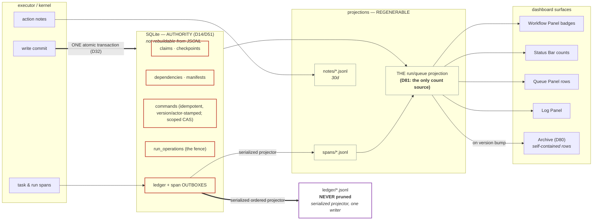

# Dashboard surfaces — the span model, the ONE projection, the command protocol, and the operator surfaces

## Plan 1 operator amendment — 2026-09-29

The approved shared Explorer/Logs rendering replaces the Run data rail and Receipt tab in the
Dashboard run panel. Saved receipt selections fall back to Logs. Served data-placement controls
remain available in the run header; internal recorded values, canonical receipt proof and transaction
verification authority remain unchanged. This retirement overrides the older rail/tab layout below.
Logs tables use distinct opaque surfaces and always-open forms. Computation groups contain rows
only. Successful action rows require D359 expected-effect evidence; old gesture notes remain neutral.
Gate and failure blocks use the same neutral form frame, with matching opaque header/body colors.
The approved R1/F2 layouts and concise evidence rules are owned by operator-trust §2.1 (D360). Identity evidence is available inline,
while approval still uses the served ceremony. Failure effect and safe-action evidence remain first;
served expected/observed subject comparisons remain visible before optional diagnostic detail.
Explorer session chips show task-implementation session needs as declarations, never login success.
Verification details stay in a secondary disclosure; exact source jumps open it when needed.
An operator gate without a supported resolution packet remains held and names that unavailable
ceremony. The shared renderer does not invent a generic approve command or decision payload.

## Frontend-only dashboard presentation amendment — 2026-10-01

`ActivityReport` supplies fictional data to `ActivityView` through `ActivityViewState`; `WorkflowExplorer`
supplies `ExplorerTimeline`; the run panel mounts `LogSample` through `LogPanel`, `LogFeed` and
`LogTimeline`; and `SessionPanel` feeds `SessionsView` through `SessionsViewState`. Local fictional
producers supply the detailed design examples while backend services and contracts remain
available. Logs defaults to a visibly labelled fictional history matched to the selected subject and
status. The Person Lookup example has UCPath/CRM searches, identity review, employment status and
appointment-date checks, with action-associated captures and explicit sample durations. Review and
failure selections open at their inline decision while retaining earlier action history and timeline
jumps. Completed substeps retain their durations; only the affected substep changes state. Local
match approval, rejection and search retry update the sample timeline and append ordinary log events.
A blocked-write row selects a separately labelled Separations sample, rather than inventing a write
operation in Person Lookup. The selector's **Selected run · queue facts** view renders only the served
subject, status, attempt, current message and pipeline, without inferred actions, captures or durations.
A queue selection resets the sample selection and local decisions. The selector retains all approved
examples. The queue occupies its full left container. Its launch, status and sort controls share the 48px Action panel above Logs with the date picker. The 2026-10-03 operator revision moves Explorer, Archive and Activity into
Settings → Data. Their separate operations toolbars are removed. Each page uses the same
`DsBodyScope` content cap, `PageHeading`, spacing and scroll pane as the other Settings pages;
its actions remain in its content. Settings replaces the dashboard workspace with its own 264px sidebar, heading and settings search. It has no workflow notification or run-search controls; Back to dashboard uses the Settings draft guard. Legacy data-page links remain addressable inside
Settings, including archive folders, report sections and Activity ranges. Settings drafts survive
section changes. Spreadsheets lives in Data and uses the same content cap and spacing as the other Settings pages. Global browser/CSS zoom stays at its original 100% sizing.
Activity's report sections stack in one full-width column at every desktop width. Explorer replaces
its workflow sidebar and search with a right-aligned workflow dropdown beside its heading. Expand all,
Collapse all, Version registry and the action legend control are removed. The selected-workflow
intro strip and Preview paths button are removed; per-form branch selectors, disclosures and source
returns remain available. Switching workflows resets transient timeline
state while retaining dropdown focus. Storage checks and Preflight place their actions and scope
selector beside their headings, with check freshness and unavailable states in the content below.
Archive search uses the shared HeroUI SearchField with one focus surface. The version overview and report folders offer search fields; the overview also has workflow and outcome filters. Explorer has no back control or `onBack` prop;
shell navigation exits it.

The 2026-10-04 operator revision uses HeroUI SearchField for every shared search, including its
search icon and clear control. The Navbar field remains 460px wide and centered at wide desktop
sizes, with space-aware sizing at the 1024px desktop floor. Clicking it, pressing Enter/Space or using
`/` opens a centered search dialog with an editable HeroUI SearchField and keyboard-selectable
Command results. Dismissal restores focus to the Navbar field. Result navigation retains its explicit
disconnected notice. Status, export and choice menus use shadcn Base UI DropdownMenu; value controls use its Base UI Select composition. Both keep keyboard navigation and focus restoration. Popups inside dialogs portal into the owning dialog. Escape dismisses an inner Base UI popup before its enclosing dialog or drawer. Overlays register only while mounted. RRSS HR and the date count are removed. Back/Forward history controls remain separate in the shortened Navbar. The visible search shortcut hint is omitted; `/` remains available. Select items sit inside their padded SelectGroup. Menus use 6px outer insets and 8px item text insets. The editable date and calendar sit in the header above Logs and select the dashboard day.

The workspace rail is permanent and 264px wide, with a left-aligned HR GPT heading. Its header owns the HeroUI notification toggle and run-search icon. Notifications replaces the workflow list while preserving the heading, queue and Logs. Settings replaces the workspace with a separate sidebar of the same width, a Settings heading and settings search; notifications and run search are absent there. The Navbar and undo/redo controls are removed. Theme preference lives in General → Appearance, outside runtime settings drafts. Workflow scrolling retains keyboard and wheel access with its scrollbar hidden. Selected workflows change only their highlight. Workflow rows have no leading icons or Preview labels; category icons sit beside category headings. The rail uses 8px outer and row insets. Active/all counts are hidden at the supported 1024px desktop width. The queue uses a rounded bordered container with a 30% track and 244px minimum. Start a run, Status, Sort, Attention and the date picker occupy the rounded bordered 48px Action panel above Logs, with 12px canvas gutters. Status and Sort have thin bordered surfaces. Attention is an independent toggle, excluded from the sort menu: when enabled, rows group by status; Newest, Oldest and Longest sort the entire queue without group headings. Frequent status filters permit multiple selections. Expanding Sessions shortens the workspace; its plus and Settings controls are adjacent. Served workflow selection remains persisted. Additional layout workflow labels open fictional queues/logs without entering the served launch catalog. Notifications use HeroUI All/Unread tabs plus a category dropdown for All updates, Needs you and Failed; read state does not resolve pending run actions. History-gap pins, Snooze and desktop-delivery controls are removed from this preview. Toasts use shadcn Base UI cards above Sessions; command details show the subject and time without the local actor ID. Errors persist until acknowledgment. Archive removes its retained-history subtitle. Activity uses its ordinary Settings heading, a left-aligned period with both dates always visible, manual edits selecting Custom, and matching control typography, a default outcomes table without version disclosures, and no Export or information control. Time-saved estimates require explicit per-workflow manual and assisted minutes; missing assumptions remain unestimated. Existing volume, outcomes and performance facts retain their supplied-data boundaries. Explorer, Storage checks and Preflight retain their heading actions and diagnostics. Workflow capabilities are part of Preflight. Keyboard settings use compact rows with editable key pills, pencil/delete controls and search; Add controls and Run/workflow number-key navigation are retired; preferences persist locally and drive the actual handlers.

Settings navigation uses closely spaced 32px rows with 10px rounded highlights. Selected and
unselected labels/icons use primary foreground; muted group labels use 14px type. Section headings
and field labels use smaller regular-weight type. Activity workflow rows expand to show supplied
version details; headers and numeric cells use regular weight in a rounded opaque table. Log decision
frames, headers and bodies remain opaque; comparisons use a bordered table with a muted header and
opaque difference highlights. Log title bars and comparison table headers use fills distinct from their surrounding bodies. Queue-backed log headers render the same StatusBadge presentation as their selected queue rows.

The Action panel keeps Start a run, the labelled status filter and sort together on the left, with the date picker on the right. The status menu groups Quick filters, In progress and Finished with status icons and counts.
Frequent All/Needs you/Running filters use HeroUI Tabs with a blue underline, normal-weight labels and separate counts. The selected content is an associated tabpanel; a status chosen outside these three filters receives a labelled additional tab. The status and sort triggers use quiet neutral controls within the Action panel, retaining the grouped, padded Base UI popups. Double-click,
right-click and Shift+F10 open the row menu, whose Select item enters selection and includes that
row. Selection replaces the filter header with a visible-row checkbox, count, Delete/Archive/Retry
and an X exit. Escape exits selection and restores row focus. There is no toolbar Select, Done or
Clear control. The workflow rail remains visible independently of queue selection.

These new queue menu and selection actions are explicitly local mocks. Each record retains authored
mock settings; Retry reuses the exact settings object to add a queued attempt, with fresh identities
and pending steps, without opening Rerun or issuing a command. Original attempts remain in history.
Archive retains the removed local records; Delete removes them. The local queue filters/counts fold
the latest mock attempt per item, while the Workflow Panel retains served day counts; the Navbar date count is removed.
Reload or a changed day/source resets local changes. This is not a reconstruction of a runtime launch
envelope or proof of live Retry/Archive/Delete contracts. Existing served row-footer commands and
command-recovery feedback retain their wiring and assurances.

Run input follows the approved Design 1 frame: a concise descriptor-derived input label, parser
guidance and a framed Parsed input list with ordered entries and per-entry run counts. The existing
Examples strip is removed; descriptor examples retain their validation contract. The Run dialog uses a 920px maximum width, a 540px desktop height, a darker 208px workflow rail, an ordered path, and contrasting header/footer surfaces. Input, Options, Steps, Values and Confirm remain scrollable inside the frame. Selected workflows use a highlight without heavier typography. Cancel confirmation retains the served title, consequence copy, target and revision; it presents the subject in a distinct identity block and initially focuses the safe action. Parsing, source binding and live launch contracts remain unchanged. The final visible log step has no bottom divider, including when a scroll spacer follows it.

Activity keeps four metrics in one row and stacks report sections in one full-width column. The workflow table is framed;
`RecordTable` renders confirmed transactions and evidence coverage with shared `text-body` values
(12px / 18px, weight 400). The adaptive chart and Run performance table follow below. Chart bars occupy 75% of each interval and are opaque; plot height adapts from 160px to
224px. Range and granularity preserve interval semantics, explicit zero/empty states, responsive
geometry and axis labels. Anchored, clamped tooltips and Arrow/Home/End/Escape bucket navigation remain.
Loading shows skeletons and an accessible status without a visible caption. Performance rows are
finished-run completion, longest measured run, total measured runtime and most common failure. Null
duration/failure values remain unavailable; an empty failure list means “No failures”; an empty period
has zero runtime and no finished-run rate.

Explorer retains workflow sources, branch previews and comments, with no registered-definition
fallback or client request. Its fictional workflow list contains Separations, Onboarding and Emergency
Contact. Onboarding illustrates CRM intake, person matching, I-9 reuse/creation and new/concurrent
hire filing; Emergency Contact illustrates packet review, per-person fan-out, identity checks,
duplicate handling, address/phone entry and save/readback. Review, mismatch, duplicate and dry-run
choices control the hypothetical path and reset when changing workflows. The copied concepts are
source-pinned to legacy `9bb973672666b9267569a22d3fa0af722e4c5e87`; the browser has no legacy runtime
dependency. Each workflow begins with its declared browser systems, matching Separations. Onboarding puts
Hire type in its own second step; all eleven steps, source links and preview stops follow that order. Emergency
Contact names UCPath first and authenticates only after packet review. These chips declare session
needs; they do not report launched or authenticated sessions.

Archive's mounted presentation follows the original-layout fictional mock in D348 below. Its retained
transport and commands remain unmounted. Loading, empty and failed resources remain distinct.

The 2026-10-03 calendar instruction selects two shared HeroUI compositions from the supplied
Calendar, RangeCalendar and DatePicker references: the default DatePicker with Calendar for every
single date, and the documented two-month RangeCalendar for every range. Preserve HeroUI's default
calendar geometry, editable date segments, suffix calendar icon, year selector and keyboard behavior.
Date fields use the surrounding DS buttons' radius, border, height and neutral colors, including hover;
the dashboard date has its own exterior above Logs, separate from Navbar history controls. Keep visible focus
and invalid states. Both calendars use the same product palette. The shared popup host retains Radix focus and layer
handling so date fields also work inside Run dialogs. Surface-specific calendar styling and old date buttons are removed.
Dashboard and form dates use DatePicker. Activity, Archive and Search ranges use DateRangeInput; either
endpoint opens the same centered range picker and completing the second date updates both values
and closes it. Activity's Start/End fields stay visible for every period; manual edits select Custom.
Range pickers have no footer or Cancel/Apply controls. Text-entry dates preserve their required format and invalid drafts; Archive
preserves inclusive UTC day boundaries and open-ended range filters. Invalid range drafts remain
visibly invalid without publishing a reversed route; keyboard dismissal restores the originating field.

Logs keeps its approved field tables, click rows, search/copy/latest controls
and action-associated screenshots. Its Completed header is hidden while unfinished and failure states remain.
`LogScreenshots` consumes presentation capture metadata (`kind`: fields, form, browser or person;
system, label, capture time and declared dimensions). Unclassified retained captures keep a generic
screenshot label. Filled-field groups show their supplied fields; Submit/Save captures show the complete
form; person checks show the candidate record. A Kuali action contains only Kuali captures. The local
sample supplies 16 fictional captures, including complete tall forms and verified result pages.
The operator approved the revised log blocks and image workspace on 2026-10-02. Single capture
previews use a 128px image area and at most 360px width; browser groups use three compact 96px
image areas with at most 900px group width. Multiple forms use two preview columns capped at 760px
group width. Forms preview their top and open at readable
width with scrolling. The viewer offers Fit width, Whole image and 100%, zoom, quarter-turn rotation,
keyboard navigation and two-capture comparison. Multiple captures appear in a left thumbnail sidebar.
The viewer preserves capture order, names the selected system and action, bounds Previous/Next,
and returns focus to its trigger after Escape, Close or outside dismissal. Missing bytes and dimension
mismatches have distinct explicit alerts; Retry reloads the affected capture without replacing evidence.
Dimension validation uses the detached decoded source, independently of preview layout; a genuine
declared-size mismatch or decode failure still refuses the capture.
Capture classifications and viewer grouping remain frontend presentation inputs, not a backend wire
or capture producer.

The local sample includes all 33 approved failure, review, parked-write, other-state and screenshot
examples. Blocks use neutral borders, distinct header/body/action bands and the established system
font and type scale. Review is blue, Write parked yellow and Failed red. The timestamp stays in the
surrounding log. Necessary yellow notices are indented and fit their content. Failures lead with the
problem, attempted action, last completed action when relevant, failed field/value and all browser
captures. Only values needed to continue receive inputs; generic Details, Evidence, Reference and
external-action controls are absent. Date corrections use the shared DateInput and calendar. The first
Escape closes an open calendar while retaining its continuation dialog. Same-run outcomes append
ordinary log entries outside the block; local continuation retains its screenshots. These controls
change fictional examples only; connected resolution and failure authority remain deferred.
The compact timeline is directly above the logs: equal-width 10px bars, small state dots and labels, and
explicit fictional durations. Selected queue context retains its supplied pipeline states, including gray
skipped/cancelled stages, and shows only supplied durations; missing completed durations have no
visible placeholder. A decision retains its complete sample pipeline and earlier completed
states and durations. Later stages remain gray and unavailable for jumping, without visible “Upcoming”
text; only the affected stage
and substep change state/color. Completed, active and failed bars are solid, waiting is hatched and
upcoming is outlined. Hover/focus reveals named substeps and measured durations; unfinished steps disclose state
without an invented duration. Hover does not change the background; green bars darken to 90% brightness. A stage
click clears search, scrolls to its confirmed-action heading and moves focus there. Computations, connected
identity/resolve/failure UI, run controls/status strip, tab band, capture gallery, elapsed-time footer and
persistent timeline disclosures stay removed. Logs does not mount run-detail, section or capture requests;
its header, timeline and content use panel fill, with opaque table fills.

Activity export remains a visible placeholder. A separately scoped backend producer must validate
authoritative projections and feed these same components while preserving approved layouts and
interactions. Activity query/export authority and Logs failure/resolve wiring remain deferred. Migrate
old connected-UI tests intentionally; synthetic samples are never live authority. The reusable palette
and type scale are in the [Dashboard theme guide](../../../src/dashboard/ds/DASHBOARD-THEME.md).

Sessions cards place the workflow/subject header first, the systems grid next, and the current action
with its node timeline after that; elapsed time and controls finish the card. The grid has at most two
columns of 32px tiles: one or an odd final system fills its row, while two systems share the row.
Active cards stay below 250px tall. Each timeline segment represents a supplied node, and its
completed/total count comes from that node array. The entire Sessions bar toggles by mouse and keyboard
and shows nonzero state counts (or “No workers”); Add workers is an independent secondary action. Worker
commands are accessible icon-only controls. Idle cards can be removed; active cards cannot. Removal
preserves peer cards and returns focus to the bar. No worker-stopped strip appears. Scenarios come from
the `sessionsPreview` URL parameter, not a visible selector. The 320px dialog groups workflow selection and an editable
positive whole-number count with increment/decrement controls; there is no fixed worker-count cap.
An idle worker without a timeline shows “Ready for the next run” above a full-width empty gray bar
with the accessible label “No run in progress.” Pause/resume/retry/stop controls change fixtures only;
App no longer passes worker cards, pools, clock, connection/version or worker command dispatch to the
UI. The former connected SessionPanel and timeline renderer are retired. Backend worker/browser
authority remains a separate wiring task.

`WorkspaceRail` supplies local `NavbarData` to the icon-triggered search dialog and local
`NotificationsState` to the inline `NotificationsView`. Search and notification examples use local
fixtures; their navigation placeholders invoke no API, command, browser permission or OS delivery
path. The shared DatePicker above Logs retains the route-owned date, limits and Today action.

The notification rail keeps a compact header and filter row fixed while its single list scrolls.
History-gap pins are absent from both the list and unread count; the normal fixture has three unread
updates. Read state is independent of pending run actions. Removing a filtered row restores focus to
the active filter. Escape closes the notification view and focuses the bell, including after Read all
becomes disabled. Empty, loading, unavailable and toast examples remain distinct. Snooze remains retired.
The shared
semantic palette is authored in `src/dashboard/ds/dashboard-theme.css`; DS, body, Settings and shadcn
neutral aliases resolve through `src/dashboard/ds/tokens.css`. Current values and presentation seams
are in the [Dashboard theme guide](../../../src/dashboard/ds/DASHBOARD-THEME.md).

The approved mixed queue presentation retains the existing system title font and monospaced gray
footer band, with 14px top padding. Regular rows have no leading status or information icon. Bulk
selectors sit outside the card. The footer's `#N` opens the exact logical item's attempt menu; selecting
an attempt opens that run without adding another row. Served mode, warning and completion labels
remain. Running puts its blue spinner and text inside the label. Review uses a blue label and message;
Failed uses the compact danger label and message; Write parked retains yellow. Running progress has
one segment per supplied pipeline step, with the action label and completed/total **steps** below it.
Tooltips retain supplied state, duration and execution count. Terminal duration is omitted when no end
instant was retained; measured zero remains visible.

Operation rows show a boxed finished/total counter beside their status and an aligned Name/Status
member table. Member status icons, attention ordering and exact run selection remain. Local checked marks, their controls and tally are retired. The compact table fits five complete rows and expands to twenty; unloaded members remain a
distinct state. Workflow-batch items render separately even when the served session prefers grouping;
no grouping control or grouping command is offered. Logical retry identity remains item-scoped, and
keyboard traversal follows the visible status bands. Bands retain uppercase labels, circular counts and
horizontal rules. This presentation changes neither served status/actions nor backend publication.


**What this doc is.** The contract for everything the operator SEES and for every mechanism that
feeds it: the span/notes event model (§1), the storage and transport split between authority and
projection (§2), the descriptor fields this layer consumes (§3), the completion contract (§4), the
cross-repo runtime boundary (§5), and one section per operator surface (§9). It is a REFERENCE
spec — cited as `ref dashboard-surfaces §N` and never actionable on its own. What is scheduled, and
what is left, lives in the phase docs `docs/rebuild/00`–`05` and in `docs/roadmap/roadmap.md`.

**How to read it.** §0 is the legacy grounding — why this layer exists at all. §1–§3 are the
platform half: the event vocabulary, where each byte lives, the one command protocol, and the
descriptor surface. §4–§5 are two contracts this doc contributed and another doc consumes. §6 is
the rot table, §7 the worked example, §8 the settled questions. §9 is the operator surfaces, one
numbered subsection per **wire square**.

**The wire squares are shared vocabulary, not this doc's own list.** §9's subsections mirror
`ref frontend-backend-integration` §5.1.1–§5.1.7 — run modal · queue row · run detail (with the
Context rail as its sub-square) · gate ceremony · archive/activity/explorer · notifications ·
intake, mobile capture and Edit Data — in that order and under those names, then add the three
squares that exist only here: settings/storage, the shell, and the delegation/row model. One
square, one name, one order: a `Dashboard · wire` task in the tree names a square, and it must name
the same square in both docs. That doc owns the WIRE (endpoints, payload shapes, the parity lane);
this doc owns what a surface MEANS, what it refuses to show, and why an absence is drawn as an
absence.

**Status blocks.** A section that describes a tree node carries `<!-- roadmap: <id> -->` and, once
per node per doc, a `<!-- roadmap-status: <id> -->` checklist the roadmap generator renders in that
node's drawer. Where a node's checklist lives under a different section of this doc, the section
says so in one line rather than opening a second block.

**Desktop support scope (D340, 2026-09-06).** Ref frontend-backend-integration §10 owns desktop-only
dashboard acceptance. Responsive behavior remains required for supported desktop windows and zoom;
older mobile/touch-specific proof wording is superseded by D340. The operator moved mobile-only
proof and coarse-pointer cleanup to immediate execution before 1.6.6. Phase 3.1 consumes the desktop
baseline and owns its final desktop/zoom matrix; it does not repeat mobile cleanup.

## Ownership (D1)

| | Concept | Where |
|---|---|---|
| **This doc OWNS** | the span/notes wire schema and its identities (D10), the state-root layout, the SQLite authority/projection split and the recovery contract, enqueue/action/queue command semantics (D67/D95), durable notifications, local artifact outboxes/projectors, the SSE surface payloads, the completion union, the cross-repo runtime boundary (D88/D89/D93), the ratified delegation/presentation decisions, **the ONE run/queue projection (D81)**, **run versioning + major-bump archival (D80/D274)**, **run display names (D83)** | §1–§5, §9 |
| **Imports from `ref task-contract`** | the task contract and `defineTask`, the task-id grammar (`<system>/<verb-object>`, D2), the closed `SystemId` union, the error taxonomy | referenced, never redefined |
| **Imports from `ref workflow-model`** | the descriptor shape and builder, `RunEnvelope` (`dryRun`'s one home, D6), the run-state machine including gates and parks (D5), the checkpoint store, and the readable span-path grammar | referenced, never redefined |
| **Exports `ref workflow-model` adopts** | verdict/detail semantics, completion-program semantics, and the wire projections; the descriptor carries every consumed field | §3–§4 |
| **Imports from `ref operator-trust`** | `FailureRecord`, evidence receipts and diagnostic bundles, semantic action targets, scenario ids, knowledge/fix references | referenced, never redefined |
| **Imports from `ref frontend-backend-integration`** | the HTTP/SSE transport, the per-square wiring matrix (§5.1), the action-descriptor rule (§8.5) and the parity lane (§7) | referenced, never redefined |

The "Where" column read `§§1–5, §9–10` until 2026-08-20 and had been wrong since 2i: §11 (intake),
§12 (the capture phone) and §13 (the two reference takeovers) were this doc's too. They folded into
§9 on 2026-08-21, so the column is now `§1–§5, §9` and stays true as surfaces are added.

## § number map (old → new)

Section numbers are load-bearing: 33 tree nodes carry a `ref:dashboard-surfaces §N` ref that the
`roadmap-doc-binding` guard resolves against a real heading, ~150 code comments cite one, and
`history/` plus `docs/rebuild/migrations/separations.md` cite the OLD numbers and are deliberately not
swept. So the numbering moved as little as it could (cohesion plan §6.2, option B): **§1–§8 keep
their numbers and their meanings**, and §9 becomes the operator-surface shelf that §10–§13 fold
into.

**Moved (2026-08-20):**

| was | is now |
|---|---|
| the opening `Status:` + nine `**Amended …**` sentences | `history/superseded/2026-08-20-dashboard-surfaces-amendment-log.md` |
| `## Phase 1c Stage A–D as-built …` (four blocks) | `history/superseded/2026-08-20-dashboard-surfaces-phase-1c-stage-deltas.md`; residue in §2.3, §2.4, §2.5 |
| `## Phase 1f authority and command ratification` | §2.4's *Phase 1f — the authority and command ratification*, which is what `ref dashboard-surfaces §Phase-1f authority` still names |
| `## 9. Ratified delegation and presentation decisions` | §9.10 — §9 is now *The operator surfaces* |

**Folded into §9 — every row below has landed, and on 2026-08-21 `docs/roadmap/roadmap.md`'s `doc:`
refs were retargeted to the right-hand column, so the transitional alias headings that used to sit
at the foot of this doc are DELETED. The numbers in the left column no longer resolve to a heading:
this table is the permanent record for the `history/`, `docs/rebuild/migrations/separations.md` and code
comments that still cite them.**

| was | is now | unit |
|---|---|---|
| `## Queue-row projection as-built delta` + *The second batch* + *Drawing the second batch* + *The per-row action descriptors* + *The row title is the SUBJECT* | **§9.2** (landed) | 5.1c |
| `### D234` runs and archived runs · `### D235` the bulk vector | **§9.2** (landed) | 5.1c |
| *The shape hazard compares a run against ITS OWN workflow's served shape* | **§9.2** (landed) | 5.1c |
| `## Phase 1g/1i-spine as-built presentation deltas` (D123 · D124 · D126) | **§9.3 · §9.2 · §9.9** (landed) | 5.1c |
| `### D225`/`#### D259` · `### D238` · `## Wave-2 connection-proof presentation deltas` (D256 · D257) | **§9.3 · §9.9** (landed) | 5.1c |
| *Shell and layout as rebuilt* | **§9.9** (landed); its superseded 400/470 widths → `history/superseded/2026-08-20-dashboard-surfaces-shell-widths.md` | 5.1c |
| §9's row-model D5–D24 | **§9.10** (landed), with its per-entry table naming §9.1 · §9.2 · §9.3 · §9.3.1 · §9.4 · §9.9 | 5.1c |
| §10.1 the ONE projection + D236 · §10.2 the archive + D179/D242/D223 | **§9.5.2 · §9.5.1** (landed) | 5.1d |
| §10.3 operator-assigned display names (D83) · §10.4 the notification model (D79b/D86) | **§9.2 · §9.6** (landed) | 5.1d |
| §11 the intake workspace · §12 the capture phone | **§9.7.1 · §9.7.2** (landed), with Edit Data's PLACE as §9.7.3 | 5.1d |
| §13 the two reference takeovers | **§9.5.3** (landed); the takeover precedence rule moved up to §9.5, where all five keys are | 5.1d |
| `## Phase 1e as-built completion + delegation-manifest delta` | **§4's opening · §4.1 · §4.4** (landed) — folded into the subsections it amends | 5.1d |
| §5.1–§5.4, the `<details>` coexistence design | `history/superseded/2026-08-21-dashboard-surfaces-coexistence.md`; §5 keeps the live boundary contract | 5.1d |

Two contracts deliberately do NOT move with their surface, because they are the model rather than
the screen: the durable notification row stays in §2.6 (the bell and the inbox are §9.6), and the
backup/doctor/restore contract stays in §2.5 (the Settings section is §9.8).

---

## 0. What exists today (and what specifically hurts)

_Legacy grounding, written 2026-07-22 against `hr-automation`'s tracker. Every row describes the
LEGACY tree, which is still production and unchanged; "today" here has always meant that tree. It is
kept because it is the argument for everything after it — each row names the mechanism a section
below replaces, and the file/line citations are legacy's, not this repository's._

| Today (legacy) | Mechanism | Pain |
|---|---|---|
| Queue rows | `TrackerEntry` snapshots, latest-wins dedupe, `data: Record<string,string>` bag | Every emit must re-stamp `archetype`/`__traceId`/`parentRunId`/`mode`/… or the latest row *eats* them (≥6 CLAUDE.md lessons are re-stamp bugs: ISS-006, E2E-016, the 2026-06-02 parentRunId lesson, the sweep-step lesson…) |
| Steps/timeline | `step` string on rows + `computeStepDurations` reconstruction + `step_change` session events | Three sources of "where is the run"; durations are *reconstructed*, not recorded; cancelled runs need a sentinel step (`failed`+`step="cancelled"`) that every classifier must special-case |
| Session cards | `sessions/<date>.jsonl` events keyed by mutable `workflowInstance` names + pid heuristics | The 2026-06-25 triple-root-cause dedup saga: instance names are reusable, so attribution needs pid + time-window hacks |
| Status | 5 base statuses + sentinel steps + per-workflow `statusExtensions` + OCR-only predicates (`isPrepareRow` keys on `workflow === "ocr"`) | Status semantics smeared across row fields, sentinels, extensions, and hardcoded branches |
| Approve fan-out | 3 divergent spec shapes (`approveTo`/`approveDocumentTo`/`completeDelegatedRun`) + string-keyed intent gate (`data.operationWorkflow`) + cross-spec borrowing (`onbase-emergency-contact.ts:82`) | Nothing forces coherence; a spec can declare contradictory shapes and only a doc comment objects |
| Dashboard | SSE `entries` (row-ish) + heavy client-side re-projection (queue-surface classifier duplicated client-side, `statusKeyForEntry`, `computeOcrPipelineView`, `workflow === "ocr"` at App.tsx:386/852/976, LogPanel.tsx:249, ocr/types.ts:142–211) | The client re-derives what the server already knows, and re-derivation drifts |

What is **good** and must be kept (charter: port, don't rewrite):
- The **three orthogonal axes** (shape / scope / kind) and the queue-surface collapse algorithm
  (`queue-surfaces.ts`) — battle-tested, including synthetic operation shells and
  `alwaysOperationDelegatedMembers`.
- **Backend-authoritative counts** (`wfCounts`) — the rail never trusts client math.
- Kind-dispatched **title/subtitle** (`queue-row-presentation.ts`) and the **trace id**
  (`<code>-<HHMMSS>-<runId4>`, frozen once).
- JSONL-per-day on disk — the operator greps files. (SQLite's role is split per D14: the
  claim/checkpoint tables are system-of-record; only the *projection* tables are rebuildable — §2.3.)
- Cross-midnight read-layer merge; append-at-now writes.
- The **`ocr_approvals` claim/lease/manifest durability machinery** (2026-07 hardening) — §4.4.

---

## 1. The span event model

<!-- roadmap: p1-spine -->
<!-- roadmap-status: p1-spine -->
- [x] the span wire union, its two identity tuples and the emit-time write-once rule (`src/events/types.ts`, `src/infra/events/span-jsonl-writer.ts`; 1g-spine)
- [x] D214 — the task span path carries the claim generation, so two executions of one node inside one attempt are distinguishable (`taskSpanPath`, `src/core/span-emitter.ts`)
- [x] D215 — `transaction.previewed` carries `not-observed`, and the wire leaf and the kernel port were re-pinned against each other after the first settled preview killed a worker (separations §9.15)
- [x] D345 — the NOTES stream has a production action emitter; the executor appends completed browser gestures after task/transaction settlement (`{#observed-logs}`)
- [ ] `span.ended` carries no `verdict`, so the descriptor's `verdicts` vocabulary has nothing to key off (§1.3, §3.2)
> 2026-08-20 | docs-dash-surfaces 5.1b | verified against src/events/types.ts, src/core/span-emitter.ts, src/core/run-executor.ts, src/infra/events/{span-jsonl-writer,note-jsonl-writer,jsonl-streams}.ts and the real state root; left: the notes producer and the verdict channel, both named below
<!-- /roadmap-status -->

### D345 — Run data and action Logs · 2026-09-24

`data.observed` is recorded run data. The live `context-data` section serves every
indexed observation for the exact run, with its producer, attempt, time, direction
and classified values, even when no editable checkpoint field exists. Logs serves
the run's action notes, ordinary notes and transaction fences. The dashboard
renders each completed browser gesture as a short, time-ordered line. A gesture
names its static semantic control and, under D346, its entered value. The executor buffers gestures through task and transaction
settlement, then appends notes outside the fenced external-write window. Every
completed gesture is retained for the operation.
Older frozen archives are projected into the same split on read: observed rows
move to Run data while the stored archive remains unchanged.

### D346 — Full local operator values · 2026-09-24

Logs records the value entered or selected with each browser action. Classified
note and diagnostic capture fields, historical note text, failures and receipts appear from their
retained bytes. Run data presents original observed values, including
identifiers, alongside their producer and time. Capture images appear inline
in Logs. Live queue rows and archived runs show retained titles, names and
sections. Settings shows stored credential values and active provider keys.
The existing classification fields remain in durable evidence for provenance;
they do not replace a retained original on the operator surface. A value
already discarded from an older record cannot be reconstructed by its read
projection. Provider prompts and OS notifications have separate egress rules.

### D356 — Frozen complete operation display per run · 2026-09-27

A complete v1 operation display is historical run evidence, not a live descriptor
lookup. At the one enqueue transaction, the descriptor compiler projects its complete
declaration into a strict, canonical, redacted serializable snapshot and stamps its
domain-separated digest into the immutable `RunEnvelope`. The snapshot binds the
envelope's `contractFingerprint` and retains the static operation/action identities,
occurrence paths, logical page/session references, typed reference kinds and paths,
templates, conditions, outcomes, and graph-derived execution edges. Equality and
inequality clauses retain their bounded public declaration literal with its digest, so
historical readers can render the exact branch. Generic workflow constants remain
digest-only. It deliberately does not retain Zod objects, pure implementation
functions, examples, configuration values, run input values, credentials, or other
secret-bearing data; a comparison literal outside the public declaration grammar
refuses snapshot minting.

The existing `workflow_runs.record_json` authority is the storage owner: the snapshot
and its reference are inserted atomically with the run; same-run requeues and lifecycle
transfers retain it unchanged, and a fingerprint-matched retry retains its source snapshot
unchanged. This is an envelope-format addition, not an ordinary-startup SQLite schema
mutation. A reader parses and hash-verifies the retained bytes before using them. A current complete-format run
without a valid matching snapshot fails by name; it is never rebuilt from the current
registry. Historical envelopes without the field remain explicit legacy format and
are not backfilled.

Action evidence remains one completed driver gesture, appended only after the task or
transaction settles. Its identity joins the existing run/span sequence to the frozen
definition fingerprint, node/task, task retry, claim generation, operation invocation
and occurrence, logical action id, child edge where present, and physical session
incarnation. An absent completed gesture is no evidence of start, failure, or
not-run. Value provenance records the exact consumed value's immediate declared
producer while prior reads remain traversable evidence; protected inputs are redacted
before a note is durable or projected.

### D357 — Shared Explorer/Logs operation structure · 2026-09-27

Explorer's complete-format projection is the same canonical, redacted definition that a
new enqueue freezes. Logs reads only the immutable envelope definition and completed action
occurrences retained in the selected log page. Each observation must name one exact run,
definition fingerprint, invocation, action, occurrence and target; an unknown or mismatched
identity refuses rather than matching current descriptor text or a similarly named action.
The existing Logs cursor remains authoritative: a page carries only its own observations, while
older envelope records without a Plan 1 capability stamp remain explicit legacy. New enqueues
stamp `complete` or `legacy`, so a missing complete snapshot cannot silently downgrade. The
normal note row continues to omit raw browser action payloads; any field value is read from the
already-redacted provenance arm.

## 10. D272–D276 — Phase 3a operator ratification (2026-08-26; ports and proofs remain open)

These decisions ratify the 49 A recommendations in the six 2026-08-25 sheets. They are **not
implementation claims**, do not re-freeze parity, and leave the resulting ports and proofs open.
Prior authority decisions (including D173, D179, D225, D234, D238, D250–D253, D264 and D269) are
cross-referenced rather than re-litigated.

### D272 — shell, queue and start

1. Settings is the demo full-page takeover; B dialog and C deferral reject known navigation drift.
2. Port shell geometry, provider nesting and toast floor together; B toast-only and C retention leave drift/collision.
3. Retain Escape-clear and Import with recorded exceptions; B strands intake, C postpones its real handoff.
4. Use demo plural/version copy; B redefines help and C keeps inconsistent claims.
5. Port the complete bulk vector/feed/toast; B compact and C feedback-only hide required result context.
6. Keep checked-by-you client-only; B invents durable actor evidence and C removes triage.
7. Use shared Chip; B forks it and C changes all consumers.
8. Port cards/clock/input continuity/reload; B loses authorization context and C keeps an unruled table divergence.
9. Keep honest empty states but port visible reasons/conditional groups/labels; B removes truth and C keeps inaccessible reasons.

### D273 — run detail

1. Port identity vocabulary, retaining visible rename refusal; B adds redundant facts, C hides validation.
2. Port focusable categorical timeline, orphan gate, Status and working+waiting axis; B changes meaning, C fixes only focus.
3. Port demo search geometry while retaining served empty/paging states; B leaves them unruled, C omits truthful states.
4. Port live dot and age-plus-clock; B splits urgency and C leaves card drift.
5. Give expansion one owner and port rail labels/chrome; B retains false state, C leaves fidelity drift.
6. Port coded refusal/preserved drafts/remove duplicate, retaining Saving; B suppresses async state, C flattens refusal.
7. Port every served receipt cue, never the unrepresentable invariant banner; B fabricates it, C hides evidence.
8. Port served failure framing/disclosure/remediation; B buries stream, C repairs density only.
9. Remove park footer metadata; B/C retain duplicated fenced facts.
10. Use one parameterized truthful refusal notice; B forks known drift, C forces inaccurate copy.

### D274 — standing product surfaces

1. Port archive virtualization; B leaves 800-row claim unsupported, C defers the target.
2. Major archives/may block; **minor archives nothing and cannot block**. B removes minor, C makes kind a lie. This amends every blanket archive-on-bump sentence: archive-on-bump means major only.
3. Port specimen page plus parity scene; B defers its review trigger, C leaves a forgotten gap.
4. Build only a served-vocabulary catalog and name absences; B claims unsupported semantics, C has no home.
5. Use Settings takeover with Help→Keyboard; B retains container drift, C reverses its removal rationale.
6. Add read-only hosts/capabilities; B hides served facts, C wrongly couples reads to settings writes.
7. Build authority-backed desktop capture states; B defers visible capture, C abandons review. **D278 (2026-08-27) rules the column the panel mounts in:** while a capture session is live the panel takes the intake column's height and the `Dropzone` yields its `flex-1` to a strip; with no live session the dropzone is primary. Rejected: dropzone-primary with a scrolling panel; a wide-viewport split. Lands with the Phase 4 carry-in (D279).
8. Add Manifest/Rerun panels over served facts only; B leaves review incomplete, C withholds states awaiting unrelated producer facts.
9. Use review checkbox/disabled Run/courtesy reason; B advertises a known refusal, C hides work.
10. Add non-byte capture viewer and archivable-run list; B leaves capture inert, C asks action on counts alone.

### D348 — dashboard and workflow runtime versions (2026-09-24)

**Mounted presentation amendment — 2026-10-03:** the operator rejected the Focus Archive
redesign and requested a polished mock of the original Archive. The app's Archive takeover now
mounts a local fictional dataset instead of the Archive read/command client. Preserve the original
dashboard-version groups, full-width workflow folders, filter strip and complete report with section
navigation. The shared compact operations toolbar replaces the separate Current/version-history header rows;
it holds search, matching count, subtle dashboard version, mock identification and Plan a bump.
Archive navigation is the only Archive label. Reports open as full pages. Dashboard version,
workflow version, archived date, outcome and retained-file count live once in Workflow details;
the separate report metadata strip is removed. Workflow fields join Workflow details without
duplicating Subject fields. The separate Fields navigation entry is removed. Steps becomes Logs,
using the shared LogPanel, timeline, action/field rows, saved failure blocks, screenshot workspace,
search, copy and latest-action controls. Historical logs offer no continuation commands. Old Fields
section links open Workflow details; remaining section identities stay stable.
Plan a bump keeps the original selected-workflow /
all-workflow modal and inline review. Downloads contain fictional local records and files; completing
bump review changes no runtime version. Backend authority and its retained implementation below are
unchanged and unmounted; reconnecting and proving them is separate future work. The mounted mock
must remain visibly identified, route-owned and free of Archive queries or commands.

The operator approved an Archive redesign with independent **dashboard** and **workflow** runtime
version counters. Both use `major.minor` display and durable run identity. They are distinct from
the package/build semver, integer descriptor version and contract fingerprint, which continue to
govern code compatibility. A controlled upgrade initializes dashboard and registered workflow
counters at 1.0. It records adoption of currently live runs into that baseline without changing
their immutable historical envelopes; older saved reports with no proven version retain an explicit
“Version not recorded” state. Neither read path may infer a runtime version from current code.

A workflow change selects one or several workflows. Each selected workflow advances its own minor
counter exactly once, and the dashboard and unselected workflows stay at their existing counters.
The operator reviews every before/after identity and affected run. Applying archives each selected
workflow's terminal runs of its old version. An all-workflow dashboard change advances the dashboard
major counter and resets **every** registered workflow to that major's `.0` version; it archives
all affected terminal old-version runs. A workflow selection containing every registered workflow
is the all-workflow major action, not a minor action disguised as one. This supersedes D274 item 2
and §9.5.1's minor-archives-nothing rule for new version changes; old change records remain readable
under their original meaning.

Nonterminal affected runs, including unresolved possible-submit states, block publication. Review
membership and version basis are rechecked at apply. Claiming the transfer fences new enqueues for
affected workflows; exact frozen reports/files and interrupted progress resume under the original
command identity. Publish the new counters only after every selected old run transfers and verifies.
A failed or partial transfer cannot expose a new version. Every subsequent start, intake-created run,
retry and restart stamps both current runtime counters from durable authority within its creation
transaction. Historical code/build identity remains separately stamped and validated.

Archive browsing uses dashboard-version groups containing workflow folders. Opening a workflow
shows its retained runs across workflow versions; workflow version remains a record column and
filter rather than a mandatory navigation level. Search and filters cover dashboard version,
workflow, workflow version and dates with bounded, deterministic pagination. The browsing surface
has no Done/Failed outcome badges or outcome filter; the stored outcome remains a plain field in
the complete report. New reports freeze both runtime versions; old report bytes are never
rewritten. Existing report integrity, attachment custody, deletion/disposition, export and
descriptor-independent rendering remain binding. The approved [3.1.24 task plan](../plans/phase-3/3.1-finish-the-dashboard/task-24-archive-runtime-versions.md)
owns implementation and focused proof. The 3.1.23 UI finalizer remains its prerequisite.

#### Workflow-record presentation amendment — 2026-09-26

The operator selected Archive 1: workflow folders, a workflow-specific run table, and a complete
run report. Summary columns may use retained report fields, but must not depend on current workflow
code to interpret an archive. The run report preserves all public section kinds (values, tables,
text and explicit unavailability), frozen inputs, results, notes, file metadata, version evidence
and record metadata. A searchable field-path view keeps unrecognized retained fields inspectable;
unknown, null, false, zero and an empty collection are not interchangeable.

The Archive landing body starts with archived dashboard-version groups, including the current
dashboard version whenever it has archived runs. The current runtime version appears subtly in
the Archive heading bar; it is not a separate introductory status block or an exclusion rule for
archive membership.

Plan a bump includes a workflow selector in the selected-workflow option. It defaults to the
browsed workflow when available and updates the proposed version and impact preview when changed.
The selected-workflow action leaves the dashboard version unchanged; existing version and
readiness authorities continue to govern the actual operation. Workflow export is an action in
the shared heading bar, and numeric, date, version and count columns align right.

The served report may add strictly validated archive-record identity/publication metadata, with
explicit absence for historical producers. Original private source snapshots and private source
digests remain outside this projection. This does not remove values already admitted to the
operator report by D346. The raw sealed-report digest also stays private: it changes with protected
source bytes, unlike the stable public archive fingerprint. Expose verified report integrity and
the existing public fingerprint without revealing the sealed digest or changing deletion citations.
The dashboard and exports consume this same public report, without
rebuilding it from live inputs or silently replacing missing evidence.

Run export offers the complete public report as JSON and a typed field-path CSV. Workflow export
covers the selected dashboard/workflow and current search/filter membership, across every matching
page; the dialog states its scope. Visible columns do not truncate either export. CSV preserves
nested values through one field per row with run identity, path, type and encoded value, and uses
the admitted spreadsheet-safe encoding policy. Exports preserve explicit absences and file
metadata; attachment bytes continue through the verified attachment path. Loading, cancellation,
changed selection, partial failure and bounded paging must not produce an apparently complete
truncated export. A browser export capacity bound must be explicit and refuse before offering a
file; it must never silently truncate matching runs. This candidate bounds workflow export at
5,000 reports and 50 MB, with narrowing filters offered when that bound is exceeded.

#### Shared surface frame refinement — 2026-09-26

Archive, Explorer and Activity occupy the Dashboard's full available content width with the
shared shell inset. Their headings use the same rounded, subtly bordered bar and their bodies
retain cohesive framed surfaces. Actions and internal layouts adapt to each selected design;
the supplied Archive heading is a style reference, not an exact control-layout requirement.
The page, grouped panels, controls, borders and text use the existing Settings body tokens in
both themes. In dark mode, the page is darker than its grouped panels, and controls are lighter
than those panels; an inverted surface hierarchy is not the selected presentation.
Centered page-width caps are superseded for these three surfaces. Reading measures may constrain
individual prose blocks without narrowing the overall surface. The operator requested regenerated
interactive designs for review before implementation finalization.

### D275 — standing conventions

1. Restore the two documented catalog toolbar entries and retain deep links; B hides navigation, C deletes it. This supersedes the prior corrective statement that no buttons exist: that was as-built, not the future contract. **Amended by D295 (2026-09-01): the `UI catalog` entry is deleted along with the takeover it opened, and the catalog is reached from `Settings -> Help`. Deep links are retained on both — the catalog's are now `?settings=ui-catalog`, with `?catalog=`/`?catalogView=` subordinate to it (§9.5.3). SUPERSEDED IN FULL by D296 (2026-09-01): `Workflow explorer` is deleted too, on the same rule — the Explorer is a Top Bar view-switcher segment, so the button was a second door onto a takeover that already has one. Every deep link still stands; the objection this item was written against was navigation that leads NOWHERE.**
2. Keep the shared takeover wrapper as an accessibility/motion convention; B loses it uniformly, C reopens drift.
3. Keep horizontal wrappers only where responsive proof shows clipping; B clips facts, C creates needless scrolling.
4. Keep explicit loading/refusal panes; B removes honest async states, C conflates refusal with empty.
5. Explorer shows demo facts unless an extra enters its owning contract; B mints vocabulary, C drops stable ids.
6. Put Explorer edit affordance on the field row; B separates action from value, C misstates deferred posture.
7. Port archive copy/shapes as one pass except prior authority wording; B invents a voice, C fragments it.
8. Port intake list/editors/Well/banners as one flow; B keeps drift, C mixes interaction grammar.
9. Port version-bump dialog as one flow while preserving no-force/async/refusal truth; B simplifies safety context, C ports labels only.
10. Port small Activity/Settings/DS/catalog drifts together; B leaves forks, C creates disproportionate decisions.

### D276 — standing copy and served facts

1. Port intake vocabulary; B requires a new semantic vocabulary, C leaves mixed grammar.
2. Port Explorer reading model and delete unreachable arms; B retains unsupported states, C presents documentation as runtime.
3. Port bump wording/control treatment while retaining truthful async/refusal; B hides server rule, C removes accessible feedback.
4. Port Activity and Settings-storage copy/geometry; B leaves drift, C couples reads to deferred writes.
5. Port DS/catalog semantics; B broadens primitives without a contract, C fixes only one symptom.

### D281 — UI-1: the elements the demo does not cover (2026-08-27)

Ratified 2026-08-27; operator context is `docs/decisions/dashboard.md` §D281 (run UI-1; the audit
`docs/plans/2026-08-27-ui-fidelity-audit.md`'s `new-in-current` rows plus UF-FU-2), all recommended.
The rebuild-demo (legacy `1ec1d870`, `src/dashboard/components/dev/rebuild-demo/`) is the design
authority for everything it covers; what it does not cover is ruled here, once, so no later audit
re-books it. Merged at `a3683bf3`.

1. ~~Keep the `Workflow explorer` toolbar button~~ — it WAS D275 item 1's restoration; the audit's `new-in-current` class was a cross-reference miss, not a finding. **SUPERSEDED by D296 (2026-09-01): the button is deleted and the Explorer is reached from the Top Bar's product-view switcher. D275.1 is not re-opened by this — its objection was navigation that leads nowhere, and the takeover keeps a door.**
2. ~~Keep the `UI catalog` toolbar button beside `Import spreadsheet`~~ — the second of D275.1's two entries; CA41's 2026-08-14 removal is superseded by it. B contradicts the ratified placement, C reverses D275.1 a third time. **SUPERSEDED by D295 (2026-09-01): the catalog is a Settings section and this button is deleted. The item's reasoning is not reversed — D295 removes the door because it removes the takeover the door led to, and gives the catalog a destination (`Settings -> Help`) rather than none.** Item 1's `Workflow explorer` button followed it out under D296, leaving the `runStart` group with one control.
3. Keep both sentences of the System-hosts banner (`settings.tsx`); the refusal sentence states a real refusal this build has and the demo's runtime lacks. B/C delete a served fact at the one place the operator acts on it.
4. Keep the TEST column's third arm `provisioned identical to production — refused` (`resolveSystemEntryUrl`'s refusal, stated before it bites; unreachable on today's estate). B blurs "configured wrong" into "not configured", C removes the advance warning.
5. Keep the Workflow-capabilities banner's trailing clause (the count is descriptor-derived, never authored). B/C remove the only sentence on the page that says so.
6. Keep the authored display names and notes for `new-kronos`, `old-kronos`, `sharepoint` (`settings-model.ts` `SYSTEM_HOST_PRESENTATION`, each marked `// authored — no demo counterpart`); UF-SET-26 requires a note on every row. B leaves three of nine rows blank, C waits on copy the demo never had.
7. **The storage band goes full-bleed.** The demo's geometry (`RebuildDemo.tsx:654` / `DemoSettings.tsx:1204+`: border-bottom only, no radius, x=0, mounted above the shellView switch) replaces the inset `Banner` card at the storage-band site — on the queue view too, since the same site serves both. D276 item 4's refusal to revert the `Banner` PRIMITIVE stands: the primitive keeps its bordered, rounded shape everywhere else; the band gets its own full-bleed arm. A keeps an x=12 band over x=0 takeovers; C is the half-match U4a rejected (`dashboard-app.tsx:1377-1383`). **Open port: UI-2 U6** (`docs/plans/2026-08-27-ui-runs.md`).

Standing from the same receive (summarized in `docs/decisions/dashboard.md` §D281, all recommended, no D-number — run-plan
matters): intake and the UI catalog adopt `TakeoverFrame` (UF-FU-1 → UI-2 U7); fidelity ledger 1's Region A
counts are recounted (U8); the G1 finding (`docs/rebuild/findings/activity.md`) is diagnosed as the one backend unit
inside UI-2 (U9) and Activity's populated body is audited after it (U10); UI-2 started after the former Phase 3b R2 closed.

### D282 — finish the dashboard; retain truthful current-only evidence (2026-08-28)

Ratified from the operator answers summarized in `docs/decisions/dashboard.md` §D282–D283 after both
coordinator residue questions **A** and directed the coordinator to complete the dashboard through
parallel supervised runs.

1. **Activity keeps the `Unread` axis in `BY WORKFLOW`.** It is a per-workflow evidence state: a
   finished run whose derived receipt has not been read is not the same thing as one read back
   cleanly. The demo had no corresponding authority fact, so exact omission would make the real
   surface less truthful. Moving it elsewhere remains possible only through a later product ruling;
   deleting it is rejected.
2. **Storage doctor gains strict span/authority reconciliation.** The operator authorizes the
   infra/domain schema work the truthful diagnostic requires. The queue projection's existing
   refusal on an unaccounted run stays unchanged: the doctor explains authority damage or archived
   state; no query substitutes a plausible row, selects a different database, or weakens the
   refusal. Requeue attempt allocations must strictly increase but need not be adjacent, because a
   sibling run may consume an intermediate item attempt. Every requeue still binds the exact
   authority/path/identity tuple; a non-increasing or foreign relation is malformed.
3. **Every dashboard-owned deferral is scheduled for completion now.** This fires the timing trigger
   for the Phase 3 cross-cutting dashboard work and D279's fidelity residue. It changes scheduling,
   not authority: missing producers remain named dependencies, production writes keep their gates,
   and a generic dashboard surface cannot claim a workflow-specific OCR or group fact until that
   workflow migration serves it. Review and People nevertheless get complete strict generic
   contracts, queries, commands, surfaces and fixture proofs now, so later migrations wire rather
   than design them.

### D283 — current-workflow completion precedes workflow-specific surfaces (2026-08-28)

D283 narrows D282's execution order after the operator clarified: **complete what the current
workflow can prove; OCR can come later.** Parallel completion runs therefore cover separations and
cross-cutting authority already present: D279 fidelity residue, editable settings and preflight,
Explorer's safe edit subset, Activity/search/export/rerun transparency, artifact reads and strict
storage diagnosis. OCR Review, Group People, capture→workflow binding and any fact whose first real
producer is a later admitted Phase 4 workflow stay with that migration. They are not fabricated behind a
fixture-only production arm, and their absence does not block the current-workflow completion
program. This supersedes only D282 item 3's scheduling sentence that generic Review/People surfaces
complete immediately; D282 items 1–2 and its authority rules stand.

### D288 — Activity people counts use keyed, generation-bound pseudonym evidence (2026-08-28)

Activity may count distinct people only from insert-only pseudonym evidence derived from the exact
canonical subject binding of each run. The pseudonym is HMAC-SHA-256 under a dedicated secret-backed
domain; the durable public row carries a key-generation id, never the key, source identifier,
identifier suffix, or an unkeyed identifier digest. There is at most one canonical row per
`(runId, keyGeneration)`, and divergent replay refuses.

The reviewed backfill covers the current Separations corpus only. It may write a row only when one
exact canonical subject binding is available for the run; a missing or ambiguous binding remains an
explicit unavailable reason. Rotation creates a new generation rather than rewriting old evidence.
An Activity range with mixed or incomplete generation coverage refuses the People measurement by
name rather than deduplicating unlike domains or presenting a partial count. This closes DCR1 for
the current corpus without weakening evidence classification or making a small identifier domain
enumerable.

**As built (2026-08-28).** `activity_person_pseudonyms` is the schema-v20 insert-only authority;
schema v21 adds the `BEFORE INSERT` conflict guard that also defeats `INSERT OR REPLACE` when
recursive triggers are disabled. Its public repository is read-only. The only writer is a scoped
reviewed capability that accepts run ids rather than evidence, authenticates the secret-held HMAC
domain, revalidates the complete current Separations result and exact binding inside one bounded
authority transaction, preflights every replay, and rolls the whole batch back on divergence. The
current-corpus query explicitly excludes `archived_runs`; selected lookup also verifies that the
returned run id is the requested id. Production composition obtains the domain only from
`requireActivityPersonPseudonymDomain()` and the registered
`activity-person-pseudonyms backfill` CLI command reports inserted/existing/unavailable without
identifiers or pseudonyms. It never receives a receipt repository, so it cannot rewrite receipt
evidence. The generation remains visible on every row so the later Activity query can refuse
missing or mixed coverage before counting.

Schema v22 adds `activity_person_pseudonym_generations`: one immutable, insert-only binding from
the public generation id to a dedicated generation-bound HMAC-SHA-256 key commitment. The binding
contains no secret or person-derived value and no reversible key material. The reviewed capability
checks an existing binding, or appends the first binding, inside the same authority transaction as
the complete evidence batch. Reusing a generation with changed key material therefore refuses
before any evidence insertion and rolls back the whole batch; rotation appends a new generation
binding and new evidence. UPDATE, DELETE and conflicting `INSERT OR REPLACE` are trigger-refused for
the binding authority as well as for pseudonym evidence.

Schema v23 preserves that truth during upgrade. A v20/v21 evidence row cannot be assigned a key
commitment after the fact, so a transient migration guard refuses any evidence still lacking a
generation binding. The guard runs in the same exclusive migration transaction as v22: refusal
rolls back v22's table, triggers, metadata and `user_version`, leaving an exact v21 database at v21
with no residue. An empty v21 database upgrades normally; the migration never guesses a commitment.

<!-- roadmap: observed-logs -->
<!-- roadmap-status: observed-logs -->
- [x] D345 — the worker composes the notes writer; allowlisted task messages and completed browser gestures append to run-scoped notes
- [x] D270 — `data.observed`: every point captured at record time and redacted by declaration; probe/prepare/verify emit synchronously, commit flushes after callback settlement; the queue projection ignores the arm by name
- [x] BE transaction probe/prepare/commit/verify roles emit their declared observations, with the durable fence carried by strict `transaction.fenced`; commit delivery waits for callback settlement so no fallible span write occupies fence→click
- [x] D345 — the lazy Logs query joins bounded-scope notes with indexed `transaction.fenced` rows in one immutable page walk; the Run data query validates and serves indexed `data.observed` for the exact run
- [x] D345/D346 — Logs shows action/task notes, entered values, captures and fences; the Context rail shows original observed facts with producer, system, time and attempt
> 2026-09-24 | D345 | action notes and the Logs/Run data split replace the D254 as-built gap
<!-- /roadmap-status -->

### 1.1 Primitives

Everything observable is one append-only stream of **span events**. Four span kinds live in
`spans/` (worker / browser / run / task) plus gate events and the dry-run preview; **per-action
attribution rides the notes stream** (D10) — an action is a note addressed to its owning task span,
not a span of its own. That keeps the span stream small enough to be the queue/timeline truth while
preserving per-action drill-down. The notes half of that sentence is a CONTRACT and not yet a fact:
see *The notes stream* at the end of this section.

```
worker ──┬─ browser / auth / idle …        (daemon process lifetime; replaces sessions/*)
         │
run ─────┬─ task                           (one descriptor node — ref workflow-model's task chain)
         ├─ task …
         ├─ gate events                    (parked-on-operator/system states, D5)
         └─ transaction.previewed          (a dry run's transaction node — D210)
                └─ actions → notes stream  (click/fill/goto/ocr-page/… — addressed by spanPath;
                                            DECLARED, no production emitter today)
```

**Identity.** A run or task span is `(runId, attempt, spanPath)`; a worker or browser span is
`(workerId, spanPath)` — workers persist across runs, so they never receive a synthetic run id.
"Opened and closed exactly once" holds per identity, and the JSONL writer enforces it at emit
(`createSpanJsonlWriter`): a second `run.queued` for one identity throws, so does re-opening or
re-ending a span this process already opened or ended. A close with no locally-seen open is allowed
on purpose — a restart may legitimately end a span an earlier process opened, and refusing it would
make every recovery emit path throw.

The path grammar is `ref workflow-model` §6's, imported rather than redefined, and composed by
`src/core/span-emitter.ts` so no caller spells one:

```
run span:      sp-080639-0041                            the frozen trace id itself
task span:     sp-080639-0041/timecard-search#2.1        <trace>/<nodeId>#<claimGeneration>.<taskAttempt>
worker span:   worker/separations/worker-1
browser span:  worker/separations/worker-1/browser:ucpath#<sessionId>
```

**`#<claimGeneration>.<taskAttempt>` is D214's fix and it is load-bearing.** A gate park and its
resume are two claims inside ONE attempt, and an `always-rerun` node re-executes across that
boundary by design — before D214 both executions emitted the same path, so the projector's
`(runId, attempt, spanPath)` fold and the timeline's React seed each collapsed two genuinely
different executions into one (D123's lesson, one level in). Every reader still parses the node id
as everything before the LAST `#`, so a stored pre-D214 stream stays readable.

**The union is thirteen strict arms** (`SpanEventWireSchema`, `src/events/types.ts`). Every arm
carries `t`, `ts`, `workflow` and `pid` plus its identity tuple; `t` alone cannot discriminate,
because `span.started`/`span.ended` legitimately appear for four kinds, so the union is plain and
each arm is a `strictObject`.

| arm | identity | what it adds | emitted by |
|---|---|---|---|
| `run.queued` | run | the row's write-once identity: `itemId`, `parentRunId?`, `shape`, `priority`, `dryRun`, `retryOf?`, `actorId`, `title`, `subtitle?`, `descriptorVersion`, `contractFingerprint`, `resolvedInstance`, `configFingerprint`, `configSnapshotId` | the BFF command service, on an applied `start-run`, intake enqueue or `retry` |
| `run.claimed` | run | `workerId` | the executor |
| `run.requeued` | run | `cause` (`reassign` · `bump` · `recovery` · `provider-capacity`), `nextAttempt` | the executor |
| `span.started` `kind:"task"` | run | `name` (the node's LABEL), `system?` | the executor |
| `span.started` `kind:"worker"\|"browser"` | worker | `name`, `system?` | the worker composition |
| `gate.opened` | run | `gate` | the executor |
| `gate.resolved` | run | `gate`, `resolutionKey`, `resultHash` | the BFF command service, on an applied `resolve-gate` |
| `transaction.previewed` | run | `node`, `subject` (`match` · `mismatch` · `unscoped` · `not-observed`), `externalCommit: "none"` | the executor, on a dry run's transaction node (D210/D215) |
| `transaction.fenced` | run | `node`, `taskId` | the write sequencer, after the commit callback settles; `ts` remains the durable fence instant |
| `data.observed` | run | `nodeId`, `taskId`, `observedAt`, `points` — one entry per recorded point: `direction`, `field`, and its value split into evidence LEAVES, each already redacted | the executor, once per `ctx.recordData` call (D270) |
| `span.ended` `kind:"task"` | run | `outcome`, `failureId?`, `errorSummary?`, `notRunReason?` | the executor |
| `span.ended` `kind:"run"` | run | `outcome`, `failureId?` | the executor |
| `span.ended` `kind:"worker"\|"browser"` | worker | `outcome`, `errorSummary?` | the worker composition |

`outcome` is `done · failed · cancelled · discarded · skipped · interrupted · superseded` —
**cancelled, discarded, interrupted and superseded are first-class outcomes**, and the
`failed + step:"cancelled"` sentinel family the legacy tree needs does not exist here. `skipped` is
a task outcome, and `notRunReason` (`condition-false` · `branch-not-selected`) may appear only on
it — a refinement enforces that, because a `done` span carrying a not-run reason would describe two
different things at once. Its ABSENCE means "no reason was recorded" and must stay legible as
that; it is never back-filled with a plausible one (D123).

A failed task span's admitted `errorSummary` is fixed producer wording that names the task id and
points to its structured failure record; it never repeats an arbitrary task `Error.message`. The
terminal run authority may retain that opaque failure sentence for audit, but copies the paired
`FailureRecord`'s optional diagnostic admission stamp exactly. Dashboard projections therefore
serve a terminal sentence only when authority admitted that exact sentence, and otherwise rebuild
bounded text from closed failure facts.

**The kernel's port is eleven of those arms, not thirteen.** `ExecutorSpanEventSchema`
(`src/core/span-emitter.ts`) is the executor's REQUIRED sink — no default, no no-op — and it
deliberately omits `run.queued` and `gate.resolved`, which the BFF emits because it is where the
enqueue and the gate resolution are applied. The two schemas are parity twins over the arms they
share, and the twin-ness is not free: D215's fourth `transaction.previewed` verdict landed in the
kernel's union and never reached this wire leaf, so the FIRST preview that ever settled threw
inside the JSONL writer and killed a live worker one emit short of its terminal (separations
§9.15). The pinning cases are `tests/unit/events/span-events.test.ts`, and the lesson they now
carry is to enumerate the VALUES a producer can emit rather than sampling the shapes.

**`data.observed` is the recorded Run data, and it is an emission rather than a scrape (D270/D345).** Every
point a task records through `ctx.recordData` — the D115 collector — is what the run actually READ
or WROTE in the system's own words, and until D270 those points validated the output and were then
discarded. They now ride this arm, on the producing task's own span path, one event per
`recordData` CALL: a batch is one observation of the page, so the collector reads the clock once per
call and the event's `observedAt` is that single instant rather than one derived from whichever
point happened to be first. Probe, prepare and verify deliver that event synchronously. Commit
freezes the same call-time batch but delays redaction and delivery until its callback settles; this
one delivery exception keeps the fallible span sink outside the durable fence→external-click
window without changing the evidence instant.

Four properties are worth stating where a reader meets the arm.

- **Record time, not finalization.** Every call is validated and stamped immediately. Probe,
  prepare and verify emit immediately, so a later throw cannot erase the observation. Commit
  batches flush after callback settlement even when that callback throws; their `observedAt`
  remains the call instant, not the flush instant.
- **Redacted by DECLARATION, per leaf.** Each point's value is split by the provenance collector's
  own leaf rule and pushed through `redactEvidenceLeaf` — the same declared table
  (`ref operator-trust` §2.3) the D82 receipt uses, never a second implementation. An UNDECLARED
  leaf fails the recording task by name; on commit, that post-callback refusal parks the fenced
  write. Dropping it would make a log look complete while hiding what the run read.
- **`direction` is carried natively, `system` is NOT.** `DataPoint` has always carried read/write.
  Run data displays that recorded direction directly; checkpoint-only fields still derive their
  direction from the producing node's declared task-contract `effect` (D252). The
  system is declared by the STORE implementing the task and reaches the wire through
  `RunDetailDescriptorView.dataOrigins`, composed at the root because a descriptor may not reach a
  store (D106); a `system` field here would be a second authority over a fact the declaration
  already owns.
- **The queue projection ignores it BY NAME.** The queue row's vocabulary is task spans and terminal
  outcomes, and folding a page observation into a span it is not would be D123's collapse again — so
  the arm is refused a fold explicitly, which is what keeps a stream carrying it from degrading
  `ingestFromDisk` and triggering the guarded rebuild (D218). Rendering the rows is `03a` §Observed
  logs' FE row. `transaction.fenced` is ignored by the queue projection by name for the same reason.

It rides `spans/` and adds no file kind: §2.1's layout is unchanged, and no note is written, so
`assertNoteWithinRunScope` is not on this path at all.

**What the wire deliberately does NOT carry.** Each of these is a named absence, not an oversight,
and every one of them was in an earlier draft of this section:

- **`span.patched`** — RETIRED by D254; see the block below.
- **`subject.observed`** — recorded at `src/events/types.ts:30` as a deliberate absence. Subject
  comparison is the write sequencer's beat ③ and lands in the durable intent and its binding proof
  (`ref write-safety` §5), not on a display stream.
- **`verdict` on `span.ended`** — there is no such field, so the descriptor's `verdicts` vocabulary
  (§3.2) has nothing to key off. It is declared, validated at `build()` and SERVED to the Workflow
  Explorer as declared prose (`src/server/dashboard/queries/explorer.ts`), and no status is derived
  from it anywhere. §1.3 is where that promise was made; this is where it is unmet.
- **`evidenceReceiptId` on `span.ended`** — the receipt is DERIVED from authority (D82/D141) and
  looked up by `runId`; carrying its id on a display event would put a second, staler pointer beside
  the one the surfaces already resolve.
- **`resultRef` on `gate.resolved`** — a gate result is keyed by `(runId, gateId)` in authority, so
  a separate ref id would duplicate an identity that already exists. `resultHash` stays, because a
  digest is a fact about the bytes rather than a second address.
- **`subject`, `subjectKind`, `input`/`sensitiveInputRef` and `displayOnly` on `run.queued`** — the
  KIND axis, the run's business input and the task-less display row were all in the 1g draft and
  none of them is on the wire. The input lives in the immutable run envelope in authority; the
  subject reaches the queue as the projection's `title`, replaced once from the descriptor's own
  `subjectProjection` leaf when the run's reads settle it (§1.2); and no enqueue path in `src/` can
  produce a `displayOnly` row, because none can produce the `operation` shape it belongs to (§1.3).

The wire schemas are the contract; TypeScript declarations are readable views of them.
`SpanEventWireSchema`, `NoteWireSchema`, every `*WireSchema` and the SSE payload schemas are strict
zod unions whose inferred types ARE the implementation types. Native JSONL read, SQLite read/write,
HTTP input/output, SSE emission and fixture load all parse at the boundary. Unknown keys, invalid
ISO instants, unbranded ids, non-canonical JSON, `NaN` and invalid state combinations fail — they
are never cast into the model. An optional offline historical importer owns its own explicit-version
parse and visible quarantine contract; it is not a runtime boundary.

#### D254 — the `span.patched` detail channel is RETIRED (2026-08-20, operator ruling)

<!-- roadmap: track-b -->

**`span.patched` is removed from the span vocabulary.** It carried a declared per-workflow key set
(`descriptor.details`) and folded into a `row.details` map the run-detail Context rail read. It had
**zero production emitters, in the strongest available sense**: the kernel's `SpanEmitter` port
(`src/core/span-emitter.ts`) never carried the arm, so no code path in `src/` could produce one; the
only producers that ever existed were test fixtures; and `.tracker-rebuild/spans` — every real run
this program has ever executed — holds no such line. Every surface fed by the channel therefore
rendered its empty state permanently, through every green gate, since 1g-spine. The gap was recorded
in `docs/rebuild/findings/dashboard-projection.md` on 2026-08-14 (found while building the subject title,
which reads a CHECKPOINT for exactly this reason — §1.2 above).

**The ruling is to remove, not to build.** An arm nothing can emit is not "unused", it is
unreachable, and leaving a declared vocabulary arm in place makes the wire claim a capability the
runtime does not have. Retiring is reversible and honest; building the emitter is work nobody asked
for. What was removed, end to end:

| Site | What went |
|---|---|
| `src/events/types.ts` | the `SpanPatchedSchema` arm, `DetailUpdateWireSchema`, its key schema, `SPAN_IDENTITY_ATTRIBUTE_KEYS` (whose only reader was the patch key refusal), and the now-unused JSON value schema |
| `src/infra/events/span-jsonl-writer.ts` | the declared-key enforcement branch and the `declaredDetails` dep it needed — a `span.patched` line now fails `SpanEventWireSchema.parse` before any byte reaches disk |
| `src/server/dashboard/compose.ts`, `src/server/worker/compose.ts` | the two `declaredDetails` injections |
| `src/server/dashboard/projectors/run-queue-projection.ts` | the fold arm and the `details` field of `RunFoldRecord` (a rebuildable projection — the fold schema hash moves and the tail re-folds from disk; nothing durable holds this shape) |
| `src/server/dashboard/queries/run-detail.ts` | the `row.details` loop in the Context-rail payload, the `details` member of `RunDetailDescriptorView`, and `editableEntryOf`'s `display` argument and checkpoint-less arm |

**`descriptor.details` STAYS, with its meaning restated.** It is no longer a patch-key vocabulary; it
is a DECLARATION with three real readers — the evidence receipt's mandatory-leaf set
(`src/core/evidence-receipt.ts`), the run-detail data-origin bound (`dataOriginViewsOf`, whose
resolved path set is `details[].source` ∪ `capabilities.editData.fields`), and the Explorer's field
census. Removing it would have been the over-correction: three live consumers, one dead one.

**What the Context rail lists is now exactly one rule.** A row exists iff a `capabilities.editData`
field has a stored checkpoint — D252's "the Data section lists values the run TOUCHED", made
structural rather than defended by a guard clause. Two consequences are deliberate. A declared
`details` spec that is not a correctable field contributes NO row (before this it contributed one
only in a fixture); and `editableEntryOf` takes the checkpoint as a parameter, so "there is a stored
checkpoint" is stated in the type instead of re-derived and re-answered.

**The named alternative, and why it was not taken.** Declared details could be served from
checkpoints the way D252 serves correctable fields — the same `latestCheckpoint` read is one line
away. That is a BUILD (it decides which declared leaves belong on an operator surface, their order
and their labels), and the surface's membership was decided by D252 two days earlier. **The trigger
that re-opens it:** an operator asking for a declared, non-correctable value on the run-detail rail.
The answer then is a checkpoint read, never a re-added event arm — the channel's defect was never its
shape, it was that nothing wrote it.

**Reading a historical line.** A `span.patched` line would now be refused BY NAME by the tail, which
degrades the projection and schedules the guarded rebuild (D218). That is the correct answer and
costs nothing, because no such line exists: the retirement was verified against the real state root,
not merely against the source tree.

**The notes stream.** Notes are the high-volume half of D10: action lines and
ordinary task messages. They carry the same `SpanRef`
addressing as spans, so a note attributes to its exact task attempt or worker lifetime:

```ts
// src/events/types.ts — NoteWireSchema, a union over the two identity tuples
{ ...identity, ts, workflow, pid,
  level: "step" | "success" | "error" | "waiting" | "warn" | "debug",
  message: string,
  fields?: readonly NoteFieldWire[],   // closed kind union: text | count | digest | last4 | basename
  action?: { kind, targetId, value? }, // completed browser gesture and entered value
}
```

`fields` is a closed key/value union. Task logger fields retain their original
values as text; classified diagnostic fields also retain their originals. Notes
are evidence, not control state — a
new structured field is a schema extension, high-cardinality exploratory metadata belongs in a
schema-versioned diagnostic attachment, and no projector, command handler, retry policy or workflow
bind may branch on note prose or an untyped attachment payload.

The worker composes `NoteJsonlWriter`. The executor emits every task logger
message and completed browser gesture. Driver calls record the verb, semantic
control id and entered value in memory; the executor writes those notes after
the task or transaction settles. `projectNoteForOperator` serves retained text
and action values, including on protected-input runs. The Logs query reads bounded note partitions for the
exact run and joins them with indexed transaction fences; `data.observed` goes
to Run data (D345).

**Volume, the reason for the split.** The legacy per-page OCR pipeline emits zero tracker rows —
its state rides ~8–12 deduped, 250 ms-debounced row snapshots per run. A naive per-action SPAN
stream would multiply that by orders of magnitude. Under D10 the split is: `spans/` carries run,
task, gate and preview events — roughly **10–40 events per run**, bounded by the descriptor's node
count × attempts and not by page or click counts — and everything per-action lands in `notes/` at
roughly today's log-line volume (hundreds per OCR run). Queue and timeline projections read spans
only; notes load lazily per selected run. That bound is what makes the span stream safe to fold on
every tick, and it holds today because the span half is real.

### 1.2 What each of today's surfaces becomes (all are projections)

<!-- roadmap: p1-spine -->
<!-- roadmap: dash-defaults -->

| Surface | Legacy mechanism | Projection of | As-built |
|---|---|---|---|
| Queue row | latest `TrackerEntry` snapshot | the run span's `run.queued` identity attributes ⊕ open gates ⊕ `span.ended`, joined with the authority run row | `#surface` in `run-queue-projection.ts` → `QueueSurfaceWire` |
| Status badge | status + sentinel step + `statusExtensions` | the run's state machine: `queued` → `queued`, claimed → `running`, an open gate → `awaiting-approval`, ended → the outcome verbatim | `QueueStatusSchema`'s eight values; no sentinel decoding anywhere |
| Step pipeline | registered steps + a `step` string + reconstructed durations | the descriptor's timeline categories ⊕ member task spans and gate records | `pipeline: PipelineStepWireSchema[]` |
| Run-detail timeline | rows + logs + filtered session events (pid heuristics) | the run's own span fold — task spans, gate open/resolve, and D259's `replayed` arm for a node whose checkpoint another run wrote | `timelineEvents` in `queries/run-detail.ts`; **spans, not notes** |
| Logs | log lines per run | one immutable-snapshot page of bounded-scope action/task notes plus indexed `transaction.fenced` rows | `logLinesForRun` + `RunQueueProjection.runLogSnapshot`; browser actions are buffered and written to `notes/` after their task or transaction settles (D345) |
| Run data | extracted fields | exact-run indexed `data.observed` plus editable checkpoint fields | `buildContextDataPayload` serves the observation ledger even when no checkpoint field was declared (D345) |
| Worker card | `rebuildSessionState` over instance-keyed events | the worker span and its browser child spans, keyed by `workerId` recorded at `run.claimed` — the instance-name/pid/time-window attribution class of bugs is structurally dead | `workerCards` in `buildDashboardDayWire` |
| Counts (`wfCounts`) | `countSidebarRowsFromTrackerHistory` | the SAME `surfaces` array the queue renders, folded once, server-side (D81) | `workflowCounts`/`statusCounts`/`monthCounts`, all from one loop |
| Row-lifecycle debug | replay + cause *guessing* | free: `run.requeued.cause` and `nextAttempt` are recorded, not derived | `RunRequeuedSchema` |

The **timeline** row is the one that changed meaning since the 1g draft, and the change is worth
reading twice. The draft said *"run span tree's notes ⊕ the owning worker span's lifecycle events"*.
<a id="sqlite-timeline-history"></a>

**2026-09-08 — T1 implementation candidate; T2 remains pending.**
[Side plan `side/timeline-history`](../plans/phase-2/2.6-revalidate-tails-against-canonical-authorities/database-modernization/history/timeline-t1.md) owns a SQLite
timeline, database-derived transaction Activity/exports and frozen archive transaction sections.
It consumes accepted worker, operation and command-group integration at schema 37. T1 uses
schema 38/floor 37. The following T1 rules supersede the older file-backed span descriptions
for this candidate; Activity/export/archive ledger replacement remains assigned to T2.

`timeline_events` becomes event-history authority, separate from `run_checkpoints` and subordinate
to canonical run lifecycle for membership/state. Related state changes and required events commit
together; observational events append independently. Cross-process readers use durable database
cursors, not an in-process notification as evidence. Preserve event kinds/identity/time, replay,
omission, worker scope, protected-data rules and explicit missing evidence. Notes are outside this move.

T1 stores strict version-1 event rows with an immutable UUID, SQLite ingestion cursor, exact
run or worker scope, occurrence/recording timestamps and a local retention day. The payload is
an existing span event, a checkpoint-recorded/replayed reference, or a confirmed operation with
exact evidence references. Native append uses the authority clock's local day; file import retains
the source filename's day. Equal timestamps or text are distinct events. Exact event identity
replays without a write; divergent content refuses. Required queued/claimed/requeued/gate/terminal
and checkpoint events join the owning authority transaction. Presentation-only transitions do not
repeat a lifecycle event. Cross-process queue/detail/log/worker
readers page one SQLite snapshot and rebuild after a cursor reset; notifications are only wakeups.

Stopped upgrade validates bounded no-follow span sources, freezes a content-addressed source copy
beside the verified SQLite backup, and binds both digests in the upgrade receipt. Conversion and
event import commit together. Missing, changed, malformed or orphan history refuses; matching
deleted owners are excluded. Resuming a committed conversion verifies its retained copy. After
restoring an older backup without original files, `storage upgrade --timeline-from <verified-copy-directory>`
requires explicit selection of the original verified copy. Current doctor/root repair use SQLite;
retired files cannot resurrect events. Restore reconciliation also inspects preserved SQLite copies
under the configured `suspects` directory as diagnostic evidence only. A displaced run absent from
current authority and its tombstones is reported as `missing`; a retained run with a newer preserved
version, missing write attempt, or missing/divergent immutable confirmation is reported as `restore-loss`.
Confirmation content is compared independently of run versions and delivery cursors; a heartbeat or
stale-claim recovery cannot account for a lost confirmation. Both carry `possibleExternalWrite`
when a retained fence/attempt establishes that possibility. No run or event is re-admitted. Damaged,
unsupported, changed or unsafe copies produce an explicit unavailable finding, never healthy absence.
Inspection bounds are 128 databases, 384 directory entries and 256 MiB total bytes. Database/WAL
identity and metadata are checked across the read; SQLite's shared-memory read cache and newly
initialized empty WAL are not authority changes. Removal of preserved copies remains explicitly
assigned cleanup after evidence is resolved. This preserves §2.5 item 6 and D332.7 item 6.

Ordinary pruning uses the existing 30-day local-day cutoff, while confirmed events remain until
D308. Checkpoint and permanent-operation lookup share the exact workflow/item group; evidence stays
while any other retained run in that group can consume it, including a queued transitive retry with
no materialized reference yet. Missing or contradictory ownership refuses deletion. Tombstone
version 3 counts the actual timeline rows and evidence removed. Notes retain their existing files.

**T2 requirements, not implemented by T1.**
Activity reads retained database facts, counting confirmed automation operations once, including
retained archived runs and excluding deleted owners. Exports are generated on explicit request;
daily ledger files and their sequence/writer tables cease to be current authority. New ordinary
timeline records retain the 30-day policy; confirmed-operation history persists until authorized
D308 owner deletion. Database run-owned events leave in that deletion transaction, with accurate
tombstone tallies. Archiving keeps the original run and related records and preserves its display
snapshot; it does not delete transaction history or change the existing archive door.

Archive transaction presentation is frozen in the same `archived_runs` row. Historical enrichment
must retain original immutable JSON, content digests and command-reference identities, with separate
integrity binding for the added transaction snapshot. Preserve protected projections and reasoned
absence; never reconstruct old labels from changed workflow inputs. Convert and verify historical
file references before retirement. The side plan binds source backups, lossless import, retention,
atomicity, deletion and current/historical compatibility proof. No source is silently discarded or
treated as a fallback authority after conversion. These requirements amend the affected D218/D236/
D301/D308 storage paths only upon the corresponding successor unit's accepted implementation.

The timeline folds SPANS, which are bounded per run (§1.1). Logs reads the
separate notes stream lazily; browser gesture notes have a production producer
under D345 and remain outside the timeline fold.

### 1.3 Decision: archetypes survive as vocabulary, die as per-row stamps

The four row shapes (`single | preview | operation | operation-member`) are **kept** — they are the
proven queue vocabulary — and the mechanism that replaced re-stamping is as-built:

- **Declared on the descriptor** (`surface.shape` or `surface.resolveShape: "by-input"`) and
  materialized **once** on `run.queued.shape`. A member's shape is set by the fan-out dispatcher on
  the child's own `run.queued`.
- **Never re-stamped, structurally.** `run.queued` is the only arm of the union that names an
  identity attribute; every other arm is a `strictObject` that does not, so a re-stamp does not
  parse. The whole legacy re-stamp bug class is unrepresentable rather than merely banned.
- **No legacy normalization** (`batch` → `operation`) in this runtime. An optional versioned
  one-time historical import would own that translation (§5).

Two of the three axes did not survive as stamps, and the doc said otherwise until 2026-08-20.

**The KIND axis is not on the wire.** `subjectKind` appears nowhere in `src/`. What a run is ABOUT
reaches the operator as the projection's `title` — composed by the descriptor's `presentation.title`
from the start input and REPLACED once, when the run's own reads settle the subject at the leaf the
descriptor declares (`subjectProjection`) — and as `panelKind` for layout. Kind-dispatched titling
survived; a per-row kind stamp did not, and nothing needed one.

**Three of the four shapes have no producer.** Every enqueue path in `src/` stamps
`shape: "single"` — `command-kernel.ts:1617` and `:2274`, `capture-intake-handoff.ts:242`,
`services/start/plan.ts` — and every registered descriptor declares `surface: { shape: "single" }`.
The kernel says so itself at `command-kernel.ts:1613-1616`: *"the coordinator/member fan-out has no
runtime yet (nothing mints an `operation` run)"*. The projection, the containment fold,
`memberRollup`, `memberPreview`, the member well and the `run-group`/`run-member` parity references
are all real and all fed by hand-composed fixtures. Building the presentation ahead of the workflow
is correct — §4's completion contract is what will mint these rows, at order 4 — but the doc must
say it is ahead, and §9's group-row decisions must be read as a contract for a shape the system
cannot yet create.

Derived statuses stop being per-workflow code where a universal mechanism exists — one of the two
promised here is built and one is not:

- **An open operator gate is a universal projection rule**, not a per-workflow predicate: a run with
  an open gate row projects `awaiting-approval` and the queue draws it with the gate's own age
  (D12). OCR would only have to declare the gate.
- **Descriptor-declared verdict mappings are NOT wired.** `verdicts` is authored as plain data,
  validated at `build()` (`assertUnique` over the keys, `src/base/workflow.ts`) and served to the
  Workflow Explorer as declared prose — and the thing it was to be keyed off,
  `span.ended.verdict`, does not exist (§1.1). So person-lookup's `notFound` is not rendered from a
  verdict today. What this section DID buy is the deletion it promised: there is no
  `statusExtensions` function registry, and no surface may branch on a workflow id
  (`dashboard-wire-boundary`'s *branches on no concrete workflow id* arm). The vocabulary is data;
  the channel that would carry a value is the open half.

---

## 2. Storage and transport

<!-- roadmap: p1-authority -->
<!-- roadmap-status: p1-authority -->
- [x] the authority/projection table split, the exhaustive frozen registry and the once-per-transaction generation rule (1c; `src/domain/authority.ts`, `src/infra/sqlite/authority-database.ts`)
- [x] released migrations are immutable — every integrated version's ordered statement bytes are pinned by literal digest through v27; DCC4's superseded v19 SQL/digest is retained only as source-lineage refusal evidence (`src/infra/sqlite/migrations.ts`, `migration-history-immutability`)
- [x] the ten strict command target families and the actor-stamped idempotent envelope (D95/D283, §2.4)
- [x] the durable notification row, folded in place per `(actorId, dedupeFingerprint)` (D134, §2.6)
- [x] the descriptor fields this layer consumes are declared and validated at `build()` (§3)
- [ ] `StepDisplayRule`, `GateProjectionDefinition` and the `ArtifactSinkId` sink registry are named in §3.2 and implemented nowhere
> 2026-08-20 | docs-dash-surfaces 5.1b | verified against src/domain/authority.ts, src/infra/sqlite/{authority-database,migrations}.ts, src/domain/commands.ts and src/domain/workflow/presentation.ts; left: §3.2's three unimplemented declaration shapes
> 2026-08-31 | D290 integration | verified integrated v1–v27 migration pins, ten current command families, exact DCC4 v19 source-lineage digest, and fail-loud refusal of that superseded suffix
<!-- /roadmap-status -->

The four dated `Phase 1c Stage A–D` blocks that used to stand above §0 are in
`history/superseded/2026-08-20-dashboard-surfaces-phase-1c-stage-deltas.md`; what they landed is
stated here, in §2.3, §2.4 and §2.5, as what IS rather than as what a stage added.

**The whole layer in one picture.** The load-bearing rule is the split between what is *authority*
(SQLite — not rebuildable, never deleted casually) and what is *projection* (JSONL + the read
model — regenerable). Every arrow below is one-directional; nothing reads back up.



Three things to read off it: a write reaches **authority in one atomic transaction** before any
JSONL exists (so a crash between them is repairable, never a lost filing); the **ledger has exactly
one ordered writer**, with actor-attributed entries reconciled from atomic outboxes; and **every
count in the UI descends from one node** (D81, §9.5.2) — there is
no second path a badge could take.

### 2.1 On disk — JSONL-per-day stays, two streams

<!-- roadmap: p1-spine -->
<!-- roadmap: observed-logs -->
<!-- roadmap: def-retention -->
<!-- roadmap-status: def-retention -->
- [x] the 30-day floor for both event streams is a settled number and it is enforced: `EVENT_STREAM_RETENTION_DAYS = 30`, applied once at boot before the fold (`src/domain/archive/retention.ts`, `src/server/dashboard/compose.ts`)
- [x] `ledger/` is structurally unprunable — `pruneEventStreams` can only see `spans`/`notes`, and a ratchet fails any module that both names `ledger/` and calls a deletion primitive
- [ ] the diagnostic-bundle 14/8/5 purge schedule and the content-store refcount reclamation (D193 `wont-build-unless-asked`; `ref operator-trust` §2.2 owns the schedule, §2.5 the backup retention)
- [ ] a configurable backup path — §2.5's *"a configurable path may point at another local volume"* is unimplemented, and the suspect directory is `<stateRoot>/suspects` by construction with no config leaf
> 2026-08-20 | docs-dash-surfaces 5.1b | verified against src/infra/events/jsonl-streams.ts, src/domain/archive/retention.ts and the D181 as-built below; left: both remainders are D193's, on nobody's milestone until the operator asks
<!-- /roadmap-status -->

The rebuild owns the distinct `.tracker-rebuild/` state root. Production `src` owns `.tracker/`;
neither runtime reads or writes the other's root.

> 2026-09-04 | D331 (R02) | STALE since D321: both runtimes name their root `.tracker` (repo-relative, never shared); the rebuild's tree below reads `.tracker/` and, at 1.6, gains `settings/` — the D331 protected settings root (`settings.json`, `protected.json`, `authority.json`, transient prepare/rollback, one lock) beside the database that journals it (ref clock-config-secrets §D331.3). Read `.tracker-rebuild/` in the tree as `.tracker/`.

```
.tracker-rebuild/
├── spans/   <workflow>-<date>.jsonl   span events (low volume — the queue/timeline truth)
├── notes/   <workflow>-<date>.jsonl   notes (high volume — logs, actions, screenshots, data points)
│                                      DECLARED, never written — the directory does not exist (§1.1)
├── evidence/<runId>/                  run receipts + redacted diagnostic bundle manifests (ref operator-trust)
├── artifacts/<hash>.artifact          content-addressed task outputs; atomic, immutable bytes
├── ledger/  <system>-<date>.jsonl     immutable write receipts (D21; shape owned by ref write-safety §6) —
│                                      ordered, actor-attributed, append-only, per-SYSTEM+day,
│                                      NEVER pruned (the audit floor; hash chain deferred by D79)
├── backups/state/                     checksummed online backups + restore manifests (§2.5)
└── state.db                           SQLite — claims/checkpoints/intents/outboxes,
                                       commands/dependencies/notifications are system-of-record;
                                       read projections alone are rebuildable
```

**Which of these the runtime actually writes.** `spans/`, `notes/`, `artifacts/`,
`backups/`, `locks/` (D181) and `state.db` have production writers. Two
listed paths still have no producer:

- **`ledger/`** — the projector is written and unit-proven (`src/infra/ledger/ledger-projector.ts`,
  D134's five ordered durable facts, guarded by `ledger-projector`) and **`createLedgerProjector` has no production caller**: its
  only callers are tests. Beat ⑦ does write the durable ledger OUTBOX row inside its authority
  transaction (`ref write-safety` §5), which is the fact the audit floor depends on — nothing
  drains it to a file. The READ half is composed and live (`createLedgerReadThrough`, shared by the
  archive's line pointers and D236's Activity block), so both read a corpus that is currently
  empty. It is not a retirement candidate — a real HR write's immutable receipt is the audit floor
  D21 exists for, and the outbox rows that feed it are already durable.
- **`evidence/<runId>/`** — the receipt moved into authority. D82's `RunEvidenceReceipt` is DERIVED
  from authority and stored as a durable row (`src/core/evidence-receipt.ts`, D141), not as a file,
  and the diagnostic bundle's attachments live in the content-addressed `artifacts/` store by
  digest (D137). What this layout line describes is a path shape nothing writes; what it means —
  evidence is indexed by content hash and missing capture is recorded explicitly — is as-built one
  layer over, in SQLite.

Rationale against alternatives:
- **Why not SQLite-only?** The operator greps files. **The design is two greps:**
  `grep sp-080639 .tracker-rebuild/spans/*.jsonl` answers *what happened* (state transitions,
  outcomes, gates), and `grep sp-080639 .tracker-rebuild/notes/*.jsonl` was to answer *what it did*
  (log lines, per-action records, screenshots) — one trace id returning the whole operation tree
  across workflows in both. D345 gives the second grep action notes from
  completed browser gestures, with no typed input values.
- **Why split spans/notes?** Queue and timeline projections read spans only (§1.1's volume note);
  notes load lazily per selected run. Mirrors the legacy rows/logs split, which was proven.
- **Why a separate `ledger/` (D21 — owner = this doc)?** Ref write-safety's write-safety layer files one
  immutable receipt per real HR mutation (the projector that appends it is unwired — see above). It is partitioned per-**system**+day so
  `grep 10001573 .tracker-rebuild/ledger/ucpath-*.jsonl` answers "what did we file for this person,
  across time." It is ordered, actor-attributed, and **never pruned**. Ref write-safety owns
  the entry *shape* (`LedgerEntry`, §6 there); this doc owns that the dir lives in the layout and is
  exempt from `clean-tracker`.
- **Base retention — DECIDED (D86):** `notes/` and `spans/` both prune at **30 days**.
  `ledger/` is exempt from both — its never-pruned floor now sits **above a settled number, not a
  guess** (this is what ref write-safety §6 references). Legacy `.tracker/` retention is unchanged and owned
  only by production `src`.
- **Why per-workflow files?** Small greppable files; partition key matches the SSE topic scope.
  Worker spans write to their workflow's file (a daemon serves one workflow).
- **Span/note write discipline (ported):** append-at-now partitioning; cross-midnight solved at the
  read layer with the OPEN-span forward-merge (same algorithm as `cross-midnight.ts`); synchronous
  SIGINT terminal writes; `O_APPEND` single-line writes. **Ledger is different:** executors write
  durable outbox rows and one serialized projector assigns ordered sequence and appends (ref write-safety).
- **A note addressed to a run is written only inside that run's partition scope.** Append-at-now
  partitioning and a scoped reader are two clocks with nothing between them: the writer files a line
  under `localDatePart(clock.now())`, and a logs GET opens only the `(workflow, date)` partitions a
  run's own durable instants select. So the scope is ONE shared function —
  `runNotePartitionScope` in `src/domain/run/note-scope.ts` — a producer ASSERTS against
  before the append (`assertNoteWithinRunScope`, refusing by name and naming the run, the note's
  instant, its partition day and the bounds), and the logs reader opens exactly those partitions.
  The producer's window is composed from authority alone and the reader's from authority PLUS the
  span fold, so the reader's instant set is a superset and its window contains the producer's by
  construction: a note the assertion admits is a note the reader opens the partition for. The
  margin is asymmetric — none below (a note cannot predate its run's enqueue) and ONE day above (the
  midnight a worker's last note can fall the other side of from the transition that closed the run).
  The action-note producer follows this rule: a note filed outside
  the scope is a line on disk that the run's own logs tab can never serve, which is a silent drop.
- **Local artifacts are not hidden task writes (D45).** A read task may create only immutable,
  content-addressed bytes under `artifacts/` through ref task-contract's writer; the returned `{id,sha256,bytes,
  mediaType}` is canonical JSON and checkpoints reference it without exposing a filesystem path.
  Per D97, `id` remains the existing UUID-backed `ArtifactId`; `sha256` is the distinct content
  identity and private `artifacts/<hash>.artifact` key. Byte-identical puts are idempotent and
  return the same public reference. The backing path is never part of a task, checkpoint, or wire
  contract.
  Mutable operator artifacts (for
  example i9's retention workbook) are different: the node checkpoint and a stable-keyed
  `artifact_outbox` row commit atomically in SQLite, then a single sink projector performs
  temp+fsync+atomic-replace and records the projected content hash. Duplicate outboxes/key retries
  are no-ops. A blocking projection failure parks the run; it never reports done while silently
  dropping the workbook update.
- **Evidence is indexed, not scattered.** `evidence/<runId>/receipt.json` points to immutable
  screenshots/artifacts/failures by content hash and records missing capture explicitly. Diagnostic
  bundles redact by schema before writing; they never copy `.env`, cookies, browser storage, raw
  SSNs, or unrestricted input blobs (ref operator-trust §3).

### 2.2 Projections are computed server-side — the wire carries surfaces, not rows

<!-- roadmap: p1-spine -->

The legacy client re-implements queue-surface classification, status keying and pipeline math. Here
the wire carries **finished projections**: the client renders and never re-derives. Descriptor
metadata reaches the SPA as `ref workflow-model`'s validated client projection — the SPA never
imports a workflow module — and every payload carries `descriptorHash`, the skew tripwire, so a
stale bundle fails loud rather than rendering against a graph that moved.

**The shapes live in `src/domain/dashboard/`, and this section names them rather than restating
them.** A TS sketch here would be a second, staler copy of a strict zod schema, which is the drift
this whole layer exists to delete; `ref frontend-backend-integration` §5.1 owns the per-square wire
and §3 the transport. What each one IS:

| shape | module | what it carries |
|---|---|---|
| `DashboardDayWire` | `projection.ts` | one day: `day`, `descriptorHash`, `projectionGeneration`, `snapshotCursor`, `monthCounts`, `workflowCounts`, `statusCounts`, `queueSurfaces`, `workerCards`, `notifications` — with uniqueness refinements on all six collections |
| `QueueSurfaceWire` | `projection.ts` | a union of three variants over one shared `QueueBaseFields`: `single`/`preview`, `member`, and `operation` (which alone adds `memberRunIds`, `memberRollup{total,terminal,failed}` and `memberPreview`) |
| `RunDetailWire`, its sections and pages | `run-detail.ts` | the per-run panel: header, timeline, and the lazily-fetched sections |
| `ActionDescriptorWire` | `actions.ts` | the ONLY source a surface may render an interactive control from (§2.4) |
| `NotificationWireSchema` | `projection.ts` | the bell's row (§2.6) |
| the SSE envelope and its patches | `subscription.ts` | six topics (`dashboard-day`, `run-detail`, `run-logs`, `run-review`, `run-people`, `artifact`) and one patch shape per topic |

The 1g draft's `EventsHubPayload`/`QueueSurfaceWire` sketches stood in this section until
2026-08-20 and were two generations behind. The corrections worth carrying forward, because each
was a design decision and not a rename: the day payload is ONE object per day rather than a
per-panel queue plus a parallel `wfCounts` array (D81 — every count folds from the same `surfaces`
array in one loop); a member is a first-class surface VARIANT rather than an optional field, and
`memberRollup` is three integers with a refinement tying `total` to `memberRunIds.length` rather
than a status/count tuple list; `detailSurfaces`, `links` and `evidence` are gone, replaced by
`availableSections` (§2.4's served-not-guessed rule applied to tabs), `linkedRuns` (which carries
the target's label and status, because serving a bare id would make the client re-derive a status
— the second path D81 deletes) and the receipt/failure lookups the run-detail sections do; and
every fact that can be absent is a discriminated `{state:"present"|"absent", reason}` union rather
than an optional — `endedAt`, `gateOpenedAt`, `displayName`, `subtitle`, `facts`, `warnings`,
`runNumber`, `memberPreview`. That last one is the load-bearing pattern of the whole wire: an
absence carries the reason it is absent, so a surface can say *why* there is nothing instead of
drawing an empty slot.

**Patching.** After the initial snapshot a changed row re-sends ONLY that complete strict surface
(`replace-queue-surface`, whose refinement pins the patch's `(runId, rowRevision)` to the
replacement's own), so a 100-member operation tick re-serializes one row and never a resolved
member tree (D10). The client applies and never merges: `applyDashboardDayPatch` replaces one
surface by id, ignores a lower `rowRevision` as a resume replay, and raises a protocol error for a
patch naming a run the snapshot does not hold — which the subscription turns into a resnapshot,
never a silent insert.

Two removal arms are declared and have **no producer**: `remove-queue-surface` and
`tombstone-queue-surface` (`subscription.ts`). The client handles them — identically, both dropping
the surface — and no code in `src/` ever emits one. They are the shape D254 retired one layer over:
two names for one behaviour that nothing can reach. Build one (a row leaving the day needs a reason
and a distinct tombstone rendering) or retire both; leaving them declared makes the wire claim a
capability the server does not have.

For a run parked on an unfinished write intent, the server replaces ordinary retry/done actions
with the closed kernel actions `resolve-write-present` and `resolve-write-absent` (ref write-safety §4.1),
including intent generation+version tokens. The descriptor cannot re-enable generic Done/Retry for
that state. These actions derive from durable intent state, not a workflow-id registry; stale
tokens fail with a conflict and trigger a fresh projection.

Per-run detail (timeline, sections) stays request/response plus a per-run SSE topic, and the
payload is already merged and ordered server-side — no client owns merge or dedup heuristics.

### 2.3 SQLite (role per D14)

<!-- roadmap: p1-authority -->

_Its checklist is the `p1-authority` status block under §2 — one block per node per doc._

`state.db` has **two classes of table with different authority**:

- **System-of-record (NOT rebuildable and never deleted by projection/runtime row maintenance):**
  the task/claim store (tasks, leases,
  dependencies, delegation manifests, commands, start plans, terminal authorizations/results, failures,
  notifications, capture sessions/photo order/finalization outboxes — ref workflow-model §5.7's checkpoint payloads,
  §4.4's `ocr_approvals` manifests, and
  ref write-safety's permanent-key `run_operations`, `run_operation_attempts`, and durable outbox, plus
  stable-keyed local `artifact_outbox`/sink-head rows). The system-of-record set is
  "planned/accepted run authority + claims + checkpoint/result/failure payloads + write
  authority/outboxes + local artifact projection authority + in-progress capture/handoff
  authority." Losing any of these loses accepted input, claims, resumable/terminal results,
  structured failure truth, in-flight write fences, or accepted capture work — they have no JSONL
  double.
- **Projection tables (rebuildable):** span-shaped read models (`spans`, `gates`, `notes`,
  `runs_view`) fed by one projector consuming only native rebuild spans — **FROM DISK,
  cross-process (D218)**: the worker emits its task spans from a separate OS process, so the
  projector's one live feed is an offset-aware tail of the stream files, never an in-process emit
  hook. These — and only these — can be deleted and rebuilt from JSONL, with today's operational
  rules: JSONL writes first, projection applies after (structural under D218 — the fold can only
  see bytes already landed), projection failures schedule guarded rebuilds and never block
  workflows; source identity is `resolve(path)`; deletion tombstones and offline compaction port
  as-is.

The system-of-record class includes a singleton `authority_meta(schema_version,
authority_generation,updated_at)`. The infra adapter exposes separate authority and projection
transaction APIs; repositories cannot execute arbitrary SQL or receive the raw connection. Every
top-level committed transaction that mutates at least one authority table increments
`authority_generation` exactly once inside that same transaction; projection-only rebuilds do not.
Nested authority operations share the outer transaction/generation increment. The table-class
registry generates coverage tests that mutate each authority repository and prove the generation
advances, then mutate each projection repository and prove it does not. A newly added authority
table without a registered mutator test fails. This makes D72 backup RPO comparison an actual
monotonic authority fact rather than a timestamp guess.

Any sentence in this doc that says "rebuildable" means the projection tables only. The sole
authority-removal exception is the explicit stopped-system, exact-id, backup-gated Purge procedure
in §2.4; ordinary cleanup, Hide, projection rebuild, and runtime code cannot reach authority rows.

> 2026-09-04 | D327/D330 (0.3 Task 1) | The "Purge procedure in §2.4" named above was never built and
> D308 replaced it: the sole authority-removal door is `delete` / `delete-archived-run` behind the
> insert-only tombstone (§D330.8). Read this sentence as naming D308 delete.

#### D218 — the projector consumes the span stream FROM DISK, cross-process (2026-08-14)

<!-- roadmap: separations-compiled-acceptance -->
<!-- roadmap-status: separations-compiled-acceptance -->
- [x] D218 — the projection's ONE live feed is an offset-aware disk tail; the `onEvent` hook is deleted, so "append first, fold after" is structural (`ingestFromDisk`, `src/server/dashboard/projectors/run-queue-projection.ts`)
- [x] D218 — two triggers, one cursor: the 250 ms dashboard poll and the command service's own tick after `run.queued`/`gate.resolved`
- [x] D218 — a torn trailing line is not consumed until its newline lands; an unparsable line degrades and the guarded rebuild refuses it by name; a file shorter than its cursor throws
- [x] D222 — the backup hazard publishes a durable `storage-degraded` notification on TRANSITIONS and leaves the every-view banner to authority-unavailable alone (§2.6)
> 2026-08-20 | docs-dash-surfaces 5.1b | verified against run-queue-projection.ts, src/infra/events/jsonl-streams.ts, src/server/dashboard/{compose,commands/command-service}.ts and src/services/notifications/storage-health.ts; the node's other fixes (D219–D221, D243/D244) are `ref workflow-model` §1.2.1/§4 and `ref execution-and-sessions` §4.2
<!-- /roadmap-status -->

"One projector" had been implemented single-process: a one-shot boot `rebuildFromJsonl` plus an
in-process post-append hook on the BFF's OWN span writer. The worker is a separate OS process, so
its task spans never reached the projection — every run enqueued after the dashboard booted served
an empty timeline, empty pipeline chips, and empty `dataFacts`, while its full span history sat in
`spans/<workflow>-<date>.jsonl`. Run STATUS stayed correct (it joins authority per surface) and
LOGS stayed correct (the notes JSONL is re-read per request), which is exactly why only the
timeline looked broken; the fingerprint of the defect was a run whose fold held exactly ONE event —
its own `gate.resolved`, the only span the BFF itself emits mid-run. The defect stood from 1i-spine
until 2026-08-14; restarting the dashboard masked it for every run already on disk.

As-built contract:

- **The projection's ONE live feed is an offset-aware tail of `spans/*.jsonl`**
  (`RunQueueProjection.ingestFromDisk` over `readEventStreamLinesFrom`): a byte cursor per file,
  advanced only through the last landed newline. `rebuildFromJsonl` seeds the cursors from exactly
  what it consumed, so the rebuild and the tail can never double-fold a line. The span writer's
  `onEvent` hook is REMOVED — "JSONL writes first, projection applies after" is now structural,
  because the fold can only read bytes that already landed.
- **Two triggers, one cursor.** The dashboard polls the tail every 250 ms (`SPAN_TAIL_POLL_MS`,
  the staleness ceiling for worker-emitted spans), and the command service ticks the SAME cursor
  after its own emissions (`run.queued`, `gate.resolved`), so an operator's follow-up read never
  waits for the poll. Neither is a second ingest path: every event reaches the fold as bytes read
  back from the stream file.
- **Fail-loud, never skip.** A torn trailing line (another process mid-append) is not consumed
  until its newline lands. An unparsable tailed line degrades the projection and schedules the
  guarded rebuild — and since the line is real durable history, the rebuild refuses it by name
  too, leaving the projection loudly degraded rather than quietly reading past it. A stream file
  SHORTER than its cursor fails loud (these files are append-only; a shrink is truncation of
  history). A file the cursors have never seen (day roll, new workflow) is read from byte 0.
- **Rejected:** per-request re-fold (O(all spans) per call); worker→BFF push (couples the two
  processes the D88/D181 isolation model keeps apart); reading `runs_view` back (a write-only
  mirror of the same in-memory rows); and tolerating an empty fold in `buildRunDetail` (the events
  were never dropped by a filter — they never arrived, and the reader is the wrong place to repair
  an ingest gap).

#### D255 — a `span.ended` binds to an OPEN entry, and one producer still owes its execution identity (2026-08-20)

<!-- roadmap: track-b -->

**The fold rule.** A task `span.ended` binds to the LAST entry at `(attempt, spanPath)` whose
`endedAt` is absent; when every entry at that identity is already closed (or none exists) the close
appends a new entry with no start, which is the same arm that already carried "a restart closed a
span an earlier process opened". It never rewrites a measured span's end.

The rule matters only when a producer emits one `(attempt, spanPath)` twice, and the first-match
binding it replaces did not undercount there — it FABRICATED. The first entry kept its own
`startedAt` and took the second execution's `endedAt`, so the step's `durationSec` covered both
executions **and everything between them** — a gate park is hours — while the second entry stayed
open and was dropped as unmeasured. B4a recorded this as a low-priority undercount behind the new
`pipeline[].executions` counter; it is the opposite kind of error, which is why it was fixed rather
than deferred. `tests/unit/server/run-queue-projection.test.ts` pins it, writing the duplicate
straight to the stream because the JSONL writer's own identity guard refuses a re-open in-process.

**Which producer can do that — and it is not the one the record named.** The record attributed the
duplicate to a requeue re-executing a node at the same span path. That has been impossible since
**D214**: `taskSpanPath` is `<trace>/<node>#<claimGeneration>.<taskAttempt>`, so two executions of
one node inside one attempt already differ. The reachable producer is the **write sequencer's beat
spans** (`emitTaskSpan`, `src/core/write-sequencer.ts`), whose path is `<trace>/<node>/<beat>` with
no claim generation and no task attempt — D214's identity fix never reached it. Two consequences,
both DEFERRED here with their trigger rather than fixed blind:

- A transaction node executed twice inside one attempt would first hit the writer's own
  `opens exactly once per identity` refusal **in-process** — a thrown worker, not a display quirk —
  and only across processes reach the fold at all. Tracing the executor, that state is currently
  unreachable: the transaction arm has no retry loop, and a node with a checkpoint replays without
  emitting spans, so a transaction node executes at most once per attempt.
- `nodeIdOfTaskSpanPath` reads a node id as "everything before the last `#` of the last segment",
  and a beat path has no `#` at all, so beat spans attribute to NO node: they draw no pipeline chip
  and their `executionsByNode` bucket (keyed by the beat name) is never read. Harmless today, and
  the reason a naive `#<gen>` suffix is the wrong repair — it would attribute the span to a node
  called `prepare`.

**The trigger that ends the deferral:** the first transaction node that can execute twice within one
run attempt (an `always-rerun` transaction node downstream of a gate, or a ref write-safety §4 recovery that
re-enters the sequencer under the same attempt), or the first requirement that a beat span attribute
to its node on the timeline. The fix then is D214's, applied at the producer: compose the beat path
UNDER the node's own span path (`<nodeSpanPath>/<beat>`), which needs the executor to hand the
sequencer the node span path it already computed.

#### D258 — the timeline event id carries the OCCURRENCE ordinal, read forward (2026-08-20)

<!-- roadmap: track-c -->

**The rule.** A timeline event's `noteId` is `deterministicUuid("timeline:<runId>:<seed>")` where the
seed is the event's whole span identity (`task:<attempt>:<spanPath>`, or the gate's own
open/resolved seed). From D258 the seed carries the **occurrence ordinal at that seed within this
run**: the first occurrence appends nothing, and the *n*-th appends `~<n>`. Ordinals are assigned
over the sorted event list, so the earlier execution is always the one that keeps the base id.

**Read forward exactly as D214's key is.** An ordinal of 1 appends nothing, so every id this
projection has ever derived — and every id an archived `RunDetailWire` froze — stays byte-identical.
Nothing on disk is rewritten: a span line is durable history (§2.3), and the repair belongs at the
fold, never at the stream.

**What it fixes, and why it was expensive.** Run `00419600-ef68-4e7d-8528-4705ad462bf5` /
`sp-080639-0041` (2026-08-14) holds **two** `span.started` and **two** `span.ended` at the identical
`(attempt 1, sp-080639-0041/timecard-search#1)` — a **pre-D214** gate resume re-executing an
`always-rerun` node, both executions emitting the same span path because the path did not yet carry
the claim generation. D255 made the FOLD keep them apart; the id mint still derived one id for both,
so `RunDetailWireSchema`'s `timeline note ids must be unique` refused the whole wire and that run's
detail answered **HTTP 400**. Because a version bump is one atomic act over every prior-version run
and the archive freezes the record through this same projection, ONE unreadable run refused
`apply-version-bump` with `SCHEMA_INVALID` for the entire workflow — **zero runs could archive, and
there is no per-run skip** (skipping would contradict D179's claim that the archive holds the bytes
the operator last saw). Separations §9.22 item 6 is the record; `run-detail-timeline-collision`
seeds exactly that shape — two full start/end pairs at one identity, written by the production JSONL
writer from two processes because its identity guard refuses a re-open in-process — and pins that
the detail parses, the ids are distinct, both executions render with their OWN measurements, and the
archive snapshot derives. Re-folded from the real 2026-08-14 lines and the real authority row, that
run now serves **14 events / 14 distinct ids**, its two `Timecard Search` executions measured
separately at 30.18 s and 30.48 s.

**Rejected:** rewriting or de-duplicating the stream (durable history, and the second execution
really happened); a random or content-hashed id (an id that moves per serve breaks the client's
React seed and every frozen archived record); and making the wire's uniqueness refinement advisory
(the refinement is what caught this — a projection serving two rows under one id is the collision
D123 exists to prevent).

#### D268 — ONE run-status derivation, ONE task-outcome vocabulary (2026-08-21)

<!-- roadmap: track-d -->

**The rule.** There is one projection (this section), and from D268 there is one DERIVATION on top
of it. `deriveRunStatus(row, authority)`, `taskStateOf(outcome)` and `panelKindOf(shape)` are one
implementation each, in `src/server/dashboard/run-status.ts`; the queue projector and
`queries/run-detail.ts` both read them, and no surface may re-derive either fact privately.

**What it was.** The projector's `#status` had two arms the panel's private `statusOf` did not —
the fold's own `ended`, and `claimedBy`. Neither arm exists because a span lands before the
transaction it describes commits; in production it is the other way round. `run-executor.ts`
settles the terminal CAS (`terminalizeFailure`/`terminalizeSuccess`) and only then emits the run's
`span.ended` (`:517-529`, `:618-624`); `worker-loop.ts` claims the run — the CAS inside
`claimNext` — and only then emits `run.claimed` (`:258` before `:286`). Authority leads; the fold
lags behind it by however long the projector's disk tail takes to ingest the line. The window this
section used to describe — a fold reading `ended`/`claimedBy` while authority still answers
non-terminal or unclaimed — is not a live race; it is representable only through the test harness,
which writes span events straight to the stream and can order them however a case needs
(`tests/unit/server/helpers/dashboard-harness.ts`'s `runEndedEventOf`/`claimEventOf`). What the
live system actually got wrong sat one level down and needed no timing at all:
`TASK_OUTCOME_PIPELINE` mapped `cancelled|discarded|superseded` to `blocked` while
`TASK_OUTCOME_STEP` mapped them to `cancelled`, for every folded span, unconditionally. The audit
recorded the run-status half as C1 (`docs/plans/2026-08-20-dashboard-architecture-audit.md` §3.2);
it names a correct requirement on the derivation even though the executor's real ordering never
exercises it.

**Precedence, stated once.** Authority terminal outranks everything (the terminal lifecycle is
written inside the transaction that settles the run); then the fold's `ended`; then `parked-write`
→ `blocked`; then `parked-gate` or any open gate span → `awaiting-approval`; then a
claimed/validating/running lifecycle or a folded `claimedBy` → `running`; otherwise `queued`.
`partial` stays unreachable from a lifecycle: it is a RESULT verdict (D238's receipt), and deriving
it here would be a second opinion about a run's completeness. The fold's `ended`/`claimedBy` arms
stay ranked directly under authority terminal even though the executor's own ordering never lets
them fire ahead of it: the projector's disk tail means the fold can still be the last fact to
settle before the next served wire, and keeping authority strictly first — rather than dropping the
fold arms, or letting a second derivation trust the fold on its own — is what stops the fold from
ever acting as a second authority. That is the whole point of D268: ONE derivation, and authority
always wins when it has an opinion.

> 2026-09-04 | D327/D330 (0.3 Task 1) | Superseded in part: the fold's `ended` and `claimedBy` arms
> are no longer lifecycle inputs. The one derivation keeps its module and precedence, but every
> lifecycle fact (terminal + outcome, `parked-write`, `parked-gate`, the claimed states, `queued`)
> comes from the run-record lifecycle service alone (§D330.12 item 1); the fold contributes no
> lifecycle arm. The task-outcome half of D268 is unchanged. The code change belongs to 2.6.

**The task vocabulary, and why `cancelled` won.** `TASK_OUTCOME_PIPELINE` mapped
`cancelled|discarded|superseded` to `blocked` and `TASK_OUTCOME_STEP` mapped them to `cancelled`
(C2), so one folded span read as two different things depending on which surface drew it. The one
vocabulary is the run-level map one level down — `done→done`, `failed→failed`, `skipped→skipped`,
`cancelled|discarded|superseded→cancelled`, `interrupted→blocked` — because a span outcome and a run
outcome are the same seven words and answering them differently was never defensible. **D123 decides
the arm:** a word names what happened, and all three of those outcomes name an act somebody took (an
operator cancelled, a plan discarded, a later run superseded), while `blocked` named no act and
collided with `interrupted`, whose whole point is that nobody reached a verdict. `skipped` stays its
own arm, per D123. `PipelineStepWireSchema.state` therefore gains `cancelled`; the chip draws it in
the hue the run-detail timeline already used, and a step with no span at all is still `pending` and
a replayed one still `replayed` (D259) — those are questions about the ABSENCE of a span, which this
mapping is never asked.

**Where the module lives, and why not in the projector.** `queries/archive.ts` value-imports
`queries/run-detail.ts`, and `run-queue-projection.ts` value-imports `src/base/workflow.ts` for its
descriptor helpers — so exporting these three from the projector would drag the workflow registry
into the archived-run read path, which `archive-invariants` refuses on D179's own argument (an
archived run renders with the originating descriptor absent). It is the same reasoning that put
`nodeIdOfTaskSpanPath` in `support.ts`: pure derivations, one home, no layer inversion. The shared
module type-imports nothing from either caller; both pass their own fold record structurally.

**Pinned by** `tests/unit/server/run-status-derivation.test.ts`, which asserts the two surfaces
AGAINST EACH OTHER for a row with `ended` set, with `claimedBy` set, with an open gate, and with a
fold that disagrees with a terminal lifecycle — the defect was never "the panel says the wrong
word", it was "the panel says a DIFFERENT word from the row it opened from", and only a comparison
can catch that. Each case also asserts the literal, so a change that made both surfaces wrong in the
same way still fails.

### 2.4 One command protocol with strict target families

<!-- roadmap: p1-kernel -->
<!-- roadmap-status: p1-kernel -->
- [x] D67/D95/D283/D351/D352 — twelve closed target families over 40 actions, one idempotent actor-stamped envelope, one exhaustive dispatcher, one durable command journal (`src/domain/commands.ts`, `src/core/command-kernel.ts`)
- [x] the Phase-1 arm partition is checked against the D95 registry in BOTH directions at module load — an action neither list carries, or both, throws before any command can dispatch (`command-kernel.ts`)
- [x] D233/D234 — CAS on every run verb, `bump` included; `hide`/`unhide` are retired from the whole stack
- [x] D253 — `CommandResultSchema` has three arms and TWO are refusals; every dashboard module settles through the one exhaustive fold (`src/dashboard/app/command-result.ts`, guarded by `command-result-exhaustive`)
- [x] D109 — a descriptor-driven start consumes a server-issued `start_plan`, revalidated and consumed in the same transaction that creates the runs
- [!] `supersede-active` is implemented in the kernel, unanticipated by the planner, and reported to the operator as unimplemented — three sites, two answers (below)
> 2026-08-20 | docs-dash-surfaces 5.1b | verified against src/domain/commands.ts, src/domain/dashboard/actions.ts, src/core/{command-kernel,run-fan-out}.ts, src/services/start/plan.ts and src/dashboard/app/command-result.ts; left: the `supersede-active` split, filed rather than fixed here
<!-- /roadmap-status -->

The dashboard, CLI, recovery code, workflow editor, notification inbox, gate resolvers and capture
UI all issue the same idempotent command **envelope**, then one strict target-family arm (D67).
None of them updates a queue row, a JSONL line or an authority record directly. Workflow
descriptors select from closed policies; a workflow never owns a cancel/delete/retry/bump/update
implementation of its own.

**The shapes are in `src/domain/commands.ts`** — `CommandFamilySchema`, `CommandActionSchema`,
`CommandRequestSchema`, `CommandResultSchema`, `BulkRunCommandRequestSchema` and
`BulkRunCommandResponseSchema` — and in `src/domain/dashboard/actions.ts` for the served control
descriptors. What follows is what they MEAN; the schemas are the contract.

**D95 — command-family closure, and the two meanings formerly called bump (2026-07-31).** Every
command arm carries exactly one closed target family; an id valid for one family cannot be erased
to a generic string target. The registry is a frozen `Record<family, actions>` whose refinement
refuses a family that is missing, duplicated or carries a different action set —
`COMMAND_FAMILY_REGISTRY`, currently twelve families over 40 actions; D334's Task-1.6.4 target was 36
after the one `edit-checkpoint` removal below:

| Target family | Actions | Authoritative target |
|---|---|---|
| `start` | `start-run` | an exact workflow/start-plan token plus its pre-consume revision and bound descriptor/config/input fingerprints |
| `intake` | `inspect-intake`, `confirm-intake-mapping`, `correct-intake-row`, `exclude-intake-row`, `validate-intake`, `enqueue-intake-manifest` | an exact intake artifact/session/manifest id plus observed version |
| `worker-browser` | `plan-worker-count`, `spawn-worker`, `stop-worker`, `pause-worker`, `resume-worker`, `refresh-browser`, `reopen-browser` | an exact worker id, or worker id + browser session id, plus observed version where authority is mutable |
| `settings` | `apply-settings`, `apply-protected-settings`, `apply-provider-keys` | independent ordinary revision, protected revision, or provider-file revision plus opaque source token; each command binds its own strict patch and private authority |
| `storage-relocation` | `plan-storage-relocation`, `cancel-storage-relocation` | installation UUID, source generation and complete root pair, expected plan revision, exact desired pair or canceled plan identity |
| `version-archive` | `plan-version-bump`, `apply-version-bump`, `relaunch-archived-run` | plan names an exact workflow/app scope and its fingerprints; apply consumes one immutable plan id/version and refuses blockers or drift |
| `run` | `retry`, `cancel`, `bump`, `rename`, `edit-checkpoint`, `resolve-write-present`, `resolve-write-absent` | exact run id + observed version |
| `gate` | `resolve-gate` | one exact `(runId, gateId)` with a schema-hash-bound result + observed version |
| `notification` | `notification-read`, `notification-unread`, `notification-snooze` | one exact actor-owned notification + observed version |
| `capture` | `capture-upload`, `capture-replace`, `capture-reorder`, `capture-delete`, `capture-finalize`, `capture-retry-finalize`, `capture-discard` | exact capture session/photo ids + observed version (`ref data-intake-and-edit-data`) |
| `explorer` | `apply-explorer-edit` | one strict command envelope bound to descriptor version/fingerprint and exact override revision; only workflow label/icon/category may hot-apply (D283, ref operator-trust §5.3–§5.4) |

#### D352 — Storage relocation intent · 2026-09-26

The closed `storage-relocation` family uses the existing immutable `commands` and `command_audits`
tables to project one contiguous revisioned desired plan. PLAN/CANCEL do not mutate the active
locator, `app_settings`, runtime configuration, or artifacts. The command and matching audit are
committed in one transaction. The generic arm and dashboard plan query share the admitted
installation reader. Missing composition returns an explicit unavailable result. Intent fingerprints
exclude server-stamped provenance; the authenticated command and audit retain it.

A stopped, verified-backup v56 upgrade is mandatory before relocation activation, including
artifact-only changes that leave the database path unchanged. v56 is a runtime-location capability
floor, not another root selector. Earlier v55 backups remain readable. Completion must derive
from the durable control activation receipt and locator while immutable plan/audit history stays
intact. [clock-config-secrets §D352](clock-config-secrets.md#d352--planned-runtime-storage-relocation-and-the-v56-activation-gate--2026-09-26)
owns the admission and source-retention requirements.

**D334 command amendment (assigned to 1.6.4).** The `run` family drops `edit-checkpoint`; the closed
registry therefore loses exactly that mutation. `retry` remains an internal compatibility command
during the lifecycle cutover, but the dashboard no longer invokes it directly after 3.1 Task 11-2.
Rerun is not a new mutation verb: Rerun launches the `start` family's server-plan flow, whose
Confirm issues `start-run`. D294's separate capture-family retirement remains unchanged.

The string **`bump` is permanently reserved for run priority/claim order.** Descriptor and app
version work uses `plan-version-bump` then `apply-version-bump`: the plan is reviewable and
immutable, and apply cannot be synthesized from a run-priority command. No union arm, bulk action,
route or UI descriptor may use one `bump` discriminant for both meanings. These ten are the
exhaustive product mutation families; adding an eleventh is a contract change in this doc, not a
route-local string.

**The active/deferred partition is checked both ways at module load.**
`PHASE1_ACTIVE` and `PHASE1_DEFERRED` (`src/core/command-kernel.ts`) must together cover the D95
registry exactly — an action in neither, or in both, throws before any command can dispatch, so the
partition is a fact the process asserts about itself rather than a comment. The deferred set is now
empty: **`settings/apply-settings`** (`{#def-settings}`) moved to active with DCC1 and every other
entry in the table was already live. The settings arm verifies schema and patch fingerprints,
compares one expected revision, validates the complete merged config, and durably prepares exact
prior/next bytes before atomic replacement. Restart reconciliation binds those bytes to the exact
command journal/audit identity. The selected authority also binds `settings_current`. Applied and replayed results name
`restartRequired`, exact `settingsRevision` and `settingsFingerprint`; until dashboard
activation advances on restart, new run/worker starts refuse and workers fence each next claim on
the same persisted/active/boot generation. This
section read *"`run`'s `edit-checkpoint` arm plus the `intake`, `settings`, `version-archive`,
`notification` and `capture` families remain schema-recognized but return
`capability-unavailable`"* until 2026-08-20; that was true of Phase 1f and of nothing since 2i.

<!-- roadmap: def-settings -->
<!-- roadmap-status: def-settings -->
- [x] the family, its action and its target shape are ratified and schema-recognized (D95)
- [x] `apply-settings` is active and the checked deferred partition is empty
- [x] Settings renders the sections the SERVER serves; DCC3 edits only its resolver-owned inventory, while health/doctor and environment-owned values remain read-only (2i-D)
- [x] the handler takes one expected config revision and one strict atomic multi-leaf patch over `ref clock-config-secrets`'s resolver, never per-field route writes
- [x] applied/replay readback names restart-required, and the dashboard/worker runtime-generation barrier refuses mixed-generation starts
> 2026-08-28 | DCC3 | the server-listed Settings edit/readback/preflight controls consume the active authority; health/doctor and environment-owned values remain read-only
<!-- /roadmap-status -->

**A result has three arms and TWO of them are refusals (D253).** `CommandResultSchema` is
`applied`/`already-applied` (carrying the affected targets), `conflict` (carrying the server's
`currentVersion`) and `rejected` (carrying a closed `CommandRejectionCode`: `invalid-state`,
`target-not-found`, `authority-unavailable`, `policy-refused`, `schema-mismatch`,
`active-version-blockers`, `capability-unavailable`). A surface that branches on `rejected` alone
treats a CAS conflict as success — which is exactly what the Context rail's Data save and the
notification bell did, closing the editor and reporting a correction *saved* that the kernel had
refused. Every module under `src/dashboard/**` therefore settles through ONE exhaustive fold,
`settleCommandResult` (`src/dashboard/app/command-result.ts`), whose `switch` over the discriminant
makes a fourth arm a compile error; `command-result-exhaustive` refuses any dashboard module that
names one refusal arm without the other. The two refusals stay distinguishable in the SENTENCE,
because the operator does different things about them: a conflict names the server's version and
never says "try again", since re-sending the same envelope carries the same stale
`expectedVersion` and would be refused identically.

A settings landing is the strict specialization of the success arm: its sole affected target is
the new settings revision and it must also carry `restartRequired:true`, the same
`settingsRevision`, and the exact `settingsFingerprint`. Exact replay returns the same
settings-specific identity only after reconciling retained file-prepare evidence with the journal
and audit. A running dashboard is then stale by construction; no new start, fan-out, capture
handoff or worker admission proceeds until restart activates that exact generation.

**A served control is an `ActionDescriptorWire`, and nothing else** (`src/domain/dashboard/actions.ts`;
`ref frontend-backend-integration` §8.5). A control the server did not describe is unreachable, not
hidden: surfaces render exactly the descriptors they are handed and never re-derive availability
from a status. The descriptor is a two-arm discriminated union over `kind`:

- shared: `key` (stable within a row), `label`, `detail?`, `intent` (`primary` · `neutral` ·
  `destructive` · `violet` · `success` · `info` · `warning`), `icon?`, and `placement[]` — one or
  more of `footer` · `banner` · `outcome` · `menu` · `data` · `review`, because the same command may
  legitimately appear in a row footer and a context menu and must be described once.
- `kind:"command"`: `command` — one of the SEVEN keys the kernel accepts from a surface
  (`retry`, `cancel`, `bump`, `rename`, `resolve-gate`, `resolve-write-present`,
  `resolve-write-absent`) — plus `expectedVersion` (the CAS target: the row revision the surface the
  operator is holding was projected at), `confirm?` (title/body/confirmLabel/tone, where the body
  names the casualties), `resolution?` (`approved`/`rejected`, for a gate option) and `writeTarget?`
  (`{writeIntentId, intentGeneration}`).
- `kind:"navigation"`: `navigate: {kind: "self" | "panel" | "drill", runId?}`.

Two refinements make an unreachable control unrepresentable: a `resolve-write-*` without its intent
target cannot be sent, and an intent target on any other verb names a scope that command does not
accept. There is no `ActionFormWire`; a control that needs one value is a `menu` descriptor the
surface intercepts, the same shape the gate ceremony's answer already uses.

`ActionCommandKeySchema`'s seven keys are NOT the same list as the descriptor's
`CommandActionIdSchema` (`src/domain/workflow/presentation.ts`), and the difference is deliberate:
that one is the WORKFLOW's action policy — which run verbs a descriptor enables for its own rows —
and a workflow does not enable `resolve-gate`, which the gate ceremony serves whenever a gate is
open.

Command semantics are binding:

| Operation | Standard behavior |
|---|---|
| Enqueue | Validate raw input once, derive the stable item id, then apply the descriptor's policy in ONE transaction. `reject-active` returns the existing active run; `supersede-active` terminalizes every active generation as `superseded` and creates the new run in the same transaction (`fanOutQueuedRuns`, `src/core/run-fan-out.ts`); `allow-parallel` still requires a distinct stable item/variant key. An authority read error aborts — never "continue and enqueue anyway". |
| Rerun | **D334/D335.** One Run-modal launcher for failed/interrupted and successful sources. It opens Steps with remaining steps selected for a failed/interrupted source and all steps selected for a successful source. Completed-step values are editable prefill. Warning Confirm advances to Values without creating a run. The confirmed server plan creates the new run; the source remains unchanged. A parked unknown write uses the resolution actions, never this launcher. |
| Cancel | Resolves the full dependency tree from authoritative SQLite, applies every edge's `ref workflow-model` cancel policy, and commits the transitions together. If the tree is unavailable or inconsistent, no target is cancelled. Visible queue roots are never an authority fallback. |
| Bump | **Run-family only:** changes priority/claim order through an idempotent transactional command; it does not fabricate a requeue, mutate business input, change a descriptor version, or archive anything. Only a `queued` run can be bumped — the scheduler supports no cooperative yield, so a running run is a typed `invalid-state` rejection — and an already-`interactive` run is idempotently `applied` with no version change. |
| Rename | Replaces only the operator-visible run display name with a strict `RunDisplayName`: NFC-normalized, already trimmed, 1–120 Unicode code points, no control characters. Empty, whitespace-padded, overlong, non-normalized or unknown-key payloads fail boundary parsing. Identity and trace id never change. |
| ~~Hide / Unhide~~ | **RETIRED (D234.)** The queue's model is runs and archived runs; there is no third hidden class. `ActionCommandKeySchema` carries neither key and `RunRecord.hidden` is a parse-tolerated vestige nothing writes. |
| Delete | **D308.** `delete` on a terminal, non-member queue row and `delete-archived-run` on an archived detail (citing the record's `contentDigest`). One journaled transaction removes the run and every row it owns — write ledger included — behind an insert-only `deleted_runs` tombstone; the tree goes leaves-first and refuses while any member is non-terminal. Confirm, destructive; the copy names the released idempotency key. See §"D308 — delete means delete". |
| Purge | Not a row action. `cli purge-run <exact-run-id> --backup <path>` is an offline maintenance command requiring a fresh verified backup and refusing any active/dependency/write-authority reference. It writes a purge receipt. **Superseded 2026-09-04 (D327/D330):** never built; D308 `delete` / `delete-archived-run` is the one authority-removal door, and "purge" now names only retention of evidence classes (§D330.8). |
| ~~Edit checkpoint~~ | **RETIRED by D334.** Editing fields belongs to the Rerun Run modal and creates a new run. No operator command patches an existing run's envelope or checkpoints. |

**D314 amendment — recovery has two named choices (2026-09-02; superseded by D334 for operator
recovery).** The current
Retry control becomes **Resume from checkpoints**: it starts at the failed node, reuses valid
ancestors and retries failed parallel leaves independently. Its sibling, **Restart from start**,
mints the same logical item's next attempt and reruns every read/computation from the graph root,
while a completed transaction reconstructs from validated durable proof and never prepares or
commits again. Confirmation names what will rerun and which completed writes will be reused. A
fresh-fact mismatch against a completed write refuses/parks, and an unknown write exposes only its
evidence-resolution actions. Neither choice changes business input or the admitted omission bundle.
D334 replaces those two direct operator commands with one editable plan-backed modal. The lifecycle
service's narrow `retry` and `restart` operations remain internal compatibility operations during
the 1.6 cutover; no dashboard control may invoke them directly after 3.1 Task 11-2.

**D289 amendment — attempts are separate, and the dashboard does not compare them (2026-09-03).**
A retry remains under the same logical item. One queue row must contain its separately selectable
attempts, each named by its own attempt number and opening its own timeline, logs, receipt, failure
and facts. The operator can inspect those attempts and compare them directly; there is no automatic
field-level comparison, synthesized difference state, or comparison endpoint. D289's comparison
panel and its closed Separations registry are retired. The authority already preserves the shared
item and attempt numbers; the current queue projection still emits one top-level row per run, so the
one-row attempt presentation is a named frontend/projection gap rather than an as-built claim.

**`supersede-active` says two different things in three places, and the doc says so rather than
picking one.** The kernel implements the row above exactly. The PLANNER does not anticipate it:
`src/services/start/plan.ts` checks for an active run only under `reject-active`, so a plan composed
under `supersede-active` never tells the operator which generation it is about to terminalize. And
the run modal prints the policy's meaning as *"Declared, and not implemented — the planner
supersedes nothing"* (`run-start-model.ts`). All eight registered descriptors declare
`reject-active`, so the arm is unexercised either way and nothing is currently wrong on screen —
which is precisely why it can rot. Reconciling it is a code change with an owner, filed rather than
resolved in prose here.

Every command is inserted durably before application and records the target's monotonic `version`.
Re-delivery returns `already-applied`. **CAS is enforced on every run verb** (D233, and D234 for
`bump` — the last arm that compared against its own re-read): a stale projection conflicts and
forces a refresh, with no exceptions. The earlier reading of this line scoped CAS to *"real race
families: cancel-tree, edit-vs-resume, gate resolution, and write recovery"* and let the rest
validate current authority without rejecting on drift; that scoping was about STATE, not about
version, and a name or a claim order is a value an operator authored. A rule with one exception is
a rule nobody can check. The command audit records the requester (`local-operator` for now), the
source surface, the reason, before/after versions, affected dependency ids, and the outcome. API
routes are thin schema parsers over this service — there are no workflow-specific mutation
endpoints except domain gates whose handlers themselves issue commands.

**Bulk is N children and one vector (D235).** A bulk request first resolves the union of all
authoritative dependency targets. `all-or-none` locks, validates every policy plus expected versions
for the CAS-enforced arms, and applies one transaction or none — and this runtime **refuses**
`all-or-none` by name rather than half-implementing it. `best-effort` writes a child command and
result per requested target and answers with the complete vector: `BulkRunCommandResponseSchema` is
`vector` (with `bulkCommandId`, `type`, `requestedCount` and the per-target results) or `refused`
(a whole-request refusal that reached no target at all). Each per-target outcome is `applied`,
`conflict` (carrying `currentVersion`), `refused` (the same `CommandRejectionCode` a single command
would have answered with) or `errored` — a fourth arm on purpose, because a child can raise a
structured error the kernel does not type, and collapsing that into `refused` would put a code
nobody computed onto a real HR record. `requestedCount` is on the wire rather than derived from
`results.length` so a STOPPED pass is legible: fewer results than requested means the remainder was
never attempted. The UI may never collapse a partial result into "Done", and there is no client
loop whose last response overwrites earlier errors.

**A descriptor-driven start consumes a server-issued plan (D109).** The Enqueue row above is reached
only through a `start_plan`: the command target carries the plan id and its pre-consume revision,
never mutable input. The plan retains, per entry, the exact strict-JSON RAW submission beside the
once-parsed canonical snapshot and its digest — accepted AND refused entries both — plus separate
ingress and canonical schema hashes, the descriptor/version/contract/config fingerprints, the config
snapshot, resolved instances, the match key and item id, the proposed logical run set, expiry, revision and
consumption state. `start-run` revalidates every binding, then in ONE authority transaction records
the command outcome, applies the descriptor's active-run policy, marks the plan consumed and creates
every accepted run with its immutable envelope and input snapshot. Any drift, expiry, spent-plan
conflict, target lookup failure or run insert failure rolls back plan consumption, command
application, supersession and every proposed run. A replay of the same `commandId` returns the
recorded result only after every binding has revalidated, and another command cannot consume a spent
plan. "Plan consumed but no run" and "run created from an unconsumed or stale plan" are both invalid
states. **D334 removes `runId` and `traceId` from a proposal:** those identities do not exist while
the operator is reviewing the modal. The run service mints them inside each create transaction when
the confirmed plan is consumed, and the applied command result returns the committed identities.
Legacy short-lived plans that carry proposed identities remain parseable only to refuse consumption
and require replanning; their reserved ids are never adopted.

#### Phase 1f — the authority and command ratification (2026-08-02)

Phase 1f closed the authority semantics the Phase-1c storage shell deliberately left open. This
block was a top-level section above §0 until 2026-08-20 and is cited from code and from
`reference/decisions.md` as *ref dashboard-surfaces §Phase-1f authority*; it now lives here, inside
the command protocol it ratified. Four of its points are this section's, and all four are as-built:

- **`run_failures` is a non-rebuildable authority family** (named `failures` through schema 40). Every failed task or run writes
  `ref operator-trust`'s strict `FailureRecord` and stores its `failureId` with the failure
  transition; a display-safe span summary is not a substitute. The composite mutation receives the
  exact factory-built descriptor separately from the strict request, resolves a node's allowed task
  ids from that authenticated runtime node, and rejects caller-invented node/task pairings.
- **`run_results` is a non-rebuildable authority family.** One successful run writes
  `ref workflow-model`'s `RunResultRecord` keyed by `runId`; its schema/result/dependency digests and
  the terminal run transition and immutable completion commit together. A second identical write is idempotent; a
  different result for the same run is corruption. Child joins read this authority rather than
  reconstructing output from spans or checkpoints. Initial success additionally requires the
  descriptor factory's seal and exact re-reads of the stored checkpoints.
- **Both terminal composites persist immutable `completion` on `workflow_runs`** (C, schema 41).
  It binds the original expected version, worker/claim generation, timestamp and failure or result
  identity; the enclosing envelope supplies run/descriptor identity. Settlement, result or failure,
  lifecycle event and command/audit commit atomically. Initial settlement advances exactly one
  version; authorized later archive/rename revisions retain the original completion. Replay checks
  the original request and durable consequence; terminal state never authorizes a stale claim.
  Stopped conversion validates the old authorization/result/failure/receipt before retiring
  `run_terminal_authorizations` and `run_terminal_outbox`. Explicit schema-40 provenance preserves
  original authorization/receipt JSON and journal fingerprints for historical replay. No new
  terminal outbox or delivery obligation is created. Frozen archive bytes remain unchanged.
  C's focused development proof is recorded in [run-completion.md](../plans/phase-2/2.6-revalidate-tails-against-canonical-authorities/database-modernization/run-completion.md#c-execution-evidence--2026-09-09);
  complete independent review and phase acceptance remain in 2.6.9.
- **Beat ⑦ is one outer authority transaction** over the current claim generation and intent
  generation: mark intent and attempt committed, persist the schema-valid transaction-output
  checkpoint, insert the ledger and same-trace terminal-span outboxes, attach any real
  evidence-receipt ref already produced, and transition the run. A failure after any storage step
  rolls back all of them and leaves the intent `attempting`. The Phase-1c four-row helper is a
  storage primitive INSIDE this bundle, not a separately committable terminal path; the whole
  sequence now lives in `src/core/write-sequencer.ts` and belongs to `ref write-safety` §5.

Migration v6 deleted pre-D109 start plans rather than fabricating raw ingress for them — they are
short-lived proposals and must be re-planned. Released v7 remains byte-for-byte the
failure/result/outbox migration and v8 alone adds the authorization table; v9 adds D112's provider
budget counters and admissions. Every released migration's ordered statement bytes are pinned by
literal digest, so a schema change appends a version and its reviewed digest without editing
history.

#### D290 — bounded integration-only suffix normalization (2026-08-30; approved)

The operator authorized one exception for the remaining-worktree join into `integration/03b`:
the common v1–v18 history remains byte-for-byte fixed; use the retained reporting suffix as the
primary sequence, then append the still-required Settings schema and its accepted exact-bulk-replay
support in a reviewed suffix. Explicitly disposition superseded Explorer schema rather than silently
erasing its history. Preserve every original branch commit, ordered SQL statement and digest as
lineage evidence; do not rewrite those source histories or call the conflicting suffixes equivalent
releases.

The integrated migration sequence and its guard are pinned together and prove fresh-database
creation, upgrade from the exact common v18, and fail-loud refusal of divergent existing suffixes.
The observed local v18 database and 95 backups at or below v18 are bounded evidence, not a claim
that divergent databases exist nowhere. This exception authorizes no conversion of a real
database, live authority selection, legacy mutation or destructive cleanup. Other released
migrations retain the ordinary append-only rule. Supporting evidence and the exact rejected
alternatives are in the remaining-worktree decision sheet item 1.

DCC4's source v19 (`explorer_edit_reviews` and `explorer_edit_outbox`) is the explicitly superseded
Explorer suffix: its exact SQL and digest remain in a test-only lineage fixture, and open-time
admission refuses an existing exact DCC4 v19 database without changing its bytes. Those dormant
tables and record schemas are not part of the integrated v27 registry. Active D283 Explorer behavior
continues through the command/audit journal and atomic `explorer-overrides.json` projection.

### 2.5 Non-rebuildable SQLite recovery contract

<!-- roadmap: p1-authority -->
<!-- roadmap: p2-2j -->
<!-- roadmap-status: p2-2j -->
- [x] the boot interlock: `quick_check`, schema-version validation, foreign keys, every authority row's `record_json` parsed through its registered strict schema, and the invariant queries — any failure starts read-only degraded with one named cause and blocks enqueue/claim/commit/control
- [x] the verified online backup: `node:sqlite.backup`, the copy self-verified read-only, the manifest bound to the final bytes, fsync + atomic rename; no `VACUUM INTO` and no live-WAL file copy (D72)
- [x] 2i-D's cadence — one backup at process start, a coalesced verified backup on each 15-minute tick ONLY when the store is dirty, and a graceful-drain backup inside `stop()` — **superseded by D322 (2026-09-03): no automatic backup; `cli storage backup` is the only writer**
- [x] the two health readings, and which is which: the cheap bootstrap summary versus the doctor's on-demand byte re-verification (`cli storage doctor [--json]`, exit 0 only when authority and span/authority reconciliation are healthy; since D322 the backup arm is reported, not gated)
- [x] **D181** — `cli storage restore --from <manifest>` is live and DRILLED (2026-08-09, on a copy of the standing local authority database); singleton roles claim atomically, workers own per-start records, all owners participate in exclusive restore admission, records release only after authority closure, and any unproven pre-swap WAL/SHM rollback reports an explicit uncertain state
- [ ] the 14/8/5 retention sweep and a configurable backup path — both D193 `wont-build-unless-asked` (§2.1's `def-retention` block carries them)
> 2026-08-20 | docs-dash-surfaces 5.1b | verified against src/infra/sqlite/{offline-restore,recovery-stop-proof,runtime-process-locks}.ts, src/server/storage/compose.ts, src/server/dashboard/queries/storage.ts and the drill table below; left: only D193's two remainders
<!-- /roadmap-status -->

Calling `state.db` authoritative without a recovery path would make a single corrupt file capable
of erasing claim, delegation, checkpoint, and write-fence truth. The base therefore includes:

1. SQLite runs with WAL, foreign keys on, a busy timeout, and `synchronous=FULL` for authority
   transactions. Schema migrations run only under an exclusive migration lease.
2. Boot runs `PRAGMA quick_check`, schema-version validation, foreign-key checks, parses every
   authority table's durable `record_json` through its registered strict schema, and runs invariant
   queries (one active claim per run, manifest children match dependencies, every attempting write
   has an attempt, every outbox references authority, every finalizing capture has exactly one live
   bundle/handoff outbox, and every finalized capture references one intake handoff). Any failure starts the dashboard read-only
   and blocks enqueue/claim/commit/control commands with one durable/console-visible health error.
3. One infra-owned `AuthorityDatabase` retains the private native `DatabaseSync`; task/command/
   projection consumers receive only narrow repositories and never the raw handle. Its async,
   single-flight `backupToTemp` calls `node:sqlite.backup`—the rebuild does not inherit the current
   compatibility wrapper's erased backup capability and does not file-copy a live WAL database.
   After backup completes, verification opens the **backup itself** read-only, runs full integrity/
   foreign-key/invariant checks, and reads schema version/page count/`authority_generation` from
   that copy. Only those self-observed values enter the manifest with SHA-256/created-at; the service
   then fsyncs and atomically renames. A pre/post read of the live DB cannot label a different
   snapshot. `VACUUM INTO` and raw file-copy are not online-backup fallbacks (D72).
   Retain 14 verified daily backups, the latest 8 coalesced critical/interval backups, and the last
   5 pre-migration backups; expose age/health in
   Settings. A configurable path may point at another local volume.
   > 2026-09-04 | phase-0-3-authority-design C31da5310 R03 | the retention classes above are D193
   > `wont-build-unless-asked` and the "pre-migration backups" class does not exist: D322 makes
   > `cli storage backup` the only writer, and D332 (§D332.2 step 10) binds the ONE pre-upgrade backup
   > to the live authority generation instead of to a cadence or a class.
4. A dirty authority store gets a coalesced verified online backup at least every 15 minutes and
   immediately after schema migration, external-write durable commit, capture final handoff, and
   graceful drain. Critical triggers may join one already-running backup, but cannot be silently
   dropped: if the completed copy's self-read generation predates a trigger's required generation,
   one coalesced follow-up backup is scheduled. Backup health reports both last verified time and
   the verified copy's authority generation/RPO gap.
   > 2026-09-04 | phase-0-3-authority-design C31da5310 R03 | superseded in full by D322 (no cadence,
   > no trigger, no "immediately after schema migration" backup — the D332 upgrade requires the
   > operator's explicit verified backup BEFORE it runs and writes none itself, §D332.2 step 10) and
   > by D332 for freshness (authority generation alone). Kept as history.
5. `cli storage doctor` is read-only and reports checks, backup freshness, pending commands,
   unresolved writes, leases, outboxes, and restore candidates. `cli storage restore --from
   <exact-backup>` verifies the exact backup first, atomically owns exclusive restore admission,
   compares a fresh live observation with the exact issued one-time proof, and holds that exclusion
   through preservation, staged-byte checksum re-verification, repeated checks and atomic swap.
   Every runtime start checks admission before and after its own atomic/per-start record and unwinds
   if restore won. A post-swap failure is reported as replaced; a failed pre-swap companion rollback
   is reported as companion-state-uncertain; neither may claim an untouched live database.
6. Restore reconciliation replays JSONL into **projection tables only**. It never invents lost
   authority from spans. Runs/events newer than the restored authority generation are surfaced as
   `authority-unknown`; any possible external write is parked for ref write-safety's live probe/operator
   resolution before execution continues.
   > 2026-09-04 | phase-0-3-authority-design C31da5310 R03 | read with D332 §D332.7 item 6: such a
   > run is `absent` (§D330.2) and is never re-admitted; nothing is "parked" because no row exists —
   > the finding carries `possibleExternalWrite` and the protection is probe-then-park (D17) on the
   > item's next attempt.

The doctor's `spanAuthority` arm is exact authority accounting, not a second projection or a repair
path. `archived` means a stream root matched its complete retained terminal task plus frozen archive
tuple and is therefore accounted evidence. `missing` means a stream-root run has no exact live or
archived authority row; no alternate row is selected. The reverse `missing-span` arm names each
current non-archived authority run without a queued root, even when other roots reconcile. Both
directions share the same authority read transaction and fingerprint. `malformed-authority` names
an invalid current/archive record (hashing an invalid record key). If any current/archive authority
record is malformed, that inspection emits malformed diagnoses and withholds both `missing` and
`missing-span` classifications; it does not infer absences around uncertain authority records.
`malformed` means evidence exists but its
identity/ordering contract contradicts the root — including duplicate roots, foreign workflow or
trace paths, task/root mismatches, non-increasing attempts, non-terminal archive pairings, or
failure/archive tuple mismatches. Any missing or malformed problem makes the aggregate
`spanAuthority.state` **`degraded`** and names each established problem, subject to that fail-closed
absence-classification limit. `unavailable` is different: the corpus
or authority snapshot could not be safely obtained under the no-follow, file/byte/line and
transaction-identity bounds. Only `reconciled` — every stream run accounted as exact live or
archived evidence and every current non-archived run represented, with no problem — can contribute
to a successful doctor exit. The rich wire retains explicit `span_stream` diagnoses and subjects
every diagnostic summary to `StorageDiagnosticMessageSchema`; caught parser errors are not wire
messages. Contradictions name `spanPath`/`parentSpanPath` without echoing either supplied path.
Only internally authored safe corpus errors retain verified schema-owned field/line detail and
configured-root basenames; intermediate ancestor components use ordinal labels, untrusted
filenames use grouped SHA-256 identifiers, and dynamic
schema-path keys are withheld. Corpus parsing and stream-structure diagnostics do not echo supplied
workflow or span-path values; existing authority identity-mismatch diagnostics remain unchanged.
Unrecognized filesystem/parser errors become closed safe causes on both browser and CLI JSON.
A missing corpus is acceptable only for the exact never-produced zero-run baseline.

#### D301 — one offline repair for a committed run whose queue root never landed (2026-09-01)

The authority-first enqueue order has one recoverable companion-state gap: a run/session/start-plan
transaction can commit and the process can fail before its required `run.queued` JSONL append. The
supported recovery is `cli storage repair-span-root --run <exact-run-id> [--json]`. It is deliberately
not a general stream editor. The command accepts only a current run with one durable run session,
one consumed start-plan origin and exactly one matching planned entry; workflow, enqueue instant,
item, trace, descriptor, config, instance, shape, priority, dry-run flag, actor and canonical input
must agree across those records. Missing or ambiguous authority refuses. An existing ordinary root,
no run events, malformed stream bytes, or any other target also refuses.

The command uses D181's exact stopped-system proof and atomic restore admission, then rechecks the
authority fingerprint around its read. It appends — never inserts, truncates or replaces — one strict
`run.queued` line to the enqueue-day partition. The root's identity and operator-facing title come
only from the exact authority chain; its `pid` belongs to the repair process. Its closed `repair`
record carries `kind: authority-reconstruction`, repair time, source authority generation and
fingerprint, and the byte count plus SHA-256 of the complete stream prefix it preserved. The append
and directory are fsynced. Repeating the command against that exact reconstructed root reports
`already-repaired` and writes no second byte; a different or duplicate root refuses.

Physical order remains append-only, so the doctor grants the one ordering exception only to a root
with that complete marker. It replays every preceding event for the run through the ordinary
workflow/trace/attempt/timestamp/task-span validators; the marker does not excuse another defect.
An unmarked late root remains malformed. A full projection rebuild already sorts by event timestamp,
so the next stopped-runtime dashboard/BFF start folds the recovered root before its claim and task
events without changing historical line order.

**First in-place recovery proof.** Run `325cd998-bd05-4ffd-a863-99e0cc5c0ebe` exposed this exact
gap during the 2026-09-01 separations rehearsal. The command preserved the original 2,422-byte
stream prefix (`sha256:8eef5a21bd94096a69ccace6e7b013e0bd3483c16c5aa23fcc68aeef832fb2f9`),
appended one generation-1335 reconstruction at 2026-09-01T22:09:45.175Z, and changed the doctor
from `span-stream-invalid` / exit 1 to authority healthy + spans reconciled (8 stream runs / 8 live)
+ current verified generation-1335 backup / exit 0. A second identical command returned
`already-repaired`; file size stayed 3,480 bytes and its SHA-256 stayed
`abe99e012c8c1074fdd8b67cc47f2218a8a77de4d0e148d6dd9daa917db9dce8`. The BFF then started and
served bootstrap storage `authority=healthy`, `backup=current`; no workflow retry, gate or write was
part of the recovery.

An automated restore drill copies a real-shaped DB, corrupts the copy, detects it, restores the
named verified backup, rebuilds projections, and proves pending commands/delegations/write intents
and capture handoffs remain consistent. (This sentence read "Phase 1 cannot exit until…" until
2026-08-09; D74 moved the drill behind the first live proof and the as-built below is where it
actually landed, in **2j**.) Backups are useful recovery state, so they
are excluded from ordinary tracker cleanup and covered by disk-space warnings.

**As-built (2i-D, 2026-08-08, D169; the CADENCE below is superseded by D322, 2026-09-03) — the
doctor/backup wire is live; restore and retention are the recorded remainders.** The dashboard
composition WAS the backup cadence's owner: one verified
backup at process start, a coalesced verified backup on each 15-minute tick **only when the store
is dirty** (`authorityGeneration` moved past the last verified backup), and a graceful-drain
backup inside `stop()` whose failure throws to the stopper AFTER cleanup. A failed run leaves no
manifest for the on-disk doctor to see, so the composition RETAINS its backup service's last
outcome and serves it on the doctor wire's `service` arm. Two health readings exist on purpose
and say which they are: the bootstrap summary (`storage.backup`) is CHEAP — the newest manifest
judged by created-at age (bound 45 min = three intervals) and live generation gap, trusting the
byte verification every manifest received when it was written — while the doctor
(`GET /api/v1/storage/doctor`, the Settings section's button, and `cli storage doctor
[--json]`, exit 0 only when authority and span/authority reconciliation are healthy AND a verified current backup exists)
re-verifies backup BYTES on demand; an unparseable manifest reads `missing` on the summary (its
closed enum's fail-safe arm) and `invalid`, named, on the doctor. Settings itself
(`src/dashboard/surfaces/settings.tsx`, the top-bar gear with an attention dot) renders the
sections the SERVER serves (`settingsSections`, today exactly `storage`) — §5's mandate "expose
age/health in Settings" remains read-only. DCC1 activated the backend `apply-settings` authority
and DCC3 landed its bounded resolver-owned editing controls; `{#def-settings}` keeps the broader
legacy settings scope explicitly open.
NOT built here, each on its owning milestone: `cli storage restore` and the one-time
rebuild-runtime proof (the 2j corruption→restore→rebuild drill owns wiring
`offline-restore.ts`), and the retention sweep (14/8/5) — until it lands, dirty-only ticks bound
growth to real generations. First real run of the doctor (2026-08-08) correctly reported the
standing local authority DEGRADED at schema v10 against the v11 build — the migration applies at
the next read-write open, and a summary that had guessed "healthy" would have hidden exactly
this.
> 2026-09-04 | phase-0-3-authority-design C31da5310 R03 | "applies at the next read-write open" stays
> true for additive steps at or above D332's floor; the floor itself is never applied at open — a
> pre-floor authority refuses `upgrade-required` and only `cli storage upgrade` crosses it (§D332.1).

**D322 (2026-09-03) — an authority backup is written only on operator command.** The operator asked
that the state root hold the bare minimum and regenerate itself when deleted, and that a SQLite backup
exist only when requested. The dashboard therefore runs NO backup cadence: no start backup, no
15-minute dirty tick, no graceful-drain backup inside `stop()`, and no D222 stale/missing storage
notification (that producer is retired; the `storage` notification kind stays in the vocabulary with
no live emitter). `npm run cli -- storage backup [--json]` is the one writer: it opens the EXISTING
authority (a missing database is a refusal, never an empty backup), asks the unchanged
`AuthorityBackupService` for a verified backup at the live generation, and prints the manifest;
SQLite's online backup makes it safe beside a running dashboard. Freshness is judged by authority
generation alone — `current` when the newest verified manifest captured the live generation, `stale`
once the authority moved past it, `missing` when none exists; the 45-minute age bound is gone and
`maxBackupAgeMs` is an optional policy no production composition sets. `storage doctor` exits 0 on
healthy authority plus reconciled span authority and REPORTS the backup arm without gating on it;
the doctor wire's `service` arm is the fixed `never-run` reading that names the command. Restore
(`storage restore --from <manifest>`, D181) and the bootstrap `storage.backup` indicator are unchanged. A
read-only inspection of a backup copy leaves SQLite `-wal`/`-shm` companions behind; the service removes
them after every inspection (an empty WAL is the only admissible state), so `backups/authority/` holds
exactly `.sqlite` + `.manifest.json` pairs.

<a id="backup-notification-amendment-2026-09-14"></a>

**D322 narrow notification amendment — 2026-09-14 (approved; implementation pending in 3.1.9.5).**
An actual failed backup operation or verified corrupt backup evidence may publish a
`storage-degraded`/`backup` notification under [§2.6's publication contract](#notifications-publication-amendment-2026-09-14).
This narrows the former blanket prohibition on backup-health inbox alerts; it does not restore
D222's missing/stale producer. A missing, old or generation-stale unrequested backup is not a
failure. `cli storage backup` remains the sole writer; no cadence, start/drain backup or automatic
upgrade backup returns. Storage doctor/recovery behavior and its existing service wire are unchanged.
Only verified available failure evidence may announce the failure; absence cannot stand in for it.

#### D181 — the restore command, and the process locks the interlock was always about (2j, 2026-08-09)

<!-- roadmap: p2-2j -->

**`cli storage restore --from <manifest.json>` is live, and the reason it could not have
been built earlier is that its precondition did not exist.** `OfflineAuthorityRestoreService` has
required a one-time `StoppedSystemProof` since Phase 1c, `RecoveryStopProofStore` has refused to
issue one without a recorded `RecoveryRuntimeLockSnapshot`, and **nothing in production had ever
recorded a snapshot** — `recordRuntimeState` had no caller, and `.tracker-rebuild/locks` (pinned as
a distinct isolated resource by D88) was never created. The restore path was therefore complete,
tested, and unreachable.

**The locks are real, but “one file per role” is no longer the contract.** The singleton dashboard
(`server`) claims its root record by an atomic hard link; a 16-process contention test admits
exactly one holder, closing the former check-then-rename window. Worker processes append per-start
records under `workers/`, so distinct pool indices coexist and duplicate worker identity reaches
the authority lease instead of a role singleton. Observation strictly composes the singleton,
every worker record and the legacy root-level `workers.lock.json` into the unchanged
`{server,workers}` stop-proof shape. Malformed current, historical or legacy records fail loud and
old records are archived forward, never deleted.

**Liveness is OBSERVED as `(pid, process-start identity)`, never PID occupancy alone, and the
observation writes nothing.** Linux records boot id plus `/proc/<pid>/stat` start ticks; macOS runs
`ps` under a fixed C/UTC environment and stores epoch seconds; Windows uses `Get-Process.StartTime`
ticks. A PID occupied by a different
birth is stale ownership and may be archived; `EPERM` remains alive and any unreadable identity
fails loud. Legacy PID-only records read forward conservatively. The supported-platform limitation
is macOS's one-second `ps` stamp: a PID recycled inside the same second cannot be distinguished and
therefore remains conservatively active until the next acquisition can prove otherwise. A process
record releases only after database closure returns successfully; a throwing close leaves it active.
Generation 1 is the observable never-run baseline; every successful start/restart advances beyond
it, so even a proof issued before the first-ever start is fenced after that process releases.

**Restore uses exclusion, not late sampling.** Restore atomically claims its own birth-bound
admission sentinel, then compares a fresh live observation with the exact persisted snapshot/proof
without changing the fingerprinted `recordedAt`. Every runtime acquisition checks that sentinel on
both sides of its atomic singleton claim or worker-record write and unwinds if restore won. Restore
holds admission through staged checksum re-verification and authority swap. After the swap,
fsync/report/admission-release errors carry an irreversible `replaced` state to the CLI. A rename
throw is not itself evidence that no side effect happened: companion displacement reconciles both
paths and enrolls a moved destination in rollback; authority replacement reconciles staged/live
existence plus their pre-call SHA-256/size identities. A proven installed staged identity is
`replaced`; an outcome that cannot be proven is `authority-state-uncertain`, with both paths named.
Before replacement, live WAL/SHM companions move only into rollback staging and must restore by
atomic rename plus fsync. If rollback rename, fsync or cleanup cannot be proven, the CLI reports
`companion-state-uncertain` and preserves the recovery artifacts instead of claiming `unchanged`.
Staged-file cleanup attempts every path and aggregates failures after the in-flight primary error,
which remains first and is the cause; cleanup-only failure after swap remains `replaced`.

**The command never chooses a backup.** `--from` names one exact manifest, because "restore the
newest" is a decision about which minutes of real HR work to discard and no default is right; a
missing or tampered manifest refuses by file name rather than falling back.
> 2026-09-04 | phase-0-3-authority-design C31da5310 R03 | D332 extends restore without changing the
> database half: the manifest READ schema admits `1 ≤ schemaVersion ≤ CURRENT` (as built it is a
> literal `CURRENT`, which would make every pre-floor backup unparseable the day 1.6 bumps the
> version), a restored pre-floor database is `upgrade-required` at the next boot, and restoring a
> pre-floor manifest under an upgraded settings root restores the old-layout files only from the
> matching `upgrades/<id>.rollback.json` or refuses `rollback-evidence-missing` (§D332.4). Projection rebuild runs
against the STAGED copy through the same `createRunQueueProjection` the dashboard uses, and a
degraded rebuild refuses the whole restore while the live authority is still untouched —
`rebuildFromJsonl` records rather than throws, so without that check an operator would be handed a
database whose surfaces are silently empty. A refusal is REPORTED with its whole `cause` chain and
exit 1 (not a stack trace) plus the observed lock line, because a running runtime is an expected
outcome the operator has to read.

**Measured — the 2j drill on a copy of the standing local authority database (2026-08-09).** Never
in place; `.tracker-rebuild/state.db` was copied to a scratch repo root with its `spans/` (14,044 B
across two JSONL files) and drilled there.

| Step | Measured |
|---|---|
| copied authority | 565,248 B, schema **v10**, authority generation 75 |
| dashboard boot over the copy (migrate v10→v13 + start backup) | **1.07 s**; `-wal` 177,192 B |
| verified backup written | `authority-g76-…sqlite` **684,032 B**, manifest 942 B, generation **76** |
| corruption injected | 36,864 B of interior pages overwritten (`0x5A`), SQLite header left intact |
| `storage doctor` over the corruption | **0.92 s**, exit 1, `authority-corrupt` (`quick_check` ≠ ok), 1 verified restore candidate, zero bytes written |
| runtime lock at restore time | `server` held by hard-killed pid 89364 → observed **stopped** (the crash path, not the graceful one) |
| `storage restore --from <manifest>` | **0.99 s**, restored generation 76, projections rebuilt |
| suspect quarantined | 565,248 B + `-wal` 177,192 B + `-shm` 32,768 B, byte-identical to what the doctor saw |
| `storage doctor` after restore | **0.71 s**, exit 0, healthy schema v13, generation 76, **167 pages** |
| authority preserved | 14 runs, 2 checkpoints, **2 write intents**, 2 durable-outbox rows, 1 command — including the real Kuali controlled commit's durable footprint |
| projections rebuilt | `runs_view` re-folded from the copied spans JSONL |

**One defect the drill found and fixed:** a `StorageHealthCause.summary` is a one-line human
sentence printed inside the doctor's report, the Settings surface, and a notification title — and
the failures that produce it are frequently zod errors whose `message` is pretty-printed multi-line
JSON. The first drill run printed `authority: DEGRADED —` followed by twenty lines of issue
objects, burying the sentence. `storageHealthCauseFromError` now collapses runs of whitespace;
every word survives, nothing is truncated, and the line is a line.

**Still not built, and named:** the retention sweep (14/8/5) stays a remainder, and no config leaf
names the suspect directory — it is `<stateRoot>/suspects` by construction. Ref dashboard-surfaces §2.5's
"a configurable path may point at another local volume" remains unimplemented.

**Storage stance — operator 2026-08-12 (D193): the built surface is enough, and the remainders are
`wont-build-unless-asked`.** With the doctor, the dirty-only 15-minute verified backup cadence, and
the drilled `cli storage restore` all live, the operator judges storage **done for this scope** and
judges a **manual folder copy of `.tracker-rebuild/` taken with the app stopped** an acceptable
backup for a solo-local system (charter §Non-negotiables, reaffirmed the same day). **The reasoning
is that this database stores records of COMPLETIONS, not primary records:** the real record of a
completed HR transaction lives in the external system — the UCPath transaction, the Kuali document —
and can be checked there in more than one way, while these rows carry *how* a thing was completed
and *whether* it completed, and mean little going forward once it is completed and approved. That is
what makes backup non-critical at this scope. It says nothing about durability *during* a write —
the fence, its binding proof, and a parked intent are load-bearing for the run in flight (ref write-safety),
and that is untouched. Everything above
**stays exactly as built — nothing is removed or weakened.** What changes is the forward plan: the
**14/8/5 retention sweep scheduling** and the **content-store refcount reclamation** (ref operator-trust §D137)
move off "deferred on an owning milestone" and onto nobody's milestone; no gate, cutover criterion,
or later slice is blocked on either. They land only if the operator asks. Note this decision is
about *further investment*, not about correctness: the doctor's refusals, the byte verification, and
the restore interlock are safety floor and remain mandatory.

#### D332 — the authority upgrade: one offline, journaled, idempotent migration from today's authorities to D330/D331 (0.3 Task 3, 2026-09-04)

> **D336 target amendment (2026-09-06; owner: ref clock-config-secrets §D336):** Phase 1.6 Task 6
> puts ordinary settings and their command/audit records in the same SQLite transaction as their
> authority. Credential operations stay independent. The file/SQLite prepare–commit–settle protocol,
> ordinary-settings sidecar/lock/reaper, mixed database/settings-file boot matrix and paired-file
> rollback below describe the superseded design and are not implementation requirements. Keep
> stopped-system admission, verified explicit backup, database schema/integrity checks, truthful
> outcomes, conflict refusal, immutable evidence and uncertain-write non-readmission. Task 6 binds
> the exact supported input formats and maps every M1–M27 obligation to retained behavior, a
> replacement test or removal of its underlying mechanism; an obsolete mechanism is not kept merely
> to pass its old test. No active guard or preservation guarantee is retired by this documentation
> amendment. Credential migration cannot roll back or partially commit a run/settings transaction.


_D327 fixed that 1.6 replaces two authorities and required 0.3 to design "migration/read-forward/recovery"
and "compatibility deletion tests". D330 (the run-record service) and D331 (the settings catalog and
protected root) are the targets; this subsection is the ONE path from what exists on an operator's disk
today — a v29 authority database with its span corpus, `<stateRoot>/settings.json` and its five siblings,
an admitted `.env`, and `config/test-subjects.json`'s environment references (since D341 the registry
is the `subjects` member of `config/test-data.json` and retired canary names are refused by key) — to those targets. It is
normative for the upgrade command, its preflight, its backup prerequisite, its journal, rollback,
idempotence and mixed-generation refusals (§D332.1–§D332.6), for what the upgrade preserves and reads
forward (§D332.7–§D332.8), for the adapter expiry policy (§D332.9), and for the proofs 1.6 owes
(§D332.11). The settings half of the import — which leaves move where, the tie-break, what is never
copied — is owned by ref clock-config-secrets §D332 (settings half) and cited from §D332.3 step 4; the
adapter roster and its deletion tests are owned by ref guards-and-tests §5.2 and cited from §D332.9.
Nothing here changes runtime code (D326); every "as-built" sentence names today's behaviour and every
"1.6 owns" sentence names the change._

**Vocabulary.** The *floor* is the first authority schema version 1.6 lands (`UPGRADE_FLOOR_SCHEMA_VERSION`,
v30 if nothing lands between; 1.6 pins the literal). A *pre-floor* authority is any database whose
`user_version` is below the floor; *at-floor* is exactly the floor or a later ordinary version; *ahead* is
above the build's `CURRENT_AUTHORITY_SCHEMA_VERSION`. The *old layout* is D321's settings family at
`<stateRoot>/settings.json` (+ `.authority.json`, `.prepare.json`, `.rollback.json`, `.lock`, `.lock.reaper`);
the *new layout* is §D331.3's `<stateRoot>/settings/` directory. An *upgrade* is one execution of the
command below against one state root; its `upgradeId` is minted at plan time (§D332.5).

##### D332.1 — one command, stopped system, never at boot

**Combined schema-35–37 naming and command-group amendment (2026-09-08).**
The current schema is 37 and the stopped-upgrade floor is 36. Every admitted existing
schema through 36 requires verified backup and the stopped upgrade route; ordinary startup
cannot perform these conversions. Migration 35 renames `leases` → `workflow_workers`,
`duo_ceremony_leases` → `worker_auth`, and `start_plans` → `workflow_run_requests`.
Migration 36 renames `write_intents` → `run_operations`, `write_attempts` →
`run_operation_attempts`, and `durable_outbox` → `operation_outbox`. Migration 37 adds
command parent linkage, converts bulk acceptances into non-executable parents, and renames
`delegation_manifests` → `run_delegations` and `dependencies` → `delegation_dependencies`.
Its stopped adapter validates identity collisions and links only exact existing children.

Complete row identities, worker generations, settings, independent credentials and historical
delete receipts remain preserved. `worker_pools` and `config_snapshots` are unchanged.
Released migrations 1–34 retain their statement bytes and digests; historical schemas 35
and 36 retain their own exact table sets, command grammars, fingerprint order and invariant
queries. An unfinished committed schema-32–36 conversion must settle with its original build
before a newer conversion. Historical migration/trigger identifiers keep their spellings.
The [worker](../plans/phase-2/2.6-revalidate-tails-against-canonical-authorities/database-modernization/history/worker-names.md),
[operation](../plans/phase-2/2.6-revalidate-tails-against-canonical-authorities/database-modernization/history/operation-names.md) and
[command-group integration](../plans/phase-2/2.6-revalidate-tails-against-canonical-authorities/database-modernization/history/command-groups.md#assigned-combined-integration--2026-09-08)
records own implementation and acceptance evidence. No operator database application is authorized.

The upgrade is **`npm run cli -- storage upgrade [--plan] [--json]`**, a fourth `storage` subcommand
beside `backup`, `doctor` and `restore`. `--plan` runs the whole preflight (§D332.2) and prints the plan
without writing a byte; without it the command executes §D332.3. It runs against a STOPPED system under
D181's exact admission — the same birth-bound restore sentinel, the same `(pid, process-start identity)`
liveness observation over the `server` singleton, every `workers/*` record and the legacy root
`workers.lock.json`, plus the authority meta row's `migration_owner` lease that every schema migration
already takes (§2.5 item 1). A live owner refuses `runtime-running { role, pid }` with the observed
lock line; the sentinel is held from the first write to release, so a dashboard or worker that starts
mid-upgrade sees it on both sides of its own record write and unwinds (D181). A worker hard-killed
before the upgrade leaves a `claimed` row with a stale heartbeat: the upgrade **never requeues, settles
or otherwise writes a lifecycle row** — that row is the post-upgrade recovery sweep's (§D330.6 lost
claims), exactly as it would have been without an upgrade.

**Boot never upgrades.** Today the migration chain applies "at the next read-write open" (§2.5's
2026-08-08 doctor finding), which is the right rule for an additive schema step and the wrong rule for
this upgrade: it imports credentials, rewrites the settings authority under a new schema hash, moves
files, and requires an operator-verified backup (D327). From 1.6 the boot interlock (§2.5 item 2)
refuses a pre-floor authority by name — `upgrade-required { schemaVersion, floor }`, remedy
"`cli storage backup`, then `cli storage upgrade`" — and blocks every command exactly as a
`quick_check` failure does; a worker boot, a dry-run start and every other `cli storage` subcommand
except `backup` and `doctor` refuse the same way. The chain's at-open rule is unchanged for versions AT
OR ABOVE the floor (a later additive step still applies at open), so the floor is a one-time gate, not
a new policy for every migration. D321's regeneration rule stands untouched: a state root with NO
database and NO settings family regenerates at boot (there is nothing to upgrade), and a fresh database
is created directly at the current version with the never-applied revision-1 baselines — it needs no
upgrade and writes ONE `authority_upgrades` row of phase `baseline` (§D332.5) in the transaction that
creates it, so §D332.6's matrix reads "fresh" from the journal rather than inferring it from a
revision-1 document that a foreign database could equally carry.

**The open never migrates across the floor.** As built `AuthorityDatabase.open` calls
`#initializeSchema` unconditionally and `#runMigrations` applies every pending version whenever
`existingVersion < CURRENT`; left alone, a 1.6 build's `storage backup` over a v29 root would silently
apply the floor's schema steps — no journal row, no settings half, no admission, no backup — and the
operator's "pre-upgrade backup" would be a backup of a half-migrated root. 1.6 therefore gates the
chain: `#runMigrations` runs only when `existingVersion ≥ floor`; a pre-floor database is admitted
READ-ONLY and NO-MIGRATE for exactly three callers — `storage backup`, `storage doctor`, and `storage
upgrade`'s own preflight — through a named open mode, and every other caller receives
`upgrade-required` from the open itself. The backup a pre-floor root gets is therefore a backup of the
bytes as they are (§D332.11 M3, M5).

##### D332.2 — preflight: every refusal before any write

Preflight is read-only, total, and ordered; the first failing step names the refusal and nothing later
runs. Steps 1–3 AND 10 are re-run after admission is claimed (§D332.3 step 1), and the live
`authority_generation` is read once more INSIDE the exclusive transaction before COMMIT and must still
equal the backup's — so nothing a concurrent process did between `--plan` and execution, or between
the operator's backup and the transaction, can pass on stale evidence. Because a dashboard start
advances `authority_generation` even when it enqueues nothing (it records its activation snapshot),
the plan prints the order the operator must follow: settle the old settings authority first (step 8),
stop every process, THEN `cli storage backup`, THEN `cli storage upgrade`. D322's "safe beside a
running dashboard" describes the backup command; the UPGRADE's precondition is the stopped system,
and a backup taken while a dashboard was still running is simply `stale` by generation the moment
that dashboard wrote. Re-taking the backup changes `upgradeId` (§D332.5) and therefore re-plans.

| # | Check | Refusal (closed) | Notes |
|---|---|---|---|
| 1 | D181 stopped-system observation | `runtime-running { role, pid }` | as §D332.1; observation writes nothing |
| 2 | authority health: `application_id`, `quick_check = ok`, foreign keys, every `record_json` through its registered strict schema, the invariant queries | `authority-unhealthy { cause }` | the boot interlock's checks, run read-only; an unhealthy store is restored (D181) first, never upgraded — an upgrade over corruption would journal a lie |
| 3 | schema identity: `user_version` = `meta.schema_version`; `migration_owner` null; version ≤ build's current | `authority-ahead { schemaVersion, supported }` (as-built refusal text "authority schema N is newer than supported M") · `migration-locked { owner }` | ahead = downgrade; refused by the OPEN, before this command sees the row (§D332.6) |
| 4 | D290 lineage: version ≤ 18, or 18 < version < floor with the exact integrated table set for that version | `foreign-suffix { version, source }` (as-built D290 refusal, `source ∈ {DCC1, DCC4, DCR, unrecognized}`) | a foreign suffix is never converted; the remedy is the D290 sentence: restore a common-lineage backup or start fresh |
| 5 | floor position, decided WITH the layout and the journal (never from the journal alone): `user_version ≥ floor` → §D332.6's matrix answers — `settled` row + new layout present + old layout absent → `already-upgraded { upgradeId, settledAt }`, exit 0, nothing written; `committed` without `settled` → the resume arms (§D332.5) after steps 8–15; any OTHER at-floor cell → that cell's own verdict verbatim (`authority-deleted { settings/ }`, `mixed-generation { … }`), never `already-upgraded`. `user_version < floor` → continue | `already-upgraded` · the matrix verdicts | a `settled` row with `settings/` gone answers `authority-deleted` here exactly as every boot door does; the command never tells the operator a root is fine that boot will refuse |
| 6 | in-flight pre-floor attempt: exactly zero or one `<stateRoot>/upgrades/<id>.prepare.json` | `upgrade-evidence-divergent { files }` on two or more prepare files (which attempt is superseded cannot be inferred) | one prepare enters the re-plan arm (§D332.5) after steps 7–15 pass |
| 7 | settings layout is old or none: no `<stateRoot>/settings/` entry exists (the database is known pre-floor from step 5) | `mixed-generation { database: pre-floor, settings: new-layout }` | a new directory beside a pre-floor database is a restored database under an upgraded root (§D332.4 names the path back), never something to merge |
| 8 | old-pathname settlement: no `settings.json.prepare.json` / `settings.json.rollback.json` exists | `settings-authority-unsettled { file }` | §D331.3: every path-bound record dies with the move; the remedy is the as-built rule — the OLD runtime's boot reconciliation settles it (before 1.6 lands: run today's dashboard once; after: adapter A1, §D332.9, runs the exact as-built reconciler under the old pathname inside the upgrade, and refuses on any mixed presence exactly as lesson 2026-08-30 requires) |
| 9 | old settings ↔ journal agreement (D321), read through A0's FROZEN pre-floor copies of `SettingsFileRecordSchema`, `EditableSettingsOverrideSchema` and the pre-floor `SETTINGS_SCHEMA_HASH` literal (the live reader refuses any file under another hash by construction, so it can never be pointed at an old-layout file): virgin (revision 1, no `settings_current`), or `settings.json.revision = settings_current.revision`, fingerprints equal under the frozen schema, the singleton's `commandId`/`auditId` rows present and authenticated | `authority-unjournaled { file }` (file above singleton) · `authority-uncertain { file }` (file below, or fingerprint/command mismatch) · `authority-deleted { file }` (sidecar `initialized` with the file absent — AND the mirror image: file absent or sidecar `virgin` while a `settings_current` row exists, a database that outlived its settings family; as built the reader returns `undefined` there and nothing refuses) | two revisions that disagree are never reconciled by choosing one; the remedy names the D321 rule |
| 10 | backup prerequisite (D322/D327): the newest verified manifest under `<stateRoot>/backups/authority/` re-verifies byte-for-byte (the doctor's on-demand verification), its `schemaVersion` equals the live `user_version`, and its `authorityGeneration` equals the live `authority_generation` observed in this same read | `backup-missing` · `backup-invalid { file }` · `backup-stale { live, backup }` | the command NEVER writes a backup (D322: `cli storage backup` is the one writer, and this is not a cadence); the generation equality closes the gap between the operator's backup and this run — any write in between makes the backup `stale` by construction |
| 11 | `.env` admission: the secure bootstrap's own grammar and descriptor checks, then every key classified by the D331 catalog (`provider-env` family cell · migrated leaf · `retired-in-target` · `test-only` · unknown) | `env-unadmitted { cause }` (mode, size, grammar — the bootstrap's refusals) · `env-unknown-key { key }` (already a refusal today) · `invalid-value { key }` (a migrated leaf whose value fails the leaf's own schema) | keys are read by NAME for classification; values of migrated leaves are parsed only through the leaf's schema and only into the plan; provider-key VALUES are never read at all (§D332.3 step 4) |
| 12 | dual-source agreement (§D331.1): for each of the seven `currentSource` arrays, the `settings.json` value and the environment value are byte-equal after canonicalization, or one is absent | `ambiguous-duplicate { key, sources }` | never a tie-break by precedence: today `env > settings` would silently pick one, and D327 says refuse |
| 13 | canary references (superseded by D341: a retired canary name in the protected source or `.env` is refused by key before decode — `retired-test-target { key }` / `retired-test-target-env { key }`): each `config/test-subjects.json` reference name resolves to an environment key present-and-valid, present-and-malformed, or absent | `invalid-value { key }` on malformed; absent is a PLAN fact (the entry imports as absent = `blocked` by key, D300) | never a name or EID into a document-number field and vice versa: the per-kind schema decides |
| 14 | tombstone evidence for the ordinal backfill (§D332.7): for every `deleted_runs` row lacking ordinals, the span corpus is read through the doctor's bounded no-follow traversal; each tombstoned `runId` has zero or one `run.queued` root whose `workflow` and `traceId` equal the tombstone's; a root carrying a closed D301 `authority-reconstruction` marker counts as that one root | `malformed-evidence { runId, field }` on two roots (a `runId` is one UUID and has one root; two day partitions naming it is a contradiction), or a root disagreeing with the tombstone | zero roots is a plan fact, not a refusal (`ordinalSource: unknown`, §D332.7) |
| 15 | plan bounds: the canonical next bytes of `settings/settings.json` ≤ 1 048 576 B and `settings/protected.json` ≤ 64 000 B | `document-too-large { file }` | the same bounds §D331.3 gives the readers |

The plan the preflight prints (and `--json` serializes) names: `upgradeId`; from/to schema versions; the
backup manifest path, `sha256` and generation it is bound to; each settings leaf with its source
(`settings.json` / `env:<KEY>` / `absent`) and destination (`settings/settings.json` / `settings/protected.json`);
each protected NAME as `present`/`absent` — never a value; every `.env` key the operator must remove
after the upgrade (§D331.8 `migrated-refused`), listed so the first post-upgrade boot is not a surprise;
the count of tombstones with `unknown` ordinals; and the accepted historical exposure (§D332.7 item 5).

##### D332.3 — execution: prepare, one exclusive transaction, settle

The upgrade is three durable phases with one prepare file between them, and every phase is
re-enterable from its own evidence (§D332.5). No phase writes outside the state root, and the only
file the upgrade never touches is `.env` — it is READ under the bootstrap's rules and left byte-exact,
because it is operator-owned and the migrated keys it still holds are the operator's to delete (the
plan lists them; boot refuses by name until they are gone, §D331.8).

1. **Admit.** Claim the D181 sentinel and the meta row's `migration_owner` lease; claim the OLD
   settings lock (`settings.json.lock`, the as-built hard-link protocol) and hold it through settlement
   so no late old-runtime process can apply a settings command under the pathname being retired. Re-run
   preflight 1–3. Mint nothing yet.
2. **Prepare.** Write `<stateRoot>/upgrades/<upgradeId>.prepare.json` (directory `0700`, file `0600`,
   temp-write → fsync → rename → directory fsync): `upgradeId`, the plan digest, the backup binding,
   the exact PRIOR bytes of every old-layout file that exists (`settings.json`, `settings.json.authority.json`),
   the exact NEXT bytes of `settings/settings.json`, `settings/protected.json` and `settings/authority.json`,
   and the `.env` key names to remove. The next `settings/authority.json` carries `ordinary:
   "initialized"` unconditionally (the rewrite of step 3(d) always advances the revision, so the
   document is journaled by construction — an old sidecar reading `initialized` never becomes `virgin`
   across the move, which is the one way a deletion could read as a fresh install) and `protected:
   "initialized"` iff at least one entry imports, else `"virgin"` at revision 1 (§D331.3's empty store).
   Because the next `protected.json` bytes carry credential
   VALUES, the prepare is a protected-class artifact (§D331.3): never backed up, never served, named in
   a report only by existence, removed at settlement. Beside it write `<upgradeId>.rollback.json`
   (`0600`, retained): the prior bytes only, plus the backup binding — the file half of §D332.4's
   rollback. Pre-upgrade files hold no credential (credentials are in `.env`, untouched), so the
   rollback file is identifier-bearing (`operator.timekeeperName`), not secret-bearing; it is still
   excluded from backups and named in the doctor by existence only.
   Amended 2026-09-04 by R04: `upgrades/` and both files live under the WHOLE private-file protocol §D331.3
   gives `settings/`, lesson 2026-08-30 verbatim — the directory is created only below verified ancestry,
   runtime-UID-owned, no group/world write, its device/inode bound for the command's lifetime and rechecked
   before every read and rename; each file is opened no-follow, must be a regular file with `nlink` 1, mode
   exactly `0600`, size bounded by stat AND by bytes read, and fstat-identical after the read; a symlink, a
   replaced directory inode or an extra entry in `upgrades/` refuses `upgrade-evidence-divergent { files }`
   before any byte is trusted. The prepare is the one file every imported credential transits in plaintext,
   so it gets the strongest protocol the tree has, not the weakest (§D332.11 M27).
3. **Migrate — ONE `BEGIN EXCLUSIVE … COMMIT`.** In order: (a) the ordinary chain from the observed
   version up to the pre-floor head, exactly as `#runMigrations` runs it today (as-built, all pending
   versions already share one exclusive transaction — this step extends that transaction, it does not
   add a second one); (b) the D332 schema steps, each an ordinary numbered migration in
   `migrations.ts`: `deleted_runs` gains `item_id`, `attempt`, `run_number` (nullable for pre-floor
   rows) and `ordinal_source ∈ {tombstone, span-root-backfill, unknown}`; the D308 cascade is
   COMPLETED for pre-floor tombstones — every `checkpoint_payloads` row whose key prefix `${runId}:`
   names a tombstoned run is removed (as-built the cascade never included the table, so gate records of
   already-deleted runs are orphans today; §D332.7 item 3) — and only then the
   `checkpoint_payloads_never_deleted` trigger is created, relaxed behind the tombstone, with its tally
   key (§D330.9); `protected_settings_current` (§D331.4); `authority_upgrades` (§D332.5's journal); the
   D290 admission's `integratedByVersion` becomes FROZEN LITERAL table lists for 27, 28 AND 29 in the
   SAME commit that bumps `CURRENT` (as built the check is a per-version table-set equality applied to
   every `18 < version < CURRENT`, and the 27/28 sets are DERIVED from the live build's DDL by filtering
   out `deleted_runs` — so adding `protected_settings_current` and `authority_upgrades` to the DDL would
   grow those derived sets and make every genuine v27, v28 and v29 database refuse as a "divergent
   post-v18 suffix", the only databases this upgrade exists for; §D332.11 M21 exercises all three);
   (c) the tombstone ordinal backfill (§D332.7 item 2) — the one
   UPDATE of `deleted_runs` rows this contract ever admits, executed by dropping
   `deleted_runs_immutable_update` (as built its `WHEN` admits only the tally settle, so the backfill
   would abort under it), updating exactly the pre-floor rows, and re-creating the trigger inside this
   same transaction WITH the four new columns added to its `NEW = OLD` equality list — so a later tally
   settle can no more rewrite an ordinal than it can rewrite `trace_id` — and a crash leaves either the
   old trigger and no backfill or the new trigger and the whole backfill. The orphan-gate sweep of (b)
   selects by exact prefix (`substr(record_key, 1, 36) = runId AND substr(record_key, 37, 1) = ':'`,
   never `LIKE`), and relies on the as-built fact that `checkpoint_payloads` holds ONLY gate records keyed
   `${runId}:${gateId}` (a `RunId` is a fixed-length UUID, so no other run's key shares the prefix); a
   future non-gate writer of the table is a defect §D330.11 test 22 and M23 make loud; (d) the
   settings rewrite as ONE journaled command: a server-authored `apply-settings` envelope (actor = the
   fixed local operator, `source: "storage-upgrade"`, `requestedBy` stamped, reason = the `upgradeId`)
   whose patch is the imported ordinary leaves (ref clock-config-secrets §D332 settings half, tie-break
   included), validated through the composition's exact resolver, committed with its audit row and a
   `settings_current` advance to `revision + 1` under the NEW `SETTINGS_SCHEMA_HASH` and the new
   document's fingerprint — the "journaled rewrite under the new hash after a verified D322 backup"
   §D331.12 item 2 assigns here, never a tolerated mismatch; (e) the protected import as ONE
   `apply-protected-settings`-shaped marked envelope (`"<set>"` markers, §D331.5) committed with its
   audit and `protected_settings_current` at revision 2 carrying `{ name, valueId, updatedAt }` per
   imported entry — the journal never learns a value; (f) the `authority_upgrades` `committed` row;
   (g) `PRAGMA user_version = floor`; COMMIT. `authority_generation` advances once for the whole
   transaction, so every earlier backup is `stale` afterwards (D322's reading) — expected, and the
   plan says so. A failure anywhere before COMMIT is a SQLite rollback: the database is byte-identical
   to the backup's generation, the old layout is untouched, the prepare file remains as evidence, and
   the command exits 1 with the cause.
4. **Settle.** Create `<stateRoot>/settings/` (`0700`, ancestry verified per lesson 2026-08-30);
   write the three documents from the prepare's next bytes by temp-write → fsync → atomic rename →
   directory fsync, then read each back through the no-follow reader and require byte equality; only
   then remove the old-layout files (`settings.json`, `settings.json.authority.json`, and the
   `settings.json.lock` family the upgrade itself holds) and fsync the state root; remove the prepare
   file; write the `authority_upgrades` `settled` row in its own short transaction; release the meta
   lease and the sentinel. Between COMMIT and the `settled` row the root is in the ONE admitted mixed
   state (§D332.6 row "committed, unsettled"), recognizable only by the journal — never inferred from
   file presence.

**What the transaction is NOT.** It is not a lifecycle write (no `tasks` row changes state, version or
claim generation — the CAS columns already exist as built, `claim_generation` since v4), not an
evidence write (no span, note, receipt, result, failure, capture, bundle, ledger or `config_snapshots`
row is inserted or updated — §D332.7 item 4; the ONE removal is the completed D308 cascade of step
3(b), which deletes rows the operator already deleted the run of), and not a backup. It touches
exactly: the schema (`user_version`, meta, DDL), `deleted_runs` (the admitted backfill), the orphaned
`${runId}:` gate rows of pre-floor tombstones, `commands`/`command_audits` (two new command rows),
`settings_current`, `protected_settings_current`, `authority_upgrades`, and `authority_generation`.

##### D332.4 — rollback: what is restored, what is never rewritten

Rollback has two shapes, and the operator is told which one applies by the state the doctor reports.

| Shape | When | What happens | What is never touched |
|---|---|---|---|
| **Transactional** | any failure before COMMIT (step 3) | SQLite ROLLBACK; the old layout is untouched; the prepare and rollback files remain as evidence; the next `storage upgrade` re-plans (§D332.5) | spans, notes, every evidence table, `config_snapshots`, `.env`, the backup |
| **Operator** | after COMMIT — the operator decides the upgrade must not stand | `cli storage restore --from <the pre-upgrade manifest the journal names>` restores the database exactly as D181 does today — which requires ONE NAMED SET of 1.6 changes to the backup READ path, without which the rollback asset is ceremonial and §D332.2 step 10 cannot even re-verify the pre-upgrade backup: as built `AuthorityBackupManifestSchema`, `BackupVerificationSchema` and `AuthorityCopyInspectionSchema` (`recovery-contracts.ts`) each pin `schemaVersion` to `z.literal(CURRENT_AUTHORITY_SCHEMA_VERSION)`, `BackupVerificationSchema.exactTableRegistry` is `z.literal(true)`, and `inspectExistingDatabaseReadOnly` — which `verifyBackupManifestAtPath` calls — refuses both a `schemaVersion ≠ CURRENT` and a table set that is not exactly `AUTHORITY_TABLE_REGISTRY`; the moment 1.6 bumps `CURRENT`, every pre-floor manifest is unparseable and every pre-floor copy uninspectable by the new build. The READ path (those three schemas, the inspector's version equality and its registry equality, restore's `beforeProjection` inspection, the doctor's candidate listing, this preflight) therefore admits exactly the versions the OPEN admits — `schemaVersion ≤ 18`, or `18 < schemaVersion < floor` with that version's FROZEN integrated table set (the same literal lists §D332.3 step 3(b) freezes for D290; a v27 or v28 backup is restorable then upgradable, which §D332.8 promises), or `floor ≤ schemaVersion ≤ CURRENT` — and admits `manifestVersion` 1 (the as-built single-file manifest: one `backupFileName`/`sha256`) beside the multi-file `manifestVersion` 2 that §D331.3's settings copy needs; every WRITE path records the OBSERVED `user_version` of the copy it verified (`CURRENT` for an at-floor root; 29 for a pre-floor root opened through the read-only no-migrate mode) and writes `manifestVersion` 2. Amended 2026-09-04 by R04: the R03 text kept the WRITE literal at `CURRENT`, and because the manifest's `superRefine` binds `manifest.schemaVersion` to the verification's observed version, a 1.6 build could never have WRITTEN the pre-upgrade backup of a v29 root that §D332.2 step 10 requires — the read widening alone was half a fix; and it widened only `schemaVersion`, so the manifest shape change would have made every pre-floor manifest unparseable. A restored pre-floor database is then `upgrade-required` at the next boot (§D332.6), never silently opened. The restore command additionally, when the manifest's `schemaVersion` is pre-floor AND `<stateRoot>/upgrades/<id>.rollback.json` names that manifest's `sha256`, restores the old-layout files from the rollback file's prior bytes and removes `<stateRoot>/settings/` — refusing `protected-entries-written { revision }` if `protected.json`'s revision exceeds the journal's `protectedRevisionAfter` for that `upgradeId` (1 after a virgin import, 2 after an import — amended 2026-09-04 by R04: an earlier draft compared against the literal 2, which would have deleted an operator-entered credential at revision 2 on a root whose import was virgin; the journal carries the exact post-upgrade revision, and only a revision above it proves an entry was entered after the upgrade; the operator clears such entries through the API or deletes the file deliberately, never silently), and refusing `rollback-evidence-missing` when no rollback file matches, in which case the database restore alone would produce the §D332.6 mixed state and the command does NOT perform it | spans/notes JSONL (D301), `config_snapshots` (§4.1 — a snapshot minted after the upgrade under a generation that retires `operator.timekeeperName` stays exactly as minted; the old runtime reads it forward or refuses by leaf name, never edits it), diagnostic and content-addressed artifacts, `.env` |

A restore is a restore: `authority-unknown` accounting for runs newer than the restored generation
(§2.5 item 6) applies to a rolled-back upgrade exactly as to any other restore, and §D332.7 item 6
says what that accounting can and cannot do. There is no third shape — no "undo the schema in place",
no partial rollback of the settings half without the database, and no rollback that leaves the
`authority_upgrades` `settled` row standing: a restored pre-floor database carries no such row because
the row was written after the backup, which is the property that makes the backup the rollback asset.

##### D332.5 — journal, idempotence, replay

**The journal is `authority_upgrades`**, an insert-only table in the authority database (it is the D321
coupling's own half: the database proves what happened to the settings files beside it). Every row has
its own opaque `record_key` (`recordKey` in the parsed record), minted fresh for that append; it is the
table's primary identity and never participates in `upgradeId`. The phase is
`phase ∈ {baseline, planned, committed, settled}`. Partial unique indexes enforce at most one
`baseline`, `committed`, and `settled` row per `upgradeId`; `planned` is deliberately excluded, so the
same deterministic `upgradeId` may retain multiple planned attempts as distinct evidence rows.
`baseline` is written exactly once, by D321 regeneration, in the transaction that creates a fresh
at-floor database (its `upgradeId` is the literal `fresh`). This separate row identity resolves the
earlier contradictory wording that both keyed every row by `(upgradeId, phase)` and required repeated
`planned` rows (operator choice, 2026-09-04). A row
carries: `upgradeId`, `planDigest`, `fromSchemaVersion`, `toSchemaVersion`, the backup binding
`{ manifestPath, sha256, authorityGeneration }`, the settings identities `{ ordinaryRevisionBefore,
ordinaryRevisionAfter, settingsFingerprintAfter, settingsSchemaHashAfter, protectedRevisionAfter,
protectedEntryNames[] }`, `tombstoneBackfill { fromRoots, fromReconstructedRoots, unknown }`,
`orphanGateRecordsRemoved`, `historicalExposure[]`, `envKeysToRemove[]` (names), `by` (the local
operator id), and the clock's instant. It carries NO value, NO digest of a value, and
NO file bytes — the prepare file carries bytes, the journal carries identities.

**Why one journal, and why here.** The run half and the settings half of the upgrade are one SQLite
transaction with one `committed` row: there is no state in which the database is at-floor and
`settings_current` is under the old hash, or the reverse. A second journal (one per authority) would
create exactly the split this contract exists to refuse — two rows that can disagree about whether
"the upgrade" happened. The journal is not a second lifecycle or settings authority: at runtime nothing
reads it except the boot interlock (to recognize the one admitted mixed state and to refuse
`upgrade-required`), the doctor (to report it), and the command itself (to resume or answer
`already-upgraded`). It decides no run's existence, no leaf's value and no revision; those stay with
D330's rows and D331's singletons. Where the journal's backup binding reaches a doctor line, a preflight
report or any wire, `manifestPath` is projected as the basename only (the DCC2 closed path policy ref
clock-config-secrets §D331.11 P16 already binds); the full path stays in the row (R04, 2026-09-04).

**`upgradeId` and idempotence.** `upgradeId` is the SHA-256 of the canonical tuple (`fromSchemaVersion`,
`toSchemaVersion`, the backup manifest's `sha256` and `authorityGeneration`, `SETTINGS_SCHEMA_HASH`,
`protectedSchemaHash`, the old ordinary document's `settingsFingerprint` or `virgin`). `planDigest` is
the SHA-256 of the canonical plan with every protected value replaced by `"<set>"` — the same marker
discipline as §D331.5, so the digest binds WHICH names import, never what they hold. Two consequences:
the same disk state yields the same `upgradeId` on every attempt, and a changed input (a different
backup, an edited `.env`, a settings apply on the old runtime) yields a different id, so a stale prepare
cannot be resumed against changed inputs.

| Observed at command start | Arm | Effect |
|---|---|---|
| `settled` row for this root's `upgradeId` (or any `settled` row while the database is at-floor and the layout new) | `already-upgraded` | exit 0; zero writes; the doctor reports the same |
| `committed` row, no `settled`; prepare present with the same `planDigest` | **resume-settle** | re-run §D332.3 step 4 only: each new-layout file is written iff absent or byte-different from the prepare's next bytes; each old-layout file must equal the rollback file's prior bytes or be absent — anything else refuses `upgrade-evidence-divergent { file }` and writes nothing |
| `committed` row, no `settled`; prepare absent; new layout byte-consistent with `settings_current` / `protected_settings_current` under §D331.4's boot predicates; old layout absent | **settle-record** | write the `settled` row only — the one inference, and it is an exact-byte proof, not a presence check |
| `committed` row, no `settled`; any other prepare/rollback or file state (a prepare with a different `planDigest`, two prepare files, a new-layout file that matches neither) | `upgrade-evidence-divergent { files }` | refuse; the operator path is §D332.4's operator rollback or restoring the prepare/rollback files from wherever they went — never a guess |
| two or more prepare files, no `committed` row | `upgrade-evidence-divergent { files }` | refuse and write nothing: which attempt is superseded cannot be inferred from the files |
| exactly one prepare present, no `committed` row | **re-plan** | the database is pre-floor (COMMIT never happened); run the full preflight; if `planDigest` equals the prepare's, execute step 3 (the prepare is reused byte-exact); if it differs, the prepare is superseded — replaced by the new one, and the old is removed only after the new is durable |
| nothing | fresh | the ordinary path |

**Replay never diverges silently.** The settings rewrite and the protected import are journaled
commands with the command kernel's own replay rule (§2.4, §D331.5): a re-executed step 3 after a crash
mid-transaction finds NO command rows (the transaction rolled back) and applies fresh under the same
`upgradeId`-derived command ids; it cannot find them half-applied because they commit with the schema
steps or not at all. There is deliberately no `--force`, no `--skip-backup`, no `--allow-mixed`: a flag
that lets the upgrade proceed past a named refusal is a mode this contract does not define.

##### D332.6 — mixed-generation refusal: the boot matrix

Three observables define a root's generation, and every runtime door — dashboard boot, worker boot,
dry-run start, `cli storage backup|doctor|restore|repair-span-root|upgrade` — reads all three inside
the boot interlock before touching authority: the DATABASE (`user_version` against floor and current,
plus D290 lineage), the SETTINGS LAYOUT (old family present? `settings/` present?), and the JOURNAL
(`authority_upgrades`' latest phase). The matrix is closed; every cell not marked healthy refuses BY
NAME with both observed halves, and no cell is "probably fine".

| Database | Layout | Journal | Verdict |
|---|---|---|---|
| none | none | — | **fresh root** — D321 regeneration at boot (new database at current version, revision-1 baselines, empty protected store) |
| pre-floor | old or none | none / `planned` | **`upgrade-required { schemaVersion, floor }`** on every door except `storage backup`, `storage doctor` (which report it) and `storage upgrade` |
| pre-floor | old or none | prepare present, no `committed` | `upgrade-required` — the interrupted attempt is `storage upgrade`'s re-plan arm, invisible to boot except as a doctor line |
| pre-floor | new | any | **`mixed-generation { database: pre-floor, settings: new-layout }`** — a pre-floor database restored under an upgraded root; remedy: `storage restore` with the matching rollback evidence (§D332.4), or start fresh (D321) |
| at-floor | new | `settled` | **healthy** — the ordinary D331 boot predicates then run per document. The upgrade advanced `settings_current` and never `runtime_config` (§D332.3's touched list), so the root sits on the atomic stale marker (lesson 2026-08-28) until THIS boot's activation advances the generation — by design, the same path any settings apply takes; a worker composed against the prior generation refuses `runtime-stale` on its first claim (§D330.6 step 1), and no fan-out door opens before the activation (§D332.11 M25, R04 2026-09-04) |
| at-floor | new | `baseline` | **healthy** — a database D321 regeneration created at-floor (§D332.1); the ordinary D331 boot predicates then run per document |
| at-floor | new | none | **`mixed-generation { database: at-floor, journal: none }`** — an at-floor database with no journal row at all was neither upgraded here nor created here; it is a foreign database under this root, and no revision-1 document makes it fresh (the journal reads, it does not infer) |
| at-floor | old, or old + new, or none | `committed` | **`upgrade-unsettled { upgradeId }`** on every door except `storage upgrade` (resume-settle) and `storage doctor` (reports it) |
| at-floor | old, or old + new | `settled` or none | **`mixed-generation { database: at-floor, settings: old-layout }`** — old files reappeared after settlement (a folder copy restored over the root, or an old runtime run against it); remedy: remove the old family deliberately after confirming the new documents are the ones the journal names; nothing merges them |
| at-floor | none | `settled` | `authority-deleted { settings/ }` — the D321 rule per document: initialized documents vanished; refuse, never regenerate |
| foreign suffix (D290) | any | any | `foreign-suffix { version, source }` — as built |
| ahead | any | any | `authority-ahead { schemaVersion, supported }` — as built ("newer than supported"); this is the DOWNGRADE refusal: old code never opens a migrated database, so it never reaches the old pathname to find nothing there and call it virgin |

Two matrix facts are worth stating outright. **Downgrade is refused by the open, not by the settings
reader**: the as-built `#admitExistingSchema` throws on `user_version > CURRENT` before any settings
byte is read, so an old build pointed at an upgraded root fails on the database and never reaches the
"no `settings.json`, must be virgin" reading that would otherwise start it with defaults over a journal
at revision ≥ 2 — the one path by which a downgrade could look like a fresh install. As built the
refusal is reached AFTER `mkdirSync(stateRoot)`, `ensureOwnerOnlyDirectory(artifactRoot)` and the
`server` process-lock acquisition, and the open throws outside the block that releases that lock — so
a downgrade attempt leaves a state-root directory, a materialized `-shm`, and an unreleased `server`
record with `releasedAt: null`, which D181's birth-bound liveness observation reconciles as stale at
the next acquisition; 1.6 wraps the open so an `authority-ahead` refusal releases the record. What the
attempt never does is read a migrated environment value into `Config`: `resolveConfigWithProvenance`
runs after the open, and `hostAwareResolutionEnvironment`'s pre-open work only probes the host display.
§D332.11 proof M9 pins that ordering. **The exclusive transaction is a second, independent barrier
beside the D181 observation**: a worker that somehow still held a connection when §D332.3 step 3 began
would hit `BEGIN EXCLUSIVE`'s WAL write lock and fail `SQLITE_BUSY` after `busy_timeout`, loud, not
interleaved — and any open while `migration_owner` is set is refused by `#admitExistingSchema`. **The old layout is never read for a value after the floor**:
an at-floor runtime that finds `<stateRoot>/settings.json` refuses on its presence (row 8), it does not
parse it; the only reader of old bytes after 1.6 is the upgrade command's preflight, and it reads them
into a plan, not into `Config`.

**Wire mapping (R04, 2026-09-04).** D332 has two closed refusal vocabularies and neither joins
`CommandRejectionCode`. The COMMAND's refusals are §D332.2's table plus §D332.5's arms; they are answered
by `storage upgrade` alone, on the CLI and in `--json`, and never cross the browser wire. The BOOT DOORS'
verdicts are exactly this matrix's names — `upgrade-required`, `upgrade-unsettled`, `mixed-generation`,
`authority-deleted`, `authority-ahead`, `foreign-suffix` — and they reach the browser through ONE place: a
new `storage-authority` check in the DCC2 preflight report, whose closed reason-code union is widened by
exactly those six literals, each carrying only its named fields (`schemaVersion`, `floor`, `upgradeId`, the
`database`/`settings`/`journal` observables, a basename) and never a path or a value. The Setup/storage
surfaces (3.1) render those literals and nothing derived from them. `settings-authority-unsettled`
(§D332.2 step 8) is a preflight-only refusal of the COMMAND: an old-pathname `.prepare.json`/`.rollback.json`
beside a pre-floor root is invisible to boot except as a doctor line, and it is unreachable beside an
at-floor root because A1 settles or refuses it inside the upgrade before COMMIT.

##### D332.7 — what the upgrade preserves, and how

1. **Every run keeps its identity and its bytes.** No `tasks`, `archived_runs`, `run_sessions`,
   `start_plans`, `intake_manifests` or evidence row is rewritten: `runId`, `traceId`, `itemId`,
   `attempt`, `runNumber`, `sessionId`, `parent`, `retryOf`, `version` and `claimGeneration` are the
   values they were; an `archived_runs` `contentDigest` is over the retained bytes and those bytes do
   not change, so every Archive door, relaunch and `delete-archived-run` citation that was valid before
   the upgrade is valid after it. The `tasks` schema gains no column in this upgrade; the D330 service
   reads the same rows through the same adapter (§D330.10).
2. **Spent ordinals are recovered from evidence, once, with provenance.** A pre-floor `deleted_runs`
   row carries `workflow` and `traceId` but no `itemId`/`attempt`/`runNumber` (R01 residue; §D330.1).
   The backfill reads, in preflight, the tombstoned run's `run.queued` root — the one span the
   lifecycle service itself publishes, or D301's offline `authority-reconstruction` of it, which was
   derived from the exact run/session/start-plan chain and carries the same identity tuple (§D330.9) —
   through the doctor's
   bounded traversal, requires its `workflow`/`traceId` to equal the tombstone's, and writes the three
   ordinals with `ordinal_source = span-root-backfill` (a D301-marked root is counted in the journal's
   `fromReconstructedRoots`). Zero roots (the file was pruned past D86's
   30 days, or the run was tombstoned before its root ever landed) leaves the ordinals NULL with
   `ordinal_source = unknown` and a doctor finding `tombstone-ordinal-unknown { runId }` — never a
   guessed number. The two-source watermark (§D330.1) then reads `tasks` ∪ non-null tombstone ordinals.
   **Why `unknown` is safe:** a spent ordinal can only collide with something that still names it, and
   for such a tombstone nothing does — the run's checkpoints, results and ledger rows left with it
   (D308), its span root is absent by hypothesis, and `#N` was never a join key (D330.1). A reissued
   `attempt` for that item therefore reuses no `run_checkpoints` key and shadows no evidence; the
   finding exists so the doctor can say the history is incomplete, not because a wrong answer is
   possible. Tombstones written at or after the floor carry `ordinal_source = tombstone` from the
   service. D330.8's "its only UPDATE is the one-way tally settle" gains a dated note naming this
   migration-time backfill as the one other write, executed only inside §D332.3's exclusive transaction.
   > 2026-09-06 · Task 1.6.6 operator amendment: released `run.queued` spans (including
   > reconstructed roots) contain `itemId` and `attempt`, but never `runNumber`. Recover the
   > known fields, using the final evidenced attempt in the ordered stream; retain `runNumber`
   > as NULL. Report `tombstone-ordinal-unknown` with the missing field names in CLI doctor and
   > JSON evidence. Journal `missingRunNumber` separately from zero-root `unknown` counts.
   > M11's three-ordinal assertion is replaced by these partial-recovery and no-guess assertions;
   > duplicate/mismatched roots still refuse, and M12's trigger protection remains unchanged.

3. **Tallies are read forward, never completed; orphaned gate records leave.** A pre-floor tombstone's
   tally lacks the `checkpoint_payloads` key §D330.9 adds and was settled once; `DeletedRunTableSchema`'s
   tally is versioned (`tallyVersion` 1 = the pre-floor key set, 2 = with `checkpoint_payloads`), a v1
   tally is read as "not counted" for that table, and the upgrade never re-settles a tally — D133's
   posture, applied to tombstones. The gate records those pre-floor deletes left behind (the as-built
   cascade never removed `${runId}:${gateId}` rows) are removed by §D332.3 step 3(b) because §D330.9
   says they leave with the run and §D330.11 test 22 says a gate resolvable for a tombstoned run is a
   defect; the journal row records the count removed (`orphanGateRecordsRemoved`) so the removal is
   accounted rather than silent. A pre-floor tombstone is otherwise never edited except for the
   ordinal backfill of item 2.
4. **Evidence is untouched, including its immutability rules.** Spans and notes JSONL are not read
   for anything but the backfill and are never written (D301). `config_snapshots` rows are never
   rewritten and never back-filled (§4.1): retiring `operator.timekeeperName` from `ConfigSchema`
   (§D331.2) is a new `CONFIG_SNAPSHOT_GENERATIONS` entry that RETIRES a leaf — the registry's first
   retirement arm, owed by 1.6 — under which `StoredConfigSchema` permits the leaf ABSENT for rows at or
   after that generation and PRESENT for older rows, `configSnapshotAbsentLeaves` reports neither as a
   defect, and every stored `fingerprint` still verifies over its exact stored bytes. The `runtime_config`
   → `config_snapshots` foreign key (`ON DELETE RESTRICT`, as built) keeps the active snapshot from ever
   losing its row. Every `*_never_deleted` / `*_immutable_update` trigger exists after the transaction
   exactly as before it, plus the ones 1.6 adds; §D330.11 test 16 enumerates them at test time.
5. **Historical exposure is recorded, not erased.** The pre-upgrade backup the preflight requires
   holds `operator.timekeeperName` in every `config_snapshots` row and fingerprint preimage, as every
   backup before it did (§D331.6 rule 8); so does the rollback file's prior `settings.json` when the
   leaf was set there. The journal's `planned` row records `historicalExposure: ["operator.timekeeperName"]`
   and the plan prints it; no report, doctor line or Settings surface may say the upgrade removed it.
   Backup files stay `0600` under the existing writer hygiene, and the rollback file is excluded from
   backups.
6. **Restore accounting after a restore, and `authority-unknown`.** A run whose evidence is newer than
   a restored authority generation is `absent` with the doctor's `authority-unknown` finding (§D330.2);
   the finding now carries `possibleExternalWrite: boolean`, derived from whether any fenced-write span
   event for that `runId` exists past the restored generation. The run is **never re-admitted** — not by
   restore, not by the upgrade, not by a later boot: there is no row to resurrect, and manufacturing one
   is the thing §D330.9 invariant 1 forbids. §2.5 item 6's "any possible external write is parked" is
   read, from this date, as: nothing is parked (a park is a lifecycle state and there is no row); the
   protection is ref write-safety's probe-then-park (D17) on the NEXT attempt of the same item, whose
   live probe against the external system, not the lost ledger row, decides whether the transaction
   already landed: the fence's first beat reads the permanent `(system, key)` row regardless of
   originating run and an UNSEEN key is exactly what reaches the policy-controlled probe (ref
   write-safety §3), subject to the transaction node's declared `probePolicy` (ref workflow-model §5.6)
   — and the finding exists so the operator knows to expect that probe to find one. The
   operator's path forward is a new run of the item (enqueue, or relaunch if an archive exists); the
   finding is retained as a durable doctor fact until that item's next run settles, and is never
   cleared by a runtime write. Considered and rejected for the missing-root tombstones of item 2: a
   third watermark source (a stored per-workflow floor raised by the count of unattributable
   tombstones) — gaps are legal, but a stored floor is a second place a watermark comes from, and a
   fabricated ordinal in a tombstone is a lie in the one row that exists to tell the truth.
7. **Archive visibility.** `archived_runs`, `archive_relaunches` and every archived capture/bundle
   membership row survive byte-identical; the Archive surface after 2.6 lists exactly the archived rows
   the service's `list` serves, which are the rows that existed — an archived run that was visible
   before the upgrade is visible after it under the same `contentDigest`, and `deleted` answers for
   pre-floor tombstones are unchanged.

##### D332.8 — read-forward rules for pre-floor rows and files

| Authority | Row / file kind | Rule after the floor | Mechanism |
|---|---|---|---|
| SQLite | `tasks`, `archived_runs`, `archive_relaunches`, `run_sessions`, `start_plans`, `intake_*`, `write_*`, `durable_outbox`, `run_checkpoints`, `run_results`, `failures`, `run_terminal_*`, `evidence_receipts`, `diagnostic_*`, `dry_run_scenario_results`, `activity_person_*`, `commands`, `command_audits`, `runtime_config`, `notifications`, ledger tables | **superset-readable** — same strict record schema, no transform, no adapter | the D330 service and every repository read the rows as they are |
| SQLite | `deleted_runs` (pre-floor) | **transform-once** for the three ordinals (§D332.7 item 2) with provenance; tally **read-forward** (item 3) | the backfill; `tallyVersion` |
| SQLite | `checkpoint_payloads` | superset-readable; gains the relaxed trigger only | 1.6 schema step |
| SQLite | `config_snapshots` | **read-forward, never transformed** — generation-gated absence for retired and post-baseline leaves; fingerprints verify over stored bytes | §4.1 + the retirement arm |
| SQLite | `settings_current` | **transform-once**: advanced by the journaled rewrite to `revision + 1` under the new hash; the prior row's identity is retained in the audit chain | §D332.3 step 3(d) |
| files | `<stateRoot>/settings.json` + `.authority.json` | **transform-once** into `settings/settings.json` + `settings/authority.json`; the old pathname is removed at settlement and REFUSED on sight thereafter (§D332.6) | prepare → settle |
| files | `settings.json.prepare.json` / `.rollback.json` at the old pathname | **refuse** (`settings-authority-unsettled`); reconciled by the old protocol (adapter A1), never carried | §D332.2 step 8 |
| files | `.env` migrated leaves | **transform-once** into the documents; the key stays in `.env` until the operator removes it and is refused by name at every boot until then — never read as a value again | §D331.8 `migrated-refused` |
| files | `.env` provider families | **unchanged** — never read by the upgrade, never copied | §D331.2 |
| files | `config/test-data.json` (`subjects`, formerly `config/test-subjects.json`) | **unchanged** (public registry); its private reference names resolve only in ignored `config/test-data.local.json`, and a retired canary name in the upgrade's sources is refused by key | §D341; §D331.6 item 6 (superseded) |
| files | spans/notes JSONL, `backups/authority/*`, `suspects/*`, artifacts | **unchanged**, never read for a value except the backfill's roots and the backup's verification | D301, D322 |
| files | pre-floor backups | **restorable then upgradable** while adapter family A0 exists (§D332.9); afterwards `authority-below-floor { schemaVersion }` by name | §D332.9 |

##### D332.9 — adapter expiry policy

A *compatibility adapter* is any code path whose only purpose is to read, reconcile or translate a
pre-floor artifact, an old-layout file, an environment-sourced leaf, or a pre-D330/D331 read model. The
policy has five rules; the roster and each adapter's deletion test live in ref guards-and-tests §5.2.

1. **Named at birth, in one place.** Every adapter has a name (`A<n>`), one owning module under
   `src/infra/compat/` (name illustrative; 1.6 fixes the path), an explicit list of the modules allowed
   to import it, and an expiry PHASE (1.6, 2.6 or 3.1). An adapter that cannot be named this way is not
   an adapter — it is either the target design (then it is not transitional) or a second authority (then
   it may not exist).
2. **Born with its deletion test.** The commit that lands an adapter lands its deletion test as a
   `planned` `guard-inventory.json` entry whose `activationMilestone` is the expiry phase and whose
   invariant names the module that must be gone; at expiry the entry becomes `active` and the test is
   red-capable in the direction that matters — it FAILS while the module, symbol, import, table read or
   file read exists, and passes once it is gone. A test that passes both before and after deletion proves
   nothing and does not satisfy this rule.
3. **Never a fallback.** An adapter reads its pre-floor input into the upgrade's plan or into an
   explicit, named read-forward arm; it never substitutes a value when the target authority has none,
   never runs when the target authority holds an answer, and never runs at boot. "If the new document is
   absent, read the old one" is the shadow-authority pattern §D331.8 closes and is forbidden by name.
4. **Expiry is a deletion, not a switch.** At its phase the adapter's module, its allowlisted imports,
   its inventory `planned` row and — where it read a table or a file — the schema or path it read are
   removed in one commit, and the test goes `active` in the same commit. No flag disables an adapter;
   no adapter outlives its phase because "nothing broke".
5. **Pre-floor artifacts after expiry refuse by name.** Once A0 (the upgrade's own pre-floor readers)
   expires, a pre-floor database or backup answers `authority-below-floor { schemaVersion, floor }` with
   the remedy "restore and upgrade on a checkout at the last release that carried `storage upgrade`, or
   start a fresh root (D321)" — the same posture D290 takes toward a foreign suffix.

###### Phase 2.6.9 recovery separation — 2026-09-10

The operator approved separating A0/A1 expiry from supported database conversion and recovery.
Delete the four settings-import adapters named by the actual §5.2 binding and their obsolete import
entry behavior. Do not preserve settings-file/environment imports, old pathname settlement,
tombstone backfill or orphan-gate migration under a renamed module. First execute and record the
original synthetic fresh/v29 migration and migrated-copy restore proof while the adapters exist.

The current supported database conversion and historical archive recovery introduced by Phase 2.6 L
remain explicitly owned stopped operations. Preserve their source/backup binding, populated archive
conversion, two-database/file interruption and exact replay guarantees. The installed schema/floor
at approval are 49/46; this amendment does not lower the floor or admit a new source range. After
expiry, below-floor databases and backups refuse `authority-below-floor` with schema/floor and an
original-compatible-release or fresh-root remedy, before authority replacement, conversion or
credential access. If an incomplete old conversion requires expired import behavior, refuse with
its original-release remedy rather than guessing completion or rewriting its journal.

Strict historical backup readers and immutable journal grammars remain available for authenticated
inspection. Inspection does not authorize restoring a below-floor source. Preserve supported
historical database recovery independently of these expired settings imports; valid supported-source
controls must still reach successful settlement. Ordinary boot and current responses never obtain
values from displaced sources. No operator database application or second controlled write is
introduced. [The approved F01–F07 brief](../plans/phase-2/2.6-revalidate-tails-against-canonical-authorities/database-modernization/final-validation.md#approved-execution-brief--2026-09-10)
owns execution and proof; this amendment is a requirement, not an implementation claim.

The roster this contract names, with the phase each expires (ref guards-and-tests §5.2 carries the
oracle per row): **A0** the upgrade command's pre-floor readers (the old-layout parser and sidecar
reader over FROZEN pre-floor copies of `SettingsFileRecordSchema`, `EditableSettingsOverrideSchema`
and the pre-floor `SETTINGS_SCHEMA_HASH` literal — the live reader cannot parse an old file because
its hash moved with the catalog; the widened `.env` admission that classifies migrated leaves; the
tombstone backfill; the orphan-gate sweep) — 2.6: 1.6 lands it and runs it on the operator's authority, 2.6 deletes it once its deletion
test is green (doc 01 §1.6 Task 6's rule); it is reachable ONLY through `storage upgrade`, never from a
boot or worker composition, and its widened `.env` admission is a parameter of that command's call,
not of the bootstrap; **A1** the old-pathname prepare/rollback reconciler the upgrade runs before the
move — 2.6 (it is A0's dependency); **A2** the D268 fold arms in `run-status.ts` (`row.ended`,
`row.claimedBy`) as lifecycle inputs — 2.6 (§D330.12 item 1; two lines, two callers, red-capable from
1.6); **A3** `runs_view` — NOT an adapter (as built the table has ZERO readers: the projector clears
and upserts it and serves from its in-memory fold), so no test can fail while "the read" exists; it is
a dead rebuildable table removed at 2.6 with the projector's rewire (§D330.12 item 2), proven by the
`no-lifecycle-sql-outside-the-adapter` arm plus a stub-throws negative control, and listed here so the
roster is complete; **A4** the resolver's environment
layer (`CONFIG_ENV_BINDINGS`, `configResolutionEnvironment`, the `"env"` provenance arm, the Settings
editor's env-provenance read, the dead `resolveConfig` export) — 1.6 (§D331.8: deleted with the
catalog, not kept for a phase; the `env` parameter is first in the signature, so its removal is
compile-time red); **A5** `secrets.ts`'s `process.env` reads for migrated non-provider names and the
`config-and-secret` dual channel — 1.6; **A6** the pre-floor
tombstone reader (NULL-ordinal rows and `tallyVersion` 1) — permanent read-forward, NOT an adapter (it
reads history that legitimately lacks the fields; §D332.7 items 2–3) and therefore has no expiry, only
a proof; **A7** the `snapshot-generations` retirement arm — permanent for the same reason (§4.1); **A8**
the `settings.json: not set` parity references and DCC3's eight-leaf editor inventory — 3.1
(§D331.11 P40). Anything else that reads a pre-floor shape and is not on this roster is a defect of
1.6's, and the `no-lifecycle-sql-outside-the-adapter` guard plus §5.2's roster guard exist to find it.

##### D332.10 — the settings half, and what this contract cites

The import itself — which `.env` keys become which ordinary or protected leaves, the seven
dual-source tie-breaks, the canary references, the `migrated-refused` first boot, what the protected
store's first revision contains and what it does not — is ref clock-config-secrets §D332 (settings
half). §D332.3 step 3(d)–(e) consumes its output as two journaled commands and adds nothing to it.
Cited, not restated: §D330.1/§D330.8 (ordinals, tombstone), §D330.9 (evidence classes, gate records),
§D330.10 (adapter boundary), §D331.3/§D331.4 (the root, the two singletons, the per-document boot
predicates), §D331.8 (`migrated-refused`), D290 (lineage), D301 (spans never rewritten), D181 (restore
and admission), D308 (delete), D321 (root/journal coupling), D322 (explicit backup), §4.1 (snapshot
generations), ref write-safety §1 (probe-then-park), ref frontend-backend-integration §4 (the browser
never reads a file or table).

##### D332.11 — what 1.6 must prove

Each row is one owed proof: *name → invariant → red-capable oracle*. The adapter deletion tests are
ref guards-and-tests §5.2's and are not repeated here.

1. `upgrade-refuses-live-runtime` → §D332.1 admission → with a live `server` singleton or one live
   worker record, `storage upgrade` refuses `runtime-running` and writes nothing (no prepare file, no
   journal row); a worker that starts during the upgrade unwinds on the sentinel.
2. `upgrade-never-writes-lifecycle-rows` → §D332.1 → a `claimed` row with a stale heartbeat is
   byte-identical after the upgrade (`version`, `claimGeneration`, `state`); the post-upgrade sweep,
   not the upgrade, requeues it.
3. `boot-refuses-pre-floor-by-name` → §D332.1/§D332.6 → dashboard boot, worker boot and dry-run start
   over a v29 fixture refuse `upgrade-required { 29, floor }` and run no migration; `storage backup`
   and `storage doctor` open it through the read-only no-migrate mode (§D332.1) and leave
   `user_version` at 29 — remove the gate on `#runMigrations` and this is red because the backup's
   manifest reports the floor.
4. `preflight-is-total-and-ordered` → §D332.2 → for each refusal row, a fixture that trips exactly that
   row yields exactly that name, in table order, with zero writes (assert no prepare file, no journal
   row, byte-identical database and old layout).
5. `backup-prerequisite-binds-generation` → §D332.2 step 10 → a verified backup at generation G with
   the live authority at G+1 refuses `backup-stale { G+1, G }`; a manifest whose bytes were altered
   refuses `backup-invalid`; the upgrade writes no backup itself (assert `backups/authority/` is
   byte-identical before and after a successful upgrade).
6. `ambiguous-duplicate-refuses` → §D332.2 step 12 → each of the seven dual-source leaves with a
   differing `settings.json` and environment value refuses by key; byte-equal values and one-absent
   import once; assert the plan names the source.
7. `migrate-is-one-transaction` → §D332.3 step 3 → an injected failure after the settings rewrite but
   before COMMIT leaves `user_version` at 29, no `settings_current` advance, no command rows, the old
   trigger on `deleted_runs`, no backfilled ordinal, and the old layout untouched; a success leaves all
   of them and exactly one `committed` row.
8. `settle-is-re-enterable` → §D332.5 → kill after COMMIT before each of: directory creation, each
   file rename, old-file removal, prepare removal, `settled` row; a rerun completes settlement with
   every new-layout file byte-equal to the prepare and the old layout absent; boot between the kill and
   the rerun refuses `upgrade-unsettled`.
9. `downgrade-refuses-at-open` → §D332.6 → the as-built `#admitExistingSchema` (or its 1.6 successor)
   over an at-floor database under a build whose `CURRENT` is 29 throws "newer than supported" before
   any settings path is opened and before any migrated environment value is applied to `Config`
   (assert with a filesystem spy on the settings family and a resolver spy: zero settings-path opens,
   zero `resolveConfigWithProvenance` calls; the state-root `mkdir`, artifact-root check and process
   lock DO run first, as built, and the proof names them rather than pretending they do not).
10. `mixed-generation-matrix-is-closed` → §D332.6 → every cell of the matrix is constructed on disk and
    yields exactly the named verdict; a cell yielding `healthy` that the table does not mark healthy is
    red. One cell is unconstructible and the proof says so: `at-floor / none / committed` with
    `settings_current` still at revision 1 cannot arise because the rewrite always advances the
    singleton; the proof asserts that impossibility rather than constructing it.
11. `tombstone-backfill-with-provenance` → §D332.7 item 2 → a pre-floor tombstone with one matching root
    gains its three ordinals and `span-root-backfill`; with no root gains NULLs and `unknown` plus the
    doctor finding; with two roots, or a root whose `traceId` disagrees, the upgrade refuses
    `malformed-evidence` before the transaction; after the upgrade the watermark for the backfilled item
    is one past the tombstoned attempt (§D330.11 test 25's oracle over migrated rows).
12. `deleted-runs-trigger-survives-backfill` → §D332.3 step 3(c) → after the upgrade
    `deleted_runs_immutable_update` exists, aborts a stray UPDATE, and aborts an UPDATE that changes
    only `item_id`, `attempt`, `run_number` or `ordinal_source` while leaving the tally alone;
    §D330.11 test 16's enumeration counts it.
13. `evidence-and-snapshots-byte-identical` → §D332.7 items 1, 4 → SHA-256 over every span/note file
    and over each evidence table's `record_json` set is equal before and after the upgrade;
    `config_snapshots` rows are byte-identical and every stored `fingerprint` still verifies.
14. `snapshot-generation-retirement-arm` → §D332.7 item 4 → a pre-floor snapshot WITH
    `operator.timekeeperName` and a post-floor snapshot WITHOUT it both parse; a post-floor snapshot
    WITH it refuses by leaf name; `auditConfigSnapshotGenerations` accepts the registered retirement and
    refuses an unregistered vanished leaf (today's behaviour, kept).
15. `journal-carries-no-value` → §D332.5 → grep the whole `authority_upgrades` table and both command
    rows' `record_json` for every planted protected value and for `operator.timekeeperName`'s value:
    zero hits; the prepare file (protected-class) is gone after settlement; the rollback file holds no
    credential.
16. `already-upgraded-writes-nothing` → §D332.5 → a second `storage upgrade` after settlement exits 0,
    reports `already-upgraded`, and the state root's recursive byte digest is unchanged.
17. `restore-rollback-pairs-with-evidence` → §D332.4 → `storage restore --from <pre-upgrade manifest>`
    under an upgraded root restores the old layout from the rollback file and removes `settings/`;
    without a matching rollback file it refuses `rollback-evidence-missing` and leaves the database
    untouched; with `protected.json` above the journal's `protectedRevisionAfter` (revision 2 after a virgin
    import, 3 after an import) it refuses `protected-entries-written`, and at exactly that revision it proceeds.
18. `authority-unknown-never-readmitted` → §D332.7 item 6 → after a restore that drops a run with a
    fenced-write span, `read` answers `absent`, the doctor finding carries `possibleExternalWrite: true`,
    no `tasks` row exists for it after any boot, and the next enqueue of the same item proceeds to the
    ordinary live probe (a stub probe observes the call) — asserted for the registered separations
    and person-lookup transaction nodes, whose declared `probePolicy` must admit the unseen-key probe.
19. `no-force-flags` → §D332.5 → `storage upgrade --force`, `--skip-backup` and `--allow-mixed` refuse
    as unknown arguments by name (the `parseDashboardCommandOptions` posture), never as accepted modes.
20. `env-untouched` → §D332.3 → `.env` is byte-identical after the upgrade and the plan lists every
    migrated key present in it; the first post-upgrade boot refuses `migrated-refused { key }` for each
    until removed (§D331.11 P34's oracle, run over the upgrade's own plan output).
21. `d290-admits-v27-v28-v29-into-the-floor` → §D332.3 step 3(b) → exact v27, v28 and v29 databases
    (each its frozen integrated table set) pass `#admitExistingSchema` under a build whose `CURRENT` is
    the floor and upgrade through the ordinary chain; a v29 database with one extra table refuses
    `foreign-suffix { 29, unrecognized }`; derive the lists from the live DDL again (the as-built
    shape) and the v27/v28 arms go red because the DDL now holds the D332 tables.
22. `pre-floor-manifest-readable-for-restore` → §D332.4 → a v29 backup manifest parses under the READ
    schema, `storage restore --from` it succeeds, and the restored root is `upgrade-required` at the
    next boot; `storage backup` under the new build writes the OBSERVED `user_version` (`CURRENT` for an
    at-floor root, 29 for a pre-floor root opened no-migrate) and `manifestVersion` 2; a `manifestVersion` 1
    single-file manifest and a frozen-set v27/v28 manifest parse under the READ schema; a manifest with
    `schemaVersion = CURRENT + 1`, an unfrozen pre-floor version, or a v29 table set with an extra table
    refuses on read (§D332.4 as amended 2026-09-04).
23. `orphan-gate-records-leave-at-upgrade` → §D332.7 item 3 → seed a v29 tombstone plus a
    `${runId}:${gateId}` row, upgrade, assert zero rows with that prefix, every other
    `checkpoint_payloads` row byte-identical, the journal's `orphanGateRecordsRemoved = 1`, and the
    tombstone's tally byte-identical (`tallyVersion` 1, never re-settled).
24. `pre-floor-manifest-and-old-sidecar-flags-carry` → §D332.3 step 2 → an old sidecar reading
    `initialized` yields `settings/authority.json` with `ordinary: "initialized"`; an old root whose
    settings file was deleted after initialization refuses `authority-deleted` in preflight (step 9)
    rather than importing defaults.
25. `post-upgrade-boot-activates-generation` → §D332.6 healthy rows (R04, 2026-09-04) → after a settled
    upgrade `runtime_config` still names the pre-upgrade generation while `settings_current` is at the new
    revision; the first dashboard boot admits (healthy), runs the D331 predicates and activates a new
    generation whose token names the new revision/fingerprint; a worker composed against the old token
    refuses `runtime-stale` on `claimNext`; a dry-run start or intake fan-out attempted before that
    activation refuses on the stale marker — remove the activation and every door stays refused.
26. `new-wire-leaves-dispositioned-under-d183` → D183 (`redaction-surface-scan` is schema-driven) → every
    leaf D332 adds to a served contract is dispositioned by name in the commit that adds it:
    `possibleExternalWrite`, `ordinal_source`, the `storage-authority` preflight check's six literals and
    their fields, the doctor's journal line (basename only), and `migrated-refused { key }`; the scan is
    red on an undispositioned leaf, and a disposition naming a value class other than
    closed-literal/identifier-free is red at review.
27. `upgrade-files-private-protocol` → §D332.3 step 2 (R04, 2026-09-04) → drive each violation over
    `upgrades/` and both files — group-readable prepare, symlinked `upgrades/`, replaced directory inode
    between prepare and settle, a raw `..` symlink target, an extra entry in the directory, `nlink` 2 —
    and assert `upgrade-evidence-divergent { files }` with nothing renamed, no transaction begun and the
    prepare bytes never read; the negative control is P23's fixture set run unchanged over `settings/`.

##### D332.12 — what this contract supersedes (dated 2026-09-04)

1. **§2.5 items 3–4's inline backup cadence** ("Retain 14 verified daily backups … 5 pre-migration
   backups"; "A dirty authority store gets a coalesced verified online backup at least every 15 minutes
   and immediately after schema migration …") — superseded by D322 in the text and marked stale by
   §D330.12 item 4; the dated notes now stand beside each sentence. There is no pre-migration backup
   class: the ONE pre-upgrade backup is the operator's explicit `cli storage backup`, bound by
   generation (§D332.2 step 10).
2. **§2.5 item 6's "any possible external write is parked"** — read as §D332.7 item 6 (no row, no
   park; probe-then-park on the next attempt; the finding carries `possibleExternalWrite`).
3. **§D330.8's "its only UPDATE is the one-way tally settle"** — plus the one migration-time ordinal
   backfill of §D332.7 item 2, marked in place.
4. **"The migration applies at the next read-write open"** (§2.5's 2026-08-08 doctor paragraph) —
   true for ordinary additive steps at or above the floor; false for the floor itself, which is
   `storage upgrade`'s (§D332.1).
5. **D181's restore** — extended, not changed: the 1.6 command learns the settings-half rollback of
   §D332.4 and the pre-floor manifest refusal of §D332.9 rule 5; the database half is verbatim.
6. **ref clock-config-secrets §4.1** — gains the retirement arm (§D332.7 item 4) by dated note; the
   three reasons that forbid rewriting a snapshot are unchanged and are the reason the arm exists.

### 2.6 Durable single-operator notifications

<a id="notifications-publication-amendment-2026-09-14"></a>

**Approved publication amendment — 2026-09-14 (3.1.9.5; implementation pending).**
The operator approved the complete [Notifications execution brief](../plans/phase-3/3.1-finish-the-dashboard/task-9-5-finish-notifications-and-delivery-behavior.md#approved-execution-brief--2026-09-14).
This is the current requirement where historical D134/D138/D222/D262 descriptions below differ;
it is not an assertion that the newly required code or proof already exists.

- A stable source occurrence identity and its inbox create/fold settle in one authority transaction.
  Notification-owned SQLite processing metadata makes replay a no-op for count, read state, snooze,
  version and publication identity. A distinct new occurrence folds once. Existing inbox rows are
  adopted without replaying history or resetting operator state. The inbox remains the authority
  for operator state; source/health metadata is not per-attempt OS delivery history.
- Dashboard notification composition owns production callers for all eight existing event kinds.
  Observations use canonical live records and verified frozen archive evidence, serialize owned
  work, retain/expose retryable publication failures, and drain before authority closes. The
  `backfill-gap` caller remains the server's unreplayable-cursor boundary; the browser cannot assert it.
- Repeating failure starts with the third distinct retained matching workflow/step/error-class
  failure, including verified archive evidence, with no time window. Later distinct occurrences
  fold one alert. Polls, restarts, replay and archive transfer do not add occurrences. Verified-done
  requires a canonical verified receipt; dry-run, warnings, partial, missing or incompatible
  historical evidence do not qualify and unsupported evidence gets a named diagnostic.
- Applicable storage concerns are free space below 1 GiB, WAL at least 256 MiB and growing across
  three one-minute observations, integrity failures, actual failed/corrupt backup evidence and
  expired ownership using the existing 60-second lease rule. Health clearance changes observation
  state without inventing a recovery trigger. Retired `outbox-stalled` is explicitly inapplicable;
  never recreate that authority. Missing/old/generation-stale unrequested backups are not failures.
- Notification metadata joins strict registration, backup/restore and supported stopped conversion
  in the next migration (52 at the approved base); floor 46 and released migrations 1–51 remain
  immutable. Archive transfer preserves inbox/publication metadata; canonical delete removes
  associated notification-owned metadata without rewriting frozen snapshots.
- Serve actual channel, count and a publication identity that changes only for new events, alongside
  safe typed targeting. Only validated IDs, closed codes, counts and safely composed strings cross
  notification boundaries; never private archive source JSON, arbitrary diagnostics, captured fields
  or secrets. Resolve targets at open time against current lifecycle authority.

**Current baseline at `9f9dfe3566084e165bd508ae8b66dc3ebe325010`:** only `gate-opened` and
`backfill-gap` have production callers. The storage-health module is present but D322 retired its
caller; the other five event kinds are unwired. The historical checklist/table below records earlier
builds and does not establish current publication coverage. §9.6's dated amendment owns the UI and
browser delivery behavior; ref operator-trust §6 owns receipt, replay and lifecycle constraints.


<!-- roadmap: p2-2g -->
<!-- roadmap-status: p2-2g -->
- [x] D134 — the durable row is the record: one row per `(actorId, dedupeFingerprint)`, folded in place, with schema v10's unique index and the triggers freezing identity, creation and a strictly advancing `version`
- [x] D138 — publish settles create-or-fold in ONE authority transaction and only then attempts OS delivery; a delivery that throws is reported and never written back
- [x] D138 — the trigger union is ids, closed codes and counts, with no free-text argument, so captured form contents have nowhere to enter
- [x] D222 — the first production publisher: the backup-health watch, on state TRANSITIONS only
- [x] D262 — the second: the open-operator-gate watch over `runs.listParkedAtGate()`, with `link` moved onto the wire
- [x] A46 — the third: an unreplayable historical SSE cursor commits one durable, permanently pinned backfill-gap Refusal before the replacement snapshot is served (`68dea43a`)
- [ ] FIVE of the eight trigger arms have no publisher — `run-failed`, `subject-mismatch`, `write-parked`, `repeating-failure`, `verified-done` (below); each belongs to the surface or slice that owns the state it announces
> 2026-08-25 | track-f A46 | verified against src/domain/notification-triggers.ts, src/services/notifications/{inbox,storage-health,gate-park,backfill-gap}.ts, src/server/dashboard/subscriptions/dashboard-stream.ts and src/domain/dashboard/projection.ts; left: the five unpublished arms
<!-- /roadmap-status -->

<!-- roadmap: separations-compiled-acceptance -->

_D218 and D222 are carried into `separations-compiled-acceptance`; that node's historical platform checklist is the status block under §2.3's
D218 — one block per node per doc._

Desktop notifications are delivery conveniences, not the record. A `notifications` authority table
stores a strict event with `notificationId`, dedupe key, severity, run/workflow/failure refs, created
time, message template + arguments, read state (`unread|read`) and optional snooze expiry. Triggers
are closed and base-owned. Repeated identical triggers fold into count/lastSeen instead of spamming.

The dashboard inbox and the per-run timeline always render durable state. OS delivery is
best-effort; a failed toast never loses the unread inbox item. Snooze suppresses delivery until its
expiry without changing read state. Notification text uses redacted arguments and links to the
evidence/failure/run — never raw secrets or captured form contents.

**The trigger union, and which arms anything actually publishes.** `NotificationTriggerEventSchema`
(`src/domain/notification-triggers.ts`) has eight arms; `projectNotificationTrigger` maps each onto
its D79b channel, severity and title, and that routing is implemented exactly as §9.6 states it.
Three arms have a production publisher:

| trigger arm | routes to | publisher |
|---|---|---|
| `storage-degraded` | `storage` · warning | `src/services/notifications/storage-health.ts` (D222) |
| `gate-opened` | `gate-waiting` · warning | `src/services/notifications/gate-park.ts` (D262) |
| `backfill-gap` | `backfill-gap` · error · permanently pinned | `src/services/notifications/backfill-gap.ts`, called only by the SSE replay boundary (A46) |
| `run-failed` | `failed` · error | **none** |
| `subject-mismatch` | `failed` · error | **none** |
| `write-parked` | `write-parked` · error | **none** |
| `repeating-failure` | `repeating` · warning | **none** |
| `verified-done` | `verified-done` · info | **none** |

Five of eight is the honest number. Each of the five is
schema-declared, routed, rendered by the bell, and unreachable — D222's finding and D262's, still
standing for the rest of the vocabulary. They are not one gap: each announces a state a different
slice owns (a terminal failure, a beat-③ subject refusal, a post-fence park, a repeat threshold
nothing counts yet, a verified-done receipt), so each lands with the surface or slice that already
holds that state, and the shape to copy is D222's — publish on a TRANSITION, advance the memory only
after the durable row commits, and never invent a "recovered" arm.

**The wire is not the durable row** (`NotificationWireSchema`, `src/domain/dashboard/projection.ts`).
It is a strict discriminated union. The ordinary `kind: "notification"` arm serves
`notificationId`, `actorId`, `severity`, `title`, `state`, `occurredAt`, `revision` and `link`. The
closed `kind: "backfill-gap"` arm serves only its id, actor, fixed error severity/title,
`state: "pinned"` and occurrence time: it has no revision to CAS and no invented run/failure link.
The differences from the durable record are deliberate:

- **Severity is three values, not four.** There is no `critical`: severity is DERIVED from the
  trigger by what the operator must DO, and the ordinary arms map onto three outcomes —
  `failed`/`write-parked` → `error`, `verified-done` → `info`, and the waiting/storage family
  (`gate-waiting`, `repeating`, `storage`) → `warning`. A fourth level would need a trigger meaning
  "worse than error", and none does; adding one is a decision about the trigger vocabulary, not
  about the wire.
- **Ordinary `state` is a three-value axis `unread | read | snoozed`; the gap arm is `pinned`.** The DURABLE model keeps
  read-state and snooze as two independent axes exactly as D138 requires — `NotificationRecord`
  carries `status` and `snooze` separately, and snoozing never changes read state. The WIRE folds
  them because the inbox renders one row state: `snoozed` wins **only while the snooze is still in
  force**, and an expired snooze reads as its underlying status again with nothing written back.
  Serving `snoozedUntil` as its own field would have invited the client to re-derive that comparison
  against its own clock, which is how two surfaces come to disagree about whether a row is snoozed.
- **`dedupeFingerprint`, `trigger`, `summary` and `count` stay durable and off the wire.** The bell
  and inbox render the title and the state; ordinary `revision` IS the durable `version`, which is what the
  read/unread/snooze commands CAS against. `link` is the one field that MOVED onto the wire (D262),
  because a needs-you alert whose only affordance is "mark read" is an alert nobody can act on — and
  the line it respects is the union's own: ids and closed codes may cross to a surface, prose may
  not. It names a `run` or a `failure`; `storage` and `backfill-gap` name none and draw no button, because an
  affordance that navigated nowhere would be worse than none.

**Durable representation (D134).** Ordinary repeated identical triggers update one row per
`(actorId, dedupeFingerprint)` in place — schema v10 adds that unique index plus triggers freezing
identity and creation and requiring a strictly advancing `version`. The durable
`NotificationRecord` therefore carries `count` and `lastSeenAt` beside `version`. A46 is the narrow
exception: once its permanent fact exists, re-observing that identity returns the existing row with
no count, timestamp or version churn. Ref operator-trust §6.1 owns the justification and the
boundary against the ledger's true immutability.

**Publish ordering (D138).** "A failed toast never loses the unread inbox item" is an ORDER, not an
aspiration. `publish` settles create-or-fold (or A46's unchanged existing fact) in one authority
transaction and only then attempts OS delivery; the delivery call is made after that transaction
returns, over a row authority can already read. A delivery that throws is reported to the caller and
**never written back** — status, `count`, and `version` are untouched — and no per-attempt delivery
state is stored at all. A missing desktop
channel reports `no-channel`, never success. Snooze is evaluated at delivery time only: a snoozed
ordinary row still folds durably, it just does not ping. Re-observing an existing A46 fact requests no
second OS delivery.

**Trigger arguments are closed (D138).** "Notification text uses redacted arguments" is enforced by
having no free-text argument: every trigger-event arm is ids, closed codes, and counts, and the
title/message are composed from those. A caller cannot hand the inbox prose, so captured form
contents have nowhere to enter. This section's eight trigger ARMS route onto seven trigger KEYS
in the table above (`NotificationTriggerSchema`, `src/domain/notifications.ts:12-19`; the durable
`channel` field is a different axis and carries two values, `ping | inbox`), and that routing is
`projectNotificationTrigger`'s exhaustive switch — one place, not a per-caller choice.

**As-built (2026-08-25, Track F A46) — a backfill gap means an UNKNOWN interval, not a weak
connection.** Only the server replay seam may publish it: the client presents an exact
`(projectionGeneration, requestedCursor)` pair and the hub proves that historical cursor cannot be
replayed from retained history in that same generation, either because it expired or because a
snapshot boundary displaced it. A cursor from another generation is restart/rebuild evidence, not
missed-history evidence, and resnapshots without publication. Current and future cursors, missing
generation evidence, reconnects, disconnects, timeouts, overflow and malformed requests do not
qualify.

The identity is detector + topic + requested cursor + requested projection generation. It excludes
both mutable observations: current head and detection reason. If one actual interval ages from
`snapshot-boundary` to `cursor-expired`, it remains the same fact. An in-process identity-keyed
single-flight lets simultaneous clients perform one publication, and authority's unique identity is
the cross-process/restart arbiter: re-observation returns the existing row unchanged, without count,
last-seen, updated-at, version or OS-delivery churn. A failed first publication remains retryable.
The closed event contains only cursors, generation and enums — no caller-authored prose or person/run
data.

The hub captures hello and snapshot from one complete day-wire instant and awaits durable
publication before exposing them. If publication moves generation or cursor, it discards the pair
and captures a new handshake, so no response can pair hello N with snapshot N+1.

The durable row is permanently pinned. Projection gives it a closed wire arm with no ordinary
lifecycle controls, and one authority-level guard refuses update and fold for that trigger before
CAS/version logic. That covers mark-read, mark-unread, snooze, clear-snooze, command-kernel calls,
direct repository calls and same-state writes. The UI partitions the pinned arm before ordinary
filtering, so no present or future filter branch receives it. Reconnect and even a complete
replacement snapshot establish a new baseline but cannot establish what happened inside the missed
interval, so neither clears the historical warning.
If Track F later wants a resolved state, its final decision brief must name independent evidence that
proves reconciliation and add a separate closed state/transition; reconnect alone is forbidden as
that evidence.

**As-built (2026-08-18, D222) — the first wired producer is the backup-health watch, and the
stale/missing backup moves OFF the every-view banner it had been riding.** 2g built the durable
inbox and 2i-B built the bell, but no production caller ever published a trigger — so the backup
hazard this section has always named a `storage` notification was being carried by the every-view
`StorageBanner` instead, which is what the operator called out. The dashboard composition — the
backup cadence's owner (2i-D) — now observes the SAME cheap `readBackupSummary` the bootstrap
serves, on the same 15-minute tick, and publishes `storage-degraded`/`backup` through the real
inbox (`src/services/notifications/storage-health.ts`). Three rules bound it: a **transition**
into or between `stale`/`missing` publishes and a standing state does not (the D134 fold marks a
row unread again, so a per-tick publish would make the row unreadable-forever — the spam this
section forbids); a **failed publish forgets nothing**, so the next tick retries the transition,
and the failure is RETAINED on the doctor wire's `service` arm rather than swallowed; and
**recovery publishes nothing** — the trigger union has no "recovered" arm, and adding one is a new
decision. The banner narrows to the one state that stops work, for a structural reason and not a
volume preference: the inbox is an authority table, so an authority that cannot be written cannot
record a notification about its own death — the banner is the only surface that can still say it,
and it still appends the backup sentence when both are true. The gear's attention dot is
unchanged; Settings remains the page that explains either state.

**As-built (2026-08-20, D262) — the OPEN OPERATOR GATE is produced, by a watch over authority rather
than by the park itself, and the row gains the one fact that makes it actionable.** This section has
routed "open operator gate" onto `gate-waiting` since D79b, the trigger union has carried the
`gate-opened` arm since D138, and the bell has rendered its rows since 2i-B — and nothing ever
published one. So the ONE state in this product that cannot move without a person produced no alert
at all, which is D222's finding a second time: machinery with zero producers.

**The seam is a transition-watcher over authority, not the park's own transaction.** The park is
written by the WORKER (ref workflow-model §4's gate arm, `src/core/run-executor.ts`), a separate OS process with
no operator attached and no desktop channel, and D82's rule stands — authority must never depend on
a projection to settle a run, so a run must park even when the inbox cannot be written. What makes
the watcher sound rather than merely convenient is that **a park is a STANDING authority fact**:
`parked-gate` does not go away until a human resolves it, so the set of runs waiting on a person is
re-derivable from authority at any later instant by any process. That is a strictly stronger recovery
story than atomicity would be — publishing inside the park's transaction covers only parks that
happen after the producer ships, while re-derivation also covers a run already parked when it
shipped, one parked while the dashboard was down, and one parked while the inbox write was failing.
The dashboard composition owns it (`src/services/notifications/gate-park.ts`, wired beside D222's
watch) on its own `GATE_PARK_WATCH_MS` timer: the notification cadence is not the span projection's
to decide, and a run waiting on a person must not wait the backup cadence's quarter hour to say so.
Its one authority read is `runs.listParkedAtGate()`, an index scan on the column `tasks_heartbeat_idx`
already leads with.

Four rules bound it, the first two D222's exactly:

- A **transition** publishes and a standing park does not. The D134 fold marks a row unread again on
  every publish, so re-publishing the same park each tick would make the row unreadable-forever —
  this section's spam by another route.
- A **failed publish forgets nothing**: the memory advances only after the durable row commits, so
  the next observation retries that park. Publishes already committed in the same pass keep their
  memory — they are durable facts, not part of the failure. The watch has no served failure arm and
  needs none: nothing about the park is hidden meanwhile (the run is `Waiting` on the queue with its
  gate named, served from authority by a path sharing nothing with the inbox), and if authority
  itself cannot be written, D222's structural argument already puts that on the `StorageBanner`.
- A **resolved gate publishes nothing and rewrites nothing.** The trigger union has no "resolved" arm
  and inventing one is a new decision (D222's own reasoning); beyond that, a resolution is an act the
  operator just performed, so announcing it is precisely the spam this section forbids. The row is
  not marked read either — read state is the operator's own axis, which D138 keeps independent of
  even snooze, and a watcher that cleared it would erase the record that a human was ever asked,
  including for a gate resolved from a surface this operator never saw. What the notifier does do is
  FORGET the park, so a later re-park at the same gate is a transition again rather than a silent
  fold nobody would see move.
- **Nothing from the gate's evidence packet travels.** The event is `runId`/`workflowId`/`gateId` —
  the packet is exactly the HR data the closed-argument rule exists to keep out of a notification.
  The alert names WHERE to look; the run it links to is where the operator sees WHAT.

**`link` moves onto the wire, and only `link`.** `NotificationRowExtras.link` and
`NotificationBell`'s `onOpenRun` had been built since 2i-B and were unreachable for want of the id,
so a needs-you alert's only affordance was "mark read". The rule the move respects is the union's
own — **ids and closed codes may cross to a surface, prose may not** — and the field's shape is in
the wire list above: the first durable link naming a run, no button at all for a `storage` row. The
button's word stays in the surface; the server says which run, never what to call the trip.

---

## 3. Descriptor fields this layer consumes (shape owned by ref workflow-model)

<!-- roadmap: p1-authority -->

_Its checklist is the `p1-authority` status block under §2._

**`ref workflow-model` owns the `WorkflowDescriptor` shape and its builder** (D1). This section does
not define a descriptor interface; it names the fields this layer READS, and the fields it
CONTRIBUTED for that descriptor to adopt. Both lists are checked against
`src/base/workflow.ts`'s `WorkflowDescriptor` / `AnyWorkflowDescriptor` and
`src/domain/workflow/presentation.ts`.

**How the vocabulary is actually enforced, which is not how this section used to say.** The claim
here was that *"emitting a task span whose `name` is not a descriptor step key, a gate not in the
descriptor's gate list, or a verdict not in its verdict map, throws at emit time"*. No such check
exists: `createSpanJsonlWriter` enforces identity write-once and nothing else, and the kernel's port
types `name` as a non-empty string and `gate` as a `GateId`. What holds the vocabulary is
STRUCTURAL and stronger than a name check would be — the executor never spells a span name or path,
it composes both from the graph node it is executing (`taskSpanPath(traceId, node.id, …)` and
`labelOf(node)`, `src/core/run-executor.ts`), so an undeclared step or gate is unrepresentable
rather than rejected. The one arm with no enforcement at all is `verdicts`, because there is no
`verdict` field on any span to check (§1.1). Two things follow for a reader: a task span's `name` is
the node's **label**, not its key — the key is in the span path — and the retired fourth clause (a
patch key ∈ the detail-field list) went with `span.patched` itself (D254).

### 3.1 Read from ref workflow-model's descriptor

`id`, `version`, `contractFingerprint`, `code` (the 2-char trace prefix), `label`, `sessionLabel`,
`icon`, `category`, `surface.shape` / `surface.resolveShape`, `inputSubject`, `nodes` (their keys,
labels and kinds), `surfaces`, `capabilities`, `details` (as a DECLARATION — D254), `actions`,
`enqueue`, `presets`, `identity`, `presentation`, `coordinator`, `completionConsumes`,
`artifactProjections`, `scenarios`, and the version/fingerprint pair. There is no second
`archetype` declaration.

D355 adds an optional compiler-produced `operationDisplay` only for complete v1 definitions;
legacy descriptors omit it. It is not a dashboard wire field in P1.1: P1.3 owns the bounded BFF
projection and the frozen-run join, so this layer neither mirrors the declaration nor invents a
second action tree.

Three more the factory DERIVES and this layer reads, none of which was in this list before
2026-08-20:

- **`timeline`** — D225's categorical run-detail shape: the declared categories normalized with
  their member labels, or one category per node by default. Always present and always exhaustive,
  because a partial declaration would leave nodes silently uncategorized on the surface whose job is
  to show the run's shape.
- **`subjectProjection`** — where a RUN resolves the subject's name, if it ever does
  (`{nodeId, fieldPath}`). It is what lets the queue's `title` be replaced once from the run's own
  reads instead of staying the composed start title (§1.2).
- **`steps`, `gates`, `summary` and `nodePurposes`** — derived projections of the graph:
  `deriveSteps` and `deriveGates` (`src/base/workflow.ts`) fold the runtime nodes into
  `StepProjection[]` (`nodeId`, `label`, `kind`, `taskId?`, `conditional`) and
  `GateProjectionDefinition[]` (`nodeId`, `label`, `statusKey?`, `resolvedBy`), and D229's prose
  pair is derived exhaustively for the Explorer.

### 3.2 Contributed by this doc, adopted into ref workflow-model's descriptor

These are plain-data fields; the descriptor carries them and this doc defines their semantics. What
they became is not what this section proposed, and the differences are the useful part:

| proposed here | as-built | note |
|---|---|---|
| `steps display rules: readonly StepDisplayRule[]` | **not built by that name.** `StepProjection[]` is DERIVED from the graph, and the fold/hide question D225 answers is the `timeline` category projection | a per-workflow display-rule list would be a second, authored answer to a question the graph already answers |
| `gates: readonly GateProjectionDefinition[]` | **built, and derived rather than authored** (`presentation.ts`, `deriveGates`) — `statusKey` is the optional per-gate status this section promised | a descriptor cannot declare a gate the graph does not contain |
| `verdicts: readonly VerdictDefinition[]` | **declared and validated, never keyed.** `VerdictDefinition` (`key`, `label`, `tone`, `tag?`) is authored, uniqueness-checked at `build()` and served to the Explorer — and no span carries a `verdict`, so nothing maps one onto a status (§1.1, §1.3) | the `statusExtensions` function registry it replaced does not exist here, which was the point |
| `details: readonly DetailProjectionSpec<Nodes>[]` | **built, meaning restated by D254.** No longer a patch-key validation set: a DECLARATION of this workflow's display-safe data leaves, read by the evidence receipt's mandatory-leaf set, by the run-detail data-origin bound, and by the Explorer's field census. It projects no VALUE onto any surface — the Context rail reads checkpoints (D252) | a stale comment in `src/domain/workflow/presentation.ts` still describes it as the `SpanPatched` key set; the code is right and the comment is not |
| `capabilities: WorkflowCapabilities` | **built** — `review`, `editData`, `delegationDisplay?` | |
| `completion?: CompletionProgram` | **built and sealed** (§4) — and declared by no descriptor yet | |
| `enqueue` / `actions` / `scenarios` / `presets` / `identity` / `presentation` / `coordinator` / `completionConsumes` | **all built** | |
| `artifactProjections` + the `ArtifactSinkId` registry | **built end to end and unused.** `ArtifactSinkIdSchema` is the one-member enum `["xlsx-retention"]`, the sink exists (`src/infra/artifacts/xlsx-retention-sink.ts`) behind an exhaustive projector with a per-sink lock, and the executor reads the specs per node — and **no descriptor declares one**, so the projector is composed nowhere and its only caller is a test | its first consumer is i9's retention workbook, at migration order 5 |

The artifact spec is a closed infrastructure contract, not an arbitrary callback: a spec names an
exact producing node and field path, a canonical record schema, its stable key fields, one
`ArtifactSinkId` and `blocking: true`. The builder factory receives the exact node accumulator and
constrains `nodeId`, `fieldPath` and `keyFields` to real paths in that node's output schema.
`blocking: false`, a free-form sink id, positional keys and function-valued projectors are not
legal, and sink implementations live in one exhaustive registry owned by infrastructure —
deliberately a sink-KIND registry, never keyed by workflow.

Every hand-maintained parallel list the legacy dashboard carries (icons, `INSTANCE_LABELS`,
step-label switches, the stub map) becomes a projection of the descriptor set with a coverage guard
— that mechanism and its guard are `ref workflow-model`'s.

---

## 4. Unified completion contract (replaces approveTo / approveDocumentTo / completeDelegatedRun)

> **D338 (2026-09-06):** human and operator-directed agent callers use this same completion
> protocol and the same server-declared checks. Caller kind adds no second approval or capability
> restriction. Attribute the real caller; ref write-safety §D338 and ref frontend-backend-integration
> §4 own this amendment.


**Re-derived from `tracker/dashboard/ocr/approve.ts` + `prepare.ts` as-built (D11), not the OCR
happy path.** The as-built route is a *staged program with durable state*, and the contract must
express five things the previous draft missed: intent-derived child shape, `deriveItemId`, ordered
stages (per-document consumes per-record's *actually-enqueued* itemIds), oath-upload's
sibling-subscriber shape with NO coordinator, and i9's prepare-route enqueue + task-less
display-only failed rows.

**Where this stands, stated once so that no subsection below has to imply it.** The TYPED layer is
built, sealed and mechanically proven: `src/domain/workflow/completion.ts` is §4.1's shape,
`defineCompletionProgram` proves a program against a mandatory sample at construction, and
`src/base/workflow.ts:237-239` admits it on a descriptor as
`completion?: SealedCompletionProgram<Completion>`. **Nothing declares one.**
`grep -rn "completion:" src/workflows/` returns nothing; no descriptor declares `completionConsumes`
or `coordinator` either; and the two execution seams a running program would need — the child-run
executor and the parallel `all-settled` join — refuse BY NAME with `capability-unavailable`
(`src/core/run-executor.ts:1508-1515` and `:1350-1356`). So this section is a contract built AHEAD
of its first consumer, which is the right order for a shape that decides what a fan-out may mint,
and it is not a description of anything that runs today. The D319 admission backlog includes the
oath-signature/emergency-contact and oath-upload/onbase candidates that may first declare it;
`{#workflow-admission}` assigns the actual owner, and §7 is the worked example the program is read against.

The `order-4` checklist lives at §9.10, which owns the group PRESENTATION this contract feeds; the
one status block here is `order-7`'s, at §4.5.

### 4.1 The typed staged completion program

```ts
// src/domain/workflow/completion.ts — the built home; §4.1 sketched it as `src/descriptor/`
import { z } from "zod/v4";
import type { AnyWorkflowRef } from "./ref.js";
// WorkflowRef<InputSchema,ResultSchema> carries both concrete schemas (refs task-contract/workflow-model).

export type CompletionProgram =
  | StagedFanOut<readonly [PerRecordStage<AnyWorkflowRef>, ...AnyFanOutStage[]]>
  | CompleteThenEnqueue<AnyWorkflowRef>;
// oath-upload deliberately has NO CompletionProgram — see §4.5 (sibling subscriber).
// verify deliberately has NO CompletionProgram — see §4.6 (in-run enrichment, not completion).

export interface StagedFanOut<Stages extends readonly [PerRecordStage<AnyWorkflowRef>, ...AnyFanOutStage[]]> {
  mode: "staged-fanout";
  gate: "approval";                          // the gate this program resolves
  /** ORDERED. Stage N+1's derive receives stage N's ACTUALLY-ENQUEUED itemIds — as-built:
   *  oath's per-document ticket gets `perRecordItemIds` = the ids the record stage really
   *  enqueued after `eligible` filtering (approve.ts:306, oath.ts:455), never the selected set. */
  stages: Stages;
}

export type AnyFanOutStage =
  | PerRecordStage<AnyWorkflowRef>
  | PerDocumentStage<AnyWorkflowRef>;

export interface PerRecordStage<Target extends AnyWorkflowRef> {
  per: "record";
  to: Target;
  derive: (record: PreviewRecord, ctx: ApproveContext) => z.input<Target["input"]>;
  /** As-built canFanOut: oath = signed + 5-digit EID (`hasOathSignerInput`); EC = EID-complete.
   *  Shared, named, exported predicates only (§4.2). Skipped records are NOT enqueued and their
   *  itemIds do NOT reach later stages. */
  eligible?: NamedPredicate;
  /** PreviewRecord carries a StableRecordId derived when extraction admits the record from
   * source-artifact digest + stable page/form identity. Item identity may use that id and validated
   * subject/business fields, never array index or run id. IDs are minted into the durable manifest
   * BEFORE dispatch. The enqueue-side resolver keys on the LOGICAL (runtime-options-stripped)
   * input and FAILS LOUD on a miss (buildFanOutItemIdResolver); the E2E-015 shared-id/index fallback
   * is banned. */
  deriveItemId: (record: PreviewRecord, ctx: ApproveContext) => ItemId;
}

export interface PerDocumentStage<Target extends AnyWorkflowRef> {
  per: "document";
  to: Target;
  derive: (doc: ApprovedDocument) => z.input<Target["input"]>; // gets prior enqueued ids
  deriveItemId: (doc: ApprovedDocument) => string;
}

export interface CompleteThenEnqueue<TTarget extends AnyWorkflowRef> {
  mode: "complete-then-enqueue";             // i9: no approval gate exists — nothing to approve
  then: {
    per: "person";
    to: TTarget;                             // concrete input schema retained end to end
    /** Runs at the PREPARE seam (as-built: /api/ocr/prepare after the delegated run completes,
     *  gated on the coordinator existing — prepare.ts:476-505), NOT at an approve route. */
    derive: (plan: MemberPlanEntry) => z.input<TTarget["input"]>;
    /** Pages that can never be searched become TASK-LESS display-only failed member rows
     *  (`run.queued { displayOnly: true }` + immediate `span.ended("failed")`; no run.claimed,
     *  no worker span, Hide-only actions) — as-built i9-check-results.ts displayFailures. */
    displayFailures: true;
  };
}
```

`defineCompletionProgram(...)` infers and returns the concrete heterogeneous stage tuple; workflow
descriptors are inferred values and are never annotated as broad `CompletionProgram`. A type-level
fixture renames a target input field and requires every `derive` site—including i9—to fail `tsc`.
Broad target erasure, untyped `derive` results, or exported erased stage arrays are forbidden.

**As-built (Phase 1e, 2026-08-01), three corrections the implementation forced.**

- **`PerDocumentStage.deriveItemId` returns `ItemId`, not `string`.** The sketch above types the
  per-record stage's id as `ItemId` and the per-document stage's as a bare `string`; there is no
  reason for two identity types on one program, and the loose one is the arm that could smuggle a
  positional id. Both are `ItemId` in `completion.ts:173-179`, and `stableItemId` calls each derive
  TWICE and refuses a program whose id is not stable (`:259-266`) — an unstable id is how one
  logical item becomes two durable ones.
- **The program is sealed, and reveal is a named function.** §4.2's "branded opaque type whose
  completion config is not structurally reachable" is a handle exposing `mode` and `gate` only, plus
  `revealCompletionProgram` (`completion.ts:216-228, 337-347`); `descriptor-coverage` additionally
  walks `src/workflows/**`'s whole import closure and fails any workflow module that so much as
  names `revealCompletionProgram`, so §4.2's second mechanism is mechanical rather than a rule.
- **Construction proves the chain against a mandatory sample**, including the §4.1 rule that stage
  N+1 receives the ids stage N ACTUALLY enqueued after `eligible` filtering: `proveStagedFanOut`
  parses each stage's derived input through the target's own schema and threads the enqueued ids
  forward, resetting them to the empty list when the sample record is filtered out
  (`completion.ts:268-298`).

### 4.2 Cross-spec borrowing becomes impossible

Today: `onbase-emergency-contact.ts:82` reaches into `emergencyContactOcrFormSpec.approveTo!.canFanOut`.
Two mechanisms close this:

1. **Predicates are first-class named exports in a shared home**, not properties fished out of
   another spec's config:

```ts
// src/forms/shared/eligibility.ts
export const hasResolvedEid: NamedPredicate = definePredicate("has-resolved-eid",
  (r) => /^\d{5,}$/.test(normalizeUcpathEmployeeId(readEid(r))));
// onbase-ec and ec BOTH import hasResolvedEid. Neither imports the other's config.
```

2. **Specs are sealed at definition.** `defineFormSpec(...)` returns a branded opaque type whose
   completion config is not structurally reachable (`unique symbol` brand + no exported property
   types). `otherSpec.completion.stages[0].eligible` is a type error — the only composition
   surface is the shared-predicate module and explicit `extendFormSpec(base, overrides)` which
   re-validates the result. The architecture guard (§6) additionally bans importing one spec
   module from another spec module (registry + shared modules only).

**As-built: mechanism 2 shipped, mechanism 1 shipped under a different name and a narrower one.**
The seal is real and guarded (§4.1's as-built). Mechanism 1's home is not: there is no
`src/forms/shared/eligibility.ts`, no `defineFormSpec` and no `extendFormSpec` anywhere in the tree
— the rebuild has no "form spec" object for one to reach into, because a workflow's eligibility
rides its descriptor. What was built instead is the predicate half, and it is stronger than a naming
convention: `definePredicate(id, test)` is the ONLY mint (`completion.ts:141-149`, freezing the
predicate and adding it to a module-private `WeakSet`), and `proveStagedFanOut` calls
`assertFactorySealedPredicate` on every stage's `eligible` before it runs, so a hand-built
`{ id, test }` object literal — the exact shape a second spec's config would be fished out as — is
refused at construction by name (`:150-154`, `:285`). The import-ban clause has nothing to govern
yet and gains its subject with the first workflow that declares a program.

### 4.3 Intent-derived child shape and stage consumption — declarative, coordinator-owned

As-built, TWO things are derived at approve time from the *launching intent*
(`data.operationWorkflow`, a string stamped on the OCR row at prepare):

- **Child shape** (approve.ts:236-239, recovery :882-884): fan-out children are stamped
  `operation-member` iff the intent is an operation coordinator (`oath-signature` /
  `emergency-contact` / `onbase` / `i9-check` — `ocr/shared.ts:25-34`). **oath-upload is
  deliberately NOT a coordinator** — its children keep the natural archetype, and the ticket is a
  real `single` task, not a display row.
- **Stage suppression** (approve.ts:224-227): the per-document stage is suppressed when the intent
  is `oath-signature` (signs only, no ticket) or `oath-upload` (the born-at-upload task files its
  own ticket).

In the rebuild both move onto the **launching coordinator's descriptor**, resolved via
`parentRunId → run.queued.workflow` — no string-keyed `data` field:

```ts
// oath-signature descriptor:  completionConsumes: { memberShape: "operation-member", suppress: ["document"] }
// emergency-contact / onbase: completionConsumes: { memberShape: "operation-member" }
// oath-upload descriptor:     completionConsumes: { memberShape: "natural", suppress: ["document"] }
// i9-check descriptor:        completionConsumes: { memberShape: "operation-member" }   (used by §4.1's then)
```

A **display-only coordinator** (operation shape, no daemon task) declares
`coordinator: "display"` — its `run.queued` carries `displayOnly: true`, no `run.claimed` ever
follows, and completion is the members-terminal rollup (legacy's `rollupOperationStatus`, ported as a
projection rule). The as-built subtlety that dependency edges are simply *not created* when the
parent has no task (approve.ts:1389-1429) becomes structural: display coordinators are not in the
task store, and the dependency step of the program skips them by type, not by a missing-row probe.

Standalone approve stays rejected loud (approval ≡ delegation, ported rule — approve.ts:162-171).

**As-built: both declarations exist and nothing declares either, and the display-only coordinator
has no runtime at all.** `CompletionConsumptionSpecSchema` and `CoordinatorPolicySchema` are built
(`completion.ts:353-367`), re-exported through `src/base/workflow.ts:52-59` and admitted on every
descriptor as optional fields (`:263-264`, `:321-322`) — so the move off `data.operationWorkflow`
onto the launching descriptor is expressible today. No descriptor uses either field. The
display-only half is further from built than that: there is **no `displayOnly` field on `run.queued`
anywhere in the wire union** — the word survives only in `completion.ts:363`'s own comment — and no
enqueue path stamps anything but `shape: "single"`, so a display coordinator cannot be minted and
the members-terminal rollup has never folded a real group — this tree carries no
`rollupOperationStatus` function at all, only the `memberRollup` the projection computes inline
(`run-queue-projection.ts:1392`) (§9.10 carries that whole absence, with the kernel's own statement
of it at `command-kernel.ts:1613-1616`).

### 4.4 Durability: the approval manifest is part of the contract's execution, ported as-is

The `ocr_approvals` machinery (2026-07 hardening) is transport-level idempotency and orthogonal to
the contract *shape* — it ports as-is, with its manifest now referencing span identity: stable
child `runIds` minted into the manifest before dispatch; claim/lease with heartbeat renewal;
conflict/stale/failed claim outcomes; a recovery path (`resumeRecoverableOcrApprovals`) that
re-dispatches **from SQLite alone** (never re-reads JSONL state that may be missing post-crash);
child-input schema validation *before* the claim is accepted (a bad derive is a durable failed
approval, not a stuck review); terminal presentation (`gate.resolved("approval","approved")` +
`span.ended("done")` with `fannedOutItemIds`) written only after the SQLite commit, so
presentation failure can never turn enqueued children into a failed approval. Dispatch failure →
`gate.resolved("approval","failed")` + `span.ended("failed")` (today's `approve-failed`), emitted
with inherited identity (ISS-006 rule, now structural — identity lives on `run.queued`).

**As-built: the table exists, its shape does not.** `ocr_approvals` is a released authority table
and it is an OPAQUE json record — `jsonRecordTable("ocr_approvals")` (`migrations.ts:295`, in the
released set at `:455`), served through `opaque("ocr_approvals")` (`authority-database.ts:3764`)
against `OpaqueAuthorityRecordSchema` (`storage-records.ts:248`). There is no strict schema, no
production writer, and none of the claim / lease / heartbeat / conflict / recovery machinery this
subsection ports: `resumeRecoverableOcrApprovals` does not exist in this tree. An opaque row is the
right holding shape for a payload nobody parses yet — the boundary rule this repository enforces is
that a row a reader INTERPRETS must be recursively strict, and nothing reads this one — but it is
not the ported durability, and "ported as-is" above describes the plan rather than the tree.

**Durable delegation manifest (D105, 2026-08-01).** The 1c `DelegationManifestSchema` could not
express what the 1e planner writes, and all three gaps were silent losses rather than validation:

- it recorded no `policy`, so the manifest — the authority a replay verifies against — was not the
  durable home of the policy the operator selected (D102 says one vocabulary END TO END);
- its `join` carried only `all`/`all-settled`, making an awaited one-child edge (`join:"one"`) and
  an un-awaited fan-out (`join:"none"`) unwritable, even though the latter's manifest reference IS
  the node's output;
- `children` required `min(1)`, so a zero-child fan-out — a legitimate empty upstream list that
  `ref workflow-model` §3.2 requires to stay an explicit satisfied join — had no writable record.

All three are corrected in `src/domain/dependencies.ts`, with `join`/`cardinality` agreement
enforced. Like D102 this is a zod-validated JSON payload, so no authority migration version was
consumed by the shape change. What that bought is the SHAPE, not a running planner: the record is a
recursively strict schema over an immutable repository (`storage-records.ts:239`,
`authority-database.ts:3098-3101`), and its only writer would be the same child-run delegation seam
§4's opening says is unwired — `DelegationManifestRefSchema` is read at `run-executor.ts:1523`,
inside the arm that refuses `capability-unavailable`. So `run_delegations` is a strict,
writable table with no production row, which is the honest half-way state and is why the correction
was worth making before the first writer rather than after it.

### 4.5 oath-upload — owner-consumes via a sibling born-at-upload task (no coordinator)

**What cannot be expressed as a CompletionProgram is stated here explicitly rather than
mis-modeled (D11).** oath-upload has **no OCR form spec at all** (`forms/registry.ts:8-14` lists
oath/ec/onbase-ec/verify/i9 — oath-upload is a fan-out *target*, not a form). Its as-built shape
(`oath-upload/handler.ts:114-181`, prepare.ts:356-419):

- The real `single` ticket task is **born at upload** at the prepare seam, BEFORE OCR; the OCR run
  is delegated *under it* (`parentRunId` = the ticket run). If the born task cannot be created,
  prepare fails loud and aborts the OCR run (`ocr-prep-failed`) — OCR must never run with no
  consumer.
- The oath spec's per-record signer stage **still runs** at approve (the ticket's coordinator
  descriptor suppresses only the `document` stage, §4.3).
- The ticket task consumes the approval as a **sibling subscriber**: its `wait-approval` step
  (a gate in the new model, per D5) calls `subscribeToApproval({ workflow:"ocr", sessionId })` and
  learns the signer set from the approval payload's `fannedOutItemIds` — cross-process, JSONL/
  SQLite-backed, not an in-memory wake.
- Declared on the oath-upload descriptor as a gate wired to an approval subscription:
  `gates: [{ id:"await-approval", subscribes: { workflow:"ocr", key:"sessionId" } }, { id:"await-signatures", … }]`.
- The zero-signer refusal is an output-dependent branch to a typed failure node; discard is a gate
  resolution mapped to cancelled; signature waiting is a typed children-terminal gate; ticket fill
  and submit form a transaction node. The submit idempotency window is ref write-safety's write intent. None
  of these hides in a handler side channel.

**As-built: the gate DECLARATION exists, and nothing consumes it.** `GateDecl` has three arms, and
two of them are subscriptions — `resolvedBy: "children-terminal"` with a
`WorkflowGateSource<AnyWorkflowRef, …>` and `resolvedBy: "external"` with an `ExternalGateSource`
(`src/base/flow.ts:207-234`) — so the shape this subsection needs is writable today, and `build()`
refuses a non-operator gate that declares no source (`:674-678`). What is absent is every consumer:
`grep -rn "subscribes" src/` returns eleven lines and every one is a declaration or its own check —
the three type declarations at `src/domain/workflow/graph.ts:321,329,338`, the two `GateDecl` arms
above, and `build()`'s refusal at `src/base/flow.ts:674-691` — and the executor has ONE
gate arm — it emits `gate.opened`, closes the browser session and parks the run waiting for an
operator command (`src/core/run-executor.ts:1363-1377`), whatever the gate declared. A
`children-terminal` gate would therefore park forever, so the arm is a declared-but-unreachable one
of exactly the kind D254 retired elsewhere, and it is named here rather than left to be discovered
by the first workflow that declares it. There is also no `oath-upload` workflow, no
`subscribeToApproval`, and no born-at-upload prepare seam: `src/workflows/` holds the two rail
folders (`person-lookup`, `separations`) and separations' six timeline-step children.

- [x] the shape is DECIDED and recorded here rather than mis-modelled as a CompletionProgram (D11) — oath-upload is a fan-out target with no form spec, and its ticket is a real `single` task
- [x] the gate declaration surface exists: `resolvedBy: "children-terminal" | "external"` each carry a typed `subscribes` source, and `build()` refuses a non-operator gate without one (`src/base/flow.ts:207-234, 674-678`)
- [ ] nothing CONSUMES a subscription — the executor's one gate arm parks for an operator command whatever the gate declared (`run-executor.ts:1363-1377`); a `children-terminal` gate parks forever today
- [ ] no `oath-upload` workflow, no `subscribeToApproval`, no born-at-upload prepare seam, and no OnBase store
- [ ] §4.4's approval durability — `ocr_approvals` is an opaque table with no writer, so the sibling subscriber has nothing to subscribe TO
> 2026-08-21 | docs-dash-surfaces 5.1d | verified against src/base/flow.ts, src/core/run-executor.ts, src/workflows/, `grep -rn 'subscribeToApproval\|subscribes' src/`; left: every consumer — this node's whole build

### 4.6 verify — in-run enrichment, not completion

verify has **no completion contract**: no approve targets, no `completeDelegatedRun`. Its
fan-outs (`verify.ts:523-660`) happen during the run: ref workflow-model models two typed child-run branches in
a first-class parallel `all-settled` node, followed by a typed join/enrichment step. Child inputs,
results, cancellation, and joins are descriptor-visible and checkpointed. This doc still does not
model them as completion. i9 is §4.1's post-completion enqueue; verify is mid-run enrichment.

**As-built: the node kind exists and the join it needs refuses.** A `parallel` node is
interpretable only with `join: "all"`; `all-settled` fails the node by name — *"the all-settled arm
lands with its owning milestone (capability-unavailable)"* (`src/core/run-executor.ts:1350-1356`) —
and the `child-run` arm refuses the same way when the delegation executor seam is unwired
(`:1508-1515`). Both are typed seams that refuse rather than degrade, which is the correct shape for
a capability nothing has built: a `parallel` node that quietly ran its branches sequentially would
be a different execution than the descriptor declared.

---

## 5. Cross-repo runtime boundary and one cutover (D88/D89/D93, 2026-07-31)

The legacy and rebuilt event worlds live in **two separate repositories** (D93). Their isolation is
therefore **physical, not guarded**:

- The **legacy repo** (`hr-automation`) remains the sole production authority. It continues to own
  its existing `.tracker`, state, processes, ports, locks, and browser profiles/sessions, and stays
  live and maintainable — source and tests intact, never deleted — until the single cutover.
- The **rebuild repo** (`hr-automation-rebuild`) has fresh git history seeded from the
  `feature/rebuild-phase1b` branch tip (that branch stays in the legacy repo as the pre-split
  record). Rebuild code is plain `src/`, rebuild tests are `tests/`, rebuild config is `config/`,
  and these plan docs stay at `docs/rebuild/` so every cross-doc link survives. Its gates are the
  plain script family — `typecheck` / `lint` / `test` / `test:architecture` / `test:coverage`; the
  `*:rebuild` script names and the "present-but-empty rebuild root fails" activation semantics are
  retired with the in-tree layout. `lint:legacy-tests-ratchet` and `lint:tests` survive, as the
  **legacy repo's** commands.
- **The two repos share no module graph, no build, and no process**, so a cross-runtime import,
  invocation, proxy, or live-state read is structurally impossible rather than merely forbidden.
  **Retired by D93:** the D88 bidirectional-ban guard machinery that enforced this inside one tree —
  the runtime-isolation guard family (its deliberately finite fail-closed syntax normal form over
  dynamic loaders and bridge-capable filesystem, process, network, route, state, and browser/profile
  sinks; its manifest-pinned module-family catalog; its ban on aliased, bound, wrapped, returned,
  passed, computed-selected, or re-exported bridge capabilities) **and** the legacy preservation
  manifest's same-tree hash-bound scanning, which imposed the rebuild's strict normal form on new,
  modified, or hash-mismatched legacy files. None of that machinery is built. Legacy files answer
  only to the legacy repo's own existing gates, and the rebuild tree is strict from its first file
  with no preservation exception to carve out.
- **Still required and still gated:** both worlds run on ONE machine, so a repo boundary does not by
  itself prevent operational collisions. The rebuild keeps distinct commands/entrypoints, distinct
  state and artifact roots, distinct ports, distinct process locks, and distinct browser
  profiles/sessions from the legacy repo, and tests continue to prove it.
  - **D216 (2026-08-14, operator decision) narrows exactly ONE distinctness: the browser profile
    ROOT'S NAME.** Both repos now name their profile root `.auth` (the rebuild's was
    `.auth-rebuild`, renamed with its contents — sessions and the Duo WebAuthn credential moved
    intact). The roots are repo-relative, so the two runtimes still never share the directory —
    what a shared NAME could never cause and a distinct name never prevented. The browser-state
    identity that MUST stay distinct — and remains guarded by `operational-isolation.test.ts` — is
    `browserSessionNamespace` (`hrauto-legacy` vs `hrauto-rebuild`), which is the segment that keeps
    a session opened in the wrong checkout from reusing the other runtime's authenticated state.
    `DISTINCT_RESOURCE_KEYS` dropped `browserProfileRoot` with a comment naming this decision;
    every other distinctness in the table above is unchanged and still asserted.
- **Legacy maintenance stays accounted for, now cross-repo (D90).** Every legacy maintenance change
  is recorded against the affected capabilities and rebuild evidence in the rebuild repo's
  `config/legacy-change-accounting.json`, referencing legacy-repo commit hashes. The legacy repo's
  root `CLAUDE.md` carries that standing duty.
- Live-verified selectors, parsers, and behavioral knowledge may be copied/ported into the rebuild
  repo only with provenance evidence — the legacy-repo commit hash plus source path — and rebuild
  tests. This is knowledge transfer; runtime linking is structurally impossible.
- Legacy tracker rows never enter the rebuilt BFF during development. There is no continuous lift,
  compatibility API, legacy proxy, dual projection, per-run engine/generation authority, or
  workflow-scoped dashboard flip.
- A historical import is optional and **one-time only**. If built, it accepts an explicit source
  schema version, reads a backed-up immutable legacy snapshot (never the live legacy root), writes
  self-contained archive records into a fresh/import transaction, records source digest + importer
  version + result counts, quarantines unknown rows visibly, and is idempotent by import manifest.
  It leaves no runtime adapter or cross-tree import behind.

Production authority changes exactly once, after the entire rebuild is ready. Cutover stops new
legacy enqueues, enumerates and drains/parks/reconciles active or uncertain legacy runs, backs up
both runtimes' state/config, runs any approved one-time import, then atomically repoints the normal
production launcher at the **rebuild repo** (D89's substance is unchanged; D93 only changes the
mechanics of the switch from an in-repo authority flip to a repo target). The legacy repo is
preserved **wholesale** as the rollback asset — commands, source, and tests all stay runnable, which
is strictly stronger than the previous "`src` remains rollback code". After native writes, rollback
requires explicit ledger/intent reconciliation and dedupe proof before the launcher can point back.
At no point may both repos accept production work.

**As-built, and what the gate actually measures.** The physical half is done and is not a claim
anybody has to trust: two repositories, no shared module graph, no shared build, no shared process.
The one-machine half is pinned as DATA and proved by a test — `config/runtime-isolation.json`
(schemaVersion 3) names every resource that must differ, `operational-isolation.test.ts` asserts
each from the one exported direct-`const` `defineRuntimeIsolation` call a composition root invokes
at top level, and `src/domain/runtime-environment.ts:12-15` marks every legacy path with the
explicit `legacy:` scheme so a bare path can never be ambiguous across two trees that both have a
`src/`. Two narrowings have since been ratified and both are in the table above rather than in
anybody's memory: D216 dropped `browserProfileRoot` from `DISTINCT_RESOURCE_KEYS` (the roots are
repo-relative and never collide; the SESSION namespace is the half that must stay distinct), and
D247 (2026-08-20) settled that command NAMES are not an isolation resource at all — a muscle-memory
`npm run dashboard` in the wrong checkout starts that checkout's dashboard on its own port, under
its own roots and locks, which the distinctness table makes legible and harmless.

**What is NOT done is the register the cutover is gated on.** `config/legacy-capabilities.json`
carries `cutoverRequiresZeroOpen: true` over 78 entries, and at HEAD they read **47 open · 20
replaced · 7 native · 4 retired**. That number is the cutover's real distance, and it is a fact
about this file rather than an estimate — which is why the gate is written as a config flag a guard
reads rather than as a sentence in a plan. `proxyDispositionAllowed: false` closes the escape hatch
in the same file: a capability may not be dispositioned by proxying it back to legacy, so the count
can only fall by building or by retiring.

**Legacy change accounting is retired (D150, 2026-08-05), and the bullet above it stands as
history.** Nothing here reads legacy's working tree and no legacy work blocks a rebuild gate;
`config/legacy-change-accounting.json` stays as a frozen record of what was reconciled through the
split. What replaced it is live re-verification at each workflow's migration, which the charter
already makes mandatory — a selector checked against the live system beats one diffed against
legacy's copy of it.

**The coexistence design that was rejected.** §5.1–§5.4 held a 130-line contract for a read-side
lift adapter, a legacy→native status mapping, per-run `(engine, cutoverGeneration)` authority and a
scoped dashboard flip, inside a `<details>` block labelled *superseded by D88/D89/D93 — do not
implement*. It moved whole to
`history/superseded/2026-08-21-dashboard-surfaces-coexistence.md` (2026-08-21), because a long
unbuildable contract kept inside a live reference doc is read by somebody eventually — and one of
its sentences (§5.3's `(engine, cutoverGeneration)` stamp) was already being cited from outside the
block as if it were live. Nothing about it is deleted; §5's live half above is what answers those
questions now, and `docs/rebuild/plans/phase-5/5B-switch-production-authority/README.md` owns the phase.

<!-- roadmap: cutover -->
<!-- roadmap-status: cutover -->
- [x] D93 — the isolation is PHYSICAL: two repositories, no shared module graph, build or process, so a cross-runtime import is impossible rather than banned
- [x] the one-machine distinctness is pinned in `config/runtime-isolation.json` and proved by `operational-isolation.test.ts`, from one top-level `defineRuntimeIsolation` call
- [x] D216 — one narrowing, argued and recorded: the profile ROOT name may coincide, the browser session namespace may not
- [x] D247 — command names are not an isolation resource; each named script must be byte-exactly its declared script
- [x] D89/D93 — the switch is one all-at-once repoint of the launcher, and the whole legacy repository is the rollback asset; nothing in it is deleted
- [x] the rejected coexistence design is preserved in `history/superseded/`, and its absence from the tree is verified (no `liftLegacy`/`compat/`/`temp_src`, no `engine` on `RunRecord`, `proxyDispositionAllowed: false`)
- [ ] the legacy capability register at zero open — **47 open** of 78 today (20 replaced · 7 native · 4 retired); `cutoverRequiresZeroOpen: true` makes it the gate
- [ ] the cutover run itself — stop new legacy enqueues, drain/park/reconcile, back up both runtimes, the approved one-time import, the atomic repoint, the rollback bridge (`doc 05`)
- [ ] `one-time-import-offline` is a `planned` guard with NO subject: no import path exists in this tree, and it activates in the commit that builds the cutover data migration
> 2026-08-21 | docs-dash-surfaces 5.1d | verified against config/runtime-isolation.json, config/legacy-capabilities.json (78 entries: 47 open · 20 replaced · 7 native · 4 retired), src/domain/runtime-environment.ts, tests/unit/architecture/operational-isolation.test.ts; left: 47 capabilities and the cutover run
<!-- /roadmap-status -->

---

## 6. Adversarial self-review — how this rots, and the guard for each

Reference matter, and reconciled row by row against `docs/rebuild/guard-inventory.json` on
2026-08-20. A named guard in the right-hand column is one that EXISTS and runs; where the guard this
table promised does not exist, the row says so and names what actually holds the invariant, because
a rot table that cites imaginary machinery is itself the rot it warns about.

| # | Rot vector | Mechanical guard |
|---|---|---|
| 1 | Per-component status/icon/label maps reappear (a new `STATUS_CONFIG` branching on workflow) | **Half guarded.** `dashboard-wire-boundary`'s *branches on no concrete workflow id* arm walks every file under `src/dashboard` and fails on any registered workflow-id literal, which makes `workflow === "ocr"` unwritable rather than merely banned — there is no separate `workflow ===` scan and none is needed. What is NOT guarded is duplication itself: two status mapping tables live in `status-model.ts`, a third result table in `receipt.tsx`, and `panelKindOf` is implemented twice. That is `{#track-d}` D1's row, not a guard gap to invent |
| 2 | Client-side re-projection creeps back (someone recomputes status from spans in React) | `one-projection-counts` holds the count half structurally — the count fields are constructed in exactly ONE production module, so a second aggregate endpoint or a client fold fails by file name. `dashboard-wire-boundary` holds the type half: no handwritten structural mirror of a `*Wire` contract under `src/dashboard`, schema-inferred types only. There is **no import guard naming `src/events/types`**; nothing under `src/dashboard` imports it today, and the layer matrix does not govern either directory |
| 3 | Silent projection fallbacks (`?? "running"`, catch→default) violating fail-loud | the `fail-loud-catch-default` and `nullish-literal-data-fallback` ratchet arms cover `src/` from day one with no allowlist entries for projection code, each executed against a violating fixture by `guard-manifest` |
| 4 | Re-stamp culture returns via a KV patch clobbering identity | **Structural since D254:** there is no patch arm. Identity attributes (`shape`, `parentRunId`, `traceId`, `itemId`) are named by `run.queued` and by no other arm of the strict union, so a re-stamp does not parse. `span-events.test.ts` keeps the negative control — a `span.patched` shape is refused by the wire |
| 5 | Undeclared vocabulary (ad-hoc gate names, step keys, verdicts) | **Not emit-time validation** (§3): the executor composes every span name and path from the graph node it is executing, so an undeclared step or gate is unrepresentable. `descriptor-coverage` and `gate-coverage` walk every descriptor and assert the derived sets. The verdict arm has nothing to check, because no span carries a verdict |
| 6 | A runtime crosses the isolation boundary and creates two sources of authority | separate repos share no module graph, build or process, so a legacy↔rebuild runtime edge is structurally impossible (D93 retired the D88 bidirectional-ban guards). What is still gated is the one-machine collision surface: `operational-isolation` proves distinct commands, state/artifact roots, ports, locks and browser profiles/sessions, from one exported direct-`const` call a composition root invokes at top level |
| 7 | Open spans leak on crash and show "running" forever | **No guard, and no derivation.** `interrupted` exists only as an outcome enum value that maps to the `blocked` status; nothing derives it from a dead worker owner, and no projection compares a run span against a newer run for the same item. What DOES bound the state is D200's lease-as-evidence sweep — a worker winning its lease proves no other process answers to that id, so every row still claimed by it is orphaned regardless of heartbeat — and D181's process records, which observe `(pid, OS process-start identity)`. The presentation half is open |
| 8 | The completion union grows a fourth ad-hoc arm as an object literal side-channel | **The mechanism exists under different names.** `defineFormSpec`/`extendFormSpec`/`src/forms/shared/eligibility.ts` were never built; `defineCompletionProgram` returns a sealed handle (a module-private `WeakSet` brand, `src/domain/workflow/completion.ts`) and `definePredicate` is the sole way to mint a predicate, so a hand-built object literal is not a program. `descriptor-coverage` pins that no workflow module can call `revealCompletionProgram` — one workflow cannot unseal another's. The two declared non-arms (oath-upload, verify — §4.5/§4.6) cannot be pinned by a test yet, because neither workflow exists |
| 9 | A one-time historical importer becomes a runtime compatibility adapter | `one-time-import-offline` is `status: planned` with **no subject**: no import path exists in this tree, and D150/D156 retired the legacy accounting that would have fed one. It activates in the commit that builds the cutover data migration (`doc 05 §Exit criteria`) and not before; its inventory `owner` still names the dissolved master plan and wants repointing with `ref guards-and-tests`'s rewrite |
| 10 | Notes stream abused as a data channel (parsing log text for state) | **The grep guard does not exist.** What exists is `redaction-surface-scan`, which classifies `payload.note.message` as `external-text` — a redaction obligation, not a ban on reading it — and the fact that no projection reads a note at all today, because nothing writes one (§1.1). The invariant is sound and unenforced; it wants a guard when the notes producer lands |
| 11 | A historical import silently drops unknown legacy records | same subject-less `one-time-import-offline` entry as row 9. The requirement stands (source/result/quarantine counts must reconcile; import commits only against an immutable backup with a signed-off manifest) and nothing checks it yet |
| 12 | Resolved member trees creep back onto the wire (the 5–8k-field re-serialization) | structural in the schema: only the `operation` variant carries `memberRunIds`, a flat `RunId[]`, and there is no recursive member field to populate — `dashboard-wire.test.ts` pins both directions (a non-operation surface carrying `memberRunIds` is refused, and duplicate ids are refused). `wire-connectivity` holds the wider "every advertised section has a query" rule in both directions |
| 13 | Attempt discipline erodes (a re-pend reuses attempt 1 and re-opens closed spans) | the JSONL writer refuses a re-open or re-close per identity in-process, and D214 put the claim generation INTO the task span path so two executions of one node inside one attempt cannot collide. D221 made a retry take the item's next unspent attempt from authority, and `runs.enqueue` refuses an attempt the item has already spent. D282's storage reconciliation additionally requires each `run.requeued.nextAttempt` to be strictly greater than the prior attempt while permitting gaps consumed by sibling runs; non-increasing or foreign relations are malformed |
| 14 | The `ledger/` dir gets pruned, or `run_operations` treated as a rebuildable projection (D21/D79/D86) | `pruneEventStreams` can only see `spans`/`notes`, and a ratchet fails any module that both names `ledger/` and calls a deletion primitive; `ledger-projector` guards the ordered five-fact append. `run_operations` is system-of-record in the frozen authority registry. Notes and spans are both 30d. The hash-chain/tail-anchor stays deferred until multi-user (D79) |
| 15 | Cancel/deletion targets fall back to whatever roots the caller can currently see | the kernel resolves the dependency tree from authority inside its own transaction and commits every transition together or none. The source-scan guard this row named, `authority-target-no-fallback`, is **RETIRED** (D188) into `storage-recovery`, which executes the whole family — corrupt, truncated, newer-schema, foreign-key-invalid, invariant-invalid and record-invalid authority all open degraded read-only with a named cause and zero bytes written |
| 16 | Two active runs appear because active-run lookup failed and enqueue continued | the enqueue policy is applied inside the fan-out's own transaction (`src/core/run-fan-out.ts`): a lookup or constraint failure rolls the whole fan-out back, so every outcome is reject / no-op / exactly one new generation |
| 17 | A dashboard retry races a newer state and mutates the wrong attempt | every action descriptor carries the row revision it was projected at, and **CAS is enforced on every run verb** (D233/D234) — the earlier sentence here, *"version drift alone is not a Retry conflict"*, was superseded by §2.4 and is deleted. The idempotent command resolves the stable run from current authority and rejects an inapplicable state rather than mutating a caller-selected attempt |
| 18 | `state.db` corrupts and the app silently starts an empty authority store | `storage-recovery` plus D181's drill: the boot fixture must enter read-only degraded mode, and the restore drill was executed on a copy of the real authority database (§2.5) — corrupt, detect, restore the named verified backup, rebuild projections, and prove commands, checkpoints and write intents survived |
| 19 | OS notification fails, so a critical unknown write is invisible | `notification-durability` injects a delivery that throws and asserts the item is still durably unread with its count and version untouched; no per-attempt delivery state is written. **The row's premise is not yet met from the other side**: `write-parked` has no publisher (§2.6), so an unknown write raises no notification to fail |

---

## 7. Worked example — operation coordinator flow, end to end in spans


**Read this as the contract §4's completion program is written against, not as a trace anybody can
produce today.** Every enqueue path in `src/` stamps `shape: "single"` and every registered
descriptor declares it, so no `operation` or `operation-member` run has ever been minted (§1.3) and
no `oath-signature` or `ocr` workflow exists. The presentation these spans drive — group rows, the
member well, the rollup, the `links.review` jump — is built and fixture-fed; the runtime that would
emit them arrives with migration orders 3–5. The example is kept because it is the only place the
whole shape is written down end to end, and because §4's program, §9's group-row decisions and the
`operation` arm of `QueueSurfaceWire` are all read against it.

Operator uploads `Oath_Packet.pdf` targeting oath-signature (dry-run off, 2 signers on the paper).
Span ids shown in ref workflow-model's path grammar; `attempt` omitted where 1. Two things in the
snippets are pre-D214/D254 shapes and would not parse today: a task span path carries
`#<claimGeneration>.<taskAttempt>` rather than a bare `#N`, and `run.queued` carries no `input` or
`displayOnly` (§1.1).

```jsonc
// Abridged for readability. Checked fixtures are generated through RunQueuedSchema and include
// every required Base/envelope/config field; these snippets are not accepted as standalone events.
// spans/oath-signature-2026-07-17.jsonl        (coordinator — operation shape, file kind)
{"t":"run.queued","workflow":"oath-signature","runId":"R-op","spanPath":"os-141002-9f3e",
 "traceId":"os-141002-9f3e","itemId":"op-9f3e","shape":"operation","subjectKind":"file",
 "displayOnly":true,"input":{"pdfFileId":"F1","pdfOriginalName":"Oath_Packet.pdf"},"pid":88}
// display coordinator: NO run.claimed ever — it completes by member rollup (projection rule)

// spans/ocr-2026-07-17.jsonl                   (delegated OCR run under the coordinator)
{"t":"run.queued","workflow":"ocr","runId":"R-ocr","spanPath":"os-141002-11ab",
 "traceId":"os-141002-11ab","parentRunId":"R-op","itemId":"ocr-9f3e","shape":"preview",
 "subjectKind":"file","input":{"formType":"oath","pdfFileId":"F1"}}
{"t":"run.claimed","runId":"R-ocr","spanPath":"os-141002-11ab","workerId":"W-dash"}
{"t":"span.started","kind":"task","name":"render-pages","spanPath":"os-141002-11ab/render-pages#1"}
{"t":"span.ended","spanPath":"os-141002-11ab/render-pages#1","outcome":"done"}
{"t":"span.started","kind":"task","name":"ocr","spanPath":"os-141002-11ab/ocr#1"}
// per-page provider calls are NOTES (D10), not spans — notes/ocr-2026-07-17.jsonl:
//   {"spanPath":"os-141002-11ab/ocr#1","level":"step","message":"page 1 … 1 record",
//    "action":{"task":"ocr/extract-page","type":"ocr"},
//    "fields":[{"key":"page","value":"1"},{"key":"tier","value":"1"}]}
{"t":"span.ended","spanPath":"os-141002-11ab/ocr#1","outcome":"done"}
{"t":"span.started","kind":"task","name":"person-lookup","spanPath":"os-141002-11ab/person-lookup#1"}
{"t":"span.ended","spanPath":"os-141002-11ab/person-lookup#1","outcome":"done"}
{"t":"gate.opened","spanPath":"os-141002-11ab","gate":"approval"}   // parked — NOT a fake "running" step
```

**Queue render now** (all server-projected): OCR panel shows one `preview` surface — title
`Oath_Packet.pdf` (file-kind dispatch), status `needsReview` (open approval gate → descriptor
`gates[approval].statusKey`), pipeline chips render-pages ✓ / ocr ✓ / person-lookup ✓ with real
span durations, Review tab present. oath-signature panel shows the `operation` surface for `R-op`
with `gates:[{gate:"approval",open:true}]` mirrored from its delegated child (projection join over
`parentRunId` — no denormalized `data.ocrStatus` copy to keep fresh) and the `links.review` jump.
The rail badge counts one surface per panel — same collapse algorithm, computed once, server-side.

Operator approves 2 records. The approve engine runs oath's `StagedFanOut` (record stage →
document stage); the launching coordinator is plain oath-signature, whose `completionConsumes`
suppresses `document` (§4.3), so only the record stage dispatches — with stable itemIds/runIds
from the durable manifest (§4.4):

```jsonc
{"t":"gate.resolved","spanPath":"os-141002-11ab","gate":"approval",
 "resolutionKey":"approved","resultRef":"gate-result:R-ocr:approval","resultHash":"sha256:…"}
{"t":"span.ended","spanPath":"os-141002-11ab","outcome":"done"}

// spans/oath-signature-2026-07-17.jsonl        (member fan-out — children of the COORDINATOR)
{"t":"run.queued","workflow":"oath-signature","runId":"R-m1","spanPath":"os-141002-c001",
 "traceId":"os-141002-c001","parentRunId":"R-op","itemId":"ocr-oath-rec-7b12a9",
 "shape":"operation-member","subjectKind":"person","input":{"employeeId":"12345678","name":"Lopez, Maria"}}
{"t":"run.queued","workflow":"oath-signature","runId":"R-m2", /* … rec-c84d31 … */}
{"t":"run.claimed","runId":"R-m1","spanPath":"os-141002-c001","workerId":"W-oath-1"}
{"t":"span.started","kind":"task","name":"navigation","spanPath":"os-141002-c001/navigation#1"} 
{"t":"span.ended","spanPath":"os-141002-c001","outcome":"done"}
{"t":"span.ended","spanPath":"os-141002-c9b2","outcome":"cancelled"}   // operator cancelled — a real outcome
```

**Queue render after:** the operation surface's members render inline (flat member surfaces
joined by `parentRunId`; the operation row itself carries only `memberRunIds` + `memberRollup` —
1 done · 1 cancelled, cancelled a first-class bucket, no `step==="cancelled"` decoding anywhere).
The coordinator completes to `done` when all members are terminal (the members-terminal rollup
ported into the projection; this tree's is the inline `memberRollup`, not a ported function). The
coordinator's timeline shows its own notes ⊕ each member's
`run.claimed`/`span.ended` boundary events (selected by `parentRunId` — structurally, not via the
memberRunIds SQL widening workaround). Grep debug: `grep os-141002 .tracker-rebuild/spans/*.jsonl` returns
the operation's state history across all three files; `grep os-141002 .tracker-rebuild/notes/*.jsonl`
returns its log/action detail (§2.1 — two greps, by design).

---

## 8. Settled design questions and one volume monitor

_Reference matter: four questions this doc closed, kept with their answers so a later reader does
not re-open one on principle. Item 1's volume monitor is the only live obligation, and it cannot
bite yet — the stream it measures has no producer (§1.1)._

1. **Notes retention & volume — RESOLVED (D86), no longer open.** Base retention is **decided**
   (§2.1): `notes/` and `spans/` both prune at **30 days**. The
   `ledger/` dir is **never pruned** and sits above both floors (ref write-safety §6 depends on this settled
   number). Only the *volume* question—whether 30-day notes strain disk in practice—remains a
   monitor-and-revisit, not an open design decision.
2. ~~Worker-span ownership~~ — **resolved 2026-07-21; amended by D87 on 2026-07-30:** one worker
   span per workflow-scoped worker process, with worker-owned per-system browser/session child spans
   and linked run spans. A worker owns at most one active run; distinct workflows never share its
   authenticated sessions.
3. ~~Descriptor `verdicts` expressiveness~~ — **resolved 2026-07-21:** use a closed serializable
   `tag: { fromDetail, map }` rule interpreted exhaustively on the server/client projection. No
   pure-function escape is sent to the browser and no workflow-id switch is introduced.
4. ~~Historical-import quarantine operations~~ — **amended 2026-07-31:** an optional one-time
   importer emits visible redacted raw/reason records and reconciled counts; there is no Re-lift
   runtime action or “mark valid/done” shortcut.

*(Resolved since the first draft: SQLite's role — D14, §2.3; cross-repo runtime boundary + one
cutover — D88/D89/D93, §5. End of the design body; §9 is the operator surfaces. Review order: §1.1
span identity → §2.4 the command protocol → §4 completion union → §5 boundary/cutover → §6 guards →
§9 the surfaces.)*

---

## 9. The operator surfaces

One numbered subsection per **wire square**, in the order and under the names
`ref frontend-backend-integration` §5.1.1–§5.1.7 uses, then the three squares that exist only here.
That doc owns each square's WIRE — its endpoints, payload shapes and parity references; this one
owns what the square MEANS: what it shows, what it refuses to show, why an absence is drawn as an
absence, and which ratified decision settled it.

A `Dashboard · wire` task in `docs/roadmap/roadmap.md` names a square. It must name the same square
in both docs, which is why the taxonomy is shared rather than each doc's own.

**Complete as of 2026-08-21.** §9 is the destination of the 2026-08-20 reorganization (cohesion plan
R9 item 3; the § number map at the top of this doc), and both surface units have landed: §9.1–§9.4,
§9.9 and §9.10 (unit 5.1c) and §9.5–§9.8 (unit 5.1d). Nothing folds into it any more, §10–§13 are
gone, and the numbers they held no longer resolve to a heading: the transitional alias block that
carried them was DELETED on 2026-08-21 once `docs/roadmap/roadmap.md`'s `doc:` refs were retargeted,
and the § number map at the top of this doc is the permanent record.

### 9.1 The run modal — plan, confirm, enqueue


**What it is.** The one start door. It is the surface that turns an operator's intent into a
`StartPlanProposal` and then into authority rows, and it is deliberately **generic**: the modal
knows no workflow. Everything workflow-shaped reaches it as a declaration — `surfaces.inputRun`
(the parser spec, placeholder, constants and examples), `input`, `summary` and `enqueue`, four
fields on the descriptor.

**What it shows.** The workflow-setup block (the descriptor's
own `summary` sentence, drawn as prose and omitted entirely when the descriptor declares none), the
typed box with its derived value-noun, separator phrase and parser sentence, an ordered Parsed input
list, and *What this will create* — the proposed run(s) the server planned, never a client-side guess.
The presentation amendment above removes the Examples strip while retaining descriptor validation.
Beside them the shared settings: queue behaviour,
priority and dry run. Destination is not a decision this form owns.

**What it commands.** `POST /api/v1/start-plans` to plan; the `start` command family, consuming the
plan token idempotently, to enqueue. Nothing else. The modal never writes a run row itself and never
collapses a `conflict` or a `rejected` into "Done".

Final dashboard enqueue also awaits one needed worker through the backend's retained Plan/Spawn
commands; startup failure reports already queued runs. The
[2026-09-28 launch-capacity contract](execution-and-sessions.md#dashboard-launch-capacity-amendment--2026-09-28)
owns capacity selection, the three-worker cap, replay and post-enqueue uncertainty.

**What it refuses to show.** Three absences are drawn as absences rather than filled in:

- **No method tabs.** The demo renders them at `methods.length > 1`; this tree has one method kind,
  because `WorkflowSurfaces.uploadRun` is declared by no registered workflow and the
  upload/capture/spreadsheet/bare bodies are 2h-deferred. A tab strip over a set of one is D186's
  sample-of-one, and the demo-faithful rendering of one method is no tabs at all (D251).
- **No policy control.** `descriptor.enqueue` is a DECLARATION the planner reads, and
  `StartPlanIngress` carries no per-start override — so a `Select` would let the operator choose
  `allow-parallel` and get `reject-active`. The declared value is drawn read-only with its reason,
  over a label table that states what the planner DOES rather than what the arm's name suggests
  (D251).
- **No example controls.** Descriptor examples remain validated data; the modal does not render
  an Examples strip or invent a sample identifier.

**D293 — preserve the Options and conditional Steps screens; remove only per-start destination
(2026-08-31; final operator correction, implemented and integration-proven).** D284 keeps its later sole
4537-canary meaning and D285 remains the launcher authority: the ordinary path is `Input -> Options
-> Confirm`, and enabling `Customize steps` inserts the separate `Steps` screen after Options. The
operator selected both of those newer screens after reviewing side-by-side screenshots. The older
DCF branch's graph-derived replacement is superseded and must not be merged.

Start Run renders no Destination group or per-system UCPath/CRM instance controls, and its dashboard
request omits `requestedInstance`. The planner's existing resolution therefore selects production
for every browser system the descriptor declares. The optional ingress field remains available to
other authorized producers and tools. No test-target badge may imply this form selected a test
system. The port is reconstructed on the later `integration/03b` authority, preserving D285's
step-selection wire, service, confirmation and fingerprint behavior. Focused source/UI tests,
responsive and keyboard proof, direct visual review and asserted parity bind the implementation.

**As-built (verified 2026-08-20).** `surfaces/run-start.tsx` + `run-start-kit.tsx` and their models
draw it; the catalogue is composed in `app/dashboard-app.tsx`; the plan is
`server/dashboard/commands/start-plan-service.ts` over `services/start/plan.ts`. Three facts are
worth keeping in this doc rather than the wire doc, because they are about MEANING:

**D285 — the launcher path is explicit, and step choices are authority-shaped (2026-08-28).** The
ordinary path is `Input -> Options -> Confirm`; there is no settings gear and Options is never hidden.
Options owns one `Customize steps` checkbox. Enabling it inserts `Steps` after Options. The bootstrap
serves the descriptor's real timeline plus a closed `required | selectable` control state. A step is
selectable only when every member is governed by the same top-level boolean input condition declared
as a typed-start constant; the server maps the selected keys back into that field before the planner's
one ingress parse. Unknown keys, duplicates and omitted required steps refuse. Person Lookup therefore
offers CRM Dates; Separations shows its real steps locked because its descriptor deliberately declares
no conditional graph. The confirmation and request fingerprint include the effective selection.
At container widths of at least 480px, Customize steps and Dry run occupy one row; active-run policy
and priority occupy the next. The production modal must not display an Automation workers choice until
the start planner owns a per-run worker-count capability.

**D307 — any step is pickable; an omitted step asks for the facts it would have read (2026-09-01).**
A step control now has three arms: `selectable` (D285's boolean-condition steps), `required` (with a
served reason), and `omittable` — a step whose folder declares an omission form (closed field kinds:
text, us-date, eid, integer, boolean, enum, text-list) and the OTHER steps its omission `forces` out.
Un-checking an omittable step renders its form inline and auto-locks the forced steps; a step whose
cascade is blocked by a step that must run projects as `required` with the sentence *Omitting this step
would also require omitting "<label>", which must run.* — or, when the step's own gate would read what
its omission leaves unread, *A gate in this step reads what omitting it would leave unread, so this step
must run.* The request carries `stepOmissions: [{ step,
facts }]` beside `selectedStepKeys`; the plan service validates every entry against the descriptor's
forms and cascade before planning and refuses with HTTP 400 `START_STEP_OMISSION_REFUSED` (codes
`selection-required | unknown-step | step-not-omittable | step-not-omitted | duplicate-step |
facts-missing | facts-invalid | cascade-refused | single-subject-only | selection-invalid`; typed facts
describe one subject, so a multi-entry box refuses omissions). The plan RESPONSE serves `omittedSteps` (keys only);
typed facts never return on a wire. Separations declares three omittable steps in slice one — Kronos
timecard (last day worked, separation date), UCPath transaction (transaction number, approval status)
and Kuali finalization (no fields); its three read steps stay required. Downstream, run detail serves the
run's `omittedSteps` and each timeline member's closed not-run reason (`operator-asserted` draws as
asserted, never as an observation; a done run with an omitted step folds to `partial`), the Data rail
marks an asserted leaf with its step, Explain lists the omitted steps and an `operator-asserted`
disposition, and the receipt carries the `OPERATOR_OMITTED_STEP` warning (ref operator-trust).

**D313 amendment — omission is decided completely in this modal (2026-09-02; declared, unbuilt).**
The workflow compiler serves each step's complete value schema and its operator-suppliable form.
Unchecking a step means none of its entries execute. Before Confirm can produce a start plan, every
required replacement value must be present and schema-valid; otherwise the modal/server refuses by
step and field key. There is no mid-run request for values. A separately declared mandatory
verification entry may still run downstream and remains visible as selected work. Confirmation
identifies omitted steps and assertion provenance, never the entered values. This supersedes the
D307 same-step-gate exception for compiled workflows; D307 remains the current built behavior until
the conversion lands.

**D334/D335 — one Rerun action opens this same modal (2026-09-05, operator approved).** Failed,
interrupted and successful runs all offer **Rerun**; there is no separate operator Retry action.
Rerun opens at Steps. A failed/interrupted source defaults to failed and unfinished steps plus
descriptor-required completed steps, as clarified below; a
successful source defaults to ALL steps, including steps the source omitted. These are defaults,
never restrictions: the operator may select or omit any eligible step and copy, change or clear any
completed-step value the source offers. The source supplies prefill and coordinates only. On submit,
the modal's raw input plus omission facts are the new plan's sole authoritative values; every value
is an operator assertion, while optional `copiedFrom` provenance may cite the source run/step/value
without turning that old value into authority or a replayed checkpoint. An omitted transaction runs
no prepare/commit and contributes no new write proof. Unknown/parked writes still expose only their
evidence-resolution actions.

<a id="rerun-required-step-defaults--2026-09-19"></a>

**Rerun required-step defaults — 2026-09-19 (operator-approved 1 A).** A failed/interrupted
source selects failed and unfinished steps plus every step the current descriptor still requires.
When such a required step is already completed, keep it selected and show a visible explanation
that this workflow requires it to run again. This reconciles the default with the existing
server-side required-step and omission-cascade rules; it does not make a required step omittable.
Successful sources still default to all eligible steps, including previously omitted steps.
The operator may change eligible optional selections and copy, edit or clear offered values.
Completion never supplies an implicit checkpoint replay or repeat consent: a selected completed
transaction still follows D335's exact warning acknowledgment and final-submit rules. The rejected
alternative left required completed steps unchecked and required manual correction before submit.
Implementation belongs to [3.1.11.2](../plans/phase-3/3.1-finish-the-dashboard/task-11-2-make-run-and-rerun-enqueue-real-work.md#approved-execution-brief--2026-09-19);
this amendment is approved scope, not a runtime completion claim.

**D335 — warning acknowledgment precedes Values; final submission starts the run (2026-09-05).**
Completion history does not disable a step or veto an explicit selection. After the operator selects
steps and proceeds, a selected transaction already known to have been submitted produces a warning
that running it again may create a duplicate. The popup has **Cancel / Confirm**. Cancel returns to
Steps without progressing; Confirm acknowledges the warning and advances to **Values**. Neither
button consumes a plan, creates a run, mints run/trace ids, publishes `run.queued`, or submits a
transaction. With no selected previously submitted transaction, Steps proceeds directly to Values.
The operator may copy, change or clear values there. Only the modal's final submission consumes the
finished server plan and queues the new run; its acknowledgment permits a fresh submission, never
old-receipt reuse. This final submission is the backend plan-consumption `Confirm` named elsewhere.
The warning's Confirm is only a modal navigation/acknowledgment action, not that command.

The server binds the warning acknowledgment to source/version and the exact warned transaction
selection, natural business keys and completed-evidence identities. The final plan binds the actual
submitted values and omissions and revalidates that warning set. Editing Values is normal: it does
not itself submit work or demand another acknowledgment when the warning set remains the same.
Changing the warned transactions, business keys or relevant evidence requires renewed acknowledgment;
consent never silently transfers to a different transaction. Deselection removes its repeat authority.
Missing/stale acknowledgment returns a typed confirmation-required result before final consumption,
never a completion-based permanent refusal. Replaying the final submission returns the same run;
opening Rerun again and completing the flow is a new intentional submission.
`ref write-safety` §D335 owns the durable repeat authorization, fencing and recovery distinction.
Task 1.6.4 owns the backend boundary and minimum existing-UI compatibility changes; Task 3.1.11-2
owns the shared modal defaults, warning and confirmation interaction. Task 2.6.1-2 remains read-only.

The plan records the exact source run id and observed version, the contextual intent, effective step
selection, typed values and prefill provenance. Planning and consumption both revalidate that source;
a stale, deleted or ineligible source refuses before any run or publication exists. The source row is
byte-identical before/after. The submitted match key decides lineage: the same item may retain
`retryOf`; a changed item is a fresh item and may not misuse `retryOf`. `runId`/`traceId` are absent
from the proposal and minted by the run service only when Confirm consumes it. This supersedes
D166's in-place checkpoint patch and D314's two no-input/no-omission recovery commands while
preserving D313's modal authority, D308 deletion, and every write-safety fence.

1. **The parser sentence is derived, never authored.** `inputRunValueNoun`,
   `inputRunSeparatorLabel` and `inputRunParserLabel` (`src/domain/workflow/ingress.ts`) read a
   legend declared beside `ENTRY_PATTERNS`, so a pattern whose regex moves has its words in the same
   diff. Two arms are load-bearing: a spec whose only rule is `otherwise` reads **"entries"** — the
   absence of a pattern claim, stated — and a spec with no `otherwise` rule says so, because
   `parseInputRunText` then throws on the whole text and an operator never told that reads a correct
   refusal as a defect (D250).
2. **An example is PROVED typeable at build time.** `defineWorkflowDescriptor` refuses an example
   that does not parse under this surface's own parser and whose every entry does not satisfy the
   workflow's own input schema — the two checks the planner performs on each submission, run at
   `build()`. A button that fills the box with a guaranteed refusal teaches the operator that the
   modal lies about what it accepts. Two descriptors declare examples: `person-lookup` and
   `separations` (D250).
3. **The typed start surface takes exactly ONE varying value per run.** D260 proved the rule and
   named the two shapes; D261 built the second — `separations` types a document number and DERIVES
   the Kuali action id one node past the ingress parse, off the Action-List row's `href`. The modal
   is unchanged by that; what changed is that a workflow needing two identifiers is now a graph
   problem rather than a second box. `ref workflow-model` and `docs/rebuild/migrations/separations.md` own
   the derivation; this section owns only the consequence for the box.

**2026-10-02 presentation amendment:** the approved Run/Rerun design and
[spreadsheet registration](#run-rerun-and-spreadsheet-presentation-amendment--2026-10-02)
replace D296/D298's spreadsheet entry inside Run. The served intake capability and backend contracts
remain; the Settings registry is explicitly mocked.

**D296 — the launcher has TWO methods, and the second one is the intake's only door
(2026-09-01).** A workflow whose MODULE declares an intake projection is spreadsheet-capable — the
same fact `command-kernel.ts` refuses an intake commit by (*"declares no intake projection; it is
not spreadsheet-capable"*) — and the bootstrap now serves it as `start.spreadsheetIntake` on the
workflow's start block. The Input stage draws the demo's own peer-method tablist (`How to start this
run`) whenever the served method set is larger than one, and never otherwise: a strip over a set of
one is D186's sample-of-one, so a workflow with no projection renders exactly what D285 describes.
D251's *"the tabs are not applicable"* is superseded on its own terms — the reading was about the
SET, and the set has grown.

The `Import a spreadsheet` arm is a HANDOFF, not a second form:

1. **It has ONE stage.** `runStartStages` returns `["Input"]` for it. The file, the column mapping,
   the per-row review, the queue policy and the enqueue all belong to the intake workspace (§"the
   intake workspace"), so `Options` and `Confirm` have nothing to put in them. The demo walks its
   spreadsheet method through every stage with each stage's controls suppressed, which it can afford
   because it serves a sheet list to pick from and a `Confirm` that names the chosen sheet; nothing
   here serves either, and a rail that says `1 → 2 → 3` over one reachable stage is a false claim
   about the dialog.
2. **Its primary is the demo's, verbatim: `Open the intake…`.** The press closes the dialog and
   opens the intake workspace ON THE WORKFLOW THE PICKER SELECTED — not the panel's. The picker is
   the whole of "any workflow, from anywhere", and an intake seeded from the panel would map the
   file's columns onto a workflow the operator did not choose.
3. **It offers no second file picker.** A picker here would drop the operator into the middle of the
   workspace past the mapping step, and the mapping is what turns a column called `ID` into an EID
   this system will search on.

**The queue toolbar's `Import spreadsheet` button is deleted in the same commit.** It was a ruled
deviation from the demo (D272 item 3, ledger rows A174/B141) kept for one stated reason — *"the demo
reaches its intake from INSIDE the Run Modal and this repository's `RunStartSurfaces` serves no such
handoff"* — and that note named its own expiry: *it goes when the run modal grows the handoff*. The
deviation is DISCHARGED rather than overruled, and its rejected arm C (*build the Run-Modal handoff
first*) is what landed. The intake takeover's focus-return target moves with the door, from
`IMPORT_SPREADSHEET_DOOR_ID` to `RUN_START_DOOR_ID` on `Start a run`.

**D298 — the spreadsheet arm IS the dropzone, and the intake's own upload page is deleted
(2026-09-01).** D296's items 2 and 3 are AMENDED, on the ground that item 3 was wrong about the
workspace it was protecting. It refused a picker here because one would "drop the operator into the
middle of the workspace past the mapping step" — but the workspace's FIRST screen is that same
dropzone, and a file dropped on it skips nothing: the upload opens a session and the mapping grid is
what comes up. What D296 actually shipped was a paragraph describing a zone, above a primary whose
only job was to reach that zone one screen later. Two screens for one act.

1. **The panel is the zone.** The Input stage draws the intake's own `Dropzone`, from the
   workspace's own `INTAKE_ACCEPT` / `INTAKE_DROPZONE_HINT` / `intakeDropzoneLabel`
   (`surfaces/intake-model.ts`), so the two doors cannot disagree about what is accepted or how
   large it may be. The zone's hint — *"Nothing runs until you map its columns and review what it
   rejects"* — says what the deleted paragraph said, on the control it is about.
2. **The drop IS the press, and the arm has NO primary.** `POST /intake/files` runs on drop; the
   dialog closes on `?intake=<sessionId>` for THE WORKFLOW THE PICKER SELECTED, with the file
   already read. `Open the intake…` is deleted: a primary beside a dropzone is either a second way
   to do the same thing or a dead control. The footer carries `Cancel` alone.
3. **Neither failure arm is swallowed.** A REFUSAL renders the server's own code and sentence with
   *"no session was opened"*, and a transport failure says the file never landed. Both leave the
   zone live so the same file can be dropped again, and neither hands the operator over — routing
   to a workspace for a file the server rejected is exactly the "the check failed reads as the check
   passed" substitution this program bans.
4. **The workspace's upload page is DELETED, and `?intake=new` with it.** `IntakeWorkspace` takes a
   required `sessionId`; its `empty` and `refused` states, its `Dropzone`, its `upload` callback and
   its `Another file` reset are gone, because every one of them existed only to serve a workspace
   opened with nothing in it. `?intake=` is now always a session id — a stale `?intake=new` link is
   a session the server does not have, and the workspace says so in the server's own words instead
   of silently landing on an empty screen. `INTAKE_NEW` retires from `url-state.ts`.
5. **What did NOT move.** Mapping, per-row review, the manifest, the rerun diff and the enqueue all
   stay in the workspace. D170/D173 stand unamended: the session is durable, the work takes minutes,
   and a modal would trap a task whose whole state is already safe on the server.
6. **The workflow label moves to the header.** The dropzone used to carry it (*"…of people for
   {label}"*); the workspace's `PanelHeader` now carries `mapping onto {label}` in its `meta` slot,
   because a mapping grid that does not name its target is a grid of guesses.

**Corpus.** `intake-upload` is retired from the reference set — the zone it photographed is now in
`start-run-spreadsheet`, which asserts the file input, the zone's label, the absence of the deleted
primary, and that a `setInputFiles` lands on the workspace's `Source file` band.

**One contradiction this section states rather than resolves.** `supersede-active` means two
different things in two files. The kernel implements it — `run-fan-out.ts` terminalizes the exact
active generation and creates the new run atomically — and the planner does not: `services/start/plan.ts`
checks only `reject-active`. The modal therefore prints *"Declared, and not implemented — the planner
supersedes nothing"* to the operator, which is the honest sentence for the surface and leaves the
split intact underneath. All eight registered descriptors declare `reject-active`, so the arm is
unexercised either way; whether it earns a planner path or leaves the enum is the owning decision of
the first workflow that wants it. §2.4's enqueue paragraph describes the KERNEL's behaviour and is
correct about it.

**Wire.** `ref frontend-backend-integration` §5.1.1 owns the endpoints, the six-step plan/confirm
sequence, the payload shapes and the parity references — including D264, which moves the three
declaration fields onto the bootstrap so step 1 reads a projection rather than the client bundle.
That changes where the declaration is READ, not what it says.

- [x] D250 — the typed box describes itself: value-noun, separator phrase and parser sentence derived from the closed spec; `examples[]` proved typeable at `build()` (`src/domain/workflow/ingress.ts`, `defineWorkflowDescriptor`)
- [x] D251 — the four modal rows, three already in the client bundle; the policy drawn read-only with its reason; the unstartable reason composed and now drawn
- [x] D296 — the peer-method tablist over the served `start.spreadsheetIntake`; the spreadsheet arm is a one-stage handoff ending at `Open the intake…`; the toolbar's `Import spreadsheet` and `Workflow explorer` doors are deleted (§9.5.3)
- [x] D298 — the spreadsheet arm IS the intake's dropzone: the drop uploads and closes the dialog on `?intake=<sessionId>`, `Open the intake…` is deleted, and the workspace's own upload page retires with the `?intake=new` sentinel
- [x] D261 — the typed start surface takes ONE box; `separations` derives the Kuali action id as a graph output rather than asking for a second value
- [x] D226 — the three identity-approval ceremonies and rejection, shape decided server-side (§9.4 carries the text)
- [x] D237 — a settled gate's decision record renders inline at `resolvedAt`, read from the durable `gate_results` row (§9.4)
- [x] D211 — the write plan rides INSIDE the packet, so §14.5's digest binds the dates, the template and the department; a moved date re-opens the gate (§9.4)
- [x] D245 — the confirmed-present arm serves its proof contract, described field by field; nothing pre-filled, nothing pasted (§9.4)
- [x] D20 — `Write parked` is an unknown outcome and has exactly two typed exits; a parked row is sent no data-mutating command at all (§9.4)
- [ ] the gate PACKET is separations-shaped — the first D319-admitted second gated workflow adds its own section arm or generalises it (`{#workflow-admission}`, §9.4)
- [!] `supersede-active` says two different things: implemented in `run-fan-out.ts`, unchecked in `services/start/plan.ts`. Two code sites disagree; the surface prints the planner's truth
- [ ] D15 — person-lookup's Search and Match modes: the final workflow must expose the accepted mode boundary (`{#person-lookup-acceptance}`, §9.10)
- [ ] the upload / capture / spreadsheet / bare method kinds, and with them the method tabs — no registered workflow declares `surfaces.uploadRun` (2h-deferred)
> 2026-08-20 | docs-dash-surfaces 5.1c | verified against src/dashboard/surfaces/{run-start,run-start-kit,run-start-model,identity-approve,park-resolve}*, src/domain/workflow/ingress.ts, src/services/start/plan.ts, src/core/run-fan-out.ts; left: the second method kind and D15's modes, both owned by workflows nobody has built

### 9.2 The queue row — the day's work

<!-- roadmap: track-b -->

**What it is.** The surface an operator lives on. One row per run, folded from the ONE run/queue
projection (§2.2, D81) — never from a per-row query — so every count on every other surface is the
same arithmetic this row is.

**What it shows.** `QueueBaseFields`, and every field on it is served rather than inferred:
`runNumber` · `title` / `displayName` · status · `startedAt` / `endedAt` · `priority` · `dryRun` ·
`liveMessage` · `gateOpenedAt` · `warnings` · `facts[]` · `containment` + `linkedRuns[]` ·
`pipeline[]` · `memberPreview` · `actions[]`. Three of those need saying in words, because they are
where the row's honesty lives.

- **The title is the SUBJECT.** It starts as the descriptor's composed title — the only honest
  string before the run has read anything — and is REPLACED exactly once, when the run's own reads
  settle the subject's name. Never blanked while it waits, never guessed. Three states keep the
  composed title and each is a real answer rather than a fallback: the workflow declares no subject
  leaf, the declared node has produced no checkpoint yet, or the declared path's union arm was not
  the one the run took (a lookup that resolved nobody, a Kuali employee-name control that was
  blank). This matters because three of six rows on a real separations day read `Separation 4502` /
  `Separation 4524`, and a document number is not a person — the column an operator scans
  distinguished nothing.
- **`displayName` is served BESIDE the title, not folded into it.** The projection used to serve
  `authority.displayName ?? queued.title` as one string, and that collapse is what made *"Named by
  you — subject is …"* unwritable: once the two are one field, no surface can tell an
  operator-authored title from a system-derived one, and a renamed row loses the subject it was
  renamed away from. The row renders `displayName ?? title` and carries the tooltip only when the
  operator has actually renamed the run.
- **An absence is a reason, never a blank.** `liveMessage`, `gateOpenedAt`, `warnings`, `facts[]`,
  `runNumber` and `memberPreview` are present/absent unions whose absent arm carries its own
  `reason`, and the row's ⓘ popover prints it. That is what keeps four states apart that an empty
  band would collapse — not settled, no receipt derived, a receipt with no output, and a receipt
  whose every output was withheld.

**What it commands.** Only what the server served it. `QueueBaseFields.actions:
ActionDescriptorWire[]` is built by `src/server/dashboard/projectors/queue-row-actions.ts` from the
descriptor's declared `WorkflowActionPolicy` **intersected with the kernel's own preconditions**,
with every descriptor's `expectedVersion` bound to the row's `rowRevision` by a schema refinement.
A status-key-to-command branch on the client is refused by `ref frontend-backend-integration` §8.5.

| Queue status | Served keys | Footer subset |
|---|---|---|
| `queued` | `bump`, `cancel`, `rename` | `bump`, `cancel` |
| `running`, `blocked`, `awaiting-approval` | `cancel`, `rename` | `cancel` |
| `done`, `failed`, `cancelled`, `partial` | `retry`, `rename` | `retry` |

Plus two row-shape refinements: a delegated child drops `retry` (`executeRetry` refuses one by
name), and an operation row's cancel is keyed `cancel-tree` so the footer titles it with its blast
radius. Everything served is also at the `menu` placement, which is what makes the right-click the
row's FULL set and the footer a frequent subset of the same list rather than a second vocabulary. A
run whose workflow has no registered descriptor in this build serves an EMPTY list — the policy is
the workflow's own statement of what it offers, and a build that cannot read it must not guess a
default set onto a run it cannot describe.

Some kernel-accepted verbs are deliberately **not** served from a row, each with an owner rather
than an omission: `edit-checkpoint` belongs to the Context rail (§9.3.1), because the payload is a
field patch set a row cannot compose, and `resolve-gate` / `resolve-write-present` /
`resolve-write-absent` are each answered from their own run-detail section (§9.4), which carries the
packet or the evidence note the payload requires. Offering one irreversible answer by two roads is
what `command-dispatch.ts` already refuses by name.

**What a descriptor is NOT is a second authority.** The admission checks are the STABLE facts about
a row (its lifecycle class, its lineage, what its descriptor enables), never the racy ones —
`executeRetry`'s `reject-active` check is deliberately left to the kernel's transaction, so a run
that goes active between the projection and the click is refused there, with the server's own
sentence, rather than pre-filtered into invisibility. That is D179's *Apply stays clickable* rule at
row scale.

#### The row model as-built — where each fact comes from, and what its absence means

Nothing below was a new decision when it was built; D6, D12, D13, D22-as-amended-by-D126 and
`ref frontend-backend-integration` §3.2's approved queue contract had all already said what the row
should say. What was missing was a PRODUCER — every one of these facts had a consumer drawing it
the moment it arrived and a projection serving none of them.

- **`liveMessage` (D13).** A terminal-failed run serves its `FailureRecord.summary` **verbatim** —
  D13's "never *Unknown error*" is the same rule stated for the substitution this projector must not
  make. Four distinct reasoned absences: an in-flight run (no producer authors a progress sentence
  on this wire), a settled non-failed run, a run whose span reports a failure authority has not
  settled, and a terminal-failed run whose failure record authority does not hold. That last one is
  NAMED rather than thrown, which deliberately differs from `buildActivityReportWire`: an aggregate
  with a hole is a wrong number, but the same hole here would degrade the ONE projection every
  surface renders, and the ⓘ popover puts the missing record in front of the operator instead of
  behind an outage. `liveMessage.value` is therefore `external-text` in the D183 redaction audit,
  not `repository-authored` — a failure summary may quote a thrown message.
- **`dryRun` (D6).** Read from the run ENVELOPE — the flag's one home, and the same bit
  `ref write-safety`'s `executeDryRun` / `executeTransaction` split turns on — never from the
  `run.queued` span's copy. There is no absent arm and there must never be one: every envelope
  carries it, so *"we do not know whether this run writes"* is not a state this system can be in.
- **`priority`.** Read from the envelope too, which is D95's `bump` target. `bumpPriority` rewrites
  the envelope and emits no span of its own, so a row reading the span would keep saying `bulk`
  after the operator's bump had already changed the claim order. It is a deliberate enum MIRROR of
  `RunPrioritySchema` (§8.13 keeps `src/domain/run/envelope.ts` out of the bundle's reach), pinned
  member-for-member by `wire-connectivity.test.ts`'s mirror joint.
- **`endedAt` (D124).** Carried in its own right as an explicit presence union. `updatedAt` happens
  to equal `lifecycle.endedAt` on a settled run, but the wire never *said* so, and the row that
  computed `now − startedAt` for every non-`queued` status counted a finished run forever — 2h 47m
  printed for ~14.5 minutes of work on the D74 live exit run. The projector serves
  `lifecycle.endedAt` when authority is terminal and the run span's `endedAt` while in flight; an
  in-flight row is schema-refused from carrying one; and a terminal row whose `endedAt` the server
  could not serve renders an explicit **`duration unknown`** rather than substituting `now`.
- **`gateOpenedAt` (D12).** Present ONLY on an `awaiting-approval` row (a refinement in the same
  shape as D124's `refineEndedAt`), sourced from the gate's own `gate.opened` span — exactly what
  the run-detail decision notice reads, so two surfaces cannot date one gate two ways. Authority's
  `lifecycle.parkedAt` is the FALLBACK and not the preferred value, which inverts `endedAt`'s
  ordering on purpose: the executor emits `gate.opened`, releases the browser session, THEN parks,
  so preferring `parkedAt` would shave a session close off every gate's age. `updatedAt` is never a
  source — it moves on every patch, and reporting a gate as *younger* than it is remains the one
  direction this fact may not err in.
- **`warnings` (D22/D126).** The `△ N` chip counts the run's evidence-receipt warning set, with the
  first warning's own summary as the chip's title. It is a plain lookup of an ALREADY-DERIVED
  receipt (`getReceipt`, never `ensureReceipt`): D141 makes derivation an on-demand act that
  persists a row, and a read model that wrote authority as a side effect of rendering a queue would
  be a projection deciding when a durable record exists. There is no `count: 0` present arm —
  absence IS zero.
- **`runNumber` (D230).** Read from `RunRecord.runNumber`, never derived. A number computed from a
  row's position in this day's sorted array would be a different number tomorrow for the same run,
  which is the one property a name may not have. Its single absent arm is D133 read-forward: a run
  enqueued before schema v15 carries no ordinal and the footer draws the trace id in that slot
  meanwhile. The two are siblings once both are present, never substitutes — `#N` is the short
  number an operator says out loud, the trace id is the string every log and receipt is grepped by.
- **`containment` + `linkedRuns[]` (D231).** The schema refuses a payload where containment, lineage
  and `surfaceKind` disagree, and the member/linked partitions are disjoint BY CONSTRUCTION rather
  than by intention — the rollup counts only `operation-member` children, so a child is never both
  counted in a group and chipped beside it. `linkedRuns[]` and the parent route share ONE
  `PanelRedirectChip`, because every redirect must look identical; it prints the SERVED
  `label · status` and routes on the link's own `workflowId`, so a child that ran on another day
  still opens.
- **`facts[]`.** Read from the same already-derived receipt's `output`. A leaf becomes a chip only
  when its redacted value is `allowed` **and** a JSON primitive: the queue is on screen all day and
  gets screenshotted into tickets, so it is the last surface that may print a dropped or transformed
  value, and flattening an object into a string would author a presentation the receipt never did.
  Both exclusions are COUNTED into the absent reason.
- **`pipeline[].durationSec` / `executions`.** One entry per descriptor timeline category. Duration
  sums every measured execution of every member node before rounding; `executions` is the largest
  member execution count. A node re-executed across a gate resume (D214) genuinely spent both
  intervals. The same refusals as the run-detail timeline: a span with no end, no folded start,
  unreadable instants, or an end before its start carries NO duration — zero is a measurement, and
  "unmeasured" is not. `executions` is present only at two or more, because one is the ordinary case.
- **`memberPreview`** (operation rows only). Composed from the member rows' OWN titles, through the
  same subject-or-composed-title rule those rows draw, so a preview can never name somebody the
  group does not contain or spell a subject two ways. SUPPRESSED once the member list is open — the
  preview and the list are then the same names twice, and the preview is the copy that truncates.

**Why none of this went into `config/pending-wire-bindings.json`.** That manifest's
`declared-unserved` direction is for a schema arm a producer cannot reach — a section key, a command
verb, a route. Every field above is SERVED, and its absence is a union whose reason the operator
reads, which is a stronger record than a manifest line nobody sees. The facts with no producer at
all were never added to the schema, so there is no orphan arm to declare either; they are restated
in `docs/rebuild/findings/queue-rows.md` with the producer each one waits on.

#### The subject-title seam is a DECLARATION

There is deliberately no per-workflow branch and no field-name sniff. A descriptor carries one
optional `subjectProjection: { nodeId, fieldPath }` beside its `details` projections; the factory
proves the node exists and the path is OFFERED by that node's real output schema, and
`src/server/dashboard/projectors/run-subject-title.ts` reads the stored checkpoint at exactly that
address. This is D204's rule at the one surface where a wrong answer is a wrong person's NAME in the
place the eye trusts most: a heuristic that is right for eight workflows and wrong for the ninth is
not a mechanism, it is a coin toss with good odds. `inputSubject` is unaffected and answers a
different question — what KIND of thing a run is about, versus where this graph settles that thing's
name.

The read is a CHECKPOINT and not a folded detail, for a reason worth keeping: the `span.patched`
detail channel had a declared vocabulary and no emitter, so a title sourced from `row.details` would
have been a title that never changes — and that observation is what eventually retired the channel
outright (D254, §1.1). The checkpoint is the record the identity chunk actually writes, and it is the
ONE stored node output a queue row reads; everything else on the row is fold ⊕ authority.

A declared leaf that resolves to a NON-STRING or a blank string **throws**, naming the workflow, the
node, the path and what was found. It is the one arm that does not degrade gracefully, on purpose: it
can only be an authoring defect the build could not catch, and the alternatives are a row titled
`[object Object]` or a silent revert to the document number that hides a declaration wrong since the
day it was written. This deliberately differs from `liveMessage`'s named absence — that one describes
DATA that may legitimately be missing, this one describes a DECLARATION that is legitimately never
wrong.

| Workflow | Composed from input | Replaced by |
|---|---|---|
| `separations` | `Separation 4502` | `job-summary.displayedName` — UCPath's record, never the Kuali form's claim |
| `separations-identity-check` | `Battistessa, Johnnie (10873698)` | `job-summary.displayedName` — the input name is the CLAIM this chunk exists to check |
| `separations-kuali-read` | `Document 4510` | `document.employee.name.value` |
| `separations-kronos-timecard` | `EID 10620118` | `timecard.subject.observedDisplayName` — the S37 wrong-person control's own page, never the search panel's candidate list |
| `person-lookup` | `EID 10873698` | `searching.selection.selected.name` |

`separations-ucpath-termination` and `separations-kuali-finalization` declare nothing, and that is
complete rather than pending: both already title with a person their input carried. `run-detail`'s header title goes
through the SAME resolver — a row and the panel it opens are the pair an operator sees side by side,
and two surfaces naming one run two ways is exactly the divergence §2.2's one-projection rule exists
to prevent.

#### D232 — the fifth semantic hue, spent on `dry run`

The palette budget was one accent and four semantic hues (info / success / warning / danger) and the
rehearsal chip has no honest home in any of them: `info` is what the `test` chip beside it is drawn
in — the one pair on the row a glance has to separate — and every amber token in this product means
*a human is involved*, which a rehearsal is not. So the budget grows to five, operator-ratified, and
`--ds-rehearsal-*` is a REAL light/dark pair rather than an alias. Two naming rules travel with it.
It is named for what it MEANS, not for its colour: `--log-violet` was a hue name on a semantic token
and was later re-derived to amber for a different meaning, so the name outlived the colour and now
lies about it. And it has no `-solid-*` step, because this hue is only ever a chip and a solid violet
fill would be a fifth voice in the loudness ladder. The demo's own tone is *named* `violet` and
*bound* to the amber parked tokens; this binds the colour the name describes, which is the one
deliberate colour deviation on the row. The same hue draws the same fact on the Log Panel's
provenance bar — one meaning, one colour.

#### Operator-assigned run display names (D83)

Any run can be renamed by the operator. The label rides the **row and the receipt**; the trace id is
preserved underneath and remains the join key for spans, notes and the ledger. A rename is a command
arm (D67), is actor-attributed (D75), and never mutates identity — it is presentation over a stable
id, exactly like the presentation-override layer (D16). Per D95 its payload is one strict
`displayName`: NFC-normalized, already trimmed, 1–120 Unicode code points, no control characters and
no unknown keys. How it is REACHED, and the CAS every presentation verb now carries, is the block
below.

#### D233 — a rename is a descriptor-driven control, and every run verb CASes the caller's version

Two halves of one seam.

**The control.** `rename` has been a kernel command since Phase 1c, and its absence from the served
vocabulary was recorded as *"the display-name edit is an inline field on the row, not a
descriptor-driven control"*. No build ever grew that field, so D83's operator-assigned display name
(above) was writable only from a CLI this runtime does not have. It joins `ActionCommandKeySchema` and is
served at `menu` on EVERY status — `executePresentation` has no state precondition, so a run that has
already written to UCPath can still be named, and that is precisely what makes a rename safe to
offer: it touches the subject, the trace and the ordinal not at all. The one narrowing is row shape
rather than a kernel fact: a MEMBER row loses the control, because `displayName` replaces the title on
the row it rides and naming a member would put free text where the group's list prints the person that
item is about. The dialog is intercepted from the descriptor exactly as the identity ceremony is, for
the same reason — it carries a value only a human can author, so the composer REFUSES a rename with no
name rather than posting a plausible one, and the field states `RunDisplayNameSchema`'s bounds where
the operator types so a refusal is never the first they hear of one.

**The CAS.** `executePresentation` re-read the run and CASed against its OWN re-read, which is a
compare-and-swap that cannot fail: a stale `Rename` from a tab left open since yesterday applied
silently and was reported as recorded. It was written on a true premise — presentation changes no
outcome, task, checkpoint, intent or evidence — and the premise is about STATE, not about version. **A
name is a value the operator authored**, so applying yesterday's over today's discards somebody's edit
while answering success. All presentation verbs now CAS `request.target.expectedVersion` like every
other run verb. The guard that covered this arm had been asserting the hole under the heading *"scopes
CAS to the real race families"*; it and its registered invariant both moved. **One arm the fix did not
reach was `bump`** — recorded rather than fixed at the time because it sits outside the presentation
seam — and it has since been closed on this same rule, with no new decision number: `executeBump`
re-read the run and passed its OWN `current.version` to `bumpPriority`. The check lands BEFORE the
lifecycle precondition, matching `executeCancel`: a caller holding yesterday's version does not get to
learn today's lifecycle from the refusal it gets. **Every run verb now CASes
`request.target.expectedVersion`. There are no exceptions left.**

**The provenance bar takes the two facts a rename makes readable.** `Priority` lands in the ⓘ with the
reason it matters — a chip would spend a slot on a constant (*"`by` and `priority` are the same two
words on every row an operator starts on their own machine"*). `Named by you` states what the rename
did NOT touch, and is drawn only for a named run, because it answers a question an unnamed run never
raises.

#### D234 — the queue's model is runs and archived runs

> **Amended by D308 (2026-09-01).** The two-class model stands — nothing is ever *hidden* — but a
> third, non-rendered class now exists: a **deleted** run, which leaves authority behind one
> insert-only tombstone. The footer slot that D234 said "no longer varies with status" varies again:
> `delete` is served on terminal, non-member rows. See §"D308 — delete means delete" below.

**Operator ruling, dated 2026-08-19:** *"There are runs and archived runs; there should be no hidden
runs."* The `hide` / `unhide` presentation pair is RETIRED across the whole stack. This subsection is
the normative text; every earlier sentence in this doc that describes hiding is superseded by it,
including §9.5's archive rules.

**What it removes.** Both kernel arms (`executePresentation` keeps `rename` alone); both keys in
`CommandActionSchema`, `RunCommandRequestSchema`, `BulkRunCommandRequestSchema`,
`ActionCommandKeySchema`, `CommandActionIdSchema` and `STANDARD_WORKFLOW_ACTIONS`; the client
composer's fall-through group; the row projector's `hide` descriptor; and — the half that actually
changes what an operator sees — the **hidden-run exclusion in the queue projection**, which had been
applied three separate times (the patch/snapshot notifier, the day wire, the Activity report). Every
run is now rendered. Archiving (§9.5, D80/D179) is the one thing that takes a run off the queue, and
that is what makes the count story checkable: ONE whole-run exclusion, applied once, inherited by
every surface.

**Why a retirement and not a deferral.** `unhide` could never have been served: a hidden run was
filtered out of the queue projection, so no row existed to hang the verb off, and no build ever grew a
hidden-runs surface. The row's own confirm copy said so out loud — *"this build serves no surface that
lists hidden runs, so the row cannot be brought back from here."* A one-way door dressed as a tombstone
is worse than no door. The two honest exits were "build the hidden-runs view" or "retire the verb", and
the operator chose.

**The durable field is a parse-tolerated vestige, not a deletion.** `RunRecord.hidden` becomes
`z.boolean().optional()`, written by nothing and read by nothing. It cannot simply be dropped:
`RunRecordSchema` is strict, `hidden` has never been a SQL column (it lives inside `record_json`), and
every row the production database already holds carries `"hidden": false` — so removing the key would
make authority refuse to open on every historical row. That is D133's read-forward rule pointing the
other way, and the same reason no migration is written. An ABSENT value means nothing and must never be
given a meaning. Production carried **zero** rows with the flag set when this landed (40+ runs, none
hidden).

**Two side effects worth stating.** Row placement no longer varies with status, because `hide`'s footer
slot was the only one that read `terminal`. And a settled delegated MEMBER row is now served NO control
at all — `retry` is refused for a child by the kernel and `rename` by row shape — which is the honest
answer rather than a gap: every verb the row could draw is one somebody refuses.

**The guard that could not see it.** `wire-connectivity` audited kernel↔schema symmetry in both
directions and was structurally blind to a key that is accepted, blessed, and projected by nothing. Its
command arm gains a third direction: every serveable verb must be one some PRODUCER emits, read by
CALLING `queueRowActions` over every status in both member and non-member shapes and by scanning the
comment-stripped descriptor literals of `queries/run-detail.ts`. Comments are stripped and that is
load-bearing: `unhide` appeared in the projector ONLY inside the prose explaining why it is never
served, so a scan that counted prose would have called the dead key healthy for the whole phase it was
dead.

#### D308 — delete means delete

**Operator ruling, dated 2026-09-01:** *"delete means delete … some runs were just error runs or
things like that which I don't want in the database. I should be able to delete normal runs like
this and archived runs."* This subsection is the normative text. It supersedes charter §17's
sentence that destructive purge is "a separate offline maintenance operation", and it amends D234
(above) and D86's "ledger forever" for exactly the run being deleted.

**What delete is.** One journaled command that removes a TERMINAL run — on the queue or in the
Archive — from the authority database with every row it owns, in one SQLite transaction, behind one
insert-only `deleted_runs` tombstone. Two doors, two kernel verbs:

| Door | Verb | Target | Admission (kernel-owned) |
|---|---|---|---|
| Queue row footer 🗑 | `delete` (run family) | `{ runId, expectedVersion }` — CAS like every run verb (D233) | terminal; not archived (refused by name — use the Archive door); not a delegated member (refused by name — delete the group); every run in the tree terminal |
| Archived detail 🗑 | `delete-archived-run` (version-archive family) | `{ archivedRunId, archiveFingerprint }` — the archive record's `contentDigest`, cited exactly as a relaunch cites it | record exists; digest matches (`schema-mismatch` otherwise, nothing removed); retained `tasks` row terminal |

Both take the tree LEAVES FIRST — a group anchor deletes its members, then itself — and refuse the
whole tree while any member is non-terminal. A non-terminal run is never deletable: cancel is the
one door that settles a run.

**What leaves.** In foreign-key order: the write ledger (`ledger_projections` → `operation_outbox` →
`run_operation_attempts` → `run_operations`), `diagnostic_attachments`, `diagnostic_bundles`,
`evidence_receipts`, `dry_run_scenario_results`, `activity_person_pseudonyms`,
`provider_admissions`, `run_failures`, `run_results`, `run_checkpoints`, the inbox `notifications` whose links name the
run, `delegation_dependencies` in either direction and the `run_delegations` the run authored,
`archive_relaunches` and `archived_runs`, and last the `tasks` row itself. The tombstone's
`removed` tally records rows per table.

**What stays, and why.** (1) The `commands` / `command_audits` journal — the delete command is the
provenance: which run, who, when. (2) Span and note lines in their shared per-workflow-per-day
JSONL — D301 forbids rewriting those files; the 30-day prune (D86) clears them, and the storage
doctor classifies a root whose run has a tombstone as **`deleted`**, an accounted state beside
`archived`, never `missing`. (3) `run_sessions`, `start_plans`, `intake_manifests`,
`config_snapshots`, `checkpoint_payloads` and the content-addressed artifact bytes — shared or
pre-run authority a single run does not own. (4) The tombstone.

> 2026-09-04 | D330 §D330.9 | Precision, not reversal: as-built, `checkpoint_payloads` holds ONLY the
> `gate_results` repository's `${runId}:${gateId}` records — there is no shared checkpoint payload
> in it. Every row is owned by exactly one run and leaves with it; 1.6 adds the table's relaxed
> `*_never_deleted` trigger and its tally column. Strike `checkpoint_payloads` from the "stays" list.

**The tombstone is the admission.** Schema v29 does not remove any never-delete trigger; it
rewrites each one on a run-owned table (`archived_runs`, `archive_relaunches`,
`dry_run_scenario_results`, `activity_person_pseudonyms`, `ledger_projections`) to abort UNLESS a
`deleted_runs` row for that exact run already exists. The cascade writes the tombstone first with an
empty tally and settles the tally once at the end — the only UPDATE the tombstone's own trigger
admits. A stray `DELETE` from any other path still aborts by name, so no code gained a delete that
was not this one. `PRAGMA secure_delete = ON` zeros freed pages, so the bytes leave the file, not
only the b-tree.

**What is knowingly given up.** A run's `run_operations` rows carry the permanent idempotency keys
that stop the same live UCPath / Kuali write from being submitted twice (ref write-safety §4). Deleting
a run that WROTE releases those keys: a later run for the same person can submit again. The confirm
dialog on both doors says this in one sentence; the kernel does not second-guess a ruling given
twice. An error run that never wrote has nothing to lose.

**Surfaces.** The queue footer's 🗑 sits last, after ✕, on every terminal non-member row (the demo's
`hide` slot, `DemoQueue.tsx`); it carries a confirm authored server-side, destructive tone. The
archived detail's 🗑 sits beside Relaunch with the same confirm. Neither is offered where the
kernel would refuse; a refusal that reaches the wire anyway prints the kernel's own sentence.

#### D327 — one canonical run-record lifecycle authority (planned in 0.3, implemented in 1.6)

Every queue, current, terminal, archive, relaunch and deleted-run surface or command must resolve
through one SQLite-backed run-record lifecycle service. That service alone decides whether a run
exists and which lifecycle state/revision it occupies, and it alone exposes typed create/read/update/
delete plus claim, retry, archive, relaunch, purge and compare-and-swap transitions. Direct table
access is an infrastructure adapter detail, never an alternate application authority.

D308 remains the deletion contract: physical deletion is terminal-only, journaled, tree-safe, and
occurs behind one insert-only tombstone. Spans, notes, receipts, failures, captures, ledger facts and
artifacts remain immutable evidence linked to stable run/session identity. They may qualify or explain
a lifecycle state but may never reconstruct a missing lifecycle row as though that made the run
current, archived, or deleted. A missing/malformed join fails loud or becomes an explicit doctor
finding.

This section fixes the architectural outcome, not the final schema. Phase 0.3 must still specify
identity, ordering, CRUD/CAS semantics, projection boundaries, migration/read-forward/recovery, and
compatibility deletion tests. Phase 1.6 implements stores, lifecycle writers and core transitions;
Phase 2.6 migrates downstream read models and joins; Phase 3.1 consumes the service in dashboard
journeys. None of those later parts may create a second lifecycle authority to get a surface green.

##### D330 — the run-record lifecycle service contract (0.3 Task 1, 2026-09-04)

_D327 fixed the outcome; this subsection is the contract 1.6 implements. It is normative for identity,
existence, the state machine, revision/CAS, the typed operation set, ordering and claim, retry/restart/
relaunch, and archive/purge/delete. §D330.9–§D330.11 (evidence linkage, the adapter boundary, and the
proofs 1.6 must write) complete it. Nothing here changes runtime code (D326); where the as-built
`tasks` store already behaves this way the sentence says so, and where it does not, 1.6 owns the change.
Settings authority (0.3 Task 2) and migration/recovery (0.3 Task 3) are cross-referenced, never restated._

###### D330.1 — stable identity

A run's identity is minted **exactly once, inside the one transaction that creates the row**, and no
field of it is ever rewritten. The identity tuple and what each part is for:

| Field | Minted by | Rule |
|---|---|---|
| `runId` | the service, at create (`crypto.randomUUID` via the injected id factory) | the ONE join key. Every evidence class links to a run by `runId` and nothing else. Primary key of the lifecycle row; primary key of the tombstone. |
| `traceId` | derived from `runId` + workflow code + clock at create | a human/log handle, deterministic from `runId`; NOT a join key, NOT unique-constrained. Nothing may resolve a run from a `traceId` except through the row that owns it. |
| `itemId` | derived: SHA-256 of (`workflow`, `matchKey`) folded into UUID shape | the LOGICAL ITEM (D221/D289). Many runs per item are legal by design; no uniqueness constraint. `matchKey` is byte-exact durable identity (lesson 2026-08-28). |
| `attempt` | the service, at create: one past the highest attempt any run of (`workflow`, `itemId`) has ever spent | strictly increasing per item; gaps are legal (a refused enqueue spends nothing); a repeat is refused by name at create. Also the checkpoint key half (`run_checkpoints` UNIQUE(`workflow`,`itemId`,`nodeId`,`attempt`)). |
| `runNumber` | the service, at create: one past the workflow's highest | operator handle (`#N`, D230); UNIQUE(`workflow`,`runNumber`); NOT identity, nothing joins on it; read forward, never back-filled (D133). |
| `sessionId` | stamped at the fan-out that enqueued the group (D269) | group membership is DERIVED from this field; `run_sessions` holds no member list. A retry inherits it. |
| `parent` (`{runId, tracePrefix, edgeId}`) | stamped at create for a delegated member | the TREE edge. Present ⇒ the row is a member; absent ⇒ a root. Never rewritten; a member cannot be re-parented. |
| `retryOf` | stamped at create by retry/restart | LINEAGE inside one item (D289 amendment). It is never permission for automatic comparison and never an ownership edge. |

**Identity invariants the service enforces, all inside the create transaction:** `runId` unique;
(`workflow`,`itemId`,`attempt`) unique; (`workflow`,`runNumber`) unique; a `parent.runId` must name
an existing non-deleted run of the same workflow family; a `retryOf` must name an existing run of the
same (`workflow`,`itemId`). A create that would violate any of these refuses by field name and
writes nothing. The as-built store already enforces the first three (`tasks` PK,
`nextItemAttempt` refusal, `tasks_run_number_idx`); the parent/retryOf existence checks are 1.6 work.

**D334 closes the start-plan boundary around this rule.** A start plan proposes logical entries and
their exact inputs/omissions, not lifecycle identities. It carries no `runId` or `traceId`; those are
minted only here when the confirmed plan creates the row. Exact product-command replay returns the
identities journaled by the original apply and never runs the id factory again.

**A spent ordinal stays spent after delete.** `attempt` and `runNumber` are one past the highest
value in `tasks` OR in any `deleted_runs` tombstone for that (`workflow`,`itemId`) / `workflow`.
The tombstone therefore carries the deleted run's `itemId`, `attempt` and `runNumber` (§D330.8);
as-built derives both watermarks from live `tasks` alone under a comment that assumes runs are never
deleted, so a D308 delete of the highest-attempt run would re-issue a spent attempt and a duplicate
`#N` — 1.6 owns the tombstone columns and the two-source watermark; pre-1.6 tombstones without
ordinals are 0.3 Task 3's migration question.

###### D330.2 — existence and disposition

The service answers "does this run exist" with a closed three-way answer, never `null`:

| Answer | Meaning | Backed by |
|---|---|---|
| `absent` | no lifecycle row and no tombstone | nothing |
| `present` with disposition `live` or `archived` | the lifecycle row exists; `archived` iff an `archived_runs` row is bound to it | `tasks` (+ `archived_runs`) |
| `deleted` | the row is gone; an insert-only tombstone names it | `deleted_runs` |

**Disposition** is orthogonal to lifecycle state and moves one way: `live → archived` (archive),
`live → deleted` (delete), `archived → deleted` (delete-archived-run). Nothing leaves `deleted`; a
create that reuses a tombstoned `runId` refuses. `archived` requires lifecycle state `terminal` — a
non-terminal run cannot be archived, and an archived run cannot leave `terminal` (the one `terminal →
queued` door for `interrupted` is closed once archived; the way back is relaunch, §D330.7).

**Only the service decides existence.** A span root, a JSONL tail, a `run_results` row, a receipt,
a capture, an archive digest, a search index or a projection fold never makes a run `present`; each
is evidence ABOUT a run the service already knows (§D330.9). A read that finds evidence with no row
and no tombstone reports `absent` plus an explicit doctor finding; it does not manufacture a row
(D301, ref dashboard-surfaces §2.5). §2.5's post-restore `authority-unknown` is therefore NOT a
lifecycle state: it is the doctor's accounting label for evidence newer than the restored authority
generation, and the existence answer for such a run is `absent` with that finding attached. Whether a
restore may re-admit such a run is 0.3 Task 3's question, not a fourth existence answer.

###### D330.3 — the closed lifecycle state machine

The lifecycle is one discriminated union — a park IS a state, never a sentinel on a status — and the
seven states are closed:

`queued` · `claimed` · `validating` · `running` · `parked-gate` · `parked-write` · `terminal`

The legal edges are exactly these (ref workflow-model §4; as-built in `LEGAL_RUN_TRANSITIONS`):

| From | To | Door |
|---|---|---|
| `queued` | `claimed` | claim (§D330.6) |
| `queued` | `terminal` | only `cancelled` / `discarded` / `superseded` — a queued run never ends `done`, `failed` or `interrupted` without a claim |
| `claimed` | `validating` · `queued` · `terminal` | worker; release/requeue; settle |
| `validating` | `running` · `queued` · `terminal` | worker; release/requeue; settle |
| `running` | `parked-gate` · `parked-write` · `queued` · `terminal` | park; release/requeue; settle |
| `parked-gate` | `queued` · `terminal` | gate resolution re-enqueues (the fresh claim reacquires sessions); cancel |
| `parked-write` | `queued` · `terminal` | write resolution (`resolve-write-present` / `-absent`) re-enqueues; cancel |
| `terminal` | `queued` | ONLY for outcome `interrupted` (recovery requeue). Every other outcome is final. |

Every non-terminal state has a self-edge for in-place updates (heartbeat, `currentNodeId`, backoff,
rename, and — on the three claimed states only — the operator's `cancelRequested` (amended 2026-09-04, coordinator ruling on R04 item 1 — option A)); `terminal` has no self-edge — a settled outcome is settled. `terminal` carries the closed
outcome union `done · failed · cancelled · discarded · interrupted · superseded`; a `failed` row must
name its `failureId` and no other outcome may. The three claimed states (`claimed`, `validating`,
`running`) are the only states in which exactly one worker owns the row, and a parked or queued row
structurally carries no worker. Any transition absent from the table is refused by name with the
legal next states in the message; the service never widens the table for a caller.

**Parked states are authority, not span folds.** `parked-gate` on the row plus the `gate_results`
record it names are the ONLY inputs to "this run awaits approval"; `parked-write` plus its
`run_operations` row are the only inputs to "this run is blocked on a write". An open gate span whose
row is not `parked-gate`, or a `parked-gate` row with no gate record, is a doctor finding by run id,
never a derived `awaiting-approval`.

<a id="workflow-batch-presentation"></a>

**Workflow batch presentation (operator-approved, 2026-09-07).** The SQL run table is
`workflow_runs` (formerly `tasks`), and start-group authority is `workflow_run_batches`
(formerly `run_sessions`). Existing run IDs and the stored `sessionId` membership remain unchanged.
Each batch owns `group_in_queue` (boolean) and a presentation revision. New multi-run fan-outs
start grouped; single-run fan-outs start separate. Migrated batches preserve their separate display.
Schema 33 uses the stopped upgrade path with a verified backup. A schema-32 source keeps its
settings journal and independent credentials unchanged; an interrupted earlier settings conversion
must settle with its original build before the rename.
The `workflow-batch/set-batch-grouping` command changes only the batch presentation, under its
expected revision and the ordinary command/audit transaction. It never changes a run, claim,
checkpoint, worker, approval, or parent edge.

The queue can place loaded root runs from that batch under an expandable batch header. The header
is presentation, not an executable parent run and not an additional countable run. Each member
retains its own status/actions; the header summarizes the loaded scope and uses its highest-priority
attention band. Status filters and the selected day still bound the visible members. Multiple
attempts of one item in that scope count once in the header, with the latest attempt shown and
previous attempts available in history. One-item batches display their run directly. Turning
`group_in_queue` off displays individual run rows; membership survives. This presentation does not
replace operation coordinators or their execution/deletion rules below.

**Group/tree rule (normative here; no other doc states it).** A tree is the `parent` edge
(§D330.1) — D14's operation/operation-member shape — not the presentation-only batch header. A member's
lifecycle is its own row's state; there is no rollup state. Three edges are constrained by the tree:
(1) an anchor may not settle `terminal` while any member is non-terminal — its `done`/`failed`
waits, and `cancel` on an anchor first cancels every non-terminal member as N CAS transitions —
direct edges for queued/parked members, cancel REQUESTS for claimed ones (amended 2026-09-04, coordinator ruling on R04 item 1 — option A) — (`cancel-tree`), then the anchor's own request or edge, and the anchor settles only after every member has; (2) `terminal/interrupted → queued` refuses on a member whose
anchor is already `terminal`; (3) `delete` refuses a member alone and an anchor cascades its members
(§D330.8). No state of a member is derived from the anchor or vice-versa; the dependency edge lives
in `delegation_dependencies` and is consulted by claim eligibility only. A projection may SUMMARIZE a tree,
but the summary is presentation and the service serves each row's own state. (As-built, every
enqueue path stamps `shape: "single"`, so the group path is unexercised — §D330.11 names the tests
1.6 owes before 3.1 draws a group.)

###### D330.4 — revision, claim generation, and compare-and-swap

Three monotonic counters live on the lifecycle row, and the store's trigger refuses any write that
moves one of them backwards (as-built `tasks_monotonic_counters_update`):

- **`version`** — the row REVISION. 1 at create; +1 on every committed write to the row, including
  self-edges and disposition changes (archive, delete-preparation). Every operator-initiated mutation
  carries `expectedVersion`; a mismatch refuses as `conflict { currentVersion }` with nothing written
  (D233). `version` is the anchor for "as enqueued" (`version === 1`), not `attempt` (D221).
- **`claimGeneration`** — the OWNERSHIP FENCE. 0 before the first claim; +1 on every successful claim;
  never reset by park, release or requeue. A worker-initiated write (heartbeat, worker transition,
  settle) carries (`workerId`, `claimGeneration`) and is refused as `lost` when either differs from
  the row or the row holds no worker at all — a zombie whose lease expired cannot touch a row another
  worker has since claimed or requeued.
- **`attempt`** — the item's attempt ordinal (§D330.1); never changes on an existing row.

**One revision, three names, one meaning.** The run's `version` is the ONLY compare-and-swap token
a run-family or version-archive command consumes (D233). The wire's `rowRevision` is that `version`
served, never a number a projection mints; the pool row's `version` (D269) is a different row's
revision and fences only pool commands. A projection that needs to know "did this row change" reads
`version`; it does not keep a counter of its own.

**CAS is the only mutation protocol.** There is no unconditional update. Two fences exist and they
do not substitute for each other: operator commands fence on `expectedVersion`; worker writes fence
on the claim. A settle (`terminalize*`) needs the claim fence AND `expectedVersion` AND the state precondition
(as-built `#assertTerminalClaim` checks all three; none is dropped), and
it happens inside the same transaction that writes the result/failure/authorization/outbox rows
(§2.4 Phase 1f) — the lifecycle row is never `terminal` before its result exists, and never
non-terminal after. Replay of a settle must reproduce that composite exactly and prove the terminal
row is its consequence: `version = expectedVersion + 1`, one result or one failure, one
authorization.

**A generation advance never touches an in-flight claim.** A settings/runtime-generation advance
(§D330.6 step 1) neither invalidates nor requeues a claimed row: the run settles under the config
snapshot its envelope retained, and only the NEXT `claimNext` refuses `runtime-stale`. The retained
snapshot, not the current generation, is what the receipt and the result name.

**Idempotent replay.** Every mutating operation is keyed by its command id (ref §2.4). A byte-exact
replay of an already-applied command returns `applied-already` with the current `version` and writes
nothing; a divergent replay under the same command id refuses. `expectedVersion` on a replay is
compared against the version the ORIGINAL apply saw, so a replay never conflicts with itself.

**Lifecycle journal arm (D333, 2026-09-04).** The existing `commands` / `command_audits` tables also
admit one strict, discriminated `run-lifecycle` record family. It stores the command id, closed
operation name, a SHA-256 commitment to the canonical parsed request, the exact original CAS or claim
fence when one exists, and only the affected run/tombstone identity plus the applied run version needed
to reproduce the result (an exact replay after later deletion returns that immutable version with the
tombstone rather than inventing absence);
it never copies the run input or another secret-bearing payload into the journal. Product command
schemas remain closed and unchanged. A lifecycle replay reads both rows inside the same authority
transaction: an exact family/operation/fingerprint/fence match returns the recorded result identity
without a write; any same-id product command or mismatched lifecycle record is `replay-divergent`;
one row without its peer is corruption and fails loud. The first successful lifecycle mutation writes
both journal rows in the mutation's transaction, so the whole operation advances authority generation
once. Refusals write neither row. No DDL is added: schema v31 remains solely the relaunch-lineage
migration in §D330.9.

**Protected archive identity amendment (operator-approved 2026-09-06, D331).** The commitment above
uses the value-free request projection for protected input. Canonical `relaunch` and `deleteArchived`
requests carry `archiveFingerprint`, the safe Archive citation, instead of private `contentDigest`.
First apply authenticates retained archive content before matching the citation; the existing journal
binds that citation and safe request facts so exact replay still works after source deletion.
Different citations, ordinary facts or original fences remain divergent. Create/relaunch projections
bind retained protected identities across raw and parsed input; archive commitments bind the permitted
authenticated frozen projection. Private historical digests are neither rehashed nor returned in
refusals. This narrow extension changes no verb, table, lifecycle edge, CAS or transaction boundary.
New protected archives authenticate their private input against the independent retained run input
inside the archive repository's SQLite read snapshot. The direct comparison is an integrity check
only; frozen display content never comes from current-run projections. Missing/differing input
refuses before index/detail/capture/delete/relaunch use, without writing or hashing protected bytes.

###### D330.5 — the typed operation set and its failure modes

The service exposes exactly this closed set. Every operation is a total function returning a closed
result union — never a thrown "unexpected" for a state the caller could have been told about — and
every refusal names the field or state that refused.

| Op | Precondition | Effect (one transaction) | Refusals (closed) |
|---|---|---|---|
| `create` | identities available (§D330.1); `runId` not tombstoned; runtime generation active (§D330.6) | insert row at `version 1`, state `queued`; reserve `attempt`, `runNumber`; AFTER commit, publish the write-once `run.queued` span root through the shared queue-root builder (lesson 2026-09-01) — a failed publish leaves a valid run with a rootless span file, a doctor finding repaired only by D301, never a rollback of the run | `identity-conflict{field}` · `parent-missing` · `retry-of-missing` · `tombstoned` · `runtime-stale` |
| `read` | — | §D330.2 three-way answer with the full record and `version` | none (total) |
| `list` | — | ordered page over `live`/`archived` rows by the §D330.6 order; never over evidence | `cursor-stale` |
| `transition` | `expectedVersion`; edge legal (§D330.3); non-claimed states only — EXCEPT the cancel request (amended 2026-09-04, coordinator ruling on R04 item 1 — option A): `cancel` on a `claimed`/`validating`/`running` row is a self-edge that sets `cancelRequested` (`version+1`, no state/worker/claim change), never a settle; the worker honours it at its next non-fenced boundary by settling `terminal/cancelled` through `terminalize` under its claim fence (a sequencer inside `retainAfterFence()` finishes its write first — lesson 2026-08-25); a lost claim's recovery `requeue` of a row carrying the request settles it `terminal/cancelled` in the sweep's transaction instead of re-queuing it; `cancel` on a non-claimed row is the ordinary direct edge; a second `cancel` on a row already carrying the request is an exact replay (`applied-already`) | self-edge or operator edge (`cancel`, `bump`, `rename`, `resolve-write-*`, gate resolution → `queued`); the cancel REQUEST on a claimed row | `conflict{currentVersion}` · `illegal-transition{from,to}` · `owned-by-worker` (every other operator edge over a claimed row) |
| `claimNext` | worker token = (`workerId`, runtime generation tuple); worker holds no active row | first-eligible row → `claimed`, `claimGeneration+1`, `version+1`, heartbeat set (§D330.6) | `none-eligible{notBefore?}` · `runtime-stale` · `worker-busy{runId}` |
| `renewClaim` | claim fence | `heartbeatAt`, `version+1` | `lost` |
| `workerTransition` | claim fence; edge legal | `claimed→validating→running`, `running→parked-*`, `running→queued`(release) | `lost` · `illegal-transition` |
| `terminalize` | claim fence; state claimed/validating/running; result or failure payload present | write result/failure/authorization rows and `terminal` in ONE transaction; emit `span.ended` only after commit (D268) | `lost` · `illegal-transition` · `replay-divergent` |
| `requeue` | `expectedVersion` or recovery admission; state claimed/validating/running with expired heartbeat, or `terminal/interrupted` | `→ queued` with `requeuedFrom ∈ {reassign, bump, recovery, provider-capacity}`; `claimGeneration` untouched | `conflict` · `illegal-transition` · `heartbeat-live` |
| `retry` / `restart` | `expectedVersion`; source `terminal` and not `parked-write`-derived; source not `deleted` | internal compatibility operations during the 1.6 cutover: `create` of the SAME item's next attempt with `retryOf` (§D330.7). D334's operator Rerun surface instead confirms a source-bound start plan, allowing authoritative input/omission changes before `create`; 3.1 exposes no direct dashboard call to these operations | `conflict` · `invalid-state` · `source-deleted` |
| `archive` | `expectedVersion`; state `terminal`; disposition `live` | insert `archived_runs` bound to the row with `contentDigest`; `version+1` | `conflict` · `not-terminal` · `already-archived` |
| `relaunch` | authenticated archive `archiveFingerprint` cited exactly (D331 projection); workflow still registered | `create` of a FRESH run on the current descriptor (§D330.7); `archive_relaunches` lineage row | `schema-mismatch{digest}` · `workflow-unregistered` |
| `delete` | `expectedVersion`; `terminal`; disposition `live`; not a member; every tree member `terminal` | D308 cascade behind the tombstone (§D330.8) | `conflict` · `not-terminal` · `is-member` · `tree-non-terminal{runId}` · `use-archive-door` |
| `deleteArchived` | authenticated archive `archiveFingerprint` cited exactly (D331 projection); retained row `terminal` | D308 cascade behind the tombstone, origin `archive` | `schema-mismatch{digest}` · `tree-non-terminal` |
| `purge` | retention deadline passed for an EVIDENCE class | removes evidence with declared retention only (§D330.8); never a lifecycle row or tombstone | `retention-not-due` |

As-built, `claimNext`, `terminalize` and the CAS helpers THROW for most of these arms; converting
each throw into its named refusal arm is 1.6's work and §D330.10's coverage rows prove it.

**Wire mapping.** The names above are the SERVICE's closed refusal union. Where a refusal reaches the
operator command wire it maps onto `CommandRejectionCode` / the `CommandResult` state, and 1.6
adds `target-deleted` so §D330.2's three-way answer survives the wire. D335 additionally admits
the source-plan `confirmation-required` acknowledgment arm (§9.1); that is not a new lifecycle
operation or a reason to map a completed selection to `invalid-state`:

| Service refusal | Wire |
|---|---|
| `conflict{currentVersion}` | result state `conflict` (D233), not a code |
| `not-terminal` · `illegal-transition` · `owned-by-worker` · `is-member` · `tree-non-terminal` · `use-archive-door` · `already-archived` · `heartbeat-live` | `invalid-state`, with the service's sentence |
| `cancelRequested` set on a claimed row (amended 2026-09-04, coordinator ruling on R04 item 1 — option A) | result state `applied` with the row's new `version`; the served lifecycle status is **`cancelling`** (the ONE derivation's arm for a claimed row carrying the request, §D330.12 item 1) until the worker settles `terminal/cancelled` — one new served status literal, dispositioned under D183 with it |
| `schema-mismatch{digest}` | `schema-mismatch` |
| `tombstoned` · `source-deleted` | **`target-deleted`** (new; `target-not-found` must not collapse `deleted` into `absent`) |
| `parent-missing` · `retry-of-missing` · `workflow-unregistered` | `target-not-found` |
| `runtime-stale` | `authority-unavailable` |
| `policy-refused` (retry of a delegated child; `reject-active` while the item has a live run) | `policy-refused` — the `retry`/`restart` row above inherits both as-built refusals |
| `lost` · `worker-busy` · `none-eligible` · `replay-divergent` · `cursor-stale` · `identity-conflict` · `retention-not-due` | never an operator command answer; structured errors on the worker/BFF seam |

`update` in the roadmap leaf is `transition` + `workerTransition` + `renewClaim`: every update is a
CAS-fenced lifecycle write; there is no field-level patch on a run record. `delete` is D308's verb
exactly — the service adds no soft-delete, hide, or presentation tombstone (D234).

**Failure modes that are not refusals.** A transaction that cannot commit (I/O, corruption, lock
timeout) throws a structured error and leaves the row exactly as it was; the caller retries the SAME
command id and gets either `applied-already` or the original refusal. A partially-settled terminal
(result row present, lifecycle non-terminal — possible only across a crash mid-transaction, which
SQLite atomicity forbids) is a doctor finding, never repaired by a runtime write.

###### D330.6 — queue ordering and first-eligible claim

**Eligibility** of a row for a worker is the conjunction: state `queued` ∧ (`notBefore` absent or
≤ now) ∧ `workflow` equals the worker's workflow ∧ every `delegation_dependencies` edge into the row is
satisfied ∧ disposition `live`. Nothing else — not `priority`, not age — makes a row ineligible.
As-built `claimNext` filters only `workflow`, `state` and `notBefore`; the dependency-satisfaction
and disposition predicates are 1.6's change. The worker's runtime token is REQUIRED in full — there
is no "fields absent, skip the check" arm (as-built skips when absent; 1.6 closes it).

**Order** is total and fixed: `priority` (`interactive` before `bulk`), then `enqueuedAt` ascending,
then `runId` ascending as the tiebreak. The same order serves `list` and the queue projection, so
the operator sees the row the next claim will take (D268's one derivation extends to one order).
`bump` is a `transition` that changes `priority` under CAS and therefore moves the row in this
order; it never rewrites `enqueuedAt`.

**First-eligible claim is one SQLite write transaction**, and the transaction is the whole mutual
exclusion: inside it the service (1) proves the worker's runtime generation tuple
(`generation`, `settingsRevision`, `settingsFingerprint`, `configFingerprint`) equals the active
`runtime_config` row AND the durable `settings_current` epoch, refusing `runtime-stale` otherwise
(lesson 2026-08-28 — the filesystem lock is boot's, not the poll's); (2) proves the worker holds no
row in a claimed state; (3) selects the first eligible row under the order above; (4) proves the
selected run's retained config snapshot matches the worker's; (5) CASes that row `queued → claimed`
with `claimGeneration+1`, `version+1`, `workerId`, `claimedAt = heartbeatAt = now`. Because SQLite
serializes writers, two workers cannot both pass step (5) for one row: the second re-reads
`state = 'claimed'` and moves on. There is no advisory lock, no lease table consulted, and no
check-then-act across two transactions. When nothing is eligible the answer carries the earliest
future `notBefore` so the worker sleeps without holding a run.

**Lost claims.** A claim is lost by the ROW'S clock: a recovery sweep may `requeue` a claimed row
whose `heartbeatAt` is older than the lease horizon (`requeuedFrom: recovery`), leaving
`claimGeneration` as it was so the previous owner's next fenced write refuses `lost`. The sweep is
itself a CAS transition; it never deletes, never resets counters, and never touches a row whose
heartbeat is live.

###### D330.7 — retry, restart, relaunch: three lineages, one item rule

| Verb | Source | New row | Identity | Lineage |
|---|---|---|---|---|
| `retry` (Resume from checkpoints, D314) | a `terminal` live run | yes | same `workflow`, `itemId`, canonical input, omissions, dry-run flag; `attempt` = item's next; new `runId`/`traceId`/`runNumber`; inherits `sessionId` | `retryOf = source.runId` |
| `restart` (Restart from start, D314) | same | yes | same as retry plus `recovery: "restart-from-start"` — reads/computes execute again; a completed transaction is REUSED, never repeated | `retryOf = source.runId` |
| `relaunch` (D179 archive model) | an `archived` run, cited by `contentDigest` | yes | a FRESH run planned from the archived RAW submission through the CURRENT descriptor's ingress; `itemId` re-derived under that descriptor (equal iff the match key still derives equal); `attempt` = that item's next | `archive_relaunches(archivedRunId → runId)`; NOT `retryOf` |
| `requeue` | a claimed/parked/`interrupted` run | **no** — same row | unchanged; `version+1`, `requeuedFrom` set | none |

**The item rule (D289 amendment).** One logical item is one queue row family; each attempt is an
evidence record with its own timeline, logs, receipt, failure and outcome. The service records
lineage and mints attempts; it never compares attempts, never chooses a "latest" attempt on a
caller's behalf, and never collapses attempts into one status. A gate resume is NOT a retry: it is
`parked-gate → queued` on the same row and the same attempt (D214).

**Internal compatibility resume/restart never re-executes a completed external write.**
D335's explicitly confirmed source-bound submission is a different path; its occurrence fence and
fresh completion evidence are owned by `ref write-safety` §D335. It does not change these compatibility
operations or let a replay of one confirmation click again.

The compatibility attempt's executor reuses
a completed `run_operations` fence by its permanent idempotency key (ref write-safety §4); the
service's only part is to refuse `retry`/`restart` on a source parked on an unknown write
(`parked-write` uses `resolve-write-present`/`-absent` first) and on a `deleted` source.

###### D330.8 — archive, purge, delete, tombstone

**Archive** binds one immutable `archived_runs` record (descriptor version, contract fingerprint,
`contentDigest` over the retained bytes) to a `terminal` lifecycle row. The row STAYS: an archived
run is `present/archived`, renders with the originating descriptor absent (D179), and is served only
through the Archive door. Archiving is idempotent-if-identical and refuses a divergent re-archive.

**Purge is retention of evidence, never removal of a run.** The only retention purges are the ones
their owners declare: diagnostic bundles past `purge_after` (§9.x Diagnostics), span/note JSONL past
the 30-day prune (D86). A purge removes no `tasks`, `archived_runs` or `deleted_runs` row and no
write-ledger row; it never changes an existence answer. **Superseded 2026-09-04:** §2.4's action
table row "Purge — `cli purge-run <exact-run-id> --backup <path>`" described an offline maintenance
command that was never built and that D308 replaced; the one authority-removal door is `delete` /
`delete-archived-run` below. The sentence in §2.3 naming "the explicit stopped-system, exact-id,
backup-gated Purge procedure in §2.4" as the sole authority-removal exception reads, from this date,
as naming D308 delete.

**Delete is D308, verbatim.** Physical deletion is TERMINAL-ONLY, journaled, tree-safe (leaves
first — **a group anchor deletes its members, then itself**; refuses while any member is
non-terminal; a member is never deleted alone), reached by two
doors (`delete` with `expectedVersion`; `delete-archived-run` citing `contentDigest`), and happens
behind ONE insert-only `deleted_runs` tombstone written FIRST with an empty tally and settled once
at the end. Every `*_never_deleted` trigger on a run-owned table stays and passes only behind that
run's tombstone; no code path gains a delete that is not this one. The write ledger leaves with the
run and its permanent idempotency keys are released — the confirm copy says so. `PRAGMA
secure_delete` zeros freed pages. What stays: the command journal, the shared/pre-run authority
(`run_sessions`, `start_plans`, `intake_manifests`, `config_snapshots`, `checkpoint_payloads`,
artifact bytes), the JSONL span/note lines (D301 — the storage doctor classifies a tombstoned root
as `deleted`, an accounted state beside `archived`, never `missing`), and the tombstone.

**The tombstone is the admission and the memory.** `deleted_runs` is insert-only, keyed by `runId`,
carries `workflow`, `traceId`, `itemId`, `attempt`, `runNumber` (the three ordinal columns are 1.6
additions, §D330.1) and `ordinal_source` (the service always writes `tombstone`; `span-root-backfill` and `unknown` are D332's migration-time values, §D332.7 item 2 — added here 2026-09-04 by R04 so the column the service stamps is in the column list the service owns), `origin ∈ {queue, archive}`, the deleting `commandId` and `deletedAt`; its only
UPDATE is the one-way tally settle (plus, dated 2026-09-04, the ONE migration-time ordinal backfill
of pre-floor tombstones inside D332's exclusive upgrade transaction — §D332.7 item 2; never a runtime
write). The service's `read` answers `deleted`
from it forever; a `create` naming a tombstoned `runId` refuses; a retry whose source is tombstoned
refuses `source-deleted`. There is no undelete and no second deletion (`delete` on a `deleted`
answer refuses as `tombstoned`, an exact replay returns `applied-already`).
`delete` has no dependent check for `retryOf` — mirroring §D330.9's `archive_relaunches` rule (R04, 2026-09-04):
a live retry whose `retryOf` names a tombstoned source keeps the edge, and `read` of that source answers
`deleted`, an existence answer, never an orphan; nothing strips a live descendant's lineage, and nothing
refuses the delete of a terminal source because a later attempt exists.

**A tree deletes as one transaction with one tombstone per run.** An anchor `delete` removes every
member and then the anchor; each removed run gets its own `deleted_runs` row, inserted before that
run's own cascade (the tombstone trigger requires the live row to still exist), so every member's
`read` answers `deleted` afterwards (§D330.2). As-built `delete` refuses any run with children; 1.6
owns the member cascade. `is-member` means `parent` is present — never `sessionId`: every fan-out run
carries a session, and reading session membership as tree membership would refuse every delete.

**Order inside the one delete transaction, fixed:** (1) read the row and, for the archive door, the
archive record; (2) admit — CAS `expectedVersion` or compare `contentDigest` byte-exactly
(`schema-mismatch` refuses with nothing written), prove `terminal`, prove tree-terminal, prove
non-member; (3) insert the tombstone with an empty tally; (4) cascade leaves-first in the D308
foreign-key order, `archived_runs` among them; (5) settle the tally; (6) commit, and only then emit
any notification. The digest cannot move between (1) and (4): `archived_runs` is immutable under
its own trigger and SQLite serializes the writer, so a concurrent relaunch or second delete
observes either the pre-image or the tombstone, never a half-cascade.

###### D330.9 — evidence linkage invariants

Every class below is evidence **about** a run; none of them **is** one. Each links to the run by
`runId` and nothing else (§D330.1), each is append-only by its own mechanism, and each may qualify a
lifecycle fact the service has already decided without ever deciding one itself.

| Evidence class | Link to the run | Append-only by | May EXPLAIN | Never DECIDES | On D308 delete |
|---|---|---|---|---|---|
| span/note JSONL lines and the `run.queued` root | `runId` on every event line; the root additionally carries the full identity tuple `liveSpanRootMismatches` reconciles against the row | immutable shared per-workflow-per-day files, never rewritten (D301) | the timeline, node progress, what a worker observed | existence, lifecycle state, disposition | stays; the doctor classifies its root `deleted` (D308), an accounted state beside `archived` |
| `run_checkpoints` | `run_id` column plus the resume key (`workflow`, `itemId`, `nodeId`, `attempt`) | insert-only per resume key | which nodes completed and what a resume would reuse | that a run is `running` or `terminal` | leaves with the run |
| `run_results` (`record_key` = `runId`), `run_failures` (`run_id`; own key `failureId`), immutable `workflow_runs.completion` | as noted | written in the SAME transaction as the `terminal` transition (§D330.4) | the outcome the terminal row already names, and the `failureId` it names | that the run is terminal; the lifecycle row decides that | leave with the run |
| `run_operations` → `run_operation_attempts` → `operation_outbox` | ONLY `run_operations` carries `runId`, and only inside `record_json`; attempts and outbox link solely by `write_intent_id` (lesson 2026-08-25) | insert-only rows plus the sequencer's fenced status advance | that a write was fenced, attempted, parked or committed | the `parked-write` state; per-run counts derive through THIS run's intent ids, never a global table count | leave with the run; the permanent idempotency keys are released and the confirm copy says so |
| `evidence_receipts` | `run_id`, UNIQUE | one immutable composition per run | the ordered obligation/verdict tuples | the outcome | leaves with the run |
| `gate_results` (a logical repository over `checkpoint_payloads`, record key `${runId}:${gateId}`) | the `runId` half of that composite key, and `$.runId` in the record | insert-only simple record | which gate decision resolved a park | `parked-gate`; the row decides it (§D330.3) | **leaves with the run.** D308's "what stays" keeps `checkpoint_payloads` as shared authority, but as-built the table holds ONLY gate records keyed `${runId}:${gateId}` — every row is owned by exactly one run, so the cascade removes that run's keys and the table has nothing that survives its run. 1.6 adds `checkpoint_payloads_never_deleted` relaxed behind the tombstone and extends `DeletedRunTableSchema` with the table so the tally can count it. §D330.11 test 22 pins it. (Ruled 2026-09-04 under D308's own rationale; D308's list did not know gate records were the table's only content.) |
| `diagnostic_bundles` (`run_id`) and `diagnostic_attachments` (`bundle_id`) | as noted | insert-only, content-digest bound | what was captured at a failure or operator request | existence or state | leave with the run, attachments first |
| captures and content-addressed artifact bytes | none directly — reached only through a bundle or capture membership row; one ref legitimately serves many runs (D292) | immutable content-addressed objects | what an artifact contains | any run fact whatsoever | the bytes STAY as shared authority; only the membership rows leave |
| `dry_run_scenario_results` | `run_id`, absent on the `not-started` arm | insert-only evidence; exact replay returns the canonical row, divergent replay refuses | that a T1b case executed and what it observed | whether a run exists — the `not-started` arm names no run at all | leaves with the run when it names one |
| `activity_person_pseudonyms` | `run_id`, keyed (`runId`, `keyGeneration`) | insert-only under a generation-bound HMAC commitment (D288) | a person count over historical runs | any lifecycle fact | leaves with the run |
| `archive_relaunches` | `record_key` = the NEW run's id; `archived_run_id` = the source run | insert-only | relaunch lineage (§D330.7) | that either end exists | owned by the NEW run: leaves only with it. Deleting the archived SOURCE keeps the row, whose `archivedRunId` then answers `deleted` — an existence answer, not an orphan. As-built the source-side cascade removes it (silently stripping a live descendant's lineage); 1.6 changes that and relaxes the trigger behind the NEW run's tombstone only. |

**The invariants, numbered:**

1. **Every evidence row names a `runId` the service can answer for.** The answer is `present` or
   `deleted`; an `absent` answer standing beside real evidence is a doctor finding by run id
   (§2.5's `missing` / `malformed` arms), never permission to manufacture a lifecycle row.
2. **The queue root is published once, from the committed record, through the shared builder.**
   `runQueuedSpanEvent` is the one projection of a committed run identity into `run.queued`, and
   that root is the only span the lifecycle service itself causes; every other span belongs to the
   executor or the worker. A rootless span file is repaired only offline, through D301's admitted
   `authority-reconstruction` marker bound to the preserved prefix — never by a runtime append and
   never by rewriting the file (lessons 2026-09-01).
3. **Authority leads, evidence lags.** Evidence is written AFTER the authority transaction it
   describes commits (D218/D268: the projector's one live feed is a disk tail, so the fold can only
   see bytes already landed). The single exception is fenced-write instrumentation, which CAPTURES
   its batch and clocks it before `ctx.driver.commit` and DELIVERS the commit-role span events only
   after the callback settles (lesson 2026-08-25); that ordering is the write sequencer's, and it
   still publishes nothing before the durable fence.
4. **No reader joins evidence to evidence to reach a lifecycle fact.** A gate record plus a span, a
   receipt plus an outbox row, a checkpoint plus a JSONL tail — none of these combinations yields
   state, outcome, existence or disposition. Every such question is one `read` (§D330.5), and a
   surface that cannot get its answer that way is missing an operation, not a join.
5. **Redaction travels with the evidence, not with the reader.** Evidence rows and every projection
   over them carry `idempotencyKeyDigest` or a bounded `key digest <12>…` reference and never a raw
   permanent key or a person identifier; a `matchKey` stays byte-exact in authority and is redacted
   only in diagnostics, wires and rendered projections. The owning rules are already written — see
   the dated lessons of 2026-08-28 (match key is durable identity), 2026-08-29 (permanent write keys
   are authority-only; diagnostic safety is an admission, not an age stamp) — and this contract adds
   no exception for lifecycle evidence.

###### D330.10 — the adapter boundary

**One adapter owns the SQL.** Exactly one infra module — today `src/infra/sqlite/authority-database.ts`
and the narrow repositories it exposes — may issue SQL over `tasks`, `archived_runs` and
`deleted_runs`. It holds the private `DatabaseSync`; repositories cannot execute arbitrary SQL or
receive the raw connection (§2.3), and no other module may open a second handle to reach these
tables. Direct table access remains an infrastructure detail (D327): it is not a supported seam, and
no surface, test or script is entitled to it.

**One service owns the mutators.** The run-record lifecycle service is the ONLY caller of the
lifecycle repositories' mutating methods (`create`, `claimNext`, the CAS transitions, `terminalize*`,
`archive`, `delete`). Application code reaches lifecycle facts only through the service's typed
operation set (§D330.5):

| Caller class | May call | May never |
|---|---|---|
| command kernel (run family, version-archive family) | `create`, `transition`, `retry`, `restart`, `relaunch`, `archive`, `delete`, `deleteArchived` | write a lifecycle row directly, or CAS on anything but the served `version` |
| worker loop | `claimNext`, `renewClaim`, `workerTransition`, `terminalize`, `requeue` (recovery sweep) | select an eligible row itself, or fence on anything but its claim |
| executor / write sequencer | `terminalize` through the worker, and its own evidence writes | change state; it emits evidence, and evidence decides nothing (§D330.9) |
| BFF queries and projectors | `read`, `list` | any mutator, and any lifecycle inference from a fold |
| storage doctor, `cli storage doctor`, D301 repair | `read`, `list` only — plus D301's one offline JSONL append | write, repair or delete any lifecycle row; select a substitute row |
| CLI (`phase`, `dry-run-scenario`, `storage`) | the same typed operations as its composed surface | reach the adapter to make an answer convenient |

**Projection tables are never a lifecycle input.** `spans`, `gates`, `notes` and `runs_view` are
rebuildable read models (§2.3); nothing in the service reads them, and a rebuild of them changes no
existence answer, no state and no disposition. The reverse also holds: the service never writes a
projection table.

**The guard 1.6 must add.** An architecture guard in `tests/unit/architecture/` (with its
`docs/rebuild/guard-inventory.json` entry in the same commit) that refuses, outside the adapter +
service allowlist, (a) any SQL text matching `FROM tasks`, `FROM archived_runs` or `FROM deleted_runs`
and their `INSERT INTO` / `UPDATE` / `DELETE FROM` forms, and (b) any import of a lifecycle
repository mutator. The allowlist is exactly two modules — the infra adapter and the service — and it
is a literal list, not a path prefix. The existing table-class registry coverage tests (§2.3, which
mutate each authority repository and prove `authority_generation` advances) extend to cover the
service: a lifecycle operation that commits without advancing the generation, or a service method
with no coverage row, fails the guard.

D333's lifecycle-journal adapter is part of this same boundary. Its strict durable schemas live in
`src/domain/commands.ts`, the authority table registry admits their union in
`src/infra/sqlite/storage-records.ts`, and only the run-record service may call the adapter's
lifecycle-journal repository. This is not a second command kernel or another lifecycle writer.

**A test may not bypass the service to make a surface green.** Fixtures compose the real service over
a real temporary database; inserting a `tasks` row by hand to reach a state the operation set refuses
proves the surface, not the system, and is exactly the shape §D330.11 exists to prevent.

###### D330.11 — what 1.6 must prove

Property and deletion tests, each as *name → invariant → red-capable oracle*. 1.6 writes these; this
list is the obligation, not the code.

1. `identity-unique-under-concurrent-create` → `runId`, (`workflow`,`itemId`,`attempt`) and
   (`workflow`,`runNumber`) are unique and `attempt`/`runNumber` advance monotonically → N concurrent
   creates for one item yield N distinct rows with a strictly increasing attempt set and no duplicate
   run number; break the reservation read and a duplicate appears.
2. `create-refuses-tombstoned-run-id` → a deleted `runId` is never re-created → create naming a
   tombstoned id refuses `tombstoned` and writes zero rows; remove the tombstone check and the row
   lands.
3. `create-refuses-missing-parent-and-retry-source` → `parent.runId` and `retryOf` must name existing
   non-deleted rows → both refuse by field name; today's store accepts them, so the test is red
   before 1.6's change.
4. `claim-next-race-one-winner` → two workers racing `claimNext` on one eligible row → exactly one
   receives the row with `claimGeneration+1`; the other observes `state = 'claimed'` and gets
   `none-eligible` — never the same `runId` twice, and never a second row for a busy worker.
5. `claim-refuses-stale-runtime-generation` → a worker whose boot token no longer equals the active
   `runtime_config` row and `settings_current` epoch claims nothing → refusal `runtime-stale` with the
   queued row's `version` and `state` unchanged.
6. `lost-heartbeat-requeue-then-zombie-write` → a recovery `requeue` leaves `claimGeneration` intact
   so the previous owner's next fenced write refuses → sweep requeues an expired claim, the zombie's
   `renewClaim`/`terminalize` refuses `lost`, and the row's `version` moves only by the sweep's one
   increment.
7. `requeue-refuses-live-heartbeat` → the sweep never touches a live claim → refusal
   `heartbeat-live`, nothing written.
8. `cas-conflict-returns-current-version` → a stale `expectedVersion` refuses `conflict` carrying
   `currentVersion` and writes nothing → assert both the refusal shape and the byte-identical row.
9. `terminalize-composite-atomicity` → the terminal transition and its result/failure/authorization
   rows commit in ONE transaction → an injected failure after the result insert leaves the row
   non-terminal AND no result; a success leaves `version = expectedVersion + 1` with exactly one
   result or one failure and one authorization.
10. `terminalize-replay-exact-and-divergent` → command-id replay is idempotent → the byte-exact
    replay returns `applied-already` with the current `version` and writes nothing; a divergent
    payload under the same command id refuses `replay-divergent`.
11. `retry-and-restart-mint-next-attempt` → a new row, same item, `retryOf` set, `sessionId`
    inherited, `attempt` = the item's next → assert the new row's identity tuple and that the source
    row is untouched; `restart` additionally carries `recovery: "restart-from-start"`.
12. `retry-refuses-deleted-or-unknown-write-source` → `source-deleted` for a tombstoned source and a
    refusal for a `parked-write` source not yet resolved → nothing minted in either case.
13. `relaunch-mints-fresh-run-with-archive-lineage` → a relaunch is a FRESH run, not a retry → the new
    row has no `retryOf`, an `archive_relaunches` row binds `archivedRunId → runId`, and a cited
    digest that does not match refuses `schema-mismatch` with nothing written.
14. `archive-idempotent-if-identical` → re-archiving identical bytes returns the existing record; a
    divergent re-archive refuses → assert the `archived_runs` row is byte-identical after both calls.
15. `delete-order-tombstone-first-leaves-first` → the tombstone is written first with an empty tally,
    the cascade runs leaves-first, and the tally settles exactly once → observe the statement order
    inside the transaction and assert the settled tally's per-table row counts equal what left.
16. `every-never-deleted-trigger-still-aborts` → EVERY `*_never_deleted` trigger in the migration
    file (enumerated from the schema at test time, never a hand-kept list — 17 distinct as-built — R04 2026-09-04: the earlier "28" counted textual occurrences of `_never_deleted` in `migrations.ts`, five of them v29 drop/recreate pairs — plus the ones
    1.6 adds) aborts a stray `DELETE` issued outside the cascade; the run-owned ones pass only behind
    that exact run's tombstone and the shared-authority ones never pass → drive each table directly
    with no tombstone and assert the named abort; a dropped trigger or a table missing from the
    enumeration makes this red.
17. `delete-refuses-member-and-non-terminal-tree` → `is-member` for a delegated member alone (`parent`
    present — a `sessionId` alone is NOT membership), `tree-non-terminal{runId}` while any member is
    non-terminal, `not-terminal` for the run itself → each refuses with zero rows removed and no
    tombstone written; a run with only a `sessionId` deletes normally.
18. `delete-archived-digest-mismatch-writes-nothing` → the archive door admits only an exactly cited
    `contentDigest` → a mismatched digest refuses `schema-mismatch` before the tombstone insert.
19. `deleted-run-id-cannot-return` → after delete, `read` answers `deleted` forever, a second `delete`
    refuses `tombstoned`, an exact replay returns `applied-already`, and `create` on that id refuses.
20. `existence-answers-are-total` → `absent` / `present:live` / `present:archived` / `deleted` for the
    four constructed cases → assert the closed union; no arm returns `null` or throws.
21. `span-only-root-answers-absent-with-a-finding` → a `run.queued` root whose run authority is gone →
    `read` answers `absent` and the doctor emits its `missing` finding; assert zero `tasks` rows were
    written by the read path.
22. `gate-records-leave-with-the-run` → §D330.9's ruling → after deleting a run that had a
    `${runId}:${gateId}` record, no `checkpoint_payloads` row with that `${runId}:` prefix remains,
    every other `checkpoint_payloads` row is byte-identical, and the tombstone tally counts them;
    a gate that can still be resolved for a tombstoned run makes this red.
23. `group-tree-lifecycle-end-to-end` → a real multi-member group (as-built every enqueue stamps
    `shape: "single"`, so this path is unexercised) → members carry `parent`, the anchor terminalizes
    only after every member, `cancel-tree` fans out as N CAS transitions, and delete of the tree takes
    leaves first while delete of one member refuses.
24. `no-lifecycle-sql-outside-the-adapter` → §D330.10's guard → the guard file plus its
    `guard-inventory.json` entry, proven against a violating fixture the way every mechanical arm is
    (`guard-manifest.test.ts`), so a dead arm cannot stand in for enforcement.
25. `spent-ordinal-survives-delete` → §D330.1's two-source watermark → delete the highest-attempt run
    of an item and the highest-numbered run of a workflow, then create/retry: the new `attempt` and
    `runNumber` are one past the TOMBSTONED values, never a repeat; drop the tombstone columns from
    the watermark and this is red.
26. `anchor-delete-cascades-members-one-tombstone-each` → §D330.8's tree delete → deleting a terminal
    anchor with terminal members removes every member then the anchor in one transaction, writes one
    tombstone per run before that run's own cascade, and every member's `read` answers `deleted`;
    a member alone still refuses `is-member`, and an anchor with a non-terminal member refuses
    `tree-non-terminal{runId}` with no tombstone written.
27. `cancel-of-a-claimed-run-is-a-request` → §D330.5 (amended 2026-09-04, coordinator ruling on R04 item 1 — option A) → `cancel` under `expectedVersion` on a
    `claimed`/`validating`/`running` row sets `cancelRequested` with `version+1` and changes no state, worker
    or claim generation (byte-identical otherwise); the worker's next non-fenced boundary settles
    `terminal/cancelled` through `terminalize` under its claim fence; a worker inside `retainAfterFence()`
    settles the write first (spy the sequencer: zero interruptions); the queue projection answers
    `cancelling` in between; a lost claim's recovery `requeue` of a row carrying the request lands
    `terminal/cancelled` in the sweep's own transaction, never `queued`; a second `cancel` on a row already
    carrying the request replays `applied-already`; and `cancel-tree` on an anchor with one running member
    is N requests plus the anchor's own request, with no member settled by the operator's transaction.

###### D330.12 — what this contract supersedes (dated 2026-09-04)

Each item is also marked in place with a dated note; the owning section keeps its history.

1. **D268's fold arms as lifecycle inputs.** "then the fold's `ended`; then … a claimed/validating/
   running lifecycle or a folded `claimedBy` → `running`" let a span fold answer a lifecycle
   question the row had already answered non-terminally. From D327/D330 the ONE derivation keeps
   its module and its precedence for everything the service serves (`terminal` + outcome,
   `parked-write` → `blocked`, `parked-gate` → `awaiting-approval`, claimed states → `running` (or
   `cancelling` when the row carries `cancelRequested`, §D330.5 (amended 2026-09-04, coordinator ruling on R04 item 1 — option A)), else `queued`), and the fold contributes no lifecycle arm. D268 kept the arms "rather than
   dropping the fold arms" so a fold could never outrank authority; §D330.4 (`span.ended` is
   emitted only after the terminal commit) and §D330.9 invariant 3 make a fold that disagrees with
   authority impossible by construction rather than merely outranked, so the arms now protect
   nothing and can only disagree. D268's one-derivation and task-outcome halves are untouched. The
   code change is 2.6's (D327), not 0.3's.
2. **`runs_view`.** The D218 write-only mirror is not a lifecycle read model; `list` (§D330.5) is.
   2.6 retires or re-homes it under the service; until then nothing may read it for state.
3. **§2.4's Purge row and §2.3's "stopped-system … Purge procedure" sentence** — replaced by D308
   delete (§D330.8).
4. **`.tracker-rebuild/` in §2.1 and the D322-retired backup cadence in §2.5 items 3–4** are
   noted stale here and left for 0.3 Tasks 2 and 3, whose scope they are. (2026-09-04: §2.1 carries
   D331's dated note; §2.5 items 3–4 carry D332's — §D332.12 item 1.)

#### D235 — a bulk command is N children and one vector

<a id="command-group-storage"></a>

The command-group candidate appends schema 35 against its isolated schema-34 base and requires
stopped conversion through schema 34. Earlier command/audit JSON stays byte-identical; the old
bulk acceptance table requires a data-aware transform into parents and validated direct-child
links. This is not a superset-only schema read. Current backup fingerprints include relational
`parent_command_id`; historical backups retain their original algorithms. Both delegation tables
are renamed without rewriting records. Parallel integration must reconcile migration numbering
and historical families before claiming a combined current schema.


**2026-09-08 command-group storage — combined implementation and independent review accepted; local integration recorded in the task owner.**
[Side task `side/command-groups`](../plans/phase-2/2.6-revalidate-tails-against-canonical-authorities/database-modernization/history/command-groups.md) moves the
exact accepted bulk envelope from `bulk_command_acceptances` into a non-executable parent
row in `commands`, with direct individual commands linked by nullable `parent_command_id`.
The parent retains original selection/order, versions, options, fingerprint and acceptance
time. Parent acceptance is not child execution or aggregate success: it gets no fabricated
execution audit and is excluded from unfinished executable-command counts. Existing child
IDs, command/audit evidence, per-target results, best-effort transactions and replay rules
below remain binding. Historical migration must preserve evidence and refuse ambiguous
identity/linkage; public command doors and envelopes do not change. This approved design
requires candidate gates and independent review before integration; live conversion remains separately assigned.

**Operator ruling, dated 2026-08-18:** bulk commands are BUILT, and the two batch verbs are `cancel`
and `retry` (`bump` is schema-admitted and deliberately not offered — a claim-order change applied to a
selection is a re-ordering nobody asked for). Every bulk action is many REAL CAS-bound transitions, so
the surface says so BEFORE it fires and reports PER-RUN outcomes, never one aggregate "Done".

**The server half.** `POST /api/v1/commands/bulk` is a SECOND door, not a mode of the single-command
door: one command answers one `CommandResult`, N commands answer N of them, and folding a vector into
the single-result union would give the collapse-into-"Done" defect a place to hide. The executor is the
SAME command-service path a single press reaches, run once per target — never one transaction spanning
the batch — so the refusal vocabulary cannot fork. Each child's command id is DERIVED
(`deriveStableUuid` over `bulkCommandId` + the run id), so re-delivering one bulk envelope replays
exactly the same N children (`replayed: true`) instead of filing N more — D174's idempotency lesson,
one family over. The vector's arms are `applied` / `conflict` (carrying the server's `currentVersion`,
the only number that tells an operator to refresh) / `refused` (the SAME `CommandRejectionCode` a single
press would get) / `errored` (an untyped throw is reported verbatim and STOPS the pass — issuing further
writes into a system that just failed to answer is the opposite of fail-loud, and `requestedCount` is
served precisely so the untried remainder is legible). Whole-request refusals reach NO target and are
named: an empty target set, a run named twice, and the `all-or-none` mode — schema-recognized,
unexecuted, refused by name rather than run best-effort under an atomicity label this kernel does not
have.

**The client half** (`bulk-dispatch.ts`, the strip in `queue-toolbar.tsx`). OFFERED and ELIGIBLE are
different rules and the strip says both out loud: a verb is offered when at least one selected row's own
served `actions[]` admits it, and its frozen target set is the INTERSECTION of the selection with those
rows — a row outside it is SKIPPED with its count and reason stated, never silently dropped and never
sent. Versions are frozen at composition from each row's own descriptor, the confirm copy states the
per-run transition and the skip count, and a plan with nothing eligible REFUSES to become an envelope so
"nothing happened" can never be mistaken for "it worked". The result band renders the vector run by run
— subjects frozen from the plan that was sent, because a band that printed uuids is a report nobody can
read and re-deriving titles from the current day goes blank the moment a batch outlives its page.

#### The shape hazard compares a run against ITS OWN workflow's served shape

**This minted no decision.** The hazard's contract was already stated — a run whose descriptor moved is
not comparable with a current one, and a retry would replay retired code. The code compared the wrong
pair, so this is a defect fix ratified in place.

`RunProvenanceBar` computed `shapeMoved = surface.descriptorHash !== currentDescriptorHash`, where
`surface.descriptorHash` is the RUN's one-workflow `contractFingerprint` and `currentDescriptorHash` was
the bootstrap's `descriptorHash` — the hash of the whole eight-workflow SET. **Two different kinds of
value, so never equal.** Every run the dashboard has ever drawn wore the amber *"Ran under Separation
shape 59830cf6; runs are served by 76a28eef now … a retry would replay retired code"*, including the
proof's three runs whose fingerprint was byte-identical to the one `GET /api/v1/explorer` served. This is
D179's `staleApp` defect inverted, and worse: a warning that could never fire is bad, and one that can
never NOT fire trains the eye past the one chip that would announce a genuinely retired shape.

- The comparison is against the run's OWN workflow's served fingerprint, which the boot document has
  always carried per workflow (`WorkflowBootstrapPrimitive.descriptorFingerprint`). **No wire grows** —
  D251's rule again: check what the served document already answers before booking a row.
- **Three verdicts, not a boolean.** `classifyRunShape` returns `current`, `moved` (carrying the shape
  now serving, so the sentence names it) or **`unserved`** — a run whose workflow this build does not
  register has no current shape to have moved to, and calling that "moved" would state a fact nobody
  established. It is still drawn as a hazard, with its own sentence, because a retry there has nothing
  to run.
- **Both directions are pinned** (`tests/unit/dashboard/run-shape-hazard.test.ts`): identical → silent,
  moved → warns naming the served shape, unregistered → `unserved`. A hazard is only as trustworthy as
  its negative case, and this one had never had one.

#### What the row model still owes, and one operator call

The group half of the row model is a contract for a shape nothing can mint (§9.10): every enqueue path
stamps `shape: "single"`, so D5's settle-collapse, D9's rejected-member arithmetic, D11's member well
and D14's group-of-one have never run against a real group. The presentation is real and fixture-fed,
and building it ahead of the workflows was correct; this section says it is ahead.

Two corrections the audit forced, both against prose this doc carried:

- **D11's two numbers were wrong.** `--ds-h-member-well` is
  `calc(5 × --ds-h-member-line + 4 × --ds-border-w)` = 5 × 28 + 4 × 1 = **144px, five whole lines**
  (`tokens.css`, `layout-metrics.ts`). The entry claimed *"136px ≈ 5.67 rows … deliberately not 144px"*
  and described a half-cut sixth row as the depth cue; there is no half-cut row. And an **in-row expand
  to 20 lines** exists (`--ds-h-member-well-open`) that the entry never mentioned. The components are
  `MemberWell` / `MemberLine`, not the `PersonWell` / `PersonLine` the prose named.
- **D9's `rejected` containment arm is not on the wire.** `ContainmentSchema` serves
  `root | member | linked` (`src/domain/dashboard/projection.ts:110`); the row model's `rejected` arm
  is not on it. Nothing mints a rejected member, so nothing is wrong on screen — but
  the doc's own vocabulary and the served union disagree, and the served union is the one that is real.

And one **operator call**, stated rather than resolved. D16 says cancelling a group has *"no
confirmation dialog and no undo window"*; the served `cancel-tree` descriptor carries an
`ActionConfirmWireSchema` whose body counts the members, and the row raises a confirm-first dialog. The
code's behaviour is the confirm. Either D16's no-dialog half is superseded by the confirm-first pattern
the whole surface now uses, or the code is wrong; that is an operator's call, and the visible design is
not relitigated here (D126's rule). D12's queue-row half is the same shape from the other side — the age
is fully served and the `waiting` pill draws none of it, on a recorded operator direction (*"the word
names the work, not the wait"*), with the wait rendering in the row's FOOTER meta and, at full strength,
in the log panel. D329 routes any still-open source-changing disposition through
`{#separations-compiled-acceptance}` before the candidate freeze.

**Wire.** `ref frontend-backend-integration` §5.1.2 owns `QueueBaseFields`' payload shape, the bulk
endpoint, the action-descriptor rule (§8.5) and the parity references.

<!-- roadmap-status: track-b -->
- [x] D124 — `endedAt` served in its own right; an in-flight row is schema-refused from carrying one; a terminal row without one draws `duration unknown` (`projection.ts`, `format.ts`)
- [x] D230 — `runNumber` read from authority, never from a row's position; the trace chip is its sibling, not its substitute
- [x] D231 — `containment` + `linkedRuns[]`, disjoint by construction; one `PanelRedirectChip` for every redirect
- [x] D232 — the fifth semantic hue, named for its meaning, chip-only, one colour on the row and the provenance bar
- [x] D233 — `rename` served as a descriptor-driven control; every run verb CASes `expectedVersion`, `bump` included, no exceptions left
- [x] D234 — hide/unhide retired stack-wide; ONE whole-run exclusion (archive) inherited by every count; `RunRecord.hidden` a parse-tolerated vestige
- [x] D235 — the bulk door is N children and one vector; offered ≠ eligible; skips counted and stated
- [x] the subject-title seam: one declared `subjectProjection`, read from the stored checkpoint, throwing on a non-string leaf (`run-subject-title.ts`)
- [x] the shape hazard compares a run against its OWN workflow's served fingerprint; three verdicts, both directions pinned
- [x] D252 — a ledger value names its step, direction and freshness bound, all from the DECLARATION, through the same functions the executor calls (§9.3.1)
- [x] D253 — three result arms, TWO refusals, one exhaustive `settleCommandResult` fold guarded against a violating fixture (§9.3.1)
- [!] D16's "no confirmation dialog" against the served member-counting confirm — the code confirms; reconcile before `{#separations-compiled-acceptance}` closes
- [x] D12's gate age is fully served and the `waiting` pill draws none of it — answered 2026-08-18 (the amendment above; former doc 03b §Smaller operator calls open, preserved in history): the pill carries no age, the wait renders in the row's footer meta and in the log panel
- [ ] D9's `rejected` containment arm is not on the wire; `ContainmentSchema` serves `root | member | linked` and the row model's `rejected` arm is not on it
- [ ] D13's `Re-upload` is not in `ActionCommandKeySchema`; the failure summary half is built and served
- [ ] every group-row fact (D5 collapse, D11's well, D14's group-of-one, `memberPreview`, the rollup) is drawn from fixtures — no `operation` run has ever been minted (§9.10)
> 2026-08-20 | docs-dash-surfaces 5.1c | verified against src/domain/dashboard/projection.ts, src/server/dashboard/projectors/{queue-row-actions,run-subject-title}.ts, src/domain/dashboard/actions.ts, src/dashboard/surfaces/{queue,queue-toolbar,queue-model,run-identity-model}*, src/dashboard/ds/tokens.css; left: the group shape's producer and D16's operator call
<!-- /roadmap-status -->

### 9.3 Run detail — open and follow a run

<!-- roadmap: dash-defaults -->

**What it is.** The surface whose whole job is to explain ONE run. It is opened from a queue row
(§9.2) and it names that run the SAME way the row does — the header title goes through the identical
subject resolver, because a row and the panel it opens are the pair an operator sees side by side.

**What it shows.** A header (title, status, timing, the provenance bar), the persistent step
timeline, and a served set of sections rendered as tabs. Beside them, on the right, the Context rail
(§9.3.1). Everything on it is read at ONE `rowRevision`, which is also the version every served
action CASes against.

**What it commands.** Nothing directly. The gate and park resolutions are §9.4's sections, the field
corrections are §9.3.1's, and the row verbs stay on the row. The panel is a reader.

#### The tab set is SERVED, and two declared kinds can never be

D19(a) ratified that tabs derive from the panel kind rather than a fixed set, and named four sets —
Run 2 · Review 3 · Group 3 · Member 2, over `Logs · Review · Receipt` plus `People` on a group. The
built shape is a **served** set (`availableSections` → `tabsFor`), which is stronger than a fixed
one, and the served set today is **`Logs` + `Receipt`**.

`RunDetailSectionSchema` declares eleven arms; `availableSections` can return eight across its
lifecycle arms; and `review`, `people` and `context-evidence` are never among them —
`buildRunSection` **throws by name** for the first two, and the client draws them as `UnservedTab`.
`captures` is different: the live detail's independent async diagnostic-authority read advertises
it only after exact verification, and its lazy payload renders inside Receipt rather than becoming
a tab. So two of D19's four panel kinds have no distinct set, because the runs that would have them
(an OCR packet, a delegated group) cannot be minted (§9.10). That is a surface built ahead of its
producer, said plainly rather than left to be discovered by an operator who clicks a tab that is
not there.

`context-evidence` is the odd one: the client FETCHES it whenever it is advertised and hands it to
nothing — it is explicitly withheld from the rail and no consumer of `sections["context-evidence"]`
exists. A fetched section with no reader is a wire round trip that cannot be observed to be wrong,
which is worse than an unserved one.

Two D19 arms carry over, with D306's deliberate visibility amendment. **(b) Screenshots is not a
tab** — captures are evidence. The same verified capture collection renders compactly at the foot
of Logs, where the operator watches the run, and fully inside Receipt beside the outcome it
qualifies; the honest short receipt keeps the full treatment before a final receipt exists. Both
placements use one read and one artifact identity, and the failure capture keeps its red frame in
the tile and preview.
**(c)/(d) Data is not a tab and not a dialog** — it is a section of the Context rail, edited in
place (§9.3.1). Tab defaults stay state-driven: a failure opens on Logs, a terminal run on Receipt,
a running one on Logs.

#### D292 — generic captures retain all verified origins (2026-08-30; implemented and integration-proven)

The original generic run-detail capture consumer keeps one tile per artifact id and exposes
every verified supporting diagnostic-bundle origin. Its strict projection contains each bundle
id and closed origin kind, not new actor or failure details. Neither artifact deduplication nor
UI selection may discard a differing supporting origin or choose an arbitrary winning bundle.
The byte reference must still agree exactly across memberships; disagreement refuses.

Both tile and lightbox use the required failure frame when at least one recorded origin is
literally `failure`, while keeping all other origin labels visible/reachable. A run's current
status, a failed download, another origin's associated failure id, or a guessed priority is not
that fact. Labels, not color alone, communicate provenance. Keep exact artifact/download identity,
full served metadata and the original Receipt placement under full and honest short receipts.

This extends only the already-indexed generic DCA3 consumer; it creates no producer, Screenshots
tab, actor/failure-detail egress or Archive/bundle-gallery color change. Repeated per-bundle tiles
were rejected in favor of the existing one-artifact list. The wire owns the strict projection
in ref frontend-backend-integration §3.6. The live authority/client now serve the complete origin
projection. `LoadedApp` owns the lazy capture read and passes it through `LogPanel` into compact
Logs evidence and full/short Receipts. Requested route run, loaded detail run/revision and an active
Logs or Receipt tab own the read
generation and selection; replacement invalidates before passive effects and rejects late success
or error. Native generic artifact downloads retain the complete byte metadata and all origins;
image previews wait for the mounted image's decode and exact declared dimensions. Whole-app DOM
tests exercise the real client/parser, native controls, literal framing and focus return. The
mounted generic and independent Archive collectors now satisfy shared two-direction route
accounting; the async capture capability census uses verified SQLite diagnostic authority. An
opt-in fixture profile proves exact generic image/data bytes over real ephemeral HTTP. Browser
geometry/pixel acceptance and integration gates are complete.

#### The timeline is CATEGORICAL (D225)

**Operator ruling.** The composed `separations` run drew **eighteen** segments across a panel column
— *"Separati… Separati… Terminat… Name Se…"* — plus a nineteenth for the gate and duplicate
`Timecar…` / `Approval…` pairs from the resume. Every label was truncated to illegibility, so the
surface that exists to say what a run is doing said nothing. The direction: *"we are not trying to
name everything… group all the tasks from task stores in a category,"* keeping legacy's own step
vocabulary. The RENDERING is unchanged and not re-litigated — the strip, its three shapes, and its
rule that **a wait is a state of a step, not a step of its own** all stand. What changed is WHAT a
segment is.

**A segment is a declared CATEGORY, and a node is a member of exactly one.** A descriptor carries an
optional `timeline: [{ label, nodes }]` beside its `details` and `subjectProjection` declarations,
and the factory derives the frozen `WorkflowDescriptor.timeline` from it — resolving each member's
display label through the same `labelOf` the step projection uses, so no consumer re-derives a label.
A descriptor that declares nothing gets **one category per node**, the honest and unchanged shape for
a graph small enough to read node by node. This is the `subjectProjection` seam's rule again: a
DECLARATION, never a sniff — nothing infers a grouping from node-id prefixes, store namespaces or
contract ids, because a grouping that is right for eight workflows and wrong for the ninth
mis-describes a real HR transaction in the one place an operator watches it happen.

**A declared timeline is EXHAUSTIVE and the factory refuses one that is not.** Every node must appear
in exactly one category; a node left out, named twice, named but undeclared, or a duplicate category
label each throws at `build()` naming the offender. The reason is the failure mode rather than
tidiness: a node missing from the declaration would vanish from the timeline **silently** — no error,
no gap, just a step nobody can see — which is D187's two-pixel panel one level up.

**The fold is served, never computed by the client** (`TimelineWireSchema.steps`). A category's state
folds its members' loudest-first — `failed` ▸ `blocked` ▸ `active` ▸ `cancelled`, then all-pending ▸
`pending`, all-done/skipped ▸ `done`/`skipped` — and the mixed remainder reads `active` on a live run
and `pending` on a terminal one, because a terminal run's unreached members genuinely never ran. A
member's state is its LATEST execution's; its duration is the SUM of every measured execution. **A
re-execution folds into `×N`, never a second segment** — a gate park and its resume are two
executions inside one attempt (D214), so an `always-rerun` node upstream of a gate emits its span
path twice, and drawing two identical segments is D123's "same absence seen twice" one level up. A
gate node owns no task span, so it takes its state from the run's own gate records and never a
duration: **the wait belongs to the gate, and the gate belongs to its category.** Every segment
discloses its members — label, state, duration — on hover and focus, so grouping hides nothing it
folded.

`steps` is optional for exactly one reason (D133 read-forward): a `RunDetailWire` frozen into an
archived record before this leaf existed must still parse, and a replayed historical workflow has no
registered descriptor to group by. Both serve no `steps` and the client renders the per-event strip,
which is the same picture it drew before. The `events` array is **unchanged and still served in
full** — the categorical strip is a presentation of that history, never a replacement for it.

**Separations' six categories, as approved** (`docs/rebuild/migrations/separations.md` §9.18): Kuali
extraction · Identity check · Job summary · Kronos timecard · UCPath transaction · Kuali
finalization. Legacy's seventh step, `transaction-check`, folds into *UCPath transaction* rather than
standing alone, because in this tree the pending check IS the sweep transaction plus the write
sequencer's own probes. The gate is a member of *Identity check*.

The queue row and worker's claimed-run strip serve these same descriptor categories. Each category
has one progress mark; the state folds member task spans and open/resolved gates with the run-detail
precedence. Measured member durations sum before rounding. A build without the run's descriptor
continues to show only observed nodes, with no invented category names.

**Since D265 (2026-08-21) the six categories ARE the six step folders under `src/workflows/separations/`**
— `kuali-extraction` · `identity-check` · `job-summary` · `kronos-timecard` · `ucpath-transaction` ·
`kuali-finalization` — and this section's exhaustiveness holds both ways: a category without a folder
or a folder without a category fails the `workflow-layout` guard (`ref workflow-model` §1.2.2, the
owner). The rendering and the fold above are unchanged; what moved is where a category is DECLARED.

#### A REPLAYED step is its own arm, and it is never `pending` (D259)

A replayed node emits no spans, by design (`ref workflow-model` §5.3), and this timeline folds spans
— so a step whose checkpoint the run replayed had nothing to render and came out **`pending`**. Track
C's connection proof watched a finished run report `Kuali extraction — pending`, `Job summary —
pending` and `Identity check — pending, took 0s`, the last on the very category whose gate the
operator had personally approved a minute earlier. `pending` means *this has not happened yet*, which
is false twice over: it did happen, and its result is the one the run consumed.

The fix is D144's shape — **the reader moves, and nothing fabricates a span.** `TimelineStepWire.state`
and its members gain a `replayed` arm, and a replayed member carries `replayedFrom`: the stored
checkpoint's own `attempt` (D221's item attempt) and, when the row names one, its `claimGeneration`
(D214's execution). A pre-D214 row names no generation, so the wire omits it rather than fabricating
`1`. A replayed member carries **no duration** — a replay emits no span, so nothing measured it, and
`0` would read as "it ran instantly", the `took 0s` this decision exists to delete. The schema refuses
both halves of the pairing and refuses a measured replay.

**Three conditions, each closing a way the claim could be false.** A step is `replayed` when it has no
task span AND: (1) the run is terminal `done` — only then did the executor visit every node, so "no
span" cannot also mean "the run stopped before reaching it", and a failed or cancelled run keeps
`pending`; (2) a checkpoint exists at `(workflow, itemId, nodeId)` — the SAME item-scoped read the
executor's own planner makes; (3) a DIFFERENT run wrote it — a row this run wrote is evidence the node
executed HERE. A category is `replayed` only when EVERY member replayed; one member that executed makes
it `done`. A settled gate is untouched: a gate never replays across runs, so it still reads `done` from
its durable record.

On screen it is the hollow ring and outlined bar `skipped` uses — nothing happened HERE — in the
verified-done hue, because the fact is settled; the word `replayed` where a measured step prints its
duration; and `attempt N` on the member line. **Hue is never the distinguisher: shape and word are.**

Two residuals, stated rather than hidden. A node this run's branch excluded — or whose declared `when`
was false — while an EARLIER run of the same item executed it also lands in the replayed arm, because
the executor's replay/skip decision is durable nowhere this projection reads; the trigger that closes
it is D114's terminal `not-run` reasons reaching this query. And a node whose checkpoint THIS run wrote
but whose spans are gone (a pruned stream) stays `pending` — "executed, span not folded" is a different
honest arm and this build does not claim it. **Rejected:** emitting a span for a replayed node (it
would make the executor's own replay policy untrue, and a synthetic span is exactly D144's
fabrication); inferring reach from the declared timeline order (author-controlled presentation, not a
topological fact); and leaving the fold alone and explaining `pending` in a tooltip (the wrong word is
what the operator reads at a glance).

#### `skipped` is its own arm and carries its closed reason (D123)

`RunDetailWire`'s state enum used to be `pending|active|done|failed|blocked|cancelled`, so
`buildRunDetail` mapped span outcome `skipped → cancelled`. In the D74 exit run the durable result was
exactly right — `crm-dates` recorded `state: not-run, reason: condition-false` — while its timeline row
said **Cancelled**, and this doc's own status vocabulary defines `Cancelled` as *"You stopped it. Not
an alert — a deliberate act."* A branch whose condition was false is the opposite: nobody acted, and
nothing was interrupted.

- `TimelineEventWireSchema.state` is `pending|active|done|failed|blocked|cancelled|**skipped**`. The
  query's closed mapping is `done→done`, `failed→failed`, `skipped→skipped`, `interrupted→blocked`,
  `cancelled|discarded|superseded→cancelled`.
- Every timeline event carries `notRun`, an explicit absence union. On a `skipped` event it is
  `{ state: "present", reason }` over the **same closed vocabulary the durable result uses**
  (`condition-false | branch-not-selected`), or an explicit `{ state: "absent", reason: "this step did
  not run; its span recorded no reason" }`. A non-skipped event may never carry one — the schema
  refuses it. **A missing reason is never back-filled.**
- The reason reaches the wire as DATA, not inference: the executor stamps `notRunReason` on the
  `span.ended` task event when it skips a node by `when`, the projector folds it verbatim, and the
  query reads it. One fact, one vocabulary, three places, pinned by a parity arm in
  `tests/unit/events/span-events.test.ts`.
- The surface renders it distinctly and NOT by hue: a hollow ring and an outlined dashed bar against
  `cancelled`'s solid one, with the accessible name `<label> — skipped, did not run: <why>`.

#### Every step segment is the same width, and the duration is printed (D21)

**Ratified 2026-07-27.** Equal-width segments regardless of duration. Each prints its duration beneath
it, and the working / waiting totals sit on the axis below.

**This reverses a prior operator-directed design.** The timeline was proportional — width ∝ elapsed —
chosen deliberately on the grounds that the width WAS the data, and later hardened by clamping the gate
wedge to ≤1.5× the step total while printing the real age beside it. Both the maths and the clamp are
gone. **Why:** a genuinely proportional 34-minute gate beside three minutes of work is a true 91% of
the track, and at 91% the step labels crush to `3.¹2 4..`. A timeline whose labels cannot be read tells
you nothing about where the time went either — the literal encoding destroyed the thing it was
encoding. Equal widths stay legible at every duration spread, including the ones this product actually
produces (a gate is usually an order of magnitude longer than the work around it, so the pathological
case is the common case).

**Why this is NOT a no-fabrication violation, stated so a future agent does not "restore honesty".**
Equal widths make no claim about duration, precisely BECAUSE the duration is printed as a number beside
every segment and the totals are on the axis. Nothing implies a length it does not also state in words.
The rule forbids *inventing* a number or drawing a quantity the data does not support; it does not
require every visual dimension to be a data channel. Inventing the value was the bug the clamp era
fixed, and that fix (`now − gate.openedAt`, never `max(active, 90)`) is retained in full. The operator
made this call verbatim — *"all the timeline elements should have equal sizes doesnt matter the time"*
— so **a future agent must not restore proportional widths on no-fabrication grounds.** If
proportionality is ever wanted again it needs a fresh operator decision, not a correctness argument.

Two 2026-07-28 extensions supersede the entry's original "gate/wait segment" and "dashed" wording. **A
wait renders on the current step's OWN bar** — hatched, true elapsed age printed beneath — rather than
as a separate trailing gate segment: a wait is a state of a step, and the old trailing segment meant
`Your review` occupied two of six slots and read as two separate things, one apparently finished. A
fail-safe is kept deliberately: a gate whose run records no waiting step still draws the old trailing
segment, because a true fact is never dropped for want of a matching shape. And **a queued run draws
every segment outlined and empty**, so the track states the run's SHAPE before it starts; the outline is
continuous, not dashed, because the dash is spoken for (`Write parked` is the one thing in this product
that dashes, and nothing else may borrow the cue). The track therefore has exactly **three legible
states**: outlined-empty (not reached) · solid (done, or being worked now) · hatched (stopped here, on
you).

#### A rehearsal's terminal outcome is never `verified-done` (D238)

**Observed on a real settled run.** `run-detail` mapped lifecycle `done → verified-done` mechanically,
so the composed separations DRY RUN that reached its preview terminal on doc 4502 rendered the label
this product reserves for an **independently verified real completion** — while the receipt for the
same run said `partial` / `unknown` with a load-bearing `DRY_RUN_PREVIEW` warning, and the authority
schema itself carries `CHECK (result <> 'verified-done' OR confidence = 'verified')`.

**The verdict is the receipt's own, and there is no new tier.** A terminal `done` run whose OWN
envelope asked for a dry run reached a PREVIEW terminal — nothing staged durably, no write intent, no
fence, no commit — and it takes **`partial`**, which is exactly what `buildRunEvidenceReceipt` derives
for it. The `result` enum and the confidence vocabulary are unchanged; the outcome arm gains only
`rehearsal`, a statement about which KIND of run produced the verdict, restating the envelope fact D6
already puts on the queue row. A schema refinement makes `verified-done` beside `rehearsal`
**unrepresentable**, so the pair cannot be re-derived by a later mapping. `rehearsal` is
`z.literal(true).optional()`: absence is the only other spelling of "not a rehearsal", so `false` would
be a second one, and optional is D133 read-forward. Only the `done` arm can carry it — a dry run that
failed or was cancelled reached no preview terminal.

**What the operator sees:** the outcome bar leads with the word — `dry run · partial · 09:20` — because
`partial` alone reads as a run that half-worked, which is the opposite of what a clean rehearsal means;
the verdict is only readable once you know which kind of run produced it. The sentence is an exported
pure function (`terminalOutcomeText`) so it is pinned by a test rather than only by the parity corpus —
this tree renders no React in the unit lane, so an operator-facing sentence is only as pinned as the
corpus unless you extract it. D22's status vocabulary is untouched: `partial` still renders with the
Done-with-warnings treatment, and the REAL `verified-done` path is unchanged in every particular.

**Beside it, D237's decision record** (`ref operator-trust` owns the derivation): a settled gate draws a
DECISION RECORD in the run's own stream at its `resolvedAt`, in the same geometry as the open gate's
decision card — verdict, approver, instant, all off one durable `gate_results` row. The card's tint
carries the verdict and the chip goes loud only for a REFUSAL, because a rejected identity is the one an
operator must not read past. Before this the panel drew a gate only while it was open, so a settled
gated run said nothing about the one step a human performed.

#### The open panel FOLLOWS its run (D257)

**What was wrong.** `useRunDetail` refetched only when `runId` or `detailNonce` moved, and
`detailNonce` was bumped ONLY by a dispatched command or an applied Data edit — never by the SSE day
stream. So a panel left open through a run's own progress froze on the wire as of the last thing the
operator clicked. On the proof: after the gate approval, the panel's header still read **`Queued` /
"run is queued"** while the queue row beside it read **`Done · took 8m 20s`** and the BFF served
`status: "done"`, and its tablist still offered only `Logs`. Because `receipt` enters
`availableSections` only at terminal, **the evidence receipt was unreachable from a panel you had
open** — the surface whose whole job is to explain a run did not notice the run finishing. A reload
fixed it, and a workaround is a finding.

- **The run's own served `rowRevision` is the follow key.** It is already on the day wire (it is what
  every served action's CAS `expectedVersion` binds to), it is the authority version the detail is read
  at, and it moves exactly when the run moves. Nothing polls, and a run whose row this day does not
  hold (an archived run, another day's run) serves no revision and is not followed, because it cannot
  move.
- **It tracks CHANGES, never a difference.** Comparing the served revision against the loaded detail's
  would refetch in a loop for as long as the two disagreed — and they legitimately can, since one is
  read from authority and the other from the projection, so one is routinely a beat ahead. The decision
  is a pure fold (`planRunDetailFollow`: `adopt` on a run switch, `settle` after the window on a move,
  `hold` otherwise) so it is pinned by a test rather than only by a live run.
- **A burst coalesces; a switch does not wait.** A run's version moves on every heartbeat, node
  transition and rename, and several can land inside one span-tail poll, so a moved revision is adopted
  after a short settling window rather than per envelope. A run SWITCH adopts at once — the switch
  already refetches, and waiting would spend a second read on a run just read.
- **The sections follow for free, and neither half blanks.** `usePanelSections` keys on the detail's own
  `rowRevision`, so a followed detail re-reads every open section with it. Both keep what they are
  showing while the next read is in flight: a panel that blanked to a spinner every time its run
  advanced a node would be unreadable for exactly the runs worth watching. Opening a DIFFERENT run
  still clears both, because the previous run's sections beside this run's header is the wrong answer
  rather than a stale one.

#### The panel had no width, and the accessibility tree said it did (D187)

`LogPanel`'s root is a flex child that never claimed one, so it sized to content and its own
`grid-cols-[minmax(0,1fr)_var(--ds-w-context-rail)]` resolved to **`2px 376px`**: the entire run-detail
panel — where the failure record and the evidence receipt live — was a two-pixel sliver at every
viewport from 1i-spine until 2j, while the a11y tree reported every word of it. D82's acceptance bar
was unmet ON SCREEN through a dozen green gates and two deliberate reference reviews. The fix is
`w-full` on the panel root; the lesson is §2.3's and the parity lane's, and it is why the timeline's
own reference gap below is recorded rather than shrugged at.

**What this square still owes.** The parity corpus does not photograph the categorical strip: the
run-detail parity fixture composes its `RunDetailWire` directly and serves no `steps`, so every
reference records the per-event fallback. That is a corpus gap with an owner, and it closes with the
fixture work and a deliberate re-freeze, not with a second re-freeze bolted onto a doc pass. The
delegated-run halves of D7 (a packet's extracted count while OCR review is open), D8 (approval exists
only on the Review surface, disabled until every record is visited), D10 (depth-2 lookups surface on
the OCR row and never on the packet group) and D17 (per-member confirmation numbers inline in the
Receipt rollup) describe sections this build cannot serve; their contracts are §9.10's and the
producers are the OCR and group workflows nobody has built.

**Wire.** `ref frontend-backend-integration` §5.1.3 owns `RunDetailWire`, the section endpoints, the
follow key on the day wire and the parity references.

<!-- roadmap-status: dash-defaults -->
- [x] D19 — the tab set is SERVED, not fixed; captures live in Receipt; Data is a rail section edited in place
- [x] D21 — equal-width segments with the duration printed; the wait on the step's own bar; a queued run draws its shape; three legible states
- [x] D123 — `skipped` is its own arm and carries the durable result's own closed reason, stamped by the executor and folded verbatim
- [x] D225 — the timeline is categorical, the fold is served, and a declared timeline is exhaustive or the factory refuses it
- [x] D259 — a replayed step is its own arm with `replayedFrom` and no duration; three conditions, two residuals stated
- [x] D238 — a rehearsal takes the receipt's own `partial`; `verified-done` beside `rehearsal` is unrepresentable
- [x] D237 — a settled gate's decision record renders inline at `resolvedAt` off the durable `gate_results` row (§9.4)
- [x] D257 — the open panel follows its run on the served `rowRevision`; changes not differences; neither half blanks
- [x] D187 — `w-full` on the panel root; the two-pixel run-detail column is closed
- [x] D258 — the timeline event id carries the occurrence ordinal, read forward (derivation stays in §2.3, beside the fold it corrects)
- [ ] `review` and `people` are declared and never served — `buildRunSection` throws by name and the client draws `UnservedTab`; the runs that would carry them cannot be minted (§9.10)
- [ ] `context-evidence` is fetched whenever advertised and handed to nothing; no consumer exists
- [ ] no parity reference photographs the categorical strip — the run-detail fixture serves no `steps`
- [ ] D17's per-member receipt table: `receipt.tsx` renders no member rollup
> 2026-08-20 | docs-dash-surfaces 5.1c | verified against src/server/dashboard/queries/run-detail.ts, src/domain/dashboard/run-detail.ts, src/base/workflow.ts, src/dashboard/surfaces/{log-panel,log-panel-model,receipt}*, src/dashboard/state/use-run-detail.ts; left: four declared-unservable sections and the categorical strip's missing reference
<!-- /roadmap-status -->

#### 9.3.1 The Context rail — Data, Edit Data, provenance

<!-- roadmap: track-b -->

A sub-square of run detail rather than a square of its own: the tree's `WIRE run detail` line names
the data rail, and the rail has no life apart from the run whose panel it rides. Its `track-b`
checklist lives in §9.2's status block; this section adds no second one.

**Current decision — D334 (2026-09-05).** The rail remains the read-only ledger of what the source
run read, asserted and wrote. It no longer edits that run in place. Its contextual action is
**Rerun** for failed/interrupted and successful runs; it opens §9.1's ordinary
Run modal at Steps, carrying completed-step values only as optional prefill. The historical
in-place editor below remains as-built evidence until 1.6.4 removes its mutation path and 3.1 Task
11-2 replaces the surface. It is not current product authority.

**What it is.** The right-hand column of the run-detail panel, and the ONE place where a run's data
ledger is both READ and CORRECTED. That merge is the decision: Logs and Data were mutually exclusive
tabs, so the operator could not watch a run's log stream and see what that run read and wrote at the
same time — a significant part of the reported clutter, because the panel appeared to hold more than
it did while half of what it held was behind the other half. The split is by **reading pattern**, not
importance: live state (what the run is doing, what it needs from you) stays in the centre column;
reference data (what it read and wrote, who asked for it) moves to the rail.

**Reads are editable in place; writes are shown and never editable.** The separate `Edit & re-run`
dialog that briefly carried the editing half was introduced and then REMOVED at operator instruction
(*"we also need the edit data and data tab to be together so i can have a feel of how its like to
edit the data"*). The section WIDENS while editing — `--ds-w-context-rail-wide`, 520px, through the
log panel's own grid — instead of opening a modal. `DemoTab` and `tabsFor` drop `"data"` entirely, so
no dead tab id is reachable; `detailSurfaces` separately carries the `data` capability for the rail.
Everything D19(c) promised survives byte-for-byte through both amendments: staged writes still render
as staged, unconfirmed still says unconfirmed, nothing gains success styling it has not earned, the
unlock rules (`editPolicyFor`, with the reason ALWAYS shown) and the CAS on the checkpoint generation
carry over unchanged. The freshness *confirm* stays a dialog — it is a question with a typed answer
and two mutually exclusive exits, which is what a dialog is for.

**As-built for reads (2i-C, D168).** `editPolicyFor` composes three policies, each carrying its own
sentence onto the lock: the entry's field policy and the run-level policy arrive ON the
`context-data` wire, and the live staleness signal is `liveLockReasonOf` over the day stream's
queue-row status — there is still no per-run SSE client, and the queue row flipping out of
`queued` / `awaiting-approval` is the same "this run was claimed while you were editing" fact, with
the kernel's CAS as the authority either way. Editing enters on FOCUS of a value box; Save issues one
`run/edit-checkpoint` command whose applied result refetches the detail at the bumped `rowRevision`,
which re-reads every open section through the same revision. A staged correction renders beside the
recorded value it will supersede — *staged renders as staged*, applied to corrections.

#### A ledger value names its STEP, its DIRECTION and the bound it is held under (D252)

The rail served a label, a redacted value, an edit policy and an observation clock, and its own
header comment recorded the two hardest remaining axes as unservable: *"nothing durable says whether
a recorded field was read or written"* and *"the originating system is still absent"*. **Both
sentences are true of the `run_checkpoints` ROW and false of the descriptor that produced it** —
D251's false-deferral shape one surface over, a comment that tells the next reader not to look.
`ContextDataSectionSchema.entries[]` grows two OPTIONAL blocks, read forward (D133).

- **`origin`** — `{ nodeId, step, dir, system? }`. `dir` is the producing node's task **`effect`**: a
  `task` node runs a `read` contract and a `transaction` node's sink is a `commit`, and `effect` is
  `ref task-contract`'s own word for what a contract does to the world. It is a DECLARATION, never an
  inference from the value — an entry with no field identity (a key recorded under an earlier
  descriptor) draws neutral ink and **no arrow**, because defaulting to `read` would claim the run
  changed nothing, which is the most expensive thing in this product to be wrong about. `system` is
  the driver system of the store implementing the task; a headless store owns none and the field is
  then absent rather than labelled.
- **`freshness`** — `{ maxAge, override, feeds[] }`, `ref workflow-model` §5.5's reuse bound. `maxAge`
  and `override` are resolved through **`resolveFreshnessBound`**, the function
  `auditCheckpointFreshness` itself calls, so the sentence an operator reads and the rule the
  executor enforces are one declaration rather than two opinions that can drift. `feeds` is
  `reachableCommits` over the static graph. An unbounded policy travels as the WORD `unbounded`,
  because `JSON.stringify(Infinity)` is `null` and a deliberate bound would arrive as a missing one.

The schema **refuses a `freshness` block with no `origin`**: a bound is the producing step's
declaration, and one served without a step to attribute it to is an unowned constraint on screen.

Where the derivation lives is the second half. `RunDetailDescriptorView` grows `dataOrigins`,
composed at the root beside `gateNodes` and `writeContracts` — `src/server/dashboard/queries/` never
reaches the descriptor builders, and this view additionally needs the MODULE, because a task's system
belongs to its store and a descriptor may not reach one (D106). Only the field paths a Data entry can
carry are resolved (`details[].source` ∪ `capabilities.editData.fields`): a bound for a path no
surface serves is a fact nobody reads.

**What the rail draws.** Level 1 is the STEP, grouped by `origin.nodeId` and never by label — two
steps may record a field of the same name, and merging them would attribute one step's read to
another. The system chip rides the heading, not each row. The row rail carries the direction as a
colour with an arrow and an `sr-only` word beside it, since colour is never the only differentiator.
The bound prints under the value it bounds, and **only where it can bite**: `auditCheckpointFreshness`
skips a checkpoint whose facts reach no commit, so an empty `feeds` set prints nothing rather than an
age limit that refuses nothing.

**What is still not drawn, and why none of it is a wire gap.** The demo's `refreshed` badge needs the
superseded reading beside the current one and this wire carries one value per entry. `staged` and
`unconfirmed` are STRUCTURAL absences: a `prepare` contract is `checkpoint: "in-memory-only"`, so a
staged value never becomes the checkpoint a ledger row reads from, and an unconfirmed write is a
`parked-write` run whose transaction node has no checkpoint at all — its honest surface is
`ref write-safety` §4.1's park section (§9.4), which already serves it. A second badge in the rail
would be a second authority for one fact.

#### A refused command that looks like a save (D253)

`CommandResultSchema` has three arms and **TWO of them are refusals**. The rail's Data save branched
on `rejected` alone, so a CAS `conflict` fell through to the SUCCESS path: the rail closed its editor,
discarded the operator's drafts and reported a correction **saved** that the kernel had refused.
Nothing in the file looks like the banned pattern — no `catch`, no `??`, no default value — because
the fallback is the ABSENCE of a branch, which is why a fail-loud review reading for `catch { return
[] }` walks straight past it. It is reachable by ordinary use, not by a corner case: a run's version
moves whenever a worker claims it or the day stream folds a span under an open panel.

Every module under `src/dashboard/**` now settles through ONE exhaustive fold, `settleCommandResult`,
whose `switch` over the discriminant makes a fourth arm a compile error, and the
`command-result-exhaustive` guard refuses any dashboard module that names one refusal arm without the
other — against a checked-in violating fixture carrying the exact shipped shape, so a walker
resolving nothing cannot report the tree clean. The two refusals stay **distinguishable in the
sentence**, because the operator does different things about them: a conflict gets the server's
`currentVersion` and never the words "try again", since re-sending the same envelope carries the same
stale `expectedVersion` and would be refused identically.

**What this square still owes.** Two D19(c) arms are built for reads and named open: the
`Load a prior run` / `Start a run from this data` footer, and `actions[]` gating at the `data`
placement — the served-actions projection is still empty there, and the wire's `editing` union
carries the gate until it lands. Beside them sits the fetched-and-unread `context-evidence` section
(§9.3): it is explicitly withheld from the rail and has no consumer anywhere.

**Wire.** `ref frontend-backend-integration` §5.1.3 owns `ContextDataSectionSchema`, the
`edit-checkpoint` command and the parity references. The FLOW and the field policy — what may be
corrected, under what freshness rule, and what a correction does to a resumed run — stay
`ref data-intake-and-edit-data` §6.4.1's.

### 9.4 The gate ceremony — and the parked-write resolution beside it


The `sep-dash` checklist lives in §9.1's status block; this section adds no second one.

**What it is.** The two places where the system STOPS and asks a human, rendered INLINE in the run's
own log stream rather than as a banner or a modal. A gate is a *pre-submit* hold — the run has
written nothing and wants a decision. A parked write is a *post-fence* hold — the run may already
have filed something and does not know. They look adjacent and mean opposite things, and keeping
them apart is the whole point of D20.

**What it shows.** A parked run's detail advertises exactly one ceremony section — `identity-gate` or
`parked-write` — and the section carries the packet, the SERVER-computed `approvalShape`, and the
typed resolutions. **The surface renders exactly the shape the server named; an unknown shape refuses
by name and blocks the send.** A frontend free to choose the control could quietly turn every gate
into one click, which is `ref write-safety` §14.6's rubber-stamping risk manufactured by accident.

**What it commands.** `resolve-gate`, `resolve-write-present`, `resolve-write-absent`, and nothing
else. The command carries only what no served fact supplies; every other leaf is read off the
section. The backend stores the decision and the gate result atomically and enqueues any
descriptor-declared children in the same authority transaction; a conflict returns the fresh
projection and the client keeps the draft for comparison.

#### The three ceremonies, and the refusal that is the fourth (D226)

The frontend had implemented ONE of the shapes `ref write-safety` §14.6 risk 1 requires.
`choose-a-candidate`, `type-the-eid` and every rejection were refused by name in
`command-dispatch.ts`, so **a separations run whose packet was anything but unambiguous had no answer
available in the dashboard at all** — the run parked, the operator opened it, and the surface offered
nothing. All three now exist against the server-computed shape:

- **`one-click`** — the unambiguous packet, approved as one act.
- **`choose-a-candidate`** — **no default is selected**, and the `chosenFrom` label is taken off the
  SERVED option rather than re-composed on the client, so the record names the string the operator
  actually read.
- **`type-the-eid`** — the operator re-enters the identifier, which is the one ceremony that cannot
  be completed by muscle memory.
- Plus **reject-with-reason** on all three, and an **unrecognised shape draws a named refusal instead
  of the approve button.** A ceremony this build cannot render must not degrade into the cheapest one.

The packet leads with DISCONFIRMING evidence, and `approvalShape` is computed SERVER-side, for the
reason the incident that motivated the gate makes plain:
`classifyNameSimilarity("Hernandez, Jose Santos", "Santos Hernandez")` returns **`same`**, because the
token alignment tolerates extra tokens on the longer side, and legacy fires its wrong-person control
only on `different`. That single fact is the argument for an ALWAYS-GATE in one line. The parity
corpus gained its first gated run with this decision.

#### The packet carries what the WRITES will consume (D211)

A gate DEPENDENCY is not a gate PACKET, and the difference is the digest an approval binds to.
`ref write-safety` §14.5 binds an approval to the digest of the exact packet SHOWN, so a value the
gate merely depends on is a value the approval does not cover. `SeparationWritePlanSchema` therefore
rides INSIDE `IdentityEvidencePacketSchema`: the digest covers the template, the reason code, the
empl record, the department option, the payroll titles, the reconciled dates and the comment text the
writes will consume. **A date that moves after approval RE-OPENS the gate — before this, approving a
person and approving a date were the same click.** The `not-composed` arm is REQUIRED with a stated
reason rather than optional, because an optional block is one a composition can forget to fill while
every gate still renders and every guard still passes.

#### A settled gate names the verdict, the approver and the instant (D237)

`run-detail`'s `resolved` gate arm was keyed on the span stream's `resolutionKey`, and the command
service emits the literal `resolved` for EVERY gate — deliberately, with a comment naming the
display-key deferral. So the approve/reject arm was **structurally unreachable**: every settled gated
run's panel reported the gate ABSENT, in a reason that reads like a data problem, while `resolvedBy`
had sat in authority since D202 and in the receipt since D204.

The verdict now comes from `authority.gateResults.listByRun` through D204's own declared arm table,
with `resolvedBy` / `resolvedAt` off the row the kernel wrote inside the resolving transaction — the
SAME derivation the receipt uses, so the two surfaces an operator reads side by side cannot name two
different humans. `resolvedBy` is REQUIRED on the arm, which is safe exactly because the arm was
unreachable: no served wire and no archived record can hold a `resolved` gate that predates it.

**Panel and receipt diverge on ONE thing, deliberately.** The receipt REFUSES to derive over an
undeclared gate or an unlisted arm value — it is the durable artifact. The panel must still render
the run it explains, so every such gap becomes a NAMED absence instead, including the one only the
projection can create: a folded `gate.resolved` with no durable row beside it. Two surfaces, one
derivation, two different things to do when it fails.

The record draws in the run's own stream at its `resolvedAt`, in the same geometry as the open gate's
decision card — verdict, approver, instant. The card's tint carries the verdict and the chip goes
loud only for a REFUSAL, because a rejected identity is the one an operator must not read past.

#### `Write parked` means an unknown write outcome, and nothing else (D20)

`Write parked` is only for a write whose outcome is genuinely **UNKNOWN**, and it has exactly two
typed resolutions: **confirmed-present** and **confirmed-absent** (`resolve-write-present` /
`resolve-write-absent` over `ref write-safety`'s durable intent state). **A pre-submit hold is NOT
parked — it is a gate.** Parked is the one status that means *we may have already filed something*,
and diluting it with holds whose state we know destroys the only signal that warrants a live probe.
(The rebuild demo's `sep-rosa` fixture, which labelled a pre-submit hold `Write parked` with a
"Resume & submit" action, is wrong and was re-authored as a gate.)

**Reinforced: a parked row is structurally sent no data-mutating command.** The prior action policy
offered `rerun-with-existing-data` on a parked row — a fresh run seeded from a write whose outcome is
unknown, which is exactly the duplicate-termination path this decision exists to prevent. A parked row
is now sent **no** `data`-placement command at all; its only exits are the two typed resolutions. And
because every control derives from the served `actions[]` (§9.2), the hazardous command is
**unreachable, not merely hidden.**

#### The confirmed-present arm serves its PROOF CONTRACT (D245)

`resolvePresent` refuses any proof whose `schemaHash` is not the commit contract's own and then parses
the value through that exact schema — and the parked-write section served **neither the hash nor the
shape**, so no client could compose either half. The arm was drawn DISABLED on every parked run in the
build (`proof-contract-unserved`), leaving a write that DID land exactly two exits: record it
**absent**, which is a durable lie that authorizes a second real submit against a live HR system, or
leave it parked forever. The copy also told the operator to *"resolve this write from the CLI"*, and
no run-mutation CLI has ever existed — `POST /api/v1/commands` is the only mutation door.

The section now carries `proofContract`: the commit task, the completion kind, the exact `schemaHash`
a resolution must echo, and the proof schema DESCRIBED as an ordered list of typed fields
(`src/validation/proof-shape.ts` — literals the schema pins, constrained strings with their own
pattern, closed option lists, bounded integers, booleans, addressed by dot path through one nested
level). Both halves are derived by the composition root beside `gateNodes`, on that view's own rule:
the BFF queries never reach the descriptor builders, and a query that recomputed a schema hash would
be a second copy of the contract's identity.

**Nothing is guessed and nothing is pasted.** A shape this build cannot describe answers with a NAMED
`unavailable` reason and leaves the confirmed-ABSENT arm reachable, because a free-text JSON box is a
client authoring a durable record about a real HR transaction with only its own opinion of the shape.
The form **PRE-FILLS NOTHING** — the run holds what it TRIED to write, and offering that back as the
proof is §14.6's rubber-stamping shape one control over — and the operator does not assert the
schema's literal `source`, which names which page shape the fields come from; who vouched is recorded
where it already was, as `proofSource: "operator-attestation"` on the outcome and the ledger entry,
with the evidence note retained in the command journal. Client-side refusal is per field and EARLY
over the constraints a wire can carry; a leaf carrying a `.refine()` is served `serverOnlyRules: true`
so the surface says the server checks more than the box does rather than implying its own tick is the
verdict. A proof that does not fit is a typed `rejected` / `schema-mismatch` rather than a throw the
dialog could only report as a transport failure.

**What this square still owes.** The mechanism is generic — the `parked-gate` / `parked-write`
lifecycles, the section as a wire resource, `resolve-gate` with a schema-bound `result`, the
`identity-gate-before-commit` guard, `gate_results` authority, D204's receipt derivation over the gate
row. **The PACKET is separations-shaped**, and a second gated workflow either adds its own section arm
or generalises it; that generalisation is this square's real remaining work and is what the first
D319-admitted second gated workflow (`{#workflow-admission}`) will force. One contract statement is corrected rather than
carried: an earlier draft described a **Review** gate — records streaming per page, per-field drafts,
"one gate command containing the full correction set". `GateCommandRequest`'s payload is a single
schema-bound `result` and the `review` section is declared-unserved (§9.3), so that flow describes
machinery with no producer on either side. The OCR review gate arrives with the Review panel kind.

**Wire.** `ref frontend-backend-integration` §5.1.4 owns the five-step sequence, the section payloads,
the three commands and the parity references.

### 9.5 Archive · Activity · Explorer — the three read surfaces

<!-- roadmap: p2-2i -->
<!-- roadmap: p1-spine -->
<!-- roadmap: track-b -->

**What they are.** Three surfaces that answer a question about runs the operator is no longer
running: what a swept run WAS (§9.5.1), what a range of days ADDS UP TO (§9.5.2), and what a
workflow IS (§9.5.3). None of them commands a run. The Archive's one control relaunches onto the
current version, Activity's one control exports what it already shows, and the explorer and the UI
catalog have no mutating client method at all — which is why they can share a section: their common
contract is that a read surface must not wear an editor's affordances.

**They are TAKEOVERS, and precedence is resolved in ONE place.** Each replaces the main region
rather than dimming it, for §9.7.1's reason — a half-visible queue behind a reference view is the
modal it deliberately is not. A link may carry any combination of keys, so `activeTakeover`
(`src/dashboard/app/url-state.ts:129-142`) states the winner rather than leaving it to whichever
JSX branch is tested first: **`intake` → `archive` → `activity` → `explore` → `catalog`**. The
operator's in-progress WORK outranks the two places they navigate to and stay, and those outrank the
two things they look UP; the workflow-scoped reference outranks the system-scoped one. Writing any
one key clears the other four (`dashboard-app.tsx:939-947`), so "which is open" is never ambiguous
in the URL either. *(This paragraph read "**three** takeover keys … `intake` → `explore` →
`catalog`" until 2026-08-21 — the sentence predates the archive and activity surfaces, which were
added to the resolver in the right places and not to the doc.)*

**Wire.** `ref frontend-backend-integration` §5.1.5 owns the endpoints, the payload shapes and the
parity references for all three.

<!-- roadmap-status: p2-2i -->
- [x] 2i-A trust surfaces — the evidence receipt and the failure record render in the run's own panel (§9.3; `ref operator-trust` owns the artifacts)
- [x] 2i-B the durable notification inbox and its bell (§9.6; the durable model is §2.6)
- [x] 2i-C the Context rail and its Edit Data half (§9.3.1; the field policy is `ref data-intake-and-edit-data` §6)
- [x] 2i-D Settings over a live backup cadence, with DCC's resolver-owned atomic edit/preflight controls and the read-only storage doctor (§9.8; the contract is §2.5)
- [x] 2i-E the intake workspace over schema v12 — all seven surface decisions (D173, §9.7.1)
- [x] 2i-F was historically delivered; D294 retires mobile Capture Mode (§9.7.2), while diagnostic capture evidence remains
- [x] 2i-G the archive model and the Activity report over schema v13, the Explorer's read-only graph plus DCC's strict label/icon/category edit subset, the UI catalog and the AI advisories (D176–D180, §9.5.1 · §9.5.2 · §9.5.3)
- [!] the bell cannot measure ordinary `Ping`/`Inbox` routing because `delivery` stays off the wire; A46's closed pinned kind now makes `Pings` non-zero for a backfill gap, while `Inbox` remains structurally zero (§9.6)
- [!] the intake Dropzone's accept list and size cap are client literals, not the server constants the doc claimed (§9.7.1)
- [~] D186 — D283/DCC close only the Explorer's strict existing-workflow label/icon/category subset; broader authoring/policy work remains deferred with its named trigger (`{#def-explorer-edit}`, §9.5.3)
- [ ] D189/D294 — the production BFF serves no frontend bytes, so `dashboard:prod` cannot serve the ordinary built local dashboard (`{#def-byte-path}`)
- [ ] the per-archived-run storage delta is unmeasured: no production database has archived a run (§9.5.1)
> 2026-08-21 | docs-dash-surfaces 5.1d | verified against src/dashboard/surfaces/{archive,activity,explorer,ui-catalog,intake,settings,top-bar}*, src/dashboard/phone/**, src/dashboard/app/url-state.ts, src/server/dashboard/queries/{archive,explorer,storage}.ts, src/services/archive/archive-service.ts; left: the two deferrals and three named deviations above
<!-- /roadmap-status -->

#### 9.5.1 The Archive — a record that needs no old code to read (D80)

**Current amendment:** D348 above replaces the historical major/minor behavior below for new
runtime version changes. The following text records D80/D274's earlier contract and its code/build
identity; it is not permission to keep minor bumps without archival after 3.1.24 lands.

**No archive folders, no compat shims — git is the archive.** Descriptors carry a version + content
fingerprint; a guard forces a bump on behavior change; **every run permanently stamps the workflow
version and the app version it ran with, at enqueue.**

**On a MAJOR version bump, all runs of prior versions leave the dashboard.** Active surfaces,
counts, and filters then contain only current-version runs; prior runs move to a read-only
**Archive** (a browsable view + on-disk store). A **MINOR bump archives nothing and cannot be
blocked**: it records the new version without moving prior-version runs. A dashboard/app update that
requires old runs to leave active surfaces is therefore a MAJOR effective-version bump for every
affected workflow, because those runs may not be interpretable against new dashboard state.

The rule that makes this pay for itself: **an archived run is stored as self-contained data** — its
final projected row, its receipt, and evidence pointers — so rendering it requires **zero
old-version code**. No compat shims, no version fallbacks, exactly one rendering path in the
dashboard forever. That is the whole point; an archive that needed old code to read would recreate
the coupling the rebuild exists to remove.

Four hard rules:

1. **The write ledger is never archived.** What was filed in a real HR system stays forever,
   independent of run archival. Archiving is a *display* lifecycle; the ledger is an *audit* one.
2. **Relaunch from archive starts a fresh run on the current version** from the archived immutable
   input. It is never a resume of the old run — resume across a fingerprint change is exactly what
   D35 forbids.
3. **A MAJOR bump cannot archive a non-terminal run.** Queued/parked runs must be terminalized first
   (cancelled, or for a parked write RESOLVED present/absent per §parked-intent resolution), and the
   major-bump flow lists them. **An unresolved possible-submit is never buried in an archive** —
   this is the write-safety carve-out and it is not negotiable for convenience. A MINOR bump
   archives nothing, so non-terminal runs do not block it.
4. **Archive is the ONLY whole-run exclusion.** This rule read *"Hide/Unhide still exists for
   same-version runs (reversible presentation tombstone, D49); archive-on-major-bump is the automatic
   path, Hide is the manual one"* until 2026-08-21, and it had been false since **D234** (§9.2)
   retired the `hide`/`unhide` pair across the whole stack: `ActionCommandKeySchema` holds neither
   key (`src/domain/dashboard/actions.ts:47-50`) and `RunRecord.hidden` is a parse-tolerated
   vestige written by nothing (`src/domain/run/record.ts:232-244`). D234 claimed the correction and
   nobody made it here, which is how a reader arriving from a `ref dashboard-surfaces §9.5.1`
   citation met a retired control described as live. One exclusion, inherited by every count,
   applied once inside the projection.

**D95 command naming:** this lifecycle is executed only through the `version-archive` family's
`plan-version-bump` and `apply-version-bump` actions. The run-family `bump` action in §2.4 remains
queue priority/claim order only and can never plan, apply, or imply version/archive work.

The scope of a bump is declared by whoever makes the change — single-workflow, multi-workflow, or
dashboard — and recorded in that update's change record (same store as fix records: what, why,
version, commit).

##### D179 — the archive model as-built (2i-G, 2026-08-09)

**The app version is the other half of the archive key, and it was not being kept.** The queue
projection stamped `deps.appVersion` — the build serving the PAGE — on every row, so the run-detail
"served by a different app build" comparison compared a value with itself and could never fire.
`RunRecord` now carries an `appVersion` stamped at the ONE enqueue point (`fanOutQueuedRuns`, and
the retry arm, which stamps the build it is enqueued under rather than inheriting the one it
retries). It is **read forward, never back-filled** (D133's rule): a run from before D179 reports
its absence with its reason, and an application-scope bump treats an unstamped run as prior-version
— the fail-closed reading, since it demonstrably is not the current build's.

**Authority schema v13** adds three tables, all insert-only in SQL rather than by convention,
because an archive whose rows could be rewritten is a WEAKER record than the live row it replaced:

| table | holds |
|---|---|
| `version_bump_applications` | the applied bump — charter §25's change record |
| `archived_runs` | one self-contained record per swept run, with its content digest |
| `archive_relaunches` | relaunch provenance, keyed by the FRESH run |

`version_plans` (released in v1, zero production rows because the family was deferred) gets its
first real shape under the same D164 precedent `artifact_outbox` set: it holds the exact
`VersionBumpPlan` rather than an opaque payload, and it moves `planned → applied` exactly once
under a CAS — the same discipline a start plan follows, because it is the same problem.

**An archived run is the FINAL PROJECTED ROW plus its detail, receipt, failure and evidence
POINTERS.** The kernel takes those payloads through an `ArchiveSnapshotSource` seam that the server
implements over the same run/queue projection and run-detail query the live surfaces render, so the
frozen bytes are the bytes the operator last saw rather than a second derivation of them. The
workflow LABEL is frozen into the record too: resolving it at read time would be a descriptor read
on the archived path, and falling back to the id would substitute a plausible value for one nobody
recorded. Evidence is pointers only — the content-addressed bytes, the checkpoints and the ledger
lines all stay exactly where they are.

**The workflow's SHORT CODE is frozen beside the label (D242, generation 3).** The index row's
leading identity token is `<code> v<N>` — `sd v1`, not `Separation Documents v1` — because at 800
rows a full label costs the name column real width and the code costs four characters; the whole
label moves to the row's `title`, so nothing is lost, it moves to the hover. Every argument the
frozen label makes applies unchanged, and one more: `traceId.slice(0, indexOf("-"))` looks like a
free derivation and is silently wrong for exactly the case a frozen field exists for — a run
planned under a code the workflow has since changed. Both facts come from ONE registry lookup at
sweep time, so the record refuses a half-resolved pair (a label present beside an absent code) and
the sweep passes both from a single `resolve`. Two absences reach the wire and each keeps its own
sentence: a record written before generation 3 holds no code at all, and a record swept after its
workflow was unregistered says so itself. A row whose code is absent falls back to its LABEL, which
is a real name the record holds, and puts the reason in the title — never a derived code. The
version registry and the Activity per-workflow table print the CURRENT registry's code beside the
label; the Activity CSV gives it its own column rather than gluing it onto the label, because a
spreadsheet sorts and filters columns. The code itself is ref workflow-model §1.1.1's.

**D269 adds archive schema generation 4 for the frozen QueueSurface session arm.** The live row
requires `session: {present, sessionId} | {absent, reason}`; making that wire optional would weaken
every current queue response merely to read history. Generation 3 was the current archive writer
when that live wire already required `session`, so generation 1–3 records legitimately carry either
shape. The archive storage reader alone admits their missing key, preserves the stored JSON and
`contentDigest` byte-for-byte, and the archived-detail query serves `absent: no session recorded
(archived before D269)` only when the key is absent. Generation 4 requires the frozen arm; unlike
sections and workflow code, compatibility has no inverse pre-generation-4 refusal.

**Archive generations 5 and 6 close the diagnostic replay boundary.** Generation 5 records the
combined frozen log-row vocabulary. Generation 6 is the current writer and may freeze a present
receipt only at diagnostic-safe composition 3; it also freezes already-projected failure, note,
queue-message and warning text. Generations 1–5 remain immutable. Their receipt is served through a
named absent/withheld arm, historical failure and note sentences are reconstructed from typed
codes/states, and historical queue live-message/warnings are replaced by a named withheld reason.
Archive index and detail apply the same generation-aware warning projection; neither may copy the
frozen warning merely because the index is the shorter path. The stored archive JSON and
`contentDigest` are never rewritten. The same seeded record is checked across Archive index/detail,
Run Detail, Queue, Explain and receipt projection so one legacy raw key or EID cannot survive by
taking a less obvious read path.

**The three arms, and where each refusal is computed:**

- `plan-version-bump` mints an immutable plan **even when it cannot be applied**, because the
  charter's requirement is that the flow LISTS the blockers — the list is what the operator needs
  in order to clear it. An `application`-scope plan must name the RUNNING build; a scope nobody can
  verify could archive every run on the strength of a typo.
- `apply-version-bump` re-derives candidates **and blockers from authority inside the applying
  transaction**, never from the plan's copy: a run that went queued between review and apply is
  exactly the possible-submit the refusal exists to keep out of an archive. It refuses on
  `active-version-blockers` naming every blocking run by trace, workflow and state; on registry
  drift; and on an app build that moved since review. A refused apply leaves the plan `planned`, so
  the SAME reviewed plan applies once the blocker settles — a refusal is not a spent plan.
- `relaunch-archived-run` cites the record's content digest, resolves the CURRENT descriptor, and
  replans from the archived RAW submission through today's ingress and canonical schemas. It never
  replays the archived canonical value — that value was validated by a schema which has, by
  definition, since moved — and it is not a retry: the fresh run carries no `retryOf`, and neither
  side of the link is rewritten to record it.

**Archived rows leave every live read once, inside the projection**, beside hidden rows and member
containment (§9.5.2) — so a swept run leaves the queue, the workflow badge, the status pill, the
month calendar and the Activity report at the same instant, by construction.

**The Archive surface is read-only structurally.** No retry, no cancel, no hide, no resolution —
absent, not disabled, because a disabled control still claims the act exists. The one control is
Relaunch, and the archived-detail query resolves the registry for exactly one thing: whether a
current version exists to relaunch ONTO. `archive-invariants` proves the rest by reading a stored
record back with the descriptor list empty.

**D223 (operator ruling, 2026-08-18) — the archived detail is the DEMO's detail: five tabs and an
Export control.** The operator ruled "for the archive stuff just follow how the demo looks",
settling the two decide-first records the findings ledger had parked here. **(1) Tabs.** An
archived run renders Summary · Logs · Data · People (where the run has members) · Evidence, like
the demo's `ArchivedRunDetail` — which means the archive snapshot FREEZES the section payloads
(log lines, data points with their provenance, member outcome rows) beside the projected row at
archive time, in the same seam that already freezes the row, detail, receipt and failure. Counts
alone are ratified insufficient: an archived run whose logs are unreadable is not "self-contained
data". This extends the archived record (a schema-version bump on the archive tables, read-forward
per D133: a pre-D223 record reports its tabs absent with the reason, never fabricates them), and
`archive-invariants`' bar is unchanged — every tab renders with the descriptor list EMPTY.
**(2) Export.** The archived detail's panel header carries the demo's Export control, writing
`archive-<traceId>.json` composed of EXACTLY the display-redacted `ArchivedRunDetailWire` the
surface already holds — the export inherits the display redaction and carries nothing more, so no
new redaction surface exists. Both halves are build items owned by the separations-completion
plan's Track B5; this ruling is the ratification the records were waiting for.

##### D223 as-built — the frozen sections, Export, and the change record (Track B5, 2026-08-19)

**Archive schema generation 2.** The archived record's own
`archiveSchemaGeneration` is the version that moved — not the SQL schema, which
did not, and no migration was written. `archived_runs` stores the record as
JSON, the generation schema is a union of the generations this reader
implements, the new blocks are optional, and a generation-1 row's
`contentDigest` is byte-identical because canonical JSON omits an absent key.
What the generation buys is the half an optional field cannot carry:
`refineSectionGeneration` refuses a WRITER that omits the block, in both
directions. A reader must admit a generation-1 record — those bytes are on disk
and nothing may back-fill them — and a writer may not produce one, or "this
build could not freeze the logs" would be recorded as "this record predates
logs", which is a silent downgrade on the record whose whole job is to be
complete.

**What is frozen, and where each half comes from.** Four sections ride the
existing `ArchiveSnapshotSource` seam, so the frozen bytes are the bytes the
live surfaces last rendered rather than a second derivation: **logs** (EVERY
note line, walked through the live section's own cursor to `end-of-page` — a
frozen `nextCursor: present` would name a fetch the archive has no endpoint
for, and the freeze refuses past a bound rather than truncating), **data**,
**people** (projected from the fold's own `memberRunIds`; a member the
projection cannot render REFUSES the archive, for the same reason an
unrenderable row does), and **attempts**. The fifth, **captures**, is derived
from authority beside the evidence pointers, because a diagnostic bundle is not
a read-model fact.

Every section is an explicit absence union and never an empty payload standing
in for two facts. A run with no members and a run whose member rows could not be
projected are different situations; so are "this run wrote no log line" and
"this record predates frozen logs" — the wire's `sections` absence names its own
generation and states that the payloads are not reconstructible.

**The captures are DESCRIBED pointers, not copies.** D179's "evidence is
pointers only" is about the BYTES and it stands — nothing on this path reads the
content store. What a tile adds is what a pointer alone could never say: kind,
media type, size, digest, sensitivity, the capture instant, the bundle's origin,
a screenshot's pixel size, and the bundle's DECLARED retention (never an
observation of whether the bytes are still there — that is `archiveRetention`'s
read-time computation). `step` and `system` are joined off the bundle's ORIGIN
failure, the only place either is recorded, and both stay named absences when
the origin names no failure or the failure names no node; borrowing the run's
last node would attach a capture to a step it may not belong to. `system` is
read as the declared store half of a `TaskId` (`<registered-store>/<operation>`)
— a component of the identifier's own grammar, not a substring somebody hopes
means something.

**DCA4 — read-time retained capture evidence (2026-08-28).** Opening a capture preserves every
tile fact above as the immutable archived snapshot, then asks a separate narrow resource read about
that exact `(archived runId, artifactId)`. The server validates the returned archive's exact run id,
strict record shape and content digest before locating the tile. Repeated bundle tiles for the same
artifact must agree on digest, byte length and media type; a conflicting reference refuses before
any byte open. It constructs an `ArtifactRef` only from those frozen fields and uses the shared
full-byte verifier before an image/lightbox/download becomes available. Resource status drains and
hashes without assembling a copy; the byte route independently re-verifies into a private
request-lifetime lease backed by unlinked scratch before success, including before refusing
unsupported Range. It never reads a live
run, descriptor, current attachment index or a `latest` object as a substitute. Physical `ENOENT`
is `missing`; failed size/digest/stream verification is `error`; only successfully verified bytes are
`available`. Declared retention remains metadata, so its deadline and an absent current diagnostic
index never claim `purged`; that state awaits a durable tombstone and is reserved rather than guessed.
The dialog shows frozen metadata in all states, gives a verified image an accessible alt and lightbox
view, exposes download only in `available`, and keeps keyboard/touch/escape focus inside the existing
DS dialog.

**The per-attempt history is a projection of an identity the fold already
carried.** Span identity is `(runId, attempt, spanPath)` (§1.1), so grouping by
attempt reads the key rather than inferring a boundary from instants. Attempt 1
is emitted even when it folded no span — a run that died before its first task
still HAD a first attempt. There is deliberately no per-attempt trace id (a
trace belongs to the run) and no per-attempt status pill (it would have to be
invented from the span mix); the mix is served verbatim and the surface counts
it.

**Export** writes `archive-<traceId>.json` containing EXACTLY the
display-redacted `ArchivedRunDetailWire` the surface holds — not a
re-derivation and not a second projection, which is why it opens no new
redaction surface. Every new wire leaf is dispositioned in the redaction audit
against the disposition its LIVE twin already carries; a frozen copy that
relaxed an origin would be a downgrade nobody reviewed.

**`LEDGER_PRESENTATION_DECLARATIONS` is keyed by the PROOF SCHEMA HASH.**
`(system, completionKind)` cannot work: separations files two different UCPath
writes — the pending-transaction sweep and the termination — and both are
`save-verify` on `ucpath`. `proof.schemaHash` is the contract's own identity and
is already on every line, so a declaration carries the commit contract's
`proofSchema`, derives that hash from it, and PARSES the stored proof through it
before reading a leaf; a line whose proof names a declared schema and does not
satisfy it is reported by name rather than read past. Two of the three
declarations state their confirmation column ABSENT with a reason, which is the
point of a declaration rather than a gap in it — UCPath issues no receipt for an
in-progress-grid delete, and Kuali's save is UI-silent (D128) and proves
completion by reload read-back. "This write has no confirmation number" and
"nobody has declared how to read one" are different facts and an operator
reading a blank cell must be able to tell them apart.

**Charter §25's change record now exists.** The paragraph above ("the scope of a
bump is declared by whoever makes the change … and recorded in that update's
change record: what, why, version, commit") had no collecting surface, so every
sweep could say who applied it and when and nothing about why. It is authored at
PLAN time in a dialog — the only person who can say why a version moved is the
one moving it, and asking later means asking somebody who did not make the
change. It rides the plan, so the fingerprint the operator's apply cites back
covers the words as well as the run sets, and apply copies it into the
application VERBATIM; re-authoring it there would let the recorded reason differ
from the one the plan was reviewed under. `commit` is an explicit absence union
rather than a required string, because a workflow bump usually has a commit and
an application bump often does not, and demanding a hash would put a fabricated
one on the record that exists to be trustworthy. It is read forward on the same
terms as the sections: a pre-generation-2 sweep says "nobody was asked" rather
than showing an empty block, which would read as "nobody had a reason".

**`fromVersions` is derived from the ARCHIVED RECORDS, not from the plan.** A
plan's `observedIdentities` are the versions the bump moves TO; "from what" is
answered by what the swept runs were actually carrying, so the index folds the
distinct `archivedIdentity.descriptorVersion` of the records each application
owns. A sweep that archived nothing has no from-version and the empty list is
that fact — there is no run to read one off.

**What `archive-invariants` proves after this.** The structural bar is
unchanged and met: the archived-run read path still value-reaches no registry
module anywhere in its import closure, so every tab renders with the descriptor
list EMPTY — which `archive-model.test.ts` now executes tab by tab, alongside a
generation-1 record read forward and a run that FILED a real ledger line,
archived and resolved back with the registry empty. Importing the three commit
contracts into the ledger read-through is inside that bar two ways: their
closure reaches no Node built-in (ref frontend-backend-integration §8.13 — the module lands on the
dashboard bundle) and no descriptor module. A task contract is neither; it is
the schema of one write, and the ledger is never archived, so interpreting its
lines with current code is exactly right.

**Storage growth — still unmeasured, and that is a fact about the corpus rather than an
oversight.** The operator accepted the per-archived-run cost on 2026-08-18. The measured per-run
delta is owed in this block once a real archive exists: at 2026-08-21 **no production database has
archived a run**, so every number here would be a measurement of a fixture. The measurement is
`{#track-b}`'s to close on the first real sweep.

**Where the read path is proved.** `buildArchivedRunDetail` resolves NOTHING — no descriptor, no
projection, no live authority beyond the archive tables — and says so at the top of the file it
shares with its opposite (`src/server/dashboard/queries/archive.ts:1-20`): `buildArchiveIndex`
re-derives current identities, candidates and blockers per request, because the version STATE a
bump would act on is a fact about the registry NOW and a plan goes stale the moment a run is
enqueued. Two halves with opposite rules, in one file so the difference is visible.

#### 9.5.2 Activity — a range rendering of the ONE projection, and the one exemption (D81)

**2026-09-21 approved target:** [3.1.12](../plans/phase-3/3.1-finish-the-dashboard/task-12-finish-activity-search-and-export.md#approved-execution-brief--2026-09-21)
finishes all roadmap search filters and snapshot-bound redacted exports. The
[canonical amendment](frontend-backend-integration.md#activity-search-and-export-amendment--2026-09-21)
owns validated/indexed metadata, cancellation/stale-result refusal, summary-backed page/CSV/XLSX
identity, safe CSV encoding and diagnostic metadata scope. Preserve current summary/confirmed-history
privacy and unavailable facts; no generic archive-run population is added. Historical as-built
statements below do not certify this pending work or override the amendment.


**The recorded bug.** The operator reports that in the legacy dashboard the per-workflow badges
"always error out" — matching the audit's bug class #7, count/badge divergence, with ≥4 separate
fixes over the project's life. The root cause is structural, not arithmetic: badges, the status
strip, and the queue list were each free to derive their own counts, so any two could disagree and
each had to be fixed independently.

**The contract.** There is exactly **one** server-side run/queue projection. **Workflow Panel
badges, Status Bar pills, and Queue Panel rows are three renderings of that one payload.** A count
is never computed a second time — not in React, not in a second endpoint, not in a "just for the
badge" aggregate. If a surface needs a number the projection does not yet expose, the projection
gains a field; it does not gain a sibling.

Consequences that follow and must not be re-litigated per surface: **collapse rules, hidden rows,
archived runs (§9.5.1), and delegated-member containment are applied once, inside the projection.**
**The Activity report (D180) is a range rendering of this same payload**, built inside the
projection for the same reason: a report that summed rows a second way could disagree with the day
it summarises. Its contract lives in ref frontend-backend-integration §6.7. One block on it — the write ledger — is the single
ratified exception, and it is spelled out immediately below (D236).
A member counted in a group is not also counted at top level because there is no second place that
could count it.

##### D236 — the write-ledger carve-out (2026-08-19, operator ruling)

**There is exactly ONE exemption from the sentence above, and it is named here so nothing else can
claim to be it.** The Activity report's `Write ledger — what was actually filed` block is folded
from the durable write ledger (`src/infra/ledger/`), **not** from this projection.

**Why it cannot be derived from the projection.** §9.5.1 rule 1 already decides the half that
matters: *the write ledger is never archived — archiving is a display lifecycle, the ledger is an
audit one.* The ledger is append-only and is never pruned (D86), so **its entries outlive the runs
that filed them**: a window whose runs have all left the live surfaces on a version bump can still
hold ledger lines, and folding those lines out of the run corpus would report *"nothing was filed"*
about real HR transactions that were. That is not a count/badge divergence — it is a different
question over a different corpus, and D81 exists to stop two answers to ONE question, not to forbid
a second question.

**The shape of the exemption, which is what keeps it from spreading.**

1. **Reported BESIDE the totals, never derived from them.** `ActivityReportWire.ledger` is its own
   block. The wire's refinements deliberately assert **no** relationship between it and `totalRuns`,
   the status buckets or the workflow cross-tab — a cross-check would be a claim that the two corpora
   cover the same rows, and that claim is false. What IS checked is one level down, where both
   numbers come from the same authority: each system row's `entries` must partition into
   `prod` + `test`.
2. **The seam is stated where the reader is.** The block carries it in its own subtitle, and
   `activityReportCaveats` carries it into the panel's ⓘ and into the CSV export (D240). A second
   authority the reader cannot see is a second authority the reader assumes is the first one.
3. **ONE reader, reused.** The fold lives on the existing archive read-through
   (`LedgerReadThrough.foldActivityRange`), not in a new module: two readers of an append-only audit
   file would be two parse disciplines, and the wrong one would be wrong about what was filed into a
   live HR system. A line it cannot read **throws by name** rather than being skipped — the pointer
   path can answer one citation with a reason, a fold has no such column, and skipping silently
   subtracts a filed transaction from the count of what was filed.
4. **The window closes on the entry's own `confirmedAt`**, read through the same local-day rule this
   projection buckets rows with. A partition FILE name is a UTC date and decides only which files are
   opened (widened one day at each end); letting it decide membership would drop a write confirmed
   late in the local day out of the report over a timezone.
5. **The empty state is now honest.** "No ledger entries. Nothing in this report's reach filed
   anything into a real HR system" is a fact the moment the axis is served, and was an *assertion*
   before it was — which is why the ported surface omitted the block entirely rather than rendering
   its empty state over an unserved axis.

**Guard (ref guards-and-tests).** `one-projection-counts` — any count/aggregate in a surface path that does not
originate from the projection payload fails. Backed by a fixture asserting Workflow Panel total,
Status Bar sum, and rendered Queue Row count are equal by construction for a seeded world that
includes archived, delegated, and rejected rows. *(The `?view=rebuild-demo` replica already
proves this shape: one `countRows()` feeds rail badges, Status Bar, and queue — divergence is
structurally unrepresentable there.)* **D236's exemption is bounded by the same guard, from both
sides:** a write-ledger block may be BUILT only in `src/domain/dashboard/activity.ts` and
`src/infra/ledger/ledger-read-through.ts`, and ASKED FOR only in that read-through and the one
projection — exact set equality both ways, so a third counting path over the ledger fails by file
name. The behavioural arm files real ledger lines into the seeded world and requires the block to
move while every count stays byte-identical: *"reported beside the totals"* is a claim about what
does not happen, so that is what is asserted.

##### As-built — what the page counts, what it refuses to count, and the block that is always empty

**The surface counts nothing.** `buildActivityReportWire`
(`src/server/dashboard/projectors/run-queue-projection.ts:1538-1710`) builds every total inside the
same projection that renders the Queue Panel, `activity.tsx` renders the payload verbatim —
including the range's own day list, so a day with no runs is simply ABSENT rather than invented as a
zero — and the report REFUSES to build at all while the projection is degraded (`:1539-1543`),
because a total folded over a partial corpus is worse than no total.

**D239 — hours saved is DROPPED, deliberately.** The demo's headline "hours saved" tile has no
honest home: the number would be a per-run manual-minutes estimate nobody has measured, on the one
artifact in this product that leaves the operator's screen and lands in front of a supervisor. The
distinct-people bullet went with it for the same reason (`activity.tsx:54`,
`src/domain/dashboard/activity.ts:470`). What replaced it is a headline row that carries the
OUTSTANDING work and an error rate that states its denominator on the tile.

**D240 — the CSV carries the rules, ahead of the numbers.** `GET /api/v1/reports/activity.csv`
writes labelled blocks, and the FIRST block is `activityReportCaveats` — the same exported sentences
the panel's ⓘ renders, read by both consumers rather than copied
(`src/server/dashboard/queries/activity-export.ts`). A panel can afford a caveat one press away; a
spreadsheet has no ⓘ, so an export with the numbers and without the rules is precisely the lying
artifact this surface is built to prevent. Two smaller rules travel with it: the error rate is the
one `activityErrorRatePercent` the tile renders, so the exported rate cannot round differently from
the screen it was taken from; and text cells use the documented spreadsheet-safe encoding approved
on 2026-09-21, preserving numeric values and meaning. That amendment supersedes D240's original
exact-text treatment of formula-like strings; CSV quoting alone is insufficient.

**The write-ledger block is served and its corpus is EMPTY, on every real machine.** The fold, the
seam sentence and the empty state are all built and bounded by the guard above — and
`createLedgerProjector`, the only writer of `.tracker-rebuild/ledger/`, **has no production caller**:
`grep -rn 'createLedgerProjector' src/` finds its definition and its barrel re-export and nothing
else, while the READ side is composed three times (`server/dashboard/compose.ts:546`,
`server/storage/compose.ts:185`, and the archive query). So every Activity report in existence draws
*"No ledger entries. Nothing in this report's reach filed anything into a real HR system"* — which
is a true sentence about the FILES and a false impression about the world, since D135's controlled
commit did file one and left both durable outbox rows behind. The gap is the outbox→ledger
projection, not the fold; §2.1 owns the stream, and the missing composition is `{#track-d}`'s
hygiene row.

<!-- roadmap: def-search-export -->
<!-- roadmap-status: def-search-export -->
- [x] the Activity CSV (D240) — the one export this product serves, caveats first, from the served payload
- [ ] BE the generic artifact resource-status/gallery family: DCA1's exact diagnostic-index byte route and D292's mounted Receipt capture consumer are served; `ArtifactResourceWireSchema` status and the generic gallery remain unserved
- [ ] BOTH cross-date run search — the top bar filters the SERVED DAY only, and Activity's range is an aggregate rather than a row search (§9.9 owns the day search)
- [ ] BE the operator xlsx export — the xlsx sink is a retention sink, uncomposed in production (D164)
- [x] D289 amendment RETIRES automatic rerun comparison — the same logical item keeps separately inspectable attempts with their own number and ordinary facts (`ref operator-trust` §2.4)
> 2026-09-03 | D289 amendment | comparison surface removed; no replacement comparison is planned
<!-- /roadmap-status -->

#### 9.5.3 The Workflow Explorer and the UI catalog — read-only graph, strict safe edits (D176/D177)

Ref operator-trust §5 owns what the explorer IS and §1.3 owns what the catalog IS; this section owns where they
sit and what they refuse to look like.

##### A read-only explorer must not look like an editor

The shape this category always ships is the workflow-builder canvas: draggable rounded nodes, bezier
edges, a palette down one side. On this surface that shape is a **lie** — it draws a mutation
affordance over a graph nobody may mutate, and ref operator-trust §5.1 rejected the free-form visual programmer
outright. It is refused.

What a reader actually arrives holding is an id or a failure location (`separations/ucpath-transaction
→ ucpath.smart-hr.ready-to-submit`), and what they must leave with is the exact node, contract, UI
ids, scenarios and source paths. So **the identifier is the interface**: every id on the page is a
`Chip`, which this system already renders monospaced and truncation-safe, and the page spends its
whole budget on them.

##### A structure rail beside a record column

The rail carries the graph — nodes in declaration order, with a controller's downstream nodes
**indented beneath it** so a branch case reads as "instead of" and a parallel branch as "alongside".
`dependsOn` alone cannot express that difference; collapsing them would make a branch look like a
fan-out that always runs. The record column carries the selected node's whole binding in one
uninterrupted read, because the question is a lookup and a lookup that hides half its answer behind
a second click is a worse index than the source tree.

Two properties of the rail are pinned by test rather than by intent: every node appears **exactly
once** whatever the control structure, and a node whose controller is declared *after* it still
appears — a node missing from the rail is a graph the surface failed to show, which is worse than
one drawn flat.

The split keys on the **column**, not the window (§9.9): this is a takeover whose
width changes with the workflow panel's mode. A container query cannot style its own container, so
the query is asked from a wrapper — asking from the same element is a query that never matches, and
it silently degrades to the stacked layout at every width.

##### One saturated mark, spent on consequence

Colour is restrained to the point of being an argument. Of six node kinds only **transaction** is
tinted, because it is the one fact on the page that can change a real HR system; in the catalog only
**observation** and a non-`observe` element `effect` are tinted, because an observation is what a
subject binding and a completion proof are checked against and an `external-commit` element is what
acts on a page. A page that colours six kinds six ways spends its whole colour budget on taxonomy
and has nothing left for consequence. In every case the word travels beside the glyph, so the tint
is never the only encoding.

##### D295 (2026-09-01) — the catalog is a Settings SECTION, and `?catalog=` is subordinate

**The Explorer replaces the queue at `?explore=<workflowId>`. The UI catalog does not replace
anything: it is the `ui-catalog` section of the Settings takeover, at `?settings=ui-catalog`.**

The Explorer's key keeps §9.7.1's reason — a half-visible queue behind a reference view is the modal
it deliberately is not — and keeps its own key rather than sharing one, because the two are different
scopes (the explorer opens on the ACTIVE workflow; the catalog is system-scoped) and a shared key
would make "which is open" ambiguous. Which takeover wins when a link carries several is §9.5's one
resolver, and the Explorer is last in it by design: a reference view is what the operator looks UP,
so it yields to the place they navigated to and to the work they have in progress.

The catalog sits in Settings' **Help** group beside `Keyboard`, and the membership rule is the same
one that put the keyboard legend there: Help is where a page an operator LOOKS UP lives. Both are
`source: "client"` entries — `settingsSections` lists neither — but for different reasons, and the
distinction is about who owns the LIST rather than who holds the data. The keyboard legend is
client-owned end to end (a fact about this build's own bindings). The catalog still reads a served
artifact over `GET /api/v1/ui-catalog`; nothing on the wire lists it because the catalog is not a
setting.

**It owns no `TakeoverFrame` and no close control.** The Settings takeover it sits in already has
exactly one exit (`Back to the dashboard`), so `UiCatalogSection` takes no `onClose` at all — a
second close control inside the content pane would be two exits from one page, which is the
duplicate-door argument the Activity report's missing back button was ruled on for (D275 item 2). It
draws the `Panel` + `PanelHeader` + body shape every other Settings destination draws (SE45). Its
tabpanel remains the scroll container, so the sticky search toolbar and the
`--ds-w-explorer-measure` reading measure are unchanged.

**`catalog` and `catalogView` are SUBORDINATE keys.** They survive only while `settings` names the
catalog section: `parseRoute` drops them on any other route and `routeToSearch` never writes them on
one. That keeps D274 item 4's property — a door from elsewhere lands on the actual panel with the
actual search term in ONE navigation — while making it impossible for a URL to carry a search term
for a page that is not open. The term may still legitimately be blank (`?settings=ui-catalog&catalog=`
is the section open with nothing typed); what changed is that an EMPTY `?catalog=` no longer opens
anything on its own, and a bare `?catalog=kuali` is dropped rather than silently carried. An
unrecognised `?catalogView=` is still dropped rather than carried, for the reason it always was.

`ActiveTakeover` loses its `catalog` arm — five takeovers, not six — and `UI_CATALOG_DOOR_ID` retires
with the queue-toolbar button it named, so `DashboardTakeoverCloseFocusTargetId` has one member
(intake's). Settings restores focus through `settingsCloseFocusTargetId` (the gear, or the main
region), which needs no id held across an unmount/remount boundary because the gear never unmounts.

**This supersedes D281 item 2, and with it the second of D275 item 1's two entries.** `Workflow
explorer` is untouched and stays in the toolbar. CA41's 2026-08-14 removal is not reinstated either:
D275 item 1's objection was navigation that leads nowhere, and the catalog is reachable — from the
gear, in the group the demo already reserves for looked-up pages. The placement had been reversed
three times before this; what makes a fourth reversal a decision rather than a fifth drift is that
the catalog is no longer a takeover that needs a door at all.

**Archive's view is route-owned too.** `?archive=` names the Archive takeover and
`archiveView=runs|versions` names its actual visible panel. The omitted arm remains the ledger for
existing Archive links; `?archive=&archiveView=versions` is the Version registry destination. This
lets Explorer's `Version registry` action arrive on the existing `Versions & bumps` panel in one
navigation (EX5, `4e09fb49`), without a second local state authority or a copied registry surface.

**Historical, superseded three times.** This section used to say entry was two `ghost` buttons in
the panel's action bar beside `Import spreadsheet`; a 2026-08-21 correction then recorded that
neither button existed, because the demo's keyboard-legend glyph was deliberately removed (*"we
already have help in settings"*) and no catalog/explorer entry point replaced it. D275 item 1
restored both buttons. **D295 then removed the catalog's again — deliberately, and with a
destination this time: the gear.**

**D296 (2026-09-01) removes the last of them, on the same rule.** `Workflow explorer` is deleted
from the queue toolbar; the Explorer is a segment of the Top Bar's product-view switcher
(`Dashboard · Archive · Explorer · Activity`, §"Shell"), which is where "where you are" is answered,
so the toolbar button was a SECOND door onto a takeover that already has one. D275 item 1's actual
objection was navigation that leads nowhere, and it still leads somewhere. The `explore` route key,
every deep link, and the surface itself are untouched — this is a door change, not a surface change.
**The queue toolbar's `runStart` group is now exactly one control: `Start a run`.**

##### As-built notes

- **`ChipRow` is the wrong primitive at this width, and that is not a criticism of it.** Its
  equal-width grid exists to stop an orphan in the queue's ~400px column. In a ~700px record column
  holding a dozen SHORT facts (`code pl`, `version 1`) `auto-fit` cuts seven 160px tracks and leaves
  every chip alone at the left of one; the shared ending edge is bought with gaps wide enough that
  the set stops reading as a set. Both surfaces pack their facts in a wrapping flex row instead, and
  the ragged right edge is the deliberate cost — the primitive's own note already says a row that is
  not a track of peers "is a flex row, and the chip is one item in it".
- **`--ds-w-explorer-measure` (1120px) is a reading measure, not a panel width.** A reference surface
  given the full 1400px of a takeover sprays its facts across the panel. The content sits at the
  panel's leading edge rather than centred, so the rail does not drift as the record column changes
  height.
- **A raw millisecond is arithmetic, not a fact.** `10002992` reads as `4h`, with the exact value on
  the chip's `title`: a contract review needs the millisecond, a glance needs the hour.
- **Motion is inherited, not extended.** Both takeovers arrive exactly as the intake takeover does
  (4px from above, `ds-motion-enter`) — two takeovers sharing one region and arriving from opposite
  edges read as two different products. The rail entry carries the house pressable pair
  (`dsMotion.fast` + `active:translate-y-px`), the same one `Button` and `Chip` use. The record swap
  and the live catalog filter are **deliberately unanimated**: one is list navigation and the other
  fires on every keystroke, and both are exactly where motion only adds latency.
- **The parity fixtures are the REAL projections.** A hand-written fixture graph would prove only
  that the surface can render a shape somebody typed, and doc 02 §Exit criteria is about the
  as-built graph. A change to the graph now moves these references, which is the drift signal the
  corpus exists to give.

##### As-built — graph facts stay structural; the closed edit subset is explicit

**The graph has no generic mutating method.** `workflowExplorer(): Promise<WorkflowExplorerWire>`
over `GET /api/v1/explorer` remains its source of graph facts. DCC4/5 add only the separately typed
validate/apply path for an existing workflow's label, icon or category: the field-row UI sends the
complete reviewed envelope and announces success only after exact refreshed readback. No graph,
node, contract, policy, notification, Edit Data, descriptor or executable-code fact acquires a
mutation path.

**D227 — the node panel's census is walked off the contract's own zod shape.** `Field · System ·
Recorded`, counted from the same schema object the arm's `inputSchemaHash`/`outputSchemaHash`
fingerprint: a read is one OUTPUT leaf of a `read` arm, a write is one INPUT leaf of a `commit` arm,
and the prepare arm's inputs are deliberately uncounted because it stages the values its commit then
writes — counting both would report every write twice (`explorer-model.ts:44-70`). `Recorded`
carries the field's declared PROVENANCE, never a run's value, with a reachable `unknown` arm.
**D302 (2026-09-01)** redraws that census as one `Card` per task arm with an `Inputs`/`Outputs` group
each: the side's `Recorded` fact sits on the group head, rows carry only their departure from it, and
the `Field · System · Recorded` head and the `System` column are retired (ref operator-trust §5.9).

**D228 — a node's `when` is rendered from the rule the executor applies.** `describeNodeCondition`
is a total projection of the same `NodeCondition` value `evaluateNodeCondition` decides with
(`src/domain/workflow/node-condition.ts:125-135`), switching exhaustively over the closed union, so
the sentence on the page cannot drift from the condition in the graph. An authored `whenLabel` was
refused for exactly that reason: it would be a second description of one rule.

**D229 — the ⓘ opens with the descriptor's own words.** `summary` and an EXHAUSTIVE `nodePurposes`
list are plain descriptor data, declared by all eight registered workflows; the wire carries an
`absent` arm naming the file that owes a sentence rather than throwing — the explorer serves every
workflow in ONE document, and refusing the surface over missing prose would take the operator's
index of the system down — and `explorer-prose-declared` makes that arm unreachable for a REGISTERED
workflow by failing the build. Nothing composes prose from a label.

**The UI catalog is the same contract at system scope — and since D303 (2026-09-01) the same
SHAPE.** `ui-catalog.tsx` draws a structure rail beside a record column: a `listbox` of every
semantic entry, nested under the screen its `screen` field names and grouped by system, with
its label, kind and `verifiedAt` on every row; and one record printing the selected entry whole.
The 2026-09-26 Settings amendment keeps each full id in the row's title and accessible name and
the selected record, using the shared Properties and Verification & evidence presentation.
`ref operator-trust` §5.8
owns what the rail and the record each must carry. Its entry no longer sits beside the
explorer's in the panel's action bar (D295): it is `Settings -> Help -> UI catalog`. The explorer's
own entry stays a `ghost` button because it is not a command.

<!-- roadmap: def-explorer-edit -->
<!-- roadmap-status: def-explorer-edit -->
- [x] the deferral is a DISPOSITION with an argument, not a gap: D186 reassigns broad authoring/editing on D79a's many-workflow reasoning, while D283 separately schedules the strict existing-workflow subset
- [x] the graph/read half remains structurally read-only; DCC4/5 add exact field-row label/icon/category validate/apply/readback without making any other fact editable
- [ ] the trigger that ends the remaining broad deferral is the second workflow that wants a policy/authoring change without a code change; `ref operator-trust` §5.5 owns new-workflow authoring
> 2026-08-28 | DCC5 | verified strict field ownership, complete typed envelope and exact refreshed readback; left: broad authoring, policy, notification and Edit Data authority
<!-- /roadmap-status -->

### 9.6 Notifications — the durable inbox and its bell

<a id="notifications-inbox-amendment-2026-09-14"></a>

**Approved inbox/delivery amendment — 2026-09-14 (3.1.9.5; implementation pending).**
Read §2.6's [publication amendment](#notifications-publication-amendment-2026-09-14) as the current
contract where the historical wire restrictions below differ. Actual Ping/Inbox channel and counts
make the filters truthful. Publication identity is distinct from row revision: read/unread/snooze
changes do not represent a new delivery event. Pinned backfill rows remain permanent, immutable and
visible under every ordinary filter. Read/unread and snooze stay independent; dismiss closes the
drawer or desktop toast and never deletes a durable row. Existing actor, revision and command-replay
protections remain; no unsnooze or new lifecycle command is introduced.

Notification targets resolve on activation to the current live run on its own date, exact failure,
verified saved report, Storage, or an explicit missing/deleted refusal. Navigation uses the existing
Settings dirty-draft guard and honors cancellation. No frozen archive snapshot is rewritten.

An explicit gesture in the drawer enables desktop notifications. Silent Ping delivery uses the
Notifications API only while the dashboard is open and only after durable publication. Inbox-only
rows never toast. Same-origin Web Locks elect one tab owner; initial baseline, reload, reconnect,
duplicate snapshots, state commands and owner handover do not replay old toasts. Denied permission,
unsupported capability, synchronous throws and asynchronous errors are explicit. An accepted API
call proves only submission to the browser API, not human visibility. Delivery failures never mutate
the inbox or create per-attempt OS authority. Both themes, keyboard/focus, desktop resizing and zoom
retain the Phase 3.1 contract; no mobile/coarse-pointer variants or existing PNG refreeze are admitted.


<!-- roadmap: p2-2g -->

The `p2-2g` checklist lives at §2.6, which owns the durable ROW — the fold, the trigger union, the
publish-then-deliver ordering — and `platform-fixes`' at §2.3's D218 block. This section adds
neither: it owns the SURFACE, which is what a row can say once it reaches a screen.
`ref operator-trust` §6 owns the model's justification and its boundary against the ledger.

**What it is.** One bell in the top bar carrying an unread count, opening an inbox of the durable
rows for this actor. Nothing about it is a toast: a desktop notification is a delivery convenience
and the row is the record, so an inbox item exists whether or not anything was ever displayed by the
operating system.

**Routing, ratified (D79b + D86), plus A46's safety arm.** **failed · gate-waiting · write-parked ·
repeating · storage · backfill-gap** → **Ping**; **verified-done** → **Inbox only**. The backfill gap
also enters the permanently pinned safety lane. Pings are silent. The ordinary lifecycle is deliberately
slimmed from five states (unread/read/acknowledged/snoozed/resolved plus per-attempt delivery
records — that was multi-user incident tooling) to **read/unread plus an optional snooze**, and the
inbox is **actor-keyed from day one** (the D75 seam) even though there is one actor today. Retention:
notes 30d, spans 30d, **ledger forever**, artifacts and checkpoints until purge.

**Unchanged and load-bearing: durability.** A notification is a durable record first and a desktop
delivery second — **a failed OS delivery still leaves an unread inbox item.** Desktop delivery may
never be the only alert.

**What the wire carries, and what it deliberately does not.** `NotificationWireSchema` is a closed
discriminated union. Ordinary rows carry `kind: "notification"`, id, actor, severity, title, state,
occurrence time, revision and D262's link. The safety row carries `kind: "backfill-gap"`, id, actor,
fixed error severity/title, `state: "pinned"` and occurrence time — no revision and no link. The
durable row's `summary`, `trigger` and `count` stay off both arms: they are prose and derived counts,
and §2.6's line is that ids and closed codes may cross while prose may not. A row that names a run
draws `Open run` (or `Open failure`); `storage` and `backfill-gap` draw no invented destination.

**Every ordinary action CASes the row's own revision.** `notification-read`, `notification-unread` and
`notification-snooze` are the whole family (`src/domain/commands.ts:266-267`), each carrying
`expectedVersion: entry.revision` — the bell holds a served row, not a guess about it — and both
refusal arms are settled through the one exhaustive fold, because a conflict that fell through to the
success path is D253's defect on a control whose only feedback is that the row changed. Snooze has
no inverse on purpose: the kernel serves no `notification-unsnooze`, so the surface offers none.
The pinned arm exposes no lifecycle control or revision. The authority itself refuses every fold or
state update for that trigger — read, unread, snooze, clear-snooze and direct same-state writes — so
hiding or version-bumping it is impossible through any service/repository path, not merely the
surface or command kernel.

**One reachable lane at every size.** Pinned Refusals are immune to the selected ordinary filter but
still belong to the filter vocabulary: each contributes to All, Unread and Pings, and a selected
Pings body therefore never says empty while one is visible. Filters stay above one bounded scroll
region containing every pinned and ordinary row; six or more permanent facts cannot consume a fixed
non-scrolling lane and strand later pins or ordinary records. At 390×844 the bell is a 44px touch
target and keyboard focus, every pin, every filter and an ordinary row remain reachable without
horizontal overflow.

**The bell reads the SAME served instant every other surface does.** A notification's age is a fact
about the server's clock, so the row ages against the one calibrated `nowIso` §9.9's D256 clock
distributes — a browser whose wall clock is off would otherwise age an alert against a time nobody
else believes.

**As-built, and the three absences the surface is honest about.**

1. **Five of the eight trigger arms have no publisher.** Three production paths publish:
   `storage-health.ts` (`storage-degraded`, D222), `gate-park.ts` (`gate-opened`, D262), and the
   stream replay boundary through `backfill-gap.ts` (A46). `run-failed`,
   `subject-mismatch`, `write-parked`, `repeating-failure` and `verified-done` are schema-declared,
   routed by `projectNotificationTrigger`, renderable — and unreachable. Each belongs to the slice
   that owns the state it announces (a terminal failure, a subject verdict, a parked write, a repeat
   fold, a verified completion), which is why they are not one build item; the routing table above is
   therefore a contract for five arms nothing exercises, and D19 row 19's rot vector — *"OS
   notification fails, so a critical unknown write is invisible"* — cannot yet fire from the other
   side either.
2. **There is no OS channel at all.** `createNotificationInbox` takes an OPTIONAL `delivery` port and
   the dashboard composition passes none (`src/server/dashboard/compose.ts:443-448`), so every
   publish settles `delivery: { state: "no-channel" }` — the schema's own word for *"no desktop
   channel configured"*, chosen over an absent field precisely so it can never be read as
   *"delivered"*. Durability is what makes that acceptable rather than a hole: the row is committed
   before delivery is attempted, so the inbox is complete whatever the channel does.
3. **`Inbox` still cannot be non-zero; `Pings` now counts the pinned safety arm.** Ordinary rows do
   not declare a delivery route on the wire, so the surface still cannot measure their routing. A46
   is different because its one closed wire kind is itself sufficient to route it into pinned Ping.
   It is an on-record deviation from the demo rather than a placeholder — the panel's
   footer states the routing in words, and the empty state answers the filter with *"The records
   still exist — switch the filter to see them. A count that reads zero here never means a
   notification was deleted"* — but `Inbox` is still a structurally zero control, and it is
   `{#track-d}`'s hygiene row to serve ordinary `delivery` or drop that chip.

**Wire.** `ref frontend-backend-integration` §5.1.6 owns the bell's payload, the three commands and
the parity references.

### 9.7 Intake and Edit Data (mobile Capture Mode retired by D294)

<!-- roadmap: p2-2i -->

The `p2-2i` checklist lives at §9.5. The remaining byte-path deferral is `{#def-byte-path}`.

**What they are.** The three ways data that did not come from a person typing into the run modal
reaches a run: a spreadsheet (§9.7.1) and a correction to a run's own recorded facts (§9.7.3).
`ref data-intake-and-edit-data` owns both FLOWS — the upload → map →
validate → run sequence (§2.2), the invariant that makes it safe (§2.5), the manifest and readiness
(§5.2) and Edit Data's field policy (§6). This doc owns what each
one LOOKS like and what it refuses to draw.

**Wire.** `ref frontend-backend-integration` §5.1.7 owns the endpoints, the manifest handoff and the
parity references for all three.

#### 9.7.1 The intake workspace (2i-E3, D173)

##### Run, Rerun and spreadsheet presentation amendment — 2026-10-02

The operator approved Design 1 with subsequent control, step-row and spreadsheet revisions.
The 2026-10-04 operator direction requires the approved Design 1 presentation exactly.
Run and Rerun share an 880×628 desktop frame, 190px rail, 73px header, 54px stage bar and
57px footer. Run has a workflow rail; Rerun has a source rail. Run follows Input → Options → Confirm;
Customize steps inserts Steps after Options. Rerun follows Steps → Values → Options → Confirm.
Input uses an 88px textarea and compact parsed rows. Reached stages can be revisited without losing
the draft; later stages require the existing validation. Options use 36px workbook and segmented
controls, with three columns for checkbox options. Workflow version appears in Options and Confirm;
the footer shows the input count and workflow, or the source/new-run context.
Checkboxes align with their titles; prior step outcomes use compact status labels beside the title.
The source-history note stays at the bottom of the Rerun rail. Date popovers anchor to the input field.
Peer controls in a row use the same height. The 2026-10-04 operator revision makes spreadsheet Settings
use the shared Settings PageHeading, ordinary buttons with 14px icons, and underline tabs. It retains
the existing theme and blue spreadsheet accent.
Options use styled workbook choices, segmented priority/browser controls and compact fixed facts.
Rerun pre-fills only available, declared input identifiers from the source, retaining copy attribution
until edited. Dates and other previous values remain explicit copy actions. Real descriptor fields,
step membership, omission dependencies and server validation remain authoritative; sample prototype
step counts do not replace them. Step system labels come from the served task namespace projection.
Rerun keeps source-bound values and repeat-write confirmation. A confirmed applied start closes the
dialog and emits a toast; unknown or refused submissions retain recovery.

Spreadsheet registration is separate, at Settings → Spreadsheets, organized by spreadsheet type.
The initial type is Roster. Registered files, type definitions and per-sheet column mappings are
inspectable; search covers multiple mapped fields, including names and identifiers. Spreadsheets uses the ordinary Settings content cap, with contained horizontal table scrolling when columns exceed that space. The search note stays on one line. Roster field groups are
separate sections with distinct Field and Source column headings; the type card keeps one description.
Registered files open the shared editable viewer with the approved fictional records; the table border
follows its content rather than unused vertical space. The import
dialog has Mapping/Preview views, a 148px sheet rail, 32px mapping controls and the shared calendar
where a date is requested. Import closes directly to a success/failure toast, without a Ready page.
Reference use and generating an updated copy are the intended defaults, not per-import toggles.
Importing a roster does not start people from its rows.

The registry and Run attachment choices remain session-only fictional spreadsheet data. They do not
persist registration, attach a workbook to a live run or start people from its rows. The same library-to-viewer flow
at Settings → Data → Spreadsheets parses real XLSX/CSV files, retains imported XLSX
fills and theme colors, edits values, adds rows/columns, sorts and controls visible columns. Export
creates a new XLSX/CSV copy without changing the original. XLSX includes every sheet; CSV includes
the current sheet. Exports include all rows and only visible columns. Formula cells use saved values,
without recalculation; font and text styling are outside the editor's color-preservation contract.
Partial exports keep the dirty draft guard when other sheets or hidden-column edits remain. Empty,
malformed, oversized or unsupported-color files report explicit errors. Workbook parsing is lazy.
Run/Rerun retain their existing live plan/start authority. D296/D298's Run-modal spreadsheet entry is
superseded for this presentation; existing intake schemas, services and durable-session contracts are
not retired by the mock registry. Full dashboard acceptance and reference refreezing remain 3.1.19.

**2026-09-14 approved presentation amendment:**
[3.1.9.6](../plans/phase-3/3.1-finish-the-dashboard/task-9-6-finish-intake-surfaces.md#approved-execution-brief--2026-09-14)
extracts the existing spreadsheet upload component from the Run modal, preserving that entry and
ordinary Run/Rerun behavior. Progress and cancellation must describe actual delivery; unresolved
rejects, missing required fields and zero valid rows keep Start blocked even after review
acknowledgement. Open imports expose explicit prior-import comparison and exact changed-plan
confirmation, invalidated by changed reviewed facts and checked by the server before enqueue.
The [Intake contract](data-intake-and-edit-data.md#spreadsheet-intake-review-and-comparison-amendment--2026-09-14)
owns identity, replay, archived-source and failure semantics. This is approved remaining work,
not an implemented claim; existing D173/D298 presentation rules and D340 desktop scope remain.

Ref data-intake-and-edit-data §2.2 owns the FLOW (upload → map → validate → run) and ref data-intake-and-edit-data §2.5 owns the invariant that
makes it safe. This section owns how that flow is presented, because three of its decisions are
surface decisions with consequences and one of them is the reason the surface exists at all.

##### Proposed against decided is a PLACE, not a colour

`ref data-intake-and-edit-data` §2.5 forbids a suggestion ever being pre-applied, and the mechanism already exists — only
`confirm-intake-mapping` mints a binding, reachable from nothing but a press. The surface's job is
to make the same fact legible, and it spends its whole visual budget on it:

- a **decided** binding is a solid control in the row's own `Bound column` cell, carrying the
  file's real sample values beneath it — so the operator confirms what a column HOLDS rather than
  what it is called, which is the only defence against a correctly-named column of wrong data;
- a **proposal** is recessed and dashed, lives in a **different column** (`Suggested`), and always
  carries an explicit verb (`Use it`) plus the scorer's own reasons in words. An `ambiguous`
  proposal states its ambiguity and receives no visual preference, because picking one of two
  indistinguishable columns for the operator is the silent guess in miniature.

Two states that are never in the same place cannot be confused for one another. A tone would have
had to be learned; a position does not.

##### The grid's rows are the WORKFLOW's fields, never the file's columns

One row per declared intake target (ref data-intake-and-edit-data §2.2 step 2 in as many words). The workflow's
requirements are the fixed axis and the spreadsheet is the variable — turn it around and the grid's
shape depends on the export, and an operator can finish it without ever seeing a field the workflow
wanted. Unmapped required targets are therefore visible by construction rather than by a check.

##### It is a workspace at `?intake=<sessionId>`, not a dialog

The session is a durable row (D170). It survives reload, and mapping a dozen columns then reviewing
four hundred rejections takes minutes during which the operator will want to look at the queue.
Trapping a task whose whole state is already safe on the server is what a modal is for and this is
not that, so the workspace takes over the main region beside the existing queue/panel pair and is
abandonable at any moment; `?intake=new` opens it at the dropzone and the upload response replaces
that with the session's own id. The takeover HIDES the queue rather than dimming it — a
half-visible queue behind a takeover is the modal it deliberately is not.

Three bands, and the outcome band is `sticky bottom-0` on purpose: an operator scrolling a long
grid must always be able to read WHY Run is disabled, and a disabled button whose explanation is
off-screen is how a person concludes the product is broken.

##### Readiness is DERIVED for courtesy and JUDGED by the kernel

The band names the blockers it can see on the served wire — no header row settled, nothing bound,
an unvalidated mapping. That is a courtesy, never the authority: `enqueueReadiness` judges the
manifest the arm would actually write (ref data-intake-and-edit-data §5.2), and its refusal renders verbatim. A surface
that decided readiness itself would eventually disagree with the server about what is about to
happen, which on this product means disagreeing about whether real HR runs were filed.

Staleness needs no client arithmetic either. Every mapping arm sets `validation: {state:"none"}`,
so "the review you are looking at describes the current mapping" is a served fact.

##### The destructive act names its cost before it happens

Changing the sheet or the header row discards every binding, correction and exclusion (D170 — they
all named rows and columns under the old layout). The surface confirms first, with the counts, and
the confirmation ARRIVES rather than blinking in. Discovering it afterwards would be the definition
of a surprise.

##### Which control is in flight, not merely that one is

Every intake command is a round trip. Locking the surface while showing a spinner nowhere means the
operator presses `Use it` and the interface appears to do nothing, so the workspace tracks the
in-flight command's KEY and that control alone carries the spinner. Everything else disables.

**As-built: five of the seven command keys carry a spinning control, and two do not.** `bind:`,
`fix:`, `exclude:`, `validate` and `run` each own a keyed `Button` that spins. `inspect` — the sheet
and header-row `Select`s — and `upload` do not: the selects merely `disabled` themselves
(`intake.tsx:299, 317`) and the `Dropzone` takes a `busy` flag (`:1198`). Both are the same class of
round trip and both change the whole grid underneath, so the rule this subsection states is not yet
true of them; it is a `{#track-d}` hygiene row, not a redesign.

##### As-built notes

- **`Dropzone` is a new DS primitive** (`primitives-form.tsx`): a real `<input type="file">` inside
  a `<label>`, so the drop target and the browse control are one control that the keyboard, the
  screen reader and touch all reach for free. It **never filters a dropped file** — `accept` is a
  picker hint, and
  a file the server would refuse is handed over so the server can refuse it BY NAME. Drag state is
  a counter, not a boolean, because `dragleave` fires when the pointer crosses into a child.
  **What it states about itself is NOT the server's constants**, though this note claimed so until
  2026-08-21: `INTAKE_ACCEPT` (`intake.tsx:115`) and the hint *"A .csv or .xlsx, up to 25 MB"*
  (`:1196`) are hardcoded client literals, while `INTAKE_UPLOAD_MAX_BYTES` and
  `INTAKE_UPLOAD_MEDIA_TYPES` sit unimported at `src/server/dashboard/commands/intake-service.ts:60,
  66-70`. Two of them can drift apart silently, and the printed figure is already imprecise —
  25 × 1024 × 1024 is 25 MiB. Importing the constants is the fix and is a `{#track-d}` hygiene row;
  the refusal path is unaffected either way, because the server is what refuses.
- **The transport grew `requestJsonResponse`.** The intake upload is the one route whose STATUS is
  the answer: `201` created a session for these bytes, `200` joined the open one they already have.
  Any other status throws — falling through to "refused" would report a server defect as the
  operator's bad file.
- **`Banner` forwards no unknown props**, so `data-demo-enter` spread onto it type-checks (a spread
  skips excess-property checking) and is silently dropped at runtime. Arriving surfaces wrap
  instead. Generalize the shape: a spread onto a component with explicit props is not a compile-time
  guarantee that the prop arrives.
- **The parity lane dismisses the floating workflow window for the intake states only.** The window
  covers the workspace's left edge — its target-field column and its stage tabs — and dismisses on
  the first click outside it, which is the operator's very first act on a takeover. The queue's
  references keep it, because the queue is what that window is FOR.
- **Deferred, with its reason.** There is no arm that sets a run-wide CONSTANT and none that REMOVES
  a binding. **Corrected 2026-08-21:** `intake.tsx` does not render `constants` read-only — nothing
  renders `session.constants` at all. The one reference to it (`:934`) reads
  `session.constants.length` inside the `nothingBound` blocker computation and nowhere else; there
  is no grid row, no read-only cell, no visible trace of a constant on this surface (ledger 3
  IN155). The column control's "unbind" absence stands as originally written. person-lookup does
  not need a constant — `keepNonHdh` and `includeCrmDates` carry schema defaults — but the first
  workflow with a required non-column field (ref data-intake-and-edit-data §8's `effectiveDate`) will need both the
  arm and a rendering.

---

#### 9.7.2 Retired — the capture phone surface (D294)

**D294 supersedes this complete surface and its two former deferrals.** It is retained below solely
as historical design provenance for D174/D175; it creates no UI, route, configuration, tunnel,
binding, test, or parity obligation. Diagnostic screenshots, Receipt Capture tiles, and Archive
evidence use distinct authority and remain supported.

Ref data-intake-and-edit-data §5.1 owns what capture DURABLY records and which routes exist; this section owns what the
person holding the phone sees. It is the only surface in this program rendered on a device the
operator does not sit at, and every decision below comes from that.

##### The use scene picks the theme, not the category

The operator dashboard is dark because it lives on a desk. The phone surface is **light**, because
its use scene is somebody standing at a filing cabinet or a front desk with a paper form in one
hand, often under a window. A dark UI at whatever brightness the phone happens to be on is the most
common way a capture flow becomes unreadable at the exact moment it is being used. Nothing is
restyled to achieve this: `tokens.css` already ships both themes behind `data-demo-theme`, so the
phone selects the light theme and spends no new colour. The palette budget, the `--ds-*` layer, and
the tailwind ratchet are unchanged, and no operator surface moves. **Two vocabularies, one fact:**
the attribute VALUE is `light` — stamped on both `<html>` and `<body>` of `capture.html:2, 22`, with
`<meta name="color-scheme" content="light">` beside it — and `Paper Ink` is that palette's product
NAME (`DEMO_THEME_LABEL`, `src/dashboard/ds/theme.ts:45-48`, and the word the parity references
carry). A reader who greps for `paper-ink` in the phone entry finds nothing and should not conclude
the theme is unset.

##### It is ONE page whose bottom bar changes verb

Capture → review/reorder → finalize are three states of one page, not three pages and not a wizard.
The task is short, the durable session means a reload lands exactly where the operator was, and a
step indicator would spend the top of a small screen narrating a sequence the bottom bar already
states. The action bar is pinned in the thumb zone and is the only place a primary action ever
appears; what changes between states is its verb, not its position.

##### Order is meaning, so it is a numeral and a button — never a drag

Every photograph tile carries its page number as a large real numeral, because the durable record
enforces contiguous ordinals and the bundle IS the order. Reordering is explicit ▲/▼ controls, not
drag: a drag target inside a scrolling list on a touch screen is the classic failure mode, it
cannot be half-performed with a keyboard, and it announces nothing to a screen reader. Buttons are
reachable, announceable, and each one is a complete act.

##### The camera is the platform's, not ours

Photographs are taken through a real `<input type="file" accept="image/*" capture="environment">`
inside a `<label>` — the same real-input-in-a-label pattern the `Dropzone` primitive established
(D173). Building a viewfinder would mean re-implementing focus, exposure and orientation worse than
the phone already does, on the one surface where a bad photograph is the whole failure.

##### A failure is the server's own sentence, in reserved space

The error region is always in the DOM with its height reserved, so a refusal never jumps the layout
under a thumb that is already moving. It is a `role="alert"` and it renders the server's message
VERBATIM — the kernel's refusal, the projector's failure, the named upload rejection. The phone
composes no prose of its own and swallows no catch: the operator holding the phone is the person who
has to choose between Retry Finalize and Discard, and "something went wrong" decides nothing for
them. Colour is never the only carrier.

##### The QR is the operator's half, and the token is minted once and bounded by TTL

Start Capture is a small control inside the existing dashboard. It calls the loopback-only session
route and renders the returned `phoneUrl` as an inline-SVG QR built by `src/domain/qr-code.ts` — a
pure encoder rather than a dependency, so the payload never leaves the process. The raw token is
MINTED once and rendered once: the durable row holds only its digest, and the URL carries the token
in the FRAGMENT, which no server sees. A refused ingress renders its `message` and `remediation` in
place of the QR, because "capture is unavailable" without the reason is a dead end an operator
cannot act on.

**Minted once is not USED once, and the difference matters to whoever holds the phone.** This
subsection read *"the token exists once"* until 2026-08-21 and was being read as single-use. The
phone presents the token on EVERY request and the server resolves it fresh each time —
`resolveToken` digests it, finds the session, expires it if overdue and stamps the active budget on
first touch (`src/server/dashboard/commands/capture-service.ts:221-259`). What bounds it is TIME:
`preConnectTtlMs` (15 min by default) from creation, then `activeIdleTtlMs` (1 h) from the phone's
first connect (`src/domain/config/schema.ts:265-266`). Every way a token can fail to name a live
session — unknown, malformed, expired, discarded — answers identically, because a difference there
is an enumeration oracle on a public origin (D174).

**Where the control actually lives.** *"A small control inside the existing dashboard"* is as-built
only inside the intake takeover's empty or refused dropzone state (`intake.tsx:1182-1206`), and it
VANISHES once a session loads. So the phone path is reachable exactly when the operator has already
opened intake and has no file — which is the right moment, and is narrower than this paragraph
reads. A second entry point is a surface decision nobody has made; it is recorded here rather than
implied away.

##### As-built notes (2026-08-09)

- **The phone is a SEPARATE Vite entry**, `capture.html` over `src/dashboard/phone/`, not a route in
  the operator SPA. Serving the operator bundle over a public tunnel would ship the whole operator
  UI to the phone origin, and no route filter can un-send bytes. `build.manifest` is emitted so the
  ingress allowlist is generated from the phone entry's own asset closure rather than hand-listed.
  `dashboard-wire-boundary` now walks **every** `*.html` entry under `src/dashboard`, not just
  `index.html` — otherwise a second entry would silently escape D120's Node-built-in check — and a
  new arm proves the phone closure reaches no operator surface, client, or app module.
- **One transport owner per bundle.** `provider-capability-boundary` pinned `fetch` to
  `src/dashboard/client/**`; the phone legitimately needs its own, so
  `src/dashboard/phone/capture-client.ts` is named as the phone bundle's single transport owner
  rather than the rule being relaxed. Its error path returns a `CapturePhoneError` that names why a
  body was unreadable — the `fail-loud-catch-default` ratchet caught a `.catch(() => undefined)`
  there and was right to.
- **The camera stays the primary control even after the first photograph**, and Review is the quiet
  one on the left. Promoting Review was a hazard, not a taste question: Review and Send would then
  both be "primary, on the right", so a second tap from a thumb already travelling would finalize
  the bundle.
- **Motion is the house language, not a phone dialect.** The one authored moment — a photograph
  settling into the list — uses `--ds-dur-enter` and `--ds-travel-md`. An invented
  `--ds-phone-*` pair differing by 30ms and 2px would have been a second motion language that also
  needed its own `prefers-reduced-motion` block to stay honest; the house tokens already collapse.
  Press feedback is `active:scale-[0.97]`, not a 1px translate: a finger COVERS a 48px control, so
  the only visible feedback is at its edges.
- **Red is reserved for Discard.** Per-tile Remove was `danger`-toned, which put three red controls
  down the reorder list — louder than Send, inverting the attention ladder the token file is
  explicit about.
- **Parity: 15 references added** (five states × pixel/a11y/provenance) at one phone viewport in
  their own block, so the operator corpus is not multiplied. **12 moved, none silently**: the
  `intake-upload` triples, because the QR start control lives on that surface; the a11y diff is
  exactly the three lines it adds.
- **Pre-existing defect found and NOT fixed here:** the intake takeover renders a dark shell under
  the light theme, leaving the dropzone heading near-invisible. It is identical in the committed
  baseline and is a sibling of the `paper-ink`-renders-dark residual already deferred to 2j's corpus
  work; fixing it here would re-freeze references for a reason unrelated to capture.

---

##### Former deferrals — retired by D294

The phone-specific portions of D189/D174 are closed by retirement. D189's ordinary local static
serving requirement remains in ref frontend-backend-integration §6.9.

#### 9.7.3 Edit Data — the rail is the place, the policy is elsewhere

**D334 retires the name and the in-place edit.** The Context rail remains where completed-step
values and provenance are read. The action beside them is **Rerun** for both failed and successful
runs; the outcome determines only the initial step selection in the shared Run modal. There is no Edit Data takeover, checkpoint
patch command, or mutable editor on the source run. `ref data-intake-and-edit-data` §6 owns which
completed values can be offered as prefill and how their coordinates/provenance travel; §9.1 owns
step/value choice and confirmation. Task 3.1.10-4 now owns intake only; Task 3.1.11-2 owns this
launcher and shared modal.

### 9.8 Settings and the storage doctor

<!-- roadmap: p2-2j -->
<!-- roadmap: def-settings -->
<!-- roadmap: def-retention -->

A dashboard-only square. DCC3's Settings UI issues one strict `apply-settings` command only for the
resolver-owned inventory the server lists. Three checklists reach it — `p2-2j`'s is at §2.5 (the
boot interlock, the backup cadence, the doctor, D181's restore and the process locks),
`def-settings`' at §2.4 (the active backend arm and its bounded UI), and `def-retention`'s at §2.1
(the sweep and the backup path). This section owns what the operator SEES of all that.

**What it is.** The gear in the top bar, opening the sections the SERVER lists. There is exactly
one today — `settingsSections: [{ id: "storage", label: "Storage", revision: 1 }]`
(`src/server/dashboard/queries/bootstrap.ts:122`) — and the surface renders the server's list rather
than its own, so a section this build cannot draw says so BY NAME instead of disappearing. A missing
section is indistinguishable from a section nobody added, and only one of those is a defect.

**The surface saves only what the resolver owns.** The server supplies the revision, schema and
editable inventory; DCC3 forms one N-leaf atomic patch and reports conflict, refusal, persisted
readback and restart-required states. Environment-owned values stay visible but locked. Storage
health and the doctor remain read-only, and credentials, AI assist, delete/recover and any
resolver-unowned setting have no edit control.

**Two readings, at two costs.** The **at-rest summary** rides the bootstrap every view already has
(`authority`, `backup`, `checkedAt`) — that is what the gear's attention dot is computed from
(`storageNeedsAttention`: authority not healthy, OR backup not current). The **doctor** is a
deliberate press: `buildStorageDoctor` runs the read-only inspection on demand
(`src/server/dashboard/queries/storage.ts`) and returns authority state, pending durable work,
byte-re-verified backup health, the restore candidates and — beside them — what the live backup
SERVICE last did. That last field exists because the on-disk view cannot see a failure: a backup run
that threw leaves no manifest for the doctor to find, so the process that owns the cadence has to
say so itself (`never-run` | `ok` | `failed`, each with its reason).

The loaded doctor also renders the served `spanAuthority` arm without re-deriving it. `reconciled`
and `degraded` show the exact stream-run and live-authority-run counts plus a reachable archived-run
accounting list with each run id and archive instant. `degraded` additionally lists every problem by
its exact discriminant: `missing` and `missing-span` retain the run id; `malformed-authority` retains
source, record key and the server-provided safe summary; `malformed` retains table, run id and the
server-provided safe summary. `unavailable` instead names its exact cause code and summary and shows
no invented counts, archived rows or healthy sentence. The presentation remains read-only: it adds
no repair action, restore command, second wire or browser-side authority fold.

**The surface lists restore candidates and cannot restore.** D181's offline restore requires a
one-time stopped-system proof derived from the runtime lock snapshot, and the dashboard is one of
the processes that proof is about — so the act is `cli storage restore` and the page's job is to
tell the operator which candidate is `verified-compatible`, which is `invalid` and why. A button
here would have to either fabricate the proof or fail every time it was pressed.

**D222 — the band was narrowed to the one state that stops the work.** `StorageBanner` renders on
EVERY view (it is mounted above the takeover switch, so the queue, intake, archive, explorer,
catalog and Activity all carry it) and it now appears for **unreachable authority only**. A stale or
missing backup does not stop runs or writes and §2.6 has always named it a `storage` NOTIFICATION,
so it reaches the operator as a durable inbox row plus the gear's dot instead of a band over
everything. The authority case stays a band for a structural reason rather than a volume preference:
**the inbox is an authority table, so an authority that cannot be written cannot record a
notification about its own death.** When both are true the band prints both sentences, authority
first, because that is the one that changes what happens next.

**The band is a HAZARD, which is one of D24's two exemptions.** It names the state, the ONE
consequence that changes what the operator should do next, and the route to the doctor. No third
sentence, no disclosure list, no defence of the design — and every word of it is derived from facts
the bootstrap actually serves, which is why the ported demo's two "what still works / what is
blocked" lists were not ported with it.

### 9.9 The shell — top bar, worker cards, keys, theme

<!-- roadmap: track-c -->

A dashboard-only square: `ref frontend-backend-integration` §5.1 has no counterpart, because the
shell issues no commands of its own. It is the frame every other square renders inside, and it owns
four things nothing else can: the status bar, the workflow rail, the layout grid, and the ONE clock.

The `p1-spine` checklist lives at §1 and the `dash-defaults` one at §9.3; this section adds neither.
Its own block is `track-c`'s, which is the wave-2 connection proof — three of that proof's four
defects were presentation, and two of them are here.

#### The layout is a GRID, and inside the detail region a switch keys on the COLUMN

The detail region is three columns: **queue · centre · context rail**. The split is by reading
pattern (§9.3.1) — live state in the centre, reference in the rail — and **a decision and a failure
never sit behind a collapse control or a lone tab**: `Waiting on you` and `Failed` are the only two
states allowed to shout. The rail collapses to a labelled spine that says what is inside it
(`Context · 9 data · 6 captures`, `--ds-w-context-spine`), with the collapsed preference applied only
above the three-column threshold.

| Width | Layout |
|---|---|
| **≥ 1024** | queue `--ds-w-side-panel` (**376px**), a fixed track, beside a detail cell taking `minmax(0,1fr)`. |
| **< 1024** | retain the 1024px desktop canvas and horizontal document scrolling; never stack the queue above detail. |

D340 sets a **1024×720 CSS-pixel minimum canvas**. Below 720px height the document also scrolls
vertically. This preserves all three existing desktop reference viewports. The browser page cannot
resize its host window; the later desktop package may enforce the same floor as a native window minimum.

The **queue and the rail share ONE resting width** and neither side panel grows independently at
wider viewports, so the centre stays the largest column at every size. 376 is 28px wider than the
former 348px rail and narrower than either former queue width, which is what buys the centre back
the room the 400/470 analysis was fighting over.

**The detail cell's own split is a CONTAINER query, not a window one** — `@min-[868px]/detail` and
`@min-[1068px]/detail`, derived as 1280−412 and 1480−412 (`layout-metrics.ts`). The distinction is
the whole point and this doc used to state the principle and then leave window numbers in the table:
the same 1280px viewport gives the centre 414px with the rail open and 728px with it collapsed, so a
viewport media query fires at the wrong moment in both directions. (Caught in the act: the two
`Write parked` resolutions were being forced side by side into a 414px column, each a ~200px box
holding a two-line sentence about whether a real UCPath termination exists.) D340 removes the
shell’s former 1180px stacking switch; the detail container is now declared at every window width.
Its internal container queries remain valid, including when the browser shows only part of the canvas.

**Grid, not flex, is normative — it is what makes the empty case impossible.** The region was
authored as two `flex-1` children. `flex-1` distributes free space only among children that EXIST,
so with no run open the second child was not rendered, nothing claimed the space, and the queue
panel — a flex item with no width — shrank to its content. At 1440×900 that left a ~470px column of
rows and **~950px of empty black** in the middle of the surface this product is named after, at
every viewport since 1i-spine, through a dozen green gates and a frozen reference corpus that
photographed it. A grid cannot fail that way: its tracks exist whether or not anything is placed in
them. And **nothing selected is a STATE** — `No run open`, owing its three things and no more — not
an absent element. It is the same defect class as D187's two-pixel panel (§9.3), found the same way.

*(Measured effect of the reading-pattern split at 1280×720, kept as the record: chrome above the
panels 190px → 117px; each panel 469px → 542px tall; the tab body 123–215px → 213–335px. The
superseded 400/470 numbers and the reasoning that produced them are in
`history/superseded/2026-08-20-dashboard-surfaces-shell-widths.md`.)*

#### The status bar: `All`, a composite, then every individual status (D18)

One row: an **`All`** pill, then a composite **`Needs you`** pill (= the two statuses that mean a
human is blocking), then each individual status. **No status is hidden.** The bar answers *is
anything on me?* first and *what is everything doing?* second. Counts are the same server-side
projection that feeds the queue rows (§2.2); the composite is a sum of projected buckets, **never a
second count path**.

A **zero-count status pill recedes**: it drops its border, its fill and its label down to an icon and
a faint `0`, keeping its slot, its click target and its full accessible name (`Done with warnings` is
130px of bar at rest; at zero it is 34px).

**The gate BANNER that this loudness principle first produced is deleted, and must not be restored on
principle.** The pill model is untouched; what was overridden is the run-detail expression of *the
decision is the loudest thing*. The decision now lives inline in the log stream at the point it was
reached, the panel header keeps a one-line state plus its action, and a small dismissable notice
appears only while a decision is outstanding **and not visible** (an IntersectionObserver on the
decision's anchor; dismissal is per row+tab and re-arms on either change, so a dismissed reminder can
never become an unreachable decision). **Why this is not a loss of loudness:** the decision was being
rendered TWICE — the banner above the tabs and, at the moment it occurred, the same title, copy and
buttons inline in the stream. Removing the banner removed a duplicate, not information; verified on
both the write-parked and identity-approval runs before the deletion. Two bands saying the same thing
is how a dense panel teaches an operator to skim past both.

Recorded with it, because they close the same *can the record hide?* question: a failed run opens on
Logs rather than Review, so the failure record cannot hide behind a tab; and the failure's
write-state sentence — the difference between a safe retry and a duplicate termination — renders
unconditionally in the stream, never behind a disclosure. Only diagnosis may sit behind one.

#### Two `Done`s, three visible channels, and one that is not visible at all (D22 + D126)

The quietest status renders as a green **`Done`** with no icon. The qualifier was doing two jobs
badly: it made the quietest status the longest label in the vocabulary, and beside `Done with
warnings` it asked the operator to work out whether *that* one was verified too. Then the operator
directed that `doneWarnings` also draw the bare word `Done` — the long label shoved the run title off
the row header, beside a count chip that already named the warning. **Both terminal dones now draw
the same word, on purpose, at the operator's direction, and the visible design is settled and not to
be relitigated.**

What separates them on screen is **icon + colour + the count chip**: `doneWarnings` draws an amber
warning triangle carrying its warning count beside an amber-tinted pill, `verifiedDone` the bare word
on a solid green fill. Two visible non-textual channels plus the count, not hue alone.

**And a third channel that is not visible at all.** Because the drawn word stopped distinguishing
them, `StatusFilters` rendered two controls whose accessible names were both `"Done — n"`, and the
queue rows both ended `"— done"`. The defect was assistive-technology ONLY, so only the non-visual
channel was fixed: `DsStatusSpec` gains an optional `accessibleLabel` that is **never rendered**;
`dsStatusText` stays the visible word; `dsStatusAccessibleName` returns `accessibleLabel ?? label`
and is what **every** `aria-label` naming a status must use. Only `doneWarnings` sets one today —
`"Done with warnings"`. The three collisions are closed at their name sites (the filter pill, the
queue row and member line, and `StatusDot`, whose `role="img"` name is all an assistive technology
gets because a dot draws no word at all), never by lengthening a drawn string.

**The pixels are unchanged, and that is verified rather than asserted:** re-freezing the parity
corpus after the change rewrote 56 `.a11y.yml` references and **zero** `.png` files, with every
visible text node byte-identical. **The rule this generalises to:** when two statuses deliberately
share a visible word because a non-textual channel carries the difference, that channel must have an
assistive-technology counterpart. Hue, a glyph and a count chip have none; a future status that
shortens its word owes one too.

The guarantee is structural rather than textual and the shortening is not a weakening: the verdict is
still reachable only via read-back, the receipt still shows its read-back checks, and the wire keys
stay `verified-done` and `done-with-warnings`. *(The reconciliation debt this entry recorded against
`ref operator-trust` is DISCHARGED — that doc now uses only the wire key `verified-done` and never
the drawn label. Row-model D9's long-label sentence is §9.10's to carry.)*

**One correction the audit forced.** D12, D18, D22 and D23 all name the status **`Waiting on you`**;
the drawn word is **`Review`**. `Needs you` survives only as the composite pill and the queue BAND
label. The code's behaviour is the short word, and whether the doc's vocabulary or the drawn one is
authoritative must be reconciled by `{#separations-compiled-acceptance}`, like D12's undrawn gate age beside it
(§9.2).

#### The workflow rail lists main workflows only (D219 → D220 → D241)

`All workflows` is retired: no all-workflows pseudo-panel is served or selectable, the queue is
always filtered to the active panel
(`dayWire.queueSurfaces.filter((s) => s.workflowId === activeWorkflowId)`,
`src/dashboard/app/dashboard-app.tsx:402`), and the app opens on a real panel — the FIRST workflow of
the SERVED bootstrap list (`workflows[0]?.id ?? ""`, `:337`), so a rename cannot point it at
nothing. An operator works one workflow at a time, and a queue mixing fourteen workflows forced
every row title to carry a workflow label to stay legible. Grouping comes from **each descriptor's
own `category`**, never a frontend list: the frontend hardcodes only the display ORDER, membership is
the descriptor's, an unlisted category appends, and an empty category drops.

Three dated rulings narrowed it, and they read as one rule because they land in one module
(`dashboard/surfaces/workflow-category.ts`):

- **D345 supersedes D219's harness presentation and startability.** The served workflow registry
  contains only Person Lookup and Separations. Workflow listings, the Run Modal picker, Explorer and
  worker controls show those two workflows. Separations owns the six groups in its timeline. The
  five earlier step proof ids remain available only to read existing runs and to run isolated tests;
  they are not start-plan or worker targets. Existing run identities and archived labels stay intact.
- **D265 (2026-08-21) — the rail is a READ of the top level of `src/workflows/`.** One top-level
  folder per rail workflow and one sub-folder per timeline step; D266 withdrew the draft
  `proving/` arm. The
  `workflow-layout` guards the source tree and the declared timeline groups (`ref workflow-model`
  §1.2.2). The former proof definitions remain in their step folders; workflow listings do not
  project them as entries.
- **D266 (2026-08-21) — `Test equipment` is gone.** `kuali-timekeeper-annotation` is dismantled into
  the testing framework (ref guards-and-tests §10, ref workflow-model §1.2.1), so the `proving` arm
  has no member and leaves the union; the D241 group drops by the grouping rule's own empty-group
  rule and the arm is removed from `groupWorkflowsByCategory` in the same code unit. The only other
  intended hierarchy delta was the D265 correction above; D345 later removed the five proof
  entries from the active picker and Explorer.
- **D220, the same day — the RAIL lists main workflows only.** This now follows directly from the
  two-workflow registry. The cross-panel `Needs you` total and notification inbox still carry
  attention from historical runs.
- **D241 — RETIRED by D266.** D241 once moved the proving workflow out of its plausible-but-wrong
  HR category. D266 removed that workflow, its role and its special group entirely; no current
  grouping or auto-pick rule has a proving arm. Decision ownership remains recorded here because
  D266 superseded the presentation rule rather than pretending it never existed.

#### The action bar is an ISLAND (D224), and row commands live in a context menu

**One composed action bar** replaces the two stacked bars above the queue. The status filters are one
*group* inside it, not a band of their own; the two composites are a segmented control — a different
shape for a different kind of thing. The **collapsed launcher shows the attention count only**, with
its scope stated in its accessible name: a rule separates the current panel's code from the count, and
the count carries the `Needs you` composite's own eye glyph, because the number is the day's whole
`Needs you` across *every* panel, which is the point of a control that is on screen when no
per-workflow badge is.

**D224 (operator decision).** The bar had been the one full-bleed element in a shell otherwise made of
cards, spanning edge to edge and separated from the panels below by a bottom hairline. It now carries
the same treatment as every panel beside it — full border, `--ds-radius-lg`, `--ds-surface-card`,
`overflow-hidden` so the select-mode band cannot square off a rounded corner — while the SHELL supplies
its outside edge (`mx`/`mt` at `--ds-shell-inset`), exactly as the panel region supplies its own. The
gap above the panels therefore equals the gap between them. Two consequences, both improvements and
neither a separate decision: the bar's inner padding becomes `--ds-space-cozy`, the same 12px
`--ds-shell-inset` resolves to, so the leading control aligns with the queue panel's own header text
rather than with the window edge; and the bottom hairline goes, because a bordered island already
states where it ends. The three groups, their order, the no-wrap rule and the middle group's sideways
scroll are unmoved.

**Row commands moved to a right-click context menu** (`ContextMenu`, opened by the platform's Menu /
Shift+F10 key and by `m` through `openContextMenuFor()`); the per-row `⋯` overflow button is gone — a
control whose only job is to admit there are more controls, costing a slot on every row. The menu's
items come from the object's served `actions[]` at the `menu` placement (§9.2), so a command the
surface did not send is unreachable rather than hidden.

**The Workflow Panel has three modes**, persisted and cycled with `w`: **floating** (default — a
window over the panel region, costing no column; Escape or an outside click dismisses it to `icon`),
**icon** (nothing drawn over the content; the launcher carries the current workflow's 2-char code and
the day's whole `Needs you` count across every panel), and **sidebar** (docked, 280px, always
visible). Floating and docked modes share the 280px width token. The dashboard's panel launcher and
Start a run stay fixed in the full-width toolbar; docking changes only the content below it.
Which panel you are in stays readable in all three because the Queue Panel is titled by its
workflow. **One scrolling region per panel**: a panel's scroll track runs its full height, and a
header, an outcome line or a tab bar that must stay put is a *sticky* block inside that one region,
never a band stacked outside it. Queue rows are fixed at `--ds-h-row` — no surface invents a row
height. The row-and-panel catalog derives its per-kind tab lists from `tabsForPanelKind`, the same
function the panel itself calls, so the catalog can never describe a tab set the panel does not
render.

#### D347 — Workflow rail selection and heading · 2026-09-24

The selected served workflow ID persists as a local browser preference. On load, use it only when
bootstrap serves that ID; otherwise select the first served workflow. The 2026-10-04 operator amendment
makes the rail permanent and 264px wide, with a left-aligned HR GPT heading that stays unchanged in
notifications. Its left edge aligns with the category icons; the run-search glyph's right edge aligns
with row counts, preserving the search button's full target. It has no floating/minimized modes or
display-mode shortcuts. Category icons sit beside their headings. Rail outer insets and row-card edges
remain 8px; workflow names align with category text by reserving the 14px category icon and its 8px gap.
Workflow rows have no
leading icons or Preview badges; active/all metadata disappears at the narrow supported desktop width.
Layout-preview workflows never enter the served launch catalog or persisted workflow preference.
The 2026-10-04 workflow-mock amendment copies contracts for all 15 rail workflows from
`legacy:hr-automation@9bb973672666b9267569a22d3fa0af722e4c5e87`. Unserved workflows have local
queues, logs and Run/Rerun previews in the approved compact frame; served launches retain their
existing descriptor, command and recovery authority. The served picker hands off preview choices
without placing their IDs in a start-plan request. Local preview transport remains separate from served launch authority.
Typed inputs, PDF preparation, form types, roster selection, dry-run terminals and kernel step order
follow the copied sources. I-9 Lookup remains delegated; SharePoint offers the configured Onboarding
Roster; OnBase combines PDFs and admits only Emergency Contact. Full Oath Upload waits for review
and independent Oath Signature runs before its ServiceNow ticket; upload-only skips both. The OCR
panel owns delegated record editing and approval. I-9 Check uses configured Action History and
appends again on rerun. Local PDF duplicate checks compare content hashes. Source histories remain
unchanged when a rerun is added. Work-Study and Old Kronos Reports use their kernel input schemas;
the old dashboard had no public typed Run registration for either. Labels use Employee IDs and
Kuali ID, and the workflow rail omits the trailing composition summary. The source digest inventory
and focused verification are retained in `workflow-mocks-20261004` under the evidence root.
Settings page actions center vertically on the complete title/description block. A title-only heading
keeps its action inline. The healthy storage summary keeps its availability label on the left and
report timestamp on the right. An absent detailed report remains explicitly not checked, and degraded
storage retains its check freshness beside the failure.
The 2026-10-05 storage presentation amendment keeps the existing card-row layout with 13 checks
visible in Storage health, Work in progress and Connections. Run history is removed from this page
at the operator's request; the doctor wire and runtime checks remain unchanged. Work counters use
Pending actions, Changes awaiting confirmation, Assigned work, Provider tasks and Pending outputs;
nonzero counts remain neutral. Connection rows retain each setting's present, absent, unknown or
unavailable state. Storage updates show readable stage names and dates rather than schema version
numbers. Healthy checks omit internal schema, generation and page metadata. Exact failure causes
remain in a contextual Diagnostic details disclosure beside the relevant check or group; there is
no page-wide technical bucket. Unavailable checks never become passing or zero-count results.
Failed refreshes retain the last completed report and timestamp, with a short failure notice and
optional exact error. Current bootstrap degradation remains prominent, and a degraded doctor report
also prevents an available summary. Doctor and recovery authority are unchanged.
Focused verification belongs to `storage-health-polish-20261005`; full frozen parity remains at 3.1.19.
Settings search arrival cues extend across a full-width row's card padding, with the card clipping its
corners. Focus and centering remain on the exact requested control. Shared underline tabs begin at the
left edge of their rail and use one interruptible 220ms transform transition between pointer-selected
tabs. Keyboard selection and reduced motion update immediately. Spreadsheet toolbar and footer controls
share the body control height; explanatory footer and sorting notes are retired. Archive folder counts
sit immediately beside search, with completed-date filters at the right. Activity keeps the period at the
left and both calendars at the right, without visible endpoint prefixes; accessible Start/End labels,
preset synchronization and manual-edit Custom selection remain.
The Run picker amendment reuses the permanent rail's category icons, heading order, text indent,
row height and selection surface. Its shared searchable catalog includes only runnable entries.
Served direct launch remains the descriptor's declared typed-input capability; local previews carry
an explicit `runnable` flag. I-9 Lookup is delegation-only in the pinned legacy kernel. OCR is excluded
from direct launch by the current operator choice, although the pinned legacy upload registry offered
standalone preparation. Both remain in the workflow panel and Explorer for their delegated records.
Work-Study and Old Kronos retain the already admitted schema-backed previews. Picker choices stay
inside the launcher, without updating dashboard selection or recreating the modal or navigation.
Search text and scroll survive a change; selecting the current entry preserves its draft. A different
workflow resets only that workflow's form. Local preview controls render within that form; memoized
navigation and omission folds avoid unrelated work. Choosing a served entry always returns to the
served planner and command door. Preview submission closes the same launcher and updates only the
local queue. Rerun source binding, request invalidation, recovery and focus return remain authoritative.

The workflow-component amendment extends these local producers with contract-specific read/fill
results, OCR record review, manual identity provenance, selected-person fan-out, discard and linked
run navigation. PDF parent rows delegate to a separate OCR row, which owns records and approval;
person rows consume approved input snapshots and own their kernel steps. Full Oath Upload links
to separate Oath Signature rows. The current operator amendment gates I-9 intake at OCR approval
before creating person rows; this supersedes the copied legacy automatic I-9 intake path in local
previews only. Completed I-9 retention results and person outcomes stay in Logs. CRM and I-9
verification values cannot be edited. Source transcriptions and all identities are fictional;
uploading a PDF does not invoke OCR or contact an external system in these previews.
Explorer includes all 15 rail workflows with field provenance and conditional paths. The copied
legacy demo graphs correct Work-Study pool F/reason JRL and comments, configured SharePoint
navigation/download, and Old Kronos Time Detail validation against the pinned kernel modules.
Onboarding dry runs stage and abandon the I-9 form, then stage Smart HR without submitting.
The source digest inventory and verification are retained in `workflow-components-20261004`.
The Records layout amendment reuses the canonical `QueuePanel` and `QueueRow` for every local
workflow. Preparation and person runs keep independent rows. Local presentation identities are
stable across edits, sorting and filtering and carry no runtime command descriptors. Results are
log steps with timeline entries; the separate Result and Linked runs tabs are retired. A named,
keyboard-accessible icon beside Rerun opens parent, child and rerun-source navigation.
The OCR-only Records amendment removes the Logs/Records tab switcher from local workflow runs.
Logs remain the main detail surface; only OCR exposes a Records action in its header. That action
toggles the entire log-panel body while retaining its header. The review body has two columns:
a PDF-page image on the left and every extracted response field on the right, including blanks.
Each pane scrolls independently; document zoom, fit and I-9 page selection stay within the panel.
Record selection, inclusion and a fixed approval footer belong to the editor. Other workflows offer a direct link to their OCR run and have
no record editor or record collection. Approved downstream inputs are copied snapshots, not editable
records. OCR cannot approve without its exact delegating parent and target; invalid, unselected and
unknown identities cannot fan out. Approval locks OCR edits. Discard and Undo retain corrections and
update the waiting parent. Source page images and CRM/I-9 verification evidence remain immutable. System checks stay in Logs;
all extracted data is editable before approval. Raw OCR date spellings and unfamiliar relationship
values remain visible for correction. The image-URL input is separate from response fields;
local fixtures supply fixed synthetic pages, never a document generated from corrected values.
I-9 retention outcomes appear only in downstream Logs, never as completed writes in pending OCR
records. Add record focuses Employee ID; opening Records and approving focus the record heading.
Toggling back restores Logs without changing corrected data. Linked-run navigation stays beside Rerun. Informational mock
paragraphs are retired. The palette and canonical queue, button and input primitives remain unchanged.
Focused unit, dark/light 1024/1440 interaction, keyboard, overflow and screenshot evidence is retained
in `ocr-review-20261004` and `ocr-inline-review-20261005`. Active mock queue cards show their current
step beneath progress bars. The redundant Result timeline stage is retired; outcome values remain
in the final real log step. These are local frontend previews; served authority is unchanged. Full frozen
parity and phase-exit gates remain owned by 3.1.19.

The 2026-10-05 document-polish amendment adds one delegated OCR queue row for each of the five
OCR-eligible operator-supplied PDFs under `legacy:data/documents`: single oath, multiple oaths,
emergency contacts, I-9 and detect-test. Sick hours uses Kuali data and is excluded from OCR.
The fixture catalog contains 14 response records, 443 editable fields and 19 immutable page images.
Printed form layouts and page counts inform the previews; employee values and signatures are
replaced with fictional data before raster assets enter the repository. Original PDFs remain outside
the rebuild, with source PDF hashes retained for provenance. I-9 scan geometry is normalized to its
first form pair; Section 1 is page 2 and Section 2 is page 1, repeated on pages 4/3 for the second
fictional person. Page controls label both the section and original page number. Detect-test reviews
its four emergency-contact pages (1, 2, 4 and 6); its unrelated oath pages are not converted into
contact records. Blank fields, raw date spellings, additional List A document slots and an unresolved
identity remain editable. A user upload with the same filename cannot claim a catalog image.
These fixtures do not admit new runtime OCR forms or routing.

The inline log body scrolls through one large card per record. Each card holds a PDF column (60%)
and compact editable fields (40%), with an Include checkbox. PDF and fields move together in one
vertical scroll area; record switching and separate field scrolling are retired. The record name and
Include control share one header row. Adjacent boolean fields share a wrapping row; notes support
multiline editing, and long fields use the full form width without changing response-field order or
membership. Page labels/selectors sit above the source. Zoom controls anchor to the image frame's
bottom-right corner and contain only zoom/fit actions. The frame follows the source image's aspect
ratio; magnified images pan inside it without resizing the card or moving its controls. Selecting a
different source page restores the fitted view. The repeated filename header and internal group
dividers are retired.
One fixed footer shows the valid selection count, Add record, Discard and Approve records. Adding a
record scrolls to its Employee ID; approval preserves field corrections, copies only eligible selected
records to downstream previews and locks the source response. Run PDF and roster inputs share a
two-column row. Served Run confirmation retains counts, refusal and governing data while retiring
the accepted-entry disclosure and its plan metadata.

Queue footers show a stable workflow code and eight decimal digits. This is a presentation alias;
full run IDs, routing, commands and served trace IDs remain unchanged, with the exact trace in the tooltip.
Local workflow rows expose canonical Retry and Delete icons. Retry opens the root workflow's bound
rerun form; the I-9 Lookup preview follows its explicit document OCR parent to the runnable
parent, never launching independently. Delete confirms removal of the document root and its
descendants so OCR cannot become orphaned; an individual lookup deletes only its own subtree.
Keyboard focus returns to the action on cancel and a remaining queue row after deletion. Local
actions issue no BFF command. Focused verification and source/asset inventories are retained in
`ocr-document-polish-20261005`, `ocr-stacked-review-20261005` and `ocr-card-polish-20261005`;
frozen references and full gates remain owned by 3.1.19.

The workflow-detail amendment uses one pure operation catalog for local Logs, Explorer fields and
timeline substeps, copied from the pinned legacy workflow actions and system helpers. It includes
authentication, navigation, form fills, readbacks, downloads, submission boundaries and conditional
outcomes. Onboarding distinguishes the complete new-hire tab walk from concurrent-hire identity
checks, legal-name readback and dry-run draft cancellation. Only OCR retains editable records and
approval; historical source fields remain distinct from approved downstream snapshots. Explorer
avoids repeated summary fields and keeps source inspection. Synthetic substep durations produce
coherent step and queue timestamps; they are not measured execution data. Every workflow rail row
shows active and total counts at both desktop widths, derived from its own served or local queue.
Counts update after local approval, fan-out and discard. Run headings contain only the subject name,
email or filename. Detailed source inventory and focused verification are retained in
`workflow-completeness-20261004`; served commands and runtime authority remain unchanged.

Scenario selectors belong outside the product screens, in `review.html`.
Its controls select Logs, Activity and notification scenarios without changing runtime authority.

The queue occupies its full rounded bordered left container, with a 30% track and 244px minimum.
Start a run, bordered Status and Sort controls, an independent Attention toggle and the shared date
picker occupy the 48px Action panel above Logs. Attention groups runs by status; other sorts order the
whole queue without group headers. The same order drives keyboard traversal. The All/Needs you/Running
quick-filter row is retired. Status dropdown items allow combined selections; selecting All resets
those selections. The sort menu excludes Attention. Logs remains a separate bordered container with
12px canvas gutters, and its title uses the run title alone.

The navbar and undo/redo controls are retired. The rail owns run search and notifications. Notifications
uses compact 28px HeroUI All/Unread tabs with a selected underline and a separate 28px category menu
control for All updates, Needs you and Failed. The category control has one 14px filter icon and marks
an active category with the info color. Read
state and category filters intersect without resolving a run's urgency. Rows use rounded hover/focus
surfaces, omit History gap and restore focus when dismissed.

The 2026-10-05 notification interaction amendment links each local update to an exact available queue
run, OCR preview or Archive index. Subjects and workflow labels come from that destination. All rows
expose their action, including completed updates and Archive. Opening a run selects its Logs and
clears queue selection/status filters; OCR review opens the inline Records body. Missing targets
and changed days refuse visibly instead of opening another run. Opening marks an update read only
after navigation succeeds. Explicit read/unread controls and Read all are idempotent and do not resolve
urgency. Category and All/Unread selections survive inbox dismissal. Read all includes hidden updates
and restores keyboard focus when the unread list empties.

The queue-link amendment derives updates from each available failed, completed, review, parked or
partial top-level queue row, including operation groups. Member rows remain represented by their group.
All five seeded OCR documents have direct Records actions, with review counts supplied by their queue
projection. Existing additional examples begin read; the normal scenario retains three unread updates.
Opening an update reveals and selects its exact queue card by scrolling only the queue pane, leaving
the workspace header and log controls fixed. Stable run/day identities preserve read overrides when
rows reorder or statuses change. Deleted rows and documents disappear from the source-derived inbox.
Evidence is retained under `notifications-queue-links-20261005`.

OCR approval/discard updates the same notification; newly created local previews add exact run links.
Approved records remain locked. Local event ages use the shared served clock, and read overrides are
scoped to the exact run and day. These read flags remain local while the dashboard is mounted; this
amendment does not implement backend publication, persistence or desktop delivery. Loading, unavailable
and empty data remain distinct. Focused source, interaction, transport-isolation and dark/light desktop
evidence is retained under `notifications-interactive-20261005`; 3.1.19 retains full and frozen gates.

Settings opens from the Sessions gear
beside the plus button. The Sessions toggle excludes that right-hand action region, including its
background. The toggle hover fill fades smoothly at that boundary and uses the shared opacity transition
with reduced-motion support. Settings replaces the dashboard with a 264px reference sidebar, Settings heading, search
and grouped navigation. The header/search/Personal gaps are each 16px. It contains no run-search or
notification button. Path Change buttons use the shared ordinary button radius. Storage summary and
row status values use the same description font size and weight. Dashboard page and section headings
place their descriptions 4px below the title. Described sections leave 12px before their card or table;
page headings leave 16px before the next content block. `BodySection` owns section descriptions without
surface-specific negative margins. Workflow readiness uses the same tight title-to-subheading relation
and 12px before its operations cards. Separate diagnostic groups retain their existing section gap.

Routes uses a plain system heading and URL count above one shared form card per system. All URL rows
remain visible, with labels and descriptions at the left, URL controls at the right and inset dividers
between rows. System disclosures and individual URL cards are removed. Route labels, descriptions,
required controls, system search, validation,
debounced saves, complete object patches and the protected SharePoint roster authority remain unchanged.

Data → Spreadsheets uses the ordinary Settings content cap. Registered rows have a Date added column;
clicking any row opens its workbook directly, with no arrow column or separate viewer/drop zone.
A shadcn Breadcrumb returns from the editable viewer to the library with its draft guard and row focus.
Imports and new workbooks join that same local library. Edited copies retain exact library identity,
including duplicate filenames; registration survives section navigation but remains local to the page.
The shared grid supports search, sorting, row/column additions, visibility and copy export. XLSX copies
preserve supported cell fills; CSV contains values from the current sheet. Formula cells use stored
values without recalculation. Exporting only some columns or sheets does not clear unsaved changes.
Back to dashboard and navigation away retain the Settings draft guard, including edited workbook copies.

General uses the shared segmented calendar picker while preserving the served US date value. Theme
preference lives in General → Appearance independently of runtime settings drafts. Workflow operations
and dry-run boundaries are integrated into Preflight's workflow-readiness group and selected scope;
they have no second page heading or separate search. The 2026-10-04 Workflow readiness redesign separates
returned requirements from supported operations. Compact workflow disclosures show descriptor-derived
available/unbuilt counts, the six served capabilities in a two-column definition list, and the exact dry-run
boundary. The first workflow opens by default. Available, Not applicable and Not built retain distinct words;
capability support does not claim runtime readiness. The empty table header, nested group frame and inline
source footer are removed. Descriptor source and capability meanings remain available through info controls.
Long details and unknown workflow IDs wrap in full. Theme tokens, scope filtering, report freshness,
credential remedies and distinct loading/empty/refusal states remain authoritative.
Old capability URLs resolve to Preflight. Runtime
readiness remains the verified server report. The synthetic review server explicitly supplies a complete
report and re-check/readback routes; production failures and unavailable readiness stay distinct.
Keyboard settings use compact reference rows with key pills and aligned pencil/delete controls; cleared
bindings can be reassigned with the pencil. Add controls and Run/workflow number-key navigation are retired. Existing
local shortcut preferences remain readable; their old number-mode field has no effect. Editable bindings
remain locally persisted and drive run search and queue shortcuts.
All dashboard search fields use the UI catalog's 12px corners through the shared search-radius token.
Settings navigation, Keyboard, Archive and the compact Run workflow filter have no local radius
override. Their sizes, theme colors and Run/Rerun flow remain unchanged.
Search fields have a quiet neutral focus border instead of a bright halo, and a 14px clear icon in a
24px control appears only while the field contains text. Settings sidebar search lists matching pages
and individual controls with their parent page. The index uses served catalog metadata and existing
presentation labels, never current values or secrets. Selecting a field carries its exact
`settingsTarget` beside `settings`, opens any containing disclosure, centers it in the content pane,
and shows a 1.4-second fading arrival cue. Reduced motion uses immediate scrolling and a temporary
static cue. Repeated selection, reload and history retain the target; unavailable targets are stated.
Local search results remain available after navigation, and Settings draft/exit authority is unchanged.

Archive version groups show report counts instead of archived dates. Folder and report views use the same
breadcrumb → focused heading/actions → controls/table structure as the spreadsheet viewer. They omit the
second Archive heading, duplicate version/count metadata, redundant scope dropdowns, table count footer,
and overview matching-report count.
Archive and Spreadsheets share the `TableList`/`TableToolbar` data-library pattern: 280px search at the
left, optional filters and a summary, a 12px gap, and one framed table with matching header
and cell spacing. The overview search, workflow and outcome filters share one horizontal row at both
supported desktop widths; the two filters divide the remaining toolbar width equally. Wide tables
scroll inside their frame.
Folder report counts sit beside search; date filters align at the right. Settings page actions center vertically against the title and
any description; title-only headings keep actions inline. The workflow-export button is retired from
the mounted Archive; saved-run export and version-bump actions remain beside the focused title.
Search and completed-date filters retain their
route state and date boundaries. The unmounted runtime export implementation remains retained.
Activity dates stay visible for every period, with the same typography and control exterior as the
period control. Presets synchronize both dates; manual endpoint edits select Custom, including incomplete
drafts that retain the applied report range. Time saved matches Activity's table typography, spacing and
alternating rows. Only manual minutes are editable. HR GPT min/run is the arithmetic mean of elapsed
durations for successful runs in the selected period. Per-workflow successful timing totals and measured/
unmeasured counts are explicit producer inputs; failed and unfinished runs never enter this average.
Savings compare the manual baseline with the total elapsed minutes for the same measured successful
population, without extrapolating to untimed runs. The footer shows covered successful runs and workflows,
manual versus automatic totals and the estimated difference. Longer automatic durations show a time
increase; they are not invalid baselines. Missing timing stays Unavailable. Negative/nonfinite manual
values are announced and excluded. The two explanatory paragraphs are retired by the 2026-10-04
operator amendment. Elapsed time is not labelled hands-on time; live timing and durable manual-baseline
storage remain wiring obligations.

Local queue selection mode and Select menu items are retired. Archive applies
immediately; Delete asks first and cancellation retains its served confirmation. Member check marks
are retired; the final log step has no divider. Command toasts show subject and clock without the local
actor ID. Run/Rerun follows the approved Design 1 proportions, controls and flows exactly, as
required on 2026-10-04; §9.7.1 owns the presentation measurements and source-value behavior.
Served launch authority remains unchanged.


#### The Session Panel is the demo's strip, and its pool controls live behind `+` (D305)

The drawer under the Sessions bar is ONE horizontal strip of worker cards, one per served worker
lease across every workflow, in wire order — the demo's `DemoSessionPanel` (`DemoShell.tsx:1825-1957`)
and its `SessionCard`, ported with provenance. A card is titled by its **workflow** (the demo strips
even the instance ordinal from the title), carries the state word, and prints the trace id or the
server's absence reason on its subline. Compact browser tiles sit in two columns with a timeline
beneath them. Pause/Resume, Stop and elapsed time live in the card header. A worker whose lease
settled `crashed` / `lease-expired` is the demo's crashed card: no tiles, no clock, its recorded stop
reason underneath, kept on screen so the failure is learned. The worker id, the run and trace ids and
the run's session membership are the card's identity-popover facts, on the subline's `AuthorityDetails`
route — never a `title` alone.

The two-column browser area overlays two authorities instead of treating either as the other.
`browserRequirements` is the exact workflow descriptor's ordered system set persisted on the worker
lease when that process starts; the dashboard never substitutes its own potentially newer descriptor.
`browsers[]` is only the worker's currently open child spans. A required system with no open span is
a dashed `Opens when needed` slot and carries no session id, age or health. Its matching observed
span upgrades that same slot to the ordinary open tile with exact identity; observed sessions outside
the requirement set remain appended and visible. A historical lease without the launch-time field is
an explicit unavailable reason, never an empty set. A terminal worker draws neither kind because its
process owns no browser resources. Freshness is the projection's, not the client's: a lease-only
transition (birth, phase, directive, settlement) or a pool declaration change publishes a snapshot
from the same tick that tails the span files, so neither a card nor the Add-workers roster waits for
a span to move (ref execution-and-sessions §3).

**The pool controls are the demo's `+ Add workers` dialog**, which is the shape ref
execution-and-sessions names (*"`+ Add workers` chooses a workflow and a count"*): a workflow
`Select` over the bootstrap's own list, a two-button count stepper capped at three (D271), and
D271's contract as the body — the served declaration and CAS basis, the exact excess members a plan
of N would cover with their running flags, the roster of declared indices with no LIVE worker (never
started, or ended with its recorded reason) each with its own `spawn-worker`, and the command's
answer drawn in the dialog against the basis it was issued with. The dialog PLANS; a member is
started only by its explicit spawn, so a raised count shows its new indices here on the next
snapshot rather than chaining a spawn against a version the server has not served. The bar carries
a `N declared members not running` chip beside the attention chip, with the worker ids on its
title, so D271's "visibly unmet declaration" is visible before the dialog opens.

**What D305 retired, and why.** The per-workflow pool BANDS (`workflowLabel · no pool declaration ·
0 active · pool v0 · Plan workers`) with `Member N` cards, dashed unmet-member cards and per-card
spawn buttons, and the virtualized **session membership list** beneath them (every queue row of the
day grouped by session id, with `No current worker card claims this run` under each). Neither has a
demo counterpart, and the operator's verdict on 2026-09-01 was that the panel *"looks very different
from the demo's"*. The membership list was P4's authority join drawn as a surface; the join itself
survives as each card's session facts, and the session id is already on the queue row. The bands
were D271's controls given a home before the demo's `+` had a CAS basis to open on; D269 served the
basis, and the dialog is where the demo puts them. No fact left the panel: every declaration,
version, excess member and unmet index the band printed is in the dialog or on the bar chip.

The card has no independent worker-step producer. For a claimed run, it joins the exact
`currentRun.runId` to that day's queue row and draws its served `pipeline[]` states and step names.
Without that row or a claim, it draws a neutral line and the served absence reason; it never
invents step dots. Browser health comes from the exact session's dated owner observation, and
missing observations say `Not checked`. The remaining idle-worker step-vector gap is recorded in
`docs/rebuild/findings/dashboard-projection.md`. The tally vocabulary is the served lease state
(`starting`, not the demo's `authenticating` — R7's ruling).

<a id="session-controls-presentation-2026-09-18"></a>

#### Session controls presentation — 2026-09-18

**Operator-approved requirements, implemented by
[3.1.11](../plans/phase-3/3.1-finish-the-dashboard/task-11-finish-sessions-worker-pools-and-browser-lifecycle.md#approved-execution-brief--2026-09-18).**
The [session-controls amendment](execution-and-sessions.md#session-controls-amendment-2026-09-18)
owns effects, identity and recovery. D305's strip, cards, identity facts and Add-workers dialog
remain the presentation boundary. Add Pause/Resume and exact-session Refresh/Reopen there; do not
restore pool bands or a second session-membership list.

Serve each control's actual basis: strict pool version for Plan/Spawn; selected worker lifetime
and durable control revision for Pause/Resume/Stop; that worker basis plus selected browser session
id for Refresh/Reopen. Do not use heartbeat-driven row versions as the worker's control basis.
Show producer-backed ownership, requested directive, observed lifecycle, current claim, session
membership, browser/profile instance and operation outcome without conflating them. An externally
running worker remains visible with its refusal reason and cannot become an owned child by UI choice.
Retain safe identity metadata, not credentials or private profile paths.

An open span or live process does not prove browser health. Real reset/authentication and reopen
outcomes supply dated observations tied to the exact session; display their observation time and
meaning, not an indefinitely inferred `Ready`. Historical or missing observations remain explicitly
unavailable/`Not checked`. Pending, refused, failed and uncertain outcomes must be distinguishable,
survive refresh through retained readback and never acquire success styling without observed
completion. A disconnected request is not proof of either failure-before-effect or success.

When a worker is executing a run, explain that Refresh/Reopen is unavailable; server admission also
refuses races, including between steps. Do not show a queued-for-idle promise after that refusal.
On successful Reopen, show the observed replacement session identity. Keep focus, keyboard access,
both themes, calibrated elapsed time, accessibility and desktop resize/zoom behavior. This amendment
supersedes the historical absence of health/control producers only as those producers are built;
it does not fabricate worker-owned step fields.

<a id="session-card-presentation-2026-09-24"></a>

#### Session card presentation — 2026-09-24

The operator's compact card reference replaces D305's older reserved-row and footer layout.
Keep the strong rounded card border, workflow title and status subline. Show Pause/Resume and Stop
in the header beside the elapsed clock. Put the workflow's queued count in the worker-details
overlay, reached from the eye icon on the status subline. Show any control refusal reason on the
card itself. Browser tiles remain a two-column grid, including an odd last tile at half width.
Each open tile shows its observed status at rest; success styling requires
an authenticated owner observation. Put exact session facts and Refresh in the tile's `?` overlay.
Reopen is an icon beside that overlay trigger, directly available on the tile. Disabled controls
retain their refusal reason in their title and on the card. The lower timeline draws only the
current claimed run's served queue pipeline; an unclaimed worker shows the neutral track and its
absence reason.

#### A live elapsed TICKS, from ONE calibration against the server's instant (D256)

**What was wrong.** `useBootstrap` fetches once, and `boot.serverClock.now` — the instant that ONE
fetch carried — was the only value the queue row's in-flight timer, the gate-age pill, the session
footer and the worker cards computed against. Every live elapsed on the dashboard was frozen at page
load. The proof measured it twice over: a parked run displayed **`0s` for more than two minutes** (the
tab had loaded at 15:03:32, the run started at 15:12:17, so the difference was negative and the clamp
made it a plausible zero), and a plain reload at 15:15:15 made the same row jump to **`2m 54s`** —
exactly `bootstrapInstant − startedAt` — and freeze again. A terminal row was unaffected, because
D124 already made its duration two served instants; so this was invisible on every settled run and
wrong on every run an operator is actually watching.

- **The server's instant stays the authority, and the browser contributes only elapsed.**
  Substituting the browser's wall clock is what D124 forbids, and a machine whose clock is minutes off
  would print a duration nobody can act on. What the browser IS authoritative about is how much time
  has passed since that instant arrived, which it reads from the monotonic clock
  (`systemClock.monotonicMs()`, `ref clock-config-secrets`'s single source) — a value an NTP step or a
  user editing the system clock cannot move.
- **One calibration, one value, every consumer.** `src/dashboard/state/served-clock.ts` holds
  `(servedInstant, monotonicMs at receipt)` and derives
  `deriveServedNow = servedInstant + (monotonicNow − monotonicAtReceipt)` on a one-second tick, on
  `visibilitychange` (a backgrounded tab's interval is throttled to about once a minute, and an
  operator returning to it must not read a minute-old age), and on any re-render. `dashboard-app.tsx`
  calls the hook ONCE and passes the result down every path that used to carry the frozen instant,
  **including the keyboard order's own sort key** — the queue's drawn order and the keyboard's
  traversal order must not be able to date one row two ways.
- **No surface reads a clock of its own.** The notification bell's `systemClock.now()` — the last
  display-time wall-clock read in the bundle — is now the same passed-down instant. A second clock on
  one screen is how two chips come to disagree about one gate's age.
- **A backwards elapsed is DRAWN, not clamped.** `elapsedSecondsBetween` returns the SIGNED interval
  and `fmtElapsed` spells a negative one with its sign. The clamp is what let *the clock reading this
  is behind the fact it is reading* wear the shape of *this happened just now*, and those are
  different facts. A sub-second skew still renders `0s` on its own, because `Math.round` of a fraction
  of a second is zero — the signed arm appears only when something is genuinely wrong.
- **Re-calibration is deliberately NOT built, with the trigger that ends the deferral named.** The BFF
  is a loopback singleton (`config/runtime-isolation.json` pins the port; D181's `server` role lock
  admits one holder), so the served clock and the browser's clock are the same machine's clock: there
  is no skew to re-converge on, only the monotonic clock's own drift, immaterial at the seconds
  granularity `fmtElapsed` renders. A server instant on the SSE `health` heartbeat is a wire change
  with a server emitter and two fixture emitters behind it, bought for a skew this deployment cannot
  have. What buys it is `ref frontend-backend-integration` §6.9's deferred exposed path (D189) — the
  day the BFF serves a browser it does not share a machine with. Add the field in that commit.
- **The parity corpus is held by pinning the OTHER half of the clock.** A ticking elapsed dated by real
  browser time would make `45m 0s` and `45m 1s` a coin flip between the run that froze a reference and
  the run that asserts it. `installFrozenMonotonic` freezes `performance.now` before navigation — and
  nothing else, so timers, rAF and CSS animation all still run — which makes the derived instant
  EXACTLY the fixture's served instant, byte-identical to what every existing reference was captured
  against. `assertMonotonicFrozen` proves the page adopted it by reading the clock twice across real
  wall time: D187's rule, applied to a clock instead of a theme.
- **Measured, and then re-measured.** When this landed, the assert lane reported 139 captures failing
  and 12 behaviour cases passing — every capture already failing before the change, because each
  reference's stamped `descriptorHash` predated D226–D255 and the rows had gained D230's `#N` ordinal.
  What mattered then was what the drift was MADE of: across 678 diverging lines, **not one was an
  elapsed**. Track C's ONE deliberate re-freeze has since landed the corpus at **151/151 assert-green**
  over 139 references × 3 files, so the interim number is superseded and only the clock finding it
  supported still stands.

<a id="date-navigation-amendment-2026-09-18"></a>

##### Date navigation amendment — 2026-09-18

Operator-approved for [3.1.10 DN1–DN5](../plans/phase-3/3.1-finish-the-dashboard/task-10-repair-date-navigation-and-the-date-picker.md#approved-execution-brief--2026-09-18);
implemented and accepted into local master on 2026-09-19. This extends D256's
single served-clock rule to calendar selection and states A19's date-navigation behavior:

- An absent URL `day` follows server Today, derived from the one live served instant and served zone.
  A valid explicit day remains pinned; Today removes the explicit selection and resumes following
  Today. Midnight and tab visibility refresh do not substitute browser wall time or browser timezone.
- Previous/next select chronological available days, with Today reachable even when empty. They
  cannot pass served Today or jump from an unserved date to the oldest available partition.
- Empty historical dates are disabled in the picker, but valid historical direct links render an
  honest empty queue. Invalid calendar dates and future links show a recoverable date error with a
  Today action; no silent date substitution, invalid stream request or wrong-date run display.
- Browsing months changes the calendar view only until a date is selected. Keyboard navigation must
  keep a reachable usable tab stop, handle disabled dates and month/year boundaries, and restore focus
  after Escape, outside-click dismissal or selection using the existing primitives.
- Selected date, URL, loaded day snapshot and navigation controls form one state machine. Superseded
  responses/errors cannot paint the current date; a wrong-day stream payload is a protocol failure.
  Loading/failure are distinct from zero rows. Preserve native/toolbar history, no-op navigation,
  dirty Settings guards and exact run/day joins; date changes clear incompatible run/section selection.
- Preserve the desktop 1024×720 canvas, both themes, resize, zoom and keyboard access. No mobile
  variants or design-system redesign are introduced.

The [bounded calendar read amendment](frontend-backend-integration.md#calendar-navigation-read-amendment-2026-09-18)
owns the transport and count-coherence boundary. No new wall-clock source, heartbeat recalibration,
summary-publication authority, database migration or external HR action is admitted.

**Wire.** The shell reads bootstrap, the SSE day stream and, under the approved 3.1.10 amendment,
the bounded calendar query; date navigation issues no commands. `ref frontend-backend-integration`
§4 owns bootstrap state (including D219's `role` leaf and D264's moved declaration fields), §3 the
read contract and §7 the parity lane.

<!-- roadmap-status: track-c -->
- [x] D256 — one served-clock calibration, monotonic elapsed, every consumer including the keyboard sort key; a backwards elapsed is drawn, not clamped
- [x] D257 — the open run-detail panel follows its run on the served `rowRevision` (§9.3)
- [x] the shape hazard compares a run against its OWN workflow's served fingerprint, three verdicts, both directions pinned (§9.2)
- [x] D259 — a replayed step is its own arm and is never `pending` (§9.3)
- [x] the parity corpus re-frozen once, deliberately: 151/151 assert-green over 139 references × 3 files
- [x] D18 — the pill row, the composite over projected buckets, the deleted banner and the inline decision
- [x] D22 + D126 — both terminal dones draw `Done`; icon + hue + count carry it visibly and `accessibleLabel` carries it for assistive technology, pixels unchanged
- [x] D219/D220/D241/D266 — role-driven grouping in ONE module: harnesses nested where listed and dropped from the rail; the sole `proving` workflow and `Test equipment` group retired
- [x] D224 — the action bar is an island; the gap above the panels equals the gap between them
- [x] D195 — the panel region is a grid, so the no-run-open case cannot leave ~950px of empty black
- [!] the drawn word for `waiting` is `Review`; D12/D18/D22/D23 all say `Waiting on you` — reconcile under `{#separations-compiled-acceptance}` before freeze
- [ ] re-calibration on the SSE `health` heartbeat, deferred with its trigger named (D189's exposed path)
> 2026-08-20 | docs-dash-surfaces 5.1c | verified against src/dashboard/surfaces/{shell,shell-model,workflow-category,status}*, src/dashboard/ds/{primitives-status.tsx,tokens.css}, src/dashboard/state/served-clock.ts, src/dashboard/app/{dashboard-app,global-keys}*, src/dashboard/surfaces/layout-metrics.ts; left: the heartbeat instant and one vocabulary call
<!-- /roadmap-status -->

### 9.10 The delegation and row model (row-model D5–D24)


**What this is.** The operator-ratified presentation series that decided what a ROW is, before any
of it was built. It is a dashboard-only square with no wire counterpart, because it is a vocabulary
rather than a payload: three row types (Run · Group · Member), a `containment` word for how a child
belongs to a parent, and a set of rules for what a group shows at every size.

**Read the whole square with one fact in front of you: the group half is a contract for a shape
nothing can mint.** Every enqueue path in this tree stamps `shape: "single"` — the command kernel,
the capture handoff and the start-plan service alike — and the kernel says so itself in a comment:
*"the coordinator/member fan-out has no runtime yet (nothing mints an `operation` run)."* The
projection, the containment fold, `memberRollup`, `memberPreview`, the member well and the
`run-group` / `run-member` parity references are all real and all fed by hand-composed fixtures.
Building the presentation ahead of the workflows was correct — the shape is what the workflows will
be authored against — and this section says once, here, that it is ahead, rather than repeating the
caveat in each entry.

#### The series, and the collision that makes the prefix mandatory

Ratified by the operator **2026-07-25**, continuing the row-model series ratified 2026-07-24 (D1:
three row types with review-as-status and eight statuses; D2: a PDF upload is always a Group; D3:
unrunnable items are typed Rejected Member Rows, delete-only; D4: a delegated OCR run keeps its own
Run Row in the OCR panel plus a link from the parent; D5: groups default collapsed, auto-expand on a
member `Waiting on you` or `Failed`). D6–D17 close the twelve delegation questions in the
2026-07-25 delegation-layouts ledger §7; D18–D20 close three build-gating decisions in the
demo-feature-plan ledger §6. That ledger's vocabulary is the one used throughout:
**`containment`** = `member | linked | rejected`, Group Row anatomy + presentation ladder + rollup
precedence, and delegation shapes S0–S7.

**This series is NOT `reference/decisions.md`'s D-numbers.** Cite these as *row-model D6…D24*,
prefix mandatory. The collision is real and load-bearing: this series' **row-model D22** shortens
the status vocabulary, while the memo's bare **D22** is an unrelated contract-shape/guards ownership
split. `reference/decisions.md` carries the matching warning at its top; keep both in step.

**Two dated amendments moved several entries after the fact, and each says so where it lands.** The
2026-07-27 demo redesign took D11's 41+ status-matrix rung, moved Data off the tab set without
changing one of D19's semantics, and added D21. The 2026-07-28 waves took the rest of D11's ladder,
gave D5 a close-on-settle arm, overrode the gate banner that expressed D18's loudness principle,
re-amended D19(d), reinforced D20 structurally, extended D21, and added D22–D24. **Several of these
reverse earlier operator-directed decisions**, which is why each entry records the reason: a future
agent must not restore the old behaviour on principle.

#### Where each entry's normative text now lives

The series was written as one list and its entries belong to four different surfaces. Each is
folded into the square it governs, so an operator reading a surface reads its rules; nothing was
dropped, and this table is how a citation to the old flat list resolves.

| Entry | Now in | What it says there |
|---|---|---|
| **D5** (collapse/auto-expand, close-on-settle) · **D6** (`linked` signers) · **D9** (rejected members) · **D11** (one member presentation) · **D13** (`Re-upload`) · **D14** (a group of one) · **D16** (tree-scoped cancel) | below, this section | the group model — the half nothing can mint |
| **D7** · **D8** · **D10** · **D17** | §9.3 (named as owed) | the OCR review and packet-receipt sections, unservable today |
| **D12** (the gate's age) | §9.2 | served in full; the pill draws none of it — an operator call |
| **D15** (Search and Match as modes) | §9.1 | reconcile the accepted mode boundary under `{#person-lookup-acceptance}` |
| **D18** (the pill row) · **D22** (the shortened vocabulary) | §9.9 | the status bar and the two `Done`s |
| **D19** (tabs, Receipt, Data) | §9.3 + §9.3.1 | the served tab set and the Context rail |
| **D20** (`Write parked`) | §9.4 | the two typed exits |
| **D21** (equal-width segments) | §9.3 | the timeline |
| **D23** · **D24** | below, this section | the two house rules the series settled for every surface |

#### The group model, as decided and as unbuilt

- **D5 — a settled group collapses shut.** Groups default collapsed and auto-expand on a member
  `Waiting on you` or `Failed`; the symmetric arm is that a group that SETTLES collapses back shut,
  and a settled row stops re-explaining its own composition — the prose count line, the checked
  counter and the member-name preview all drop on terminal rows, while attention and live rows keep
  everything. The auto-expand exists because an open group is a demand; a group with nothing left to
  demand holding the space of an open one is the same defect inverted. The row's expansion state and
  its explanatory chrome are both projections of settlement, derived in ONE place
  from settlement and nothing else, never authored per fixture. *(No shipped fold implements it yet:
  the served group row's well is operator-toggled state (`openWells`, `dashboard-app.tsx:158`, empty
  at mount and flipped only by the row's own control), and nothing mints an `operation` run — §9.10's
  standing absence.)*
- **D6 — oath-upload's signers are `linked`, not `member`; shape S4 is deleted.** Oath Upload stays
  ONE Run Row for the PDF being uploaded; the signer rows live in the Oath Signature panel as their
  own rows, and the upload row carries a chip (`6 signers · 3 done ↗`) that jumps there. A signer run
  is independently meaningful and independently viewable; the upload row's job is the ticket, not the
  roster. This supersedes the delegation ledger's §7 Q1, which recommended the opposite, and deletes
  its §5 **S4** layout — oath-upload has no Group Row anatomy, no member ladder and no member rollup.
  It restores the as-built production model §4.5 describes: a real `single` task born at upload that
  walks `OCR prep → awaiting approval → wait signatures → submit` as one row, so the presentation now
  matches the completion contract instead of contradicting it.
- **D9 — rejected members never count toward done.** A packet carrying rejections is
  `Done with warnings` until every rejection is deleted or explicitly acknowledged; rejected members
  stay excluded from the rollup and counted separately (`50 people · 3 rejected`). An unrun person is
  not a finished person. **As-built divergence:** `ContainmentSchema` serves `root | member | linked`
  and this vocabulary's `rejected` arm is not on it — nothing mints a rejected member, so nothing is
  wrong on screen, but the served union is the real one (§9.2). *(This entry's original wording said the verdict requires zero
  unacknowledged rejections under its pre-D22 name; the verdict is unchanged and its drawn label is
  now `Done`, §9.9.)*
- **D11 — one member presentation at every count; the density ladder is deleted.** A group's expanded
  body is one rung at every member count: count strip → compact member lines in a capped scroll well
  → `Open all N people` drill-in. The same shape at 3 people and at 50 — scale changes the
  container's **overflow** and nothing else.

  This replaced a ratified four-rung ladder in two stages, both reversals of operator-directed
  designs. 2026-07-27 deleted the **41+ status matrix**: the operator saw the 50-member I-9 group
  render as a grid of status cells where the 18-person work-study group renders named lines, read the
  matrix as *a different kind of row*, and said *"we also don't need a new row type for i9 quarterly
  retention."* 2026-07-28 deleted the rest: shown a 2-member group rendering full inline row cards
  beside a 6-member group rendering compact lines, the operator said *"why are some like this and
  some like that? keep the design like above. ditch the bottom design completely."* An earlier
  amendment recorded the operator confirming "4 is good" for the 1–3 / 4–12 boundary; **that
  ratification is spent** and must not be quoted to restore the rung.

  **The principle, which is why neither deletion may be undone piecemeal:** a second visual language
  for *the same thing but more of it* makes the product read as having more concepts than it has —
  the exact cost the three-row-type model exists to avoid. D14 holds this from the other end; the
  matrix broke it at 41+, the inline cards at 3. `densityRung` / `DensityRung` / `DENSITY_RUNGS` were
  **deleted, not reduced to a function that ignores its argument** — a per-count switch that maps
  every count to one rung is a per-count switch waiting to grow rungs back. Nothing was lost: the
  per-status information the matrix carried survives as the count strip's status counts plus the
  waiting / rejected tallies, an inline card's detail survives on the member's drill-in and the
  group's People tab, and `Open all N people` is still the route into the full list at every size.

  **Two as-built corrections to this entry, from the 2026-08-20 audit.** The components are
  `MemberWell` / `MemberLine`, not the `PersonWell` / `PersonLine` the prose named. And the two
  numbers were wrong: `--ds-h-member-well` is `calc(5 × --ds-h-member-line + 4 × --ds-border-w)` =
  **144px, five whole lines**, not "136px ≈ 5.67 rows … deliberately not 144px" — there is no half-cut
  sixth row and no such depth cue in the built well. An **in-row expand to 20 lines**
  (`--ds-h-member-well-open`) exists that the entry never mentioned. What survives untouched is the
  ordering rule: members are ordered **attention-first**, so the top of the well IS the attention list
  the 41+ rung used to draw as a separate strip.
- **D13 — a failed `linked` child makes the parent `Failed`, with `Re-upload`.** The parent mirrors
  the child's error **verbatim** (never "Unknown error") and offers a `Re-upload` action.
  **`Waiting on you` is reserved for a pending decision and is never used for a breakage** — the two
  states demand different operator actions, and a breakage disguised as a decision is a gate that will
  never resolve. As-built: the verbatim half is served (`liveMessage`, §9.2); `Re-upload` is not in
  `ActionCommandKeySchema`.
- **D14 — a group of one still renders as a Group Row.** A group of one that looks like a Run Row
  makes the next fan-out look like a new object.
- **D16 — cancelling a group is tree-scoped and final.** The served key is `cancel-tree` and the
  footer titles it with its blast radius (§9.2). Its "no confirmation dialog and no undo window" half
  is contradicted by the built surface, which raises a confirm whose body counts the members; the
  code's behaviour is the confirm, and which of the two wins is an operator call
  before `{#separations-compiled-acceptance}` closes.

#### Two house rules the series settled for every surface

- **D23 — the motion rule is narrowed on purpose.** From *never animate status changes* to **never
  animate ambient status churn; a run that starts needing you may announce itself** — once, on the
  edge. The reasoning, so the narrower form is applied and not merely quoted: a dashboard where
  everything that updates also moves is unreadable exactly when it is busiest, and this one updates
  constantly, so elapsed timers, incrementing counts, background settling and self-initiated re-sorts
  stay STILL — if all of that moved, movement would be unavailable for the one thing that needs it.
  But the two states allowed to shout mark the moment a run stops being background and becomes work,
  and that is precisely the moment the operator is looking somewhere else. **Four constraints keep the
  exception from becoming a licence:** (1) **edge, never state** — it fires on the transition INTO an
  attention status, and a row already waiting when scrolled to does nothing; (2) **never on mount** —
  first sight of a row is not a change; (3) **once, then still** (`ATTENTION_ANNOUNCE_MS`) — nothing
  pulses, repeats or waits to be acknowledged; (4) **only the two loud statuses** — reaching for this
  on a third is the drift, and the answer is no. Implemented once (`useAttentionAnnounce`); never
  re-derived at a second call site. This entry is authority for exactly the attention edge and nothing
  more.
- **D24 — a professional dashboard does not explain itself.** Explanatory prose on a surface is a
  **defect** unless it lives inside an **ⓘ** (a click-to-open popover — reachable by pointer, touch
  and keyboard, costing the surface nothing until asked for). Two exemptions, and only two, because
  neither is explanation: a **refusal**, which must state what was not done and why or the operator
  cannot act on it; and a genuine **hazard** about the run in front of you (a stale checkpoint, a
  staged write, an unresolved park) — those are outcomes, not teaching. **The test:** a sentence on a
  surface must be a fact about the RUN in front of you; a sentence equally true of every run in the
  product is a rule of the product, and a rule of the product is teaching that costs the same pixels
  every time it is drawn whether or not anyone needed it. Operator, verbatim: *"i feel like the
  dashboard right now is bloated with extra information like explanations and descriptions that we
  dont need."* This drove the removal of dozens of strings and the relocation of the rest into ⓘs. An
  **empty state** owes three things and no more: what would be here, why it is not, and what to do —
  it does not owe a defence of the design. The full deletion criteria live in
  `src/dashboard/DESIGN.md`, which is binding on every surface built against this contract.

- [x] the three row types, the `containment` vocabulary and the group anatomy are decided, drawn and pinned by parity references
- [x] D6 — oath-upload is one Run Row with `linked` signers; shape S4 deleted, so the presentation matches §4.5's completion contract
- [x] D11 — one member presentation at every count; the ladder's types are deleted rather than neutered
- [x] D23 — the attention edge: once, on the transition, only the two loud statuses, one implementation
- [x] D24 — the ⓘ rule, its two exemptions and `DESIGN.md` as the binding companion
- [ ] **nothing mints an `operation` run** — every enqueue path stamps `shape: "single"`, so D5's settle-collapse, D9's rejected arithmetic, D11's well and D14's group-of-one have never run against a real group; the whole group model is fixture-fed
- [ ] D9's `rejected` containment arm is not on the wire (`ContainmentSchema` serves `root | member | linked`)
- [ ] D13's `Re-upload` verb, and the OCR/packet surfaces D7/D8/D10/D17 describe (§9.3)
- [!] D16's "no confirmation dialog" against the built confirm-first dialog — reconcile before `{#separations-compiled-acceptance}` closes
> 2026-08-21 | docs-dash-surfaces 5.1c | verified against src/core/command-kernel.ts (`shape: "single"` at every enqueue), src/domain/dashboard/projection.ts (`ContainmentSchema`), src/dashboard/surfaces/{queue,queue-model}*, src/dashboard/ds/tokens.css; left: the producer for every group-shaped fact in this section

## Run completion storage

**2026-09-09 — C scoped implementation; final acceptance remains 2.6.9.**
[Task 2.6.5 C](../plans/phase-2/2.6-revalidate-tails-against-canonical-authorities/database-modernization/run-completion.md) amends D110/D114 and
D330 storage: schema 41 moves `run_terminal_authorizations` evidence into a strict immutable completion record
on `workflow_runs`, renames `failures` to `run_failures`, and retires the unused `run_terminal_outbox`.
It follows accepted timeline T2 integration, before the shared database foundation, under the
[parallel execution binding](../plans/phase-2/2.6-revalidate-tails-against-canonical-authorities/database-modernization/README.md). Running predecessor plans remain unchanged.

Active ownership remains the run's worker/claim generation and expected-version protocol. Completion
preserves the exact accepted worker, generation, version, timestamp and result/failure identity after
active ownership ends. It is historical evidence, not a live claim. Initial factory/checkpoint/failure
validation and exact replay/divergence protection remain required. The run completion, result/failure
and required SQLite timeline event commit atomically. Assignment history uses timeline events, never
a newest-event ownership lookup. Existing cancellation/interruption and retry semantics remain intact.

Historical conversion preserves exact settlement identities, immutable archive content/digests and
supported old replay, with inert legacy receipts only where required. No invented completion evidence,
replacement queue or dual authority. Failure references and D308 deletion remain consistent. Remove
the current terminal-outbox pending count from Storage Doctor CLI/BFF/dashboard with reviewed parity;
historical backup formats retain explicit versioned inspection. C implements this contract with
focused proof recorded at its owner; full gates and independent review remain in 2.6.9. No operator
database conversion is authorized.

## Failure resolution

**2026-09-08 — approved, pending implementation.**
[Side task `side/diagnostics`](../plans/phase-2/2.6-revalidate-tails-against-canonical-authorities/database-modernization/diagnostics.md) adds Mark resolved and Reopen
after the shared foundation supplies run completion and annotation storage. Its independent parallel
assignment follows the [parallel execution binding](../plans/phase-2/2.6-revalidate-tails-against-canonical-authorities/database-modernization/README.md). The actions appear in existing failure details. The current annotation is stored on the
owning `run_failures` row separately from immutable occurrence evidence, with its own version,
operator actor/time and optional bounded note. It needs no fix/lesson table, required commit or
verification report. Historical failures start unresolved; matching fingerprints or later successful
runs do not resolve them automatically.

Commands use existing identity/actor/Host-Origin admission, exact run/failure ownership and annotation
version fences. Annotation, command/audit result and timeline event commit atomically; exact replay
is a no-op and divergent/stale/deleted targets refuse. Do not mutate original failure JSON/fingerprints,
run outcome/completion/logical version, receipts or frozen archive content. Archived views may display
current resolution separately with canonical archive admission; they must not rewrite historical
snapshot bytes/digests or infer that resolution was known at capture time. Capture-only snapshots
have no failure-resolution control. Resolution never overrides retry/UNKNOWN-write safety or purges
evidence. This records approved scope, not a current feature or database application authorization.

## Artifact storage model

**2026-09-08 — approved, pending implementation.**
[Side task `side/artifacts`](../plans/phase-2/2.6-revalidate-tails-against-canonical-authorities/database-modernization/artifacts.md) owns one-row `imported_artifacts`,
`extracted_artifacts` and `generated_artifacts`; [data intake](data-intake-and-edit-data.md#artifact-storage-model)
owns their lifecycle/identity rules. Preserve intake mapping/validation/correction/exclusion, frozen
submission, batch origin/grouping, command replay and current duplicate/re-upload behavior. Historical
session/manifest IDs remain resolvable without separate live tables or altered issued fingerprints.

Generated-file state replaces separate output-update/head authority while preserving durable pending
work and verified file-version references. Storage Doctor counts pending updates accurately even when
several belong to one file. Existing explicit XLSX export selection/contents/download headers/receipts
remain unchanged, with generated-file registration and receipt settlement consistent before success.
No artifact-management page, new automatic export, diagnostic-catalog duplication or activation of
unwired workflow projections is assigned. Frozen archives and exact referenced file versions retain
their meaning. This is pending approved scope; two sequential units follow diagnostics integration.

## Phase 2.6 approved naming and projection cleanup — 2026-09-09

The operator retains maintenance state and upgrade recovery, backups and exports. Naming-only
2.6.2 R changes authority_meta → database_state, authority_upgrades → database_upgrades,
diagnostic_bundles → diagnostic_snapshots, diagnostic_attachments → diagnostic_files,
evidence_receipts → run_receipts, config_snapshots → settings_snapshots and
dry_run_scenario_results → dryrun_results. Row meanings, generation/transaction rules, immutable
evidence and upgrade behavior remain unchanged. Released schemas/migrations and historical readers
keep their original names; no operator database upgrade is authorized by this contract amendment.

F retires only the unused SQL spans projection; timeline_events and historical file inputs needed
for admitted conversion/recovery remain. F/G put each explicit XLSX export's request and completion
evidence on its generated_artifacts file row and retire operator_xlsx_exports; no second receipt
table. Preserve unique request/receipt identities, snapshot selection, immutable evidence, download
verification and authorization. The [single owning plan](../plans/phase-2/2.6-revalidate-tails-against-canonical-authorities/database-modernization/artifacts.md#xlsx-consolidation-amendment--2026-09-09)
specifies conversion and proof; current implementation is not claimed by this amendment.

## C0 archive, summary and surface contract — 2026-09-09

L/A replace live `archived_runs` storage with one independent `archive.sqlite` database containing
`archive_records`. Each report has stable source/transfer identity, indexed workflow/name/version,
outcome and completion/archive timestamps, approved searchable metadata, and a versioned generic
display document: labelled values, typed tables, text/log sections and verified attachment references.
Freeze the supported displayed-run inventory while sources exist. Viewing must require neither a
current workflow descriptor nor live RunRecord/failure/settings parsers. Preserve explicit absence,
protected projections and original source digests separately from the report's own integrity binding.

`version_changes` replaces proposal/application tables: immutable reviewed scope/target/reason,
reviewed identities/membership/fingerprint and actor/time, then recoverable applying progress and
immutable applied outcome. Changed membership requires renewed review. Fence terminal source trees,
write and verify reports/files, remove only exclusively owned live data, then publish completion.
Stable identities make replay verify identical content or refuse divergence. Transfer is not deletion
and creates no `deleted_runs` receipt. Failure between stores remains resumable and distinguishable.
Historical archive conversion uses stored sources once; historical relaunch lineage and command/audit
identities become preserved report provenance before their producer-only tables/readers retire.
Remove archive Relaunch and all current execution doors; historical command parsing remains inert.
Normal live start/retry/restart stays available under its existing safety and the C0 settings rule.

Explicit live or archive deletion uses `deleted_runs` and existing command/audit identity, with
origin, honest tallies, durable progress and reference-aware file cleanup. Retained archive identity
protects run-ID and numbering uniqueness after live cleanup. Failed or interrupted deletion cannot
claim completion or recreate the report; stale live/archive commands refuse by canonical disposition.
Notifications keep their state and resolve to the archived report after transfer, with explicit
unavailable/deleted behavior. Late publication must not recreate a transferred/deleted live run.

L/Q introduce one rebuildable `run_summaries` row per live run, serving Queue and Activity. Include
only their required filter/display/status, timestamps/duration, completion/warning/failure, grouping
and internally validated person-identity availability facts. Source authority still authorizes every
action. One derivation serves initial fill, transactional source updates and rebuild; file/event inputs
need a durable cursor and explicit freshness. Refresh affected parents; do not rewrite each second.
Indexed filters/order/pagination and selected-set aggregates replace repeated whole-run enumeration.
Stale/corrupt/missing generations refuse or expose a named recovery state, never plausible totals.
Rebuild publishes a complete consistent generation with proven concurrent-update handling.

Retire Activity pseudonym tables only after privacy/equivalence proof. Canonical validated identities
remain server-internal; return aggregates and explicit unavailable counts, never person IDs/digests
through Activity responses, exports or logs. No inferred identity, daily-distinct summation, averaged
daily medians or new daily-totals table. Archive transfer/deletion removes the live summary. Preserve
current generic Activity eligibility and range/group semantics; transaction history keeps its separate
T query and must not be relabelled as run counts. No all-time generic archive population is admitted.

F retires unused physical `gates`, `ocr_approvals`, SQL `notes` and SQL `spans` scaffolding only.
Preserve checkpoint-backed gate answers, resumption, future durable OCR review/dispatch requirements,
notes/log files and timeline events. Unknown authoritative population blocks retirement pending
classification; a storage-only table name is not proof of safely disposable data. Verified historical
preservation and absence/refusal guards precede removal.

This is the C0-admitted target contract, not a claim of implemented behavior. The [Phase 2.6 owner](../plans/phase-2/2.6-revalidate-tails-against-canonical-authorities/database-modernization/README.md) binds sequential prerequisites, focused development proof and final 2.6.9 acceptance. Released evidence and migrations remain immutable.

### F implementation baseline — 2026-09-09

F removes only approved unused SQL spans/gates/notes/OCR approval scaffolding, refusing unknown population, and retires knowledge/fix live authority with source-bound preservation. Logs, timeline events, historical span readers, approvals and live-read results remain. Archive transfer and summaries are later work.

Implementation, frozen interfaces and focused evidence: [F execution owner](../plans/phase-2/2.6-revalidate-tails-against-canonical-authorities/database-modernization/foundation.md#f-execution-record--2026-09-09).
This records implementation of the approved C0 contract, not a new decision or full-phase acceptance.


## D live resolution context admission — 2026-09-09

The approved [2.6.6.2 D01–D05 brief](../plans/phase-2/2.6-revalidate-tails-against-canonical-authorities/database-modernization/diagnostics.md#approved-execution-brief--2026-09-09)
assigns `log-panel.tsx` live-context/actor wiring to D alongside its existing trust component/model.
Shared failure rendering defaults to read-only; the archive caller receives no live resolution
controls. Live controls use durable annotation readback and cross-process refresh without changing
the run's logical version. Refusals and refresh failures remain visible; no optimistic resolved
state may stand as authority. Saved-report capture-time resolution and post-transfer readability
remain L/A/H and final 2.6.9 obligations. This is approved implementation scope, not completion.

## Phase 2.6.9 obsolete relaunch-history retirement — 2026-09-10

This operator amendment supersedes D330.7/D330.9 and C0 requirements to retain
`archive_relaunches` or project those historical relationships into new reports. Discard the
relationship history without a replacement store, endpoint or UI. Preserve source archive reports
and descendant runs, immutable existing report bytes, command/audit grammar, numbering and all
other retained evidence. Migration 50 follows unchanged released migrations 1–49; floor remains 46.
Supported stopped conversion/restore must preserve paired archive recovery and shared files.
Archived confirmed transactions remain in Activity until explicit deletion. The
[owning finalization amendment](../plans/phase-2/2.6-revalidate-tails-against-canonical-authorities/database-modernization/final-validation.md#approved-obsolete-table-retirement-amendment--2026-09-10)
freezes the full removed/renamed inventory and proof/review obligations. No operator database
application or local tracker cleanup is authorized.

For supported historical recovery, a live-half backup containing archive transfer custody refuses
single-database restore with `paired-lifecycle-backup-required` before replacement or quarantine.
The operator selects its explicit verified lifecycle pair; both archive reports and retained files
are restored before the required stopped schema upgrade. An old schema alone does not imply that
its independent archive half is disposable.

## Phase 2.6.9 durable archive capture claims — 2026-09-11

The operator approved the [capture-claim amendment](../plans/phase-2/2.6-revalidate-tails-against-canonical-authorities/database-modernization/final-validation.md#approved-capture-claim-amendment--2026-09-11).
A version apply validates reviewed membership and freezes complete private sources, safe display
sections and retained attachment identities inside the claiming authority transaction. Temporary
`pendingCaptures` reside in the existing `version_changes` record; no table, schema-floor change
or replacement relaunch authority is introduced. They are private recovery payloads, excluded from
archive headers and dashboard wires. The schema-2 reader still admits older claims without this
optional field; readers predating this amendment reject the additional field rather than discard it.

Replay uses the exact authenticated capture. Cleanup compares run-owned evidence and preserves
independently owned provider accounting, permanent operations/attempts/checkpoints, settings and
journals. Other owners may advance those retained facts without rewriting a report or losing their
settlements. Run-owned mutations remain fenced, including older claims across a transaction.
Temporary captures can be removed only with verified published report/transfer custody and recorded
member progress; completed changes retain command identity and digests without duplicate reports.

Paired backup includes pending-capture attachment ownership before archive-row publication. Pair
verification binds required file membership to both saved databases and verifies actual bytes;
archive deletion retains files owned by another pending capture. Older admitted claims reuse saved
reports or require exact retained-source proof before capture. Unprovable history refuses
`archive-claim-source-unprovable` and preserves recovery assets. This amendment authorizes code and
synthetic proofs only; it does not authorize applying changes to the operator database.

<a id="archive-recovery-export-amendment-2026-09-16"></a>

## Archive deletion recovery and saved-report export — 2026-09-16

Operator-approved with [3.1.9.7](../plans/phase-3/3.1-finish-the-dashboard/task-9-7-finish-archive-saved-reports-version-changes-and-deletion.md#approved-execution-brief--2026-09-16).
This is a bounded implementation amendment to C0/D308/D223, not a completion claim or new deletion
policy. Canonical terminal-tree admission, tombstones, permanent-key warnings, shared-file custody,
immutable reports and the retirement of Archive execution doors remain binding.

**Deletion identity and recovery.** The accepted Archive-delete envelope must survive canonical
removal before cross-store file cleanup and the final operator audit. Retain narrowly validated
Archive-delete request metadata in the existing lifecycle command/audit JSON, atomically with
canonical deletion. Authenticate it against operation, command identity, actor, exact report
reference and the retained fingerprint. A delayed HTTP retry or restarted browser must resume the
same accepted request when that evidence exists. BFF provenance admission remains authoritative;
never accept a caller-authored time or change the equivalence rules for another command family.
Changed actor, target, report reference or optional intent refuses before additional effects.

This is a read-forward JSON extension, not new SQL storage or a schema-floor change. Existing
immutable command/audit/report bytes remain untouched. Historical absence of request metadata is
explicit: preserve existing exact-envelope canonical replay, but never synthesize an unauthenticated
browser recovery request or claim that missing evidence proves completion.

**Readback and presentation.** Archive deletion readback binds the selected run and its canonical
receipts to existing archive cleanup/command settlement evidence. It distinguishes canonical removal,
pending cleanup and verified completion. Reads must not settle deletion. Missing/corrupt evidence
remains an explicit refusal or unavailable state. Only authenticated retained requests may be offered
for explicit resume; no automatic replay. Keep results tied to their original report when selection
changes. A rejected retry after partial work does not establish that nothing changed.

Display only authoritative deletion tallies and progress. Preserve shared live, published-report
and pending-capture file owners. Logical row removal is not a measured reduction of SQLite file size;
unmeasured byte savings remain unavailable. No report can reappear after canonical deletion. Queue
controls remain owned by 3.1.13 and cross-surface convergence by 3.1.16; this amendment does not move
those obligations into Archive.

**Saved-report export and outcomes.** C0's generic saved report retains D223's whole-report Export
control. Its JSON file is `archive-<runId>.json`, containing exactly the public
`SavedArchiveReportWire` already served to the selected viewer. The D348 workflow-record
presentation amendment adds typed field-path CSV and scoped multi-run exports from that same
public record. This updates D223's old wire/trace-ID naming to the current report model; do not
re-derive content, include private source payloads/digests, bundle attachment bytes, or create a
second projection. Frozen sections and explicit absence remain intact even when
the originating workflow is retired. Generic outcome `done` is not evidence of a confirmed external
write; labels/tooltips may not claim verification from that outcome alone. Attachments still require
exact membership and verified bytes before image/lightbox/download availability.

The single task owner binds production-service browser proof, interruption/restart/changed-identity
controls, privacy and historical compatibility, focused gates and exact ownership. No migration,
operator-state application, external HR transaction or advanced recovery interface is authorized.
