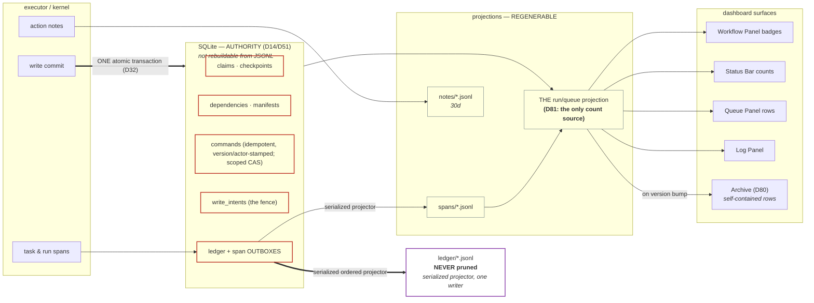

# Dashboard surfaces — the span model, the ONE projection, the command protocol, and the operator surfaces

**What this doc is.** The contract for everything the operator SEES and for every mechanism that
feeds it: the span/notes event model (§1), the storage and transport split between authority and
projection (§2), the descriptor fields this layer consumes (§3), the completion contract (§4), the
cross-repo runtime boundary (§5), and one section per operator surface (§9). It is a REFERENCE
spec — cited as `ref dashboard-surfaces §N` and never actionable on its own. What is scheduled, and
what is left, lives in the phase docs `docs/rebuild/00`–`05` and in `docs/roadmap/roadmap.md`.

**How to read it.** §0 is the legacy grounding — why this layer exists at all. §1–§3 are the
platform half: the event vocabulary, where each byte lives, the one command protocol, and the
descriptor surface. §4–§5 are two contracts this doc contributed and another doc consumes. §6 is
the rot table, §7 the worked example, §8 the settled questions. §9 is the operator surfaces, one
numbered subsection per **wire square**.

**The wire squares are shared vocabulary, not this doc's own list.** §9's subsections mirror
`ref frontend-backend-integration` §5.1.1–§5.1.7 — run modal · queue row · run detail (with the
Context rail as its sub-square) · gate ceremony · archive/activity/explorer · notifications ·
intake, mobile capture and Edit Data — in that order and under those names, then add the three
squares that exist only here: settings/storage, the shell, and the delegation/row model. One
square, one name, one order: a `Dashboard · wire` task in the tree names a square, and it must name
the same square in both docs. That doc owns the WIRE (endpoints, payload shapes, the parity lane);
this doc owns what a surface MEANS, what it refuses to show, and why an absence is drawn as an
absence.

**Status blocks.** A section that describes a tree node carries `<!-- roadmap: <id> -->` and, once
per node per doc, a `<!-- roadmap-status: <id> -->` checklist the roadmap generator renders in that
node's drawer. Where a node's checklist lives under a different section of this doc, the section
says so in one line rather than opening a second block.

## Ownership (D1)

| | Concept | Where |
|---|---|---|
| **This doc OWNS** | the span/notes wire schema and its identities (D10), the state-root layout, the SQLite authority/projection split and the recovery contract, enqueue/action/queue command semantics (D67/D95), durable notifications, local artifact outboxes/projectors, the SSE surface payloads, the completion union, the cross-repo runtime boundary (D88/D89/D93), the ratified delegation/presentation decisions, **the ONE run/queue projection (D81)**, **run versioning + archive-on-bump (D80)**, **run display names (D83)** | §1–§5, §9–§13 |
| **Imports from `ref task-contract`** | the task contract and `defineTask`, the task-id grammar (`<system>/<verb-object>`, D2), the closed `SystemId` union, the error taxonomy | referenced, never redefined |
| **Imports from `ref workflow-model`** | the descriptor shape and builder, `RunEnvelope` (`dryRun`'s one home, D6), the run-state machine including gates and parks (D5), the checkpoint store, and the readable span-path grammar | referenced, never redefined |
| **Exports `ref workflow-model` adopts** | verdict/detail semantics, completion-program semantics, and the wire projections; the descriptor carries every consumed field | §3–§4 |
| **Imports from `ref operator-trust`** | `FailureRecord`, evidence receipts and diagnostic bundles, semantic action targets, scenario ids, knowledge/fix references | referenced, never redefined |
| **Imports from `ref frontend-backend-integration`** | the HTTP/SSE transport, the per-square wiring matrix (§5.1), the action-descriptor rule (§8.5) and the parity lane (§7) | referenced, never redefined |

The "Where" column read `§§1–5, §9–10` until 2026-08-20 and had been wrong since 2i: §11 (intake),
§12 (the capture phone) and §13 (the two reference takeovers) are this doc's too, and are folding
into §9 with the rest of the surfaces.

## § number map (old → new)

Section numbers are load-bearing: 33 tree nodes carry a `ref:dashboard-surfaces §N` ref that the
`roadmap-doc-binding` guard resolves against a real heading, ~150 code comments cite one, and
`history/` plus `docs/migrations/separations.md` cite the OLD numbers and are deliberately not
swept. So the numbering moved as little as it could (cohesion plan §6.2, option B): **§1–§8 keep
their numbers and their meanings**, and §9 becomes the operator-surface shelf that §10–§13 fold
into.

**Moved (2026-08-20):**

| was | is now |
|---|---|
| the opening `Status:` + nine `**Amended …**` sentences | `history/superseded/2026-08-20-dashboard-surfaces-amendment-log.md` |
| `## Phase 1c Stage A–D as-built …` (four blocks) | `history/superseded/2026-08-20-dashboard-surfaces-phase-1c-stage-deltas.md`; residue in §2.3, §2.4, §2.5 |
| `## Phase 1f authority and command ratification` | §2.4's *Phase 1f — the authority and command ratification*, which is what `ref dashboard-surfaces §Phase-1f authority` still names |
| `## 9. Ratified delegation and presentation decisions` | §9.10 — §9 is now *The operator surfaces* |

**Folding into §9 (the two surface units; the number in the left column still resolves until each
lands):**

| was | is going to | unit |
|---|---|---|
| `## Queue-row projection as-built delta` + *The second batch* + *Drawing the second batch* + *The per-row action descriptors* + *The row title is the SUBJECT* | **§9.2** (landed) | 5.1c |
| `### D234` runs and archived runs · `### D235` the bulk vector | **§9.2** (landed) | 5.1c |
| *The shape hazard compares a run against ITS OWN workflow's served shape* | **§9.2** (landed) | 5.1c |
| `## Phase 1g/1i-spine as-built presentation deltas` (D123 · D124 · D126) | **§9.3 · §9.2 · §9.9** (landed) | 5.1c |
| `### D225`/`#### D259` · `### D238` · `## Wave-2 connection-proof presentation deltas` (D256 · D257) | **§9.3 · §9.9** (landed) | 5.1c |
| *Shell and layout as rebuilt* | **§9.9** (landed); its superseded 400/470 widths → `history/superseded/2026-08-20-dashboard-surfaces-shell-widths.md` | 5.1c |
| §9's row-model D5–D24 | **§9.10** (landed), with its per-entry table naming §9.1 · §9.2 · §9.3 · §9.3.1 · §9.4 · §9.9 | 5.1c |
| §10.1 Activity · §10.2 Archive · §10.3 display names · §10.4 the notification model | §9.5 · §9.5 · §9.2 · §9.6 | 5.1d |
| §11 the intake workspace · §12 the capture phone · §13 the two takeovers | §9.7 · §9.7 · §9.5 | 5.1d |

Two contracts deliberately do NOT move with their surface, because they are the model rather than
the screen: the durable notification row stays in §2.6 (the bell and the inbox are §9.6), and the
backup/doctor/restore contract stays in §2.5 (the Settings section is §9.8).

---

## 0. What exists today (and what specifically hurts)

_Legacy grounding, written 2026-07-22 against `hr-automation`'s tracker. Every row describes the
LEGACY tree, which is still production and unchanged; "today" here has always meant that tree. It is
kept because it is the argument for everything after it — each row names the mechanism a section
below replaces, and the file/line citations are legacy's, not this repository's._

| Today (legacy) | Mechanism | Pain |
|---|---|---|
| Queue rows | `TrackerEntry` snapshots, latest-wins dedupe, `data: Record<string,string>` bag | Every emit must re-stamp `archetype`/`__traceId`/`parentRunId`/`mode`/… or the latest row *eats* them (≥6 CLAUDE.md lessons are re-stamp bugs: ISS-006, E2E-016, the 2026-06-02 parentRunId lesson, the sweep-step lesson…) |
| Steps/timeline | `step` string on rows + `computeStepDurations` reconstruction + `step_change` session events | Three sources of "where is the run"; durations are *reconstructed*, not recorded; cancelled runs need a sentinel step (`failed`+`step="cancelled"`) that every classifier must special-case |
| Session cards | `sessions/<date>.jsonl` events keyed by mutable `workflowInstance` names + pid heuristics | The 2026-06-25 triple-root-cause dedup saga: instance names are reusable, so attribution needs pid + time-window hacks |
| Status | 5 base statuses + sentinel steps + per-workflow `statusExtensions` + OCR-only predicates (`isPrepareRow` keys on `workflow === "ocr"`) | Status semantics smeared across row fields, sentinels, extensions, and hardcoded branches |
| Approve fan-out | 3 divergent spec shapes (`approveTo`/`approveDocumentTo`/`completeDelegatedRun`) + string-keyed intent gate (`data.operationWorkflow`) + cross-spec borrowing (`onbase-emergency-contact.ts:82`) | Nothing forces coherence; a spec can declare contradictory shapes and only a doc comment objects |
| Dashboard | SSE `entries` (row-ish) + heavy client-side re-projection (queue-surface classifier duplicated client-side, `statusKeyForEntry`, `computeOcrPipelineView`, `workflow === "ocr"` at App.tsx:386/852/976, LogPanel.tsx:249, ocr/types.ts:142–211) | The client re-derives what the server already knows, and re-derivation drifts |

What is **good** and must be kept (charter: port, don't rewrite):
- The **three orthogonal axes** (shape / scope / kind) and the queue-surface collapse algorithm
  (`queue-surfaces.ts`) — battle-tested, including synthetic operation shells and
  `alwaysOperationDelegatedMembers`.
- **Backend-authoritative counts** (`wfCounts`) — the rail never trusts client math.
- Kind-dispatched **title/subtitle** (`queue-row-presentation.ts`) and the **trace id**
  (`<code>-<HHMMSS>-<runId4>`, frozen once).
- JSONL-per-day on disk — the operator greps files. (SQLite's role is split per D14: the
  claim/checkpoint tables are system-of-record; only the *projection* tables are rebuildable — §2.3.)
- Cross-midnight read-layer merge; append-at-now writes.
- The **`ocr_approvals` claim/lease/manifest durability machinery** (2026-07 hardening) — §4.4.

---

## 1. The span event model

<!-- roadmap: p1-spine -->
<!-- roadmap-status: p1-spine -->
- [x] the span wire union, its two identity tuples and the emit-time write-once rule (`src/events/types.ts`, `src/infra/events/span-jsonl-writer.ts`; 1g-spine)
- [x] D214 — the task span path carries the claim generation, so two executions of one node inside one attempt are distinguishable (`taskSpanPath`, `src/core/span-emitter.ts`)
- [x] D215 — `transaction.previewed` carries `not-observed`, and the wire leaf and the kernel port were re-pinned against each other after the first settled preview killed a worker (separations §9.15)
- [ ] the NOTES stream has no production emitter: `emitNote` is composed and never called, and `.tracker-rebuild/notes/` has never existed (`{#observed-logs}`)
- [ ] `span.ended` carries no `verdict`, so the descriptor's `verdicts` vocabulary has nothing to key off (§1.3, §3.2)
> 2026-08-20 | docs-dash-surfaces 5.1b | verified against src/events/types.ts, src/core/span-emitter.ts, src/core/run-executor.ts, src/infra/events/{span-jsonl-writer,note-jsonl-writer,jsonl-streams}.ts and the real state root; left: the notes producer and the verdict channel, both named below
<!-- /roadmap-status -->

<!-- roadmap: observed-logs -->
<!-- roadmap-status: observed-logs -->
- [ ] BE the notes stream is DECLARED, its writer is composed and exposed, and nothing in `src/` calls `emitNote` — the worker logs to stdout instead (`lineTaskLogger`, `src/server/worker/compose.ts`)
- [ ] BE a transaction node's beats emit task spans with no observation payload (`emitTaskSpan`, `src/core/write-sequencer.ts`), so nothing streams what the page said
- [ ] FE the run-detail Logs section reads the notes JSONL per request and a failed run OPENS on it (`noteLinesForRun` + `defaultTabFor`), so today's default tab for a failure is an empty stream
> 2026-08-20 | docs-dash-surfaces 5.1b | verified at D254's own bar — `.tracker-rebuild/` holds `spans/` and no `notes/` directory at all; the three doc sections that describe the stream (§1.1, §1.2, §2.1) now say so
<!-- /roadmap-status -->

### 1.1 Primitives

Everything observable is one append-only stream of **span events**. Four span kinds live in
`spans/` (worker / browser / run / task) plus gate events and the dry-run preview; **per-action
attribution rides the notes stream** (D10) — an action is a note addressed to its owning task span,
not a span of its own. That keeps the span stream small enough to be the queue/timeline truth while
preserving per-action drill-down. The notes half of that sentence is a CONTRACT and not yet a fact:
see *The notes stream* at the end of this section.

```
worker ──┬─ browser / auth / idle …        (daemon process lifetime; replaces sessions/*)
         │
run ─────┬─ task                           (one descriptor node — ref workflow-model's task chain)
         ├─ task …
         ├─ gate events                    (parked-on-operator/system states, D5)
         └─ transaction.previewed          (a dry run's transaction node — D210)
                └─ actions → notes stream  (click/fill/goto/ocr-page/… — addressed by spanPath;
                                            DECLARED, no production emitter today)
```

**Identity.** A run or task span is `(runId, attempt, spanPath)`; a worker or browser span is
`(workerId, spanPath)` — workers persist across runs, so they never receive a synthetic run id.
"Opened and closed exactly once" holds per identity, and the JSONL writer enforces it at emit
(`createSpanJsonlWriter`): a second `run.queued` for one identity throws, so does re-opening or
re-ending a span this process already opened or ended. A close with no locally-seen open is allowed
on purpose — a restart may legitimately end a span an earlier process opened, and refusing it would
make every recovery emit path throw.

The path grammar is `ref workflow-model` §6's, imported rather than redefined, and composed by
`src/core/span-emitter.ts` so no caller spells one:

```
run span:      sp-080639-0041                            the frozen trace id itself
task span:     sp-080639-0041/timecard-search#2.1        <trace>/<nodeId>#<claimGeneration>.<taskAttempt>
worker span:   worker/separations/worker-1
browser span:  worker/separations/worker-1/browser:ucpath#<sessionId>
```

**`#<claimGeneration>.<taskAttempt>` is D214's fix and it is load-bearing.** A gate park and its
resume are two claims inside ONE attempt, and an `always-rerun` node re-executes across that
boundary by design — before D214 both executions emitted the same path, so the projector's
`(runId, attempt, spanPath)` fold and the timeline's React seed each collapsed two genuinely
different executions into one (D123's lesson, one level in). Every reader still parses the node id
as everything before the LAST `#`, so a stored pre-D214 stream stays readable.

**The union is eleven strict arms** (`SpanEventWireSchema`, `src/events/types.ts`). Every arm
carries `t`, `ts`, `workflow` and `pid` plus its identity tuple; `t` alone cannot discriminate,
because `span.started`/`span.ended` legitimately appear for four kinds, so the union is plain and
each arm is a `strictObject`.

| arm | identity | what it adds | emitted by |
|---|---|---|---|
| `run.queued` | run | the row's write-once identity: `itemId`, `parentRunId?`, `shape`, `priority`, `dryRun`, `retryOf?`, `actorId`, `title`, `subtitle?`, `descriptorVersion`, `contractFingerprint`, `resolvedInstance`, `configFingerprint`, `configSnapshotId` | the BFF command service, on an applied `start-run`, intake enqueue or `retry` |
| `run.claimed` | run | `workerId` | the executor |
| `run.requeued` | run | `cause` (`reassign` · `bump` · `recovery` · `provider-capacity`), `nextAttempt` | the executor |
| `span.started` `kind:"task"` | run | `name` (the node's LABEL), `system?` | the executor |
| `span.started` `kind:"worker"\|"browser"` | worker | `name`, `system?` | the worker composition |
| `gate.opened` | run | `gate` | the executor |
| `gate.resolved` | run | `gate`, `resolutionKey`, `resultHash` | the BFF command service, on an applied `resolve-gate` |
| `transaction.previewed` | run | `node`, `subject` (`match` · `mismatch` · `unscoped` · `not-observed`), `externalCommit: "none"` | the executor, on a dry run's transaction node (D210/D215) |
| `span.ended` `kind:"task"` | run | `outcome`, `failureId?`, `errorSummary?`, `notRunReason?` | the executor |
| `span.ended` `kind:"run"` | run | `outcome`, `failureId?` | the executor |
| `span.ended` `kind:"worker"\|"browser"` | worker | `outcome`, `errorSummary?` | the worker composition |

`outcome` is `done · failed · cancelled · discarded · skipped · interrupted · superseded` —
**cancelled, discarded, interrupted and superseded are first-class outcomes**, and the
`failed + step:"cancelled"` sentinel family the legacy tree needs does not exist here. `skipped` is
a task outcome, and `notRunReason` (`condition-false` · `branch-not-selected`) may appear only on
it — a refinement enforces that, because a `done` span carrying a not-run reason would describe two
different things at once. Its ABSENCE means "no reason was recorded" and must stay legible as
that; it is never back-filled with a plausible one (D123).

**The kernel's port is nine of those arms, not eleven.** `ExecutorSpanEventSchema`
(`src/core/span-emitter.ts`) is the executor's REQUIRED sink — no default, no no-op — and it
deliberately omits `run.queued` and `gate.resolved`, which the BFF emits because it is where the
enqueue and the gate resolution are applied. The two schemas are parity twins over the arms they
share, and the twin-ness is not free: D215's fourth `transaction.previewed` verdict landed in the
kernel's union and never reached this wire leaf, so the FIRST preview that ever settled threw
inside the JSONL writer and killed a live worker one emit short of its terminal (separations
§9.15). The pinning cases are `tests/unit/events/span-events.test.ts`, and the lesson they now
carry is to enumerate the VALUES a producer can emit rather than sampling the shapes.

**What the wire deliberately does NOT carry.** Each of these is a named absence, not an oversight,
and every one of them was in an earlier draft of this section:

- **`span.patched`** — RETIRED by D254; see the block below.
- **`subject.observed`** — recorded at `src/events/types.ts:30` as a deliberate absence. Subject
  comparison is the write sequencer's beat ③ and lands in the durable intent and its binding proof
  (`ref write-safety` §5), not on a display stream.
- **`verdict` on `span.ended`** — there is no such field, so the descriptor's `verdicts` vocabulary
  (§3.2) has nothing to key off. It is declared, validated at `build()` and SERVED to the Workflow
  Explorer as declared prose (`src/server/dashboard/queries/explorer.ts`), and no status is derived
  from it anywhere. §1.3 is where that promise was made; this is where it is unmet.
- **`evidenceReceiptId` on `span.ended`** — the receipt is DERIVED from authority (D82/D141) and
  looked up by `runId`; carrying its id on a display event would put a second, staler pointer beside
  the one the surfaces already resolve.
- **`resultRef` on `gate.resolved`** — a gate result is keyed by `(runId, gateId)` in authority, so
  a separate ref id would duplicate an identity that already exists. `resultHash` stays, because a
  digest is a fact about the bytes rather than a second address.
- **`subject`, `subjectKind`, `input`/`sensitiveInputRef` and `displayOnly` on `run.queued`** — the
  KIND axis, the run's business input and the task-less display row were all in the 1g draft and
  none of them is on the wire. The input lives in the immutable run envelope in authority; the
  subject reaches the queue as the projection's `title`, replaced once from the descriptor's own
  `subjectProjection` leaf when the run's reads settle it (§1.2); and no enqueue path in `src/` can
  produce a `displayOnly` row, because none can produce the `operation` shape it belongs to (§1.3).

The wire schemas are the contract; TypeScript declarations are readable views of them.
`SpanEventWireSchema`, `NoteWireSchema`, every `*WireSchema` and the SSE payload schemas are strict
zod unions whose inferred types ARE the implementation types. Native JSONL read, SQLite read/write,
HTTP input/output, SSE emission and fixture load all parse at the boundary. Unknown keys, invalid
ISO instants, unbranded ids, non-canonical JSON, `NaN` and invalid state combinations fail — they
are never cast into the model. An optional offline historical importer owns its own explicit-version
parse and visible quarantine contract; it is not a runtime boundary.

#### D254 — the `span.patched` detail channel is RETIRED (2026-08-20, operator ruling)

<!-- roadmap: track-b -->

**`span.patched` is removed from the span vocabulary.** It carried a declared per-workflow key set
(`descriptor.details`) and folded into a `row.details` map the run-detail Context rail read. It had
**zero production emitters, in the strongest available sense**: the kernel's `SpanEmitter` port
(`src/core/span-emitter.ts`) never carried the arm, so no code path in `src/` could produce one; the
only producers that ever existed were test fixtures; and `.tracker-rebuild/spans` — every real run
this program has ever executed — holds no such line. Every surface fed by the channel therefore
rendered its empty state permanently, through every green gate, since 1g-spine. The gap was recorded
in `docs/findings/dashboard-projection.md` on 2026-08-14 (found while building the subject title,
which reads a CHECKPOINT for exactly this reason — §1.2 above).

**The ruling is to remove, not to build.** An arm nothing can emit is not "unused", it is
unreachable, and leaving a declared vocabulary arm in place makes the wire claim a capability the
runtime does not have. Retiring is reversible and honest; building the emitter is work nobody asked
for. What was removed, end to end:

| Site | What went |
|---|---|
| `src/events/types.ts` | the `SpanPatchedSchema` arm, `DetailUpdateWireSchema`, its key schema, `SPAN_IDENTITY_ATTRIBUTE_KEYS` (whose only reader was the patch key refusal), and the now-unused JSON value schema |
| `src/infra/events/span-jsonl-writer.ts` | the declared-key enforcement branch and the `declaredDetails` dep it needed — a `span.patched` line now fails `SpanEventWireSchema.parse` before any byte reaches disk |
| `src/server/dashboard/compose.ts`, `src/server/worker/compose.ts` | the two `declaredDetails` injections |
| `src/server/dashboard/projectors/run-queue-projection.ts` | the fold arm and the `details` field of `RunFoldRecord` (a rebuildable projection — the fold schema hash moves and the tail re-folds from disk; nothing durable holds this shape) |
| `src/server/dashboard/queries/run-detail.ts` | the `row.details` loop in the Context-rail payload, the `details` member of `RunDetailDescriptorView`, and `editableEntryOf`'s `display` argument and checkpoint-less arm |

**`descriptor.details` STAYS, with its meaning restated.** It is no longer a patch-key vocabulary; it
is a DECLARATION with three real readers — the evidence receipt's mandatory-leaf set
(`src/core/evidence-receipt.ts`), the run-detail data-origin bound (`dataOriginViewsOf`, whose
resolved path set is `details[].source` ∪ `capabilities.editData.fields`), and the Explorer's field
census. Removing it would have been the over-correction: three live consumers, one dead one.

**What the Context rail lists is now exactly one rule.** A row exists iff a `capabilities.editData`
field has a stored checkpoint — D252's "the Data section lists values the run TOUCHED", made
structural rather than defended by a guard clause. Two consequences are deliberate. A declared
`details` spec that is not a correctable field contributes NO row (before this it contributed one
only in a fixture); and `editableEntryOf` takes the checkpoint as a parameter, so "there is a stored
checkpoint" is stated in the type instead of re-derived and re-answered.

**The named alternative, and why it was not taken.** Declared details could be served from
checkpoints the way D252 serves correctable fields — the same `latestCheckpoint` read is one line
away. That is a BUILD (it decides which declared leaves belong on an operator surface, their order
and their labels), and the surface's membership was decided by D252 two days earlier. **The trigger
that re-opens it:** an operator asking for a declared, non-correctable value on the run-detail rail.
The answer then is a checkpoint read, never a re-added event arm — the channel's defect was never its
shape, it was that nothing wrote it.

**Reading a historical line.** A `span.patched` line would now be refused BY NAME by the tail, which
degrades the projection and schedules the guarded rebuild (D218). That is the correct answer and
costs nothing, because no such line exists: the retirement was verified against the real state root,
not merely against the source tree.

**The notes stream — declared, composed, and written by nothing.** Notes are the high-volume half
of D10: log lines, screenshots, per-action records, data points. They carry the same `SpanRef`
addressing as spans, so a note attributes to its exact task attempt or worker lifetime:

```ts
// src/events/types.ts — NoteWireSchema, a union over the two identity tuples
{ ...identity, ts, workflow, pid,
  level: "step" | "success" | "error" | "waiting" | "warn" | "debug",
  message: string,
  fields?: readonly NoteFieldWire[],   // closed kind union: text | count | digest | last4 | basename
}
```

`fields` is a closed key/value union whose kinds mirror the redaction transforms (`ref
clock-config-secrets`): a value that reached this wire either passed `allow` as text or was
transformed, and a dropped field does not appear at all. Notes are evidence, not control state — a
new structured field is a schema extension, high-cardinality exploratory metadata belongs in a
schema-versioned diagnostic attachment, and no projector, command handler, retry policy or workflow
bind may branch on note prose or an untyped attachment payload.

**Nothing writes it.** `emitNote` exists and is the only entry
(`src/infra/events/note-jsonl-writer.ts`); the writer is constructed in the dashboard composition
and exposed on its handle (`src/server/dashboard/compose.ts`) — and **no caller in `src/` ever
invokes it.** The only callers are test and fixture files. The worker, which is where a run's log
lines would come from, writes structured JSON to stdout instead (`lineTaskLogger`,
`src/server/worker/compose.ts`). At D254's own evidentiary bar — verified against the real state
root, not merely against the source tree — **`.tracker-rebuild/notes/` does not exist**: the state
root holds a `spans/` directory with a file per workflow-day and no notes directory at all.

Three consequences are worth stating where a reader meets them, because each reads as a rendering
quirk from the surface side. The run-detail **Logs** section re-reads that stream per request
(`noteLinesForRun`, `src/server/dashboard/queries/run-detail.ts`) and therefore serves an empty
page. `defaultTabFor` opens a **failed** run on Logs (`log-panel-model.ts`), so the default tab for
the one run an operator most needs to read is the empty one. And the `notes/` line in the §2.1
layout, the "second grep" rationale there, and §1.2's *timeline ← notes* row all describe a stream
with no producer.

This is `span.patched`'s shape one stream over — machinery whose consumers are complete and whose
producer was never written — with two differences that decide the disposition. The channel is
REACHABLE (a call to `emitNote` writes a line and the Logs section reads it back), and it has a
named owner: `{#observed-logs}` in the tree, whose whole premise is that the log carries the facts
each task recorded. So this is a to-build, not a retirement.

The declared attribution fields the 1g draft named on the note — `action` (task + semantic UI id +
page-state transition) and `attachment` (screenshot / data point / diagnostic) — are not on
`NoteWireSchema` either, and are recorded as the driver-instrumentation slice's, at
`src/events/types.ts:30`.

**Volume, the reason for the split.** The legacy per-page OCR pipeline emits zero tracker rows —
its state rides ~8–12 deduped, 250 ms-debounced row snapshots per run. A naive per-action SPAN
stream would multiply that by orders of magnitude. Under D10 the split is: `spans/` carries run,
task, gate and preview events — roughly **10–40 events per run**, bounded by the descriptor's node
count × attempts and not by page or click counts — and everything per-action lands in `notes/` at
roughly today's log-line volume (hundreds per OCR run). Queue and timeline projections read spans
only; notes load lazily per selected run. That bound is what makes the span stream safe to fold on
every tick, and it holds today because the span half is real.

### 1.2 What each of today's surfaces becomes (all are projections)

<!-- roadmap: p1-spine -->
<!-- roadmap: dash-defaults -->

| Surface | Legacy mechanism | Projection of | As-built |
|---|---|---|---|
| Queue row | latest `TrackerEntry` snapshot | the run span's `run.queued` identity attributes ⊕ open gates ⊕ `span.ended`, joined with the authority run row | `#surface` in `run-queue-projection.ts` → `QueueSurfaceWire` |
| Status badge | status + sentinel step + `statusExtensions` | the run's state machine: `queued` → `queued`, claimed → `running`, an open gate → `awaiting-approval`, ended → the outcome verbatim | `QueueStatusSchema`'s eight values; no sentinel decoding anywhere |
| Step pipeline | registered steps + a `step` string + reconstructed durations | the descriptor's nodes ⊕ task spans — a task span IS the duration | `pipeline: PipelineStepWireSchema[]` |
| Run-detail timeline | rows + logs + filtered session events (pid heuristics) | the run's own span fold — task spans, gate open/resolve, and D259's `replayed` arm for a node whose checkpoint another run wrote | `timelineEvents` in `queries/run-detail.ts`; **spans, not notes** |
| Logs | log lines per run | the notes stream, re-read per request | `noteLinesForRun` — **and nothing writes that stream** (§1.1) |
| Worker card | `rebuildSessionState` over instance-keyed events | the worker span and its browser child spans, keyed by `workerId` recorded at `run.claimed` — the instance-name/pid/time-window attribution class of bugs is structurally dead | `workerCards` in `buildDashboardDayWire` |
| Counts (`wfCounts`) | `countSidebarRowsFromTrackerHistory` | the SAME `surfaces` array the queue renders, folded once, server-side (D81) | `workflowCounts`/`statusCounts`/`monthCounts`, all from one loop |
| Row-lifecycle debug | replay + cause *guessing* | free: `run.requeued.cause` and `nextAttempt` are recorded, not derived | `RunRequeuedSchema` |

The **timeline** row is the one that changed meaning since the 1g draft, and the change is worth
reading twice. The draft said *"run span tree's notes ⊕ the owning worker span's lifecycle events"*.
The timeline folds SPANS — that is what makes it derivable at all, since spans are bounded per run
(§1.1) — and the notes half is a separate lazy section that reads a stream nothing writes. A reader
who took the old sentence literally would look for the timeline's bug in the fold; the gap is one
layer earlier, at the producer.

### 1.3 Decision: archetypes survive as vocabulary, die as per-row stamps

The four row shapes (`single | preview | operation | operation-member`) are **kept** — they are the
proven queue vocabulary — and the mechanism that replaced re-stamping is as-built:

- **Declared on the descriptor** (`surface.shape` or `surface.resolveShape: "by-input"`) and
  materialized **once** on `run.queued.shape`. A member's shape is set by the fan-out dispatcher on
  the child's own `run.queued`.
- **Never re-stamped, structurally.** `run.queued` is the only arm of the union that names an
  identity attribute; every other arm is a `strictObject` that does not, so a re-stamp does not
  parse. The whole legacy re-stamp bug class is unrepresentable rather than merely banned.
- **No legacy normalization** (`batch` → `operation`) in this runtime. An optional versioned
  one-time historical import would own that translation (§5).

Two of the three axes did not survive as stamps, and the doc said otherwise until 2026-08-20.

**The KIND axis is not on the wire.** `subjectKind` appears nowhere in `src/`. What a run is ABOUT
reaches the operator as the projection's `title` — composed by the descriptor's `presentation.title`
from the start input and REPLACED once, when the run's own reads settle the subject at the leaf the
descriptor declares (`subjectProjection`) — and as `panelKind` for layout. Kind-dispatched titling
survived; a per-row kind stamp did not, and nothing needed one.

**Three of the four shapes have no producer.** Every enqueue path in `src/` stamps
`shape: "single"` — `command-kernel.ts:1617` and `:2274`, `capture-intake-handoff.ts:242`,
`services/start/plan.ts` — and every registered descriptor declares `surface: { shape: "single" }`.
The kernel says so itself at `command-kernel.ts:1608-1612`: *"the coordinator/member fan-out has no
runtime yet (nothing mints an `operation` run)"*. The projection, the containment fold,
`memberRollup`, `memberPreview`, the member well and the `run-group`/`run-member` parity references
are all real and all fed by hand-composed fixtures. Building the presentation ahead of the workflow
is correct — §4's completion contract is what will mint these rows, at order 4 — but the doc must
say it is ahead, and §9's group-row decisions must be read as a contract for a shape the system
cannot yet create.

Derived statuses stop being per-workflow code where a universal mechanism exists — one of the two
promised here is built and one is not:

- **An open operator gate is a universal projection rule**, not a per-workflow predicate: a run with
  an open gate row projects `awaiting-approval` and the queue draws it with the gate's own age
  (D12). OCR would only have to declare the gate.
- **Descriptor-declared verdict mappings are NOT wired.** `verdicts` is authored as plain data,
  validated at `build()` (`assertUnique` over the keys, `src/base/workflow.ts`) and served to the
  Workflow Explorer as declared prose — and the thing it was to be keyed off,
  `span.ended.verdict`, does not exist (§1.1). So person-lookup's `notFound` is not rendered from a
  verdict today. What this section DID buy is the deletion it promised: there is no
  `statusExtensions` function registry, and no surface may branch on a workflow id
  (`dashboard-wire-boundary`'s *branches on no concrete workflow id* arm). The vocabulary is data;
  the channel that would carry a value is the open half.

---

## 2. Storage and transport

<!-- roadmap: p1-authority -->
<!-- roadmap-status: p1-authority -->
- [x] the authority/projection table split, the exhaustive frozen registry and the once-per-transaction generation rule (1c; `src/domain/authority.ts`, `src/infra/sqlite/authority-database.ts`)
- [x] released migrations are immutable — every version's ordered statement bytes pinned by literal digest, v1 through the current v15 (`src/infra/sqlite/migrations.ts`, `migration-history-immutability`)
- [x] the nine strict command target families and the actor-stamped idempotent envelope (D95, §2.4)
- [x] the durable notification row, folded in place per `(actorId, dedupeFingerprint)` (D134, §2.6)
- [x] the descriptor fields this layer consumes are declared and validated at `build()` (§3)
- [ ] `StepDisplayRule`, `GateProjectionDefinition` and the `ArtifactSinkId` sink registry are named in §3.2 and implemented nowhere
> 2026-08-20 | docs-dash-surfaces 5.1b | verified against src/domain/authority.ts, src/infra/sqlite/{authority-database,migrations}.ts, src/domain/commands.ts and src/domain/workflow/presentation.ts; left: §3.2's three unimplemented declaration shapes
<!-- /roadmap-status -->

The four dated `Phase 1c Stage A–D` blocks that used to stand above §0 are in
`history/superseded/2026-08-20-dashboard-surfaces-phase-1c-stage-deltas.md`; what they landed is
stated here, in §2.3, §2.4 and §2.5, as what IS rather than as what a stage added.

**The whole layer in one picture.** The load-bearing rule is the split between what is *authority*
(SQLite — not rebuildable, never deleted casually) and what is *projection* (JSONL + the read
model — regenerable). Every arrow below is one-directional; nothing reads back up.



Three things to read off it: a write reaches **authority in one atomic transaction** before any
JSONL exists (so a crash between them is repairable, never a lost filing); the **ledger has exactly
one ordered writer**, with actor-attributed entries reconciled from atomic outboxes; and **every
count in the UI descends from one node** (D81, §10.1) — there is
no second path a badge could take.

### 2.1 On disk — JSONL-per-day stays, two streams

<!-- roadmap: p1-spine -->
<!-- roadmap: observed-logs -->
<!-- roadmap: def-retention -->
<!-- roadmap-status: def-retention -->
- [x] the 30-day floor for both event streams is a settled number and it is enforced: `EVENT_STREAM_RETENTION_DAYS = 30`, applied once at boot before the fold (`src/domain/archive/retention.ts`, `src/server/dashboard/compose.ts`)
- [x] `ledger/` is structurally unprunable — `pruneEventStreams` can only see `spans`/`notes`, and a ratchet fails any module that both names `ledger/` and calls a deletion primitive
- [ ] the diagnostic-bundle 14/8/5 purge schedule and the content-store refcount reclamation (D193 `wont-build-unless-asked`; `ref operator-trust` §2.2 owns the schedule, §2.5 the backup retention)
- [ ] a configurable backup path — §2.5's *"a configurable path may point at another local volume"* is unimplemented, and the suspect directory is `<stateRoot>/suspects` by construction with no config leaf
> 2026-08-20 | docs-dash-surfaces 5.1b | verified against src/infra/events/jsonl-streams.ts, src/domain/archive/retention.ts and the D181 as-built below; left: both remainders are D193's, on nobody's milestone until the operator asks
<!-- /roadmap-status -->

The rebuild owns the distinct `.tracker-rebuild/` state root. Production `src` owns `.tracker/`;
neither runtime reads or writes the other's root.

```
.tracker-rebuild/
├── spans/   <workflow>-<date>.jsonl   span events (low volume — the queue/timeline truth)
├── notes/   <workflow>-<date>.jsonl   notes (high volume — logs, actions, screenshots, data points)
│                                      DECLARED, never written — the directory does not exist (§1.1)
├── evidence/<runId>/                  run receipts + redacted diagnostic bundle manifests (ref operator-trust)
├── artifacts/<hash>.artifact          content-addressed task outputs; atomic, immutable bytes
├── ledger/  <system>-<date>.jsonl     immutable write receipts (D21; shape owned by ref write-safety §6) —
│                                      ordered, actor-attributed, append-only, per-SYSTEM+day,
│                                      NEVER pruned (the audit floor; hash chain deferred by D79)
├── backups/state/                     checksummed online backups + restore manifests (§2.5)
└── state.db                           SQLite — claims/checkpoints/intents/outboxes,
                                       commands/dependencies/notifications are system-of-record;
                                       read projections alone are rebuildable
```

**Which of these the runtime actually writes.** `spans/`, `artifacts/`, `backups/`, `locks/` (D181)
and `state.db` are created and written today. Three are not, each for its own reason and each
verified against the real state root rather than against the source tree:

- **`notes/`** — nothing calls `emitNote`, so the directory has never existed (§1.1).
- **`ledger/`** — the projector is written and unit-proven (`src/infra/ledger/ledger-projector.ts`,
  D134's five ordered durable facts, guarded by `ledger-projector`) and **`createLedgerProjector` has no production caller**: its
  only callers are tests. Beat ⑦ does write the durable ledger OUTBOX row inside its authority
  transaction (`ref write-safety` §5), which is the fact the audit floor depends on — nothing
  drains it to a file. The READ half is composed and live (`createLedgerReadThrough`, shared by the
  archive's line pointers and D236's Activity block), so both read a corpus that is currently
  empty. This is §1.1's notes gap a second time: a complete mechanism whose producer was never
  wired. It is not a retirement candidate — a real HR write's immutable receipt is the audit floor
  D21 exists for, and the outbox rows that feed it are already durable.
- **`evidence/<runId>/`** — the receipt moved into authority. D82's `RunEvidenceReceipt` is DERIVED
  from authority and stored as a durable row (`src/core/evidence-receipt.ts`, D141), not as a file,
  and the diagnostic bundle's attachments live in the content-addressed `artifacts/` store by
  digest (D137). What this layout line describes is a path shape nothing writes; what it means —
  evidence is indexed by content hash and missing capture is recorded explicitly — is as-built one
  layer over, in SQLite.

Rationale against alternatives:
- **Why not SQLite-only?** The operator greps files. **The design is two greps:**
  `grep sp-080639 .tracker-rebuild/spans/*.jsonl` answers *what happened* (state transitions,
  outcomes, gates), and `grep sp-080639 .tracker-rebuild/notes/*.jsonl` was to answer *what it did*
  (log lines, per-action records, screenshots) — one trace id returning the whole operation tree
  across workflows in both. **Only the first grep answers anything today**, and the cost is not the
  one this bullet used to record: the `spans/` grep does not contain log-line text (that is the real
  D10 split cost, as documented) AND the second grep has no file to read. `{#observed-logs}` owns
  closing it.
- **Why split spans/notes?** Queue and timeline projections read spans only (§1.1's volume note);
  notes load lazily per selected run. Mirrors the legacy rows/logs split, which was proven.
- **Why a separate `ledger/` (D21 — owner = this doc)?** Ref write-safety's write-safety layer files one
  immutable receipt per real HR mutation (the projector that appends it is unwired — see above). It is partitioned per-**system**+day so
  `grep 10001573 .tracker-rebuild/ledger/ucpath-*.jsonl` answers "what did we file for this person,
  across time." It is ordered, actor-attributed, and **never pruned**. Ref write-safety owns
  the entry *shape* (`LedgerEntry`, §6 there); this doc owns that the dir lives in the layout and is
  exempt from `clean-tracker`.
- **Base retention — DECIDED (D86):** `notes/` and `spans/` both prune at **30 days**.
  `ledger/` is exempt from both — its never-pruned floor now sits **above a settled number, not a
  guess** (this is what ref write-safety §6 references). Legacy `.tracker/` retention is unchanged and owned
  only by production `src`.
- **Why per-workflow files?** Small greppable files; partition key matches the SSE topic scope.
  Worker spans write to their workflow's file (a daemon serves one workflow).
- **Span/note write discipline (ported):** append-at-now partitioning; cross-midnight solved at the
  read layer with the OPEN-span forward-merge (same algorithm as `cross-midnight.ts`); synchronous
  SIGINT terminal writes; `O_APPEND` single-line writes. **Ledger is different:** executors write
  durable outbox rows and one serialized projector assigns ordered sequence and appends (ref write-safety).
- **Local artifacts are not hidden task writes (D45).** A read task may create only immutable,
  content-addressed bytes under `artifacts/` through ref task-contract's writer; the returned `{id,sha256,bytes,
  mediaType}` is canonical JSON and checkpoints reference it without exposing a filesystem path.
  Per D97, `id` remains the existing UUID-backed `ArtifactId`; `sha256` is the distinct content
  identity and private `artifacts/<hash>.artifact` key. Byte-identical puts are idempotent and
  return the same public reference. The backing path is never part of a task, checkpoint, or wire
  contract.
  Mutable operator artifacts (for
  example i9's retention workbook) are different: the node checkpoint and a stable-keyed
  `artifact_outbox` row commit atomically in SQLite, then a single sink projector performs
  temp+fsync+atomic-replace and records the projected content hash. Duplicate outboxes/key retries
  are no-ops. A blocking projection failure parks the run; it never reports done while silently
  dropping the workbook update.
- **Evidence is indexed, not scattered.** `evidence/<runId>/receipt.json` points to immutable
  screenshots/artifacts/failures by content hash and records missing capture explicitly. Diagnostic
  bundles redact by schema before writing; they never copy `.env`, cookies, browser storage, raw
  SSNs, or unrestricted input blobs (ref operator-trust §3).

### 2.2 Projections are computed server-side — the wire carries surfaces, not rows

<!-- roadmap: p1-spine -->

The legacy client re-implements queue-surface classification, status keying and pipeline math. Here
the wire carries **finished projections**: the client renders and never re-derives. Descriptor
metadata reaches the SPA as `ref workflow-model`'s validated client projection — the SPA never
imports a workflow module — and every payload carries `descriptorHash`, the skew tripwire, so a
stale bundle fails loud rather than rendering against a graph that moved.

**The shapes live in `src/domain/dashboard/`, and this section names them rather than restating
them.** A TS sketch here would be a second, staler copy of a strict zod schema, which is the drift
this whole layer exists to delete; `ref frontend-backend-integration` §5.1 owns the per-square wire
and §3 the transport. What each one IS:

| shape | module | what it carries |
|---|---|---|
| `DashboardDayWire` | `projection.ts` | one day: `day`, `descriptorHash`, `projectionGeneration`, `snapshotCursor`, `monthCounts`, `workflowCounts`, `statusCounts`, `queueSurfaces`, `workerCards`, `notifications` — with uniqueness refinements on all six collections |
| `QueueSurfaceWire` | `projection.ts` | a union of three variants over one shared `QueueBaseFields`: `single`/`preview`, `member`, and `operation` (which alone adds `memberRunIds`, `memberRollup{total,terminal,failed}` and `memberPreview`) |
| `RunDetailWire`, its sections and pages | `run-detail.ts` | the per-run panel: header, timeline, and the lazily-fetched sections |
| `ActionDescriptorWire` | `actions.ts` | the ONLY source a surface may render an interactive control from (§2.4) |
| `NotificationWireSchema` | `projection.ts` | the bell's row (§2.6) |
| the SSE envelope and its patches | `subscription.ts` | six topics (`dashboard-day`, `run-detail`, `run-logs`, `run-review`, `run-people`, `artifact`) and one patch shape per topic |

The 1g draft's `EventsHubPayload`/`QueueSurfaceWire` sketches stood in this section until
2026-08-20 and were two generations behind. The corrections worth carrying forward, because each
was a design decision and not a rename: the day payload is ONE object per day rather than a
per-panel queue plus a parallel `wfCounts` array (D81 — every count folds from the same `surfaces`
array in one loop); a member is a first-class surface VARIANT rather than an optional field, and
`memberRollup` is three integers with a refinement tying `total` to `memberRunIds.length` rather
than a status/count tuple list; `detailSurfaces`, `links` and `evidence` are gone, replaced by
`availableSections` (§2.4's served-not-guessed rule applied to tabs), `linkedRuns` (which carries
the target's label and status, because serving a bare id would make the client re-derive a status
— the second path D81 deletes) and the receipt/failure lookups the run-detail sections do; and
every fact that can be absent is a discriminated `{state:"present"|"absent", reason}` union rather
than an optional — `endedAt`, `gateOpenedAt`, `displayName`, `subtitle`, `facts`, `warnings`,
`runNumber`, `memberPreview`. That last one is the load-bearing pattern of the whole wire: an
absence carries the reason it is absent, so a surface can say *why* there is nothing instead of
drawing an empty slot.

**Patching.** After the initial snapshot a changed row re-sends ONLY that complete strict surface
(`replace-queue-surface`, whose refinement pins the patch's `(runId, rowRevision)` to the
replacement's own), so a 100-member operation tick re-serializes one row and never a resolved
member tree (D10). The client applies and never merges: `applyDashboardDayPatch` replaces one
surface by id, ignores a lower `rowRevision` as a resume replay, and raises a protocol error for a
patch naming a run the snapshot does not hold — which the subscription turns into a resnapshot,
never a silent insert.

Two removal arms are declared and have **no producer**: `remove-queue-surface` and
`tombstone-queue-surface` (`subscription.ts`). The client handles them — identically, both dropping
the surface — and no code in `src/` ever emits one. They are the shape D254 retired one layer over:
two names for one behaviour that nothing can reach. Build one (a row leaving the day needs a reason
and a distinct tombstone rendering) or retire both; leaving them declared makes the wire claim a
capability the server does not have.

For a run parked on an unfinished write intent, the server replaces ordinary retry/done actions
with the closed kernel actions `resolve-write-present` and `resolve-write-absent` (ref write-safety §4.1),
including intent generation+version tokens. The descriptor cannot re-enable generic Done/Retry for
that state. These actions derive from durable intent state, not a workflow-id registry; stale
tokens fail with a conflict and trigger a fresh projection.

Per-run detail (timeline, sections) stays request/response plus a per-run SSE topic, and the
payload is already merged and ordered server-side — no client owns merge or dedup heuristics.

### 2.3 SQLite (role per D14)

<!-- roadmap: p1-authority -->

_Its checklist is the `p1-authority` status block under §2 — one block per node per doc._

`state.db` has **two classes of table with different authority**:

- **System-of-record (NOT rebuildable and never deleted by projection/runtime row maintenance):**
  the task/claim store (tasks, leases,
  dependencies, delegation manifests, commands, start plans, terminal authorizations/results, failures,
  notifications, capture sessions/photo order/finalization outboxes — ref workflow-model §5.7's checkpoint payloads,
  §4.4's `ocr_approvals` manifests, and
  ref write-safety's permanent-key `write_intents`, `write_attempts`, and durable outbox, plus
  stable-keyed local `artifact_outbox`/sink-head rows). The system-of-record set is
  "planned/accepted run authority + claims + checkpoint/result/failure payloads + write
  authority/outboxes + local artifact projection authority + in-progress capture/handoff
  authority." Losing any of these loses accepted input, claims, resumable/terminal results,
  structured failure truth, in-flight write fences, or accepted capture work — they have no JSONL
  double.
- **Projection tables (rebuildable):** span-shaped read models (`spans`, `gates`, `notes`,
  `runs_view`) fed by one projector consuming only native rebuild spans — **FROM DISK,
  cross-process (D218)**: the worker emits its task spans from a separate OS process, so the
  projector's one live feed is an offset-aware tail of the stream files, never an in-process emit
  hook. These — and only these — can be deleted and rebuilt from JSONL, with today's operational
  rules: JSONL writes first, projection applies after (structural under D218 — the fold can only
  see bytes already landed), projection failures schedule guarded rebuilds and never block
  workflows; source identity is `resolve(path)`; deletion tombstones and offline compaction port
  as-is.

The system-of-record class includes a singleton `authority_meta(schema_version,
authority_generation,updated_at)`. The infra adapter exposes separate authority and projection
transaction APIs; repositories cannot execute arbitrary SQL or receive the raw connection. Every
top-level committed transaction that mutates at least one authority table increments
`authority_generation` exactly once inside that same transaction; projection-only rebuilds do not.
Nested authority operations share the outer transaction/generation increment. The table-class
registry generates coverage tests that mutate each authority repository and prove the generation
advances, then mutate each projection repository and prove it does not. A newly added authority
table without a registered mutator test fails. This makes D72 backup RPO comparison an actual
monotonic authority fact rather than a timestamp guess.

Any sentence in this doc that says "rebuildable" means the projection tables only. The sole
authority-removal exception is the explicit stopped-system, exact-id, backup-gated Purge procedure
in §2.4; ordinary cleanup, Hide, projection rebuild, and runtime code cannot reach authority rows.

#### D218 — the projector consumes the span stream FROM DISK, cross-process (2026-08-14)

<!-- roadmap: platform-fixes -->
<!-- roadmap-status: platform-fixes -->
- [x] D218 — the projection's ONE live feed is an offset-aware disk tail; the `onEvent` hook is deleted, so "append first, fold after" is structural (`ingestFromDisk`, `src/server/dashboard/projectors/run-queue-projection.ts`)
- [x] D218 — two triggers, one cursor: the 250 ms dashboard poll and the command service's own tick after `run.queued`/`gate.resolved`
- [x] D218 — a torn trailing line is not consumed until its newline lands; an unparsable line degrades and the guarded rebuild refuses it by name; a file shorter than its cursor throws
- [x] D222 — the backup hazard publishes a durable `storage-degraded` notification on TRANSITIONS and leaves the every-view banner to authority-unavailable alone (§2.6)
> 2026-08-20 | docs-dash-surfaces 5.1b | verified against run-queue-projection.ts, src/infra/events/jsonl-streams.ts, src/server/dashboard/{compose,commands/command-service}.ts and src/services/notifications/storage-health.ts; the node's other fixes (D219–D221, D243/D244) are `ref workflow-model` §1.2.1/§4 and `ref execution-and-sessions` §4.2
<!-- /roadmap-status -->

"One projector" had been implemented single-process: a one-shot boot `rebuildFromJsonl` plus an
in-process post-append hook on the BFF's OWN span writer. The worker is a separate OS process, so
its task spans never reached the projection — every run enqueued after the dashboard booted served
an empty timeline, empty pipeline chips, and empty `dataFacts`, while its full span history sat in
`spans/<workflow>-<date>.jsonl`. Run STATUS stayed correct (it joins authority per surface) and
LOGS stayed correct (the notes JSONL is re-read per request), which is exactly why only the
timeline looked broken; the fingerprint of the defect was a run whose fold held exactly ONE event —
its own `gate.resolved`, the only span the BFF itself emits mid-run. The defect stood from 1i-spine
until 2026-08-14; restarting the dashboard masked it for every run already on disk.

As-built contract:

- **The projection's ONE live feed is an offset-aware tail of `spans/*.jsonl`**
  (`RunQueueProjection.ingestFromDisk` over `readEventStreamLinesFrom`): a byte cursor per file,
  advanced only through the last landed newline. `rebuildFromJsonl` seeds the cursors from exactly
  what it consumed, so the rebuild and the tail can never double-fold a line. The span writer's
  `onEvent` hook is REMOVED — "JSONL writes first, projection applies after" is now structural,
  because the fold can only read bytes that already landed.
- **Two triggers, one cursor.** The dashboard polls the tail every 250 ms (`SPAN_TAIL_POLL_MS`,
  the staleness ceiling for worker-emitted spans), and the command service ticks the SAME cursor
  after its own emissions (`run.queued`, `gate.resolved`), so an operator's follow-up read never
  waits for the poll. Neither is a second ingest path: every event reaches the fold as bytes read
  back from the stream file.
- **Fail-loud, never skip.** A torn trailing line (another process mid-append) is not consumed
  until its newline lands. An unparsable tailed line degrades the projection and schedules the
  guarded rebuild — and since the line is real durable history, the rebuild refuses it by name
  too, leaving the projection loudly degraded rather than quietly reading past it. A stream file
  SHORTER than its cursor fails loud (these files are append-only; a shrink is truncation of
  history). A file the cursors have never seen (day roll, new workflow) is read from byte 0.
- **Rejected:** per-request re-fold (O(all spans) per call); worker→BFF push (couples the two
  processes the D88/D181 isolation model keeps apart); reading `runs_view` back (a write-only
  mirror of the same in-memory rows); and tolerating an empty fold in `buildRunDetail` (the events
  were never dropped by a filter — they never arrived, and the reader is the wrong place to repair
  an ingest gap).

#### D255 — a `span.ended` binds to an OPEN entry, and one producer still owes its execution identity (2026-08-20)

<!-- roadmap: track-b -->

**The fold rule.** A task `span.ended` binds to the LAST entry at `(attempt, spanPath)` whose
`endedAt` is absent; when every entry at that identity is already closed (or none exists) the close
appends a new entry with no start, which is the same arm that already carried "a restart closed a
span an earlier process opened". It never rewrites a measured span's end.

The rule matters only when a producer emits one `(attempt, spanPath)` twice, and the first-match
binding it replaces did not undercount there — it FABRICATED. The first entry kept its own
`startedAt` and took the second execution's `endedAt`, so the step's `durationSec` covered both
executions **and everything between them** — a gate park is hours — while the second entry stayed
open and was dropped as unmeasured. B4a recorded this as a low-priority undercount behind the new
`pipeline[].executions` counter; it is the opposite kind of error, which is why it was fixed rather
than deferred. `tests/unit/server/run-queue-projection.test.ts` pins it, writing the duplicate
straight to the stream because the JSONL writer's own identity guard refuses a re-open in-process.

**Which producer can do that — and it is not the one the record named.** The record attributed the
duplicate to a requeue re-executing a node at the same span path. That has been impossible since
**D214**: `taskSpanPath` is `<trace>/<node>#<claimGeneration>.<taskAttempt>`, so two executions of
one node inside one attempt already differ. The reachable producer is the **write sequencer's beat
spans** (`emitTaskSpan`, `src/core/write-sequencer.ts`), whose path is `<trace>/<node>/<beat>` with
no claim generation and no task attempt — D214's identity fix never reached it. Two consequences,
both DEFERRED here with their trigger rather than fixed blind:

- A transaction node executed twice inside one attempt would first hit the writer's own
  `opens exactly once per identity` refusal **in-process** — a thrown worker, not a display quirk —
  and only across processes reach the fold at all. Tracing the executor, that state is currently
  unreachable: the transaction arm has no retry loop, and a node with a checkpoint replays without
  emitting spans, so a transaction node executes at most once per attempt.
- `nodeIdOfTaskSpanPath` reads a node id as "everything before the last `#` of the last segment",
  and a beat path has no `#` at all, so beat spans attribute to NO node: they draw no pipeline chip
  and their `executionsByNode` bucket (keyed by the beat name) is never read. Harmless today, and
  the reason a naive `#<gen>` suffix is the wrong repair — it would attribute the span to a node
  called `prepare`.

**The trigger that ends the deferral:** the first transaction node that can execute twice within one
run attempt (an `always-rerun` transaction node downstream of a gate, or a ref write-safety §4 recovery that
re-enters the sequencer under the same attempt), or the first requirement that a beat span attribute
to its node on the timeline. The fix then is D214's, applied at the producer: compose the beat path
UNDER the node's own span path (`<nodeSpanPath>/<beat>`), which needs the executor to hand the
sequencer the node span path it already computed.

#### D258 — the timeline event id carries the OCCURRENCE ordinal, read forward (2026-08-20)

<!-- roadmap: track-c -->

**The rule.** A timeline event's `noteId` is `deterministicUuid("timeline:<runId>:<seed>")` where the
seed is the event's whole span identity (`task:<attempt>:<spanPath>`, or the gate's own
open/resolved seed). From D258 the seed carries the **occurrence ordinal at that seed within this
run**: the first occurrence appends nothing, and the *n*-th appends `~<n>`. Ordinals are assigned
over the sorted event list, so the earlier execution is always the one that keeps the base id.

**Read forward exactly as D214's key is.** An ordinal of 1 appends nothing, so every id this
projection has ever derived — and every id an archived `RunDetailWire` froze — stays byte-identical.
Nothing on disk is rewritten: a span line is durable history (§2.3), and the repair belongs at the
fold, never at the stream.

**What it fixes, and why it was expensive.** Run `00419600-ef68-4e7d-8528-4705ad462bf5` /
`sp-080639-0041` (2026-08-14) holds **two** `span.started` and **two** `span.ended` at the identical
`(attempt 1, sp-080639-0041/timecard-search#1)` — a **pre-D214** gate resume re-executing an
`always-rerun` node, both executions emitting the same span path because the path did not yet carry
the claim generation. D255 made the FOLD keep them apart; the id mint still derived one id for both,
so `RunDetailWireSchema`'s `timeline note ids must be unique` refused the whole wire and that run's
detail answered **HTTP 400**. Because a version bump is one atomic act over every prior-version run
and the archive freezes the record through this same projection, ONE unreadable run refused
`apply-version-bump` with `SCHEMA_INVALID` for the entire workflow — **zero runs could archive, and
there is no per-run skip** (skipping would contradict D179's claim that the archive holds the bytes
the operator last saw). Separations §9.22 item 6 is the record; `run-detail-timeline-collision`
seeds exactly that shape — two full start/end pairs at one identity, written by the production JSONL
writer from two processes because its identity guard refuses a re-open in-process — and pins that
the detail parses, the ids are distinct, both executions render with their OWN measurements, and the
archive snapshot derives. Re-folded from the real 2026-08-14 lines and the real authority row, that
run now serves **14 events / 14 distinct ids**, its two `Timecard Search` executions measured
separately at 30.18 s and 30.48 s.

**Rejected:** rewriting or de-duplicating the stream (durable history, and the second execution
really happened); a random or content-hashed id (an id that moves per serve breaks the client's
React seed and every frozen archived record); and making the wire's uniqueness refinement advisory
(the refinement is what caught this — a projection serving two rows under one id is the collision
D123 exists to prevent).

### 2.4 One command protocol with strict target families

<!-- roadmap: p1-kernel -->
<!-- roadmap-status: p1-kernel -->
- [x] D67/D95 — nine closed target families over 36 actions, one idempotent actor-stamped envelope, one exhaustive dispatcher, one durable command journal (`src/domain/commands.ts`, `src/core/command-kernel.ts`)
- [x] the Phase-1 arm partition is checked against the D95 registry in BOTH directions at module load — an action neither list carries, or both, throws before any command can dispatch (`command-kernel.ts`)
- [x] D233/D234 — CAS on every run verb, `bump` included; `hide`/`unhide` are retired from the whole stack
- [x] D253 — `CommandResultSchema` has three arms and TWO are refusals; every dashboard module settles through the one exhaustive fold (`src/dashboard/app/command-result.ts`, guarded by `command-result-exhaustive`)
- [x] D109 — a descriptor-driven start consumes a server-issued `start_plan`, revalidated and consumed in the same transaction that creates the runs
- [!] `supersede-active` is implemented in the kernel, unanticipated by the planner, and reported to the operator as unimplemented — three sites, two answers (below)
> 2026-08-20 | docs-dash-surfaces 5.1b | verified against src/domain/commands.ts, src/domain/dashboard/actions.ts, src/core/{command-kernel,run-fan-out}.ts, src/services/start/plan.ts and src/dashboard/app/command-result.ts; left: the `supersede-active` split, filed rather than fixed here
<!-- /roadmap-status -->

The dashboard, CLI, recovery code, workflow editor, notification inbox, gate resolvers and capture
UI all issue the same idempotent command **envelope**, then one strict target-family arm (D67).
None of them updates a queue row, a JSONL line or an authority record directly. Workflow
descriptors select from closed policies; a workflow never owns a cancel/delete/retry/bump/update
implementation of its own.

**The shapes are in `src/domain/commands.ts`** — `CommandFamilySchema`, `CommandActionSchema`,
`CommandRequestSchema`, `CommandResultSchema`, `BulkRunCommandRequestSchema` and
`BulkRunCommandResponseSchema` — and in `src/domain/dashboard/actions.ts` for the served control
descriptors. What follows is what they MEAN; the schemas are the contract.

**D95 — command-family closure, and the two meanings formerly called bump (2026-07-31).** Every
command arm carries exactly one closed target family; an id valid for one family cannot be erased
to a generic string target. The registry is a frozen `Record<family, actions>` whose refinement
refuses a family that is missing, duplicated or carries a different action set —
`COMMAND_FAMILY_REGISTRY`, nine families over 36 actions:

| Target family | Actions | Authoritative target |
|---|---|---|
| `start` | `start-run` | an exact workflow/start-plan token plus its pre-consume revision and bound descriptor/config/input fingerprints |
| `intake` | `inspect-intake`, `confirm-intake-mapping`, `correct-intake-row`, `exclude-intake-row`, `validate-intake`, `enqueue-intake-manifest` | an exact intake artifact/session/manifest id plus observed version |
| `worker-browser` | `plan-worker-count`, `spawn-worker`, `stop-worker`, `pause-worker`, `resume-worker`, `refresh-browser`, `reopen-browser` | an exact worker id, or worker id + browser session id, plus observed version where authority is mutable |
| `settings` | `apply-settings` | one expected config revision plus one strict atomic multi-leaf patch — never per-field route writes |
| `version-archive` | `plan-version-bump`, `apply-version-bump`, `relaunch-archived-run` | plan names an exact workflow/app scope and its fingerprints; apply consumes one immutable plan id/version and refuses blockers or drift |
| `run` | `retry`, `cancel`, `bump`, `rename`, `edit-checkpoint`, `resolve-write-present`, `resolve-write-absent` | exact run id + observed version |
| `gate` | `resolve-gate` | one exact `(runId, gateId)` with a schema-hash-bound result + observed version |
| `notification` | `notification-read`, `notification-unread`, `notification-snooze` | one exact actor-owned notification + observed version |
| `capture` | `capture-upload`, `capture-replace`, `capture-reorder`, `capture-delete`, `capture-finalize`, `capture-retry-finalize`, `capture-discard` | exact capture session/photo ids + observed version (`ref data-intake-and-edit-data`) |

The string **`bump` is permanently reserved for run priority/claim order.** Descriptor and app
version work uses `plan-version-bump` then `apply-version-bump`: the plan is reviewable and
immutable, and apply cannot be synthesized from a run-priority command. No union arm, bulk action,
route or UI descriptor may use one `bump` discriminant for both meanings. These nine are the
exhaustive product mutation families; adding a tenth is a contract change in this doc, not a
route-local string.

**One arm is deferred, and the partition that says so is checked both ways at module load.**
`PHASE1_ACTIVE` and `PHASE1_DEFERRED` (`src/core/command-kernel.ts`) must together cover the D95
registry exactly — an action in neither, or in both, throws before any command can dispatch, so the
deferral is a fact the process asserts about itself rather than a comment. Today the deferred set is
exactly **`settings/apply-settings`** (`{#def-settings}`): it is schema-recognized and answers
`rejected{code:"capability-unavailable"}` with **zero** authority side effects — no journal row, no
audit row, no generation advance. Everything else in the table is live, including `edit-checkpoint`
(D166), the whole `intake` family (D170/D171), `version-archive` (D179) and `capture` (D167). This
section read *"`run`'s `edit-checkpoint` arm plus the `intake`, `settings`, `version-archive`,
`notification` and `capture` families remain schema-recognized but return
`capability-unavailable`"* until 2026-08-20; that was true of Phase 1f and of nothing since 2i.

<!-- roadmap: def-settings -->
<!-- roadmap-status: def-settings -->
- [x] the family, its action and its target shape are ratified and schema-recognized (D95)
- [x] the deferral is enforced and legible: `apply-settings` is the single member of `PHASE1_DEFERRED`, answering `capability-unavailable` with zero authority side effects
- [x] Settings renders the sections the SERVER serves, read-only, so §2.5's "expose age/health in Settings" is met without the command (2i-D)
- [ ] the handler itself — one expected config revision, one strict atomic multi-leaf patch over `ref clock-config-secrets`'s resolver, never per-field route writes
> 2026-08-20 | docs-dash-surfaces 5.1b | verified against src/core/command-kernel.ts (PHASE1_DEFERRED) and src/dashboard/surfaces/settings.tsx; left: the write half, which is the node's whole scope
<!-- /roadmap-status -->

**A result has three arms and TWO of them are refusals (D253).** `CommandResultSchema` is
`applied`/`already-applied` (carrying the affected targets), `conflict` (carrying the server's
`currentVersion`) and `rejected` (carrying a closed `CommandRejectionCode`: `invalid-state`,
`target-not-found`, `authority-unavailable`, `policy-refused`, `schema-mismatch`,
`active-version-blockers`, `capability-unavailable`). A surface that branches on `rejected` alone
treats a CAS conflict as success — which is exactly what the Context rail's Data save and the
notification bell did, closing the editor and reporting a correction *saved* that the kernel had
refused. Every module under `src/dashboard/**` therefore settles through ONE exhaustive fold,
`settleCommandResult` (`src/dashboard/app/command-result.ts`), whose `switch` over the discriminant
makes a fourth arm a compile error; `command-result-exhaustive` refuses any dashboard module that
names one refusal arm without the other. The two refusals stay distinguishable in the SENTENCE,
because the operator does different things about them: a conflict names the server's version and
never says "try again", since re-sending the same envelope carries the same stale
`expectedVersion` and would be refused identically.

**A served control is an `ActionDescriptorWire`, and nothing else** (`src/domain/dashboard/actions.ts`;
`ref frontend-backend-integration` §8.5). A control the server did not describe is unreachable, not
hidden: surfaces render exactly the descriptors they are handed and never re-derive availability
from a status. The descriptor is a two-arm discriminated union over `kind`:

- shared: `key` (stable within a row), `label`, `detail?`, `intent` (`primary` · `neutral` ·
  `destructive` · `violet` · `success` · `info` · `warning`), `icon?`, and `placement[]` — one or
  more of `footer` · `banner` · `outcome` · `menu` · `data` · `review`, because the same command may
  legitimately appear in a row footer and a context menu and must be described once.
- `kind:"command"`: `command` — one of the SEVEN keys the kernel accepts from a surface
  (`retry`, `cancel`, `bump`, `rename`, `resolve-gate`, `resolve-write-present`,
  `resolve-write-absent`) — plus `expectedVersion` (the CAS target: the row revision the surface the
  operator is holding was projected at), `confirm?` (title/body/confirmLabel/tone, where the body
  names the casualties), `resolution?` (`approved`/`rejected`, for a gate option) and `writeTarget?`
  (`{writeIntentId, intentGeneration}`).
- `kind:"navigation"`: `navigate: {kind: "self" | "panel" | "drill", runId?}`.

Two refinements make an unreachable control unrepresentable: a `resolve-write-*` without its intent
target cannot be sent, and an intent target on any other verb names a scope that command does not
accept. There is no `ActionFormWire`; a control that needs one value is a `menu` descriptor the
surface intercepts, the same shape the gate ceremony's answer already uses.

`ActionCommandKeySchema`'s seven keys are NOT the same list as the descriptor's
`CommandActionIdSchema` (`src/domain/workflow/presentation.ts`), and the difference is deliberate:
that one is the WORKFLOW's action policy — which run verbs a descriptor enables for its own rows —
and a workflow does not enable `resolve-gate`, which the gate ceremony serves whenever a gate is
open.

Command semantics are binding:

| Operation | Standard behavior |
|---|---|
| Enqueue | Validate raw input once, derive the stable item id, then apply the descriptor's policy in ONE transaction. `reject-active` returns the existing active run; `supersede-active` terminalizes every active generation as `superseded` and creates the new run in the same transaction (`fanOutQueuedRuns`, `src/core/run-fan-out.ts`); `allow-parallel` still requires a distinct stable item/variant key. An authority read error aborts — never "continue and enqueue anyway". |
| Retry | Creates a new run linked by `retryOf`, reuses the immutable parsed input/config, validates checkpoints and freshness, and preserves the logical item — taking the item's next unspent attempt from authority (D221). A parked unknown write uses the resolution actions, never generic retry. |
| Cancel | Resolves the full dependency tree from authoritative SQLite, applies every edge's `ref workflow-model` cancel policy, and commits the transitions together. If the tree is unavailable or inconsistent, no target is cancelled. Visible queue roots are never an authority fallback. |
| Bump | **Run-family only:** changes priority/claim order through an idempotent transactional command; it does not fabricate a requeue, mutate business input, change a descriptor version, or archive anything. Only a `queued` run can be bumped — the scheduler supports no cooperative yield, so a running run is a typed `invalid-state` rejection — and an already-`interactive` run is idempotently `applied` with no version change. |
| Rename | Replaces only the operator-visible run display name with a strict `RunDisplayName`: NFC-normalized, already trimmed, 1–120 Unicode code points, no control characters. Empty, whitespace-padded, overlong, non-normalized or unknown-key payloads fail boundary parsing. Identity and trace id never change. |
| ~~Hide / Unhide~~ | **RETIRED (D234.)** The queue's model is runs and archived runs; there is no third hidden class. `ActionCommandKeySchema` carries neither key and `RunRecord.hidden` is a parse-tolerated vestige nothing writes. |
| Purge | Not a row action. `cli purge-run <exact-run-id> --backup <path>` is an offline maintenance command requiring a fresh verified backup and refusing any active/dependency/write-authority reference. It writes a purge receipt. |
| Edit checkpoint | Uses `ref data-intake-and-edit-data`'s field-level patch/provenance model (D166), creates a new run/attempt as specified there, and never mutates original input or a completed proof. |

**`supersede-active` says two different things in three places, and the doc says so rather than
picking one.** The kernel implements the row above exactly. The PLANNER does not anticipate it:
`src/services/start/plan.ts` checks for an active run only under `reject-active`, so a plan composed
under `supersede-active` never tells the operator which generation it is about to terminalize. And
the run modal prints the policy's meaning as *"Declared, and not implemented — the planner
supersedes nothing"* (`run-start-model.ts`). All eight registered descriptors declare
`reject-active`, so the arm is unexercised either way and nothing is currently wrong on screen —
which is precisely why it can rot. Reconciling it is a code change with an owner, filed rather than
resolved in prose here.

Every command is inserted durably before application and records the target's monotonic `version`.
Re-delivery returns `already-applied`. **CAS is enforced on every run verb** (D233, and D234 for
`bump` — the last arm that compared against its own re-read): a stale projection conflicts and
forces a refresh, with no exceptions. The earlier reading of this line scoped CAS to *"real race
families: cancel-tree, edit-vs-resume, gate resolution, and write recovery"* and let the rest
validate current authority without rejecting on drift; that scoping was about STATE, not about
version, and a name or a claim order is a value an operator authored. A rule with one exception is
a rule nobody can check. The command audit records the requester (`local-operator` for now), the
source surface, the reason, before/after versions, affected dependency ids, and the outcome. API
routes are thin schema parsers over this service — there are no workflow-specific mutation
endpoints except domain gates whose handlers themselves issue commands.

**Bulk is N children and one vector (D235).** A bulk request first resolves the union of all
authoritative dependency targets. `all-or-none` locks, validates every policy plus expected versions
for the CAS-enforced arms, and applies one transaction or none — and this runtime **refuses**
`all-or-none` by name rather than half-implementing it. `best-effort` writes a child command and
result per requested target and answers with the complete vector: `BulkRunCommandResponseSchema` is
`vector` (with `bulkCommandId`, `type`, `requestedCount` and the per-target results) or `refused`
(a whole-request refusal that reached no target at all). Each per-target outcome is `applied`,
`conflict` (carrying `currentVersion`), `refused` (the same `CommandRejectionCode` a single command
would have answered with) or `errored` — a fourth arm on purpose, because a child can raise a
structured error the kernel does not type, and collapsing that into `refused` would put a code
nobody computed onto a real HR record. `requestedCount` is on the wire rather than derived from
`results.length` so a STOPPED pass is legible: fewer results than requested means the remainder was
never attempted. The UI may never collapse a partial result into "Done", and there is no client
loop whose last response overwrites earlier errors.

**A descriptor-driven start consumes a server-issued plan (D109).** The Enqueue row above is reached
only through a `start_plan`: the command target carries the plan id and its pre-consume revision,
never mutable input. The plan retains, per entry, the exact strict-JSON RAW submission beside the
once-parsed canonical snapshot and its digest — accepted AND refused entries both — plus separate
ingress and canonical schema hashes, the descriptor/version/contract/config fingerprints, the config
snapshot, resolved instances, the match key and item id, the proposed run set, expiry, revision and
consumption state. `start-run` revalidates every binding, then in ONE authority transaction records
the command outcome, applies the descriptor's active-run policy, marks the plan consumed and creates
every accepted run with its immutable envelope and input snapshot. Any drift, expiry, spent-plan
conflict, target lookup failure or run insert failure rolls back plan consumption, command
application, supersession and every proposed run. A replay of the same `commandId` returns the
recorded result only after every binding has revalidated, and another command cannot consume a spent
plan. "Plan consumed but no run" and "run created from an unconsumed or stale plan" are both invalid
states.

#### Phase 1f — the authority and command ratification (2026-08-02)

Phase 1f closed the authority semantics the Phase-1c storage shell deliberately left open. This
block was a top-level section above §0 until 2026-08-20 and is cited from code and from
`reference/decisions.md` as *ref dashboard-surfaces §Phase-1f authority*; it now lives here, inside
the command protocol it ratified. Four of its points are this section's, and all four are as-built:

- **`failures` is a non-rebuildable authority family.** Every failed task or run writes
  `ref operator-trust`'s strict `FailureRecord` and stores its `failureId` with the failure
  transition; a display-safe span summary is not a substitute. The composite mutation receives the
  exact factory-built descriptor separately from the strict request, resolves a node's allowed task
  ids from that authenticated runtime node, and rejects caller-invented node/task pairings.
- **`run_results` is a non-rebuildable authority family.** One successful run writes
  `ref workflow-model`'s `RunResultRecord` keyed by `runId`; its schema/result/dependency digests and
  the terminal run transition and outbox commit together. A second identical write is idempotent; a
  different result for the same run is corruption. Child joins read this authority rather than
  reconstructing output from spans or checkpoints. Initial success additionally requires the
  descriptor factory's seal and exact re-reads of the stored checkpoints.
- **Both terminal composites first persist a strict `run_terminal_authorizations` row** keyed by
  `runId`, binding the original expected version, worker/claim generation, descriptor identity,
  timestamp and the exact failure or result/outbox identity. Replay must reproduce that row exactly
  and prove the terminal row is its exact consequence: `run.version = expectedVersion + 1`, the
  claim generation and authorization timestamp are retained, and the terminal state/outcome/failure
  identity match the authorization arm. A terminal state cannot make a stale claim look valid.
- **Beat ⑦ is one outer authority transaction** over the current claim generation and intent
  generation: mark intent and attempt committed, persist the schema-valid transaction-output
  checkpoint, insert the ledger and same-trace terminal-span outboxes, attach any real
  evidence-receipt ref already produced, and transition the run. A failure after any storage step
  rolls back all of them and leaves the intent `attempting`. The Phase-1c four-row helper is a
  storage primitive INSIDE this bundle, not a separately committable terminal path; the whole
  sequence now lives in `src/core/write-sequencer.ts` and belongs to `ref write-safety` §5.

Migration v6 deleted pre-D109 start plans rather than fabricating raw ingress for them — they are
short-lived proposals and must be re-planned. Released v7 remains byte-for-byte the
failure/result/outbox migration and v8 alone adds the authorization table; v9 adds D112's provider
budget counters and admissions. Every released migration's ordered statement bytes are pinned by
literal digest, v1 through the current v15, so a schema change appends a version and its reviewed
digest without editing history.

### 2.5 Non-rebuildable SQLite recovery contract

<!-- roadmap: p1-authority -->
<!-- roadmap: p2-2j -->
<!-- roadmap-status: p2-2j -->
- [x] the boot interlock: `quick_check`, schema-version validation, foreign keys, every authority row's `record_json` parsed through its registered strict schema, and the invariant queries — any failure starts read-only degraded with one named cause and blocks enqueue/claim/commit/control
- [x] the verified online backup: `node:sqlite.backup`, the copy self-verified read-only, the manifest bound to the final bytes, fsync + atomic rename; no `VACUUM INTO` and no live-WAL file copy (D72)
- [x] 2i-D's cadence — one backup at process start, a coalesced verified backup on each 15-minute tick ONLY when the store is dirty, and a graceful-drain backup inside `stop()`
- [x] the two health readings, and which is which: the cheap bootstrap summary versus the doctor's on-demand byte re-verification (`cli storage doctor [--json]`, exit 0 only when authority is healthy AND a verified current backup exists)
- [x] **D181** — `cli storage restore --from <manifest>` is live and DRILLED (2026-08-09, on a copy of the standing local authority database), because its missing precondition finally exists: one runtime lock file per role, written before the authority database opens and released after its handle closes
- [ ] the 14/8/5 retention sweep and a configurable backup path — both D193 `wont-build-unless-asked` (§2.1's `def-retention` block carries them)
> 2026-08-20 | docs-dash-surfaces 5.1b | verified against src/infra/sqlite/{offline-restore,recovery-stop-proof,runtime-process-locks}.ts, src/server/storage/compose.ts, src/server/dashboard/queries/storage.ts and the drill table below; left: only D193's two remainders
<!-- /roadmap-status -->

Calling `state.db` authoritative without a recovery path would make a single corrupt file capable
of erasing claim, delegation, checkpoint, and write-fence truth. The base therefore includes:

1. SQLite runs with WAL, foreign keys on, a busy timeout, and `synchronous=FULL` for authority
   transactions. Schema migrations run only under an exclusive migration lease.
2. Boot runs `PRAGMA quick_check`, schema-version validation, foreign-key checks, parses every
   authority table's durable `record_json` through its registered strict schema, and runs invariant
   queries (one active claim per run, manifest children match dependencies, every attempting write
   has an attempt, every outbox references authority, every finalizing capture has exactly one live
   bundle/handoff outbox, and every finalized capture references one intake handoff). Any failure starts the dashboard read-only
   and blocks enqueue/claim/commit/control commands with one durable/console-visible health error.
3. One infra-owned `AuthorityDatabase` retains the private native `DatabaseSync`; task/command/
   projection consumers receive only narrow repositories and never the raw handle. Its async,
   single-flight `backupToTemp` calls `node:sqlite.backup`—the rebuild does not inherit the current
   compatibility wrapper's erased backup capability and does not file-copy a live WAL database.
   After backup completes, verification opens the **backup itself** read-only, runs full integrity/
   foreign-key/invariant checks, and reads schema version/page count/`authority_generation` from
   that copy. Only those self-observed values enter the manifest with SHA-256/created-at; the service
   then fsyncs and atomically renames. A pre/post read of the live DB cannot label a different
   snapshot. `VACUUM INTO` and raw file-copy are not online-backup fallbacks (D72).
   Retain 14 verified daily backups, the latest 8 coalesced critical/interval backups, and the last
   5 pre-migration backups; expose age/health in
   Settings. A configurable path may point at another local volume.
4. A dirty authority store gets a coalesced verified online backup at least every 15 minutes and
   immediately after schema migration, external-write durable commit, capture final handoff, and
   graceful drain. Critical triggers may join one already-running backup, but cannot be silently
   dropped: if the completed copy's self-read generation predates a trigger's required generation,
   one coalesced follow-up backup is scheduled. Backup health reports both last verified time and
   the verified copy's authority generation/RPO gap.
5. `cli storage doctor` is read-only and reports checks, backup freshness, pending commands,
   unresolved writes, leases, outboxes, and restore candidates. `cli storage restore --from
   <exact-backup>` verifies the exact backup first, then consumes a fresh one-time rebuild-runtime
   proof bound to current runtime/server/worker lock generations before preserving the suspect DB;
   it restores into a temp path, repeats all checks, and atomically swaps only while those locks remain stopped.
6. Restore reconciliation replays JSONL into **projection tables only**. It never invents lost
   authority from spans. Runs/events newer than the restored authority generation are surfaced as
   `authority-unknown`; any possible external write is parked for ref write-safety's live probe/operator
   resolution before execution continues.

An automated restore drill copies a real-shaped DB, corrupts the copy, detects it, restores the
named verified backup, rebuilds projections, and proves pending commands/delegations/write intents
and capture handoffs remain consistent. (This sentence read "Phase 1 cannot exit until…" until
2026-08-09; D74 moved the drill behind the first live proof and the as-built below is where it
actually landed, in **2j**.) Backups are useful recovery state, so they
are excluded from ordinary tracker cleanup and covered by disk-space warnings.

**As-built (2i-D, 2026-08-08, D169) — the doctor/backup wire is live; restore and retention are
the recorded remainders.** The dashboard composition is the backup cadence's owner: one verified
backup at process start, a coalesced verified backup on each 15-minute tick **only when the store
is dirty** (`authorityGeneration` moved past the last verified backup), and a graceful-drain
backup inside `stop()` whose failure throws to the stopper AFTER cleanup. A failed run leaves no
manifest for the on-disk doctor to see, so the composition RETAINS its backup service's last
outcome and serves it on the doctor wire's `service` arm. Two health readings exist on purpose
and say which they are: the bootstrap summary (`storage.backup`) is CHEAP — the newest manifest
judged by created-at age (bound 45 min = three intervals) and live generation gap, trusting the
byte verification every manifest received when it was written — while the doctor
(`GET /api/v1/storage/doctor`, the Settings section's button, and `cli storage doctor
[--json]`, exit 0 only when authority is healthy AND a verified current backup exists)
re-verifies backup BYTES on demand; an unparseable manifest reads `missing` on the summary (its
closed enum's fail-safe arm) and `invalid`, named, on the doctor. Settings itself
(`src/dashboard/surfaces/settings.tsx`, the top-bar gear with an attention dot) renders the
sections the SERVER serves (`settingsSections`, today exactly `storage`) — §5's mandate "expose
age/health in Settings" is met read-only; `apply-settings` stays a deferred command family.
NOT built here, each on its owning milestone: `cli storage restore` and the one-time
rebuild-runtime proof (the 2j corruption→restore→rebuild drill owns wiring
`offline-restore.ts`), and the retention sweep (14/8/5) — until it lands, dirty-only ticks bound
growth to real generations. First real run of the doctor (2026-08-08) correctly reported the
standing local authority DEGRADED at schema v10 against the v11 build — the migration applies at
the next read-write open, and a summary that had guessed "healthy" would have hidden exactly
this.

#### D181 — the restore command, and the process locks the interlock was always about (2j, 2026-08-09)

<!-- roadmap: p2-2j -->

**`cli storage restore --from <manifest.json>` is live, and the reason it could not have
been built earlier is that its precondition did not exist.** `OfflineAuthorityRestoreService` has
required a one-time `StoppedSystemProof` since Phase 1c, `RecoveryStopProofStore` has refused to
issue one without a recorded `RecoveryRuntimeLockSnapshot`, and **nothing in production had ever
recorded a snapshot** — `recordRuntimeState` had no caller, and `.tracker-rebuild/locks` (pinned as
a distinct isolated resource by D88) was never created. The restore path was therefore complete,
tested, and unreachable.

**The locks are now real, one file per role.** `src/infra/sqlite/runtime-process-locks.ts` gives
the dashboard composition (`server`) and the worker composition (`workers`) a lock file each,
taken BEFORE the authority database opens and released only AFTER its handle closes. Each process
writes only its own file; the snapshot the stop-proof store records is **composed at observation
time** from both. That is the load-bearing choice: one shared snapshot file would need a
read-modify-write from two processes, and a lost update there would report a running server as
stopped — the exact state this interlock exists to refuse. A second live holder of one role is now
refused by name and pid, which is the "two dashboards over one authority store" collision
`config/runtime-isolation.json` has named since D88 and nothing enforced.

**Liveness is OBSERVED, never assumed, and the observation writes nothing.** A crashed process
leaves its lock held. Reading that as "still running" would make restore permanently impossible
after a crash — the one moment it is most needed — so the observation asks the operating system
whether the recorded pid still exists and reports `stopped` only for a pid that is genuinely gone
(`EPERM` counts as ALIVE: the process exists and belongs to someone else). It never rewrites
another process's lock file to make a restore possible. `runtimeGeneration` is the sum of the two
lock generations, so it strictly advances whenever either process restarts, which is what stops a
proof issued before a restart from matching the runtime after it.

**The command never chooses a backup.** `--from` names one exact manifest, because "restore the
newest" is a decision about which minutes of real HR work to discard and no default is right; a
missing or tampered manifest refuses by file name rather than falling back. Projection rebuild runs
against the STAGED copy through the same `createRunQueueProjection` the dashboard uses, and a
degraded rebuild refuses the whole restore while the live authority is still untouched —
`rebuildFromJsonl` records rather than throws, so without that check an operator would be handed a
database whose surfaces are silently empty. A refusal is REPORTED with its whole `cause` chain and
exit 1 (not a stack trace) plus the observed lock line, because a running runtime is an expected
outcome the operator has to read.

**Measured — the 2j drill on a copy of the standing local authority database (2026-08-09).** Never
in place; `.tracker-rebuild/state.db` was copied to a scratch repo root with its `spans/` (14,044 B
across two JSONL files) and drilled there.

| Step | Measured |
|---|---|
| copied authority | 565,248 B, schema **v10**, authority generation 75 |
| dashboard boot over the copy (migrate v10→v13 + start backup) | **1.07 s**; `-wal` 177,192 B |
| verified backup written | `authority-g76-…sqlite` **684,032 B**, manifest 942 B, generation **76** |
| corruption injected | 36,864 B of interior pages overwritten (`0x5A`), SQLite header left intact |
| `storage doctor` over the corruption | **0.92 s**, exit 1, `authority-corrupt` (`quick_check` ≠ ok), 1 verified restore candidate, zero bytes written |
| runtime lock at restore time | `server` held by hard-killed pid 89364 → observed **stopped** (the crash path, not the graceful one) |
| `storage restore --from <manifest>` | **0.99 s**, restored generation 76, projections rebuilt |
| suspect quarantined | 565,248 B + `-wal` 177,192 B + `-shm` 32,768 B, byte-identical to what the doctor saw |
| `storage doctor` after restore | **0.71 s**, exit 0, healthy schema v13, generation 76, **167 pages** |
| authority preserved | 14 runs, 2 checkpoints, **2 write intents**, 2 durable-outbox rows, 1 command — including the real Kuali controlled commit's durable footprint |
| projections rebuilt | `runs_view` re-folded from the copied spans JSONL |

**One defect the drill found and fixed:** a `StorageHealthCause.summary` is a one-line human
sentence printed inside the doctor's report, the Settings surface, and a notification title — and
the failures that produce it are frequently zod errors whose `message` is pretty-printed multi-line
JSON. The first drill run printed `authority: DEGRADED —` followed by twenty lines of issue
objects, burying the sentence. `storageHealthCauseFromError` now collapses runs of whitespace;
every word survives, nothing is truncated, and the line is a line.

**Still not built, and named:** the retention sweep (14/8/5) stays a remainder, and no config leaf
names the suspect directory — it is `<stateRoot>/suspects` by construction. Ref dashboard-surfaces §2.5's
"a configurable path may point at another local volume" remains unimplemented.

**Storage stance — operator 2026-08-12 (D193): the built surface is enough, and the remainders are
`wont-build-unless-asked`.** With the doctor, the dirty-only 15-minute verified backup cadence, and
the drilled `cli storage restore` all live, the operator judges storage **done for this scope** and
judges a **manual folder copy of `.tracker-rebuild/` taken with the app stopped** an acceptable
backup for a solo-local system (charter §Non-negotiables, reaffirmed the same day). **The reasoning
is that this database stores records of COMPLETIONS, not primary records:** the real record of a
completed HR transaction lives in the external system — the UCPath transaction, the Kuali document —
and can be checked there in more than one way, while these rows carry *how* a thing was completed
and *whether* it completed, and mean little going forward once it is completed and approved. That is
what makes backup non-critical at this scope. It says nothing about durability *during* a write —
the fence, its binding proof, and a parked intent are load-bearing for the run in flight (ref write-safety),
and that is untouched. Everything above
**stays exactly as built — nothing is removed or weakened.** What changes is the forward plan: the
**14/8/5 retention sweep scheduling** and the **content-store refcount reclamation** (ref operator-trust §D137)
move off "deferred on an owning milestone" and onto nobody's milestone; no gate, cutover criterion,
or later slice is blocked on either. They land only if the operator asks. Note this decision is
about *further investment*, not about correctness: the doctor's refusals, the byte verification, and
the restore interlock are safety floor and remain mandatory.

### 2.6 Durable single-operator notifications

<!-- roadmap: p2-2g -->
<!-- roadmap-status: p2-2g -->
- [x] D134 — the durable row is the record: one row per `(actorId, dedupeFingerprint)`, folded in place, with schema v10's unique index and the triggers freezing identity, creation and a strictly advancing `version`
- [x] D138 — publish settles create-or-fold in ONE authority transaction and only then attempts OS delivery; a delivery that throws is reported and never written back
- [x] D138 — the trigger union is ids, closed codes and counts, with no free-text argument, so captured form contents have nowhere to enter
- [x] D222 — the first production publisher: the backup-health watch, on state TRANSITIONS only
- [x] D262 — the second: the open-operator-gate watch over `runs.listParkedAtGate()`, with `link` moved onto the wire
- [ ] FIVE of the seven trigger arms have no publisher — `run-failed`, `subject-mismatch`, `write-parked`, `repeating-failure`, `verified-done` (below); each belongs to the surface or slice that owns the state it announces
> 2026-08-20 | docs-dash-surfaces 5.1b | verified against src/domain/notification-triggers.ts, src/services/notifications/{inbox,storage-health,gate-park}.ts, src/domain/dashboard/projection.ts and `grep -rn '\.publish(' src/`; left: the five unpublished arms
<!-- /roadmap-status -->

<!-- roadmap: platform-fixes -->

_D218 and D222 are both `platform-fixes`; that node's checklist is the status block under §2.3's
D218 — one block per node per doc._

Desktop notifications are delivery conveniences, not the record. A `notifications` authority table
stores a strict event with `notificationId`, dedupe key, severity, run/workflow/failure refs, created
time, message template + arguments, read state (`unread|read`) and optional snooze expiry. Triggers
are closed and base-owned. Repeated identical triggers fold into count/lastSeen instead of spamming.

The dashboard inbox and the per-run timeline always render durable state. OS delivery is
best-effort; a failed toast never loses the unread inbox item. Snooze suppresses delivery until its
expiry without changing read state. Notification text uses redacted arguments and links to the
evidence/failure/run — never raw secrets or captured form contents.

**The trigger union, and which arms anything actually publishes.** `NotificationTriggerEventSchema`
(`src/domain/notification-triggers.ts`) has seven arms; `projectNotificationTrigger` maps each onto
its D79b channel, severity and title, and that routing is implemented exactly as §10.4 describes it.
Only two arms have a production publisher — `grep -rn '\.publish(' src/` returns exactly two callers:

| trigger arm | routes to | publisher |
|---|---|---|
| `storage-degraded` | `storage` · warning | `src/services/notifications/storage-health.ts` (D222) |
| `gate-opened` | `gate-waiting` · warning | `src/services/notifications/gate-park.ts` (D262) |
| `run-failed` | `failed` · error | **none** |
| `subject-mismatch` | `failed` · error | **none** |
| `write-parked` | `write-parked` · error | **none** |
| `repeating-failure` | `repeating` · warning | **none** |
| `verified-done` | `verified-done` · info | **none** |

Five of seven is the honest number and this section had never stated it. Each of the five is
schema-declared, routed, rendered by the bell, and unreachable — D222's finding and D262's, still
standing for the rest of the vocabulary. They are not one gap: each announces a state a different
slice owns (a terminal failure, a beat-③ subject refusal, a post-fence park, a repeat threshold
nothing counts yet, a verified-done receipt), so each lands with the surface or slice that already
holds that state, and the shape to copy is D222's — publish on a TRANSITION, advance the memory only
after the durable row commits, and never invent a "recovered" arm.

**The wire is not the durable row** (`NotificationWireSchema`, `src/domain/dashboard/projection.ts`).
It serves `notificationId`, `actorId`, `severity`, `title`, `state`, `occurredAt`, `revision` and an
optional `link`, and the three differences from the durable record are each deliberate:

- **Severity is three values, not four.** There is no `critical`: severity is DERIVED from the
  trigger by what the operator must DO, and the seven arms map onto three outcomes —
  `failed`/`write-parked` → `error`, `verified-done` → `info`, and the waiting/storage family
  (`gate-waiting`, `repeating`, `storage`) → `warning`. A fourth level would need a trigger meaning
  "worse than error", and none does; adding one is a decision about the trigger vocabulary, not
  about the wire.
- **`state` is a single three-value axis `unread | read | snoozed`.** The DURABLE model keeps
  read-state and snooze as two independent axes exactly as D138 requires — `NotificationRecord`
  carries `status` and `snooze` separately, and snoozing never changes read state. The WIRE folds
  them because the inbox renders one row state: `snoozed` wins **only while the snooze is still in
  force**, and an expired snooze reads as its underlying status again with nothing written back.
  Serving `snoozedUntil` as its own field would have invited the client to re-derive that comparison
  against its own clock, which is how two surfaces come to disagree about whether a row is snoozed.
- **`dedupeKey`, `trigger`, `message` and `count` stay durable and off the wire.** The bell and inbox
  render the title and the state; `revision` IS the durable `version`, which is what the
  read/unread/snooze commands CAS against. `link` is the one field that MOVED onto the wire (D262),
  because a needs-you alert whose only affordance is "mark read" is an alert nobody can act on — and
  the line it respects is the union's own: ids and closed codes may cross to a surface, prose may
  not. It names a `run` or a `failure`; a `storage` row names none and draws no button, because an
  affordance that navigated nowhere would be worse than none.

**Durable representation (D134).** "Repeated identical triggers update count/lastSeen" is stored as
**one row per `(actorId, dedupeFingerprint)`, updated in place** — schema v10 adds that unique index
plus triggers freezing identity and creation and requiring a strictly advancing `version`. The
durable `NotificationRecord` therefore carries `count` and `lastSeenAt` beside `version`. Ref operator-trust
§6.1 owns the justification and the boundary against the ledger's true immutability.

**Publish ordering (D138).** "A failed toast never loses the unread inbox item" is an ORDER, not an
aspiration. `publish` settles create-or-fold in one authority transaction and only then attempts OS
delivery; the delivery call is made after that transaction returns, over a row authority can already
read. A delivery that throws is reported to the caller and **never written back** — status, `count`,
and `version` are untouched — and no per-attempt delivery state is stored at all. A missing desktop
channel reports `no-channel`, never success. Snooze is evaluated at delivery time only: a snoozed
row still folds durably, it just does not ping.

**Trigger arguments are closed (D138).** "Notification text uses redacted arguments" is enforced by
having no free-text argument: every trigger-event arm is ids, closed codes, and counts, and the
title/message are composed from those. A caller cannot hand the inbox prose, so captured form
contents have nowhere to enter. This section's seven triggers route onto D79b's six channels in the
table above, and that routing is `projectNotificationTrigger`'s exhaustive switch — one place, not a
per-caller choice.

**As-built (2026-08-18, D222) — the first wired producer is the backup-health watch, and the
stale/missing backup moves OFF the every-view banner it had been riding.** 2g built the durable
inbox and 2i-B built the bell, but no production caller ever published a trigger — so the backup
hazard this section has always named a `storage` notification was being carried by the every-view
`StorageBanner` instead, which is what the operator called out. The dashboard composition — the
backup cadence's owner (2i-D) — now observes the SAME cheap `readBackupSummary` the bootstrap
serves, on the same 15-minute tick, and publishes `storage-degraded`/`backup` through the real
inbox (`src/services/notifications/storage-health.ts`). Three rules bound it: a **transition**
into or between `stale`/`missing` publishes and a standing state does not (the D134 fold marks a
row unread again, so a per-tick publish would make the row unreadable-forever — the spam this
section forbids); a **failed publish forgets nothing**, so the next tick retries the transition,
and the failure is RETAINED on the doctor wire's `service` arm rather than swallowed; and
**recovery publishes nothing** — the trigger union has no "recovered" arm, and adding one is a new
decision. The banner narrows to the one state that stops work, for a structural reason and not a
volume preference: the inbox is an authority table, so an authority that cannot be written cannot
record a notification about its own death — the banner is the only surface that can still say it,
and it still appends the backup sentence when both are true. The gear's attention dot is
unchanged; Settings remains the page that explains either state.

**As-built (2026-08-20, D262) — the OPEN OPERATOR GATE is produced, by a watch over authority rather
than by the park itself, and the row gains the one fact that makes it actionable.** This section has
routed "open operator gate" onto `gate-waiting` since D79b, the trigger union has carried the
`gate-opened` arm since D138, and the bell has rendered its rows since 2i-B — and nothing ever
published one. So the ONE state in this product that cannot move without a person produced no alert
at all, which is D222's finding a second time: machinery with zero producers.

**The seam is a transition-watcher over authority, not the park's own transaction.** The park is
written by the WORKER (ref workflow-model §4's gate arm, `src/core/run-executor.ts`), a separate OS process with
no operator attached and no desktop channel, and D82's rule stands — authority must never depend on
a projection to settle a run, so a run must park even when the inbox cannot be written. What makes
the watcher sound rather than merely convenient is that **a park is a STANDING authority fact**:
`parked-gate` does not go away until a human resolves it, so the set of runs waiting on a person is
re-derivable from authority at any later instant by any process. That is a strictly stronger recovery
story than atomicity would be — publishing inside the park's transaction covers only parks that
happen after the producer ships, while re-derivation also covers a run already parked when it
shipped, one parked while the dashboard was down, and one parked while the inbox write was failing.
The dashboard composition owns it (`src/services/notifications/gate-park.ts`, wired beside D222's
watch) on its own `GATE_PARK_WATCH_MS` timer: the notification cadence is not the span projection's
to decide, and a run waiting on a person must not wait the backup cadence's quarter hour to say so.
Its one authority read is `runs.listParkedAtGate()`, an index scan on the column `tasks_heartbeat_idx`
already leads with.

Four rules bound it, the first two D222's exactly:

- A **transition** publishes and a standing park does not. The D134 fold marks a row unread again on
  every publish, so re-publishing the same park each tick would make the row unreadable-forever —
  this section's spam by another route.
- A **failed publish forgets nothing**: the memory advances only after the durable row commits, so
  the next observation retries that park. Publishes already committed in the same pass keep their
  memory — they are durable facts, not part of the failure. The watch has no served failure arm and
  needs none: nothing about the park is hidden meanwhile (the run is `Waiting` on the queue with its
  gate named, served from authority by a path sharing nothing with the inbox), and if authority
  itself cannot be written, D222's structural argument already puts that on the `StorageBanner`.
- A **resolved gate publishes nothing and rewrites nothing.** The trigger union has no "resolved" arm
  and inventing one is a new decision (D222's own reasoning); beyond that, a resolution is an act the
  operator just performed, so announcing it is precisely the spam this section forbids. The row is
  not marked read either — read state is the operator's own axis, which D138 keeps independent of
  even snooze, and a watcher that cleared it would erase the record that a human was ever asked,
  including for a gate resolved from a surface this operator never saw. What the notifier does do is
  FORGET the park, so a later re-park at the same gate is a transition again rather than a silent
  fold nobody would see move.
- **Nothing from the gate's evidence packet travels.** The event is `runId`/`workflowId`/`gateId` —
  the packet is exactly the HR data the closed-argument rule exists to keep out of a notification.
  The alert names WHERE to look; the run it links to is where the operator sees WHAT.

**`link` moves onto the wire, and only `link`.** `NotificationRowExtras.link` and
`NotificationBell`'s `onOpenRun` had been built since 2i-B and were unreachable for want of the id,
so a needs-you alert's only affordance was "mark read". The rule the move respects is the union's
own — **ids and closed codes may cross to a surface, prose may not** — and the field's shape is in
the wire list above: the first durable link naming a run, no button at all for a `storage` row. The
button's word stays in the surface; the server says which run, never what to call the trip.

---

## 3. Descriptor fields this layer consumes (shape owned by ref workflow-model)

<!-- roadmap: p1-authority -->

_Its checklist is the `p1-authority` status block under §2._

**`ref workflow-model` owns the `WorkflowDescriptor` shape and its builder** (D1). This section does
not define a descriptor interface; it names the fields this layer READS, and the fields it
CONTRIBUTED for that descriptor to adopt. Both lists are checked against
`src/base/workflow.ts`'s `WorkflowDescriptor` / `AnyWorkflowDescriptor` and
`src/domain/workflow/presentation.ts`.

**How the vocabulary is actually enforced, which is not how this section used to say.** The claim
here was that *"emitting a task span whose `name` is not a descriptor step key, a gate not in the
descriptor's gate list, or a verdict not in its verdict map, throws at emit time"*. No such check
exists: `createSpanJsonlWriter` enforces identity write-once and nothing else, and the kernel's port
types `name` as a non-empty string and `gate` as a `GateId`. What holds the vocabulary is
STRUCTURAL and stronger than a name check would be — the executor never spells a span name or path,
it composes both from the graph node it is executing (`taskSpanPath(traceId, node.id, …)` and
`labelOf(node)`, `src/core/run-executor.ts`), so an undeclared step or gate is unrepresentable
rather than rejected. The one arm with no enforcement at all is `verdicts`, because there is no
`verdict` field on any span to check (§1.1). Two things follow for a reader: a task span's `name` is
the node's **label**, not its key — the key is in the span path — and the retired fourth clause (a
patch key ∈ the detail-field list) went with `span.patched` itself (D254).

### 3.1 Read from ref workflow-model's descriptor

`id`, `version`, `contractFingerprint`, `code` (the 2-char trace prefix), `label`, `sessionLabel`,
`icon`, `category`, `surface.shape` / `surface.resolveShape`, `inputSubject`, `nodes` (their keys,
labels and kinds), `surfaces`, `capabilities`, `details` (as a DECLARATION — D254), `actions`,
`enqueue`, `presets`, `identity`, `presentation`, `coordinator`, `completionConsumes`,
`artifactProjections`, `scenarios`, and the version/fingerprint pair. There is no second
`archetype` declaration.

Three more the factory DERIVES and this layer reads, none of which was in this list before
2026-08-20:

- **`timeline`** — D225's categorical run-detail shape: the declared categories normalized with
  their member labels, or one category per node by default. Always present and always exhaustive,
  because a partial declaration would leave nodes silently uncategorized on the surface whose job is
  to show the run's shape.
- **`subjectProjection`** — where a RUN resolves the subject's name, if it ever does
  (`{nodeId, fieldPath}`). It is what lets the queue's `title` be replaced once from the run's own
  reads instead of staying the composed start title (§1.2).
- **`steps`, `gates`, `summary` and `nodePurposes`** — derived projections of the graph:
  `deriveSteps` and `deriveGates` (`src/base/workflow.ts`) fold the runtime nodes into
  `StepProjection[]` (`nodeId`, `label`, `kind`, `taskId?`, `conditional`) and
  `GateProjectionDefinition[]` (`nodeId`, `label`, `statusKey?`, `resolvedBy`), and D229's prose
  pair is derived exhaustively for the Explorer.

### 3.2 Contributed by this doc, adopted into ref workflow-model's descriptor

These are plain-data fields; the descriptor carries them and this doc defines their semantics. What
they became is not what this section proposed, and the differences are the useful part:

| proposed here | as-built | note |
|---|---|---|
| `steps display rules: readonly StepDisplayRule[]` | **not built by that name.** `StepProjection[]` is DERIVED from the graph, and the fold/hide question D225 answers is the `timeline` category projection | a per-workflow display-rule list would be a second, authored answer to a question the graph already answers |
| `gates: readonly GateProjectionDefinition[]` | **built, and derived rather than authored** (`presentation.ts`, `deriveGates`) — `statusKey` is the optional per-gate status this section promised | a descriptor cannot declare a gate the graph does not contain |
| `verdicts: readonly VerdictDefinition[]` | **declared and validated, never keyed.** `VerdictDefinition` (`key`, `label`, `tone`, `tag?`) is authored, uniqueness-checked at `build()` and served to the Explorer — and no span carries a `verdict`, so nothing maps one onto a status (§1.1, §1.3) | the `statusExtensions` function registry it replaced does not exist here, which was the point |
| `details: readonly DetailProjectionSpec<Nodes>[]` | **built, meaning restated by D254.** No longer a patch-key validation set: a DECLARATION of this workflow's display-safe data leaves, read by the evidence receipt's mandatory-leaf set, by the run-detail data-origin bound, and by the Explorer's field census. It projects no VALUE onto any surface — the Context rail reads checkpoints (D252) | a stale comment in `src/domain/workflow/presentation.ts` still describes it as the `SpanPatched` key set; the code is right and the comment is not |
| `capabilities: WorkflowCapabilities` | **built** — `review`, `editData`, `delegationDisplay?` | |
| `completion?: CompletionProgram` | **built and sealed** (§4) — and declared by no descriptor yet | |
| `enqueue` / `actions` / `scenarios` / `presets` / `identity` / `presentation` / `coordinator` / `completionConsumes` | **all built** | |
| `artifactProjections` + the `ArtifactSinkId` registry | **built end to end and unused.** `ArtifactSinkIdSchema` is the one-member enum `["xlsx-retention"]`, the sink exists (`src/infra/artifacts/xlsx-retention-sink.ts`) behind an exhaustive projector with a per-sink lock, and the executor reads the specs per node — and **no descriptor declares one**, so the projector is composed nowhere and its only caller is a test | its first consumer is i9's retention workbook, at migration order 5 |

The artifact spec is a closed infrastructure contract, not an arbitrary callback: a spec names an
exact producing node and field path, a canonical record schema, its stable key fields, one
`ArtifactSinkId` and `blocking: true`. The builder factory receives the exact node accumulator and
constrains `nodeId`, `fieldPath` and `keyFields` to real paths in that node's output schema.
`blocking: false`, a free-form sink id, positional keys and function-valued projectors are not
legal, and sink implementations live in one exhaustive registry owned by infrastructure —
deliberately a sink-KIND registry, never keyed by workflow.

Every hand-maintained parallel list the legacy dashboard carries (icons, `INSTANCE_LABELS`,
step-label switches, the stub map) becomes a projection of the descriptor set with a coverage guard
— that mechanism and its guard are `ref workflow-model`'s.

---

## 4. Unified completion contract (replaces approveTo / approveDocumentTo / completeDelegatedRun)

<!-- roadmap: order-4 -->
<!-- roadmap: order-7 -->

**Re-derived from `tracker/dashboard/ocr/approve.ts` + `prepare.ts` as-built (D11), not the OCR
happy path.** The as-built route is a *staged program with durable state*, and the contract must
express five things the previous draft missed: intent-derived child shape, `deriveItemId`, ordered
stages (per-document consumes per-record's *actually-enqueued* itemIds), oath-upload's
sibling-subscriber shape with NO coordinator, and i9's prepare-route enqueue + task-less
display-only failed rows.

**Where this stands, stated once so that no subsection below has to imply it.** The TYPED layer is
built, sealed and mechanically proven: `src/domain/workflow/completion.ts` is §4.1's shape,
`defineCompletionProgram` proves a program against a mandatory sample at construction, and
`src/base/workflow.ts:237-239` admits it on a descriptor as
`completion?: SealedCompletionProgram<Completion>`. **Nothing declares one.**
`grep -rn "completion:" src/workflows/` returns nothing; no descriptor declares `completionConsumes`
or `coordinator` either; and the two execution seams a running program would need — the child-run
executor and the parallel `all-settled` join — refuse BY NAME with `capability-unavailable`
(`src/core/run-executor.ts:1508-1515` and `:1350-1356`). So this section is a contract built AHEAD
of its first consumer, which is the right order for a shape that decides what a fan-out may mint,
and it is not a description of anything that runs today. The workflows that will declare it are
`{#order-4}` (oath-signature · emergency-contact) and `{#order-7}` (oath-upload · onbase), and §7 is
the worked example the program is read against.

The `order-4` checklist lives at §9.10, which owns the group PRESENTATION this contract feeds; the
one status block here is `order-7`'s, at §4.5.

### 4.1 The typed staged completion program

```ts
// src/domain/workflow/completion.ts — the built home; §4.1 sketched it as `src/descriptor/`
import { z } from "zod/v4";
import type { AnyWorkflowRef } from "./ref.js";
// WorkflowRef<InputSchema,ResultSchema> carries both concrete schemas (refs task-contract/workflow-model).

export type CompletionProgram =
  | StagedFanOut<readonly [PerRecordStage<AnyWorkflowRef>, ...AnyFanOutStage[]]>
  | CompleteThenEnqueue<AnyWorkflowRef>;
// oath-upload deliberately has NO CompletionProgram — see §4.5 (sibling subscriber).
// verify deliberately has NO CompletionProgram — see §4.6 (in-run enrichment, not completion).

export interface StagedFanOut<Stages extends readonly [PerRecordStage<AnyWorkflowRef>, ...AnyFanOutStage[]]> {
  mode: "staged-fanout";
  gate: "approval";                          // the gate this program resolves
  /** ORDERED. Stage N+1's derive receives stage N's ACTUALLY-ENQUEUED itemIds — as-built:
   *  oath's per-document ticket gets `perRecordItemIds` = the ids the record stage really
   *  enqueued after `eligible` filtering (approve.ts:306, oath.ts:455), never the selected set. */
  stages: Stages;
}

export type AnyFanOutStage =
  | PerRecordStage<AnyWorkflowRef>
  | PerDocumentStage<AnyWorkflowRef>;

export interface PerRecordStage<Target extends AnyWorkflowRef> {
  per: "record";
  to: Target;
  derive: (record: PreviewRecord, ctx: ApproveContext) => z.input<Target["input"]>;
  /** As-built canFanOut: oath = signed + 5-digit EID (`hasOathSignerInput`); EC = EID-complete.
   *  Shared, named, exported predicates only (§4.2). Skipped records are NOT enqueued and their
   *  itemIds do NOT reach later stages. */
  eligible?: NamedPredicate;
  /** PreviewRecord carries a StableRecordId derived when extraction admits the record from
   * source-artifact digest + stable page/form identity. Item identity may use that id and validated
   * subject/business fields, never array index or run id. IDs are minted into the durable manifest
   * BEFORE dispatch. The enqueue-side resolver keys on the LOGICAL (runtime-options-stripped)
   * input and FAILS LOUD on a miss (buildFanOutItemIdResolver); the E2E-015 shared-id/index fallback
   * is banned. */
  deriveItemId: (record: PreviewRecord, ctx: ApproveContext) => ItemId;
}

export interface PerDocumentStage<Target extends AnyWorkflowRef> {
  per: "document";
  to: Target;
  derive: (doc: ApprovedDocument) => z.input<Target["input"]>; // gets prior enqueued ids
  deriveItemId: (doc: ApprovedDocument) => string;
}

export interface CompleteThenEnqueue<TTarget extends AnyWorkflowRef> {
  mode: "complete-then-enqueue";             // i9: no approval gate exists — nothing to approve
  then: {
    per: "person";
    to: TTarget;                             // concrete input schema retained end to end
    /** Runs at the PREPARE seam (as-built: /api/ocr/prepare after the delegated run completes,
     *  gated on the coordinator existing — prepare.ts:476-505), NOT at an approve route. */
    derive: (plan: MemberPlanEntry) => z.input<TTarget["input"]>;
    /** Pages that can never be searched become TASK-LESS display-only failed member rows
     *  (`run.queued { displayOnly: true }` + immediate `span.ended("failed")`; no run.claimed,
     *  no worker span, Hide-only actions) — as-built i9-check-results.ts displayFailures. */
    displayFailures: true;
  };
}
```

`defineCompletionProgram(...)` infers and returns the concrete heterogeneous stage tuple; workflow
descriptors are inferred values and are never annotated as broad `CompletionProgram`. A type-level
fixture renames a target input field and requires every `derive` site—including i9—to fail `tsc`.
Broad target erasure, untyped `derive` results, or exported erased stage arrays are forbidden.

**As-built (Phase 1e, 2026-08-01), three corrections the implementation forced.**

- **`PerDocumentStage.deriveItemId` returns `ItemId`, not `string`.** The sketch above types the
  per-record stage's id as `ItemId` and the per-document stage's as a bare `string`; there is no
  reason for two identity types on one program, and the loose one is the arm that could smuggle a
  positional id. Both are `ItemId` in `completion.ts:173-179`, and `stableItemId` calls each derive
  TWICE and refuses a program whose id is not stable (`:259-266`) — an unstable id is how one
  logical item becomes two durable ones.
- **The program is sealed, and reveal is a named function.** §4.2's "branded opaque type whose
  completion config is not structurally reachable" is a handle exposing `mode` and `gate` only, plus
  `revealCompletionProgram` (`completion.ts:216-228, 337-347`); `descriptor-coverage` additionally
  walks `src/workflows/**`'s whole import closure and fails any workflow module that so much as
  names `revealCompletionProgram`, so §4.2's second mechanism is mechanical rather than a rule.
- **Construction proves the chain against a mandatory sample**, including the §4.1 rule that stage
  N+1 receives the ids stage N ACTUALLY enqueued after `eligible` filtering: `proveStagedFanOut`
  parses each stage's derived input through the target's own schema and threads the enqueued ids
  forward, resetting them to the empty list when the sample record is filtered out
  (`completion.ts:268-298`).

### 4.2 Cross-spec borrowing becomes impossible

Today: `onbase-emergency-contact.ts:82` reaches into `emergencyContactOcrFormSpec.approveTo!.canFanOut`.
Two mechanisms close this:

1. **Predicates are first-class named exports in a shared home**, not properties fished out of
   another spec's config:

```ts
// src/forms/shared/eligibility.ts
export const hasResolvedEid: NamedPredicate = definePredicate("has-resolved-eid",
  (r) => /^\d{5,}$/.test(normalizeUcpathEmployeeId(readEid(r))));
// onbase-ec and ec BOTH import hasResolvedEid. Neither imports the other's config.
```

2. **Specs are sealed at definition.** `defineFormSpec(...)` returns a branded opaque type whose
   completion config is not structurally reachable (`unique symbol` brand + no exported property
   types). `otherSpec.completion.stages[0].eligible` is a type error — the only composition
   surface is the shared-predicate module and explicit `extendFormSpec(base, overrides)` which
   re-validates the result. The architecture guard (§6) additionally bans importing one spec
   module from another spec module (registry + shared modules only).

**As-built: mechanism 2 shipped, mechanism 1 shipped under a different name and a narrower one.**
The seal is real and guarded (§4.1's as-built). Mechanism 1's home is not: there is no
`src/forms/shared/eligibility.ts`, no `defineFormSpec` and no `extendFormSpec` anywhere in the tree
— the rebuild has no "form spec" object for one to reach into, because a workflow's eligibility
rides its descriptor. What was built instead is the predicate half, and it is stronger than a naming
convention: `definePredicate(id, test)` is the ONLY mint (`completion.ts:141-149`, freezing the
predicate and adding it to a module-private `WeakSet`), and `proveStagedFanOut` calls
`assertFactorySealedPredicate` on every stage's `eligible` before it runs, so a hand-built
`{ id, test }` object literal — the exact shape a second spec's config would be fished out as — is
refused at construction by name (`:150-154`, `:285`). The import-ban clause has nothing to govern
yet and gains its subject with the first workflow that declares a program.

### 4.3 Intent-derived child shape and stage consumption — declarative, coordinator-owned

As-built, TWO things are derived at approve time from the *launching intent*
(`data.operationWorkflow`, a string stamped on the OCR row at prepare):

- **Child shape** (approve.ts:236-239, recovery :882-884): fan-out children are stamped
  `operation-member` iff the intent is an operation coordinator (`oath-signature` /
  `emergency-contact` / `onbase` / `i9-check` — `ocr/shared.ts:25-34`). **oath-upload is
  deliberately NOT a coordinator** — its children keep the natural archetype, and the ticket is a
  real `single` task, not a display row.
- **Stage suppression** (approve.ts:224-227): the per-document stage is suppressed when the intent
  is `oath-signature` (signs only, no ticket) or `oath-upload` (the born-at-upload task files its
  own ticket).

In the rebuild both move onto the **launching coordinator's descriptor**, resolved via
`parentRunId → run.queued.workflow` — no string-keyed `data` field:

```ts
// oath-signature descriptor:  completionConsumes: { memberShape: "operation-member", suppress: ["document"] }
// emergency-contact / onbase: completionConsumes: { memberShape: "operation-member" }
// oath-upload descriptor:     completionConsumes: { memberShape: "natural", suppress: ["document"] }
// i9-check descriptor:        completionConsumes: { memberShape: "operation-member" }   (used by §4.1's then)
```

A **display-only coordinator** (operation shape, no daemon task) declares
`coordinator: "display"` — its `run.queued` carries `displayOnly: true`, no `run.claimed` ever
follows, and completion is the members-terminal rollup (`rollupOperationStatus`, ported as a
projection rule). The as-built subtlety that dependency edges are simply *not created* when the
parent has no task (approve.ts:1389-1429) becomes structural: display coordinators are not in the
task store, and the dependency step of the program skips them by type, not by a missing-row probe.

Standalone approve stays rejected loud (approval ≡ delegation, ported rule — approve.ts:162-171).

**As-built: both declarations exist and nothing declares either, and the display-only coordinator
has no runtime at all.** `CompletionConsumptionSpecSchema` and `CoordinatorPolicySchema` are built
(`completion.ts:353-367`), re-exported through `src/base/workflow.ts:52-59` and admitted on every
descriptor as optional fields (`:263-264`, `:321-322`) — so the move off `data.operationWorkflow`
onto the launching descriptor is expressible today. No descriptor uses either field. The
display-only half is further from built than that: there is **no `displayOnly` field on `run.queued`
anywhere in the wire union** — the word survives only in `completion.ts:363`'s own comment — and no
enqueue path stamps anything but `shape: "single"`, so a display coordinator cannot be minted and
`rollupOperationStatus` has never folded a real group (§9.10 carries that whole absence, with the
kernel's own statement of it at `command-kernel.ts:1608-1612`).

### 4.4 Durability: the approval manifest is part of the contract's execution, ported as-is

The `ocr_approvals` machinery (2026-07 hardening) is transport-level idempotency and orthogonal to
the contract *shape* — it ports as-is, with its manifest now referencing span identity: stable
child `runIds` minted into the manifest before dispatch; claim/lease with heartbeat renewal;
conflict/stale/failed claim outcomes; a recovery path (`resumeRecoverableOcrApprovals`) that
re-dispatches **from SQLite alone** (never re-reads JSONL state that may be missing post-crash);
child-input schema validation *before* the claim is accepted (a bad derive is a durable failed
approval, not a stuck review); terminal presentation (`gate.resolved("approval","approved")` +
`span.ended("done")` with `fannedOutItemIds`) written only after the SQLite commit, so
presentation failure can never turn enqueued children into a failed approval. Dispatch failure →
`gate.resolved("approval","failed")` + `span.ended("failed")` (today's `approve-failed`), emitted
with inherited identity (ISS-006 rule, now structural — identity lives on `run.queued`).

**As-built: the table exists, its shape does not.** `ocr_approvals` is a released authority table
and it is an OPAQUE json record — `jsonRecordTable("ocr_approvals")` (`migrations.ts:295`, in the
released set at `:455`), served through `opaque("ocr_approvals")` (`authority-database.ts:3764`)
against `OpaqueAuthorityRecordSchema` (`storage-records.ts:248`). There is no strict schema, no
production writer, and none of the claim / lease / heartbeat / conflict / recovery machinery this
subsection ports: `resumeRecoverableOcrApprovals` does not exist in this tree. An opaque row is the
right holding shape for a payload nobody parses yet — the boundary rule this repository enforces is
that a row a reader INTERPRETS must be recursively strict, and nothing reads this one — but it is
not the ported durability, and "ported as-is" above describes the plan rather than the tree.

**Durable delegation manifest (D105, 2026-08-01).** The 1c `DelegationManifestSchema` could not
express what the 1e planner writes, and all three gaps were silent losses rather than validation:

- it recorded no `policy`, so the manifest — the authority a replay verifies against — was not the
  durable home of the policy the operator selected (D102 says one vocabulary END TO END);
- its `join` carried only `all`/`all-settled`, making an awaited one-child edge (`join:"one"`) and
  an un-awaited fan-out (`join:"none"`) unwritable, even though the latter's manifest reference IS
  the node's output;
- `children` required `min(1)`, so a zero-child fan-out — a legitimate empty upstream list that
  `ref workflow-model` §3.2 requires to stay an explicit satisfied join — had no writable record.

All three are corrected in `src/domain/dependencies.ts`, with `join`/`cardinality` agreement
enforced. Like D102 this is a zod-validated JSON payload, so no authority migration version was
consumed by the shape change. What that bought is the SHAPE, not a running planner: the record is a
recursively strict schema over an immutable repository (`storage-records.ts:239`,
`authority-database.ts:3098-3101`), and its only writer would be the same child-run delegation seam
§4's opening says is unwired — `DelegationManifestRefSchema` is read at `run-executor.ts:1523`,
inside the arm that refuses `capability-unavailable`. So `delegation_manifests` is a strict,
writable table with no production row, which is the honest half-way state and is why the correction
was worth making before the first writer rather than after it.

### 4.5 oath-upload — owner-consumes via a sibling born-at-upload task (no coordinator)

**What cannot be expressed as a CompletionProgram is stated here explicitly rather than
mis-modeled (D11).** oath-upload has **no OCR form spec at all** (`forms/registry.ts:8-14` lists
oath/ec/onbase-ec/verify/i9 — oath-upload is a fan-out *target*, not a form). Its as-built shape
(`oath-upload/handler.ts:114-181`, prepare.ts:356-419):

- The real `single` ticket task is **born at upload** at the prepare seam, BEFORE OCR; the OCR run
  is delegated *under it* (`parentRunId` = the ticket run). If the born task cannot be created,
  prepare fails loud and aborts the OCR run (`ocr-prep-failed`) — OCR must never run with no
  consumer.
- The oath spec's per-record signer stage **still runs** at approve (the ticket's coordinator
  descriptor suppresses only the `document` stage, §4.3).
- The ticket task consumes the approval as a **sibling subscriber**: its `wait-approval` step
  (a gate in the new model, per D5) calls `subscribeToApproval({ workflow:"ocr", sessionId })` and
  learns the signer set from the approval payload's `fannedOutItemIds` — cross-process, JSONL/
  SQLite-backed, not an in-memory wake.
- Declared on the oath-upload descriptor as a gate wired to an approval subscription:
  `gates: [{ id:"await-approval", subscribes: { workflow:"ocr", key:"sessionId" } }, { id:"await-signatures", … }]`.
- The zero-signer refusal is an output-dependent branch to a typed failure node; discard is a gate
  resolution mapped to cancelled; signature waiting is a typed children-terminal gate; ticket fill
  and submit form a transaction node. The submit idempotency window is ref write-safety's write intent. None
  of these hides in a handler side channel.

**As-built: the gate DECLARATION exists, and nothing consumes it.** `GateDecl` has three arms, and
two of them are subscriptions — `resolvedBy: "children-terminal"` with a
`WorkflowGateSource<AnyWorkflowRef, …>` and `resolvedBy: "external"` with an `ExternalGateSource`
(`src/base/flow.ts:207-234`) — so the shape this subsection needs is writable today, and `build()`
refuses a non-operator gate that declares no source (`:674-678`). What is absent is every consumer:
`grep -rn "subscribes" src/` returns those five lines and nothing else, and the executor has ONE
gate arm — it emits `gate.opened`, closes the browser session and parks the run waiting for an
operator command (`src/core/run-executor.ts:1363-1377`), whatever the gate declared. A
`children-terminal` gate would therefore park forever, so the arm is a declared-but-unreachable one
of exactly the kind D254 retired elsewhere, and it is named here rather than left to be discovered
by the first workflow that declares it. There is also no `oath-upload` workflow, no
`subscribeToApproval`, and no born-at-upload prepare seam: `src/workflows/` holds person-lookup,
kuali-timekeeper-annotation and the six separations descriptors.

<!-- roadmap-status: order-7 -->
- [x] the shape is DECIDED and recorded here rather than mis-modelled as a CompletionProgram (D11) — oath-upload is a fan-out target with no form spec, and its ticket is a real `single` task
- [x] the gate declaration surface exists: `resolvedBy: "children-terminal" | "external"` each carry a typed `subscribes` source, and `build()` refuses a non-operator gate without one (`src/base/flow.ts:207-234, 674-678`)
- [ ] nothing CONSUMES a subscription — the executor's one gate arm parks for an operator command whatever the gate declared (`run-executor.ts:1363-1377`); a `children-terminal` gate parks forever today
- [ ] no `oath-upload` workflow, no `subscribeToApproval`, no born-at-upload prepare seam, and no OnBase store
- [ ] §4.4's approval durability — `ocr_approvals` is an opaque table with no writer, so the sibling subscriber has nothing to subscribe TO
> 2026-08-21 | docs-dash-surfaces 5.1d | verified against src/base/flow.ts, src/core/run-executor.ts, src/workflows/, `grep -rn 'subscribeToApproval\|subscribes' src/`; left: every consumer — this node's whole build
<!-- /roadmap-status -->

### 4.6 verify — in-run enrichment, not completion

verify has **no completion contract**: no approve targets, no `completeDelegatedRun`. Its
fan-outs (`verify.ts:523-660`) happen during the run: ref workflow-model models two typed child-run branches in
a first-class parallel `all-settled` node, followed by a typed join/enrichment step. Child inputs,
results, cancellation, and joins are descriptor-visible and checkpointed. This doc still does not
model them as completion. i9 is §4.1's post-completion enqueue; verify is mid-run enrichment.

**As-built: the node kind exists and the join it needs refuses.** A `parallel` node is
interpretable only with `join: "all"`; `all-settled` fails the node by name — *"the all-settled arm
lands with its owning milestone (capability-unavailable)"* (`src/core/run-executor.ts:1350-1356`) —
and the `child-run` arm refuses the same way when the delegation executor seam is unwired
(`:1508-1515`). Both are typed seams that refuse rather than degrade, which is the correct shape for
a capability nothing has built: a `parallel` node that quietly ran its branches sequentially would
be a different execution than the descriptor declared.

---

## 5. Cross-repo runtime boundary and one cutover (D88/D89/D93, 2026-07-31)

The legacy and rebuilt event worlds live in **two separate repositories** (D93). Their isolation is
therefore **physical, not guarded**:

- The **legacy repo** (`hr-automation`) remains the sole production authority. It continues to own
  its existing `.tracker`, state, processes, ports, locks, and browser profiles/sessions, and stays
  live and maintainable — source and tests intact, never deleted — until the single cutover.
- The **rebuild repo** (`hr-automation-rebuild`) has fresh git history seeded from the
  `feature/rebuild-phase1b` branch tip (that branch stays in the legacy repo as the pre-split
  record). Rebuild code is plain `src/`, rebuild tests are `tests/`, rebuild config is `config/`,
  and these plan docs stay at `docs/rebuild/` so every cross-doc link survives. Its gates are the
  plain script family — `typecheck` / `lint` / `test` / `test:architecture` / `test:coverage`; the
  `*:rebuild` script names and the "present-but-empty rebuild root fails" activation semantics are
  retired with the in-tree layout. `lint:legacy-tests-ratchet` and `lint:tests` survive, as the
  **legacy repo's** commands.
- **The two repos share no module graph, no build, and no process**, so a cross-runtime import,
  invocation, proxy, or live-state read is structurally impossible rather than merely forbidden.
  **Retired by D93:** the D88 bidirectional-ban guard machinery that enforced this inside one tree —
  the runtime-isolation guard family (its deliberately finite fail-closed syntax normal form over
  dynamic loaders and bridge-capable filesystem, process, network, route, state, and browser/profile
  sinks; its manifest-pinned module-family catalog; its ban on aliased, bound, wrapped, returned,
  passed, computed-selected, or re-exported bridge capabilities) **and** the legacy preservation
  manifest's same-tree hash-bound scanning, which imposed the rebuild's strict normal form on new,
  modified, or hash-mismatched legacy files. None of that machinery is built. Legacy files answer
  only to the legacy repo's own existing gates, and the rebuild tree is strict from its first file
  with no preservation exception to carve out.
- **Still required and still gated:** both worlds run on ONE machine, so a repo boundary does not by
  itself prevent operational collisions. The rebuild keeps distinct commands/entrypoints, distinct
  state and artifact roots, distinct ports, distinct process locks, and distinct browser
  profiles/sessions from the legacy repo, and tests continue to prove it.
  - **D216 (2026-08-14, operator decision) narrows exactly ONE distinctness: the browser profile
    ROOT'S NAME.** Both repos now name their profile root `.auth` (the rebuild's was
    `.auth-rebuild`, renamed with its contents — sessions and the Duo WebAuthn credential moved
    intact). The roots are repo-relative, so the two runtimes still never share the directory —
    what a shared NAME could never cause and a distinct name never prevented. The browser-state
    identity that MUST stay distinct — and remains guarded by `operational-isolation.test.ts` — is
    `browserSessionNamespace` (`hrauto-legacy` vs `hrauto-rebuild`), which is the segment that keeps
    a session opened in the wrong checkout from reusing the other runtime's authenticated state.
    `DISTINCT_RESOURCE_KEYS` dropped `browserProfileRoot` with a comment naming this decision;
    every other distinctness in the table above is unchanged and still asserted.
- **Legacy maintenance stays accounted for, now cross-repo (D90).** Every legacy maintenance change
  is recorded against the affected capabilities and rebuild evidence in the rebuild repo's
  `config/legacy-change-accounting.json`, referencing legacy-repo commit hashes. The legacy repo's
  root `CLAUDE.md` carries that standing duty.
- Live-verified selectors, parsers, and behavioral knowledge may be copied/ported into the rebuild
  repo only with provenance evidence — the legacy-repo commit hash plus source path — and rebuild
  tests. This is knowledge transfer; runtime linking is structurally impossible.
- Legacy tracker rows never enter the rebuilt BFF during development. There is no continuous lift,
  compatibility API, legacy proxy, dual projection, per-run engine/generation authority, or
  workflow-scoped dashboard flip.
- A historical import is optional and **one-time only**. If built, it accepts an explicit source
  schema version, reads a backed-up immutable legacy snapshot (never the live legacy root), writes
  self-contained archive records into a fresh/import transaction, records source digest + importer
  version + result counts, quarantines unknown rows visibly, and is idempotent by import manifest.
  It leaves no runtime adapter or cross-tree import behind.

Production authority changes exactly once, after the entire rebuild is ready. Cutover stops new
legacy enqueues, enumerates and drains/parks/reconciles active or uncertain legacy runs, backs up
both runtimes' state/config, runs any approved one-time import, then atomically repoints the normal
production launcher at the **rebuild repo** (D89's substance is unchanged; D93 only changes the
mechanics of the switch from an in-repo authority flip to a repo target). The legacy repo is
preserved **wholesale** as the rollback asset — commands, source, and tests all stay runnable, which
is strictly stronger than the previous "`src` remains rollback code". After native writes, rollback
requires explicit ledger/intent reconciliation and dedupe proof before the launcher can point back.
At no point may both repos accept production work.

**As-built, and what the gate actually measures.** The physical half is done and is not a claim
anybody has to trust: two repositories, no shared module graph, no shared build, no shared process.
The one-machine half is pinned as DATA and proved by a test — `config/runtime-isolation.json`
(schemaVersion 3) names every resource that must differ, `operational-isolation.test.ts` asserts
each from the one exported direct-`const` `defineRuntimeIsolation` call a composition root invokes
at top level, and `src/domain/runtime-environment.ts:12-15` marks every legacy path with the
explicit `legacy:` scheme so a bare path can never be ambiguous across two trees that both have a
`src/`. Two narrowings have since been ratified and both are in the table above rather than in
anybody's memory: D216 dropped `browserProfileRoot` from `DISTINCT_RESOURCE_KEYS` (the roots are
repo-relative and never collide; the SESSION namespace is the half that must stay distinct), and
D247 (2026-08-20) settled that command NAMES are not an isolation resource at all — a muscle-memory
`npm run dashboard` in the wrong checkout starts that checkout's dashboard on its own port, under
its own roots and locks, which the distinctness table makes legible and harmless.

**What is NOT done is the register the cutover is gated on.** `config/legacy-capabilities.json`
carries `cutoverRequiresZeroOpen: true` over 78 entries, and at HEAD they read **47 open · 20
replaced · 7 native · 4 retired**. That number is the cutover's real distance, and it is a fact
about this file rather than an estimate — which is why the gate is written as a config flag a guard
reads rather than as a sentence in a plan. `proxyDispositionAllowed: false` closes the escape hatch
in the same file: a capability may not be dispositioned by proxying it back to legacy, so the count
can only fall by building or by retiring.

**Legacy change accounting is retired (D150, 2026-08-05), and the bullet above it stands as
history.** Nothing here reads legacy's working tree and no legacy work blocks a rebuild gate;
`config/legacy-change-accounting.json` stays as a frozen record of what was reconciled through the
split. What replaced it is live re-verification at each workflow's migration, which the charter
already makes mandatory — a selector checked against the live system beats one diffed against
legacy's copy of it.

**The coexistence design that was rejected.** §5.1–§5.4 held a 130-line contract for a read-side
lift adapter, a legacy→native status mapping, per-run `(engine, cutoverGeneration)` authority and a
scoped dashboard flip, inside a `<details>` block labelled *superseded by D88/D89/D93 — do not
implement*. It moved whole to
`history/superseded/2026-08-21-dashboard-surfaces-coexistence.md` (2026-08-21), because a long
unbuildable contract kept inside a live reference doc is read by somebody eventually — and one of
its sentences (§5.3's `(engine, cutoverGeneration)` stamp) was already being cited from outside the
block as if it were live. Nothing about it is deleted; §5's live half above is what answers those
questions now, and `docs/rebuild/05-cut-over.md` owns the phase.

<!-- roadmap: cutover -->
<!-- roadmap-status: cutover -->
- [x] D93 — the isolation is PHYSICAL: two repositories, no shared module graph, build or process, so a cross-runtime import is impossible rather than banned
- [x] the one-machine distinctness is pinned in `config/runtime-isolation.json` and proved by `operational-isolation.test.ts`, from one top-level `defineRuntimeIsolation` call
- [x] D216 — one narrowing, argued and recorded: the profile ROOT name may coincide, the browser session namespace may not
- [x] D247 — command names are not an isolation resource; each named script must be byte-exactly its declared script
- [x] D89/D93 — the switch is one all-at-once repoint of the launcher, and the whole legacy repository is the rollback asset; nothing in it is deleted
- [x] the rejected coexistence design is preserved in `history/superseded/`, and its absence from the tree is verified (no `liftLegacy`/`compat/`/`temp_src`, no `engine` on `RunRecord`, `proxyDispositionAllowed: false`)
- [ ] the legacy capability register at zero open — **47 open** of 78 today (20 replaced · 7 native · 4 retired); `cutoverRequiresZeroOpen: true` makes it the gate
- [ ] the cutover run itself — stop new legacy enqueues, drain/park/reconcile, back up both runtimes, the approved one-time import, the atomic repoint, the rollback bridge (`doc 05`)
- [ ] `one-time-import-offline` is a `planned` guard with NO subject: no import path exists in this tree, and it activates in the commit that builds the cutover data migration
> 2026-08-21 | docs-dash-surfaces 5.1d | verified against config/runtime-isolation.json, config/legacy-capabilities.json (78 entries: 47 open · 20 replaced · 7 native · 4 retired), src/domain/runtime-environment.ts, tests/unit/architecture/operational-isolation.test.ts; left: 47 capabilities and the cutover run
<!-- /roadmap-status -->

---

## 6. Adversarial self-review — how this rots, and the guard for each

Reference matter, and reconciled row by row against `docs/rebuild/guard-inventory.json` on
2026-08-20. A named guard in the right-hand column is one that EXISTS and runs; where the guard this
table promised does not exist, the row says so and names what actually holds the invariant, because
a rot table that cites imaginary machinery is itself the rot it warns about.

| # | Rot vector | Mechanical guard |
|---|---|---|
| 1 | Per-component status/icon/label maps reappear (a new `STATUS_CONFIG` branching on workflow) | **Half guarded.** `dashboard-wire-boundary`'s *branches on no concrete workflow id* arm walks every file under `src/dashboard` and fails on any registered workflow-id literal, which makes `workflow === "ocr"` unwritable rather than merely banned — there is no separate `workflow ===` scan and none is needed. What is NOT guarded is duplication itself: two status mapping tables live in `status-model.ts`, a third result table in `receipt.tsx`, and `panelKindOf` is implemented twice. That is `{#track-d}` D1's row, not a guard gap to invent |
| 2 | Client-side re-projection creeps back (someone recomputes status from spans in React) | `one-projection-counts` holds the count half structurally — the count fields are constructed in exactly ONE production module, so a second aggregate endpoint or a client fold fails by file name. `dashboard-wire-boundary` holds the type half: no handwritten structural mirror of a `*Wire` contract under `src/dashboard`, schema-inferred types only. There is **no import guard naming `src/events/types`**; nothing under `src/dashboard` imports it today, and the layer matrix does not govern either directory |
| 3 | Silent projection fallbacks (`?? "running"`, catch→default) violating fail-loud | the `fail-loud-catch-default` and `nullish-literal-data-fallback` ratchet arms cover `src/` from day one with no allowlist entries for projection code, each executed against a violating fixture by `guard-manifest` |
| 4 | Re-stamp culture returns via a KV patch clobbering identity | **Structural since D254:** there is no patch arm. Identity attributes (`shape`, `parentRunId`, `traceId`, `itemId`) are named by `run.queued` and by no other arm of the strict union, so a re-stamp does not parse. `span-events.test.ts` keeps the negative control — a `span.patched` shape is refused by the wire |
| 5 | Undeclared vocabulary (ad-hoc gate names, step keys, verdicts) | **Not emit-time validation** (§3): the executor composes every span name and path from the graph node it is executing, so an undeclared step or gate is unrepresentable. `descriptor-coverage` and `gate-coverage` walk every descriptor and assert the derived sets. The verdict arm has nothing to check, because no span carries a verdict |
| 6 | A runtime crosses the isolation boundary and creates two sources of authority | separate repos share no module graph, build or process, so a legacy↔rebuild runtime edge is structurally impossible (D93 retired the D88 bidirectional-ban guards). What is still gated is the one-machine collision surface: `operational-isolation` proves distinct commands, state/artifact roots, ports, locks and browser profiles/sessions, from one exported direct-`const` call a composition root invokes at top level |
| 7 | Open spans leak on crash and show "running" forever | **No guard, and no derivation.** `interrupted` exists only as an outcome enum value that maps to the `blocked` status; nothing derives it from a dead worker pid, and no projection compares a run span against a newer run for the same item. What DOES bound the state is D200's lease-as-evidence sweep — a worker winning its lease proves no other process answers to that id, so every row still claimed by it is orphaned regardless of heartbeat — and D181's role locks, which observe liveness by pid. The presentation half is open |
| 8 | The completion union grows a fourth ad-hoc arm as an object literal side-channel | **The mechanism exists under different names.** `defineFormSpec`/`extendFormSpec`/`src/forms/shared/eligibility.ts` were never built; `defineCompletionProgram` returns a sealed handle (a module-private `WeakSet` brand, `src/domain/workflow/completion.ts`) and `definePredicate` is the sole way to mint a predicate, so a hand-built object literal is not a program. `descriptor-coverage` pins that no workflow module can call `revealCompletionProgram` — one workflow cannot unseal another's. The two declared non-arms (oath-upload, verify — §4.5/§4.6) cannot be pinned by a test yet, because neither workflow exists |
| 9 | A one-time historical importer becomes a runtime compatibility adapter | `one-time-import-offline` is `status: planned` with **no subject**: no import path exists in this tree, and D150/D156 retired the legacy accounting that would have fed one. It activates in the commit that builds the cutover data migration (`doc 05 §Exit criteria`) and not before; its inventory `owner` still names the dissolved master plan and wants repointing with `ref guards-and-tests`'s rewrite |
| 10 | Notes stream abused as a data channel (parsing log text for state) | **The grep guard does not exist.** What exists is `redaction-surface-scan`, which classifies `payload.note.message` as `external-text` — a redaction obligation, not a ban on reading it — and the fact that no projection reads a note at all today, because nothing writes one (§1.1). The invariant is sound and unenforced; it wants a guard when the notes producer lands |
| 11 | A historical import silently drops unknown legacy records | same subject-less `one-time-import-offline` entry as row 9. The requirement stands (source/result/quarantine counts must reconcile; import commits only against an immutable backup with a signed-off manifest) and nothing checks it yet |
| 12 | Resolved member trees creep back onto the wire (the 5–8k-field re-serialization) | structural in the schema: only the `operation` variant carries `memberRunIds`, a flat `RunId[]`, and there is no recursive member field to populate — `dashboard-wire.test.ts` pins both directions (a non-operation surface carrying `memberRunIds` is refused, and duplicate ids are refused). `wire-connectivity` holds the wider "every advertised section has a query" rule in both directions |
| 13 | Attempt discipline erodes (a re-pend reuses attempt 1 and re-opens closed spans) | the JSONL writer refuses a re-open or re-close per identity in-process, and D214 put the claim generation INTO the task span path so two executions of one node inside one attempt cannot collide. D221 made a retry take the item's next unspent attempt from authority, and `runs.enqueue` refuses an attempt the item has already spent. `run.requeued.nextAttempt` is **not** emit-validated as monotonic — the schema requires a positive integer and nothing compares it to the last one |
| 14 | The `ledger/` dir gets pruned, or `write_intents` treated as a rebuildable projection (D21/D79/D86) | `pruneEventStreams` can only see `spans`/`notes`, and a ratchet fails any module that both names `ledger/` and calls a deletion primitive; `ledger-projector` guards the ordered five-fact append. `write_intents` is system-of-record in the frozen authority registry. Notes and spans are both 30d. The hash-chain/tail-anchor stays deferred until multi-user (D79) |
| 15 | Cancel/deletion targets fall back to whatever roots the caller can currently see | the kernel resolves the dependency tree from authority inside its own transaction and commits every transition together or none. The source-scan guard this row named, `authority-target-no-fallback`, is **RETIRED** (D188) into `storage-recovery`, which executes the whole family — corrupt, truncated, newer-schema, foreign-key-invalid, invariant-invalid and record-invalid authority all open degraded read-only with a named cause and zero bytes written |
| 16 | Two active runs appear because active-run lookup failed and enqueue continued | the enqueue policy is applied inside the fan-out's own transaction (`src/core/run-fan-out.ts`): a lookup or constraint failure rolls the whole fan-out back, so every outcome is reject / no-op / exactly one new generation |
| 17 | A dashboard retry races a newer state and mutates the wrong attempt | every action descriptor carries the row revision it was projected at, and **CAS is enforced on every run verb** (D233/D234) — the earlier sentence here, *"version drift alone is not a Retry conflict"*, was superseded by §2.4 and is deleted. The idempotent command resolves the stable run from current authority and rejects an inapplicable state rather than mutating a caller-selected attempt |
| 18 | `state.db` corrupts and the app silently starts an empty authority store | `storage-recovery` plus D181's drill: the boot fixture must enter read-only degraded mode, and the restore drill was executed on a copy of the real authority database (§2.5) — corrupt, detect, restore the named verified backup, rebuild projections, and prove commands, checkpoints and write intents survived |
| 19 | OS notification fails, so a critical unknown write is invisible | `notification-durability` injects a delivery that throws and asserts the item is still durably unread with its count and version untouched; no per-attempt delivery state is written. **The row's premise is not yet met from the other side**: `write-parked` has no publisher (§2.6), so an unknown write raises no notification to fail |

---

## 7. Worked example — operation coordinator flow, end to end in spans

<!-- roadmap: order-5 -->

**Read this as the contract §4's completion program is written against, not as a trace anybody can
produce today.** Every enqueue path in `src/` stamps `shape: "single"` and every registered
descriptor declares it, so no `operation` or `operation-member` run has ever been minted (§1.3) and
no `oath-signature` or `ocr` workflow exists. The presentation these spans drive — group rows, the
member well, the rollup, the `links.review` jump — is built and fixture-fed; the runtime that would
emit them arrives with migration orders 3–5. The example is kept because it is the only place the
whole shape is written down end to end, and because §4's program, §9's group-row decisions and the
`operation` arm of `QueueSurfaceWire` are all read against it.

Operator uploads `Oath_Packet.pdf` targeting oath-signature (dry-run off, 2 signers on the paper).
Span ids shown in ref workflow-model's path grammar; `attempt` omitted where 1. Two things in the
snippets are pre-D214/D254 shapes and would not parse today: a task span path carries
`#<claimGeneration>.<taskAttempt>` rather than a bare `#N`, and `run.queued` carries no `input` or
`displayOnly` (§1.1).

```jsonc
// Abridged for readability. Checked fixtures are generated through RunQueuedSchema and include
// every required Base/envelope/config field; these snippets are not accepted as standalone events.
// spans/oath-signature-2026-07-17.jsonl        (coordinator — operation shape, file kind)
{"t":"run.queued","workflow":"oath-signature","runId":"R-op","spanPath":"os-141002-9f3e",
 "traceId":"os-141002-9f3e","itemId":"op-9f3e","shape":"operation","subjectKind":"file",
 "displayOnly":true,"input":{"pdfFileId":"F1","pdfOriginalName":"Oath_Packet.pdf"},"pid":88}
// display coordinator: NO run.claimed ever — it completes by member rollup (projection rule)

// spans/ocr-2026-07-17.jsonl                   (delegated OCR run under the coordinator)
{"t":"run.queued","workflow":"ocr","runId":"R-ocr","spanPath":"os-141002-11ab",
 "traceId":"os-141002-11ab","parentRunId":"R-op","itemId":"ocr-9f3e","shape":"preview",
 "subjectKind":"file","input":{"formType":"oath","pdfFileId":"F1"}}
{"t":"run.claimed","runId":"R-ocr","spanPath":"os-141002-11ab","workerId":"W-dash"}
{"t":"span.started","kind":"task","name":"render-pages","spanPath":"os-141002-11ab/render-pages#1"}
{"t":"span.ended","spanPath":"os-141002-11ab/render-pages#1","outcome":"done"}
{"t":"span.started","kind":"task","name":"ocr","spanPath":"os-141002-11ab/ocr#1"}
// per-page provider calls are NOTES (D10), not spans — notes/ocr-2026-07-17.jsonl:
//   {"spanPath":"os-141002-11ab/ocr#1","level":"step","message":"page 1 … 1 record",
//    "action":{"task":"ocr/extract-page","type":"ocr"},
//    "fields":[{"key":"page","value":"1"},{"key":"tier","value":"1"}]}
{"t":"span.ended","spanPath":"os-141002-11ab/ocr#1","outcome":"done"}
{"t":"span.started","kind":"task","name":"person-lookup","spanPath":"os-141002-11ab/person-lookup#1"}
{"t":"span.ended","spanPath":"os-141002-11ab/person-lookup#1","outcome":"done"}
{"t":"gate.opened","spanPath":"os-141002-11ab","gate":"approval"}   // parked — NOT a fake "running" step
```

**Queue render now** (all server-projected): OCR panel shows one `preview` surface — title
`Oath_Packet.pdf` (file-kind dispatch), status `needsReview` (open approval gate → descriptor
`gates[approval].statusKey`), pipeline chips render-pages ✓ / ocr ✓ / person-lookup ✓ with real
span durations, Review tab present. oath-signature panel shows the `operation` surface for `R-op`
with `gates:[{gate:"approval",open:true}]` mirrored from its delegated child (projection join over
`parentRunId` — no denormalized `data.ocrStatus` copy to keep fresh) and the `links.review` jump.
The rail badge counts one surface per panel — same collapse algorithm, computed once, server-side.

Operator approves 2 records. The approve engine runs oath's `StagedFanOut` (record stage →
document stage); the launching coordinator is plain oath-signature, whose `completionConsumes`
suppresses `document` (§4.3), so only the record stage dispatches — with stable itemIds/runIds
from the durable manifest (§4.4):

```jsonc
{"t":"gate.resolved","spanPath":"os-141002-11ab","gate":"approval",
 "resolutionKey":"approved","resultRef":"gate-result:R-ocr:approval","resultHash":"sha256:…"}
{"t":"span.ended","spanPath":"os-141002-11ab","outcome":"done"}

// spans/oath-signature-2026-07-17.jsonl        (member fan-out — children of the COORDINATOR)
{"t":"run.queued","workflow":"oath-signature","runId":"R-m1","spanPath":"os-141002-c001",
 "traceId":"os-141002-c001","parentRunId":"R-op","itemId":"ocr-oath-rec-7b12a9",
 "shape":"operation-member","subjectKind":"person","input":{"employeeId":"12345678","name":"Lopez, Maria"}}
{"t":"run.queued","workflow":"oath-signature","runId":"R-m2", /* … rec-c84d31 … */}
{"t":"run.claimed","runId":"R-m1","spanPath":"os-141002-c001","workerId":"W-oath-1"}
{"t":"span.started","kind":"task","name":"navigation","spanPath":"os-141002-c001/navigation#1"} 
{"t":"span.ended","spanPath":"os-141002-c001","outcome":"done"}
{"t":"span.ended","spanPath":"os-141002-c9b2","outcome":"cancelled"}   // operator cancelled — a real outcome
```

**Queue render after:** the operation surface's members render inline (flat member surfaces
joined by `parentRunId`; the operation row itself carries only `memberRunIds` + `memberRollup` —
1 done · 1 cancelled, cancelled a first-class bucket, no `step==="cancelled"` decoding anywhere).
The coordinator completes to `done` when all members are terminal (`rollupOperationStatus` ported
into the projection). The coordinator's timeline shows its own notes ⊕ each member's
`run.claimed`/`span.ended` boundary events (selected by `parentRunId` — structurally, not via the
memberRunIds SQL widening workaround). Grep debug: `grep os-141002 .tracker-rebuild/spans/*.jsonl` returns
the operation's state history across all three files; `grep os-141002 .tracker-rebuild/notes/*.jsonl`
returns its log/action detail (§2.1 — two greps, by design).

---

## 8. Settled design questions and one volume monitor

_Reference matter: four questions this doc closed, kept with their answers so a later reader does
not re-open one on principle. Item 1's volume monitor is the only live obligation, and it cannot
bite yet — the stream it measures has no producer (§1.1)._

1. **Notes retention & volume — RESOLVED (D86), no longer open.** Base retention is **decided**
   (§2.1): `notes/` and `spans/` both prune at **30 days**. The
   `ledger/` dir is **never pruned** and sits above both floors (ref write-safety §6 depends on this settled
   number). Only the *volume* question—whether 30-day notes strain disk in practice—remains a
   monitor-and-revisit, not an open design decision.
2. ~~Worker-span ownership~~ — **resolved 2026-07-21; amended by D87 on 2026-07-30:** one worker
   span per workflow-scoped worker process, with worker-owned per-system browser/session child spans
   and linked run spans. A worker owns at most one active run; distinct workflows never share its
   authenticated sessions.
3. ~~Descriptor `verdicts` expressiveness~~ — **resolved 2026-07-21:** use a closed serializable
   `tag: { fromDetail, map }` rule interpreted exhaustively on the server/client projection. No
   pure-function escape is sent to the browser and no workflow-id switch is introduced.
4. ~~Historical-import quarantine operations~~ — **amended 2026-07-31:** an optional one-time
   importer emits visible redacted raw/reason records and reconciled counts; there is no Re-lift
   runtime action or “mark valid/done” shortcut.

*(Resolved since the first draft: SQLite's role — D14, §2.3; cross-repo runtime boundary + one
cutover — D88/D89/D93, §5. End of the design body; §9 is the operator surfaces. Review order: §1.1
span identity → §2.4 the command protocol → §4 completion union → §5 boundary/cutover → §6 guards →
§9 the surfaces.)*

---

## 9. The operator surfaces

One numbered subsection per **wire square**, in the order and under the names
`ref frontend-backend-integration` §5.1.1–§5.1.7 uses, then the three squares that exist only here.
That doc owns each square's WIRE — its endpoints, payload shapes and parity references; this one
owns what the square MEANS: what it shows, what it refuses to show, why an absence is drawn as an
absence, and which ratified decision settled it.

A `Dashboard · wire` task in `docs/roadmap/roadmap.md` names a square. It must name the same square
in both docs, which is why the taxonomy is shared rather than each doc's own.

**Being written.** §9 is the destination of the 2026-08-20 reorganization (cohesion plan R9 item 3;
the § number map at the top of this doc). Two units fill it, and until each lands, the material it
folds is where the map says: the as-built delta blocks above §0, and §10–§13 below. A stub says who
is writing it and what it inherits — that is a transitional state with a named owner, not an empty
promise.

### 9.1 The run modal — plan, confirm, enqueue

<!-- roadmap: sep-dash -->

**What it is.** The one start door. It is the surface that turns an operator's intent into a
`StartPlanProposal` and then into authority rows, and it is deliberately **generic**: the modal
knows no workflow. Everything workflow-shaped reaches it as a declaration — `surfaces.inputRun`
(the parser spec, placeholder, constants and examples), `input`, `summary` and `enqueue`, four
fields on the descriptor.

**What it shows.** Four rows, in the demo's own order: the workflow-setup block (the descriptor's
own `summary` sentence, drawn as prose and omitted entirely when the descriptor declares none), the
typed box with its derived value-noun, separator phrase and parser sentence, the `Examples` row of
buttons that fill the box with **exact** text, and *What this will create* — the proposed run(s) the
server planned, never a client-side guess. Beside them the shared settings: queue behaviour,
priority, dry run, destination.

**What it commands.** `POST /api/v1/start-plans` to plan; the `start` command family, consuming the
plan token idempotently, to enqueue. Nothing else. The modal never writes a run row itself and never
collapses a `conflict` or a `rejected` into "Done".

**What it refuses to show.** Three absences are drawn as absences rather than filled in:

- **No method tabs.** The demo renders them at `methods.length > 1`; this tree has one method kind,
  because `WorkflowSurfaces.uploadRun` is declared by no registered workflow and the
  upload/capture/spreadsheet/bare bodies are 2h-deferred. A tab strip over a set of one is D186's
  sample-of-one, and the demo-faithful rendering of one method is no tabs at all (D251).
- **No policy control.** `descriptor.enqueue` is a DECLARATION the planner reads, and
  `StartPlanIngress` carries no per-start override — so a `Select` would let the operator choose
  `allow-parallel` and get `reject-active`. The declared value is drawn read-only with its reason,
  over a label table that states what the planner DOES rather than what the arm's name suggests
  (D251).
- **No fabricated example.** Absent `examples[]` renders no row. Nothing invents a sample
  identifier.

**As-built (verified 2026-08-20).** `surfaces/run-start.tsx` + `run-start-kit.tsx` and their models
draw it; the catalogue is composed in `app/dashboard-app.tsx`; the plan is
`server/dashboard/commands/start-plan-service.ts` over `services/start/plan.ts`. Three facts are
worth keeping in this doc rather than the wire doc, because they are about MEANING:

1. **The parser sentence is derived, never authored.** `inputRunValueNoun`,
   `inputRunSeparatorLabel` and `inputRunParserLabel` (`src/domain/workflow/ingress.ts`) read a
   legend declared beside `ENTRY_PATTERNS`, so a pattern whose regex moves has its words in the same
   diff. Two arms are load-bearing: a spec whose only rule is `otherwise` reads **"entries"** — the
   absence of a pattern claim, stated — and a spec with no `otherwise` rule says so, because
   `parseInputRunText` then throws on the whole text and an operator never told that reads a correct
   refusal as a defect (D250).
2. **An example is PROVED typeable at build time.** `defineWorkflowDescriptor` refuses an example
   that does not parse under this surface's own parser and whose every entry does not satisfy the
   workflow's own input schema — the two checks the planner performs on each submission, run at
   `build()`. A button that fills the box with a guaranteed refusal teaches the operator that the
   modal lies about what it accepts. Two descriptors declare examples: `person-lookup` and
   `separations` (D250).
3. **The typed start surface takes exactly ONE varying value per run.** D260 proved the rule and
   named the two shapes; D261 built the second — `separations` types a document number and DERIVES
   the Kuali action id one node past the ingress parse, off the Action-List row's `href`. The modal
   is unchanged by that; what changed is that a workflow needing two identifiers is now a graph
   problem rather than a second box. `ref workflow-model` and `docs/migrations/separations.md` own
   the derivation; this section owns only the consequence for the box.

**One contradiction this section states rather than resolves.** `supersede-active` means two
different things in two files. The kernel implements it — `run-fan-out.ts` terminalizes the exact
active generation and creates the new run atomically — and the planner does not: `services/start/plan.ts`
checks only `reject-active`. The modal therefore prints *"Declared, and not implemented — the planner
supersedes nothing"* to the operator, which is the honest sentence for the surface and leaves the
split intact underneath. All eight registered descriptors declare `reject-active`, so the arm is
unexercised either way; whether it earns a planner path or leaves the enum is the owning decision of
the first workflow that wants it. §2.4's enqueue paragraph describes the KERNEL's behaviour and is
correct about it.

**Wire.** `ref frontend-backend-integration` §5.1.1 owns the endpoints, the six-step plan/confirm
sequence, the payload shapes and the parity references — including D264, which moves the three
declaration fields onto the bootstrap so step 1 reads a projection rather than the client bundle.
That changes where the declaration is READ, not what it says.

<!-- roadmap-status: sep-dash -->
- [x] D250 — the typed box describes itself: value-noun, separator phrase and parser sentence derived from the closed spec; `examples[]` proved typeable at `build()` (`src/domain/workflow/ingress.ts`, `defineWorkflowDescriptor`)
- [x] D251 — the four modal rows, three already in the client bundle; the policy drawn read-only with its reason; the unstartable reason composed and now drawn
- [x] D261 — the typed start surface takes ONE box; `separations` derives the Kuali action id as a graph output rather than asking for a second value
- [x] D226 — the three identity-approval ceremonies and rejection, shape decided server-side (§9.4 carries the text)
- [x] D237 — a settled gate's decision record renders inline at `resolvedAt`, read from the durable `gate_results` row (§9.4)
- [x] D211 — the write plan rides INSIDE the packet, so §14.5's digest binds the dates, the template and the department; a moved date re-opens the gate (§9.4)
- [x] D245 — the confirmed-present arm serves its proof contract, described field by field; nothing pre-filled, nothing pasted (§9.4)
- [x] D20 — `Write parked` is an unknown outcome and has exactly two typed exits; a parked row is sent no data-mutating command at all (§9.4)
- [ ] the gate PACKET is separations-shaped — a second gated workflow adds its own section arm or generalises it (`{#order-4-dash}`, `{#order-9-dash}`, §9.4)
- [!] `supersede-active` says two different things: implemented in `run-fan-out.ts`, unchecked in `services/start/plan.ts`. Two code sites disagree; the surface prints the planner's truth
- [ ] D15 — person-lookup's Search and Match modes: `src/workflows/person-lookup/descriptor.ts` declares ONE graph and no mode (`{#order-1}`, §9.10)
- [ ] the upload / capture / spreadsheet / bare method kinds, and with them the method tabs — no registered workflow declares `surfaces.uploadRun` (2h-deferred)
> 2026-08-20 | docs-dash-surfaces 5.1c | verified against src/dashboard/surfaces/{run-start,run-start-kit,run-start-model,identity-approve,park-resolve}*, src/domain/workflow/ingress.ts, src/services/start/plan.ts, src/core/run-fan-out.ts; left: the second method kind and D15's modes, both owned by workflows nobody has built
<!-- /roadmap-status -->

### 9.2 The queue row — the day's work

<!-- roadmap: track-b -->

**What it is.** The surface an operator lives on. One row per run, folded from the ONE run/queue
projection (§2.2, D81) — never from a per-row query — so every count on every other surface is the
same arithmetic this row is.

**What it shows.** `QueueBaseFields`, and every field on it is served rather than inferred:
`runNumber` · `title` / `displayName` · status · `startedAt` / `endedAt` · `priority` · `dryRun` ·
`liveMessage` · `gateOpenedAt` · `warnings` · `facts[]` · `containment` + `linkedRuns[]` ·
`pipeline[]` · `memberPreview` · `actions[]`. Three of those need saying in words, because they are
where the row's honesty lives.

- **The title is the SUBJECT.** It starts as the descriptor's composed title — the only honest
  string before the run has read anything — and is REPLACED exactly once, when the run's own reads
  settle the subject's name. Never blanked while it waits, never guessed. Three states keep the
  composed title and each is a real answer rather than a fallback: the workflow declares no subject
  leaf, the declared node has produced no checkpoint yet, or the declared path's union arm was not
  the one the run took (a lookup that resolved nobody, a Kuali employee-name control that was
  blank). This matters because three of six rows on a real separations day read `Separation 4502` /
  `Separation 4524`, and a document number is not a person — the column an operator scans
  distinguished nothing.
- **`displayName` is served BESIDE the title, not folded into it.** The projection used to serve
  `authority.displayName ?? queued.title` as one string, and that collapse is what made *"Named by
  you — subject is …"* unwritable: once the two are one field, no surface can tell an
  operator-authored title from a system-derived one, and a renamed row loses the subject it was
  renamed away from. The row renders `displayName ?? title` and carries the tooltip only when the
  operator has actually renamed the run.
- **An absence is a reason, never a blank.** `liveMessage`, `gateOpenedAt`, `warnings`, `facts[]`,
  `runNumber` and `memberPreview` are present/absent unions whose absent arm carries its own
  `reason`, and the row's ⓘ popover prints it. That is what keeps four states apart that an empty
  band would collapse — not settled, no receipt derived, a receipt with no output, and a receipt
  whose every output was withheld.

**What it commands.** Only what the server served it. `QueueBaseFields.actions:
ActionDescriptorWire[]` is built by `src/server/dashboard/projectors/queue-row-actions.ts` from the
descriptor's declared `WorkflowActionPolicy` **intersected with the kernel's own preconditions**,
with every descriptor's `expectedVersion` bound to the row's `rowRevision` by a schema refinement.
A status-key-to-command branch on the client is refused by `ref frontend-backend-integration` §8.5.

| Queue status | Served keys | Footer subset |
|---|---|---|
| `queued` | `bump`, `cancel`, `rename` | `bump`, `cancel` |
| `running`, `blocked`, `awaiting-approval` | `cancel`, `rename` | `cancel` |
| `done`, `failed`, `cancelled`, `partial` | `retry`, `rename` | `retry` |

Plus two row-shape refinements: a delegated child drops `retry` (`executeRetry` refuses one by
name), and an operation row's cancel is keyed `cancel-tree` so the footer titles it with its blast
radius. Everything served is also at the `menu` placement, which is what makes the right-click the
row's FULL set and the footer a frequent subset of the same list rather than a second vocabulary. A
run whose workflow has no registered descriptor in this build serves an EMPTY list — the policy is
the workflow's own statement of what it offers, and a build that cannot read it must not guess a
default set onto a run it cannot describe.

Some kernel-accepted verbs are deliberately **not** served from a row, each with an owner rather
than an omission: `edit-checkpoint` belongs to the Context rail (§9.3.1), because the payload is a
field patch set a row cannot compose, and `resolve-gate` / `resolve-write-present` /
`resolve-write-absent` are each answered from their own run-detail section (§9.4), which carries the
packet or the evidence note the payload requires. Offering one irreversible answer by two roads is
what `command-dispatch.ts` already refuses by name.

**What a descriptor is NOT is a second authority.** The admission checks are the STABLE facts about
a row (its lifecycle class, its lineage, what its descriptor enables), never the racy ones —
`executeRetry`'s `reject-active` check is deliberately left to the kernel's transaction, so a run
that goes active between the projection and the click is refused there, with the server's own
sentence, rather than pre-filtered into invisibility. That is D179's *Apply stays clickable* rule at
row scale.

#### The row model as-built — where each fact comes from, and what its absence means

Nothing below was a new decision when it was built; D6, D12, D13, D22-as-amended-by-D126 and
`ref frontend-backend-integration` §3.2's approved queue contract had all already said what the row
should say. What was missing was a PRODUCER — every one of these facts had a consumer drawing it
the moment it arrived and a projection serving none of them.

- **`liveMessage` (D13).** A terminal-failed run serves its `FailureRecord.summary` **verbatim** —
  D13's "never *Unknown error*" is the same rule stated for the substitution this projector must not
  make. Four distinct reasoned absences: an in-flight run (no producer authors a progress sentence
  on this wire), a settled non-failed run, a run whose span reports a failure authority has not
  settled, and a terminal-failed run whose failure record authority does not hold. That last one is
  NAMED rather than thrown, which deliberately differs from `buildActivityReportWire`: an aggregate
  with a hole is a wrong number, but the same hole here would degrade the ONE projection every
  surface renders, and the ⓘ popover puts the missing record in front of the operator instead of
  behind an outage. `liveMessage.value` is therefore `external-text` in the D183 redaction audit,
  not `repository-authored` — a failure summary may quote a thrown message.
- **`dryRun` (D6).** Read from the run ENVELOPE — the flag's one home, and the same bit
  `ref write-safety`'s `executeDryRun` / `executeTransaction` split turns on — never from the
  `run.queued` span's copy. There is no absent arm and there must never be one: every envelope
  carries it, so *"we do not know whether this run writes"* is not a state this system can be in.
- **`priority`.** Read from the envelope too, which is D95's `bump` target. `bumpPriority` rewrites
  the envelope and emits no span of its own, so a row reading the span would keep saying `bulk`
  after the operator's bump had already changed the claim order. It is a deliberate enum MIRROR of
  `RunPrioritySchema` (§8.13 keeps `src/domain/run/envelope.ts` out of the bundle's reach), pinned
  member-for-member by `wire-connectivity.test.ts`'s mirror joint.
- **`endedAt` (D124).** Carried in its own right as an explicit presence union. `updatedAt` happens
  to equal `lifecycle.endedAt` on a settled run, but the wire never *said* so, and the row that
  computed `now − startedAt` for every non-`queued` status counted a finished run forever — 2h 47m
  printed for ~14.5 minutes of work on the D74 live exit run. The projector serves
  `lifecycle.endedAt` when authority is terminal and the run span's `endedAt` while in flight; an
  in-flight row is schema-refused from carrying one; and a terminal row whose `endedAt` the server
  could not serve renders an explicit **`duration unknown`** rather than substituting `now`.
- **`gateOpenedAt` (D12).** Present ONLY on an `awaiting-approval` row (a refinement in the same
  shape as D124's `refineEndedAt`), sourced from the gate's own `gate.opened` span — exactly what
  the run-detail decision notice reads, so two surfaces cannot date one gate two ways. Authority's
  `lifecycle.parkedAt` is the FALLBACK and not the preferred value, which inverts `endedAt`'s
  ordering on purpose: the executor emits `gate.opened`, releases the browser session, THEN parks,
  so preferring `parkedAt` would shave a session close off every gate's age. `updatedAt` is never a
  source — it moves on every patch, and reporting a gate as *younger* than it is remains the one
  direction this fact may not err in.
- **`warnings` (D22/D126).** The `△ N` chip counts the run's evidence-receipt warning set, with the
  first warning's own summary as the chip's title. It is a plain lookup of an ALREADY-DERIVED
  receipt (`getReceipt`, never `ensureReceipt`): D141 makes derivation an on-demand act that
  persists a row, and a read model that wrote authority as a side effect of rendering a queue would
  be a projection deciding when a durable record exists. There is no `count: 0` present arm —
  absence IS zero.
- **`runNumber` (D230).** Read from `RunRecord.runNumber`, never derived. A number computed from a
  row's position in this day's sorted array would be a different number tomorrow for the same run,
  which is the one property a name may not have. Its single absent arm is D133 read-forward: a run
  enqueued before schema v15 carries no ordinal and the footer draws the trace id in that slot
  meanwhile. The two are siblings once both are present, never substitutes — `#N` is the short
  number an operator says out loud, the trace id is the string every log and receipt is grepped by.
- **`containment` + `linkedRuns[]` (D231).** The schema refuses a payload where containment, lineage
  and `surfaceKind` disagree, and the member/linked partitions are disjoint BY CONSTRUCTION rather
  than by intention — the rollup counts only `operation-member` children, so a child is never both
  counted in a group and chipped beside it. `linkedRuns[]` and the parent route share ONE
  `PanelRedirectChip`, because every redirect must look identical; it prints the SERVED
  `label · status` and routes on the link's own `workflowId`, so a child that ran on another day
  still opens.
- **`facts[]`.** Read from the same already-derived receipt's `output`. A leaf becomes a chip only
  when its redacted value is `allowed` **and** a JSON primitive: the queue is on screen all day and
  gets screenshotted into tickets, so it is the last surface that may print a dropped or transformed
  value, and flattening an object into a string would author a presentation the receipt never did.
  Both exclusions are COUNTED into the absent reason.
- **`pipeline[].durationSec` / `executions`.** Summed over EVERY execution of the node rather than
  taken from the last, because a node re-executed across a gate resume (D214) genuinely spent both
  intervals. The same refusals as the run-detail timeline: a step with no end, no folded start,
  unreadable instants, or an end before its start carries NO duration — zero is a measurement, and
  "unmeasured" is not. `executions` is present only at two or more, because one is the ordinary case.
- **`memberPreview`** (operation rows only). Composed from the member rows' OWN titles, through the
  same subject-or-composed-title rule those rows draw, so a preview can never name somebody the
  group does not contain or spell a subject two ways. SUPPRESSED once the member list is open — the
  preview and the list are then the same names twice, and the preview is the copy that truncates.

**Why none of this went into `config/pending-wire-bindings.json`.** That manifest's
`declared-unserved` direction is for a schema arm a producer cannot reach — a section key, a command
verb, a route. Every field above is SERVED, and its absence is a union whose reason the operator
reads, which is a stronger record than a manifest line nobody sees. The facts with no producer at
all were never added to the schema, so there is no orphan arm to declare either; they are restated
in `docs/findings/queue-rows.md` with the producer each one waits on.

#### The subject-title seam is a DECLARATION

There is deliberately no per-workflow branch and no field-name sniff. A descriptor carries one
optional `subjectProjection: { nodeId, fieldPath }` beside its `details` projections; the factory
proves the node exists and the path is OFFERED by that node's real output schema, and
`src/server/dashboard/projectors/run-subject-title.ts` reads the stored checkpoint at exactly that
address. This is D204's rule at the one surface where a wrong answer is a wrong person's NAME in the
place the eye trusts most: a heuristic that is right for eight workflows and wrong for the ninth is
not a mechanism, it is a coin toss with good odds. `inputSubject` is unaffected and answers a
different question — what KIND of thing a run is about, versus where this graph settles that thing's
name.

The read is a CHECKPOINT and not a folded detail, for a reason worth keeping: the `span.patched`
detail channel had a declared vocabulary and no emitter, so a title sourced from `row.details` would
have been a title that never changes — and that observation is what eventually retired the channel
outright (D254, §1.1). The checkpoint is the record the identity chunk actually writes, and it is the
ONE stored node output a queue row reads; everything else on the row is fold ⊕ authority.

A declared leaf that resolves to a NON-STRING or a blank string **throws**, naming the workflow, the
node, the path and what was found. It is the one arm that does not degrade gracefully, on purpose: it
can only be an authoring defect the build could not catch, and the alternatives are a row titled
`[object Object]` or a silent revert to the document number that hides a declaration wrong since the
day it was written. This deliberately differs from `liveMessage`'s named absence — that one describes
DATA that may legitimately be missing, this one describes a DECLARATION that is legitimately never
wrong.

| Workflow | Composed from input | Replaced by |
|---|---|---|
| `separations` | `Separation 4502` | `job-summary.displayedName` — UCPath's record, never the Kuali form's claim |
| `separations-identity-check` | `Battistessa, Johnnie (10873698)` | `job-summary.displayedName` — the input name is the CLAIM this chunk exists to check |
| `separations-kuali-read` | `Document 4510` | `document.employee.name.value` |
| `separations-kronos-timecard` | `EID 10620118` | `timecard.subject.observedDisplayName` — the S37 wrong-person control's own page, never the search panel's candidate list |
| `person-lookup` | `EID 10873698` | `searching.selection.selected.name` |

`separations-ucpath-termination`, `separations-kuali-finalization` and `kuali-timekeeper-annotation`
declare nothing, and that is complete rather than pending: the first two already title with a person
their input carried, and the third's subject IS its document. `run-detail`'s header title goes
through the SAME resolver — a row and the panel it opens are the pair an operator sees side by side,
and two surfaces naming one run two ways is exactly the divergence §2.2's one-projection rule exists
to prevent.

#### D232 — the fifth semantic hue, spent on `dry run`

The palette budget was one accent and four semantic hues (info / success / warning / danger) and the
rehearsal chip has no honest home in any of them: `info` is what the `test` chip beside it is drawn
in — the one pair on the row a glance has to separate — and every amber token in this product means
*a human is involved*, which a rehearsal is not. So the budget grows to five, operator-ratified, and
`--ds-rehearsal-*` is a REAL light/dark pair rather than an alias. Two naming rules travel with it.
It is named for what it MEANS, not for its colour: `--log-violet` was a hue name on a semantic token
and was later re-derived to amber for a different meaning, so the name outlived the colour and now
lies about it. And it has no `-solid-*` step, because this hue is only ever a chip and a solid violet
fill would be a fifth voice in the loudness ladder. The demo's own tone is *named* `violet` and
*bound* to the amber parked tokens; this binds the colour the name describes, which is the one
deliberate colour deviation on the row. The same hue draws the same fact on the Log Panel's
provenance bar — one meaning, one colour.

#### D233 — a rename is a descriptor-driven control, and every run verb CASes the caller's version

Two halves of one seam.

**The control.** `rename` has been a kernel command since Phase 1c, and its absence from the served
vocabulary was recorded as *"the display-name edit is an inline field on the row, not a
descriptor-driven control"*. No build ever grew that field, so §9.3's operator-assigned display name
was writable only from a CLI this runtime does not have. It joins `ActionCommandKeySchema` and is
served at `menu` on EVERY status — `executePresentation` has no state precondition, so a run that has
already written to UCPath can still be named, and that is precisely what makes a rename safe to
offer: it touches the subject, the trace and the ordinal not at all. The one narrowing is row shape
rather than a kernel fact: a MEMBER row loses the control, because `displayName` replaces the title on
the row it rides and naming a member would put free text where the group's list prints the person that
item is about. The dialog is intercepted from the descriptor exactly as the identity ceremony is, for
the same reason — it carries a value only a human can author, so the composer REFUSES a rename with no
name rather than posting a plausible one, and the field states `RunDisplayNameSchema`'s bounds where
the operator types so a refusal is never the first they hear of one.

**The CAS.** `executePresentation` re-read the run and CASed against its OWN re-read, which is a
compare-and-swap that cannot fail: a stale `Rename` from a tab left open since yesterday applied
silently and was reported as recorded. It was written on a true premise — presentation changes no
outcome, task, checkpoint, intent or evidence — and the premise is about STATE, not about version. **A
name is a value the operator authored**, so applying yesterday's over today's discards somebody's edit
while answering success. All presentation verbs now CAS `request.target.expectedVersion` like every
other run verb. The guard that covered this arm had been asserting the hole under the heading *"scopes
CAS to the real race families"*; it and its registered invariant both moved. **One arm the fix did not
reach was `bump`** — recorded rather than fixed at the time because it sits outside the presentation
seam — and it has since been closed on this same rule, with no new decision number: `executeBump`
re-read the run and passed its OWN `current.version` to `bumpPriority`. The check lands BEFORE the
lifecycle precondition, matching `executeCancel`: a caller holding yesterday's version does not get to
learn today's lifecycle from the refusal it gets. **Every run verb now CASes
`request.target.expectedVersion`. There are no exceptions left.**

**The provenance bar takes the two facts a rename makes readable.** `Priority` lands in the ⓘ with the
reason it matters — a chip would spend a slot on a constant (*"`by` and `priority` are the same two
words on every row an operator starts on their own machine"*). `Named by you` states what the rename
did NOT touch, and is drawn only for a named run, because it answers a question an unnamed run never
raises.

#### D234 — the queue's model is runs and archived runs

**Operator ruling, dated 2026-08-19:** *"There are runs and archived runs; there should be no hidden
runs."* The `hide` / `unhide` presentation pair is RETIRED across the whole stack. This subsection is
the normative text; every earlier sentence in this doc that describes hiding is superseded by it,
including §9.5's archive rules.

**What it removes.** Both kernel arms (`executePresentation` keeps `rename` alone); both keys in
`CommandActionSchema`, `RunCommandRequestSchema`, `BulkRunCommandRequestSchema`,
`ActionCommandKeySchema`, `CommandActionIdSchema` and `STANDARD_WORKFLOW_ACTIONS`; the client
composer's fall-through group; the row projector's `hide` descriptor; and — the half that actually
changes what an operator sees — the **hidden-run exclusion in the queue projection**, which had been
applied three separate times (the patch/snapshot notifier, the day wire, the Activity report). Every
run is now rendered. Archiving (§9.5, D80/D179) is the one thing that takes a run off the queue, and
that is what makes the count story checkable: ONE whole-run exclusion, applied once, inherited by
every surface.

**Why a retirement and not a deferral.** `unhide` could never have been served: a hidden run was
filtered out of the queue projection, so no row existed to hang the verb off, and no build ever grew a
hidden-runs surface. The row's own confirm copy said so out loud — *"this build serves no surface that
lists hidden runs, so the row cannot be brought back from here."* A one-way door dressed as a tombstone
is worse than no door. The two honest exits were "build the hidden-runs view" or "retire the verb", and
the operator chose.

**The durable field is a parse-tolerated vestige, not a deletion.** `RunRecord.hidden` becomes
`z.boolean().optional()`, written by nothing and read by nothing. It cannot simply be dropped:
`RunRecordSchema` is strict, `hidden` has never been a SQL column (it lives inside `record_json`), and
every row the production database already holds carries `"hidden": false` — so removing the key would
make authority refuse to open on every historical row. That is D133's read-forward rule pointing the
other way, and the same reason no migration is written. An ABSENT value means nothing and must never be
given a meaning. Production carried **zero** rows with the flag set when this landed (40+ runs, none
hidden).

**Two side effects worth stating.** Row placement no longer varies with status, because `hide`'s footer
slot was the only one that read `terminal`. And a settled delegated MEMBER row is now served NO control
at all — `retry` is refused for a child by the kernel and `rename` by row shape — which is the honest
answer rather than a gap: every verb the row could draw is one somebody refuses.

**The guard that could not see it.** `wire-connectivity` audited kernel↔schema symmetry in both
directions and was structurally blind to a key that is accepted, blessed, and projected by nothing. Its
command arm gains a third direction: every serveable verb must be one some PRODUCER emits, read by
CALLING `queueRowActions` over every status in both member and non-member shapes and by scanning the
comment-stripped descriptor literals of `queries/run-detail.ts`. Comments are stripped and that is
load-bearing: `unhide` appeared in the projector ONLY inside the prose explaining why it is never
served, so a scan that counted prose would have called the dead key healthy for the whole phase it was
dead.

#### D235 — a bulk command is N children and one vector

**Operator ruling, dated 2026-08-18:** bulk commands are BUILT, and the two batch verbs are `cancel`
and `retry` (`bump` is schema-admitted and deliberately not offered — a claim-order change applied to a
selection is a re-ordering nobody asked for). Every bulk action is many REAL CAS-bound transitions, so
the surface says so BEFORE it fires and reports PER-RUN outcomes, never one aggregate "Done".

**The server half.** `POST /api/v1/commands/bulk` is a SECOND door, not a mode of the single-command
door: one command answers one `CommandResult`, N commands answer N of them, and folding a vector into
the single-result union would give the collapse-into-"Done" defect a place to hide. The executor is the
SAME command-service path a single press reaches, run once per target — never one transaction spanning
the batch — so the refusal vocabulary cannot fork. Each child's command id is DERIVED
(`deriveStableUuid` over `bulkCommandId` + the run id), so re-delivering one bulk envelope replays
exactly the same N children (`replayed: true`) instead of filing N more — D174's idempotency lesson,
one family over. The vector's arms are `applied` / `conflict` (carrying the server's `currentVersion`,
the only number that tells an operator to refresh) / `refused` (the SAME `CommandRejectionCode` a single
press would get) / `errored` (an untyped throw is reported verbatim and STOPS the pass — issuing further
writes into a system that just failed to answer is the opposite of fail-loud, and `requestedCount` is
served precisely so the untried remainder is legible). Whole-request refusals reach NO target and are
named: an empty target set, a run named twice, and the `all-or-none` mode — schema-recognized,
unexecuted, refused by name rather than run best-effort under an atomicity label this kernel does not
have.

**The client half** (`bulk-dispatch.ts`, the strip in `queue-toolbar.tsx`). OFFERED and ELIGIBLE are
different rules and the strip says both out loud: a verb is offered when at least one selected row's own
served `actions[]` admits it, and its frozen target set is the INTERSECTION of the selection with those
rows — a row outside it is SKIPPED with its count and reason stated, never silently dropped and never
sent. Versions are frozen at composition from each row's own descriptor, the confirm copy states the
per-run transition and the skip count, and a plan with nothing eligible REFUSES to become an envelope so
"nothing happened" can never be mistaken for "it worked". The result band renders the vector run by run
— subjects frozen from the plan that was sent, because a band that printed uuids is a report nobody can
read and re-deriving titles from the current day goes blank the moment a batch outlives its page.

#### The shape hazard compares a run against ITS OWN workflow's served shape

**This minted no decision.** The hazard's contract was already stated — a run whose descriptor moved is
not comparable with a current one, and a retry would replay retired code. The code compared the wrong
pair, so this is a defect fix ratified in place.

`RunProvenanceBar` computed `shapeMoved = surface.descriptorHash !== currentDescriptorHash`, where
`surface.descriptorHash` is the RUN's one-workflow `contractFingerprint` and `currentDescriptorHash` was
the bootstrap's `descriptorHash` — the hash of the whole eight-workflow SET. **Two different kinds of
value, so never equal.** Every run the dashboard has ever drawn wore the amber *"Ran under Separation
shape 59830cf6; runs are served by 76a28eef now … a retry would replay retired code"*, including the
proof's three runs whose fingerprint was byte-identical to the one `GET /api/v1/explorer` served. This is
D179's `staleApp` defect inverted, and worse: a warning that could never fire is bad, and one that can
never NOT fire trains the eye past the one chip that would announce a genuinely retired shape.

- The comparison is against the run's OWN workflow's served fingerprint, which the boot document has
  always carried per workflow (`WorkflowBootstrapPrimitive.descriptorFingerprint`). **No wire grows** —
  D251's rule again: check what the served document already answers before booking a row.
- **Three verdicts, not a boolean.** `classifyRunShape` returns `current`, `moved` (carrying the shape
  now serving, so the sentence names it) or **`unserved`** — a run whose workflow this build does not
  register has no current shape to have moved to, and calling that "moved" would state a fact nobody
  established. It is still drawn as a hazard, with its own sentence, because a retry there has nothing
  to run.
- **Both directions are pinned** (`tests/unit/dashboard/run-shape-hazard.test.ts`): identical → silent,
  moved → warns naming the served shape, unregistered → `unserved`. A hazard is only as trustworthy as
  its negative case, and this one had never had one.

#### What the row model still owes, and one operator call

The group half of the row model is a contract for a shape nothing can mint (§9.10): every enqueue path
stamps `shape: "single"`, so D5's settle-collapse, D9's rejected-member arithmetic, D11's member well
and D14's group-of-one have never run against a real group. The presentation is real and fixture-fed,
and building it ahead of the workflows was correct; this section says it is ahead.

Two corrections the audit forced, both against prose this doc carried:

- **D11's two numbers were wrong.** `--ds-h-member-well` is
  `calc(5 × --ds-h-member-line + 4 × --ds-border-w)` = 5 × 28 + 4 × 1 = **144px, five whole lines**
  (`tokens.css`, `layout-metrics.ts`). The entry claimed *"136px ≈ 5.67 rows … deliberately not 144px"*
  and described a half-cut sixth row as the depth cue; there is no half-cut row. And an **in-row expand
  to 20 lines** exists (`--ds-h-member-well-open`) that the entry never mentioned. The components are
  `MemberWell` / `MemberLine`, not the `PersonWell` / `PersonLine` the prose named.
- **D9's `rejected` containment arm is not on the wire.** `ContainmentSchema` serves two arms; the row
  model's vocabulary says three. Nothing mints a rejected member, so nothing is wrong on screen — but
  the doc's own vocabulary and the served union disagree, and the served union is the one that is real.

And one **operator call**, stated rather than resolved. D16 says cancelling a group has *"no
confirmation dialog and no undo window"*; the served `cancel-tree` descriptor carries an
`ActionConfirmWireSchema` whose body counts the members, and the row raises a confirm-first dialog. The
code's behaviour is the confirm. Either D16's no-dialog half is superseded by the confirm-first pattern
the whole surface now uses, or the code is wrong; that is an operator's call, and the visible design is
not relitigated here (D126's rule). D12's queue-row half is the same shape from the other side — the age
is fully served and the `waiting` pill draws none of it, on a recorded operator direction (*"the word
names the work, not the wait"*), with the wait rendering in the row's FOOTER meta and, at full strength,
in the log panel. Both sit under `{#operator-calls}`.

**Wire.** `ref frontend-backend-integration` §5.1.2 owns `QueueBaseFields`' payload shape, the bulk
endpoint, the action-descriptor rule (§8.5) and the parity references.

<!-- roadmap-status: track-b -->
- [x] D124 — `endedAt` served in its own right; an in-flight row is schema-refused from carrying one; a terminal row without one draws `duration unknown` (`projection.ts`, `format.ts`)
- [x] D230 — `runNumber` read from authority, never from a row's position; the trace chip is its sibling, not its substitute
- [x] D231 — `containment` + `linkedRuns[]`, disjoint by construction; one `PanelRedirectChip` for every redirect
- [x] D232 — the fifth semantic hue, named for its meaning, chip-only, one colour on the row and the provenance bar
- [x] D233 — `rename` served as a descriptor-driven control; every run verb CASes `expectedVersion`, `bump` included, no exceptions left
- [x] D234 — hide/unhide retired stack-wide; ONE whole-run exclusion (archive) inherited by every count; `RunRecord.hidden` a parse-tolerated vestige
- [x] D235 — the bulk door is N children and one vector; offered ≠ eligible; skips counted and stated
- [x] the subject-title seam: one declared `subjectProjection`, read from the stored checkpoint, throwing on a non-string leaf (`run-subject-title.ts`)
- [x] the shape hazard compares a run against its OWN workflow's served fingerprint; three verdicts, both directions pinned
- [x] D252 — a ledger value names its step, direction and freshness bound, all from the DECLARATION, through the same functions the executor calls (§9.3.1)
- [x] D253 — three result arms, TWO refusals, one exhaustive `settleCommandResult` fold guarded against a violating fixture (§9.3.1)
- [!] D16's "no confirmation dialog" against the served member-counting confirm — the code confirms; an operator call (`{#operator-calls}`)
- [!] D12's gate age is fully served and the `waiting` pill draws none of it, on a recorded operator direction — an operator call (`{#operator-calls}`)
- [ ] D9's `rejected` containment arm is not on the wire; the row model's vocabulary says three arms and `ContainmentSchema` serves two
- [ ] D13's `Re-upload` is not in `ActionCommandKeySchema`; the failure summary half is built and served
- [ ] every group-row fact (D5 collapse, D11's well, D14's group-of-one, `memberPreview`, the rollup) is drawn from fixtures — no `operation` run has ever been minted (§9.10)
> 2026-08-20 | docs-dash-surfaces 5.1c | verified against src/domain/dashboard/projection.ts, src/server/dashboard/projectors/{queue-row-actions,run-subject-title}.ts, src/domain/dashboard/actions.ts, src/dashboard/surfaces/{queue,queue-toolbar,queue-model,run-identity-model}*, src/dashboard/ds/tokens.css; left: the group shape's producer and two operator calls
<!-- /roadmap-status -->

### 9.3 Run detail — open and follow a run

<!-- roadmap: dash-defaults -->

**What it is.** The surface whose whole job is to explain ONE run. It is opened from a queue row
(§9.2) and it names that run the SAME way the row does — the header title goes through the identical
subject resolver, because a row and the panel it opens are the pair an operator sees side by side.

**What it shows.** A header (title, status, timing, the provenance bar), the persistent step
timeline, and a served set of sections rendered as tabs. Beside them, on the right, the Context rail
(§9.3.1). Everything on it is read at ONE `rowRevision`, which is also the version every served
action CASes against.

**What it commands.** Nothing directly. The gate and park resolutions are §9.4's sections, the field
corrections are §9.3.1's, and the row verbs stay on the row. The panel is a reader.

#### The tab set is SERVED, and two declared kinds can never be

D19(a) ratified that tabs derive from the panel kind rather than a fixed set, and named four sets —
Run 2 · Review 3 · Group 3 · Member 2, over `Logs · Review · Receipt` plus `People` on a group. The
built shape is a **served** set (`availableSections` → `tabsFor`), which is stronger than a fixed
one, and the served set today is **`Logs` + `Receipt`**.

`RunDetailSectionSchema` declares eleven arms; `availableSections` returns at most seven; and
`review`, `people`, `captures` and `context-evidence` are never among them — `buildRunSection`
**throws by name** for the first two, and the client draws them as `UnservedTab`. So two of D19's
four panel kinds have no distinct set, because the runs that would have them (an OCR packet, a
delegated group) cannot be minted (§9.10). That is a surface built ahead of its producer, said
plainly rather than left to be discovered by an operator who clicks a tab that is not there.

`context-evidence` is the odd one: the client FETCHES it whenever it is advertised and hands it to
nothing — it is explicitly withheld from the rail and no consumer of `sections["context-evidence"]`
exists. A fetched section with no reader is a wire round trip that cannot be observed to be wrong,
which is worse than an unserved one.

Two D19 arms carry over unchanged and are worth restating because they are about where evidence
lives. **(b) Screenshots is not a tab** — captures are evidence and render inside Receipt, beside
the outcome they qualify, under both the full `RunEvidenceReceipt` and the honest short receipt shown
before a full one exists; the failure capture keeps its red frame in the tile and the lightbox.
**(c)/(d) Data is not a tab and not a dialog** — it is a section of the Context rail, edited in
place (§9.3.1). Tab defaults stay state-driven: a failure opens on Logs, a terminal run on Receipt,
a running one on Logs.

#### The timeline is CATEGORICAL (D225)

**Operator ruling.** The composed `separations` run drew **eighteen** segments across a panel column
— *"Separati… Separati… Terminat… Name Se…"* — plus a nineteenth for the gate and duplicate
`Timecar…` / `Approval…` pairs from the resume. Every label was truncated to illegibility, so the
surface that exists to say what a run is doing said nothing. The direction: *"we are not trying to
name everything… group all the tasks from task stores in a category,"* keeping legacy's own step
vocabulary. The RENDERING is unchanged and not re-litigated — the strip, its three shapes, and its
rule that **a wait is a state of a step, not a step of its own** all stand. What changed is WHAT a
segment is.

**A segment is a declared CATEGORY, and a node is a member of exactly one.** A descriptor carries an
optional `timeline: [{ label, nodes }]` beside its `details` and `subjectProjection` declarations,
and the factory derives the frozen `WorkflowDescriptor.timeline` from it — resolving each member's
display label through the same `labelOf` the step projection uses, so no consumer re-derives a label.
A descriptor that declares nothing gets **one category per node**, the honest and unchanged shape for
a graph small enough to read node by node. This is the `subjectProjection` seam's rule again: a
DECLARATION, never a sniff — nothing infers a grouping from node-id prefixes, store namespaces or
contract ids, because a grouping that is right for eight workflows and wrong for the ninth
mis-describes a real HR transaction in the one place an operator watches it happen.

**A declared timeline is EXHAUSTIVE and the factory refuses one that is not.** Every node must appear
in exactly one category; a node left out, named twice, named but undeclared, or a duplicate category
label each throws at `build()` naming the offender. The reason is the failure mode rather than
tidiness: a node missing from the declaration would vanish from the timeline **silently** — no error,
no gap, just a step nobody can see — which is D187's two-pixel panel one level up.

**The fold is served, never computed by the client** (`TimelineWireSchema.steps`). A category's state
folds its members' loudest-first — `failed` ▸ `blocked` ▸ `active` ▸ `cancelled`, then all-pending ▸
`pending`, all-done/skipped ▸ `done`/`skipped` — and the mixed remainder reads `active` on a live run
and `pending` on a terminal one, because a terminal run's unreached members genuinely never ran. A
member's state is its LATEST execution's; its duration is the SUM of every measured execution. **A
re-execution folds into `×N`, never a second segment** — a gate park and its resume are two
executions inside one attempt (D214), so an `always-rerun` node upstream of a gate emits its span
path twice, and drawing two identical segments is D123's "same absence seen twice" one level up. A
gate node owns no task span, so it takes its state from the run's own gate records and never a
duration: **the wait belongs to the gate, and the gate belongs to its category.** Every segment
discloses its members — label, state, duration — on hover and focus, so grouping hides nothing it
folded.

`steps` is optional for exactly one reason (D133 read-forward): a `RunDetailWire` frozen into an
archived record before this leaf existed must still parse, and a replayed historical workflow has no
registered descriptor to group by. Both serve no `steps` and the client renders the per-event strip,
which is the same picture it drew before. The `events` array is **unchanged and still served in
full** — the categorical strip is a presentation of that history, never a replacement for it.

**Separations' six categories, as approved** (`docs/migrations/separations.md` §9.18): Kuali
extraction · Identity check · Job summary · Kronos timecard · UCPath transaction · Kuali
finalization. Legacy's seventh step, `transaction-check`, folds into *UCPath transaction* rather than
standing alone, because in this tree the pending check IS the sweep transaction plus the write
sequencer's own probes. The gate is a member of *Identity check*.

#### A REPLAYED step is its own arm, and it is never `pending` (D259)

A replayed node emits no spans, by design (`ref workflow-model` §5.3), and this timeline folds spans
— so a step whose checkpoint the run replayed had nothing to render and came out **`pending`**. Track
C's connection proof watched a finished run report `Kuali extraction — pending`, `Job summary —
pending` and `Identity check — pending, took 0s`, the last on the very category whose gate the
operator had personally approved a minute earlier. `pending` means *this has not happened yet*, which
is false twice over: it did happen, and its result is the one the run consumed.

The fix is D144's shape — **the reader moves, and nothing fabricates a span.** `TimelineStepWire.state`
and its members gain a `replayed` arm, and a replayed member carries `replayedFrom`: the stored
checkpoint's own `attempt` (D221's item attempt) and, when the row names one, its `claimGeneration`
(D214's execution). A pre-D214 row names no generation, so the wire omits it rather than fabricating
`1`. A replayed member carries **no duration** — a replay emits no span, so nothing measured it, and
`0` would read as "it ran instantly", the `took 0s` this decision exists to delete. The schema refuses
both halves of the pairing and refuses a measured replay.

**Three conditions, each closing a way the claim could be false.** A step is `replayed` when it has no
task span AND: (1) the run is terminal `done` — only then did the executor visit every node, so "no
span" cannot also mean "the run stopped before reaching it", and a failed or cancelled run keeps
`pending`; (2) a checkpoint exists at `(workflow, itemId, nodeId)` — the SAME item-scoped read the
executor's own planner makes; (3) a DIFFERENT run wrote it — a row this run wrote is evidence the node
executed HERE. A category is `replayed` only when EVERY member replayed; one member that executed makes
it `done`. A settled gate is untouched: a gate never replays across runs, so it still reads `done` from
its durable record.

On screen it is the hollow ring and outlined bar `skipped` uses — nothing happened HERE — in the
verified-done hue, because the fact is settled; the word `replayed` where a measured step prints its
duration; and `attempt N` on the member line. **Hue is never the distinguisher: shape and word are.**

Two residuals, stated rather than hidden. A node this run's branch excluded — or whose declared `when`
was false — while an EARLIER run of the same item executed it also lands in the replayed arm, because
the executor's replay/skip decision is durable nowhere this projection reads; the trigger that closes
it is D114's terminal `not-run` reasons reaching this query. And a node whose checkpoint THIS run wrote
but whose spans are gone (a pruned stream) stays `pending` — "executed, span not folded" is a different
honest arm and this build does not claim it. **Rejected:** emitting a span for a replayed node (it
would make the executor's own replay policy untrue, and a synthetic span is exactly D144's
fabrication); inferring reach from the declared timeline order (author-controlled presentation, not a
topological fact); and leaving the fold alone and explaining `pending` in a tooltip (the wrong word is
what the operator reads at a glance).

#### `skipped` is its own arm and carries its closed reason (D123)

`RunDetailWire`'s state enum used to be `pending|active|done|failed|blocked|cancelled`, so
`buildRunDetail` mapped span outcome `skipped → cancelled`. In the D74 exit run the durable result was
exactly right — `crm-dates` recorded `state: not-run, reason: condition-false` — while its timeline row
said **Cancelled**, and this doc's own status vocabulary defines `Cancelled` as *"You stopped it. Not
an alert — a deliberate act."* A branch whose condition was false is the opposite: nobody acted, and
nothing was interrupted.

- `TimelineEventWireSchema.state` is `pending|active|done|failed|blocked|cancelled|**skipped**`. The
  query's closed mapping is `done→done`, `failed→failed`, `skipped→skipped`, `interrupted→blocked`,
  `cancelled|discarded|superseded→cancelled`.
- Every timeline event carries `notRun`, an explicit absence union. On a `skipped` event it is
  `{ state: "present", reason }` over the **same closed vocabulary the durable result uses**
  (`condition-false | branch-not-selected`), or an explicit `{ state: "absent", reason: "this step did
  not run; its span recorded no reason" }`. A non-skipped event may never carry one — the schema
  refuses it. **A missing reason is never back-filled.**
- The reason reaches the wire as DATA, not inference: the executor stamps `notRunReason` on the
  `span.ended` task event when it skips a node by `when`, the projector folds it verbatim, and the
  query reads it. One fact, one vocabulary, three places, pinned by a parity arm in
  `tests/unit/events/span-events.test.ts`.
- The surface renders it distinctly and NOT by hue: a hollow ring and an outlined dashed bar against
  `cancelled`'s solid one, with the accessible name `<label> — skipped, did not run: <why>`.

#### Every step segment is the same width, and the duration is printed (D21)

**Ratified 2026-07-27.** Equal-width segments regardless of duration. Each prints its duration beneath
it, and the working / waiting totals sit on the axis below.

**This reverses a prior operator-directed design.** The timeline was proportional — width ∝ elapsed —
chosen deliberately on the grounds that the width WAS the data, and later hardened by clamping the gate
wedge to ≤1.5× the step total while printing the real age beside it. Both the maths and the clamp are
gone. **Why:** a genuinely proportional 34-minute gate beside three minutes of work is a true 91% of
the track, and at 91% the step labels crush to `3.¹2 4..`. A timeline whose labels cannot be read tells
you nothing about where the time went either — the literal encoding destroyed the thing it was
encoding. Equal widths stay legible at every duration spread, including the ones this product actually
produces (a gate is usually an order of magnitude longer than the work around it, so the pathological
case is the common case).

**Why this is NOT a no-fabrication violation, stated so a future agent does not "restore honesty".**
Equal widths make no claim about duration, precisely BECAUSE the duration is printed as a number beside
every segment and the totals are on the axis. Nothing implies a length it does not also state in words.
The rule forbids *inventing* a number or drawing a quantity the data does not support; it does not
require every visual dimension to be a data channel. Inventing the value was the bug the clamp era
fixed, and that fix (`now − gate.openedAt`, never `max(active, 90)`) is retained in full. The operator
made this call verbatim — *"all the timeline elements should have equal sizes doesnt matter the time"*
— so **a future agent must not restore proportional widths on no-fabrication grounds.** If
proportionality is ever wanted again it needs a fresh operator decision, not a correctness argument.

Two 2026-07-28 extensions supersede the entry's original "gate/wait segment" and "dashed" wording. **A
wait renders on the current step's OWN bar** — hatched, true elapsed age printed beneath — rather than
as a separate trailing gate segment: a wait is a state of a step, and the old trailing segment meant
`Your review` occupied two of six slots and read as two separate things, one apparently finished. A
fail-safe is kept deliberately: a gate whose run records no waiting step still draws the old trailing
segment, because a true fact is never dropped for want of a matching shape. And **a queued run draws
every segment outlined and empty**, so the track states the run's SHAPE before it starts; the outline is
continuous, not dashed, because the dash is spoken for (`Write parked` is the one thing in this product
that dashes, and nothing else may borrow the cue). The track therefore has exactly **three legible
states**: outlined-empty (not reached) · solid (done, or being worked now) · hatched (stopped here, on
you).

#### A rehearsal's terminal outcome is never `verified-done` (D238)

**Observed on a real settled run.** `run-detail` mapped lifecycle `done → verified-done` mechanically,
so the composed separations DRY RUN that reached its preview terminal on doc 4502 rendered the label
this product reserves for an **independently verified real completion** — while the receipt for the
same run said `partial` / `unknown` with a load-bearing `DRY_RUN_PREVIEW` warning, and the authority
schema itself carries `CHECK (result <> 'verified-done' OR confidence = 'verified')`.

**The verdict is the receipt's own, and there is no new tier.** A terminal `done` run whose OWN
envelope asked for a dry run reached a PREVIEW terminal — nothing staged durably, no write intent, no
fence, no commit — and it takes **`partial`**, which is exactly what `buildRunEvidenceReceipt` derives
for it. The `result` enum and the confidence vocabulary are unchanged; the outcome arm gains only
`rehearsal`, a statement about which KIND of run produced the verdict, restating the envelope fact D6
already puts on the queue row. A schema refinement makes `verified-done` beside `rehearsal`
**unrepresentable**, so the pair cannot be re-derived by a later mapping. `rehearsal` is
`z.literal(true).optional()`: absence is the only other spelling of "not a rehearsal", so `false` would
be a second one, and optional is D133 read-forward. Only the `done` arm can carry it — a dry run that
failed or was cancelled reached no preview terminal.

**What the operator sees:** the outcome bar leads with the word — `dry run · partial · 09:20` — because
`partial` alone reads as a run that half-worked, which is the opposite of what a clean rehearsal means;
the verdict is only readable once you know which kind of run produced it. The sentence is an exported
pure function (`terminalOutcomeText`) so it is pinned by a test rather than only by the parity corpus —
this tree renders no React in the unit lane, so an operator-facing sentence is only as pinned as the
corpus unless you extract it. D22's status vocabulary is untouched: `partial` still renders with the
Done-with-warnings treatment, and the REAL `verified-done` path is unchanged in every particular.

**Beside it, D237's decision record** (`ref operator-trust` owns the derivation): a settled gate draws a
DECISION RECORD in the run's own stream at its `resolvedAt`, in the same geometry as the open gate's
decision card — verdict, approver, instant, all off one durable `gate_results` row. The card's tint
carries the verdict and the chip goes loud only for a REFUSAL, because a rejected identity is the one an
operator must not read past. Before this the panel drew a gate only while it was open, so a settled
gated run said nothing about the one step a human performed.

#### The open panel FOLLOWS its run (D257)

**What was wrong.** `useRunDetail` refetched only when `runId` or `detailNonce` moved, and
`detailNonce` was bumped ONLY by a dispatched command or an applied Data edit — never by the SSE day
stream. So a panel left open through a run's own progress froze on the wire as of the last thing the
operator clicked. On the proof: after the gate approval, the panel's header still read **`Queued` /
"run is queued"** while the queue row beside it read **`Done · took 8m 20s`** and the BFF served
`status: "done"`, and its tablist still offered only `Logs`. Because `receipt` enters
`availableSections` only at terminal, **the evidence receipt was unreachable from a panel you had
open** — the surface whose whole job is to explain a run did not notice the run finishing. A reload
fixed it, and a workaround is a finding.

- **The run's own served `rowRevision` is the follow key.** It is already on the day wire (it is what
  every served action's CAS `expectedVersion` binds to), it is the authority version the detail is read
  at, and it moves exactly when the run moves. Nothing polls, and a run whose row this day does not
  hold (an archived run, another day's run) serves no revision and is not followed, because it cannot
  move.
- **It tracks CHANGES, never a difference.** Comparing the served revision against the loaded detail's
  would refetch in a loop for as long as the two disagreed — and they legitimately can, since one is
  read from authority and the other from the projection, so one is routinely a beat ahead. The decision
  is a pure fold (`planRunDetailFollow`: `adopt` on a run switch, `settle` after the window on a move,
  `hold` otherwise) so it is pinned by a test rather than only by a live run.
- **A burst coalesces; a switch does not wait.** A run's version moves on every heartbeat, node
  transition and rename, and several can land inside one span-tail poll, so a moved revision is adopted
  after a short settling window rather than per envelope. A run SWITCH adopts at once — the switch
  already refetches, and waiting would spend a second read on a run just read.
- **The sections follow for free, and neither half blanks.** `usePanelSections` keys on the detail's own
  `rowRevision`, so a followed detail re-reads every open section with it. Both keep what they are
  showing while the next read is in flight: a panel that blanked to a spinner every time its run
  advanced a node would be unreadable for exactly the runs worth watching. Opening a DIFFERENT run
  still clears both, because the previous run's sections beside this run's header is the wrong answer
  rather than a stale one.

#### The panel had no width, and the accessibility tree said it did (D187)

`LogPanel`'s root is a flex child that never claimed one, so it sized to content and its own
`grid-cols-[minmax(0,1fr)_var(--ds-w-context-rail)]` resolved to **`2px 376px`**: the entire run-detail
panel — where the failure record and the evidence receipt live — was a two-pixel sliver at every
viewport from 1i-spine until 2j, while the a11y tree reported every word of it. D82's acceptance bar
was unmet ON SCREEN through a dozen green gates and two deliberate reference reviews. The fix is
`w-full` on the panel root; the lesson is §2.3's and the parity lane's, and it is why the timeline's
own reference gap below is recorded rather than shrugged at.

**What this square still owes.** The parity corpus does not photograph the categorical strip: the
run-detail parity fixture composes its `RunDetailWire` directly and serves no `steps`, so every
reference records the per-event fallback. That is a corpus gap with an owner, and it closes with the
fixture work and a deliberate re-freeze, not with a second re-freeze bolted onto a doc pass. The
delegated-run halves of D7 (a packet's extracted count while OCR review is open), D8 (approval exists
only on the Review surface, disabled until every record is visited), D10 (depth-2 lookups surface on
the OCR row and never on the packet group) and D17 (per-member confirmation numbers inline in the
Receipt rollup) describe sections this build cannot serve; their contracts are §9.10's and the
producers are the OCR and group workflows nobody has built.

**Wire.** `ref frontend-backend-integration` §5.1.3 owns `RunDetailWire`, the section endpoints, the
follow key on the day wire and the parity references.

<!-- roadmap-status: dash-defaults -->
- [x] D19 — the tab set is SERVED, not fixed; captures live in Receipt; Data is a rail section edited in place
- [x] D21 — equal-width segments with the duration printed; the wait on the step's own bar; a queued run draws its shape; three legible states
- [x] D123 — `skipped` is its own arm and carries the durable result's own closed reason, stamped by the executor and folded verbatim
- [x] D225 — the timeline is categorical, the fold is served, and a declared timeline is exhaustive or the factory refuses it
- [x] D259 — a replayed step is its own arm with `replayedFrom` and no duration; three conditions, two residuals stated
- [x] D238 — a rehearsal takes the receipt's own `partial`; `verified-done` beside `rehearsal` is unrepresentable
- [x] D237 — a settled gate's decision record renders inline at `resolvedAt` off the durable `gate_results` row (§9.4)
- [x] D257 — the open panel follows its run on the served `rowRevision`; changes not differences; neither half blanks
- [x] D187 — `w-full` on the panel root; the two-pixel run-detail column is closed
- [x] D258 — the timeline event id carries the occurrence ordinal, read forward (derivation stays in §2.3, beside the fold it corrects)
- [ ] `review` and `people` are declared and never served — `buildRunSection` throws by name and the client draws `UnservedTab`; the runs that would carry them cannot be minted (§9.10)
- [ ] `context-evidence` is fetched whenever advertised and handed to nothing; no consumer exists
- [ ] no parity reference photographs the categorical strip — the run-detail fixture serves no `steps`
- [ ] D17's per-member receipt table: `receipt.tsx` renders no member rollup
> 2026-08-20 | docs-dash-surfaces 5.1c | verified against src/server/dashboard/queries/run-detail.ts, src/domain/dashboard/run-detail.ts, src/base/workflow.ts, src/dashboard/surfaces/{log-panel,log-panel-model,receipt}*, src/dashboard/state/use-run-detail.ts; left: four declared-unservable sections and the categorical strip's missing reference
<!-- /roadmap-status -->

#### 9.3.1 The Context rail — Data, Edit Data, provenance

<!-- roadmap: track-b -->

A sub-square of run detail rather than a square of its own: the tree's `WIRE run detail` line names
the data rail, and the rail has no life apart from the run whose panel it rides. Its `track-b`
checklist lives in §9.2's status block; this section adds no second one.

**What it is.** The right-hand column of the run-detail panel, and the ONE place where a run's data
ledger is both READ and CORRECTED. That merge is the decision: Logs and Data were mutually exclusive
tabs, so the operator could not watch a run's log stream and see what that run read and wrote at the
same time — a significant part of the reported clutter, because the panel appeared to hold more than
it did while half of what it held was behind the other half. The split is by **reading pattern**, not
importance: live state (what the run is doing, what it needs from you) stays in the centre column;
reference data (what it read and wrote, who asked for it) moves to the rail.

**Reads are editable in place; writes are shown and never editable.** The separate `Edit & re-run`
dialog that briefly carried the editing half was introduced and then REMOVED at operator instruction
(*"we also need the edit data and data tab to be together so i can have a feel of how its like to
edit the data"*). The section WIDENS while editing — `--ds-w-context-rail-wide`, 520px, through the
log panel's own grid — instead of opening a modal. `DemoTab` and `tabsFor` drop `"data"` entirely, so
no dead tab id is reachable; `detailSurfaces` separately carries the `data` capability for the rail.
Everything D19(c) promised survives byte-for-byte through both amendments: staged writes still render
as staged, unconfirmed still says unconfirmed, nothing gains success styling it has not earned, the
unlock rules (`editPolicyFor`, with the reason ALWAYS shown) and the CAS on the checkpoint generation
carry over unchanged. The freshness *confirm* stays a dialog — it is a question with a typed answer
and two mutually exclusive exits, which is what a dialog is for.

**As-built for reads (2i-C, D168).** `editPolicyFor` composes three policies, each carrying its own
sentence onto the lock: the entry's field policy and the run-level policy arrive ON the
`context-data` wire, and the live staleness signal is `liveLockReasonOf` over the day stream's
queue-row status — there is still no per-run SSE client, and the queue row flipping out of
`queued` / `awaiting-approval` is the same "this run was claimed while you were editing" fact, with
the kernel's CAS as the authority either way. Editing enters on FOCUS of a value box; Save issues one
`run/edit-checkpoint` command whose applied result refetches the detail at the bumped `rowRevision`,
which re-reads every open section through the same revision. A staged correction renders beside the
recorded value it will supersede — *staged renders as staged*, applied to corrections.

#### A ledger value names its STEP, its DIRECTION and the bound it is held under (D252)

The rail served a label, a redacted value, an edit policy and an observation clock, and its own
header comment recorded the two hardest remaining axes as unservable: *"nothing durable says whether
a recorded field was read or written"* and *"the originating system is still absent"*. **Both
sentences are true of the `run_checkpoints` ROW and false of the descriptor that produced it** —
D251's false-deferral shape one surface over, a comment that tells the next reader not to look.
`ContextDataSectionSchema.entries[]` grows two OPTIONAL blocks, read forward (D133).

- **`origin`** — `{ nodeId, step, dir, system? }`. `dir` is the producing node's task **`effect`**: a
  `task` node runs a `read` contract and a `transaction` node's sink is a `commit`, and `effect` is
  `ref task-contract`'s own word for what a contract does to the world. It is a DECLARATION, never an
  inference from the value — an entry with no field identity (a key recorded under an earlier
  descriptor) draws neutral ink and **no arrow**, because defaulting to `read` would claim the run
  changed nothing, which is the most expensive thing in this product to be wrong about. `system` is
  the driver system of the store implementing the task; a headless store owns none and the field is
  then absent rather than labelled.
- **`freshness`** — `{ maxAge, override, feeds[] }`, `ref workflow-model` §5.5's reuse bound. `maxAge`
  and `override` are resolved through **`resolveFreshnessBound`**, the function
  `auditCheckpointFreshness` itself calls, so the sentence an operator reads and the rule the
  executor enforces are one declaration rather than two opinions that can drift. `feeds` is
  `reachableCommits` over the static graph. An unbounded policy travels as the WORD `unbounded`,
  because `JSON.stringify(Infinity)` is `null` and a deliberate bound would arrive as a missing one.

The schema **refuses a `freshness` block with no `origin`**: a bound is the producing step's
declaration, and one served without a step to attribute it to is an unowned constraint on screen.

Where the derivation lives is the second half. `RunDetailDescriptorView` grows `dataOrigins`,
composed at the root beside `gateNodes` and `writeContracts` — `src/server/dashboard/queries/` never
reaches the descriptor builders, and this view additionally needs the MODULE, because a task's system
belongs to its store and a descriptor may not reach one (D106). Only the field paths a Data entry can
carry are resolved (`details[].source` ∪ `capabilities.editData.fields`): a bound for a path no
surface serves is a fact nobody reads.

**What the rail draws.** Level 1 is the STEP, grouped by `origin.nodeId` and never by label — two
steps may record a field of the same name, and merging them would attribute one step's read to
another. The system chip rides the heading, not each row. The row rail carries the direction as a
colour with an arrow and an `sr-only` word beside it, since colour is never the only differentiator.
The bound prints under the value it bounds, and **only where it can bite**: `auditCheckpointFreshness`
skips a checkpoint whose facts reach no commit, so an empty `feeds` set prints nothing rather than an
age limit that refuses nothing.

**What is still not drawn, and why none of it is a wire gap.** The demo's `refreshed` badge needs the
superseded reading beside the current one and this wire carries one value per entry. `staged` and
`unconfirmed` are STRUCTURAL absences: a `prepare` contract is `checkpoint: "in-memory-only"`, so a
staged value never becomes the checkpoint a ledger row reads from, and an unconfirmed write is a
`parked-write` run whose transaction node has no checkpoint at all — its honest surface is
`ref write-safety` §4.1's park section (§9.4), which already serves it. A second badge in the rail
would be a second authority for one fact.

#### A refused command that looks like a save (D253)

`CommandResultSchema` has three arms and **TWO of them are refusals**. The rail's Data save branched
on `rejected` alone, so a CAS `conflict` fell through to the SUCCESS path: the rail closed its editor,
discarded the operator's drafts and reported a correction **saved** that the kernel had refused.
Nothing in the file looks like the banned pattern — no `catch`, no `??`, no default value — because
the fallback is the ABSENCE of a branch, which is why a fail-loud review reading for `catch { return
[] }` walks straight past it. It is reachable by ordinary use, not by a corner case: a run's version
moves whenever a worker claims it or the day stream folds a span under an open panel.

Every module under `src/dashboard/**` now settles through ONE exhaustive fold, `settleCommandResult`,
whose `switch` over the discriminant makes a fourth arm a compile error, and the
`command-result-exhaustive` guard refuses any dashboard module that names one refusal arm without the
other — against a checked-in violating fixture carrying the exact shipped shape, so a walker
resolving nothing cannot report the tree clean. The two refusals stay **distinguishable in the
sentence**, because the operator does different things about them: a conflict gets the server's
`currentVersion` and never the words "try again", since re-sending the same envelope carries the same
stale `expectedVersion` and would be refused identically.

**What this square still owes.** Two D19(c) arms are built for reads and named open: the
`Load a prior run` / `Start a run from this data` footer, and `actions[]` gating at the `data`
placement — the served-actions projection is still empty there, and the wire's `editing` union
carries the gate until it lands. Beside them sits the fetched-and-unread `context-evidence` section
(§9.3): it is explicitly withheld from the rail and has no consumer anywhere.

**Wire.** `ref frontend-backend-integration` §5.1.3 owns `ContextDataSectionSchema`, the
`edit-checkpoint` command and the parity references. The FLOW and the field policy — what may be
corrected, under what freshness rule, and what a correction does to a resumed run — stay
`ref data-intake-and-edit-data` §6.4.1's.

### 9.4 The gate ceremony — and the parked-write resolution beside it

<!-- roadmap: sep-dash -->

The `sep-dash` checklist lives in §9.1's status block; this section adds no second one.

**What it is.** The two places where the system STOPS and asks a human, rendered INLINE in the run's
own log stream rather than as a banner or a modal. A gate is a *pre-submit* hold — the run has
written nothing and wants a decision. A parked write is a *post-fence* hold — the run may already
have filed something and does not know. They look adjacent and mean opposite things, and keeping
them apart is the whole point of D20.

**What it shows.** A parked run's detail advertises exactly one ceremony section — `identity-gate` or
`parked-write` — and the section carries the packet, the SERVER-computed `approvalShape`, and the
typed resolutions. **The surface renders exactly the shape the server named; an unknown shape refuses
by name and blocks the send.** A frontend free to choose the control could quietly turn every gate
into one click, which is `ref write-safety` §14.6's rubber-stamping risk manufactured by accident.

**What it commands.** `resolve-gate`, `resolve-write-present`, `resolve-write-absent`, and nothing
else. The command carries only what no served fact supplies; every other leaf is read off the
section. The backend stores the decision and the gate result atomically and enqueues any
descriptor-declared children in the same authority transaction; a conflict returns the fresh
projection and the client keeps the draft for comparison.

#### The three ceremonies, and the refusal that is the fourth (D226)

The frontend had implemented ONE of the shapes `ref write-safety` §14.6 risk 1 requires.
`choose-a-candidate`, `type-the-eid` and every rejection were refused by name in
`command-dispatch.ts`, so **a separations run whose packet was anything but unambiguous had no answer
available in the dashboard at all** — the run parked, the operator opened it, and the surface offered
nothing. All three now exist against the server-computed shape:

- **`one-click`** — the unambiguous packet, approved as one act.
- **`choose-a-candidate`** — **no default is selected**, and the `chosenFrom` label is taken off the
  SERVED option rather than re-composed on the client, so the record names the string the operator
  actually read.
- **`type-the-eid`** — the operator re-enters the identifier, which is the one ceremony that cannot
  be completed by muscle memory.
- Plus **reject-with-reason** on all three, and an **unrecognised shape draws a named refusal instead
  of the approve button.** A ceremony this build cannot render must not degrade into the cheapest one.

The packet leads with DISCONFIRMING evidence, and `approvalShape` is computed SERVER-side, for the
reason the incident that motivated the gate makes plain:
`classifyNameSimilarity("Hernandez, Jose Santos", "Santos Hernandez")` returns **`same`**, because the
token alignment tolerates extra tokens on the longer side, and legacy fires its wrong-person control
only on `different`. That single fact is the argument for an ALWAYS-GATE in one line. The parity
corpus gained its first gated run with this decision.

#### The packet carries what the WRITES will consume (D211)

A gate DEPENDENCY is not a gate PACKET, and the difference is the digest an approval binds to.
`ref write-safety` §14.5 binds an approval to the digest of the exact packet SHOWN, so a value the
gate merely depends on is a value the approval does not cover. `SeparationWritePlanSchema` therefore
rides INSIDE `IdentityEvidencePacketSchema`: the digest covers the template, the reason code, the
empl record, the department option, the payroll titles, the reconciled dates and the comment text the
writes will consume. **A date that moves after approval RE-OPENS the gate — before this, approving a
person and approving a date were the same click.** The `not-composed` arm is REQUIRED with a stated
reason rather than optional, because an optional block is one a composition can forget to fill while
every gate still renders and every guard still passes.

#### A settled gate names the verdict, the approver and the instant (D237)

`run-detail`'s `resolved` gate arm was keyed on the span stream's `resolutionKey`, and the command
service emits the literal `resolved` for EVERY gate — deliberately, with a comment naming the
display-key deferral. So the approve/reject arm was **structurally unreachable**: every settled gated
run's panel reported the gate ABSENT, in a reason that reads like a data problem, while `resolvedBy`
had sat in authority since D202 and in the receipt since D204.

The verdict now comes from `authority.gateResults.listByRun` through D204's own declared arm table,
with `resolvedBy` / `resolvedAt` off the row the kernel wrote inside the resolving transaction — the
SAME derivation the receipt uses, so the two surfaces an operator reads side by side cannot name two
different humans. `resolvedBy` is REQUIRED on the arm, which is safe exactly because the arm was
unreachable: no served wire and no archived record can hold a `resolved` gate that predates it.

**Panel and receipt diverge on ONE thing, deliberately.** The receipt REFUSES to derive over an
undeclared gate or an unlisted arm value — it is the durable artifact. The panel must still render
the run it explains, so every such gap becomes a NAMED absence instead, including the one only the
projection can create: a folded `gate.resolved` with no durable row beside it. Two surfaces, one
derivation, two different things to do when it fails.

The record draws in the run's own stream at its `resolvedAt`, in the same geometry as the open gate's
decision card — verdict, approver, instant. The card's tint carries the verdict and the chip goes
loud only for a REFUSAL, because a rejected identity is the one an operator must not read past.

#### `Write parked` means an unknown write outcome, and nothing else (D20)

`Write parked` is only for a write whose outcome is genuinely **UNKNOWN**, and it has exactly two
typed resolutions: **confirmed-present** and **confirmed-absent** (`resolve-write-present` /
`resolve-write-absent` over `ref write-safety`'s durable intent state). **A pre-submit hold is NOT
parked — it is a gate.** Parked is the one status that means *we may have already filed something*,
and diluting it with holds whose state we know destroys the only signal that warrants a live probe.
(The rebuild demo's `sep-rosa` fixture, which labelled a pre-submit hold `Write parked` with a
"Resume & submit" action, is wrong and was re-authored as a gate.)

**Reinforced: a parked row is structurally sent no data-mutating command.** The prior action policy
offered `rerun-with-existing-data` on a parked row — a fresh run seeded from a write whose outcome is
unknown, which is exactly the duplicate-termination path this decision exists to prevent. A parked row
is now sent **no** `data`-placement command at all; its only exits are the two typed resolutions. And
because every control derives from the served `actions[]` (§9.2), the hazardous command is
**unreachable, not merely hidden.**

#### The confirmed-present arm serves its PROOF CONTRACT (D245)

`resolvePresent` refuses any proof whose `schemaHash` is not the commit contract's own and then parses
the value through that exact schema — and the parked-write section served **neither the hash nor the
shape**, so no client could compose either half. The arm was drawn DISABLED on every parked run in the
build (`proof-contract-unserved`), leaving a write that DID land exactly two exits: record it
**absent**, which is a durable lie that authorizes a second real submit against a live HR system, or
leave it parked forever. The copy also told the operator to *"resolve this write from the CLI"*, and
no run-mutation CLI has ever existed — `POST /api/v1/commands` is the only mutation door.

The section now carries `proofContract`: the commit task, the completion kind, the exact `schemaHash`
a resolution must echo, and the proof schema DESCRIBED as an ordered list of typed fields
(`src/validation/proof-shape.ts` — literals the schema pins, constrained strings with their own
pattern, closed option lists, bounded integers, booleans, addressed by dot path through one nested
level). Both halves are derived by the composition root beside `gateNodes`, on that view's own rule:
the BFF queries never reach the descriptor builders, and a query that recomputed a schema hash would
be a second copy of the contract's identity.

**Nothing is guessed and nothing is pasted.** A shape this build cannot describe answers with a NAMED
`unavailable` reason and leaves the confirmed-ABSENT arm reachable, because a free-text JSON box is a
client authoring a durable record about a real HR transaction with only its own opinion of the shape.
The form **PRE-FILLS NOTHING** — the run holds what it TRIED to write, and offering that back as the
proof is §14.6's rubber-stamping shape one control over — and the operator does not assert the
schema's literal `source`, which names which page shape the fields come from; who vouched is recorded
where it already was, as `proofSource: "operator-attestation"` on the outcome and the ledger entry,
with the evidence note retained in the command journal. Client-side refusal is per field and EARLY
over the constraints a wire can carry; a leaf carrying a `.refine()` is served `serverOnlyRules: true`
so the surface says the server checks more than the box does rather than implying its own tick is the
verdict. A proof that does not fit is a typed `rejected` / `schema-mismatch` rather than a throw the
dialog could only report as a transport failure.

**What this square still owes.** The mechanism is generic — the `parked-gate` / `parked-write`
lifecycles, the section as a wire resource, `resolve-gate` with a schema-bound `result`, the
`identity-gate-dominance` guard, `gate_results` authority, D204's receipt derivation over the gate
row. **The PACKET is separations-shaped**, and a second gated workflow either adds its own section arm
or generalises it; that generalisation is this square's real remaining work and is what
`{#order-4-dash}` and `{#order-9-dash}` will force. One contract statement is corrected rather than
carried: an earlier draft described a **Review** gate — records streaming per page, per-field drafts,
"one gate command containing the full correction set". `GateCommandRequest`'s payload is a single
schema-bound `result` and the `review` section is declared-unserved (§9.3), so that flow describes
machinery with no producer on either side. The OCR review gate arrives with the Review panel kind.

**Wire.** `ref frontend-backend-integration` §5.1.4 owns the five-step sequence, the section payloads,
the three commands and the parity references.

### 9.5 Archive · Activity · Explorer — the three read surfaces

<!-- roadmap: p2-2i -->
<!-- roadmap: p1-spine -->
<!-- roadmap: track-b -->

**What they are.** Three surfaces that answer a question about runs the operator is no longer
running: what a swept run WAS (§9.5.1), what a range of days ADDS UP TO (§9.5.2), and what a
workflow IS (§9.5.3). None of them commands a run. The Archive's one control relaunches onto the
current version, Activity's one control exports what it already shows, and the explorer and the UI
catalog have no mutating client method at all — which is why they can share a section: their common
contract is that a read surface must not wear an editor's affordances.

**They are TAKEOVERS, and precedence is resolved in ONE place.** Each replaces the main region
rather than dimming it, for §9.7.1's reason — a half-visible queue behind a reference view is the
modal it deliberately is not. A link may carry any combination of keys, so `activeTakeover`
(`src/dashboard/app/url-state.ts:129-142`) states the winner rather than leaving it to whichever
JSX branch is tested first: **`intake` → `archive` → `activity` → `explore` → `catalog`**. The
operator's in-progress WORK outranks the two places they navigate to and stay, and those outrank the
two things they look UP; the workflow-scoped reference outranks the system-scoped one. Writing any
one key clears the other four (`dashboard-app.tsx:939-947`), so "which is open" is never ambiguous
in the URL either. *(This paragraph read "**three** takeover keys … `intake` → `explore` →
`catalog`" until 2026-08-21 — the sentence predates the archive and activity surfaces, which were
added to the resolver in the right places and not to the doc.)*

**Wire.** `ref frontend-backend-integration` §5.1.5 owns the endpoints, the payload shapes and the
parity references for all three.

<!-- roadmap-status: p2-2i -->
- [x] 2i-A trust surfaces — the evidence receipt and the failure record render in the run's own panel (§9.3; `ref operator-trust` owns the artifacts)
- [x] 2i-B the durable notification inbox and its bell (§9.6; the durable model is §2.6)
- [x] 2i-C the Context rail and its Edit Data half (§9.3.1; the field policy is `ref data-intake-and-edit-data` §6)
- [x] 2i-D Settings over a live backup cadence, with the read-only storage doctor (§9.8; the contract is §2.5)
- [x] 2i-E the intake workspace over schema v12 — all seven surface decisions (D173, §9.7.1)
- [x] 2i-F the token-scoped capture phone surface (D175, §9.7.2)
- [x] 2i-G the archive model and the Activity report over schema v13, the read-only Workflow Explorer, the UI catalog and the AI advisories (D176–D180, §9.5.1 · §9.5.2 · §9.5.3)
- [!] the bell's `Pings` / `Inbox` filter chips can never be non-zero — `delivery` is a client-side extra that never crosses the wire (§9.6)
- [!] the intake Dropzone's accept list and size cap are client literals, not the server constants the doc claimed (§9.7.1)
- [!] the capture token is TTL-bounded, not single-use, and `Start Capture` lives only inside the intake takeover's empty dropzone state (§9.7.2)
- [ ] D186 — the explorer's EDIT half, deferred BY DISPOSITION with a named trigger (`{#def-explorer-edit}`, §9.5.3)
- [ ] D189 — the production BFF serves no frontend bytes, so 2i-F's surface has no delivery path (`{#def-byte-path}`, §9.7.2)
- [ ] the per-archived-run storage delta is unmeasured: no production database has archived a run (§9.5.1)
> 2026-08-21 | docs-dash-surfaces 5.1d | verified against src/dashboard/surfaces/{archive,activity,explorer,ui-catalog,intake,settings,top-bar}*, src/dashboard/phone/**, src/dashboard/app/url-state.ts, src/server/dashboard/queries/{archive,explorer,storage}.ts, src/services/archive/archive-service.ts; left: the two deferrals and three named deviations above
<!-- /roadmap-status -->

#### 9.5.1 The Archive — a record that needs no old code to read (D80)

**No archive folders, no compat shims — git is the archive.** Descriptors carry a version + content
fingerprint; a guard forces a bump on behavior change; **every run permanently stamps the workflow
version and the app version it ran with, at enqueue.**

**On a version bump, all runs of prior versions leave the dashboard.** Active surfaces, counts, and
filters only ever contain current-version runs; prior runs move to a read-only **Archive** (a
browsable view + on-disk store). A **dashboard/app update bumps the effective version of every
workflow**, because old runs may not be interpretable against new dashboard state.

The rule that makes this pay for itself: **an archived run is stored as self-contained data** — its
final projected row, its receipt, and evidence pointers — so rendering it requires **zero
old-version code**. No compat shims, no version fallbacks, exactly one rendering path in the
dashboard forever. That is the whole point; an archive that needed old code to read would recreate
the coupling the rebuild exists to remove.

Four hard rules:

1. **The write ledger is never archived.** What was filed in a real HR system stays forever,
   independent of run archival. Archiving is a *display* lifecycle; the ledger is an *audit* one.
2. **Relaunch from archive starts a fresh run on the current version** from the archived immutable
   input. It is never a resume of the old run — resume across a fingerprint change is exactly what
   D35 forbids.
3. **A bump cannot archive a non-terminal run.** Queued/parked runs must be terminalized first
   (cancelled, or for a parked write RESOLVED present/absent per §parked-intent resolution), and
   the bump flow lists them. **An unresolved possible-submit is never buried in an archive** — this
   is the write-safety carve-out and it is not negotiable for convenience.
4. **Archive is the ONLY whole-run exclusion.** This rule read *"Hide/Unhide still exists for
   same-version runs (reversible presentation tombstone, D49); archive-on-bump is the automatic
   path, Hide is the manual one"* until 2026-08-21, and it had been false since **D234** (§9.2)
   retired the `hide`/`unhide` pair across the whole stack: `ActionCommandKeySchema` holds neither
   key (`src/domain/dashboard/actions.ts:47-50`) and `RunRecord.hidden` is a parse-tolerated
   vestige written by nothing (`src/domain/run/record.ts:232-244`). D234 claimed the correction and
   nobody made it here, which is how a reader arriving from a `ref dashboard-surfaces §10.2`
   citation met a retired control described as live. One exclusion, inherited by every count,
   applied once inside the projection.

**D95 command naming:** this lifecycle is executed only through the `version-archive` family's
`plan-version-bump` and `apply-version-bump` actions. The run-family `bump` action in §2.4 remains
queue priority/claim order only and can never plan, apply, or imply version/archive work.

The scope of a bump is declared by whoever makes the change — single-workflow, multi-workflow, or
dashboard — and recorded in that update's change record (same store as fix records: what, why,
version, commit).

##### D179 — the archive model as-built (2i-G, 2026-08-09)

**The app version is the other half of the archive key, and it was not being kept.** The queue
projection stamped `deps.appVersion` — the build serving the PAGE — on every row, so the run-detail
"served by a different app build" comparison compared a value with itself and could never fire.
`RunRecord` now carries an `appVersion` stamped at the ONE enqueue point (`fanOutQueuedRuns`, and
the retry arm, which stamps the build it is enqueued under rather than inheriting the one it
retries). It is **read forward, never back-filled** (D133's rule): a run from before D179 reports
its absence with its reason, and an application-scope bump treats an unstamped run as prior-version
— the fail-closed reading, since it demonstrably is not the current build's.

**Authority schema v13** adds three tables, all insert-only in SQL rather than by convention,
because an archive whose rows could be rewritten is a WEAKER record than the live row it replaced:

| table | holds |
|---|---|
| `version_bump_applications` | the applied bump — charter §25's change record |
| `archived_runs` | one self-contained record per swept run, with its content digest |
| `archive_relaunches` | relaunch provenance, keyed by the FRESH run |

`version_plans` (released in v1, zero production rows because the family was deferred) gets its
first real shape under the same D164 precedent `artifact_outbox` set: it holds the exact
`VersionBumpPlan` rather than an opaque payload, and it moves `planned → applied` exactly once
under a CAS — the same discipline a start plan follows, because it is the same problem.

**An archived run is the FINAL PROJECTED ROW plus its detail, receipt, failure and evidence
POINTERS.** The kernel takes those payloads through an `ArchiveSnapshotSource` seam that the server
implements over the same run/queue projection and run-detail query the live surfaces render, so the
frozen bytes are the bytes the operator last saw rather than a second derivation of them. The
workflow LABEL is frozen into the record too: resolving it at read time would be a descriptor read
on the archived path, and falling back to the id would substitute a plausible value for one nobody
recorded. Evidence is pointers only — the content-addressed bytes, the checkpoints and the ledger
lines all stay exactly where they are.

**The workflow's SHORT CODE is frozen beside the label (D242, generation 3).** The index row's
leading identity token is `<code> v<N>` — `sd v1`, not `Separation Documents v1` — because at 800
rows a full label costs the name column real width and the code costs four characters; the whole
label moves to the row's `title`, so nothing is lost, it moves to the hover. Every argument the
frozen label makes applies unchanged, and one more: `traceId.slice(0, indexOf("-"))` looks like a
free derivation and is silently wrong for exactly the case a frozen field exists for — a run
planned under a code the workflow has since changed. Both facts come from ONE registry lookup at
sweep time, so the record refuses a half-resolved pair (a label present beside an absent code) and
the sweep passes both from a single `resolve`. Two absences reach the wire and each keeps its own
sentence: a record written before generation 3 holds no code at all, and a record swept after its
workflow was unregistered says so itself. A row whose code is absent falls back to its LABEL, which
is a real name the record holds, and puts the reason in the title — never a derived code. The
version registry and the Activity per-workflow table print the CURRENT registry's code beside the
label; the Activity CSV gives it its own column rather than gluing it onto the label, because a
spreadsheet sorts and filters columns. The code itself is ref workflow-model §1.1.1's.

**The three arms, and where each refusal is computed:**

- `plan-version-bump` mints an immutable plan **even when it cannot be applied**, because the
  charter's requirement is that the flow LISTS the blockers — the list is what the operator needs
  in order to clear it. An `application`-scope plan must name the RUNNING build; a scope nobody can
  verify could archive every run on the strength of a typo.
- `apply-version-bump` re-derives candidates **and blockers from authority inside the applying
  transaction**, never from the plan's copy: a run that went queued between review and apply is
  exactly the possible-submit the refusal exists to keep out of an archive. It refuses on
  `active-version-blockers` naming every blocking run by trace, workflow and state; on registry
  drift; and on an app build that moved since review. A refused apply leaves the plan `planned`, so
  the SAME reviewed plan applies once the blocker settles — a refusal is not a spent plan.
- `relaunch-archived-run` cites the record's content digest, resolves the CURRENT descriptor, and
  replans from the archived RAW submission through today's ingress and canonical schemas. It never
  replays the archived canonical value — that value was validated by a schema which has, by
  definition, since moved — and it is not a retry: the fresh run carries no `retryOf`, and neither
  side of the link is rewritten to record it.

**Archived rows leave every live read once, inside the projection**, beside hidden rows and member
containment (§9.5.2) — so a swept run leaves the queue, the workflow badge, the status pill, the
month calendar and the Activity report at the same instant, by construction.

**The Archive surface is read-only structurally.** No retry, no cancel, no hide, no resolution —
absent, not disabled, because a disabled control still claims the act exists. The one control is
Relaunch, and the archived-detail query resolves the registry for exactly one thing: whether a
current version exists to relaunch ONTO. `archive-invariants` proves the rest by reading a stored
record back with the descriptor list empty.

**D223 (operator ruling, 2026-08-18) — the archived detail is the DEMO's detail: five tabs and an
Export control.** The operator ruled "for the archive stuff just follow how the demo looks",
settling the two decide-first records the findings ledger had parked here. **(1) Tabs.** An
archived run renders Summary · Logs · Data · People (where the run has members) · Evidence, like
the demo's `ArchivedRunDetail` — which means the archive snapshot FREEZES the section payloads
(log lines, data points with their provenance, member outcome rows) beside the projected row at
archive time, in the same seam that already freezes the row, detail, receipt and failure. Counts
alone are ratified insufficient: an archived run whose logs are unreadable is not "self-contained
data". This extends the archived record (a schema-version bump on the archive tables, read-forward
per D133: a pre-D223 record reports its tabs absent with the reason, never fabricates them), and
`archive-invariants`' bar is unchanged — every tab renders with the descriptor list EMPTY.
**(2) Export.** The archived detail's panel header carries the demo's Export control, writing
`archive-<traceId>.json` composed of EXACTLY the display-redacted `ArchivedRunDetailWire` the
surface already holds — the export inherits the display redaction and carries nothing more, so no
new redaction surface exists. Both halves are build items owned by the separations-completion
plan's Track B5; this ruling is the ratification the records were waiting for.

##### D223 as-built — the frozen sections, Export, and the change record (Track B5, 2026-08-19)

**Archive schema generation 2.** The archived record's own
`archiveSchemaGeneration` is the version that moved — not the SQL schema, which
did not, and no migration was written. `archived_runs` stores the record as
JSON, the generation schema is a union of the generations this reader
implements, the new blocks are optional, and a generation-1 row's
`contentDigest` is byte-identical because canonical JSON omits an absent key.
What the generation buys is the half an optional field cannot carry:
`refineSectionGeneration` refuses a WRITER that omits the block, in both
directions. A reader must admit a generation-1 record — those bytes are on disk
and nothing may back-fill them — and a writer may not produce one, or "this
build could not freeze the logs" would be recorded as "this record predates
logs", which is a silent downgrade on the record whose whole job is to be
complete.

**What is frozen, and where each half comes from.** Four sections ride the
existing `ArchiveSnapshotSource` seam, so the frozen bytes are the bytes the
live surfaces last rendered rather than a second derivation: **logs** (EVERY
note line, walked through the live section's own cursor to `end-of-page` — a
frozen `nextCursor: present` would name a fetch the archive has no endpoint
for, and the freeze refuses past a bound rather than truncating), **data**,
**people** (projected from the fold's own `memberRunIds`; a member the
projection cannot render REFUSES the archive, for the same reason an
unrenderable row does), and **attempts**. The fifth, **captures**, is derived
from authority beside the evidence pointers, because a diagnostic bundle is not
a read-model fact.

Every section is an explicit absence union and never an empty payload standing
in for two facts. A run with no members and a run whose member rows could not be
projected are different situations; so are "this run wrote no log line" and
"this record predates frozen logs" — the wire's `sections` absence names its own
generation and states that the payloads are not reconstructible.

**The captures are DESCRIBED pointers, not copies.** D179's "evidence is
pointers only" is about the BYTES and it stands — nothing on this path reads the
content store. What a tile adds is what a pointer alone could never say: kind,
media type, size, digest, sensitivity, the capture instant, the bundle's origin,
a screenshot's pixel size, and the bundle's DECLARED retention (never an
observation of whether the bytes are still there — that is `archiveRetention`'s
read-time computation). `step` and `system` are joined off the bundle's ORIGIN
failure, the only place either is recorded, and both stay named absences when
the origin names no failure or the failure names no node; borrowing the run's
last node would attach a capture to a step it may not belong to. `system` is
read as the declared store half of a `TaskId` (`<registered-store>/<operation>`)
— a component of the identifier's own grammar, not a substring somebody hopes
means something.

**The per-attempt history is a projection of an identity the fold already
carried.** Span identity is `(runId, attempt, spanPath)` (§1.1), so grouping by
attempt reads the key rather than inferring a boundary from instants. Attempt 1
is emitted even when it folded no span — a run that died before its first task
still HAD a first attempt. There is deliberately no per-attempt trace id (a
trace belongs to the run) and no per-attempt status pill (it would have to be
invented from the span mix); the mix is served verbatim and the surface counts
it.

**Export** writes `archive-<traceId>.json` containing EXACTLY the
display-redacted `ArchivedRunDetailWire` the surface holds — not a
re-derivation and not a second projection, which is why it opens no new
redaction surface. Every new wire leaf is dispositioned in the redaction audit
against the disposition its LIVE twin already carries; a frozen copy that
relaxed an origin would be a downgrade nobody reviewed.

**`LEDGER_PRESENTATION_DECLARATIONS` is keyed by the PROOF SCHEMA HASH.**
`(system, completionKind)` cannot work: separations files two different UCPath
writes — the pending-transaction sweep and the termination — and both are
`save-verify` on `ucpath`. `proof.schemaHash` is the contract's own identity and
is already on every line, so a declaration carries the commit contract's
`proofSchema`, derives that hash from it, and PARSES the stored proof through it
before reading a leaf; a line whose proof names a declared schema and does not
satisfy it is reported by name rather than read past. Two of the three
declarations state their confirmation column ABSENT with a reason, which is the
point of a declaration rather than a gap in it — UCPath issues no receipt for an
in-progress-grid delete, and Kuali's save is UI-silent (D128) and proves
completion by reload read-back. "This write has no confirmation number" and
"nobody has declared how to read one" are different facts and an operator
reading a blank cell must be able to tell them apart.

**Charter §25's change record now exists.** The paragraph above ("the scope of a
bump is declared by whoever makes the change … and recorded in that update's
change record: what, why, version, commit") had no collecting surface, so every
sweep could say who applied it and when and nothing about why. It is authored at
PLAN time in a dialog — the only person who can say why a version moved is the
one moving it, and asking later means asking somebody who did not make the
change. It rides the plan, so the fingerprint the operator's apply cites back
covers the words as well as the run sets, and apply copies it into the
application VERBATIM; re-authoring it there would let the recorded reason differ
from the one the plan was reviewed under. `commit` is an explicit absence union
rather than a required string, because a workflow bump usually has a commit and
an application bump often does not, and demanding a hash would put a fabricated
one on the record that exists to be trustworthy. It is read forward on the same
terms as the sections: a pre-generation-2 sweep says "nobody was asked" rather
than showing an empty block, which would read as "nobody had a reason".

**`fromVersions` is derived from the ARCHIVED RECORDS, not from the plan.** A
plan's `observedIdentities` are the versions the bump moves TO; "from what" is
answered by what the swept runs were actually carrying, so the index folds the
distinct `archivedIdentity.descriptorVersion` of the records each application
owns. A sweep that archived nothing has no from-version and the empty list is
that fact — there is no run to read one off.

**What `archive-invariants` proves after this.** The structural bar is
unchanged and met: the archived-run read path still value-reaches no registry
module anywhere in its import closure, so every tab renders with the descriptor
list EMPTY — which `archive-model.test.ts` now executes tab by tab, alongside a
generation-1 record read forward and a run that FILED a real ledger line,
archived and resolved back with the registry empty. Importing the three commit
contracts into the ledger read-through is inside that bar two ways: their
closure reaches no Node built-in (ref frontend-backend-integration §8.13 — the module lands on the
dashboard bundle) and no descriptor module. A task contract is neither; it is
the schema of one write, and the ledger is never archived, so interpreting its
lines with current code is exactly right.

**Storage growth — still unmeasured, and that is a fact about the corpus rather than an
oversight.** The operator accepted the per-archived-run cost on 2026-08-18. The measured per-run
delta is owed in this block once a real archive exists: at 2026-08-21 **no production database has
archived a run**, so every number here would be a measurement of a fixture. The measurement is
`{#track-b}`'s to close on the first real sweep.

**Where the read path is proved.** `buildArchivedRunDetail` resolves NOTHING — no descriptor, no projection, no live authority beyond the archive tables — and says so at the top of the file it shares with its opposite (`src/server/dashboard/queries/archive.ts:1-20`): `buildArchiveIndex` re-derives current identities, candidates and blockers per request, because the version STATE a bump would act on is a fact about the registry NOW and a plan goes stale the moment a run is enqueued. Two halves with opposite rules, in one file so the difference is visible.

### 9.6 Notifications — the durable inbox and its bell

**Stub — written by unit 5.1d.** Inherits §10.4's routing table and the bell/inbox surface. The
durable MODEL stays in §2.6 — including the trigger table showing that five of seven arms have no
publisher, which is the fact this square renders around. Wire:
`ref frontend-backend-integration` §5.1.6.

### 9.7 Intake, mobile capture and Edit Data

**Stub — written by unit 5.1d**, which may add §9.7.1–§9.7.3. Inherits §11 (the intake workspace's
seven surface decisions) and §12 (the capture phone), with the FLOW, the manifest, readiness and
capture durability staying `ref data-intake-and-edit-data`'s. Wire:
`ref frontend-backend-integration` §5.1.7.

### 9.8 Settings and the storage doctor

**Stub — written by unit 5.1d.** A dashboard-only square: `ref frontend-backend-integration` §5.1
has no counterpart. Inherits the Settings surface as 2i-D built it, read-only over the sections the
server serves. The CONTRACT — the boot interlock, the backup cadence, the doctor, D181's restore and
the process locks — stays in §2.5, and the `apply-settings` deferral in §2.4.

### 9.9 The shell — top bar, worker cards, keys, theme

<!-- roadmap: track-c -->

A dashboard-only square: `ref frontend-backend-integration` §5.1 has no counterpart, because the
shell issues no commands of its own. It is the frame every other square renders inside, and it owns
four things nothing else can: the status bar, the workflow rail, the layout grid, and the ONE clock.

The `p1-spine` checklist lives at §1 and the `dash-defaults` one at §9.3; this section adds neither.
Its own block is `track-c`'s, which is the wave-2 connection proof — three of that proof's four
defects were presentation, and two of them are here.

#### The layout is a GRID, and inside the detail region a switch keys on the COLUMN

The detail region is three columns: **queue · centre · context rail**. The split is by reading
pattern (§9.3.1) — live state in the centre, reference in the rail — and **a decision and a failure
never sit behind a collapse control or a lone tab**: `Waiting on you` and `Failed` are the only two
states allowed to shout. The rail collapses to a labelled spine that says what is inside it
(`Context · 9 data · 6 captures`, `--ds-w-context-spine`), with the collapsed preference applied only
above the three-column threshold.

| Width | Layout |
|---|---|
| **< 1180** | one scrolling stack — shape, then detail, then context. The rail degrades to a section, never to nothing. |
| **≥ 1180** | queue `--ds-w-side-panel` (**376px**), a fixed track, + a detail cell taking `minmax(0,1fr)`. |

The **queue and the rail share ONE resting width** and neither side panel grows independently at
wider viewports, so the centre stays the largest column at every size. 376 is 28px wider than the
former 348px rail and narrower than either former queue width, which is what buys the centre back
the room the 400/470 analysis was fighting over.

**The detail cell's own split is a CONTAINER query, not a window one** — `@min-[868px]/detail` and
`@min-[1068px]/detail`, derived as 1280−412 and 1480−412 (`layout-metrics.ts`). The distinction is
the whole point and this doc used to state the principle and then leave window numbers in the table:
the same 1280px viewport gives the centre 414px with the rail open and 728px with it collapsed, so a
viewport media query fires at the wrong moment in both directions. (Caught in the act: the two
`Write parked` resolutions were being forced side by side into a 414px column, each a ~200px box
holding a two-line sentence about whether a real UCPath termination exists.) Only the shell grid
itself is a window query, at `min-[1180px]`, because the window is genuinely what it measures.

**Grid, not flex, is normative — it is what makes the empty case impossible.** The region was
authored as two `flex-1` children. `flex-1` distributes free space only among children that EXIST,
so with no run open the second child was not rendered, nothing claimed the space, and the queue
panel — a flex item with no width — shrank to its content. At 1440×900 that left a ~470px column of
rows and **~950px of empty black** in the middle of the surface this product is named after, at
every viewport since 1i-spine, through a dozen green gates and a frozen reference corpus that
photographed it. A grid cannot fail that way: its tracks exist whether or not anything is placed in
them. And **nothing selected is a STATE** — `No run open`, owing its three things and no more — not
an absent element. It is the same defect class as D187's two-pixel panel (§9.3), found the same way.

*(Measured effect of the reading-pattern split at 1280×720, kept as the record: chrome above the
panels 190px → 117px; each panel 469px → 542px tall; the tab body 123–215px → 213–335px. The
superseded 400/470 numbers and the reasoning that produced them are in
`history/superseded/2026-08-20-dashboard-surfaces-shell-widths.md`.)*

#### The status bar: `All`, a composite, then every individual status (D18)

One row: an **`All`** pill, then a composite **`Needs you`** pill (= the two statuses that mean a
human is blocking), then each individual status. **No status is hidden.** The bar answers *is
anything on me?* first and *what is everything doing?* second. Counts are the same server-side
projection that feeds the queue rows (§2.2); the composite is a sum of projected buckets, **never a
second count path**.

A **zero-count status pill recedes**: it drops its border, its fill and its label down to an icon and
a faint `0`, keeping its slot, its click target and its full accessible name (`Done with warnings` is
130px of bar at rest; at zero it is 34px).

**The gate BANNER that this loudness principle first produced is deleted, and must not be restored on
principle.** The pill model is untouched; what was overridden is the run-detail expression of *the
decision is the loudest thing*. The decision now lives inline in the log stream at the point it was
reached, the panel header keeps a one-line state plus its action, and a small dismissable notice
appears only while a decision is outstanding **and not visible** (an IntersectionObserver on the
decision's anchor; dismissal is per row+tab and re-arms on either change, so a dismissed reminder can
never become an unreachable decision). **Why this is not a loss of loudness:** the decision was being
rendered TWICE — the banner above the tabs and, at the moment it occurred, the same title, copy and
buttons inline in the stream. Removing the banner removed a duplicate, not information; verified on
both the write-parked and identity-approval runs before the deletion. Two bands saying the same thing
is how a dense panel teaches an operator to skim past both.

Recorded with it, because they close the same *can the record hide?* question: a failed run opens on
Logs rather than Review, so the failure record cannot hide behind a tab; and the failure's
write-state sentence — the difference between a safe retry and a duplicate termination — renders
unconditionally in the stream, never behind a disclosure. Only diagnosis may sit behind one.

#### Two `Done`s, three visible channels, and one that is not visible at all (D22 + D126)

The quietest status renders as a green **`Done`** with no icon. The qualifier was doing two jobs
badly: it made the quietest status the longest label in the vocabulary, and beside `Done with
warnings` it asked the operator to work out whether *that* one was verified too. Then the operator
directed that `doneWarnings` also draw the bare word `Done` — the long label shoved the run title off
the row header, beside a count chip that already named the warning. **Both terminal dones now draw
the same word, on purpose, at the operator's direction, and the visible design is settled and not to
be relitigated.**

What separates them on screen is **icon + colour + the count chip**: `doneWarnings` draws an amber
warning triangle carrying its warning count beside an amber-tinted pill, `verifiedDone` the bare word
on a solid green fill. Two visible non-textual channels plus the count, not hue alone.

**And a third channel that is not visible at all.** Because the drawn word stopped distinguishing
them, `StatusFilters` rendered two controls whose accessible names were both `"Done — n"`, and the
queue rows both ended `"— done"`. The defect was assistive-technology ONLY, so only the non-visual
channel was fixed: `DsStatusSpec` gains an optional `accessibleLabel` that is **never rendered**;
`dsStatusText` stays the visible word; `dsStatusAccessibleName` returns `accessibleLabel ?? label`
and is what **every** `aria-label` naming a status must use. Only `doneWarnings` sets one today —
`"Done with warnings"`. The three collisions are closed at their name sites (the filter pill, the
queue row and member line, and `StatusDot`, whose `role="img"` name is all an assistive technology
gets because a dot draws no word at all), never by lengthening a drawn string.

**The pixels are unchanged, and that is verified rather than asserted:** re-freezing the parity
corpus after the change rewrote 56 `.a11y.yml` references and **zero** `.png` files, with every
visible text node byte-identical. **The rule this generalises to:** when two statuses deliberately
share a visible word because a non-textual channel carries the difference, that channel must have an
assistive-technology counterpart. Hue, a glyph and a count chip have none; a future status that
shortens its word owes one too.

The guarantee is structural rather than textual and the shortening is not a weakening: the verdict is
still reachable only via read-back, the receipt still shows its read-back checks, and the wire keys
stay `verified-done` and `done-with-warnings`. *(The reconciliation debt this entry recorded against
`ref operator-trust` is DISCHARGED — that doc now uses only the wire key `verified-done` and never
the drawn label. Row-model D9's long-label sentence is §9.10's to carry.)*

**One correction the audit forced.** D12, D18, D22 and D23 all name the status **`Waiting on you`**;
the drawn word is **`Review`**. `Needs you` survives only as the composite pill and the queue BAND
label. The code's behaviour is the short word, and whether the doc's vocabulary or the drawn one is
authoritative is an operator call (`{#operator-calls}`), like D12's undrawn gate age beside it
(§9.2).

#### The workflow rail lists main workflows only (D219 → D220 → D241)

`All workflows` is retired: `ALL_WORKFLOWS` is deleted, `rowsForWorkflow` always filters, and the app
opens on a real panel (`DEFAULT_WORKFLOW`, read from the registry so a rename cannot point it at
nothing). An operator works one workflow at a time, and a queue mixing fourteen workflows forced
every row title to carry a workflow label to stay legible. Grouping comes from **each descriptor's
own `category`**, never a frontend list: the frontend hardcodes only the display ORDER, membership is
the descriptor's, an unlisted category appends, and an empty category drops.

Three dated rulings narrowed it, and they read as one rule because they land in one module
(`dashboard/surfaces/workflow-category.ts`):

- **D219 — a chunk harness is a step of its composition, never a peer workflow.** *"kuali
  finalization is a step in the separation workflow, not another workflow itself."* An entry whose
  served `role` is `chunk-harness` renders nested and visually subordinate under its composition's
  entry, marked as a proving harness. The WIRE serves the raw fact and display stays the frontend's:
  the bootstrap workflow primitive gains a REQUIRED closed `role` (`standalone` / `composition` /
  `chunk-harness` + `of`), and the schema refuses an `of` that does not name a served composition.
  **Counts do not roll up** — a badge beside an entry counts exactly the rows that entry's panel
  shows, and folding harness runs into the composition's badge would make the badge disagree with its
  own queue panel, which is D81's divergence class manufactured deliberately. Run rows keep the
  harness's own label everywhere, and archived rows' frozen labels are untouched. **Startability does
  not move**: chunks stay registered and independently runnable, and each still owes or holds its own
  §3.2 controlled-commit proof.
- **D220, the same day — the RAIL lists main workflows only.** On seeing the nesting live: *"not
  needed at all — only the main workflows should be there."* The rail drops every entry whose role is
  `chunk-harness` or `proving`, and a category whose entries all dropped goes with them rather than
  rendering an empty heading. D219's one-rule claim narrows to the surfaces that still list them —
  the Run Modal picker (both lists) and the Explorer — so proving work stays startable and
  documented. The always-visible-nesting rationale (a hidden harness's `Needs you` must not vanish)
  is answered at the rail's level instead: attention reaches the operator through the cross-panel
  `Needs you` total and the notification inbox, neither of which is rail-scoped.
- **D241 — a proving workflow heads `Test equipment`, not an HR category.** D220 left
  `kuali-timekeeper-annotation` heading the picker and the Explorer under **Operations**, beside
  daily work (*"a crash test dummy is not a workflow … maybe it belongs in a different category,
  perhaps in test"*). A descriptor's `category` answers *which HR area does this touch*; for a
  workflow that exists to prove the write kernel that is the wrong question with a plausible answer,
  and **a plausible wrong answer is worse than none.** So the one grouping rule reads the module's
  ROLE for these entries and not their category: role `proving` groups under **`Test equipment`**,
  appended after every listed and unlisted category, on every surface that lists it. It appears
  exactly once — lifted out of the category pass, never duplicated into it — and the group DROPS when
  nothing proving is served. The picker's auto-pick set narrows to the same pair on D219's own
  argument (a dialog that opens on a step the operator did not ask for must not open on test
  equipment either).

#### The action bar is an ISLAND (D224), and row commands live in a context menu

**One composed action bar** replaces the two stacked bars above the queue. The status filters are one
*group* inside it, not a band of their own; the two composites are a segmented control — a different
shape for a different kind of thing. The **collapsed launcher shows the attention count only**, with
its scope stated in its accessible name: a rule separates the current panel's code from the count, and
the count carries the `Needs you` composite's own eye glyph, because the number is the day's whole
`Needs you` across *every* panel, which is the point of a control that is on screen when no
per-workflow badge is.

**D224 (operator decision).** The bar had been the one full-bleed element in a shell otherwise made of
cards, spanning edge to edge and separated from the panels below by a bottom hairline. It now carries
the same treatment as every panel beside it — full border, `--ds-radius-lg`, `--ds-surface-card`,
`overflow-hidden` so the select-mode band cannot square off a rounded corner — while the SHELL supplies
its outside edge (`mx`/`mt` at `--ds-shell-inset`), exactly as the panel region supplies its own. The
gap above the panels therefore equals the gap between them. Two consequences, both improvements and
neither a separate decision: the bar's inner padding becomes `--ds-space-cozy`, the same 12px
`--ds-shell-inset` resolves to, so the leading control aligns with the queue panel's own header text
rather than with the window edge; and the bottom hairline goes, because a bordered island already
states where it ends. The three groups, their order, the no-wrap rule and the middle group's sideways
scroll are unmoved.

**Row commands moved to a right-click context menu** (`ContextMenu`, opened by the platform's Menu /
Shift+F10 key and by `m` through `openContextMenuFor()`); the per-row `⋯` overflow button is gone — a
control whose only job is to admit there are more controls, costing a slot on every row. The menu's
items come from the object's served `actions[]` at the `menu` placement (§9.2), so a command the
surface did not send is unreachable rather than hidden.

**The Workflow Panel has three modes**, persisted and cycled with `w`: **floating** (default — a
window over the panel region, costing no column; Escape or an outside click dismisses it to `icon`),
**icon** (nothing drawn over the content; the launcher carries the current workflow's 2-char code and
the day's whole `Needs you` count across every panel), and **sidebar** (docked, 200px, always
visible). Which panel you are in stays readable in all three because the Queue Panel is titled by its
workflow. **One scrolling region per panel**: a panel's scroll track runs its full height, and a
header, an outcome line or a tab bar that must stay put is a *sticky* block inside that one region,
never a band stacked outside it. Queue rows are fixed at `--ds-h-row` — no surface invents a row
height. The row-and-panel catalog derives its per-kind tab lists from `tabsForPanelKind`, the same
function the panel itself calls, so the catalog can never describe a tab set the panel does not
render.

#### A live elapsed TICKS, from ONE calibration against the server's instant (D256)

**What was wrong.** `useBootstrap` fetches once, and `boot.serverClock.now` — the instant that ONE
fetch carried — was the only value the queue row's in-flight timer, the gate-age pill, the session
footer and the worker cards computed against. Every live elapsed on the dashboard was frozen at page
load. The proof measured it twice over: a parked run displayed **`0s` for more than two minutes** (the
tab had loaded at 15:03:32, the run started at 15:12:17, so the difference was negative and the clamp
made it a plausible zero), and a plain reload at 15:15:15 made the same row jump to **`2m 54s`** —
exactly `bootstrapInstant − startedAt` — and freeze again. A terminal row was unaffected, because
D124 already made its duration two served instants; so this was invisible on every settled run and
wrong on every run an operator is actually watching.

- **The server's instant stays the authority, and the browser contributes only elapsed.**
  Substituting the browser's wall clock is what D124 forbids, and a machine whose clock is minutes off
  would print a duration nobody can act on. What the browser IS authoritative about is how much time
  has passed since that instant arrived, which it reads from the monotonic clock
  (`systemClock.monotonicMs()`, `ref clock-config-secrets`'s single source) — a value an NTP step or a
  user editing the system clock cannot move.
- **One calibration, one value, every consumer.** `src/dashboard/state/served-clock.ts` holds
  `(servedInstant, monotonicMs at receipt)` and derives
  `deriveServedNow = servedInstant + (monotonicNow − monotonicAtReceipt)` on a one-second tick, on
  `visibilitychange` (a backgrounded tab's interval is throttled to about once a minute, and an
  operator returning to it must not read a minute-old age), and on any re-render. `dashboard-app.tsx`
  calls the hook ONCE and passes the result down every path that used to carry the frozen instant,
  **including the keyboard order's own sort key** — the queue's drawn order and the keyboard's
  traversal order must not be able to date one row two ways.
- **No surface reads a clock of its own.** The notification bell's `systemClock.now()` — the last
  display-time wall-clock read in the bundle — is now the same passed-down instant. A second clock on
  one screen is how two chips come to disagree about one gate's age.
- **A backwards elapsed is DRAWN, not clamped.** `elapsedSecondsBetween` returns the SIGNED interval
  and `fmtElapsed` spells a negative one with its sign. The clamp is what let *the clock reading this
  is behind the fact it is reading* wear the shape of *this happened just now*, and those are
  different facts. A sub-second skew still renders `0s` on its own, because `Math.round` of a fraction
  of a second is zero — the signed arm appears only when something is genuinely wrong.
- **Re-calibration is deliberately NOT built, with the trigger that ends the deferral named.** The BFF
  is a loopback singleton (`config/runtime-isolation.json` pins the port; D181's `server` role lock
  admits one holder), so the served clock and the browser's clock are the same machine's clock: there
  is no skew to re-converge on, only the monotonic clock's own drift, immaterial at the seconds
  granularity `fmtElapsed` renders. A server instant on the SSE `health` heartbeat is a wire change
  with a server emitter and two fixture emitters behind it, bought for a skew this deployment cannot
  have. What buys it is `ref frontend-backend-integration` §6.9's deferred exposed path (D189) — the
  day the BFF serves a browser it does not share a machine with. Add the field in that commit.
- **The parity corpus is held by pinning the OTHER half of the clock.** A ticking elapsed dated by real
  browser time would make `45m 0s` and `45m 1s` a coin flip between the run that froze a reference and
  the run that asserts it. `installFrozenMonotonic` freezes `performance.now` before navigation — and
  nothing else, so timers, rAF and CSS animation all still run — which makes the derived instant
  EXACTLY the fixture's served instant, byte-identical to what every existing reference was captured
  against. `assertMonotonicFrozen` proves the page adopted it by reading the clock twice across real
  wall time: D187's rule, applied to a clock instead of a theme.
- **Measured, and then re-measured.** When this landed, the assert lane reported 139 captures failing
  and 12 behaviour cases passing — every capture already failing before the change, because each
  reference's stamped `descriptorHash` predated D226–D255 and the rows had gained D230's `#N` ordinal.
  What mattered then was what the drift was MADE of: across 678 diverging lines, **not one was an
  elapsed**. Track C's ONE deliberate re-freeze has since landed the corpus at **151/151 assert-green**
  over 139 references × 3 files, so the interim number is superseded and only the clock finding it
  supported still stands.

**Wire.** The shell reads the bootstrap document and the SSE day stream and issues no commands of its
own; `ref frontend-backend-integration` §4 owns the bootstrap's shape (including D219's `role` leaf and
D264's moved declaration fields) and §7 the parity lane.

<!-- roadmap-status: track-c -->
- [x] D256 — one served-clock calibration, monotonic elapsed, every consumer including the keyboard sort key; a backwards elapsed is drawn, not clamped
- [x] D257 — the open run-detail panel follows its run on the served `rowRevision` (§9.3)
- [x] the shape hazard compares a run against its OWN workflow's served fingerprint, three verdicts, both directions pinned (§9.2)
- [x] D259 — a replayed step is its own arm and is never `pending` (§9.3)
- [x] the parity corpus re-frozen once, deliberately: 151/151 assert-green over 139 references × 3 files
- [x] D18 — the pill row, the composite over projected buckets, the deleted banner and the inline decision
- [x] D22 + D126 — both terminal dones draw `Done`; icon + hue + count carry it visibly and `accessibleLabel` carries it for assistive technology, pixels unchanged
- [x] D219/D220/D241 — role-driven grouping in ONE module: harnesses nested where listed, dropped from the rail, and `proving` heading `Test equipment`
- [x] D224 — the action bar is an island; the gap above the panels equals the gap between them
- [x] D195 — the panel region is a grid, so the no-run-open case cannot leave ~950px of empty black
- [!] the drawn word for `waiting` is `Review`; D12/D18/D22/D23 all say `Waiting on you` — an operator call (`{#operator-calls}`)
- [ ] re-calibration on the SSE `health` heartbeat, deferred with its trigger named (D189's exposed path)
> 2026-08-20 | docs-dash-surfaces 5.1c | verified against src/dashboard/surfaces/{shell,shell-model,workflow-category,status}*, src/dashboard/ds/{primitives-status.tsx,tokens.css}, src/dashboard/state/served-clock.ts, src/dashboard/app/{dashboard-app,global-keys,layout-metrics}*; left: the heartbeat instant and one vocabulary call
<!-- /roadmap-status -->

### 9.10 The delegation and row model (row-model D5–D24)

<!-- roadmap: order-4 -->

**What this is.** The operator-ratified presentation series that decided what a ROW is, before any
of it was built. It is a dashboard-only square with no wire counterpart, because it is a vocabulary
rather than a payload: three row types (Run · Group · Member), a `containment` word for how a child
belongs to a parent, and a set of rules for what a group shows at every size.

**Read the whole square with one fact in front of you: the group half is a contract for a shape
nothing can mint.** Every enqueue path in this tree stamps `shape: "single"` — the command kernel,
the capture handoff and the start-plan service alike — and the kernel says so itself in a comment:
*"the coordinator/member fan-out has no runtime yet (nothing mints an `operation` run)."* The
projection, the containment fold, `memberRollup`, `memberPreview`, the member well and the
`run-group` / `run-member` parity references are all real and all fed by hand-composed fixtures.
Building the presentation ahead of the workflows was correct — the shape is what the workflows will
be authored against — and this section says once, here, that it is ahead, rather than repeating the
caveat in each entry.

#### The series, and the collision that makes the prefix mandatory

Ratified by the operator **2026-07-25**, continuing the row-model series ratified 2026-07-24 (D1:
three row types with review-as-status and eight statuses; D2: a PDF upload is always a Group; D3:
unrunnable items are typed Rejected Member Rows, delete-only; D4: a delegated OCR run keeps its own
Run Row in the OCR panel plus a link from the parent; D5: groups default collapsed, auto-expand on a
member `Waiting on you` or `Failed`). D6–D17 close the twelve delegation questions in the
2026-07-25 delegation-layouts ledger §7; D18–D20 close three build-gating decisions in the
demo-feature-plan ledger §6. That ledger's vocabulary is the one used throughout:
**`containment`** = `member | linked | rejected`, Group Row anatomy + presentation ladder + rollup
precedence, and delegation shapes S0–S7.

**This series is NOT `reference/decisions.md`'s D-numbers.** Cite these as *row-model D6…D24*,
prefix mandatory. The collision is real and load-bearing: this series' **row-model D22** shortens
the status vocabulary, while the memo's bare **D22** is an unrelated contract-shape/guards ownership
split. `reference/decisions.md` carries the matching warning at its top; keep both in step.

**Two dated amendments moved several entries after the fact, and each says so where it lands.** The
2026-07-27 demo redesign took D11's 41+ status-matrix rung, moved Data off the tab set without
changing one of D19's semantics, and added D21. The 2026-07-28 waves took the rest of D11's ladder,
gave D5 a close-on-settle arm, overrode the gate banner that expressed D18's loudness principle,
re-amended D19(d), reinforced D20 structurally, extended D21, and added D22–D24. **Several of these
reverse earlier operator-directed decisions**, which is why each entry records the reason: a future
agent must not restore the old behaviour on principle.

#### Where each entry's normative text now lives

The series was written as one list and its entries belong to four different surfaces. Each is
folded into the square it governs, so an operator reading a surface reads its rules; nothing was
dropped, and this table is how a citation to the old flat list resolves.

| Entry | Now in | What it says there |
|---|---|---|
| **D5** (collapse/auto-expand, close-on-settle) · **D6** (`linked` signers) · **D9** (rejected members) · **D11** (one member presentation) · **D13** (`Re-upload`) · **D14** (a group of one) · **D16** (tree-scoped cancel) | below, this section | the group model — the half nothing can mint |
| **D7** · **D8** · **D10** · **D17** | §9.3 (named as owed) | the OCR review and packet-receipt sections, unservable today |
| **D12** (the gate's age) | §9.2 | served in full; the pill draws none of it — an operator call |
| **D15** (Search and Match as modes) | §9.1 | the descriptor declares ONE graph and no mode (`{#order-1}`) |
| **D18** (the pill row) · **D22** (the shortened vocabulary) | §9.9 | the status bar and the two `Done`s |
| **D19** (tabs, Receipt, Data) | §9.3 + §9.3.1 | the served tab set and the Context rail |
| **D20** (`Write parked`) | §9.4 | the two typed exits |
| **D21** (equal-width segments) | §9.3 | the timeline |
| **D23** · **D24** | below, this section | the two house rules the series settled for every surface |

#### The group model, as decided and as unbuilt

- **D5 — a settled group collapses shut.** Groups default collapsed and auto-expand on a member
  `Waiting on you` or `Failed`; the symmetric arm is that a group that SETTLES collapses back shut,
  and a settled row stops re-explaining its own composition — the prose count line, the checked
  counter and the member-name preview all drop on terminal rows, while attention and live rows keep
  everything. The auto-expand exists because an open group is a demand; a group with nothing left to
  demand holding the space of an open one is the same defect inverted. The row's expansion state and
  its explanatory chrome are both projections of settlement, derived in ONE place
  (`visibleMemberIds` branches on settlement and nothing else), never authored per fixture.
- **D6 — oath-upload's signers are `linked`, not `member`; shape S4 is deleted.** Oath Upload stays
  ONE Run Row for the PDF being uploaded; the signer rows live in the Oath Signature panel as their
  own rows, and the upload row carries a chip (`6 signers · 3 done ↗`) that jumps there. A signer run
  is independently meaningful and independently viewable; the upload row's job is the ticket, not the
  roster. This supersedes the delegation ledger's §7 Q1, which recommended the opposite, and deletes
  its §5 **S4** layout — oath-upload has no Group Row anatomy, no member ladder and no member rollup.
  It restores the as-built production model §4.5 describes: a real `single` task born at upload that
  walks `OCR prep → awaiting approval → wait signatures → submit` as one row, so the presentation now
  matches the completion contract instead of contradicting it.
- **D9 — rejected members never count toward done.** A packet carrying rejections is
  `Done with warnings` until every rejection is deleted or explicitly acknowledged; rejected members
  stay excluded from the rollup and counted separately (`50 people · 3 rejected`). An unrun person is
  not a finished person. **As-built divergence:** `ContainmentSchema` serves two arms and this
  vocabulary names three — nothing mints a rejected member, so nothing is wrong on screen, but the
  served union is the real one (§9.2). *(This entry's original wording said the verdict requires zero
  unacknowledged rejections under its pre-D22 name; the verdict is unchanged and its drawn label is
  now `Done`, §9.9.)*
- **D11 — one member presentation at every count; the density ladder is deleted.** A group's expanded
  body is one rung at every member count: count strip → compact member lines in a capped scroll well
  → `Open all N people` drill-in. The same shape at 3 people and at 50 — scale changes the
  container's **overflow** and nothing else.

  This replaced a ratified four-rung ladder in two stages, both reversals of operator-directed
  designs. 2026-07-27 deleted the **41+ status matrix**: the operator saw the 50-member I-9 group
  render as a grid of status cells where the 18-person work-study group renders named lines, read the
  matrix as *a different kind of row*, and said *"we also don't need a new row type for i9 quarterly
  retention."* 2026-07-28 deleted the rest: shown a 2-member group rendering full inline row cards
  beside a 6-member group rendering compact lines, the operator said *"why are some like this and
  some like that? keep the design like above. ditch the bottom design completely."* An earlier
  amendment recorded the operator confirming "4 is good" for the 1–3 / 4–12 boundary; **that
  ratification is spent** and must not be quoted to restore the rung.

  **The principle, which is why neither deletion may be undone piecemeal:** a second visual language
  for *the same thing but more of it* makes the product read as having more concepts than it has —
  the exact cost the three-row-type model exists to avoid. D14 holds this from the other end; the
  matrix broke it at 41+, the inline cards at 3. `densityRung` / `DensityRung` / `DENSITY_RUNGS` were
  **deleted, not reduced to a function that ignores its argument** — a per-count switch that maps
  every count to one rung is a per-count switch waiting to grow rungs back. Nothing was lost: the
  per-status information the matrix carried survives as the count strip's status counts plus the
  waiting / rejected tallies, an inline card's detail survives on the member's drill-in and the
  group's People tab, and `Open all N people` is still the route into the full list at every size.

  **Two as-built corrections to this entry, from the 2026-08-20 audit.** The components are
  `MemberWell` / `MemberLine`, not the `PersonWell` / `PersonLine` the prose named. And the two
  numbers were wrong: `--ds-h-member-well` is `calc(5 × --ds-h-member-line + 4 × --ds-border-w)` =
  **144px, five whole lines**, not "136px ≈ 5.67 rows … deliberately not 144px" — there is no half-cut
  sixth row and no such depth cue in the built well. An **in-row expand to 20 lines**
  (`--ds-h-member-well-open`) exists that the entry never mentioned. What survives untouched is the
  ordering rule: members are ordered **attention-first**, so the top of the well IS the attention list
  the 41+ rung used to draw as a separate strip.
- **D13 — a failed `linked` child makes the parent `Failed`, with `Re-upload`.** The parent mirrors
  the child's error **verbatim** (never "Unknown error") and offers a `Re-upload` action.
  **`Waiting on you` is reserved for a pending decision and is never used for a breakage** — the two
  states demand different operator actions, and a breakage disguised as a decision is a gate that will
  never resolve. As-built: the verbatim half is served (`liveMessage`, §9.2); `Re-upload` is not in
  `ActionCommandKeySchema`.
- **D14 — a group of one still renders as a Group Row.** A group of one that looks like a Run Row
  makes the next fan-out look like a new object.
- **D16 — cancelling a group is tree-scoped and final.** The served key is `cancel-tree` and the
  footer titles it with its blast radius (§9.2). Its "no confirmation dialog and no undo window" half
  is contradicted by the built surface, which raises a confirm whose body counts the members; the
  code's behaviour is the confirm, and which of the two wins is an operator call
  (`{#operator-calls}`).

#### Two house rules the series settled for every surface

- **D23 — the motion rule is narrowed on purpose.** From *never animate status changes* to **never
  animate ambient status churn; a run that starts needing you may announce itself** — once, on the
  edge. The reasoning, so the narrower form is applied and not merely quoted: a dashboard where
  everything that updates also moves is unreadable exactly when it is busiest, and this one updates
  constantly, so elapsed timers, incrementing counts, background settling and self-initiated re-sorts
  stay STILL — if all of that moved, movement would be unavailable for the one thing that needs it.
  But the two states allowed to shout mark the moment a run stops being background and becomes work,
  and that is precisely the moment the operator is looking somewhere else. **Four constraints keep the
  exception from becoming a licence:** (1) **edge, never state** — it fires on the transition INTO an
  attention status, and a row already waiting when scrolled to does nothing; (2) **never on mount** —
  first sight of a row is not a change; (3) **once, then still** (`ATTENTION_ANNOUNCE_MS`) — nothing
  pulses, repeats or waits to be acknowledged; (4) **only the two loud statuses** — reaching for this
  on a third is the drift, and the answer is no. Implemented once (`useAttentionAnnounce`); never
  re-derived at a second call site. This entry is authority for exactly the attention edge and nothing
  more.
- **D24 — a professional dashboard does not explain itself.** Explanatory prose on a surface is a
  **defect** unless it lives inside an **ⓘ** (a click-to-open popover — reachable by pointer, touch
  and keyboard, costing the surface nothing until asked for). Two exemptions, and only two, because
  neither is explanation: a **refusal**, which must state what was not done and why or the operator
  cannot act on it; and a genuine **hazard** about the run in front of you (a stale checkpoint, a
  staged write, an unresolved park) — those are outcomes, not teaching. **The test:** a sentence on a
  surface must be a fact about the RUN in front of you; a sentence equally true of every run in the
  product is a rule of the product, and a rule of the product is teaching that costs the same pixels
  every time it is drawn whether or not anyone needed it. Operator, verbatim: *"i feel like the
  dashboard right now is bloated with extra information like explanations and descriptions that we
  dont need."* This drove the removal of dozens of strings and the relocation of the rest into ⓘs. An
  **empty state** owes three things and no more: what would be here, why it is not, and what to do —
  it does not owe a defence of the design. The full deletion criteria live in
  `src/dashboard/DESIGN.md`, which is binding on every surface built against this contract.

<!-- roadmap-status: order-4 -->
- [x] the three row types, the `containment` vocabulary and the group anatomy are decided, drawn and pinned by parity references
- [x] D6 — oath-upload is one Run Row with `linked` signers; shape S4 deleted, so the presentation matches §4.5's completion contract
- [x] D11 — one member presentation at every count; the ladder's types are deleted rather than neutered
- [x] D23 — the attention edge: once, on the transition, only the two loud statuses, one implementation
- [x] D24 — the ⓘ rule, its two exemptions and `DESIGN.md` as the binding companion
- [ ] **nothing mints an `operation` run** — every enqueue path stamps `shape: "single"`, so D5's settle-collapse, D9's rejected arithmetic, D11's well and D14's group-of-one have never run against a real group; the whole group model is fixture-fed
- [ ] D9's `rejected` containment arm is not on the wire (`ContainmentSchema` serves two of the vocabulary's three)
- [ ] D13's `Re-upload` verb, and the OCR/packet surfaces D7/D8/D10/D17 describe (§9.3)
- [!] D16's "no confirmation dialog" against the built confirm-first dialog — an operator call (`{#operator-calls}`)
> 2026-08-21 | docs-dash-surfaces 5.1c | verified against src/core/command-kernel.ts (`shape: "single"` at every enqueue), src/domain/dashboard/projection.ts (`ContainmentSchema`), src/dashboard/surfaces/{queue,queue-model}*, src/dashboard/ds/tokens.css; left: the producer for every group-shaped fact in this section
<!-- /roadmap-status -->

---

## 10. Round-8 obligations this doc owns (2026-07-26)

Four operator ratifications from 2026-07-24 land here. Each is stated as a contract, not a
preference, because each has a guard.

### 10.1 ONE projection owns every count (D81)

**The recorded bug.** The operator reports that in the legacy dashboard the per-workflow badges
"always error out" — matching the audit's bug class #7, count/badge divergence, with ≥4 separate
fixes over the project's life. The root cause is structural, not arithmetic: badges, the status
strip, and the queue list were each free to derive their own counts, so any two could disagree and
each had to be fixed independently.

**The contract.** There is exactly **one** server-side run/queue projection. **Workflow Panel
badges, Status Bar pills, and Queue Panel rows are three renderings of that one payload.** A count
is never computed a second time — not in React, not in a second endpoint, not in a "just for the
badge" aggregate. If a surface needs a number the projection does not yet expose, the projection
gains a field; it does not gain a sibling.

Consequences that follow and must not be re-litigated per surface: **collapse rules, hidden rows,
archived runs (§10.2), and delegated-member containment are applied once, inside the projection.**
**The Activity report (D180) is a range rendering of this same payload**, built inside the
projection for the same reason: a report that summed rows a second way could disagree with the day
it summarises. Its contract lives in ref frontend-backend-integration §6.7. One block on it — the write ledger — is the single
ratified exception, and it is spelled out immediately below (D236).
A member counted in a group is not also counted at top level because there is no second place that
could count it.

#### D236 — the write-ledger carve-out (2026-08-19, operator ruling)

**There is exactly ONE exemption from the sentence above, and it is named here so nothing else can
claim to be it.** The Activity report's `Write ledger — what was actually filed` block is folded
from the durable write ledger (`src/infra/ledger/`), **not** from this projection.

**Why it cannot be derived from the projection.** §10.2 rule 1 already decides the half that
matters: *the write ledger is never archived — archiving is a display lifecycle, the ledger is an
audit one.* The ledger is append-only and is never pruned (D86), so **its entries outlive the runs
that filed them**: a window whose runs have all left the live surfaces on a version bump can still
hold ledger lines, and folding those lines out of the run corpus would report *"nothing was filed"*
about real HR transactions that were. That is not a count/badge divergence — it is a different
question over a different corpus, and D81 exists to stop two answers to ONE question, not to forbid
a second question.

**The shape of the exemption, which is what keeps it from spreading.**

1. **Reported BESIDE the totals, never derived from them.** `ActivityReportWire.ledger` is its own
   block. The wire's refinements deliberately assert **no** relationship between it and `totalRuns`,
   the status buckets or the workflow cross-tab — a cross-check would be a claim that the two corpora
   cover the same rows, and that claim is false. What IS checked is one level down, where both
   numbers come from the same authority: each system row's `entries` must partition into
   `prod` + `test`.
2. **The seam is stated where the reader is.** The block carries it in its own subtitle, and
   `activityReportCaveats` carries it into the panel's ⓘ and into the CSV export (D240). A second
   authority the reader cannot see is a second authority the reader assumes is the first one.
3. **ONE reader, reused.** The fold lives on the existing archive read-through
   (`LedgerReadThrough.foldActivityRange`), not in a new module: two readers of an append-only audit
   file would be two parse disciplines, and the wrong one would be wrong about what was filed into a
   live HR system. A line it cannot read **throws by name** rather than being skipped — the pointer
   path can answer one citation with a reason, a fold has no such column, and skipping silently
   subtracts a filed transaction from the count of what was filed.
4. **The window closes on the entry's own `confirmedAt`**, read through the same local-day rule this
   projection buckets rows with. A partition FILE name is a UTC date and decides only which files are
   opened (widened one day at each end); letting it decide membership would drop a write confirmed
   late in the local day out of the report over a timezone.
5. **The empty state is now honest.** "No ledger entries. Nothing in this report's reach filed
   anything into a real HR system" is a fact the moment the axis is served, and was an *assertion*
   before it was — which is why the ported surface omitted the block entirely rather than rendering
   its empty state over an unserved axis.

**Guard (ref guards-and-tests).** `one-projection-counts` — any count/aggregate in a surface path that does not
originate from the projection payload fails. Backed by a fixture asserting Workflow Panel total,
Status Bar sum, and rendered Queue Row count are equal by construction for a seeded world that
includes archived, delegated, and rejected rows. *(The `?view=rebuild-demo` replica already
proves this shape: one `countRows()` feeds rail badges, Status Bar, and queue — divergence is
structurally unrepresentable there.)* **D236's exemption is bounded by the same guard, from both
sides:** a write-ledger block may be BUILT only in `src/domain/dashboard/activity.ts` and
`src/infra/ledger/ledger-read-through.ts`, and ASKED FOR only in that read-through and the one
projection — exact set equality both ways, so a third counting path over the ledger fails by file
name. The behavioural arm files real ledger lines into the seeded world and requires the block to
move while every count stays byte-identical: *"reported beside the totals"* is a claim about what
does not happen, so that is what is asserted.

### 10.3 Operator-assigned run display names (D83)

Any run can be renamed by the operator. The label rides the **row and the receipt**; the trace id is
preserved underneath and remains the join key for spans, notes, and the ledger. A rename is a
command arm (D67), is actor-attributed (D75), and never mutates identity — it is presentation over
a stable id, exactly like the presentation-override layer (D16). Per D95, its payload is one strict
`displayName`: NFC-normalized, already trimmed, 1–120 Unicode code points, no control characters,
and no unknown keys.

### 10.4 Notification model (D79b + D86)

**Slimmed from the five-state lifecycle** (unread/read/acknowledged/snoozed/resolved + per-attempt
delivery records — that was multi-user incident tooling) **to read/unread + optional snooze.** The
inbox is **actor-keyed from day one** (D75 seam) even though there is one actor today.

Routing, ratified: **failed · gate-waiting · write-parked · repeating · storage** → **Ping**;
**verified-done** → **Inbox only**. Pings are silent. Retention: notes 30d, spans 30d, **ledger
forever**, artifacts + checkpoints until purge.

Unchanged and load-bearing: durability. A notification is a durable record first and a desktop
delivery second — **failed OS delivery still leaves an unread inbox item.** Desktop delivery may
never be the only alert.

---

## 11. The intake workspace — the surface contract (2i-E3, D173)

Ref data-intake-and-edit-data §2.2 owns the FLOW (upload → map → validate → run) and ref data-intake-and-edit-data §2.5 owns the invariant that
makes it safe. This section owns how that flow is presented, because three of its decisions are
surface decisions with consequences and one of them is the reason the surface exists at all.

### 11.1 Proposed against decided is a PLACE, not a colour

§2.5 forbids a suggestion ever being pre-applied, and the mechanism already exists — only
`confirm-intake-mapping` mints a binding, reachable from nothing but a press. The surface's job is
to make the same fact legible, and it spends its whole visual budget on it:

- a **decided** binding is a solid control in the row's own `Bound column` cell, carrying the
  file's real sample values beneath it — so the operator confirms what a column HOLDS rather than
  what it is called, which is the only defence against a correctly-named column of wrong data;
- a **proposal** is recessed and dashed, lives in a **different column** (`Suggested`), and always
  carries an explicit verb (`Use it`) plus the scorer's own reasons in words. An `ambiguous`
  proposal states its ambiguity and receives no visual preference, because picking one of two
  indistinguishable columns for the operator is the silent guess in miniature.

Two states that are never in the same place cannot be confused for one another. A tone would have
had to be learned; a position does not.

### 11.2 The grid's rows are the WORKFLOW's fields, never the file's columns

One row per declared intake target (ref data-intake-and-edit-data §2.2 step 2 in as many words). The workflow's
requirements are the fixed axis and the spreadsheet is the variable — turn it around and the grid's
shape depends on the export, and an operator can finish it without ever seeing a field the workflow
wanted. Unmapped required targets are therefore visible by construction rather than by a check.

### 11.3 It is a workspace at `?intake=<sessionId>`, not a dialog

The session is a durable row (D170). It survives reload, and mapping a dozen columns then reviewing
four hundred rejections takes minutes during which the operator will want to look at the queue.
Trapping a task whose whole state is already safe on the server is what a modal is for and this is
not that, so the workspace takes over the main region beside the existing queue/panel pair and is
abandonable at any moment; `?intake=new` opens it at the dropzone and the upload response replaces
that with the session's own id. The takeover HIDES the queue rather than dimming it — a
half-visible queue behind a takeover is the modal it deliberately is not.

Three bands, and the outcome band is `sticky bottom-0` on purpose: an operator scrolling a long
grid must always be able to read WHY Run is disabled, and a disabled button whose explanation is
off-screen is how a person concludes the product is broken.

### 11.4 Readiness is DERIVED for courtesy and JUDGED by the kernel

The band names the blockers it can see on the served wire — no header row settled, nothing bound,
an unvalidated mapping. That is a courtesy, never the authority: `enqueueReadiness` judges the
manifest the arm would actually write (ref data-intake-and-edit-data §5.2), and its refusal renders verbatim. A surface
that decided readiness itself would eventually disagree with the server about what is about to
happen, which on this product means disagreeing about whether real HR runs were filed.

Staleness needs no client arithmetic either. Every mapping arm sets `validation: {state:"none"}`,
so "the review you are looking at describes the current mapping" is a served fact.

### 11.5 The destructive act names its cost before it happens

Changing the sheet or the header row discards every binding, correction and exclusion (D170 — they
all named rows and columns under the old layout). The surface confirms first, with the counts, and
the confirmation ARRIVES rather than blinking in. Discovering it afterwards would be the definition
of a surprise.

### 11.6 Which control is in flight, not merely that one is

Every intake command is a round trip. Locking the surface while showing a spinner nowhere means the
operator presses `Use it` and the interface appears to do nothing, so the workspace tracks the
in-flight command's KEY and that control alone carries the spinner. Everything else disables.

### 11.7 As-built notes

- **`Dropzone` is a new DS primitive** (`primitives-form.tsx`): a real `<input type="file">` inside
  a `<label>`, so the drop target and the browse control are one control that the keyboard, the
  screen reader and touch all reach for free. It states what it takes and its size cap from the
  server's own constants, and it **never filters a dropped file** — `accept` is a picker hint, and
  a file the server would refuse is handed over so the server can refuse it BY NAME. Drag state is
  a counter, not a boolean, because `dragleave` fires when the pointer crosses into a child.
- **The transport grew `requestJsonResponse`.** The intake upload is the one route whose STATUS is
  the answer: `201` created a session for these bytes, `200` joined the open one they already have.
  Any other status throws — falling through to "refused" would report a server defect as the
  operator's bad file.
- **`Banner` forwards no unknown props**, so `data-demo-enter` spread onto it type-checks (a spread
  skips excess-property checking) and is silently dropped at runtime. Arriving surfaces wrap
  instead. Generalize the shape: a spread onto a component with explicit props is not a compile-time
  guarantee that the prop arrives.
- **The parity lane dismisses the floating workflow window for the intake states only.** The window
  covers the workspace's left edge — its target-field column and its stage tabs — and dismisses on
  the first click outside it, which is the operator's very first act on a takeover. The queue's
  references keep it, because the queue is what that window is FOR.
- **Deferred, with its reason.** There is no arm that sets a run-wide CONSTANT and none that REMOVES
  a binding, so the grid renders `constants` read-only (today always empty) and its column control
  offers no "unbind". Offering either would be a control that silently does nothing. person-lookup
  does not need a constant — `keepNonHdh` and `includeCrmDates` carry schema defaults — but the
  first workflow with a required non-column field (ref data-intake-and-edit-data §8's `effectiveDate`) will need the arm.

---

## 12. The capture phone surface — the surface contract (2i-F, D175)

Ref data-intake-and-edit-data §5.1 owns what capture DURABLY records and which routes exist; this section owns what the
person holding the phone sees. It is the only surface in this program rendered on a device the
operator does not sit at, and every decision below comes from that.

### 12.1 The use scene picks the theme, not the category

The operator dashboard is dark because it lives on a desk. The phone surface is **light**, because
its use scene is somebody standing at a filing cabinet or a front desk with a paper form in one
hand, often under a window. A dark UI at whatever brightness the phone happens to be on is the most
common way a capture flow becomes unreadable at the exact moment it is being used. Nothing is
restyled to achieve this: `tokens.css` already ships both themes behind `data-demo-theme`, so the
phone selects `paper-ink` and spends no new colour. The palette budget, the `--ds-*` layer, and the
tailwind ratchet are unchanged, and no operator surface moves.

### 12.2 It is ONE page whose bottom bar changes verb

Capture → review/reorder → finalize are three states of one page, not three pages and not a wizard.
The task is short, the durable session means a reload lands exactly where the operator was, and a
step indicator would spend the top of a small screen narrating a sequence the bottom bar already
states. The action bar is pinned in the thumb zone and is the only place a primary action ever
appears; what changes between states is its verb, not its position.

### 12.3 Order is meaning, so it is a numeral and a button — never a drag

Every photograph tile carries its page number as a large real numeral, because the durable record
enforces contiguous ordinals and the bundle IS the order. Reordering is explicit ▲/▼ controls, not
drag: a drag target inside a scrolling list on a touch screen is the classic failure mode, it
cannot be half-performed with a keyboard, and it announces nothing to a screen reader. Buttons are
reachable, announceable, and each one is a complete act.

### 12.4 The camera is the platform's, not ours

Photographs are taken through a real `<input type="file" accept="image/*" capture="environment">`
inside a `<label>` — the same real-input-in-a-label pattern the `Dropzone` primitive established
(D173). Building a viewfinder would mean re-implementing focus, exposure and orientation worse than
the phone already does, on the one surface where a bad photograph is the whole failure.

### 12.5 A failure is the server's own sentence, in reserved space

The error region is always in the DOM with its height reserved, so a refusal never jumps the layout
under a thumb that is already moving. It is a `role="alert"` and it renders the server's message
VERBATIM — the kernel's refusal, the projector's failure, the named upload rejection. The phone
composes no prose of its own and swallows no catch: the operator holding the phone is the person who
has to choose between Retry Finalize and Discard, and "something went wrong" decides nothing for
them. Colour is never the only carrier.

### 12.6 The QR is the operator's half, and the token exists once

Start Capture is a small control inside the existing dashboard. It calls the loopback-only session
route and renders the returned `phoneUrl` as an inline-SVG QR built by `src/domain/qr-code.ts` — a
pure encoder rather than a dependency, so the payload never leaves the process. The raw token exists
in exactly that one response and is rendered, never stored: the durable row has only its digest, and
the URL carries it in the FRAGMENT, which no server sees. A refused ingress renders its `message`
and `remediation` in place of the QR, because "capture is unavailable" without the reason is a dead
end an operator cannot act on.

### 12.7 As-built notes (2026-08-09)

- **The phone is a SEPARATE Vite entry**, `capture.html` over `src/dashboard/phone/`, not a route in
  the operator SPA. Serving the operator bundle over a public tunnel would ship the whole operator
  UI to the phone origin, and no route filter can un-send bytes. `build.manifest` is emitted so the
  ingress allowlist is generated from the phone entry's own asset closure rather than hand-listed.
  `dashboard-wire-boundary` now walks **every** `*.html` entry under `src/dashboard`, not just
  `index.html` — otherwise a second entry would silently escape D120's Node-built-in check — and a
  new arm proves the phone closure reaches no operator surface, client, or app module.
- **One transport owner per bundle.** `provider-capability-boundary` pinned `fetch` to
  `src/dashboard/client/**`; the phone legitimately needs its own, so
  `src/dashboard/phone/capture-client.ts` is named as the phone bundle's single transport owner
  rather than the rule being relaxed. Its error path returns a `CapturePhoneError` that names why a
  body was unreadable — the `fail-loud-catch-default` ratchet caught a `.catch(() => undefined)`
  there and was right to.
- **The camera stays the primary control even after the first photograph**, and Review is the quiet
  one on the left. Promoting Review was a hazard, not a taste question: Review and Send would then
  both be "primary, on the right", so a second tap from a thumb already travelling would finalize
  the bundle.
- **Motion is the house language, not a phone dialect.** The one authored moment — a photograph
  settling into the list — uses `--ds-dur-enter` and `--ds-travel-md`. An invented
  `--ds-phone-*` pair differing by 30ms and 2px would have been a second motion language that also
  needed its own `prefers-reduced-motion` block to stay honest; the house tokens already collapse.
  Press feedback is `active:scale-[0.97]`, not a 1px translate: a finger COVERS a 48px control, so
  the only visible feedback is at its edges.
- **Red is reserved for Discard.** Per-tile Remove was `danger`-toned, which put three red controls
  down the reorder list — louder than Send, inverting the attention ladder the token file is
  explicit about.
- **Parity: 15 references added** (five states × pixel/a11y/provenance) at one phone viewport in
  their own block, so the operator corpus is not multiplied. **12 moved, none silently**: the
  `intake-upload` triples, because the QR start control lives on that surface; the a11y diff is
  exactly the three lines it adds.
- **Pre-existing defect found and NOT fixed here:** the intake takeover renders a dark shell under
  the light theme, leaving the dropzone heading near-invisible. It is identical in the committed
  baseline and is a sibling of the `paper-ink`-renders-dark residual already deferred to 2j's corpus
  work; fixing it here would re-freeze references for a reason unrelated to capture.

---

## 13. The two reference takeovers — the surface contract (2i-G, D176/D177)

Ref operator-trust §5 owns what the explorer IS and §1.3 owns what the catalog IS; this section owns where they
sit and what they refuse to look like.

### 13.1 A read-only explorer must not look like an editor

The shape this category always ships is the workflow-builder canvas: draggable rounded nodes, bezier
edges, a palette down one side. On this surface that shape is a **lie** — it draws a mutation
affordance over a graph nobody may mutate, and ref operator-trust §5.1 rejected the free-form visual programmer
outright. It is refused.

What a reader actually arrives holding is an id or a failure location (`separations/ucpath-transaction
→ ucpath.smart-hr.ready-to-submit`), and what they must leave with is the exact node, contract, UI
ids, scenarios and source paths. So **the identifier is the interface**: every id on the page is a
`Chip`, which this system already renders monospaced and truncation-safe, and the page spends its
whole budget on them.

### 13.2 A structure rail beside a record column

The rail carries the graph — nodes in declaration order, with a controller's downstream nodes
**indented beneath it** so a branch case reads as "instead of" and a parallel branch as "alongside".
`dependsOn` alone cannot express that difference; collapsing them would make a branch look like a
fan-out that always runs. The record column carries the selected node's whole binding in one
uninterrupted read, because the question is a lookup and a lookup that hides half its answer behind
a second click is a worse index than the source tree.

Two properties of the rail are pinned by test rather than by intent: every node appears **exactly
once** whatever the control structure, and a node whose controller is declared *after* it still
appears — a node missing from the rail is a graph the surface failed to show, which is worse than
one drawn flat.

The split keys on the **column**, not the window (see §Shell and layout): this is a takeover whose
width changes with the workflow panel's mode. A container query cannot style its own container, so
the query is asked from a wrapper — asking from the same element is a query that never matches, and
it silently degrades to the stacked layout at every width.

### 13.3 One saturated mark, spent on consequence

Colour is restrained to the point of being an argument. Of six node kinds only **transaction** is
tinted, because it is the one fact on the page that can change a real HR system; in the catalog only
**observation** and a non-`observe` element `effect` are tinted, because an observation is what a
subject binding and a completion proof are checked against and an `external-commit` element is what
acts on a page. A page that colours six kinds six ways spends its whole colour budget on taxonomy
and has nothing left for consequence. In every case the word travels beside the glyph, so the tint
is never the only encoding.

### 13.4 They are takeovers, and precedence is resolved in one place

Both replace the queue at `?explore=<workflowId>` and `?catalog=<term>`, for §11.3's reason: a
half-visible queue behind a reference view is the modal it deliberately is not. Two keys rather than
one shared key, because the two are different scopes — the explorer opens on the ACTIVE workflow and
the catalog is system-scoped — and a shared key would make "which is open" ambiguous.

An **empty** `?catalog=` is meaningful: open, nothing typed. Presence rather than length is what
opens it. Three takeover keys can be present on one link, so `activeTakeover` resolves the winner in
ONE place (`intake` → `explore` → `catalog`): the operator's in-progress WORK outranks either
reference view. Leaving that to whichever JSX branch is tested first is how two surfaces come to
disagree about which of them is showing.

Entry is two `ghost` buttons in the panel's action bar beside `Import spreadsheet`. They are
secondary because neither is a command — neither takes an argument from the operator nor changes
anything.

### 13.5 As-built notes

- **`ChipRow` is the wrong primitive at this width, and that is not a criticism of it.** Its
  equal-width grid exists to stop an orphan in the queue's ~400px column. In a ~700px record column
  holding a dozen SHORT facts (`code pl`, `version 1`) `auto-fit` cuts seven 160px tracks and leaves
  every chip alone at the left of one; the shared ending edge is bought with gaps wide enough that
  the set stops reading as a set. Both surfaces pack their facts in a wrapping flex row instead, and
  the ragged right edge is the deliberate cost — the primitive's own note already says a row that is
  not a track of peers "is a flex row, and the chip is one item in it".
- **`--ds-w-explorer-measure` (1120px) is a reading measure, not a panel width.** A reference surface
  given the full 1400px of a takeover sprays its facts across the panel. The content sits at the
  panel's leading edge rather than centred, so the rail does not drift as the record column changes
  height.
- **A raw millisecond is arithmetic, not a fact.** `10002992` reads as `4h`, with the exact value on
  the chip's `title`: a contract review needs the millisecond, a glance needs the hour.
- **Motion is inherited, not extended.** Both takeovers arrive exactly as the intake takeover does
  (4px from above, `ds-motion-enter`) — two takeovers sharing one region and arriving from opposite
  edges read as two different products. The rail entry carries the house pressable pair
  (`dsMotion.fast` + `active:translate-y-px`), the same one `Button` and `Chip` use. The record swap
  and the live catalog filter are **deliberately unanimated**: one is list navigation and the other
  fires on every keystroke, and both are exactly where motion only adds latency.
- **The parity fixtures are the REAL projections.** A hand-written fixture graph would prove only
  that the surface can render a shape somebody typed, and doc 02 §Exit criteria is about the
  as-built graph. A change to the graph now moves these references, which is the drift signal the
  corpus exists to give.
