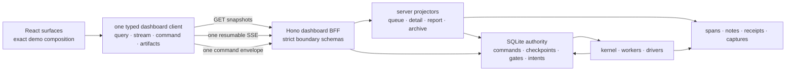

# 13 — Production frontend/backend integration contract

Status: **binding contract, as-built through Track C (2026-08-20).** The BFF, the wire, the one
command route and the one resumable stream are BUILT and carry a real operator's daily work; the
parity lane asserts 151 reference pairs; Track D is the ratified hardening list (D264) and is the
only planned change to this document's contracts. Every section below states what IS — where the
contract is normative and the code has not reached it yet, the section says so in its own status
block rather than reading as met.

This document is the production-wiring companion for the rebuild demo. It answers one question:
**how do we make the rebuilt product render the approved frontend exactly, while ensuring every
visible state and action is backed by durable, honest backend behavior?**

This is **not a second build order**. The phase docs remain the only sequencer. The slices here map onto
`1g-spine`, `1i-spine`, and the Phase-2 tails in that plan. Contract ownership remains with the
reference specs (workflow-model, dashboard-surfaces, data-intake-and-edit-data, write-safety,
clock-config-secrets, operator-trust); this document owns the composition boundary between those
contracts and the production React application. If a wire shape below needs to change, its owning
document must be amended before implementation.

Visual authority:

- `src/dashboard/DESIGN.md` — **this repository's own** design language and interaction rules, and
  the binding one for anything visual built here (`src/dashboard/CLAUDE.md` says to read it first);
- `docs/rebuild/reference/dashboard-surfaces.md` §9 — ratified presentation decisions;
- `docs/rebuild/history/design-inputs/2026-07-28-backend-capabilities-from-the-demo.md` — backend
  discoveries made while building the target;
- the **demo**, in the LEGACY repo — `src/dashboard/components/dev/rebuild-demo/DESIGN.md`, its
  `ds/` tokens and its rendered surfaces. It remains the visual oracle for anything not yet ported.

The demo is a **visual specification and contract fixture**, not production infrastructure. The
production app must not import the legacy repo's `src/dashboard/components/dev/rebuild-demo/**` —
since D93 that is structurally impossible across the repo boundary, not merely banned. Approved
surfaces and primitives are ported into this repo's `src/dashboard/`; mock wire factories stay
test-only and are preserved with the legacy/design-oracle tree through initial cutover. Ported
production code owns its own copies and provenance (legacy-repo commit hash + source path); no
runtime import or proxy is permitted.

---

## 0. Outcome and non-negotiable decisions

<!-- roadmap: phase-1 -->
<!-- roadmap: dash-defaults -->

The optimal foundation is a **typed dashboard backend-for-frontend (BFF) inside the rebuild repo's
own Hono process**, backed by rebuilt authoritative SQLite state and server-side
projections (ref dashboard-surfaces). It is not a separate rebuild service and never shares the legacy Hono
process, routes, middleware, state, port, lock, or browser sessions. It binds loopback only
(`src/server/dashboard/http-server.ts` refuses any other address) over a hand-rolled Node→Hono
bridge, because the chunk-by-chunk pipe is what lets the stream flush without `@hono/node-server`.



The following are settled:

1. **The frontend renders finished read models.** It does not classify raw tracker rows, infer
   statuses, reconstruct timelines, merge logs, calculate authoritative counts, or decide which
   commands are safe.
2. **One strict client owns all transport per bundle.** Components do not call `fetch` or open a
   stream directly. Query, subscription, command, upload, error normalization, schema parsing,
   reconnect, and cancellation live behind one client boundary — `src/dashboard/client/**` for the
   operator bundle, and `src/dashboard/phone/capture-client.ts` for the phone bundle, which is a
   SECOND browser entry (`capture.html`) that may not reach the operator client at all. One owner
   per bundle, enforced (§8 guard #1).
3. **REST snapshots + one resumable SSE stream + one command route.** This fits the local,
   single-operator product and the current append/project architecture better than GraphQL,
   WebSockets, or a client database. The bulk arm rides its own POST (`/api/v1/commands/bulk`)
   because its result is a per-target VECTOR, not a single result — one envelope shape could not
   carry it (§3.4). Large immutable bytes are meant to use dedicated artifact routes; none is
   served yet (§3.6).
4. **Server facts, client composition.** The server owns facts, state, availability, policy,
   counts, capabilities, and actions. React owns exact layout, focus, responsive behavior,
   animation, local drafts, and the fixed visual mapping from closed wire enums to the approved
   design system.
5. **No optimistic authority.** After a command, the UI may show “request submitted,” but it does
   not locally turn Running into Done, remove a row, resolve a gate, or invent a receipt. The next
   server projection or an authoritative replacement returned with the command result does that.
6. **Build end-to-end slices.** A surface is not complete when its JSX exists. It is complete when
   its schema, projector/query, stream invalidation, command path, degraded/error state, fixture,
   and Playwright visual proof all exist.
7. **The demo remains the visual oracle until parity is complete.** We port its visual language;
   we do not redesign while wiring production data.
8. **The product does not explain itself.** General teaching copy lives in an accessible ⓘ
   popover; only a refusal, a genuine hazard, or a fact about the selected run may consume standing
   surface space (ref dashboard-surfaces D24).
9. **Two repos, one cutover (D88/D89/D93).** The legacy repo's dashboard remains the production UI
   throughout construction, while the rebuild is built in the standalone `hr-automation-rebuild`
   repo. The two share no module graph, build, or process, so neither side *can* proxy, import,
   invoke, or read the other's live state. What still needs deliberate separation — both run on one
   machine — is distinct commands, ports, state/artifact roots, locks, and browser
   profiles/sessions. No workflow or surface flips individually. After the complete integration
   matrix passes, the normal launcher is repointed at the rebuild repo once; the legacy repo is
   preserved wholesale as the rollback asset.

<!-- roadmap-status: phase-1 -->
- [x] 0.1 the frontend renders finished read models — every count, status, action and containment fact is projected (`src/server/dashboard/projectors/run-queue-projection.ts`), with the ONE standing exception named in §4: the run modal still reads `WORKFLOW_DESCRIPTORS` from the bundle (D264 row D11)
- [x] 0.2 one transport owner per bundle — `src/dashboard/client/transport.ts` and `src/dashboard/phone/capture-client.ts`, enforced by `isNetworkOwner` in `provider-capability-boundary.test.ts`
- [x] 0.3 REST snapshots + ONE resumable stream + ONE command route — `routes/api.ts`, `GET /events/v1`, `POST /api/v1/commands` (+ the bulk vector arm)
- [x] 0.5 no optimistic authority — every surface settles through the served result and the next projection (D253, `app/command-result.ts`)
- [x] 0.9 two repos, one cutover — structural since D93; `config/runtime-isolation.json` + `operational-isolation.test.ts` pin the one-machine half
- [ ] 0.3's artifact half — "large immutable bytes use dedicated artifact routes": the schemas exist and NO route serves them (§3.6)
- [ ] 0.6 end-to-end slices — the "Playwright visual proof" cell is filled for every ported surface (151 references) but the "fixture + degraded state" cell is not uniform; R10's test tiers are the plan for it (`ref:guards-and-tests`, `{#test-tiers}`)
> 2026-08-20 | docs-cohesion frontend-backend-integration | verified against src/server/dashboard/routes/api.ts, http-server.ts, src/dashboard/client/**, provider-capability-boundary.test.ts; left: the artifact byte route (§3.6) and D11 (§4)
<!-- /roadmap-status -->

---
## 1. What the audit found

_The 2026-07-30 audit that opened this document. §1.1 and §1.2 are kept as the dated record of what
was surveyed; **§1.3's list of contract gaps is closed** and moved to
`docs/rebuild/history/superseded/2026-08-20-frontend-backend-integration-1.3.md`, with the one gap
per line and where it landed. A citation of "§1.3" resolves there._

### 1.1 The production target is a complete product, not four panels

The demo contains all of these production surfaces (2026-07-30 survey). The **built** column is the
2026-08-20 as-built, so the table doubles as the completeness checklist §5's matrix expands:

| Product area | Approved surface/state coverage | Built here |
|---|---|---|
| Shell | Graphite Warm/Paper Ink themes, history, Dashboard/Archive/Explorer/Activity switcher, search, day navigation, notifications, doctor, Settings, responsive Workflow Panel, Session Panel | yes — search is **within the served day only** (§3.6) |
| Queue | one workflow at a time, eight statuses, Needs-you composite, three row types, server action placement, bulk selection, group/member/rejected/linked containment, run facts, row explanations | yes (D230–D235) |
| Detail | panel-kind tabs (`Logs · Receipt`, `Review · Logs · Receipt`, or `People · Logs · Receipt`), persistent equal-width timeline, Context rail, gates, outcomes, write-parked resolution, attempts and lineage | `run`/`member` yes; `review`/`group` panel kinds are declared-unserved (§3.3) |
| Review | progressive OCR records, page evidence, field provenance/confidence, operator corrections, candidate identity captures, approve/reject gates, retry/research/relookup actions | no — the section arm is declared-unserved; the OCR stores exist (2h) and no descriptor declares a review panel |
| Evidence | receipts for every terminal outcome, staged/verified/unconfirmed writes, failure `writeState`, remediation, diagnostic bundles, capture kinds and dimensions, rerun diffs | receipts/failure/write state yes (2g); capture BYTES have no route (§3.6) |
| Start | descriptor-driven typed/bare/upload/capture/spreadsheet methods, presets/options, dry-run truth, per-system prod/test hosts, capability absence reasons, preflight and enqueue refusals | typed yes (D250/D251); the other four method kinds have no registered declarer; preflight unserved |
| Intake | upload, header-row choice, explicit column mapping, suggestions-only matching, validation, row correction/exclusion, immutable manifest, fan-out preview, same-data rerun diff | yes (2h/2i-E) |
| Workers | one-item worker cards, browser health/recovery, lease waits, spawn-count planning, per-worker spawn results, stop/recovery commands | cards yes (D248/D249); browser HEALTH is deliberately not a field (nothing probes a live session) |
| Settings | sparse overrides with provenance, atomic multi-leaf save, environment facts, system URLs, performance budgets, preflight/doctor, storage health and recovery | read-only — `apply-settings` answers `capability-unavailable` (§3.4); storage doctor yes |
| Archive/versioning | searchable self-contained historical runs, old receipts/captures/timelines, integrity state, major/minor version planning, archive blockers and relaunch | yes (D179/D223) |
| Explorer | exact descriptor DAG, systems/tasks/gates/delegation, optional dry-run boundary, live-run overlay, checkpoints/failures/evidence and source links | graph yes (D227–D229); the **live-run overlay is not served** (§3.6) |
| Activity | day/range aggregates, workflow/category/status/outcome totals, durations and failure breakdowns | yes, plus the write-ledger block and the CSV export (D180/D236/D240) |

The row/panel catalog and design-system kit behind the flask control are development scaffolding.
They are fixture routes, not product navigation — `GET /api/v1/ui-catalog` serves the committed
catalog and the parity lane photographs it (`catalog-search`).

### 1.2 The existing frontend shows why the rebuild needs a BFF boundary

The legacy dashboard had, at the 2026-07-30 survey, **271 frontend files, 30 hook modules, 59 direct
`fetch(` call sites, and 21 Hono route modules**. Those numbers are not defects by themselves; the
coupling is:

- components and hooks know route paths and response quirks;
- multiple polling and SSE resources describe overlapping run state;
- the browser receives tracker-shaped data and owns merge/dedup/classification work;
- startability is split across workflow metadata, `INPUT_RUN_REGISTRY`, `RUN_MODAL_REGISTRY`, and
  workflow-specific routes;
- counts, selected-run snapshots, live entries, logs, screenshots, and failures can arrive from
  different freshness points;
- some backend reads still fall back from SQLite to JSONL, and `/api/entry-data` chooses a
  “richest” row instead of exposing one authoritative detail projection;
- the current SSE hub transports permissive payloads and relies on client JSON parsing/ignoring;
- several product mutations still have one-off route families instead of one audited command
  protocol.

The rebuild must not reproduce this as cleaner folder names. The replacement boundary is one
server-authored product model and one client that parses it. As built, that is **one** transport
module per browser bundle, **35** command actions behind **one** POST, and **zero** handwritten wire
mirrors — the three properties §8's guards hold.

---

## 2. Production module boundaries

<!-- roadmap: p1-spine -->
<!-- roadmap: track-d -->

The production tree makes the dependency direction obvious. This is the tree **as built**:

```text
src/
├── domain/
│   ├── commands.ts               # the command envelope/result/family/action schemas
│   └── dashboard/
│       ├── bootstrap.ts          # strict wire schemas; zero React/Node imports
│       ├── projection.ts         # dashboard/day/queue/worker-card/status schemas
│       ├── run-detail.ts         # panel kind + section schemas
│       ├── subscription.ts       # hello/snapshot/patch/reset/cursor envelopes
│       ├── artifacts.ts          # refs/manifests, never local paths
│       ├── activity.ts · archive.ts · explorer.ts · storage.ts · advisory.ts
│       ├── actions.ts            # served action descriptors
│       └── primitives.ts         # the shared closed unions (sections, features)
├── server/
│   └── dashboard/
│       ├── routes/api.ts         # the ONE thin parse/host-gate/dispatch boundary
│       ├── queries/              # bootstrap · run-detail · archive · explorer · activity-export · storage · advisory · ui-catalog
│       ├── projectors/           # run-queue-projection · worker-cards · queue-row-actions · run-subject-title
│       ├── commands/             # command-service · start-plan-service · intake-service · capture-service
│       ├── subscriptions/        # dashboard-stream: cursor/ring → SSE envelopes
│       ├── compose.ts            # the composition root
│       └── http-server.ts        # the loopback Node→Hono bridge
└── dashboard/
    ├── app/                      # shell, URL/nav state, global keys, command dispatch, the ONE command-result fold
    ├── client/                   # the operator bundle's only transport
    ├── state/                    # React resource hooks over the client
    ├── ds/                       # the design system: tokens, primitives, the ONE barrel
    ├── surfaces/                 # every operator surface, each paired with a `<surface>-model.ts`
    ├── lib/                      # framework-free helpers
    └── phone/                    # the phone capture bundle: its own entry, its own transport
```

Rules:

- `domain/dashboard/**` (plus `domain/commands.ts`, which is shared with the kernel) exports strict
  zod schemas and inferred types. There is no handwritten duplicate frontend interface (§8 #2).
- Route handlers parse input, call a query/command service, parse output, and return it. They do
  not contain workflow switches or projection logic.
- Projectors never import React. React never imports workflow modules, stores, SQLite, tracker
  readers, or server registries — with the one named exception in §4 (`WORKFLOW_DESCRIPTORS`, D264
  row D11).
- **One transport owner per bundle**: `dashboard/client/**` for the operator app,
  `dashboard/phone/capture-client.ts` for the phone. The phone bundle may not reach the operator
  client, so it needs its own; the principle is unchanged and the guard names ONE file rather than
  the whole `phone/` subtree, so a component reaching for `fetch` still fails (§8 #1).
- Product surfaces may import only strict wire types, the client facade, design-system primitives,
  and pure presentation helpers.
- A `surfaces/*.tsx` or `app/*.tsx` module exports components only; its pure half lives in
  `<surface>-model.ts` (§8 #14).
- The BFF remains in-process. Splitting it into a network service adds failure modes and gives this
  local-first tool no benefit.

**As built, `state/` is half of what this table says it is.** The folder holds React resource hooks
(`use-bootstrap`, `use-dashboard-day`, `use-run-detail`, `client-context`, `served-clock`,
`async-resource`) — the "client-only UI state" half. The **normalized server cache** half was never
built: `async-resource.ts` is the right shape and four callers use it, while the fetch effect is
hand-copied in at least nine other places and 13 of 19 `useDashboardClient` consumers bypass
`state/` entirely. That is Track D row **D6**, and it is named here rather than left for the next
reader to find (`docs/plans/2026-08-20-dashboard-architecture-audit.md` §3.4 M2). Two more Track D
rows amend this section: **D7** splits `LoadedApp` (`app/dashboard-app.tsx`, ~1,100 lines, 18
concerns) along its own seams, and **D8** gives `intake.tsx` and `archive.tsx` the models the
pairing rule assumes and splits the workflow-versioning surface out of the archive file. Their
checklist lives in §7.4's status block, with the rest of the track.

---

## 3. Canonical transport contracts

<!-- roadmap: p1-spine -->
<!-- roadmap: p1-base -->

The names below are integration roles; the reference specs own the final strict shapes. Every one
of them is now a real exported schema — the file and export name are given per subsection.

**Phase 1b landed the primitives (2026-07-31), and they are what the served wire is still made of.**
Frontend bootstrap, day/queue projection, run-detail sections, artifact/capture resources, and
topic snapshot/patch/subscription envelopes are strict domain contracts with versions, revisions,
projection cursors, explicit capability availability/absence, closed status/panel/topic unions and
nested unknown-key rejection, each pinned by fixtures. 1b claimed no BFF, SSE server, command route,
React client or rendered surface; `1g-spine` and `1i-spine` served them and `2g`–`2i` widened them.

<!-- roadmap-status: p1-base -->
- [x] the strict wire primitives — `src/domain/dashboard/{bootstrap,projection,run-detail,subscription,artifacts,primitives}.ts`, all recursively strict, unknown keys refused (`strict-boundary-schemas.test.ts`)
- [x] the closed unions 1b froze are still the served ones — `RunDetailSectionSchema`, `TopicKeySchema`, `QueueStatus`, the capability `{state:"present"|"absent", reason}` shape
- [x] no handwritten frontend mirror of any `*Wire` type (`dashboard-wire-boundary`)
> 2026-08-20 | docs-cohesion frontend-backend-integration | verified against src/domain/dashboard/**; the 1b as-built block was FOLDED into this section (R9 item 1) rather than left as a dated appendix; left: nothing for 1b
<!-- /roadmap-status -->

<!-- roadmap-status: p1-spine -->
- [x] `FrontendBootstrapWire` served and consumed — `queries/bootstrap.ts`, `GET /api/v1/bootstrap`
- [x] `DashboardDayWire` served from the ONE projection — `projectors/run-queue-projection.ts`, `GET /api/v1/dashboard?day=`
- [x] `RunDetailWire` + lazy sections — `queries/run-detail.ts`, `GET /api/v1/runs/:runId` + `/:section`
- [x] one command route + one bulk arm — `POST /api/v1/commands`, `POST /api/v1/commands/bulk`
- [x] one resumable stream with cursor resume — `subscriptions/dashboard-stream.ts`, `GET /events/v1`, `Last-Event-ID`
- [x] the projector is fed by an offset-aware DISK TAIL, not an in-process hook (D218) — `compose.ts` seeds `rebuildFromJsonl()` and polls `ingestFromDisk()`
- [ ] five of the six declared stream topics have no producer — only `dashboard-day` is ever emitted (§3.5)
- [ ] the artifact resource schemas have no route (§3.6)
> 2026-08-20 | docs-cohesion frontend-backend-integration | verified against src/server/dashboard/{routes/api.ts,compose.ts,queries/**,projectors/**,subscriptions/**} and src/domain/dashboard/**; left: the unserved stream topics and the artifact route, both now stated in their own sections
<!-- /roadmap-status -->

### 3.1 `FrontendBootstrapWire`

<!-- roadmap: p1-spine -->

`FrontendBootstrapWireSchema` — `src/domain/dashboard/bootstrap.ts`. Fetched once at app boot and
refetched when the subscription declares descriptor/config skew.

```ts
interface FrontendBootstrapWire {
  wireVersion: 1;
  appVersion: string;
  descriptorHash: Fingerprint;
  settingsSchemaHash: Fingerprint;
  projectionGeneration: number;
  actor: { id: "local-operator"; label: string };
  serverClock: { now: IsoInstant; zone: "America/Los_Angeles" };
  storage: StorageHealthSummaryWire;
  workflows: WorkflowClientProjection[];
  systemInstances: SystemInstanceProjection[];
  settingsSections: SettingsSectionProjection[];
  featureAvailability: FeatureAvailabilityWire[];
  preflight?: PreflightCheckWire[];
}
```

`actor.id` is the **literal** `"local-operator"`, not a free actor id: this is a single-operator
local tool (D193) and a schema that admitted any slug would be describing a product that does not
exist. `featureAvailability` is closed to `capture | ocr | ai-advisory | archive | workflow-editor`.

`preflight` is the doctor's standing summary — one entry per check, each carrying its verdict, its
detail, the named things its failure **blocks**, an optional remediation, and the instant it was
checked. The Top Bar owns it (§5): the stethoscope carries the worst verdict of the set, its popover
lists the checks, and "Run doctor again" is the paired command. It is **optional and unserved
today** — `buildBootstrap` composes no preflight service — and its absence is declared as
`FrontendBootstrapWireSchema#preflight` in `config/pending-wire-bindings.json` (D184). The surface
renders the whole popover only when the field is present: a doctor indicator over checks nobody ran
would report a pass the server never made. The verdict itself is DERIVED on the client from the
checks (`fail` beats `warning` beats `pass`) and is never a second served field, so the glyph and
the list cannot disagree.

The workflow projection includes label/icon/category/code/version, panel kind, graph summary,
systems, start methods/options/presets, dry-run support or explicit absence reason, input subject,
status/verdict vocabulary, detail capabilities, action policy summary, and source availability.
The client derives navigation from this list; no parallel workflow registry survives — **except the
one named in §4**, which D264 row D11 removes.

**Category GROUPING is served raw and displayed by the client (R2 D17/D18).** The projection carries
each workflow's own `category` id and nothing else about grouping — there is no `workflowCategories`
projection, because the one this wire used to carry invented both of its fields (`label` was
`id.replace(/-/g, " ")`, `order` was the registry's first-seen index), so the Workflow Panel's
headings read `separation` in whatever order a module happened to import. Ref dashboard-surfaces §Shell is the
owner and it is explicit: *the frontend hardcodes only the display order, membership is the
descriptor's, an unlisted category appends, and an empty category drops.* The heading text and the
order therefore live in `src/dashboard/surfaces/workflow-category.ts`, typed
`Record<WorkflowCategory, …>` so a new category in the descriptor vocabulary fails `tsc` rather than
rendering a hole, and BOTH the Workflow Panel's rail and the Run Modal's picker call its one
`groupWorkflowsByCategory` — two surfaces that once held hand-copied copies of the same rule.

### 3.2 `DashboardDayWire`

<!-- roadmap: p1-spine -->
<!-- roadmap: track-b -->
<!-- roadmap: track-d -->

`DashboardDayWireSchema` — `src/domain/dashboard/projection.ts`. One query provides the selected
day's coherent shell and queue state:

```ts
interface DashboardDayWire {
  day: LocalDate;
  descriptorHash: Fingerprint;
  projectionGeneration: number;
  snapshotCursor: ProjectionCursor;
  monthCounts: readonly DayCountWire[];
  workflowCounts: readonly WorkflowCountWire[];
  statusCounts: readonly StatusCountWire[];
  queueSurfaces: readonly QueueSurfaceWire[];
  workerCards: readonly WorkerCardWire[];
  notifications: readonly NotificationWire[];
}
```

`monthCounts` rides this payload rather than a calendar route: the calendar and the queue below it
are the same fold, so a second endpoint is the second count path D81 forbids.

`QueueSurfaceWire` remains flat. Group/member relationships use ids and `parentRunId`; the client
may join those ids for layout but may not reinterpret containment or status. Counts and rows are
folded from the same projection transaction/generation. The calendar, Workflow Panel, Status Bar,
queue header, and Activity query can therefore never disagree because of different source paths.

**`WorkflowCountWire` carries its own status dimension** — `{ workflowId, count, statusCounts[] }`,
the per-status counts summing to `count` by refinement (R2 D5–D12, R4-1). One `count` per workflow
could not answer the two questions the shell asks of it: the Workflow Panel's `active │ all` column
needs queued + running for THAT workflow, and the Status Bar's pills are scoped to the workflow the
queue below them is showing — so a day-wide fold put `Failed 3` above a queue with no failures. Both
are the same fact at two scopes and both come off this one array, filled in the projector's single
countable loop beside the day-wide totals it must agree with (D81). A client-side fold over
`queueSurfaces` is the second count path that rule exists to delete, and remains forbidden.

**A queue row states its ORDINAL, its CLASS and what it MADE** (D230/D231, 2026-08-19).
`QueueBaseFields` carries `runNumber` — durable on `RunRecord`, assigned per workflow at enqueue,
served with a D133 read-forward absent arm and never derived from a row's position in the day's
array; `priority` — read from the run envelope, which is what D95's `bump` rewrites, and a
deliberate enum mirror of `RunPrioritySchema` kept member-for-member identical by
`wire-connectivity`'s mirror joint (§8 #8) because
`src/domain/run/envelope.ts` is outside the bundle's reach (§8 #13); `containment`
(`root | member | linked`, projected from shape and lineage, with a refinement refusing every
disagreement with `lineage`/`surfaceKind` and no `rejected` arm until a producer writes such a row);
`linkedRuns[]` — each delegated child's id, workflow, label, panel kind and LIVE status, because a
client re-deriving the target's status from `queueSurfaces` is D81's forbidden second path and goes
blank the moment the target sits on another day; `facts[]` — the run's already-derived evidence
receipt's `output`, chipped only where the redacted value is `allowed` and primitive; and
`pipeline[].durationSec`/`executions`, summed over every execution of the node. An operation row
additionally carries `memberPreview`, composed from its members' own served titles. Every one of
these carries its absence as a reasoned arm rather than a zero, an empty band, or a plausible
number.

**A worker card IS the authority lease, joined with what its spans hold open** (D248, 2026-08-20).
`WorkerCardWireSchema` carries `workerId`, `workflowId`, `state`, `directive`, `startedAt`,
`endedAt` + `stopReason`, `currentRun`, `browsers[]`, `leaseVersion` and `revision`. The card SET is
authority's: every live lease is a card, a settled lease is a card while the retained span stream
still names its worker, and a worker the spans name but authority does not is NOT a card — authority
is what says a worker exists. Until D248 the projector derived a worker's phase from whichever rows
happened to be claimed, which is exactly the inference ref execution-and-sessions §3 says the lease exists to make
unnecessary, and it cost three of the six state arms the Session Panel drew: a daemon that had
started and not yet reported read as `idle`, and a worker whose PROCESS DIED was drawn identically
to one the operator had asked to stop.

Four rules travel with it. **`state` and `directive` are separate fields**, because
`src/domain/run/worker.ts` separates them: a command writes what was ASKED and the worker writes
what is TRUE, so folding a pending `pause` into the state word would let a card read `Paused` while
its worker is mid-transaction on a live HR system. **Every arm of both has a producer** — the served
state vocabulary is exactly `starting | idle | working | stopped | failed` (the lifecycle's own
`busy` becomes the card's `working`; its `paused` and `stopping` are NOT mirrored, because nothing
reports them), and the demo's `waiting` arm is gone because this platform gives every worker its own
browser session per system (ref execution-and-sessions §1), so there is no cross-worker lease to wait on and no
holder to name. **`stopped` and `failed` split the terminal lifecycle by its RECORDED reason**
(`operator`/`shutdown` versus `crashed`/`lease-expired`, the latter written by the recovery sweep),
pinned by a refinement — that split is the whole content of `failed`. And **`leaseVersion` is the
lease's row version, never `revision`**, which counts folded span events and is a patch cursor:
binding the Stop control to it would have fabricated the exact fact a version check exists to check.

`browsers[]` is the sessions a worker HOLDS — `{sessionId, system, openedAt}`, started, not yet
closed, keyed by the session id its span path carries — and a settled card holds none, because its
process is gone and its Chromium children went with it. It carries no `health` and no `url`: nothing
in this build probes a live session, so the only verdict available is "never probed" and a six-arm
health enum would be five unreachable arms; and no span, checkpoint or lease records a page address,
so a URL would have to be composed rather than observed. The tile therefore states which system a
session speaks to and how long it has been open, which is what the wire actually knows.

The approved queue contract must include:

- immutable identity, attempt/lineage, actor, descriptor/app/config versions and resolved instance;
- server-resolved title/subtitle/status/live message/run facts;
- final pipeline and open gates;
- member ids/rollups/containment and streamed-record rollups;
- server-authored action descriptors with placement and version/audit tokens;
- `panelKind` plus closed available-section keys;
- evidence/failure/receipt confidence pointers;
- a monotonic `rowRevision` used by commands and patches.

**Every command CASes.** An earlier draft of this list said CAS was enforced only for the four
real-race command families; the schema does not work that way and never did — every family's target
carries a required `expectedVersion`, and the kernel revalidates inside its own transaction (§3.4).

**Track D amends how this payload is CONSUMED, not what it says.** Row **D4** stops the client
re-parsing the whole day on every single-row patch (`client/day-state.ts` runs
`DashboardDayWireSchema.parse` over all rows per patch) and memoizes the three hot panels; at
legacy's real volume — 1,240 rows on the busiest day, 108-member operations — that is the one item
on the audit's list a single operator perceives. Row **D5** bounds the projector's own scans
(`#memberPreview` joins every member to print three; two receipt reads per terminal row). Both
measure and record the numbers §7.4 has been waiting for.

### 3.3 `RunDetailWire` and lazy sections

<!-- roadmap: p1-spine -->
<!-- roadmap: track-b -->

`RunDetailWireSchema` — `src/domain/dashboard/run-detail.ts`. Opening a row fetches one small header
plus only the selected panel section. A terminal 50-person packet must not ship every note, capture,
and facsimile in the day payload.

```ts
interface RunDetailWire {
  runId: RunId;
  rowRevision: number;
  panelKind: "run" | "member" | "review" | "group";
  header: RunIdentityWire;
  timeline: TimelineWire;
  gate: GateDecisionWire;        // present-or-absent IN the union, never an optional field
  outcome: OutcomeWire;          // likewise
  context: ContextSummaryWire;
  availableSections: readonly RunDetailSection[];
}

type RunDetailSection =
  | "logs" | "receipt" | "review" | "people"
  | "context-data" | "context-evidence" | "context-attempts"
  | "failure" | "captures"
  | "parked-write" | "identity-gate";
```

**`gate` and `outcome` are required fields carrying an explicit `{state:"absent", reason}` arm**,
not optional fields. The difference is the whole honesty posture of this wire: an optional field
that is missing cannot say WHY, so a panel drawing nothing could not tell "this run has no gate"
from "the projection failed to look". Every capability on this payload takes the same shape.

The fixed frontend mapping is:

| `panelKind` | Tabs | Always-visible adjacent content |
|---|---|---|
| `run` / `member` | Logs · Receipt | timeline, gate/outcome/failure, Context rail |
| `review` | Review · Logs · Receipt | timeline, gate/outcome/failure, Context rail |
| `group` | People · Logs · Receipt | timeline, gate/outcome/failure, Context rail |

Data lives in the Context rail. Captures live in Receipt and Review where relevant. A backend
capability may make a section empty/absent; it may not silently change the approved composition.

**Four of the eleven section arms have no producer, and each is DECLARED** in
`config/pending-wire-bindings.json` rather than left silent (D184, the D107 pattern one layer up):
`review` and `people` (no registered descriptor declares those panel kinds; the record store is 2h),
`context-evidence` (`buildRunDetail` serves `evidenceFacts: 0` and the evidence service is a later
slice), and `captures` (the section lists artifact refs and **nothing serves artifact bytes** —
§3.6). `wire-connectivity` fails in both directions over that manifest: an undeclared orphan arm, and
a declaration whose binding has become reachable.

Logs/notes are served by cursor-paged GET on the section route. Review records use stable record ids
and record revisions so one page result can stream without replacing the whole run; People use
stable member ids and pagination metadata for large groups. Receipt, failure, and archive evidence
are immutable once finalized. **The per-run SUBSCRIPTION those three describe does not exist yet** —
the stream emits one topic (§3.5), so a panel follows the day stream's `rowRevision` for its live
key and re-reads the section (D257).

### 3.4 One command protocol

<!-- roadmap: p1-kernel -->
<!-- roadmap: track-b -->
<!-- roadmap: track-d -->
<!-- roadmap: def-settings -->
<!-- roadmap: cross-cutting -->

All JSON mutations enter one route (`POST /api/v1/commands`) and one durable command journal. The
schemas are `src/domain/commands.ts`; the kernel is `src/core/command-kernel.ts`, and D113 confines
the journal, the audit and start-plan consumption to it.

```ts
interface CommandEnvelopeFields {
  commandId: CommandId;
  requestedAt: IsoInstant;
  requestedBy: ActorId;
  source: CommandSourceSchema;   // where the request came from
  reason?: string;               // an operator's own words, where a family asks for them
}
// discriminated by a PAIR: `family` (9) × `type` (35), with a per-arm `target` and `payload`
type CommandResult =
  | { state: "applied" | "already-applied"; commandId: CommandId;
      affectedTargets: readonly AffectedTarget[] /* ≥1 */ }
  | { state: "conflict"; commandId: CommandId; currentVersion: number; message: string }
  | { state: "rejected"; commandId: CommandId; code: CommandRejectionCode; message: string };
```

The nine families are `start · intake · worker-browser · settings · version-archive · run · gate ·
notification · capture`, and the 35 actions under them cover: start-run; intake inspect/confirm
mapping/correct row/exclude row/validate/enqueue manifest; worker plan-count/spawn/stop/pause/resume
and browser refresh/reopen; `apply-settings`; version plan/apply/relaunch-archived-run; the run verbs
`retry · cancel · bump · rename · edit-checkpoint · resolve-write-present · resolve-write-absent`;
`resolve-gate`; notification read/unread/snooze; and the seven capture verbs. Dedicated legacy
mutation endpoints are not recreated.

**Every arm CASes on a required `expectedVersion`.** There is no privileged subset: run verbs,
intake, worker, capture, settings and version targets all carry one, and the kernel revalidates the
row inside its own transaction and CASes on what it reads there — so the field states the caller's
BASIS rather than being the check itself.

**A refusal has two arms and both must be handled** — `rejected` (a kernel refusal with one of seven
codes, including D113's `capability-unavailable`) and `conflict` (the CAS refusal carrying the
server's `currentVersion`). `src/dashboard/app/command-result.ts` is the ONE fold that settles them;
D253 (§5.1) is the decision and `command-result-exhaustive` the guard.

**Bulk rides its own route** — `POST /api/v1/commands/bulk`, family `run`, type `retry | cancel |
bump`, a `bulkCommandId`, `targets[≥1]` and a `mode`. It returns one complete per-target vector with
four outcome arms; a partial result can never collapse to one success toast. The `all-or-none` mode
is declared and refuses by name with `capability-unavailable` (D235) — `best-effort` is what runs.
The second route exists because the RESULT shape differs: a vector is not a `CommandResult`, and
widening the single-result union to sometimes be a list would make every caller check.

**Multipart bytes are the exception to the JSON route.** Uploads enter through
`POST /api/v1/intake/files` (which also creates or joins the intake session) and the phone's own
photo routes; the command then references the stored artifact. There is no generic
`POST /api/v1/uploads`.

**Server action descriptors are the only source** for command availability, labels, placement,
confirmation copy, required forms, and revision tokens.

**`apply-settings` is the one command arm that is declared and refused.** It is the sole
`PHASE1_DEFERRED` entry in the kernel: it answers `capability-unavailable` with zero authority
effect, so Settings is read-only in the product today. The family, the target and the atomic N-leaf
payload are already the contract; what is missing is the config-service half
(ref clock-config-secrets §3), which is also what would serve `preflight` and the doctor-rerun
command (§3.1).

**`requestedBy` is not yet enforced, and that is a gap rather than a design.** The contract is that
the client echoes the actor from bootstrap, the server requires it to match the request's identity
checkpoint, then stamps the authoritative actor and acceptance time on the durable command record —
a mismatch rejects, and request-body identity is never trusted. As built, the kernel stamps
`request.requestedBy` verbatim into `resolvedBy` / `plannedBy` / `appliedBy` / `archivedBy` /
`relaunchedBy` and compares an actor id only for notification-row ownership. On a single-operator
loopback tool with one literal actor (§3.1) nothing can currently present a different one; the
contract stands because it is what makes the durable record's actor a fact rather than a claim, and
the enforcement is listed as to-build below.

**A command whose target is not a run is composed beside the composer, not inside it** (D249,
2026-08-20). `composeCommandRequest` is exhaustive over the SERVED row-action vocabulary and every
one of its arms targets a `runId`; the Session Panel's `Stop` targets a worker lease, so widening
the shared `ActionTarget` to hold either would make every run arm accept a target it can never use.
`composeStopWorkerCommand` therefore stands beside it, composes the whole envelope from facts the
card already carries, and has no refusal arm — the two states where stopping is meaningless (a
settled lease, a worker already asked to stop) disable the control AT the card rather than being
discovered after a click. Its `expectedVersion` is the served `leaseVersion`; the kernel revalidates
the lease inside its own transaction and CASes on what it reads there, so the field states the
operator's BASIS rather than claiming to be the check — the shape ref execution-and-sessions §"A capture command's
`expectedVersion` is not a CAS" already ratified.

**A served descriptor may also declare how much CEREMONY its command costs, and a surface obeys it
or refuses (D226, 2026-08-19).** The identity gate is the case that forced the rule: ref write-safety §14.6
risk 1 makes `approvalShape` a SERVER computation precisely so a frontend cannot quietly turn a
risky approval into one click, and the `identity-gate` section serves it beside the packet and both
typed resolutions. Three obligations follow for any surface that renders such a control, and they
generalise to every future server-declared ceremony:

1. **Render the shape the server named, and only that one.** The control for a shape that asks the
   operator to CHOOSE carries no pre-selected option — a pre-selected radio is a one-click approve
   wearing a radio's clothes, which is the downgrade the server-side computation exists to prevent.
2. **A shape this build does not know draws a NAMED REFUSAL and blocks the send.** It may not fall
   back to the cheapest control it does know. A wire value can outrun a bundle — a server upgraded
   ahead of an open tab — and answering under a ceremony nobody implemented is worse than having no
   guard, because the server is still reporting that it asked a question.
3. **The operator supplies only what no served fact carries.** Every other leaf of the payload is
   read off the section — the schema hash, the evidence digest, and the label the server paired with
   each option. A client that derived any of them would be a second implementation of the
   descriptor's identity, and a client that INVENTED one would put a value nobody authored onto a
   durable record. Composition stays in the one composer; the surface hands it the human's answer.

The `RunDetailSectionResponse` arm this is stated over is `identity-gate`; ref write-safety §14.11 owns the
gate's own ceremony table.

<!-- roadmap-status: p1-kernel -->
- [x] ONE command route + ONE journal — `POST /api/v1/commands`, `src/core/command-kernel.ts`, confined by `control-command-single-path` (D113)
- [x] nine families / 35 actions, all dispatching but one; every arm CASes on a required `expectedVersion` (`src/domain/commands.ts`)
- [x] three result arms with TWO refusals, settled through one exhaustive fold (D253, `command-result-exhaustive`)
- [x] the bulk vector arm — per-target outcomes, `best-effort` (D235)
- [ ] `requestedBy` is stamped verbatim; the identity-checkpoint match this section requires is unenforced — reachable only if a second actor ever exists, and undeclared today (no D-number, no `pending-wire-bindings` entry)
- [ ] `all-or-none` bulk mode — declared, refuses `capability-unavailable` (D235)
> 2026-08-20 | docs-cohesion frontend-backend-integration | verified against src/domain/commands.ts, src/core/command-kernel.ts, src/server/dashboard/commands/**, src/dashboard/app/command-result.ts; corrected the envelope shape, the result arms and the CAS scope to the code; left: the `requestedBy` check and the bulk all-or-none mode
<!-- /roadmap-status -->

<!-- roadmap-status: def-settings -->
- [x] the command family, target and atomic N-leaf payload are contracted — `settings` / `apply-settings` in `src/domain/commands.ts`
- [x] Settings RENDERS effective/default/override provenance from `bootstrap.settingsSections`
- [ ] the write half — `apply-settings` is the kernel's one `PHASE1_DEFERRED` arm and answers `capability-unavailable` with zero authority effect (D113)
- [ ] the config service behind it (ref clock-config-secrets §3), which also serves `preflight` and the doctor-rerun command
> 2026-08-20 | docs-cohesion frontend-backend-integration | verified against src/core/command-kernel.ts PHASE1_DEFERRED and src/dashboard/surfaces/settings.tsx; left: the whole write path — the deferral is declared in code, not silent
<!-- /roadmap-status -->

### 3.5 Resumable subscription protocol

<!-- roadmap: p1-spine -->
<!-- roadmap: track-c -->

One stream carries closed envelopes (`DashboardStreamEnvelopeSchema`,
`src/domain/dashboard/subscription.ts`):

```ts
type DashboardStreamEnvelope =
  | { type: "hello"; wireVersion: 1; descriptorHash: Fingerprint;
      projectionGeneration: number; cursor: ProjectionCursor }
  | { type: "snapshot"; topic: TopicKey; cursor: ProjectionCursor;
      payload: DashboardTopicSnapshot }
  | { type: "patch"; topic: TopicKey; cursor: ProjectionCursor;
      payload: DashboardTopicPatch }
  | { type: "reset-required"; reason: "cursor-expired" | "generation-changed" |
      "descriptor-changed"; cursor: ProjectionCursor }
  | { type: "health"; state: "live" | "reconnecting" | "degraded" };
```

Rules:

- every envelope parses before entering client state; malformed payload is a visible protocol
  failure, never `console.warn` + ignore;
- cursors are monotonic and delivered as SSE ids; reconnect sends `Last-Event-ID`;
- duplicate cursors are idempotent, gaps force a snapshot, and an expired cursor gets
  `reset-required`;
- a descriptor hash or projection-generation change invalidates affected cached projections;
- queue patches replace one complete surface by `(runId,rowRevision)`; Review patches replace one
  complete record by `(recordId,recordRevision)`; note pages append by stable note id;
- stream payloads signal authoritative changes. They do not carry local UI state or draft edits;
- the server bounds subscriber buffers and tells the client to reset rather than silently dropping
  state-bearing messages.

**It is SSE, and it is deliberately not an `EventSource`.** `src/dashboard/client/transport.ts`
speaks the SSE wire format over `fetch` + `ReadableStream`, because `EventSource` cannot set a
request header and the resume contract is `Last-Event-ID`. The route reads that header and falls
back to `?cursor=`.

**One topic has a producer.** `TopicKeySchema` declares six (`dashboard-day`, `run-detail`,
`run-logs`, `run-review`, `run-people`, `artifact`); the route's topic pattern admits only
`dashboard-day:YYYY-MM-DD` and the hub emits only that topic. Every per-run subscription this
section and §3.3 describe — Review record patches, note-page appends, artifact availability — is
machinery with nothing on the other side of it. **That is the one unserved thing on this wire that
is NOT declared** in `config/pending-wire-bindings.json`, and it should be; it is listed as to-build
in §3's status block. What a panel does instead is D257: it follows the day stream's `rowRevision`
for that run and re-reads the section, so a live thing has a live key.

**What feeds the projector is a disk tail, not an in-process hook (D218).** A worker is a separate
OS process, so `compose.ts` seeds the projection with `rebuildFromJsonl()` at boot — refusing to
start over a degraded projection — and then polls `ingestFromDisk()` on a byte cursor; the command
service ticks the same cursor after its own emissions so an operator's follow-up read never waits
for the poll. The `onEvent` hook that used to feed it is deleted, which is what makes "append first,
fold after" structural.

### 3.6 Query and artifact surface

<!-- roadmap: order-2 -->
<!-- roadmap: order-2-dash -->
<!-- roadmap: def-search-export -->
<!-- roadmap: cross-cutting -->

The served route layout (`src/server/dashboard/routes/api.ts` — a fresh rebuild API, no legacy
compatibility layer):

```text
GET  /api/v1/bootstrap
GET  /api/v1/dashboard?day=YYYY-MM-DD          # includes monthCounts — there is no calendar route
GET  /api/v1/runs/:runId
GET  /api/v1/runs/:runId/:section              # one lazy panel section, cursor-paged where it pages
POST /api/v1/runs/:runId/advisory              # the optional AI failure advisory (unjournaled, D178)
GET  /api/v1/archive           ·  GET /api/v1/archive/:runId
GET  /api/v1/explorer                          # the whole descriptor DAG, flat — no workflow segment
GET  /api/v1/reports/activity?from=&to=   ·  GET /api/v1/reports/activity.csv?from=&to=
GET  /api/v1/storage/doctor
GET  /api/v1/ui-catalog
POST /api/v1/start-plans
POST /api/v1/intake/files      ·  GET /api/v1/intake/:sessionId
POST /api/v1/capture/sessions  ·  GET /api/v1/capture/sessions/:sessionId
     /api/v1/capture/phone/…                   # nine token-scoped phone routes behind the Host gate
POST /api/v1/commands          ·  POST /api/v1/commands/bulk
GET  /events/v1?topics=…                       # the one stream; cursor via Last-Event-ID
```

Route count is not the goal; coherent resources are. The exact split may be adjusted for lazy
loading, but there must be only one route per fact/command family and no workflow-specific API path
when a descriptor/schema can express the behavior — which holds: no served path names a workflow.

**Five capabilities this section contracts have no route, and each has an owner.**

| Capability | State | Owner / trigger |
|---|---|---|
| **Artifact bytes** — `GET /artifacts/v1/:artifactId` | `ArtifactRefWireSchema` / `ArtifactResourceWireSchema` exist and carry media type, byte length, `sha256`, image dimensions or PDF page count, sensitivity/redaction and explicit missing/purged arms. **Nothing serves them.** The only byte route in the tree is the phone's own `GET /api/v1/capture/phone/photos/:photoId/bytes`. | `legacy-route-files`, phase-3; it is also what blocks the `captures` section arm and the run screenshot gallery |
| **Cross-date run search** — `GET /api/v1/search?q=` | absent. The Top Bar's search filters **the day already served** (`day-search-model.ts`), and the surface says so in its own header rather than implying more. | `legacy-route-search`, D184 → `{#def-search-export}` |
| **The explorer's live-run overlay** — `?runId=` | absent. `GET /api/v1/explorer` serves the static descriptor graph; no overlay parameter exists. | `{#def-explorer-edit}`'s sibling work; recorded here rather than implied by §1.1's row |
| **Excel export** | absent. The one export served is the Activity report as **CSV** (D240). The xlsx sink exists as a retention sink and is uncomposed in production (D164). | `{#def-search-export}` |
| **Settings write / preflight** | `GET /api/v1/settings` and `GET /api/v1/storage/health` are not routes; the facts ride `bootstrap.settingsSections` and `GET /api/v1/storage/doctor`. The write half is §3.4's deferred command arm. | `{#def-settings}` |

Artifacts are fetched through opaque ids with media type, byte length, digest, dimensions/page
metadata, redaction/sensitivity policy, and explicit missing/purged state. The frontend never
receives a local filesystem path and never guesses capture aspect ratio. That contract is fully
schema'd and entirely unserved — which is exactly the shape `wire-connectivity` exists to keep
declared rather than silent.

<!-- roadmap-status: def-search-export -->
- [x] the within-day search the shell actually needs — `surfaces/day-search.tsx` + `day-search-model.ts`, over the served day
- [x] one export exists and travels with its rules — the Activity CSV (D240): the caveats are a BLOCK of the artifact, one rounding shared with the tile
- [ ] the cross-date search route (`legacy-route-search`) — no endpoint; the surface names its own scope rather than implying more
- [ ] the artifact/screenshot byte route (`legacy-route-files`) — the schemas are complete, nothing serves bytes
- [ ] the operator xlsx export (`legacy-export-export-excel`) — the xlsx sink is a retention sink, uncomposed in production (D164)
> 2026-08-20 | docs-cohesion frontend-backend-integration | verified against src/server/dashboard/routes/api.ts (the whole served table), src/domain/dashboard/artifacts.ts, config/legacy-capabilities.json; left: all three routes, each with a named capability entry
<!-- /roadmap-status -->

---
## 4. State ownership

<!-- roadmap: p1-spine -->
<!-- roadmap: track-d -->

| State | Owner | Frontend rule |
|---|---|---|
| run/worker/capture/intake/settings/archive state | SQLite authority | never mutated locally |
| queue rows, status, counts, pipeline, gates, rollups | server projection | render verbatim; format only |
| actions and capability absence reasons | server policy projection | no status/workflow switches that re-enable actions |
| workflow metadata/start methods/system instances | descriptor/config projection | no parallel registries |
| receipts/failures/captures/provenance | evidence services | fetch by stable id; never synthesize missing proof |
| reports/month counts/search results | server query over projection family | do not scan browser caches to recreate them |
| selected page/workflow/row/tab, panel sizes, open dialogs | client URL/UI state | safe to update immediately |
| theme, Workflow Panel display mode, Context-rail openness | client preference | persist locally unless later promoted to actor settings |
| form/mapping/review edits before submit | client draft | retain across section switches; submit atomically with base revision |
| notification read/snooze | authority, actor-keyed | command-driven even though it feels presentational |
| elapsed time between server timestamps | client Clock calibrated from bootstrap | display-only; terminal durations remain server facts |

Pure presentation helpers may map a closed enum to an icon, token, tab order, or explanatory copy.
They may not decide whether a run is safe, complete, startable, reviewable, or actionable.

**Where the frontend keeps its half is not `state/`, and the folder name over-promises.** As built,
`src/dashboard/state/**` is six small modules: a four-arm `AsyncResource` union, the React context
holding the one client, the served clock (D256), and three resource hooks. There is **no cache** —
no keyed store, no dedupe, no abort, no retry/backoff; each hook owns a private `useState` and
refetches on every dependency change and every remount, invalidation arrives as a `reloadNonce`
prop threaded down from the app, and two components asking for the same run issue two GETs. Nor is
the "client-only UI state" half here: URL state is `app/url-state.ts`, preferences are
`lib/preference-storage.ts` + `ds/theme.ts`, panel geometry is `surfaces/layout-metrics.ts`. Two of
the folder's exports (`useDashboardDaySnapshot`, `useRunSection`) have no importer at all. Track D
row **D6** is what makes the folder match this table; **D2** deletes the dead pair.

**One row of this table is violated today, deliberately and named.**

**D264 (2026-08-20) — the descriptor registry leaves the browser bundle, amending D251.** The
`workflow metadata/start methods/system instances` row above names `descriptor/config projection`
as the owner and §0.1 says the frontend renders finished read models; the run modal does neither.
`src/dashboard/app/dashboard-app.tsx:25` imports `WORKFLOW_DESCRIPTORS` and `:516` joins it by
`descriptor.id` against the bootstrap's own workflow list for exactly three fields — `summary`,
`enqueue` and `surfaces.inputRun` (the typed-input surface carrying D250's declared examples); the
picker's other rows (`label`, `categoryId`, `role`, `code`) are served already. **Those three are
therefore SERVED over `FrontendBootstrapWire` and the frontend drops the registry import** — Track D
row D11 (`docs/plans/2026-08-20-dashboard-architecture-audit.md` §3.5). D251's reasoning, that the
bundle already carries them so a wire would be a second source (§8 #2), is superseded on its own
premise: the import is what makes the bundle a source, and a projection with no registry beside it
is ONE source. D251's other findings stand. Until D11 lands the import — 49 modules, 22 % of the
bundle's module closure, for three plain fields — is a KNOWN divergence from this table, named here
rather than left for the next reader to discover. It is the ONE such import: `run-start.tsx` does
not reach the registry, and the audit sentence that said it did is corrected here.

Track D's checklist for every row that lands on this section — D1, D4, D6, D7, D8, D11 — is in
§7.4's status block, so the track is ticked in one place.

---

## 5. Surface-to-backend wiring matrix

<!-- roadmap: dash-defaults -->
<!-- roadmap: sep-dash -->
<!-- roadmap: order-0-dash -->
<!-- roadmap: order-1-dash -->
<!-- roadmap: order-2-dash -->
<!-- roadmap: order-3-dash -->
<!-- roadmap: order-4-dash -->
<!-- roadmap: order-5-dash -->
<!-- roadmap: order-6-dash -->
<!-- roadmap: order-7-dash -->
<!-- roadmap: order-9-dash -->

This matrix is the completeness checklist, and it is what a workflow's own `Dashboard · wire` task
fills in. A production surface is not ready until every cell in its row has an implementation and a
test. The **Built** column is the 2026-08-20 as-built; a cell that says `—` is not a defect in the
surface, it is a wire nobody has run yet.

| Surface | Initial query/read model | Live patch/invalidation | Commands | Backend authority/owner | Built |
|---|---|---|---|---|---|
| Top Bar + app shell | bootstrap, search, calendar month counts, notification summary, storage/preflight summary | descriptor/config/storage/notification patches | notification lifecycle; doctor rerun | descriptor registry, projection queries, notification/config/storage services | mostly — search is within the served day, preflight is unserved, the doctor is a GET not a command, and there are no descriptor/config/storage/notification patch topics |
| Workflow Panel + Status Bar | `DashboardDayWire` counts from the queue projection | changed count tuples in the same dashboard cursor | none; filters/navigation are local | ref dashboard-surfaces one run/queue projection | yes |
| Queue Panel + rows | flat `QueueSurfaceWire[]` for selected day/workflow | complete row replacements and removals/tombstones | served row/bulk action descriptors | authority command state + span projection | yes (D230–D235) |
| Log Panel + Context rail | `RunDetailWire`, paged notes, context/evidence/attempt summaries | run/timeline/gate/outcome/note patches | gate, retry/cancel/rename/bump, checkpoint and write resolution | spans/notes, checkpoints, commands, write intents, evidence | yes for the sections that have producers — but the live half is a **refetch keyed on the day row's `rowRevision`** (D257), not a per-run subscription; `context-evidence` and `captures` are declared-unserved |
| Gate ceremony + park resolution | the `identity-gate` and `parked-write` sections, with the packet, the server's `approvalShape` and both typed resolutions | the same `rowRevision` follow | `resolve-gate`, `resolve-write-present`, `resolve-write-absent` | `gate_results`, write intents, ref write-safety §14 | yes (D226/D245) — the packet is separations-shaped; a second gated workflow generalises it |
| Group People | paged members + rollup + containment | per-member replacement and rollup patch | contextual member and bulk commands | delegation manifests + run projection | **no surface** — `people` is declared-unserved; group/member ROWS exist in the queue |
| OCR Review | record/page/capture projections with provenance and revision | progressive record replacements and OCR child state | approve/reject, retry page, re-research, relookup; one atomic correction list | OCR checkpoints/gates, evidence, commands | **no surface** — `review` is declared-unserved; the OCR stores and the CLI path exist (2h) |
| Receipt/Failure/Captures | immutable receipt/failure/capture refs | pending receipt becomes finalized; capture availability/purge state | remediation actions only when served | ref operator-trust evidence/failure store + ref write-safety ledger/proof | receipt and failure yes (D140/D142); **captures no** — no artifact-bytes route (§3.6) |
| Start Run | descriptor start capability + server start plan + preflight | descriptor/config/preflight invalidation | start command referencing plan token/artifact ids | descriptor parser, config resolver, enqueue authority | typed method yes (D250/D251); upload/capture/spreadsheet/bare methods and preflight are not built |
| Spreadsheet Intake | artifact inspection, detected headers/samples, saved exact-fingerprint mapping, validation/manifest draft | parse/validation/finalize progress | confirm mapping, correct/exclude, validate, enqueue manifest | ref data-intake-and-edit-data artifact/mapping/intake authority | yes, end to end |
| Mobile Capture | capture session + ordered immutable photo refs | session/photo/finalize/handoff patches | upload/replace/reorder/delete/finalize/retry/discard | ref data-intake-and-edit-data capture authority + artifact/finalize outbox | yes — but over **eight bespoke REST routes**, not the one command route; the phone-host gate is inert (D189) |
| Session Panel | worker cards, browser health, current run, queue/wait reasons | worker/browser/run patches | plan/spawn/stop/refresh/reopen/pause/resume | worker/session authority and browser health services | cards yes (D248); of seven commands only `stop-worker` has a control — the other six have kernel arms and no button |
| Settings + doctor/storage | schema-driven sections, effective/default/override provenance, revision, health/backups | config/storage/preflight patches | atomic settings update; recovery actions when explicitly served | ref clock-config-secrets config/preflight + ref dashboard-surfaces authority recovery | read-only — `apply-settings` is deferred (§3.4); the storage doctor is served |
| Archive + version bump | paged archive index, self-contained archived detail, integrity, version plan | version/archive job progress | plan/apply bump, relaunch as new run | ref dashboard-surfaces archive snapshots + descriptor/version service | yes (D179/D223) |
| Explorer | descriptor graph projection; optional run overlay | selected run overlay patches | navigation only in Phase A; safe edit commands later | refs workflow-model/operator-trust exact descriptor + spans/checkpoints | graph yes (D227–D229); **the run overlay is not served**; the EDIT half is D186 |
| Activity | server aggregate by range/category/workflow/status/outcome, plus the write-ledger block (D236) | explicit refresh or range invalidation; no per-row stream required | CSV export, SERVED (D240) — `GET /api/v1/reports/activity.csv`, caveats inside the artifact | aggregation query over the same run projection/receipts, beside the one ledger read-through | yes |
| AI failure advisory | on-demand `POST /api/v1/runs/:runId/advisory` | none — it is a request, not a projection | none; it is unjournaled and holds no authority (D178) | the advisory provider behind the zero-authority-edge guard | yes |
| UI catalog | `GET /api/v1/ui-catalog` — the committed semantic catalog | none | none | the generated catalog, pinned by its own guard | yes (fixture/dev surface, not product navigation) |

<!-- roadmap-status: dash-defaults -->
- [x] run modal — the typed start door, its declared examples and its four modal rows (D250/D251, §5.1.1)
- [x] queue row — ordinal, class, containment, linked runs, facts, per-row and bulk actions (D230–D235, §5.1.2)
- [x] run detail — header, timeline, logs, receipt, failure, Context rail with step · direction · bound (D252, §5.1.3)
- [x] gate ceremony — three server-declared shapes plus rejection, and the parked-write resolution beside it (D226/D245, §5.1.4)
- [x] archive · activity · explorer — frozen archived detail, the aggregate + ledger block + CSV, the read-only graph (D179/D223/D236/D240/D227–D229, §5.1.5)
- [x] notifications — the bell, its filters, and read/unread/snooze CASed on the row's own revision (D222/D253, §5.1.6)
- [x] intake and capture — upload → mapping → validate → manifest → fan-out, and the phone session (2h/2i-E/2i-F, §5.1.7)
- [~] Edit Data — the checkpoint-edit command is wired and only `person-lookup` declares the capability (§5.1.7)
- [ ] Group People and OCR Review — both matrix rows have NO surface; `people` and `review` are declared-unserved (D184)
- [ ] the live half of every square except the queue row — five of six stream topics have no producer, so a panel follows the day cursor and re-reads (§3.5)
- [ ] the Session Panel's other six commands — kernel arms exist, controls do not
- [ ] preflight / the doctor as a command / Settings write (§3.1, §3.4)
> 2026-08-20 | docs-cohesion frontend-backend-integration | verified against src/dashboard/surfaces/**, src/server/dashboard/**, config/pending-wire-bindings.json; §5.1 split into one subsection per wire square (R9 item 5); left: the two unserved panel kinds, the per-run stream topics, and the four unbuilt controls above
<!-- /roadmap-status -->

### 5.1 Critical user flows

<!-- roadmap: dash-defaults -->
<!-- roadmap: track-b -->
<!-- roadmap: track-d -->
<!-- roadmap: sep-dash -->
<!-- roadmap: order-0-dash -->
<!-- roadmap: order-1-dash -->
<!-- roadmap: order-2-dash -->
<!-- roadmap: order-3-dash -->
<!-- roadmap: order-4-dash -->
<!-- roadmap: order-5-dash -->
<!-- roadmap: order-6-dash -->
<!-- roadmap: order-7-dash -->
<!-- roadmap: order-9-dash -->

**A flow is a WIRE SQUARE.** Each subsection below is one square: the thing built ONCE in
`{#dash-defaults}` and then WIRED per workflow, which is why every workflow's `Dashboard · wire`
task has the same shape and why each square is separately citable. Per square: the flow as
contracted, the files that implement it, what is generic versus per-workflow, and what is left.

Three rules hold across every square and are stated once here.

**No optimistic authority** (§0.5). A surface may say "sent"; the next projection says what happened.

**Every command settles through the ONE fold.** D253, below.

**A server-declared ceremony is obeyed or refused by name**, never downgraded to the cheapest
control the bundle knows (D226, §3.4).

<!-- roadmap-status: track-b -->
- [x] B1 the three identity-approval ceremonies + rejection, against the SERVER's shape (D226) — §5.1.4
- [x] B2 a settled gate's decision on the panel; a rehearsal never wears `verified-done` (D237/D238) — §5.1.3
- [x] B3 the run modal's four rows — three already in the bundle, one drawn read-only (D250/D251) — §5.1.1
- [x] B4 queue rows: `QueueBaseFields` served + drawn, rename, the bulk strip + result vector (D230–D235) — §5.1.2
- [x] B5 archive: frozen sections, five tabs, Export, ledger read-through (D223) — §5.1.5
- [x] B6 explorer: field census, the declared `when` in words, descriptor prose (D227–D229) — §5.1.5
- [x] B7 worker-card / session-footer batch; the rail names step, direction and bound; a CAS conflict is a refusal (D248/D249/D252/D253) — §3.2, §5.1.3
- [x] B8 findings ledger zero-or-decided; `span.patched` retired (D254/D255)
- [ ] the fold is called by 2 of 9 command surfaces (Track D row D3) and `src/dashboard/CLAUDE.md` claims all 9 (row D2)
> 2026-08-20 | docs-cohesion frontend-backend-integration | verified against src/dashboard/surfaces/**, src/dashboard/app/command-result.ts, tests/unit/architecture/command-result-exhaustive.test.ts; left: D3's seven call sites and the CLAUDE.md sentence
<!-- /roadmap-status -->

#### D253 — a refused command that looks like a save (2026-08-20)

`CommandResultSchema` has carried three arms since the kernel's first command, and **two of them
are refusals**: `rejected` (a kernel refusal with a code) and `conflict` (a CAS refusal carrying the
server's `currentVersion`). Two browser surfaces branched on `rejected` alone.

- The Context rail's Data save fell through to its SUCCESS path on a conflict: it closed the editor,
  cleared the drafts and called `onSaved()`, for a correction the kernel never applied. That is a
  false "submitted" on the surface whose job is telling the operator what happened, and it is
  reachable by ordinary use — the run's version moves whenever a worker claims it or the day stream
  folds a span under an open panel, which is the exact race ref dashboard-surfaces D19's live lock exists to warn
  about.
- The notification bell's mark-read / mark-unread / snooze swallowed the same arm in silence. A
  notification row carries its own `revision`, and the D134 fold advances it on every publish, so a
  bell action races a fold that is designed to happen — and the control did nothing and said nothing,
  which reads as a broken button rather than a stale view.

Neither surface wrote a fallback. **An unhandled union arm IS the fallback** — the most dangerous
kind this program has, because nothing in the source says a decision was made.

`src/dashboard/app/command-result.ts` is the ONE fold: `settleCommandResult` switches over the
discriminant (so TypeScript refuses a fourth arm nothing handles) and answers `applied` or
`refused`. The two refusals stay DISTINGUISHABLE, because the operator does different things about
them: a `conflict` gets the server's own sentence plus its `currentVersion`, which is the only number
that tells you to refresh, and never the words "try again" — a re-send of the same envelope carries
the same stale `expectedVersion` and would be refused identically. A `rejected` carries the kernel's
sentence unchanged; the fold never rewrites a refusal it did not compute. Drafts survive a refusal
on both surfaces.

`command-result-exhaustive.test.ts` (guard inventory) holds the rule for every module under
`src/dashboard/**`: naming one refusal arm without the other fails. Naming both in one condition —
including the negated early-return form `archive.tsx` uses — is exhaustive and clean. The fold and
the client transport are exempt: the transport's job is to PARSE the union, not to act on it. A
checked-in violating fixture carries the exact shipped shape, so a walker that resolved nothing
cannot report the tree clean.

**Two of the nine command-issuing surfaces call the fold; the other seven enumerate both arms by
hand and are correct.** That is what the guard enforces and it is enough for correctness — but it
is not what `src/dashboard/CLAUDE.md`'s D253 lesson says ("every command-issuing surface … now
settles through"), and it is not what this decision intends: one fold means one place to change
when a fourth arm arrives. Folding the remaining seven is Track D row **D3**, and correcting the
CLAUDE.md sentence is part of row **D2**.

**What is NOT built, and is recorded rather than deferred.** The demo's per-field CAS re-offer
(`DemoContextRail.tsx:699-749`) shows the server's current value for each patched field so the
operator can re-decide field by field. `executeEditCheckpoint` refuses at the RUN's version and
re-reads no field, so serving that would change what the kernel RETURNS — each patched leaf's
server-current value projected out of the refusing transaction — which is a write-safety decision,
not a wire projection. The trigger is named: the first change to `executeEditCheckpoint`'s refusal
payload. Until then the rail states the version and sends the operator back to a reopened run, which
is a true sentence about a stale basis rather than a partial re-offer.

#### 5.1.1 Run modal — plan, confirm, enqueue

<!-- roadmap: dash-defaults -->
<!-- roadmap: sep-dash -->
<!-- roadmap: order-0-dash -->
<!-- roadmap: order-1-dash -->
<!-- roadmap: order-2-dash -->
<!-- roadmap: order-3-dash -->
<!-- roadmap: order-4-dash -->
<!-- roadmap: order-5-dash -->
<!-- roadmap: order-6-dash -->
<!-- roadmap: order-7-dash -->
<!-- roadmap: order-9-dash -->

1. The descriptor projection determines which start doors exist; absence includes the reason.
2. Upload bytes, when present, become immutable artifact refs before planning.
3. `POST /api/v1/start-plans` parses input, resolves prod/test hosts, evaluates dry-run support,
   preflight, identity/item id/enqueue policy, and returns the exact proposed run(s), warnings,
   refusals, and a short-lived plan token bound to all fingerprints.
4. The operator confirms. The `start` command consumes that token idempotently.
5. The command atomically creates authority records, then returns applied/conflict/rejected.
6. The queue changes only from the authoritative projection replacement/patch.

**Implemented:** steps 1 and 3–6, whole. `surfaces/run-start.tsx` + `run-start-kit.tsx` and their
models draw the modal; the catalogue is composed in `app/dashboard-app.tsx`; the plan is
`server/dashboard/commands/start-plan-service.ts` over `services/start/plan.ts`; the enqueue is the
`start` family through the one command route, and `command-service.ts` emits a `run.queued` span per
planned run and ticks the projection cursor so the row appears without waiting for the poll. The
enqueue banner never collapses a `conflict` or `rejected` into "Done".

**Generic:** all of it — the modal knows no workflow. **Per-workflow:** `surfaces.inputRun` (the
parser spec, placeholder, constants and examples), `input`, `summary` and `enqueue` — four
declarations on the descriptor.

**Left:** step 2 and the upload / capture / spreadsheet / bare method kinds (2h-deferred; no
registered workflow declares one); presets; preflight results in the modal; per-system prod/test
host lines; the plan's `warnings`/`decisions` prose and per-row role/panel/containment; and D264 row
D11, which is what makes step 1 read a projection rather than the bundle.

##### D250 — the typed box DESCRIBES itself, and its examples are proved typeable (2026-08-20)

The demo's typed-input block carries three things this tree served none of (R8 finding 17): an
`Examples` row of buttons that fill the box, a value-noun on the Field's label, and a `parserLabel`
sentence under it. They close in **two different ways, and the split is the decision.**

**Derived, never authored: the value-noun, the separator phrase and the parser sentence.** The demo
authors `parserLabel` per method ("Kuali document IDs, comma-separated — 3 to 6 digits each") because
its parser is fixture code in the same file. Here the parser is a **closed spec** —
`InputParserSpec.split` plus an ordered `rules[]` over the closed `EntryPatternName` enum — so every
word that sentence needs is already declared. `src/domain/workflow/ingress.ts` exports
`inputRunValueNoun`, `inputRunSeparatorLabel` and `inputRunParserLabel` over a legend
(`ENTRY_PATTERN_NOUNS`) declared **beside `ENTRY_PATTERNS`**, so a pattern whose regex moves has its
words in the same diff and a guard pins the two key sets equal. An authored per-workflow string could
say a box takes document ids while its only rule matches EIDs; a lookup over the rule's own enum
cannot. Two arms are load-bearing rather than cosmetic: a spec whose only rule is `otherwise` reads
**"entries"** (the absence of a pattern claim, stated — not a guessed noun), and a spec with **no**
`otherwise` rule says so, because `parseInputRunText` then throws on the WHOLE text and an operator
never told that reads a correct refusal as a defect.

**Declared, and PROVED: `examples[]`.** `InputRunSurfaceSchema` grows optional
`examples: [{ key, label, text, note }]`. It carries the **exact text** the box receives, never the
demo's `values[]` that the surface re-joins with a separator character: reconstructing the delimiter
client-side re-implements `splitEntries` outside the boundary that owns it, and a client that split
differently would fill the box with something the server never receives — R8 finding 17's own
argument, from the writing side. `defineWorkflowDescriptor` refuses an example that does not
**parse under this surface's own parser** AND whose every entry does not **satisfy the workflow's own
input schema** — the two checks `services/start/plan.ts` performs on each submission, run at build
time. An example failing either is a button that fills the box with a guaranteed refusal, which
teaches the operator the modal lies about what it accepts. Absent examples render **no row**; nothing
fabricates a sample identifier. Two descriptors declare examples today: `person-lookup` and
`separations`.

No wire grows: the run modal composes `surfaces.inputRun` from the client-bundled descriptor
(R8 finding 12's precedent), so the declaration reaches the surface by the path the placeholder and
the parser already take. **D264 moves that path** — the three fields become bootstrap-served (§4,
row D11) — which changes where the declaration is READ, not what it says. Any descriptor-closure
edit re-runs `npm run build:manifest`.

##### D251 — the run modal's three remaining facts are SERVED ALREADY, and the fourth is refused (2026-08-20)

The audit's ledger booked three more run-modal rows as wire gaps — `capability.note` + method tabs,
the active-run policy control, and per-workflow unstartable reasons. **None of the three needs a wire
addition, and one of them needed no server work at all**; recording that is the point, because a row
left saying "to declare" reads as backend work nobody has scheduled.

- **`capability.note` is `descriptor.summary` (D229).** It is plain data on `AnyWorkflowDescriptor`,
  which the modal already holds, so the workflow-setup block draws the descriptor's own sentence.
  Absent summary → no paragraph.
- **The active-run policy is a DECLARATION, not a control.** `descriptor.enqueue` is what
  `planStart` reads, and there is no per-start override on `StartPlanIngress` — so the demo's
  `Select` would let an operator choose `allow-parallel` and get `reject-active`, which is an operator
  choice the server would not honour. Group 01 draws the declared value **read-only**, in the demo's
  slot, with the reason. The label table is exhaustive over `EnqueuePolicy` and states **what the
  planner does**, not what the arm's name suggests: `reject-active` refuses (`plan.ts`'s active-run
  check), `allow-parallel` runs no check, and **`supersede-active` supersedes nothing — no planner
  path implements it and no registered descriptor declares it.** A label claiming otherwise would be
  the same lie one level down. Whether that arm earns an implementation or leaves the enum is the
  owning decision of the first workflow that wants it.
- **The unstartable reason was already composed and thrown away.** The picker's disclosure carried a
  comment claiming "this tree serves none", and `dashboard-app.tsx` had been composing the reason
  since R8 finding 12's own commit. It draws the demo's `<dl>` now. The reason set is the MODAL's,
  and it says so: a workflow with no declared `surfaces.inputRun` has no box to type into, and that
  is not a server refusal — `POST /start-plans` takes JSON submissions and parses them with
  `descriptor.input`, so a caller that composes its own submission can start such a workflow. The
  modal must never spell a refusal the server would not make. `availability` is deliberately NOT a
  second arm: `buildBootstrap` serves every workflow `available` unconditionally and no start path
  reads it, so an arm keyed on it would be a reason nothing produces and nothing enforces.
- **The method tabs are NOT built.** The demo renders them only at `methods.length > 1`, and this
  tree has one method kind: `WorkflowSurfaces.uploadRun` is declared by no registered workflow and
  the upload/capture/spreadsheet/bare bodies are 2h-deferred. A tab strip over a set of one is
  D186's sample-of-one, and the demo-faithful rendering of one method is no tabs at all. The demo's
  per-method `note` goes with them — with one method it would be a second sentence about the same
  thing the summary already says.

D251's fourth premise — that the bundle already carrying a fact makes a wire a second source — is
**superseded by D264** for these three fields (§4). Everything else above stands.

#### 5.1.2 Queue row — the day's work

<!-- roadmap: dash-defaults -->
<!-- roadmap: track-b -->
<!-- roadmap: sep-dash -->
<!-- roadmap: order-0-dash -->
<!-- roadmap: order-1-dash -->
<!-- roadmap: order-2-dash -->
<!-- roadmap: order-3-dash -->
<!-- roadmap: order-4-dash -->
<!-- roadmap: order-5-dash -->
<!-- roadmap: order-6-dash -->
<!-- roadmap: order-7-dash -->
<!-- roadmap: order-9-dash -->

1. The day snapshot paints counts, rows, worker cards and the notification summary from ONE cursor.
2. A row states its ordinal, class, containment, linked runs, facts and pipeline (§3.2), and carries
   its own `rowRevision`.
3. Actions are SERVED descriptors with placement, confirmation copy and a version token; an absent
   action carries its reason.
4. A patch replaces one complete surface by `(runId, rowRevision)`; duplicates are idempotent.
5. Bulk selection dispatches one bulk envelope and renders the per-target VECTOR — never one toast.

**Implemented:** all five. `surfaces/queue.tsx` + `queue-model.ts` + `queue-toolbar.tsx` +
`actions.tsx` on the client, with `app/command-dispatch.ts` and `app/bulk-dispatch.ts`;
`projectors/run-queue-projection.ts` + `queue-row-actions.ts` on the server, which is also the ONE
place any count is constructed (D81, §8 #4). The served verbs are `retry`, `bump`, `cancel` and
`rename`; `hide`/`unhide` left the vocabulary with D234.

**Generic:** all of it. **Per-workflow:** an optional `WorkflowActionPolicy` layered over the generic
admission table, and the row title each workflow's presentation composes.

**Left:** virtualization or paging (§7.4's own unmet budget, Track D row D9); patch-splice without
re-parsing the whole day (row D4); and the projector's member-preview and duplicate-receipt scans
(row D5). One stale in-file comment says the BFF serves no row actions yet — it has since D230.

#### 5.1.3 Run detail — open and follow a run

<!-- roadmap: dash-defaults -->
<!-- roadmap: track-b -->
<!-- roadmap: sep-dash -->
<!-- roadmap: order-0-dash -->
<!-- roadmap: order-1-dash -->
<!-- roadmap: order-2-dash -->
<!-- roadmap: order-3-dash -->
<!-- roadmap: order-4-dash -->
<!-- roadmap: order-5-dash -->
<!-- roadmap: order-6-dash -->
<!-- roadmap: order-7-dash -->
<!-- roadmap: order-9-dash -->

1. Bootstrap validates hashes and renders shell vocabulary.
2. Selecting a row fetches the detail header and the default panel section.
3. The panel FOLLOWS the run: its live key is the day stream's `rowRevision` for that run, and a
   change re-reads the section (D257). Local selection and scroll survive.
4. A disconnect displays Reconnecting. Cursor resume either catches up or requests a new snapshot.

**Implemented:** `surfaces/log-panel.tsx`, `context-rail.tsx`, `receipt.tsx`, `trust.tsx`,
`run-identity.tsx`, `advisory.tsx`, `app/use-panel-sections.ts` and `state/use-run-detail.ts` on the
client; `queries/run-detail.ts` on the server, with `compose.ts` composing the descriptor view the
rail's origins need. Served sections today: `logs`, `receipt`, `failure`, `context-data`,
`context-attempts`, `parked-write`, `identity-gate`.

**Generic:** header, timeline, sections, receipt, failure, the rail. **Per-workflow:** the
`identity-gate` section's packet is separations-shaped in the query today, and Edit Data is
declaration-gated (`capabilities.editData`, declared by `person-lookup` alone).

**Left:** `context-evidence` and `captures` (declared-unserved); the per-run subscription step 3
replaces (§3.5); the whole-notes-corpus read on every logs GET (Track D row D5); and the panel's
SECOND status/outcome derivation — `queries/run-detail.ts` re-derives what the projector already
computed, so a run whose span stream ended before authority settled can read `done` in its row and
`running` in its panel. That is Track D row **D1** and it is a projection defect, not a
presentation one: ref dashboard-surfaces §2.3 says there is one derivation.

##### D252 — a ledger value names its STEP, its DIRECTION and the bound it is held under (2026-08-20)

The Context rail's Data section served a label, a redacted value, an edit policy and (W2) an
observation clock. The demo's ledger draws four more axes, and the rail's own header comment
recorded the two hardest as unservable: *"nothing durable says whether a recorded field was read or
written"*, and *"the originating system is still absent"*. **Both sentences are true of the
`run_checkpoints` ROW and false of the descriptor that produced it**, which is the same
false-deferral shape D251 found on the picker one surface over — a comment that tells the next
reader not to look.

`ContextDataSectionSchema.entries[]` therefore grows two OPTIONAL blocks, read forward (D133):

- **`origin`** — `{ nodeId, step, dir, system? }`. `dir` is the producing node's task **`effect`**:
  a `task` node runs a `read` contract and a `transaction` node's sink is a `commit`, and `effect`
  is ref task-contract's own word for what a contract does to the world. It is a DECLARATION, never an
  inference from the value — an entry with no field identity (a key recorded under an earlier
  descriptor) draws neutral ink and no arrow, because defaulting to `read` would be a claim that
  the run changed nothing. `system` is the driver system of the store that implements the task; a
  headless store owns none and the field is then absent rather than labelled.
- **`freshness`** — `{ maxAge, override, feeds[] }`, the reuse bound of ref workflow-model §5.5. `maxAge` and
  `override` are resolved through **`resolveFreshnessBound`**, the function `auditCheckpointFreshness`
  itself calls, so the sentence an operator reads and the rule the executor enforces are one
  declaration rather than two. `feeds` is `reachableCommits` over the static graph. An unbounded
  policy travels as the word `unbounded`, because `JSON.stringify(Infinity)` is `null` and a
  deliberate bound would arrive as a missing one.

The schema **refuses a `freshness` block with no `origin`**: a bound is the producing step's
declaration, and one served without a step to attribute it to is an unowned constraint on screen.

Where the derivation lives is the second half of the decision. `RunDetailDescriptorView` grows
`dataOrigins`, composed at the root beside `gateNodes` and `writeContracts` for the reason those
two state — `src/server/dashboard/queries/` never reaches the descriptor builders, and this view
additionally needs the MODULE, because a task's system belongs to its store and a descriptor may
not reach one (D106). Only the field paths a Data entry can carry are resolved
(`details[].source` ∪ `capabilities.editData.fields`): a bound for a path no surface serves is a
fact nobody reads.

**What the rail draws.** Level 1 is the STEP, grouped by `origin.nodeId` and never by label — two
steps may record a field of the same name, and merging them would attribute one step's read to
another. The system chip rides the heading, not each row. The row rail carries the direction as a
colour with an arrow and an `sr-only` word beside it, since colour is never the only differentiator.
The bound prints under the value it bounds, and **only where it can bite**: `auditCheckpointFreshness`
skips a checkpoint whose facts reach no commit, so an empty `feeds` set prints nothing rather than
an age limit that refuses nothing.

**What is still not drawn, and why it is not a wire gap.** The demo's `refreshed` badge needs the
superseded reading beside the current one and this wire carries one value per entry. `staged` and
`unconfirmed` are structural absences: a `prepare` contract is `checkpoint: "in-memory-only"`, so a
staged value never becomes the checkpoint a ledger row reads from, and an unconfirmed write is a
`parked-write` run whose transaction node has no checkpoint at all — its honest surface is ref write-safety
§4.1's park section, which already serves it. A second badge in the rail would be a second authority
for one fact.

#### 5.1.4 Gate ceremony — and the parked-write resolution beside it

<!-- roadmap: dash-defaults -->
<!-- roadmap: sep-dash -->
<!-- roadmap: order-4-dash -->
<!-- roadmap: order-9-dash -->

1. A parked run's detail advertises its ceremony section — `identity-gate` or `parked-write` — and
   the section carries the packet, the server-computed `approvalShape`, and the typed resolutions.
2. The surface renders exactly the shape the server named; an unknown shape refuses by name and
   blocks the send (D226, §3.4).
3. The operator answers. The command carries only what no served fact supplies; every other leaf is
   read off the section.
4. The backend stores the decision and the gate result atomically and enqueues any
   descriptor-declared children in that same authority transaction.
5. A conflict returns the fresh projection; the client keeps the draft for comparison.

**Implemented:** `surfaces/identity-approve.tsx` + `app/identity-ceremony.ts` and
`surfaces/park-resolve.tsx` + `app/proof-form.ts`, both rendered INLINE in the log stream;
`queries/run-detail.ts` serves both sections, and the kernel owns `resolve-gate`,
`resolve-write-present` and `resolve-write-absent`. All three approval shapes ship — `one-click`,
`choose-a-candidate`, `type-the-eid` — plus reject-with-reason; the write resolutions bind
`writeIntentId` + `intentGeneration` (D245). D211's write plan is INSIDE the packet, so the digest an
approval binds covers the dates, the template and the department, not only the person.

**Generic:** the mechanism — the `parked-gate` / `parked-write` lifecycles, the section as a wire
resource, `resolve-gate` with a schema-bound `result`, the `identity-gate-dominance` guard,
`gate_results` authority, and D204's receipt derivation over the gate row.
**Per-workflow:** the packet itself and its ceremony are separations-shaped; a second gated workflow
either adds its own section arm or generalises the packet. That generalisation is the square's real
remaining work and is what `{#order-4-dash}` and `{#order-9-dash}` will force.

**Left:** the generalisation above. And one contract statement has to be corrected rather than
carried: an earlier draft of this flow described a **Review** gate — records streaming per page,
per-field drafts, and "one gate command containing the full correction set". `GateCommandRequest`'s
payload is a single schema-bound `result`, and the `review` section is declared-unserved (D184), so
that flow describes machinery with no producer on either side. The OCR review gate arrives with the
Review panel kind; until then the built ceremony is the identity gate above, and this section
describes the built one.

#### 5.1.5 Archive · Activity · Explorer — the three read surfaces

<!-- roadmap: dash-defaults -->
<!-- roadmap: track-b -->
<!-- roadmap: sep-dash -->
<!-- roadmap: order-0-dash -->
<!-- roadmap: order-1-dash -->
<!-- roadmap: order-2-dash -->
<!-- roadmap: order-3-dash -->
<!-- roadmap: order-4-dash -->
<!-- roadmap: order-5-dash -->
<!-- roadmap: order-6-dash -->
<!-- roadmap: order-7-dash -->
<!-- roadmap: order-9-dash -->

1. Archive serves a paged index and a **self-contained** archived detail — frozen row, detail,
   receipt and failure plus evidence POINTERS, readable with the descriptor list empty (D179).
2. Version bump plans and applies against a plan revision, re-deriving candidates and blockers
   inside the applying transaction, and can relaunch an archived run as a new one.
3. Activity aggregates a range from the SAME projection fold as the day (D180), carries the
   write-ledger block as a declared second authority (D236), and exports as CSV with its caveats
   inside the artifact (D240).
4. Explorer serves the exact descriptor DAG with the field census, each node's declared `when` in
   words, and the descriptor's own prose (D227–D229).

**Implemented:** `surfaces/archive.tsx`, `activity.tsx`, `explorer.tsx` (+ models) over
`queries/archive.ts`, `buildActivityReportWire` on the projector, `queries/activity-export.ts` and
`queries/explorer.ts`. **Generic:** all three; nothing here is per-workflow beyond rendering each
descriptor's own graph and freezing the workflow LABEL into the archived row.

**Left:** the Explorer's EDIT half (D186 — reassigned with a named trigger, not waived) and its
live-run overlay (§3.6); paging or virtualization on all three (Track D row D9); the archive
freeze's up-to-500× notes-corpus read (row D5); and all three surfaces bypass `state/` with a
hand-copied fetch effect (row D6). `archive.tsx` is also two surfaces in one file — the
workflow-versioning half is row **D8**.

#### 5.1.6 Notifications — the durable inbox and its bell

<!-- roadmap: dash-defaults -->
<!-- roadmap: sep-dash -->
<!-- roadmap: order-1-dash -->
<!-- roadmap: order-2-dash -->
<!-- roadmap: order-3-dash -->
<!-- roadmap: order-4-dash -->
<!-- roadmap: order-5-dash -->
<!-- roadmap: order-6-dash -->
<!-- roadmap: order-7-dash -->
<!-- roadmap: order-9-dash -->

1. A service publishes a durable, actor-keyed notification row on a closed trigger; the row commits
   before any OS delivery is attempted (D138).
2. The rows ride the day wire; the bell renders unread and critical counts and the all / ping /
   inbox / snoozed filters.
3. Read, unread and snooze are COMMANDS, CASed on the row's own `revision` — which the D134 fold
   advances on every publish, so a bell action races a fold that is designed to happen.
4. A refusal is shown, never swallowed (D253).

**Implemented:** the bell is `NotificationBell` inside `surfaces/top-bar.tsx`; the rows are on
`DashboardDayWire`; the `notification` command family is `read` / `unread` / `snooze`. Publishing is
the services' half — a park at an ALWAYS-GATE publishes a needs-you row by re-derivation over
authority, and the backup hazard publishes `storage-degraded` on state TRANSITIONS only (D222).

**Generic:** entirely — the trigger set is ref dashboard-surfaces §2.6's closed vocabulary.

**Left:** there is no notification patch topic, so the bell moves when the day snapshot does (§3.5);
snooze has no inverse because the kernel serves none; and the OS-delivery half belongs to the
notification service, not this surface.

#### 5.1.7 Intake, mobile capture and Edit Data

<!-- roadmap: dash-defaults -->
<!-- roadmap: order-3-dash -->
<!-- roadmap: order-6-dash -->
<!-- roadmap: order-9-dash -->

1. Upload returns an artifact ref; inspect returns columns and bounded samples.
2. Exact fingerprint reuse is visible; suggestions remain unbound until accepted.
3. Validate creates a revisioned plan with every row exactly valid / rejected / excluded.
4. Corrections and exclusions update that plan through commands; no source artifact is rewritten.
5. The final command atomically stores the immutable manifest, coordinator, members and dependencies.
6. Group/member queue patches then follow the ordinary projection path.

**Implemented:** all six. `surfaces/intake.tsx` over `POST /api/v1/intake/files` +
`GET /api/v1/intake/:sessionId` and the six `intake` command verbs; the fan-out emits a `run.queued`
span per member, so the rows arrive through §5.1.2's ordinary path. Mobile capture is
`surfaces/capture-start.tsx` plus the SECOND browser bundle under `src/dashboard/phone/**`
(`capture.html`), over eight bespoke REST routes and the `capture` command family. Edit Data is the
Context rail's `run.edit-checkpoint`, gated on `capabilities.editData` — declared today by
`person-lookup` alone — and held by the `edit-data-policy` guard.

**Generic:** the intake pipeline and the capture session. **Per-workflow:** the intake projection
each workflow declares, and the Edit Data field list on its descriptor.

**Left:** the operator-side capture-session poll (declared `served-unconsumed`, D175); the phone-host
gate middleware, which **compiles and never fires** because `deps.capturePhoneHost` is never supplied
— harmless until D189's ingress exists and exactly the shape D181 warns about, so it is wired or
deleted-with-a-note in Track D row **D2**; a model file for `intake.tsx`, whose folds are untested by
construction (row **D8**); the triple envelope parse in `intake.prepare` and the capture service
throwing its refusals instead of returning the result union (row **D10**).

---
## 6. Delivery sequence mapped to the phase docs

<!-- roadmap: phase-1 -->
<!-- roadmap: phase-2 -->
<!-- roadmap: phase-3 -->

These are **vertical-slice acceptance units**, not new phases. Every slice below `6.1`–`6.7` has
landed; `6.8` is the standing rule each migration follows; `6.9` is the one named gap.

### 6.1 Before `1g-spine`: contract and visual foundation

<!-- roadmap: p1-spine -->

Landed with the earliest owning work items:

- `1b`: strict dashboard wire primitives, ids, versions, cursor and error/absence unions;
- `1c`: command target-family type shells and durable command records;
- `1e`: `WorkflowClientProjection`, including start, panel, graph, action, dry-run and
  capability-absence fields;
- the approved design tokens/primitives ported into `src/dashboard/ds/` without importing the demo;
- schema-valid fixture builders from the strict production schemas;
- the approved reference viewport matrix captured before component porting began.

### 6.2 `1g-spine`: BFF spine

<!-- roadmap: p1-spine -->

Built:

1. the `FrontendBootstrapWire` query;
2. the one day/run projection and the `DashboardDayWire` query;
3. the `RunDetailWire` header + logs/context slices needed by Person Lookup;
4. the typed client query/error boundary (the CACHE half of `state/` was not built — §4);
5. sequenced hello/snapshot/patch/reset SSE with cursor resume;
6. the command route with the Phase-1 run actions/start arm;
7. the architecture guards forbidding direct transport and client authority derivation.

Exited with contract tests proving a snapshot plus any valid patch sequence equals a fresh snapshot.

### 6.3 `1i-spine`: exact shell + Person Lookup vertical slice

<!-- roadmap: p1-spine -->
<!-- roadmap: order-0-dash -->

Ported and wired the approved production shell, Workflow Panel, Status Bar, Queue Panel, run/member
Log Panel, Context rail, Receipt placeholder, Start Run, and Session Panel. The target was not “four
rough parity surfaces”: it was the exact demo composition for the Person Lookup capability set.

The Phase-1 live exit proved (D74, run `4ebf7275-0158-49af-a78f-1f37948efb27`):

- a typed Person Lookup start plan and enqueue;
- live Queue Row/status/timeline/log/Context updates over reconnectable SSE;
- one count source across calendar/Workflow Panel/Status Bar/queue;
- server-served actions and honest no-write/dry-run facts;
- worker/session health and current trace linkage;
- pixel/interaction parity in both themes at the reference viewports.

Three presentation defects that live run exposed were fixed the same day (D123 skipped-arm, D124
terminal duration, D126 accessible-name collision), and 2j found a fourth that every green gate had
passed over: the run-detail panel was **two pixels wide** at every viewport since this slice, while
the accessibility tree reported every word of it (D187, §7.1).

<!-- roadmap-status: order-0-dash -->
- [x] run modal — the typed name/EID start plan (§5.1.1)
- [x] queue row — the person-lookup row, its status and its timing, with D123/D124/D126 fixed from the live run (§5.1.2)
- [x] run detail — timeline, receipt, Context rail; the two-pixel panel found and fixed in 2j (D187)
- [x] archive · activity · explorer — person-lookup rows appear through the generic surfaces (§5.1.5)
- [ ] PROOF T2 dashboard scenario for the wired surfaces (R10, `{#test-tiers}`)
> 2026-08-20 | docs-cohesion frontend-backend-integration | verified against the §5.1 squares' as-built and tests/parity/dashboard-reference.spec.ts; left: the T2 scenario the testing tiers add
<!-- /roadmap-status -->

### 6.4 Phase 2 transaction proof

<!-- roadmap: p2-proof -->

Before broad UI tails, one write-capable workflow went through the same client:

- prepare preview and dry-run boundary;
- fresh subject-binding evidence;
- fenced commit, read-back, receipt, and ledger link;
- structured failure with mandatory `writeState`;
- crash recovery and Write parked resolution;
- conflict/idempotency/reconnect behavior during commands.

This validated that the visual trust model is backed by real write authority, not fixture prose.

<!-- roadmap-status: p2-proof -->
- [x] the controlled commit is MET LIVE — `kuali-timekeeper-annotation` on real doc 4489 (D135, 2026-08-04); ref write-safety §Phase-2 controlled-commit as-built holds the evidence
- [x] the parked-write resolution reaches the operator through the same client — the `parked-write` section and both typed resolutions (§5.1.4)
- [x] the dry-run boundary is visible on the row and honest in the receipt — a rehearsal never wears `verified-done` (D238)
> 2026-08-20 | docs-cohesion frontend-backend-integration | verified against src/server/dashboard/queries/run-detail.ts's parked-write section and src/dashboard/surfaces/park-resolve.tsx; left: nothing on the integration side
<!-- /roadmap-status -->

### 6.5 `2g`: trust surfaces

<!-- roadmap: p2-2g -->

Completed Receipt, Failure, captures metadata, rerun lineage/diff, durable notifications, search
links, archive snapshot generation, and `explain run` projections. Receipt-owned screenshot
placement and the Context data ledger are part of this slice, not optional polish.

<!-- roadmap-status: p2-2g -->
- [x] the receipt and the failure record render from authority — `trust.tsx` over `queries/run-detail.ts`'s receipt and failure sections (D140/D142)
- [x] the durable notification inbox has a bell and a real publisher (D138/D222, §5.1.6)
- [x] the Context data ledger names its step, direction and bound (D252, §5.1.3)
- [ ] capture BYTES on the receipt — the metadata is served, the artifact route is not (§3.6)
- [ ] the `context-evidence` rail section — declared-unserved; the receipt carries the trust content that exists (D184)
> 2026-08-20 | docs-cohesion frontend-backend-integration | verified against src/dashboard/surfaces/{trust,receipt,context-rail,top-bar}.tsx and config/pending-wire-bindings.json; left: the two unserved sections, both blocked on the byte route
<!-- /roadmap-status -->

### 6.6 `2h`: data acquisition

<!-- roadmap: p2-2h -->

Wired the mapping/validation/manifest flow, operator correction evidence, Edit Data checkpoint
commands, and mobile capture authority/outbox recovery.

<!-- roadmap-status: p2-2h -->
- [x] spreadsheet intake end to end — upload, header choice, explicit mapping, validation, immutable manifest, fan-out (§5.1.7)
- [x] Edit Data over checkpoints — `run.edit-checkpoint`, declaration-gated by `capabilities.editData`
- [x] mobile capture authority and its outbox — the phone bundle, the session, the ordered photo refs (2i-F)
- [ ] descriptor-driven upload / capture / spreadsheet / bare START methods — no registered workflow declares one, so the run modal has one method kind (D251, §5.1.1)
- [ ] progressive OCR Review records — the store exists; the `review` panel kind and its section are declared-unserved (D184)
> 2026-08-20 | docs-cohesion frontend-backend-integration | verified against src/dashboard/surfaces/{intake,capture-start,context-rail}.tsx and src/server/dashboard/commands/{intake,capture}-service.ts; left: the start-method kinds and the Review surface, both waiting on a declaring workflow
<!-- /roadmap-status -->

### 6.7 `2i`: complete product shell

<!-- roadmap: p2-2i -->

Wired Settings/doctor/storage health, Archive/version bump, Explorer/run overlay, the Activity
report, generated safe catalog/help surfaces, worker/session controls, and the remaining
notification and search states. The development row/panel catalog and design-system kit remain
fixture-only.

<!-- roadmap-status: p2-2i -->
- [x] Archive + version bump, self-contained and insert-only (D179/D223, §5.1.5)
- [x] the Activity report, its write-ledger block and its CSV export (D180/D236/D240, below)
- [x] Explorer Phase A — the read-only graph, field census, declared `when`, descriptor prose (D227–D229)
- [x] the storage doctor and the backup summary the Settings surface renders
- [x] the phone capture surface at its own viewport, in one theme (2i-F, §7.1)
- [~] Settings — read-only; `apply-settings` is the kernel's one deferred arm (§3.4)
- [ ] worker/session controls — six of seven have kernel arms and no control (§5)
- [ ] the Explorer's live-run overlay and its EDIT half (D186)
> 2026-08-20 | docs-cohesion frontend-backend-integration | verified against src/dashboard/surfaces/{archive,activity,explorer,settings,shell}.tsx and src/server/dashboard/queries/**; left: the Settings write path, the six worker controls, and both Explorer halves
<!-- /roadmap-status -->

#### D180 — the Activity report as-built (2i-G, 2026-08-09)

<!-- roadmap: p2-2i -->

`GET /api/v1/reports/activity?from=&to=` serves `ActivityReportWire`. **Both bounds are required
and the route refuses without them** — an aggregate over a window the caller never named is a
number nobody asked for, and defaulting one silently would be a report that answers a different
question than the link says.

**Every total is built inside `run-queue-projection.ts`**, from the same in-memory surfaces the
Queue Panel renders. §8 guard #4 names Activity aggregates explicitly and D81 is the reason: a
second summation path could disagree with the day it summarises. Hidden rows, archived rows and
member containment are therefore already applied — the report inherits them rather than re-deciding
them.

**Four places the wire is honest rather than tidy, each enforced by the schema:**

1. **Durations report their misses.** `measuredRuns` and `unmeasuredRuns` PARTITION the terminal
   runs, and the median and longest are present-or-absent with a reason. D124's lesson at scale: a
   median over a denominator that quietly dropped its unknowns is the number that gets quoted in a
   meeting.
2. **A retired workflow's runs still count.** `registration` is `registered{label, categoryId}` or
   `unregistered{reason}`; the report never invents a label from an id.
3. **The status totals must sum to the reported total**, and terminal plus in-flight must partition
   it. A report whose own parts disagree is the bug class D81 exists to make unrepresentable, so it
   is refused at the boundary rather than rendered.
4. **A warning count nobody derived is UNKNOWN, never zero.** `ActivityCompletion` splits the
   `done` status three ways — `readBack`, `warnings`, `warningsUnknown` — because the warning set
   lives on a derived evidence receipt and a run may not have one. It is the duration rule one axis
   over: folding the unread runs into `readBack` would state "came back clean" about a run nobody
   checked, on the artifact built to be exported.

**The workflow axis is CROSSED with the status axis (2026-08-14).** `ActivityWorkflowTotal` carries
`{completion, failed, cancelled, partial, open}` beside `runs`, computed in the same summation pass:
an aggregate wire fixes its axes at build time, so a cross-tab that was not built cannot be
recovered by the client. The bucket set is total over the closed `QueueStatus` vocabulary — `partial`
is present although this projector's outcome map cannot produce it, because a set enumerating only
today's statuses would absorb a new one into the wrong column instead of failing the partition. The
completion split reads `#warningVerdict`, the SAME classifier behind the queue row's `△ N` chip, so
the row and the report cannot disagree about a run.

D81's agreement rule extends with the axis and every arm is schema-refused: each row partitions its
own `runs`, the rows sum to `totalRuns`, and each column equals the whole-report total that owns it
(`failed`/`cancelled`/`partial` against `statuses[]`, `open` against the non-terminal statuses, the
completion arms against the report's own `completion`, which must cover the `done` status exactly).

**Open buckets carry a bounded Who sample (2026-08-14).** `ActivityStatusTotal` gains
`sample: RunId[]`, the failure breakdown's own precedent under one shared `ACTIVITY_SAMPLE_LIMIT`
of five. It carries ids and NO display names — a name is subject data and this report is explicitly
built to be exported, so the redaction posture for names on it is unsettled; the surface resolves
them against the queue rows the shell already holds, and a sampled run those rows do not cover
names itself by id rather than by a label composed from a workflow and a date. The sample rides
non-terminal buckets only, exactly `min(runs, 5)` of them, and the schema refuses both mistakes: an
empty sample beside a positive open count would render a Who column that silently says nobody.

The surface opens with a headline tile row under a counterweight-first rule — finished work is
never read without the work that is not, so the still-open count and the error rate's own
denominator sit IN the headline row beside the finished totals — then the same totals as
proportional rows. No chart runtime, which also keeps the bundle within §8 guard #13: every tile
and proportional bar is a plain element sized from its own share, and no chart library or Node
built-in enters the bundle. There is no live stream: the range is an explicit refresh, exactly as
§5 specifies.

*(Amended 2026-08-14. The original as-built read "no KPI-card row", describing the 2i-G surface
this port replaced. That half carried no reason; the half that did — no chart runtime, §8 #13 —
is unchanged and still enforced. The operator's demo argues the tile row's case explicitly and the
ported surface ships it; this restatement is what ratifies the port per ref decisions's rule that a
decision lands in its owning doc.)*

#### D236 — the write-ledger block is SERVED, as a second authority (2026-08-19)

<!-- roadmap: p2-2i -->
<!-- roadmap: track-b -->

`ActivityReportWire` gains `ledger: { systems: [{ system, entries, prod, test }] }`, the demo's last
Activity block. **It is the one field on this payload that does not come out of
`run-queue-projection.ts`'s fold**, and ref dashboard-surfaces §10.1 owns the carve-out that permits it — read it
there; the normative text is not restated here. What this doc owns is the wire shape and the route:

- The block rides the SAME `GET /api/v1/reports/activity?from=&to=` response, over the same window.
  A second endpoint would make the two halves of one report separately refreshable, and a supervisor
  reading a page whose blocks were fetched at different instants is reading two reports.
- The projection takes the fold as a narrow **port** (`deps.ledger.foldActivityRange`) and passes the
  result through. It is a port rather than a private read so the second authority is visible in the
  type; the projection never opens the ledger itself.
- `superRefine` asserts **nothing** between `ledger` and any run total, on purpose — see the
  carve-out. The one refinement is per row: `entries === prod + test`.
- Rows are ordered by `entries` descending, ties broken by system id, so the order is total and a
  re-run over the same corpus cannot reshuffle its own rows.
- The surface renders the block on the **zero-run branch too**, because a range with no runs can
  still hold entries.

`one-projection-counts` carries a dedicated arm bounding this carve-out to ONE builder and ONE
consumer, so the exception cannot spread by precedent.

#### D239 — the hours-saved tile is DROPPED (2026-08-19, operator ruling)

<!-- roadmap: p2-2i -->
<!-- roadmap: track-b -->

**A decision, not a deferral, and there is no code to point at because the tile was never rendered.**
The demo's fifth headline tile reads `HOURS SAVED ≈ 3.5` with an `estimate` badge; its whole input is
`MANUAL_MINUTES`, a hand-kept minutes-per-workflow constant compiled into the demo's own wire module.
`docs/findings/activity.md` recorded it as decide-first with three questions attached — where the
minutes live, who may change them and whether changes are versioned, and the wire shape. **The
operator's answer is that none of those get answered: no operator-entered minutes store is built and
the report keeps its measured tiles.**

The reason is the one the record already named and is worth stating as normative rather than as a
finding. Every other number on this report is MEASURED. A minutes-per-run figure would be the only
one that is not, and it would sit on **the one artifact in the product that leaves the operator's
screen** — now literally, since D240 exports it — where a plausible total is quoted in a meeting and
never traced back to the constant it came from. `ActivityWorkflowTotal` therefore has no
`minutesPerRun`, `ActivityReportWire` has no `hoursSaved`, and the `Tile` primitive keeps no
`estimate` tone or badge, because nothing else wears them.

**What would re-open it:** a REAL minutes source — a measured baseline of the manual process, or a
durable operator-owned store with an owner, an edit path and versioning so a re-run of an old range
cannot silently restate history. Until one of those exists there is nothing true to multiply, and the
tile stays out. The record in `docs/findings/activity.md` closes with this decision rather than being
deleted, so the argument survives the next person who notices the demo has five tiles and the product
has four.

#### D240 — the report is EXPORTABLE, and the rules travel with the numbers (2026-08-19)

<!-- roadmap: p2-2i -->
<!-- roadmap: track-b -->

`GET /api/v1/reports/activity.csv?from=&to=` serves the same `ActivityReportWire` the panel renders,
as a file, and the panel header carries the demo's `Export` button beside the ⓘ.

- **It refuses a missing bound in the same words as the JSON route.** D180's argument gets *stronger*
  for an export, not weaker: an aggregate over a window the caller never named is a number nobody
  asked for, and this copy is the one that gets mailed on.
- **The caveats are a BLOCK of the artifact**, ahead of every total they qualify. The panel can put
  them one press away because the ⓘ is on the same screen as the numbers; a CSV has no ⓘ, and an
  exported report with the numbers and without the rules is exactly the lying artifact §5's
  `export if later served` was waiting on a decision about.
- **One set of sentences, one rounding.** `activityReportCaveats` and `activityErrorRatePercent` live
  in the browser-safe contract (`src/domain/dashboard/activity.ts`) and BOTH consumers read them, so
  an exported rate cannot round differently than the tile it was taken from and a rule that moves
  moves in both places. Two copies would be the same lie with a delay on it.
- **Absences export their reasons.** An absent median or longest duration writes the reason string,
  never a zero — D124's rule survives the format change, because a spreadsheet will average a zero
  and cannot average a sentence. An unregistered workflow exports its reason, never an id dressed as
  a label.
- **Cells are quoted, never rewritten.** A leading `=` is left exactly as the payload spells it:
  prefixing a cell to defuse a spreadsheet's formula parser would put a different string in the file
  than the one on screen, and the export's entire value is that the two agree.
- **What is deliberately absent:** the panel footer's operator id and app build. They are client
  props that never crossed this wire, and a server composing them would assert provenance about a
  reader it cannot see. The window, the generation instant and the wire version are on the payload
  and are what the header block carries.

CSV is the only export format the product serves. The **xlsx** export §1.1's Settings row and
`{#def-search-export}` name is not built: the xlsx sink exists as a retention sink and is uncomposed
in production (D164).

### 6.8 Phase 3+ workflow migrations

<!-- roadmap: dash-defaults -->
<!-- roadmap: migrations -->

Each workflow migration uses the same integration checklist — the WIRE half of the seven-step loop,
one `Dashboard · wire <workflow>` task filling §5's matrix row by row through §5.1's squares:

1. descriptor projection has complete start/panel/action/capability absence data;
2. every run shape/status/gate/outcome used by the workflow has a schema-valid scenario fixture;
3. every system read/write appears in Context and Receipt with provenance;
4. every operator decision has one strict command and conflict state;
5. group/member/rejected/linked containment is projected, never inferred from workflow id;
6. live dry-run and controlled-write evidence satisfy the owning migration gate;
7. screenshots at the reference viewports match the target composition.

**Nothing on this list is a new surface.** The squares exist; a migration RUNS the wire. That is why
an unfilled square on a `Dashboard · wire` node means a wire nobody has run, not a surface nobody
built — and why a workflow that needs a genuinely new square (a Review panel, a People page, a
second gate packet shape) is a §5 matrix change with its own decision, not a wiring task.

<!-- roadmap-status: migrations -->
- [x] the WIRE checklist is the same for every workflow and the squares behind it are built once (§5.1)
- [x] two workflows have run it — person-lookup (`{#order-0-dash}`) and separations (`{#sep-dash}`, all nine squares)
- [ ] the eleven remaining `Dashboard · wire` tasks (`{#order-1-dash}` … `{#order-9-dash}`)
- [ ] the squares a later migration needs and this build has not got: the Review panel kind, Group People, a generalised gate packet, the artifact byte route (§5)
> 2026-08-20 | docs-cohesion frontend-backend-integration | verified against the §5.1 squares and the two completed wire sets; left: eleven wire tasks and the four missing squares above
<!-- /roadmap-status -->

### 6.9 NOT BUILT — the BFF serves no frontend bytes (2j, 2026-08-09, D189)

<!-- roadmap: phase2-dispositions -->
<!-- roadmap: def-byte-path -->
<!-- roadmap: order-3 -->

**A named gap, recorded so it cannot read as met-by-silence.** The production BFF
(`src/server/dashboard/http-server.ts` + `routes/api.ts`) has **no static handler**: every unrouted
path 404s, and the only servers in this tree that deliver `dist/dashboard` are the parity lane's
test fixtures. Four consequences, all real:

1. **`npm run dashboard:prod` claims a mode the runtime does not implement.** The script
   passes `--prod`; `startRebuildRuntime` reads `args[0]` as the command and never looks at
   `args[1]`, so the flag is silently ignored and the script behaves byte-identically to
   `npm run cli -- dashboard`. Today the operator's working path is the Vite dev server on 5174
   beside the BFF on 3938 (see CLAUDE.md §Operational isolation), which is why this went unnoticed —
   the frontend has always been served by something else.
2. **The phone capture page has no delivery path.** `api.ts` allow-lists `/capture.html` for the
   phone host gate and nothing in production serves that file, so 2i-F's token-scoped surface is
   unreachable from a phone even though every route behind it works and is tested.
3. **The host gate itself is inert.** The `app.use("*")` capture-ingress middleware is composed and
   `deps.capturePhoneHost` is never supplied, so the gate compiles and can never fire. It is
   harmless until the ingress exists — and it is exactly D181's shape, a complete tested path with
   no producer for its one precondition. Track D row **D2** wires it or deletes it with this note.
4. `config/legacy-capabilities.json`'s `legacy-route-static` is therefore genuinely **open**, and
   D184 moved it to the non-workflow capability closure milestone rather than closing it.

**Why 2j did not build it, decided rather than skipped.** The static handler itself is small — the
parity fixture's `serveStatic` (traversal-checked, content-typed) would port in an afternoon. What
is NOT small is that the bytes would be served on the ONE surface deliberately exposed to the public
internet through the capture ingress, behind the same Host gate whose whole contract is that the
phone origin reaches capture routes and nothing else (`capture-durability-and-scope`, D174). Adding
an internet-reachable file handler to that path is a security change and it deserves its own slice
with its own review, not a tail-end addition to a documentation gate. The second half is missing
anyway: the on-demand ngrok tunnel LAUNCHER is still unbuilt (D175), so static bytes alone would not
make the phone surface reachable end to end.

**Owner and trigger.** The first migration that needs the phone surface in production. That slice
builds both halves together — the static handler *and* the tunnel launcher — plus a guard arm that
the file handler cannot serve anything outside the capture allow-list to a phone-origin request, and
`--prod` starts meaning what its script name says. Until then the operator path is the dev server
beside the BFF, which is what has always actually run.

**Timing confirmed (operator, 2026-08-12).** The operator confirmed the byte path — static handler,
`capture.html`, ngrok launcher, and the guard arm above — builds at the first phone-consuming
migration (orders 3–4), not earlier and not held to cutover. No new decision number: this is D189's
owner and trigger as already recorded, now explicitly confirmed rather than merely proposed.

**"Production" here means LOCAL, and nothing about this gap implies hosting (D193, 2026-08-12).**
The byte path serves the **local app's own bundle** from the operator's own machine, replacing the
Vite dev server that sits beside the BFF today — it is not, and never becomes, a deployment. The
**ngrok tunnel stays the ONE internet-exposed path**, exists only for phone capture, is
operator-started and session-scoped, and reaches the token-scoped capture allow-list and nothing
else (§capture scope, D174). The trigger above is unchanged. Read `production` throughout this doc
as the charter defines it: the day this repo becomes the operator's daily local tool.

<!-- roadmap-status: phase2-dispositions -->
- [x] D189 — the BFF serves no frontend bytes: DECIDED, with an owner and a named trigger, not waived
- [x] D186 — the Workflow Explorer's EDIT half is REASSIGNED on D79a's own argument; its trigger is named in ref operator-trust §5.3
- [x] both dispositions still hold at HEAD: no static handler exists in `src/server/**`, and the explorer serves a read-only graph
> 2026-08-20 | docs-cohesion frontend-backend-integration | verified against src/server/dashboard/{http-server.ts,routes/api.ts,compose.ts} (no static/dist/serveStatic reference) and src/core/runtime-composition.ts (`--prod` unparsed); left: nothing — a disposition is closed by being stated with its trigger
<!-- /roadmap-status -->

<!-- roadmap-status: def-byte-path -->
- [ ] the static handler on the BFF — port the parity fixture's traversal-checked `serveStatic`; every unrouted path 404s today
- [ ] `--prod` parsed, so `npm run dashboard:prod` means what its name says
- [ ] `/capture.html` delivered, so 2i-F's phone surface is reachable from a phone
- [ ] the on-demand ngrok tunnel launcher (D175)
- [ ] the guard arm: a phone-origin request may not be served any file outside the capture allow-list (§8)
- [!] the inert phone-host gate — wired or deleted with a D189 note (Track D row D2); it is a precondition nothing supplies
> 2026-08-20 | docs-cohesion frontend-backend-integration | verified against src/server/dashboard/routes/api.ts:141-156 (the gate), compose.ts (no `capturePhoneHost` supplied), src/domain/capture-surface.ts (`/capture.html` is an allow-list constant only); left: all five halves — they build together at the first phone-consuming migration
<!-- /roadmap-status -->

---
## 7. Exact visual-parity and contract verification

### 7.1 Reference route matrix

<!-- roadmap: p1-spine -->
<!-- roadmap: track-c -->

**The corpus as built (2026-08-20): 139 reference triples — a `.png`, a `.a11y.yml` and a
`.meta.json` each, 417 files under `tests/parity/references/`.** The matrix axis is 3 viewports
(1280×720, 1440×900, narrow 1024×768) × 2 themes (Graphite Warm, Paper Ink), driven by
`tests/parity/dashboard-reference.spec.ts` over the routes `tests/parity/helpers/app-driver.ts`
exposes.

| Block | States | Axis |
|---|---|---|
| Matrixed | `queue-day` · `run-open-gate` · `run-failed` · `run-running` · `run-done` · `run-queued` · `run-parked-write` · `run-group` · `run-member` · `run-receipt` · `start-run` · `intake-upload` · `intake-mapping` · `intake-review` · `explorer-graph` · `explorer-transaction` · `catalog-search` · `archive-ledger` · `archive-run` · `activity-report` | 20 × 3 viewports × 2 themes = 120 |
| Variants (1440×900 only) | the two panel-dismissed states in both themes; `queue-day--keyboard` and `queue-day--reduced-motion` in Paper Ink; the four gate-ceremony variants and the two park resolutions in Graphite Warm; `run-receipt-populated` in both themes, over the SEEDED adapter | 14 |
| Phone (its own block) | `capture-empty` · `capture-photos` · `capture-reorder` · `capture-sent` · `capture-failed` | 5, at 390×844, Paper Ink only |

The stored reference includes state id, viewport, theme, adapter, fixture id, descriptor hash, app
version, capture date and variant. A screenshot without the matching a11y snapshot is incomplete —
`assertOrUpdateReferenceFile` refuses a pair with a missing half.

**What the matrix still owes.** These are contract, not description: each is a state the product has
and the corpus does not photograph.

- **Settings, healthy and degraded**, and the **Session Panel**'s worker/browser states: neither is
  reachable from `AppRoute`, so the harness structurally cannot drive them. This is the largest gap
  and it is a harness gap before it is a corpus gap.
- **Per-status queue rows and the three row types.** One `queue-day` frame carries whatever the
  fixture holds; the eight statuses are not separately frozen.
- **Group member counts at 1, 3, 4, 12 and 13.** The smaller groups exist in the day fixture to
  exercise the queue's well sizing, and only `run-group` (13) is a named reference.
- **Start Run methods and refusals**, and the intake **fan-out preview**.
- **The `review` panel kind**, which has no producer at all (§3.3) — `intake-review` is the intake
  workspace, not a run panel.
- **Keyboard-only and reduced-motion in BOTH themes.** One reference each exists, Paper Ink only.
- **Disconnected / degraded / read-only** and a command **conflict** — §10 item 4 asks for these to
  be *visibly* proven and no reference shows one.
- **The Explorer's live-run overlay**, which is unserved (§3.6).

**The phone viewport is its own block, not a fourth entry in the shared matrix (2i-F).** The matrix
photographs every operator state at every viewport in both themes; adding 390×844 to it would have
minted twenty-six references of a dense console squeezed into a phone width, a rung the operator
dashboard does not support and nobody will ever review. The phone capture surface is the opposite
case: it is the ONE surface that renders at that width, it ships a single theme (`capture.html`
stamps Paper Ink and carries no `dark` class, because the page is read at arm's length in daylight
rather than at a desk), so it has nothing to photograph twice. Its five states live in
`tests/parity/capture-phone-reference.spec.ts` under their own `test.describe`, sharing the same
`captureParityPair` contract, the same flat `references/` namespace, the same PARITY_UPDATE gate and
the same zero-moved-pixel comparison as everything above. The rule this records is general: a
viewport belongs in the shared matrix when every state is meant to be seen at it, and in its own
block when exactly one surface is.

**The reference set is an expectation, not a log (D132).** Both halves of every pair are
**compared** on a normal `npm run test:parity`: the pixels through Playwright's baseline, the
`.a11y.yml` tree and the `.meta.json` provenance record byte-for-byte against their stored files.
A mismatch fails with a diff naming the reference, its fixture id, theme, viewport and variant; a
**missing** reference fails rather than being minted. Nothing on the assert path writes a reference
file — a failing comparison leaves the stored bytes untouched.

Refreshing is one deliberate act with one switch: `npm run test:parity:update` sets `PARITY_UPDATE=1`,
which the config hands to Playwright's `updateSnapshots` *and* the a11y/provenance writer, so the
pixel and semantic halves can never be refreshed independently. `updateSnapshots` is `"none"`
otherwise, and `"changed"` under the switch, so an intentional refresh produces a reviewable diff of
exactly what moved. The switch itself refuses any value other than `1`, `0` or unset.

**The pixel half allows ZERO moved pixels, and that number is measured, not chosen (D145).** The
comparison is `maxDiffPixels: 0` with the per-pixel colour tolerance `threshold` pinned explicitly
at `0.2`. Read the two settings as a division of labour: **the per-pixel tolerance is the lane's
only nondeterminism budget, and the count of pixels permitted to move is zero.** The tolerance is
calibrated against a measurement, recorded here so a future reviewer can re-run it: 46 references
captured twice through two independent full lane runs (each rebuilding the bundle and launching
fresh servers and a fresh Chromium), 2026-08-04 on darwin/arm64 — **counted differing pixels: 0/46,
both times**. Raw byte-level wobble reached 24 px of 786,432 (3.1e-5) and the worst per-pixel YIQ
delta from nondeterminism was 0.0682 normalized, so `0.2` carries 2.9× headroom over the observed
floor while the count allowance needs none at all. *The corpus has since grown from 46 to 139
references; the calibration has not been re-run over the additions, and the honest reading is that
the tolerance is measured against a third of today's corpus and has held green over all of it.*

What this replaced was `maxDiffPixelRatio: 0.001` — 786 px at 1024×768 — which was calibrated
against nothing and whose stated intent ("antialiasing nondeterminism only, never content drift")
was therefore a claim the config did not enforce. It failed in both directions at once. A visible
content change (a stale `wf <descriptorHash>` stamp, 112 counted px) sat under it and the pixel half
stayed green; and because `updateSnapshots: "changed"` decides what to rewrite using **the same
comparison**, a deliberate `npm run test:parity:update` could not repair what it could not fail.
Commit `6a8d467` is the artifact: it refreshed eight `.a11y.yml` files to `wf a3ea62a0` and left
their `.png` siblings showing `wf dd705833`, so eight reference **pairs** shipped self-contradictory
— the exact "the two halves can never be refreshed independently" property D132 ratified, broken by
an allowance sitting underneath it.

**What the pixel half now catches, stated exactly, so nothing is believed of it that is not true.**
Any pixel whose colour moves beyond the per-pixel tolerance fails the lane — one pixel is enough.
That covers layout, geometry, glyph and text drift at any size, down to a single character. The one
thing it does **not** see is a colour change that stays under the per-pixel tolerance on *every*
pixel it touches (for a neutral shift, roughly 53/255 levels); a per-pixel tolerance cannot be
driven to zero without making the lane flaky, and a flaky lane is worse than a calibrated one. That
residual is covered elsewhere, not by hope: palette tokens are enforced by the
`frontend-tailwind-compliance` ratchet arm, and text and structure by the `.a11y.yml` half of every
pair. No parity spec or helper may pass its own `maxDiffPixels` / `maxDiffPixelRatio` / `threshold`
— the comparison is config-wide, and the guard scans for per-call overrides in both directions.

**The lane serves the working tree, never whatever is on disk.** `tests/parity/helpers/bundle.ts`
builds `dist/dashboard` through the repo's own `web:build` before anything serves
it, and writes a stamp binding two digests: every build input (all of `src/**`, the Vite config,
`tsconfig.json`, `package.json`, `package-lock.json`) and every emitted output file. Each parity
server asserts that stamp **before it binds a port** and declares what it serves — `proof:
"working-tree"` for anything that renders the app, or an explicitly reasoned `proof: "unverified"`
for an API-only route probe that never renders. A stale, unstamped, or post-build-edited bundle is
refused with a legible error; it is never served.

All three properties are proven by negative control in `tests/unit/architecture/parity-reference-authority.test.ts`,
which executes the real arms — including the lane's own `captureA11yReference` and
`startFixtureServer` entry points, and the parity config's own resolved comparison — against
violating fixtures, in the same style as the ratchet arms. Rationale: an accessibility-only change
once rewrote 56 `.a11y.yml` references, changed zero screenshots, and left the lane green; a run
against a stale bundle likewise passed while testing code that was not in the working tree; and an
uncalibrated pixel allowance let a visible content change through while blocking its own repair. A
verification lane that cannot fail is worse than none, because it reads as coverage — and so is one
whose stated guarantee is stronger than the number it enforces.

**Two defects this lane hid until 2j went looking, and what they mean for reading it (D187).** Every
`paper-ink` reference had been photographed DARK since the corpus existed: the harness stamped the
theme after React rendered and the app root's own attribute won the cascade, so the semantic half
AGREED with the wrong pixels and there was nothing to diff. Behind it, the run-detail panel — where
the failure record and the evidence receipt live — was **two pixels wide** at every viewport, while
the accessibility tree reported every word. The fixes are `page.addInitScript` seeding the product's
own stored preference BEFORE navigation, an `assertThemeApplied` that refuses when the three writers
disagree, and `w-full` on the panel root. The rule: **when a test asserts through one representation
of a surface, something must assert the other** — and a screenshot corpus nobody looks at records
defects rather than catching them.

<!-- roadmap-status: track-c -->
- [x] the connection proof ran against the REAL composed separations dry run, every UI assertion paired with a direct authority check (`docs/migrations/separations.md` §9.22 items 1–8)
- [x] the five defects it found were fixed the same day — the ticking served clock (D256), the SSE-followed panel (D257), the honest shape hazard, the replayed timeline arm (D259), the unblocked archive (D258)
- [x] the ONE deliberate re-freeze — every drift mapped to a ratified decision (D226–D261), asserted green
- [ ] the states the proof could not reach because the harness cannot route to them: Settings and the Session Panel
> 2026-08-20 | docs-cohesion frontend-backend-integration | verified against tests/parity/{dashboard-reference,capture-phone-reference}.spec.ts, helpers/{app-driver,capture,reference-store,bundle}.ts and the 139-triple corpus; corrected this section's matrix to the corpus that exists and listed what it still owes; left: the unroutable surfaces
<!-- /roadmap-status -->

### 7.2 Dual-adapter parity harness

The same production bundle is driven against two **test-only** data sources:

1. a deterministic fixture adapter, generated from the strict production schemas
   (`tests/parity/helpers/fixture-*.ts`);
2. a real HTTP/SSE client against an isolated **seeded** backend
   (`tests/parity/helpers/seeded-bff.ts`).

`tests/parity/dual-adapter.spec.ts` runs in the same parity project and asserts that the two produce
the same **accessibility contract** for the same role: seven pairs today (`queue-day`, `run-failed`,
`run-open-gate`, `run-running`, `run-done`, `run-group`, `run-parked-write`), compared as the SET of
ARIA roles present in each direction, plus two standing contract assertions (exactly one `h1`, every
control named).

**Three things this section used to claim that the code deliberately does not do, corrected here
rather than left to be discovered.** (1) It does **not** compare screenshots: the two adapters mint
different run ids, titles and instants, so identical pixels are impossible and demanding them would
be demanding the wrong thing. The pixel half belongs to §7.1's single-adapter corpus. (2) It does
**not** cover "each ported state" — seven of the corpus's twenty. (3) It compares the role
VOCABULARY, not order or nesting: the skeleton walk records depth and `rolesOf` discards it, so a
reordered panel passes. Whether the ordering assertion is worth building is open; saying the harness
already makes it would be the more expensive error.

"During construction" is also no longer true, and the section is renamed accordingly: the lane is
standing, and the seeded adapter has graduated into the reference corpus itself — the
`run-receipt-populated` references are captured through it.

The dev demo remains an independent visual reference; production never imports it. Since D93 that
isolation is structural (the demo and the legacy runtime live in the other repo), and the seeded
backend here is this repo's own, never the legacy one.

### 7.3 Required test layers

<!-- roadmap: p2-2j -->

| Layer | Required proof | Built |
|---|---|---|
| schema | every HTTP/SSE/fixture/artifact boundary strictly parses; unknown keys and invalid combinations fail | yes — `strict-boundary-schemas` plus per-boundary unit tests |
| projector | event fold, count conservation, group collapse, action policy, panel capability and archive self-containment invariants | yes — `one-projection-counts`, `archive-invariants`, `tests/unit/dashboard/**` |
| subscription | duplicate/gap/reconnect/reset/generation/hash cases; snapshot + patches = fresh snapshot | yes — `tests/unit/dashboard/client-transport.test.ts` |
| command | idempotency, conflict, rejection, actor/source audit, bulk result vectors and fail-closed authority lookup | yes — `command-kernel`, `commands-authority`, `control-command-single-path`, `command-result-exhaustive` |
| component | closed enum exhaustiveness, draft preservation, no hidden load-bearing info, keyboard/focus/reduced-motion behavior | **not as a layer** — this tree renders no React in the unit lane (no jsdom, no testing-library) and `vitest.config.ts` excludes every `*.tsx` from coverage with that reason stated. Enum exhaustiveness is held by `command-result-exhaustive`; keyboard and reduced-motion by exactly two parity references; draft preservation and "no hidden load-bearing info" by nothing named |
| end-to-end | seeded Hono + built React + Playwright a11y assertions and screenshots | yes — the parity lane — but it is **not** a vitest project and **not** part of `test:coverage`, the per-commit gate (D191). It runs only on `npm run test:parity` |
| live | Person Lookup in Phase 1; controlled write/recovery in Phase 2; each workflow migration thereafter | yes as evidence (D74, D135), no as a runnable layer |

**The component row is the honest gap of this table, and R10 is the plan for it.** Because nothing
renders a component under `vitest`, an operator-facing sentence is only as pinned as the parity
corpus unless it is EXTRACTED — which is why the surface/model pairing rule (§8 #14) is a testability
rule as much as a Fast Refresh one, and why `terminalOutcomeText`, `deriveServedNow`,
`planRunDetailFollow` and `classifyRunShape` are exported pure functions. The tiers that close the
rest — one structural fixture scenario per workflow, dashboard feature scenarios, dashboard
conditions attached to a live dry run, and the agent-operated parallel e2e — are
`ref:guards-and-tests`'s and the tree's `{#test-tiers}` node.

<!-- roadmap-status: p2-2j -->
- [x] the layer table above is real for six of seven layers, each with named files
- [x] 2j's own findings are fixed and recorded — the unreachable restore path (D181), the dark `paper-ink` corpus and the two-pixel panel (D187), the underivable receipt (D187)
- [ ] the component layer — no React render lane exists; R10's tiers own it (`{#test-tiers}`)
- [ ] the parity lane is outside the per-commit gate: `test:coverage` does not run it, so a `.tsx` change is gated only by the layers above until someone runs `npm run test:parity`
> 2026-08-20 | docs-cohesion frontend-backend-integration | verified against vitest.config.ts (two projects: unit, scenario), package.json scripts and tests/**; left: the component layer and the parity lane's place in the gate
<!-- /roadmap-status -->

### 7.4 Performance and resilience budgets

<!-- roadmap: track-d -->
<!-- roadmap: cutover -->

Budgets are measured on the local production build with a realistic large fixture:

- one global stream connection plus only the selected-run topic set; no connection-per-component;
- day snapshot excludes note/capture bytes and detailed member trees;
- opening a row lazily fetches only its header/default section;
- a single Review record or member update replaces only that record/surface;
- queue, member well, logs, and archive results virtualize or page before DOM size becomes the
  bottleneck;
- a 50-member operation update does not rebuild every member or reset selection/scroll;
- stream backpressure causes explicit reset, never silent loss;
- disconnected/degraded/read-only state remains navigable and evidence stays readable while
  mutation controls are visibly refused.

**Not one of these is measured or asserted anywhere in this repository.** The evidence of absence,
so the next reader does not re-run the search: no test or helper named for performance, a budget or
a benchmark exists except doc 01's `tsc` type-inference budget; no 1,240-row or 108-member fixture
exists; nothing in `src/dashboard` virtualizes or pages; there is no `memo` in any surface or app
module; nothing mentions backpressure. The section has been normative and unenforced since it was
written, and the audit that found that is what Track D exists to answer.

**D264 (2026-08-20) — Track D's D4/D5 supply the first numbers, and the numbers become the gates.**
The thresholds this section defers to the first Person Lookup slice were never recorded: that slice
shipped and nothing measured it. Track D's **D4** (patch-splice without a whole-day re-parse, `memo`
on the three hot panels) and **D5** (bounded read scans) are the FIRST measurement, taken on the
local production build against a seeded **1,240-row / 108-member** fixture — legacy's real volume —
and the recorded numbers become the non-regression gates named above. Rows D1–D5 are `planned`;
D6–D10 — the maintainability slice, including the virtualized list this section's virtualize-or-page
bullet owes — stay `proposed` behind one named trigger: **before the second migration's
`Dashboard · wire` task starts.** Ordering, evidence and per-row scope:
`docs/plans/2026-08-20-dashboard-architecture-audit.md` §3.3, §5. Row **D11** — the descriptor
registry leaving the bundle — amends §4 and D251 and is planned with D1–D5.

**Where each row lands in this document**, so a reader of any section can find its hardening:
D1 → §5.1.3 (the panel's second status derivation) · D2 → §6.9 and §5.1.7 (the inert host gate) plus
`src/dashboard/CLAUDE.md`'s D253 sentence · D3 → §5.1's D253 · D4/D5 → this section · D6 → §2 and §4
(`state/`) · D7/D8 → §2 · D9 → this section's virtualize bullet · D10 → §3.4 (one CAS transport) ·
D11 → §4.

<!-- roadmap-status: track-d -->
- [ ] D1 one status/outcome derivation — exported `deriveRunStatus`, ONE `TASK_OUTCOME` vocabulary, ONE `panelKindOf`; the detail panel stops disagreeing with the queue row
- [ ] D2 hygiene — dead hooks and exports deleted, a typed not-found error instead of message-sniffing, the inert phone-host gate wired or deleted with its D189 note, `testSystemsOf`/`plural`/`shortHash` unified, the false D253 sentence in `src/dashboard/CLAUDE.md` corrected
- [ ] D3 every command settlement folds through `settleCommandResult` — 7 of 9 sites still enumerate both refusal arms by hand
- [ ] D4 patch-splice without re-parsing the whole day, `memo` on `QueuePanel`/`TopBar`/`LogPanel`, `viewState` and `nav` memoized; MEASURED against a seeded 1,240-row / 108-member fixture and recorded here as this section's first numbers
- [ ] D5 bound the read scans — the member preview slices ids before joining, one receipt read per row, the notes reader scoped by workflow and day range, the archive freeze reads the corpus once; measured and recorded
- [ ] D11 the descriptor registry LEAVES the bundle — bootstrap serves `summary`, `enqueue` and `surfaces.inputRun`, and `dashboard-app.tsx` drops its `WORKFLOW_DESCRIPTORS` import (amends D251, §4)
- [?] D6 `useResource` in `state/` over `async-resource.ts` — the nine hand-copied fetch effects migrate and `state/` becomes what §2 says it is
- [?] D7 split `LoadedApp` along its own seams — `useDayRoute`/`useRunDetailState`/`useBulkSelection` into `app/*-model.ts`, the five takeover layouts into `app/takeovers.tsx`
- [?] D8 models for intake / archive / log-panel, the versioning half of `archive.tsx` split out, and ONE `foldTaskExecutions(row)` for pipeline / timeline / archive
- [?] D9 a virtualized list primitive in `ds/`, adopted by queue / logs / archive, then re-measured — this section's virtualize-or-page bullet
- [?] D10 one CAS transport — `expectedVersion` in the body everywhere, the `intake.prepare` double-parse dropped
> 2026-08-20 | docs-cohesion frontend-backend-integration | verified that NOTHING in src/ or tests/ measures or asserts any budget in this section (no perf/budget/bench test, no 1,240-row fixture, no `memo`, no virtualization, no backpressure handling) — the section is normative and unenforced, exactly as D264 records; left: all eleven rows
<!-- /roadmap-status -->

---

## 8. Mechanical guards

<!-- roadmap: def-byte-path -->

The guard for each rule, as built. `ref:guards-and-tests` owns the inventory;
`docs/rebuild/guard-inventory.json` is the manifest and `guard-manifest.test.ts` checks it both
ways. A rule with no guard is listed as such rather than implied.

1. **Transport boundary:** `fetch`, stream construction, and upload streams appear only in this
   repo's `src/dashboard/client/**` (operator bundle) and `src/dashboard/phone/capture-client.ts`
   (phone bundle). **HELD by `provider-capability-boundary`'s `isNetworkOwner`** — the same
   single-owner principle it enforces for provider adapters, applied to the frontend transport, and
   the reason the phone carve-out is ONE named file rather than the whole subtree. Nothing in the
   tree constructs an `EventSource`; the client speaks SSE over `fetch` + `ReadableStream` so it can
   send `Last-Event-ID` as a header (§3.5).
2. **No duplicate wire types:** dashboard code imports schema-inferred types; handwritten mirrors
   of `*Wire` interfaces fail. **HELD by `dashboard-wire-boundary`.**
3. **No workflow switches:** production dashboard/server projectors cannot branch on workflow id
   except the one descriptor registry composition root. **HELD for the CLIENT half** by
   `dashboard-wire-boundary` (no registered workflow-id string literal anywhere under
   `src/dashboard`); **the server-projector half has no arm** — a projector branching on a workflow
   id would pass today.
4. **One projection counts:** calendar, Workflow Panel, Status Bar, Queue Panel, and Activity
   aggregates trace to registered projection queries; no raw JSONL/client-cache counting path.
   **HELD by `one-projection-counts`**, structurally (the count fields are constructed in exactly
   one production module) and behaviourally, with a dedicated arm bounding D236's ledger carve-out
   to one builder and one consumer.
5. **Actions from descriptors only:** interactive run controls require an
   `ActionDescriptorWire`; status-key-to-command branches fail. **NO GUARD.**
   `wire-connectivity` pins the command vocabulary both ways, which is a different claim; the
   "no status-key-to-command branch" half is unenforced.
6. **No raw tracker transport:** legacy `TrackerEntry`/log/session row types cannot cross a v1
   route or enter production React. **NO GUARD — and structurally vacuous:** no such type exists
   anywhere in this repository, which is what D93's clean-tree start bought.
7. **Strict stream exhaustiveness:** every envelope/topic/patch discriminant is exhaustively
   handled; malformed/gapped payload tests must reach a visible reset/error state. **NO GUARD.**
   The behaviour is covered by `client-transport.test.ts`; the exhaustiveness is held by TypeScript
   alone, and the client throws by name on an unexpected topic.
8. **Panel composition coverage:** every descriptor panel kind resolves to the approved tab/Context
   mapping; every advertised section has a query and renderer. **HELD by `wire-connectivity`**,
   which generalises this rule to the WHOLE wire in both directions against
   `config/pending-wire-bindings.json` (D107's pattern one layer up): every section arm is either
   returnable by `availableSections` — proven by CALLING it over parsed records covering every run
   state and outcome — or declared in the manifest; every command key the client can name is
   accepted by the kernel and every serveable verb is one some producer emits (D234); every path
   the client calls resolves to a served route; and every wire MIRROR of a durable vocabulary — the
   queue row's `priority` against `RunPrioritySchema`, the worker card's against the lifecycle's —
   is compared member-for-member, the fourth joint and the one with no import to keep it honest. It
   is what catches an orphan arm, and the reason a declared-unserved arm is a DECLARATION with an
   owner instead of a silence. *(`guard-inventory.json` still describes this guard as "three
   joints"; the mirror joint makes four — an inventory-text correction `ref:guards-and-tests`
   owns.)*
9. **Start coverage:** every descriptor start method has both server and client interpreters;
   unsupported prod/test or dry-run combinations return a served absence/refusal. **NO GUARD.**
   With one method kind registered the rule has one case; it earns a guard with the second.
10. **Evidence honesty:** the `verified-done` verdict requires a verified receipt (and renders as
    `Done` per ref dashboard-surfaces D22); failures require `writeState`; every capture pointer carries dimensions
    or explicit missing metadata. **HELD by `evidence-receipt`** for the verdict half (it refuses
    `verified-done` for every unresolved-evidence condition) and by the authority schema's own
    `CHECK (result <> 'verified-done' OR confidence = 'verified')`.
11. **Archive self-containment:** archived detail tests run with the originating descriptor/runtime
    absent. **LANDED as `archive-invariants` (2i-G, D179).** It is checked over the archived-detail
    read path's whole IMPORT CLOSURE, not by reading one file — a descriptor read three modules deep
    is the same coupling with more steps — and it runs against a checked-in violating fixture that
    reaches `src/base/workflow.ts` two hops away through a re-export, so a walker that resolved
    nothing could not pass. The behavioural half reads a stored record back with the descriptor
    list EMPTY.
12. **Demo isolation:** the dev demo stays in the legacy repo, so no rebuild production import can
    reach `components/dev/rebuild-demo/**` or its mock wire modules — **structural under D93, and
    no guard exists because no mock wire module was ever copied in.** The guard is owed only if one
    is.
13. **Browser-bundle purity:** no module the dashboard entry can value-reach may statically import a
    Node built-in. The closure starts at the entry declared in each `*.html` under `src/dashboard`
    (read, not assumed) and follows every specifier that survives emission — type-only imports are
    exempt, bare side-effect imports and dynamic `import()` are not. **HELD by
    `dashboard-wire-boundary`**, over every entry since 2i-F/D175, not only `index.html`.

    `src/dashboard` imports shared `src/domain/**` contracts, so "browser code" is not a directory:
    a `node:*` import several modules deep is browser code the moment anything under `src/dashboard`
    can reach it. Vite's dev server replaces an externalized built-in with a proxy that throws on the
    first property read, so the named-import BINDING alone kills the app at module evaluation — a
    blank page before any component renders. The production build only warns and ships a bundle that
    fails later, if at all, so dev and prod fail differently and neither can be trusted to catch it.

    The required fix is structural: the browser-reachable module keeps the pure contract, and
    anything needing a filesystem, a process, or a working directory moves to a server-only module
    the browser never reaches. A bundler alias, a polyfill, or a browser stub for `node:path` is
    explicitly rejected — a stubbed `resolve()` invents a plausible-but-wrong absolute path, which is
    the silent-wrong-value failure the charter forbids. A config leaf whose default can only be
    produced at runtime is REQUIRED in the schema and supplied by the server resolver, so a caller
    without it gets a loud zod error naming the leaf.

14. **Refresh-boundary purity:** every `src/dashboard/surfaces/*.tsx` and `src/dashboard/app/*.tsx`
    module exports components only — uppercase-named functions/classes or `memo`/`forwardRef`/`lazy`
    wrappers; type exports are erased and legal. Hooks, pure folds, vocabularies and object/array
    constants live in a sibling `<surface>-model.ts`.

    `@vitejs/plugin-react` accepts a module as a Fast Refresh boundary only when every export is a
    likely component or is reference-equal across the module's re-evaluation. One exported helper,
    hook or object constant is a fresh reference every save, so the module refuses the update and the
    invalidation climbs to `dashboard-app.tsx` — the whole app remounts and loses its state on each
    edit, which is exactly what the operator saw once every surface carried its folds beside its
    components. `src/dashboard/ds/**` is out of scope on purpose: `ui.tsx` is the design system's one
    mixed barrel, and a full remount when a primitive changes is the accepted price of one import
    for the whole system.

    **LANDED as `dashboard-refresh-boundary` (2026-08-20).** Both arms run against checked-in
    fixtures — one violating in every way the rule can break, one clean — so a walker that resolved
    nothing could not pass. The rule is also a TESTABILITY rule: it is what moves a surface's folds
    into a module the unit lane can reach (§7.3).

15. **Command-result exhaustiveness:** no module under `src/dashboard/**` may name one refusal arm
    of `CommandResult` without the other. **LANDED as `command-result-exhaustive` (D253, §5.1).**
    Both `===` and `!==` forms count; the fold and the client transport are exempt; a checked-in
    violating fixture carries the exact shipped shape.

16. **Parity-lane authority:** the §7 lane must be able to FAIL — stored references are compared and
    never rewritten on a normal run, both halves of a pair refresh through the one `PARITY_UPDATE`
    switch, no caller may widen the pixel comparison, and no server may bind a port over a bundle
    that is not the working tree's. **LANDED as `parity-reference-authority` (D132/D145, §7.1)**,
    executing the lane's own entry points against violating fixtures.

**The byte-path guard §6.9 owes** is the seventeenth and is not built: a phone-origin request may be
served nothing outside the capture allow-list. It lands with the static handler.

---

## 9. Decisions rejected

| Alternative | Why it is rejected |
|---|---|
| Port the current dashboard hooks/routes and restyle them | preserves overlapping freshness, raw-row knowledge, registry duplication and one-off mutation paths |
| Make the demo mock store the production state layer | demo state intentionally fakes time and outcomes; importing it makes fixtures runtime authority |
| Let React fold spans/notes directly | recreates queue/status/timeline divergence and makes reconnect correctness a UI concern |
| GraphQL | adds schema/cache/stream machinery without solving command authority or evidence consistency; the resource graph is small and purpose-built |
| WebSockets | bidirectional transport is unnecessary; commands are request/response and SSE already matches ordered server events |
| One giant initial payload | blocks first render on logs/captures/member trees and makes every small patch expensive |
| Poll everything | wastes work, creates skew across resources, and makes progressive Review/worker state feel stale |
| Optimistically apply run actions | can show a cancellation/approval/write resolution the authority rejected or conflicted |
| Backend-authored JSX/layout descriptions | couples presentation iteration to server releases and turns the descriptor into an unsafe UI DSL |
| Client-authored safety decisions | hides capability absences and can expose commands the server deliberately withdrew |
| A second endpoint for a second block of one report | two halves of one report become separately refreshable, and a reader whose blocks were fetched at different instants is reading two reports (D236) |
| A browser stub, alias or polyfill for a Node built-in | a stubbed `resolve()` invents a plausible-but-wrong absolute path — the silent-wrong-value failure the charter forbids (§8 #13) |

---

## 10. Integration definition of done

<!-- roadmap: cutover -->

Frontend/backend integration is complete only when — with the 2026-08-20 state of each:

| # | Criterion | State |
|---|---|---|
| 1 | every production product surface in §1.1 is served by the matrix in §5 | **partial** — Group People and OCR Review have no surface; Settings is read-only; the phone surface has no production delivery path (§6.9) |
| 2 | the production app contains no workflow-specific registry, route switch, raw tracker model, direct component transport, or client-authored command policy | **partial** — held by guards for every clause except the ONE named registry import (§4, D264 row D11); no served route names a workflow and no `TrackerEntry` type exists |
| 3 | bootstrap, snapshots, detail sections, stream envelopes, commands, and artifacts all parse strict runtime schemas | **met** — `strict-boundary-schemas`, recursively strict, unknown keys refused |
| 4 | reconnect/gap/reset and command conflict/idempotency paths are visibly and mechanically proven | **partial** — mechanically yes (`client-transport`, `command-kernel`, `commands-authority`, `command-result-exhaustive`); **visibly no** — no reference photographs a disconnected, degraded, read-only or conflicted state (§7.1) |
| 5 | all authoritative counts and reports reconcile from the one projection family | **met** — `one-projection-counts`, with D236's carve-out bounded by its own arm |
| 6 | every visible action is backed by a durable command or is clearly local navigation | **met** — `wire-connectivity` resolves every client-named command to a kernel arm and every client-called path to a served route |
| 7 | every terminal run renders an honest receipt/failure/capture state without opening a live system, and an old archived run renders without old code | **met for receipt and failure** (`archive-invariants` reads a stored record back with the descriptor list empty); **capture bytes are unserved** (§3.6) |
| 8 | Person Lookup and the controlled write slice pass their live gates | **met** — D74 (run `4ebf7275`) and D135 (doc 4489) |
| 9 | the complete reference route matrix passes a11y, keyboard, reduced-motion, responsive, and screenshot comparison in both themes | **unmet as stated** — Settings and the Session Panel are unreachable from the harness's routes; keyboard and reduced-motion exist as one reference each, Paper Ink only (§7.1) |
| 10 | the preserved legacy demo/mock wire modules remain a design oracle/rollback asset in the legacy repo, which this repo structurally cannot import (D93) | **met** — no `rebuild-demo` reference anywhere in this tree |
| 11 | cutover rehearsal proves the legacy and rebuild servers cannot share a port/root/lock/browser profile, every normal launch target repoints atomically as one unit, the legacy repo remains intact as the rollback asset, and no production route proxies/remounts the other repo's runtime | **unmet** — the isolation half is proven (`operational-isolation` against `config/runtime-isolation.json`); the REHEARSAL has not been run, and "every launch target repoints atomically" is contradicted while `--prod` is unparsed (§6.9) |

<!-- roadmap-status: cutover -->
- [x] 3 · 5 · 6 · 8 · 10 — met, each with a named guard or a recorded live gate
- [~] 1 · 2 · 4 · 7 — partial, each with exactly one named blocker in the table above
- [ ] 9 the complete reference matrix — Settings and the Session Panel are unroutable in the harness; keyboard/reduced-motion exist in one theme (§7.1)
- [ ] 11 the cutover rehearsal — the isolation half is proven; the rehearsal itself has not run, and `--prod` must first mean what its name says (§6.9)
- [ ] §7.4's budgets, which doc 05's exit criteria also gate on — normative and never measured; Track D's D4/D5 supply the first numbers
> 2026-08-20 | docs-cohesion frontend-backend-integration | verified each of the eleven criteria against the guard suite, the parity corpus and the served routes; left: 9 and 11 outright, four partials with one named blocker each, and the budgets
<!-- /roadmap-status -->
