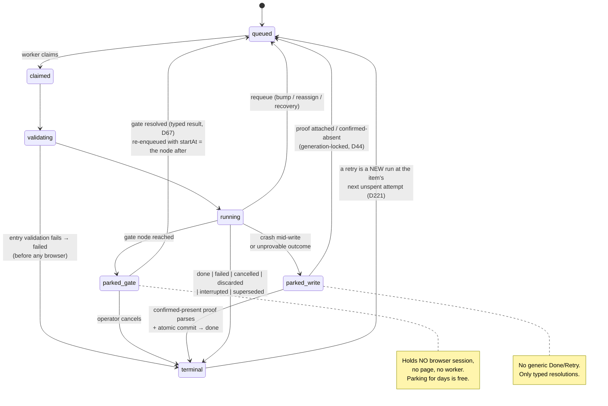

# Workflow model — descriptor SSOT · workflow-constant input · run-state machine · start-anywhere resume

**Reference doc** (`docs/rebuild/reference/workflow-model.md`; cited as `ref workflow-model §x`, and
`02-workflow-model.md` before the 2026-08-20 shelf split). It owns the ONE workflow descriptor, the
ONE builder API that produces it, the `RunEnvelope`, the run-state machine including gates and
parks, and the checkpoint/resume model. It is **normative**: where a phase doc, the tree
(`docs/roadmap/roadmap.md`) or a migration record disagrees about any of those, this doc wins — and
where the CODE disagrees, the doc is corrected to say what IS (D252), never left describing an
intention.

**Section numbers are load-bearing and do not move.** `§1.1`, `§1.2.1`, `§2`, `§2.1`, `§3`, `§3.2`,
`§4`, `§5.5`, `§5.7`, `§8` and the rest are cited from the phase docs, the sibling reference docs,
`docs/migrations/separations.md`, the tree's `doc:` attributes and from `src/` itself. A rewrite adds
and corrects; it does not renumber.

**As-built is folded in, not appended.** This doc used to carry four dated `Phase 1e` / `Phase 1f`
as-built blocks above §0. Each has been folded into the numbered section it amends, so a section
states the contract AND what the tree actually holds in one place. The chronology header that
recorded *when* the doc changed is `history/superseded/2026-08-21-workflow-model-status-header.md`.

**Seven workflows are registered** (`src/control/workflow-registry.ts`): `person-lookup`, the five
`separations-*` chunk harnesses, and the composed `separations`. Every active role contract in this
doc is exercised by at least one of them, and the sections below say which.

## Ownership (D1)

| This doc OWNS | Imported from siblings (referenced, never redefined) |
|---|---|
| The ONE workflow builder API — read steps, page-scoped transactions, output-dependent branches, parallel fork/join, typed child runs/delegation policy, gates, decoration/instrumentation, auth | Ref task-contract: task contracts, three effects, stores, sessions, freshness metadata, subject declarations, decoration |
| Descriptor shape (incl. verdict mappings, gate declarations, derived session union) | Ref dashboard-surfaces: native span/event **wire** schema incl. `gate.opened`/`gate.resolved`, notes stream, isolated rebuild storage, SQLite projection, SSE wire shapes, completion (fan-out/approval) union |
| `RunEnvelope` (incl. `dryRun` — D6) | |
| Run-state machine incl. gate nodes and parks (D5) | |
| Checkpoint/resume model: store, freshness (D8), scope (D9), task-authoring rule | |
| Span-id path grammar + attempt semantics (what the engine brackets) | |
| Workflow terminal result schema and child-run result typing | Ref dashboard-surfaces: command/action/enqueue policy semantics and durable dependency/command storage |
| | Ref operator-trust: semantic UI registry, scenarios, evidence receipt, explorer/editor projections |

---

## 0. Grounding — what exists today, why it hurts

Paths in this section are **legacy-repo** paths (`hr-automation`); unqualified `src/` in the design
sections below is the **rebuild repo's** `src/`.

- `defineWorkflow` (`src/core/kernel/workflow.ts`) is the closest thing to a descriptor, but it
  imports Playwright transitively, so it never ships to the browser. The client re-declares
  metadata by hand: `formatStepName` string-switches (`dashboard/components/shared/types.ts:405`),
  `pipelineStepLabel`'s run-conditional override (`StepPipeline.tsx:127`),
  `workflow-icons.ts`, `INSTANCE_LABELS` (`tracker/session-events.ts:395`).
- ~10 parallel registries keyed by the same string names: `WORKFLOW_LOADERS`,
  `DASHBOARD_INPUT_RUN_WORKFLOWS` + `DASHBOARD_UPLOAD_RUN_WORKFLOWS`, `INPUT_RUN_REGISTRY`,
  `RUN_MODAL_REGISTRY`, `WORKFLOW_ICONS`, `INSTANCE_LABELS` (+ `LEGACY_INSTANCE_LABELS`),
  `E2E stub map`, `queue-row-status-index.ts`, the `:stop` npm scripts. Two have coverage guards
  (`instance-labels-coverage`, `queue-row-kind-coverage`); the rest fail at runtime.
- Timing is inferred, not recorded: `computeStepDurations` (`tracker/dashboard/run-timelines.ts`)
  reconstructs step durations from row-status transitions with anchor heuristics. `step_change`
  session events exist *only* to carry the live step.
- Long waits are faked as steps: a delegated OCR run parks at `running/awaiting-approval` via
  sentinel statuses; oath-upload hand-rolls a wait-signatures polling step; nothing releases the
  browser while a run waits days for an operator.
- Resume exists only as ad-hoc channels: retry replays `tasks.original_input_json`; Edit Data
  rides a `prefilledData` side channel that `splitPrefilled` strips before schema parse; a step
  that needs an upstream value re-reads it from stringified tracker `data`.

The new model replaces all of this with the **descriptor** (one client-safe declaration per
workflow), the **run-state machine** (gates as first-class parks), and the **checkpointed run
context** (typed data flow between tasks). Time lives in ref dashboard-surfaces's span stream.

---

## 1. The workflow descriptor

<!-- roadmap: p1-authority -->

<!-- roadmap-status: p1-authority -->
- [x] ONE bundle-safe descriptor module per workflow, value-importing only zod + `src/domain/**` + the audited `src/base/**` builders — enforced by walking the real import graph (§1.1/§1.2, D106; `src/base/workflow.ts`, `tests/unit/architecture/descriptor-coverage.test.ts` "keeps every descriptor module's value-import closure bundle-safe")
- [x] `identity` is a MATCH KEY only; the kernel mints `ItemId` from `(workflowId, matchKey)` at enqueue, because a descriptor cannot hash and two derivations of one identity drift (D103, `src/base/workflow.ts:170-183`)
- [x] the typed DAG builder ships with the exact `S`/`Nodes` accumulators, `build()`-time forward-reference validation for branch and parallel targets (D104) and the mandated real-scale type proof (§3; `src/base/flow.ts`, `tests/types/flow-graph.typecheck.ts`, `tests/unit/flow-type-budget.test.ts`)
- [x] `descriptor-coverage` is the ONE coverage guard — 17 cases over `DESCRIPTORS`, both directions (§1.4)
- [x] checkpoint replay with a REQUIRED per-node `replay` policy, the D8 freshness walk, and the item-scoped store (§5.3 · §5.5 · §5.7)
- [x] labels resolve from exactly two layers and no third (§1.5, D16)
- [ ] six descriptor fields have ZERO producers among the eight registered workflows and are carried on the strength of the type proof alone: `presets`, `coordinator`, `completionConsumes`, `completion`, `surfaces.uploadRun`, `artifactProjections` (verified by grep over `src/workflows/*/descriptor.ts`) — each is named in place in the section that declares it
- [ ] three of the six node kinds have zero producers for the same reason: no registered workflow declares a `branch`, a `parallel` or a `child-run` node (37 `.step`, 7 `.transaction`, 4 `.gate`). §3.2's delegation contract is proved by the type suite and `fixtureDescriptor`, never by a run — and of the three gate arms, only `resolvedBy: "operator"` has a producer
- [ ] the builder's `.auth()` per-system override is UNBUILT (§3): neither `"eager"` nor `"on-first-use"` appears in `src/`, so every workflow acquires each session at the first node that needs it and cannot ask for the eager chain. R12's Duo ceremony lease is its prerequisite
- [ ] three §1.3 projections have no reader: `cli stop <workflow>` (no `stop` verb in `src/cli.ts`), the exhaustive `Record<IconName, LucideIcon>` (`IconName` is absent from `src/dashboard`), and `sessionLabel` (declared, read by nothing)
- [ ] §1.5's layer-1 presentation override is unbuilt — no `config/workflow-presentation/` exists and nothing reads one, so every label comes from the descriptor
> 2026-08-21 | docs-cohesion workflow-model | verified against `src/base/workflow.ts`, `src/base/flow.ts`, `src/control/workflow-registry.ts`, all eight `src/workflows/*/descriptor.ts`, `config/pending-impl-bindings.json` and `tests/unit/architecture/descriptor-coverage.test.ts`; left: the six unproduced fields and the three unproduced node kinds
<!-- /roadmap-status -->

### 1.1 Shape

<!-- roadmap: p1-authority -->

One authored module per workflow: `src/workflows/<id>/workflow.ts` — one `defineWorkflow(...)` call
(§1.6); the `WorkflowDescriptor` this section describes is its compiled product
(`compileWorkflow(definition).descriptor`), never a hand-authored file. That authored module imports
**only** zod,
`src/domain/**` (which includes the task **contracts** at `src/domain/contracts/<system>/`
— D3's client-safe half), and type-only imports — never a store, never Playwright. Enforced
mechanically (§1.4). "Plain data" means: serializable fields plus pure functions (zod schemas,
input parsers, bind mappings) — the same class of object that already crosses the bundle boundary
in `queue-row-status-index.ts`.

```ts
// src/domain/workflow/descriptor.ts  (client-safe)
import { z } from "zod/v4";
import type {
  AnyCommitContract,
  AnyPrepareContract,
  AnyReadContract,
  AnyTaskContract,
  JsonValue,
} from "../contracts/types.js";   // ref task-contract / D3

export interface WorkflowRef<
  InputSchema extends z.ZodType,
  ResultSchema extends z.ZodType,
> {
  readonly id: WorkflowId;
  readonly input: InputSchema;
  /** The schema-valid terminal value a successful child exposes to its parent. */
  readonly result: ResultSchema;
}
export type AnyWorkflowRef = WorkflowRef<z.ZodType, z.ZodType>;

export interface RuntimeScope {
  readonly input: JsonValue;
  readonly outputs: Readonly<Record<string, JsonValue>>;
}

export interface WorkflowGateSource<
  Target extends AnyWorkflowRef,
  EventSchema extends z.ZodType,
> {
  kind: "workflow";
  workflow: Target;
  event: EventSchema;
  correlationKey: string;
  terminal?: readonly string[];
}
export interface ExternalGateSource<EventSchema extends z.ZodType> {
  kind: "external";
  sourceId: string;
  event: EventSchema;
  correlationKey: string;
}
/** Compile-time icon union; the dashboard's icon map is Record<IconName, LucideIcon>
 *  (exhaustive), so a new name without a component FAILS TO COMPILE. */
export const ICON_NAMES = ["Search", "Users", "UserMinus", "FileScan", /* … */] as const;
export type IconName = (typeof ICON_NAMES)[number];

export type GraphNodeKind = "task" | "transaction" | "branch" | "parallel" | "child-run" | "gate";
export interface GraphNodeBase {
  kind: GraphNodeKind;
  id: string;
  dependsOn: readonly string[];
}

/** Runtime discriminant union. The builder retains the descriptor's exact node tuple;
 * this alias is only for exhaustive runtime switching and never feeds type inference. */
export type RuntimeFlowNode =
  | TaskStepNode<RuntimeScope, AnyReadContract>
  | TransactionNode<RuntimeScope, AnyPrepareContract, AnyCommitContract>
  | BranchNode<RuntimeScope, Readonly<Record<string, readonly string[]>>>
  | ParallelNode
  | ChildRunNode<RuntimeScope, AnyWorkflowRef>
  | AnyGateNode;

export interface TaskStepNode<TCtx, C extends AnyReadContract> {
  kind: "task";
  /** Workflow-local step id — the span/label/resume key. Unique per workflow. */
  id: string;
  /** Display label. Defaults to the contract's `title` (D16 — see §1.5 precedence). */
  label?: string;
  uses: C;                             // the CONTRACT object (ref task-contract / D3), imported by value
  /** Bind the task's input from workflow input + upstream outputs. Returns z.input<C["input"]>;
   *  the impl's run receives z.output<C["input"]> (ref task-contract / D15). Must be PURE. */
  bind: (ctx: TCtx) => z.input<C["input"]>;
  /** Declared graph dependencies; freshness and scheduling use these static edges. */
  dependsOn: readonly string[];
  /** Optional condition — a DECLARED value, not a closure (D228, §3.3). */
  when?: NodeCondition;
  /** Resume policy — REQUIRED, no default (§5.3). */
  replay: "checkpoint" | "always-rerun";
  // Prepare and commit contracts are illegal here: they appear only inside one transaction node.
  // NOTE: no `system` field — the system is the contract id's `<system>/` prefix.
}

export interface TransactionNode<TCtx, P extends AnyPrepareContract, C extends AnyCommitContract> {
  kind: "transaction";
  id: string;
  label?: string;
  dependsOn: readonly string[];
  prepare: { uses: P; bind: (scope: TCtx) => z.input<P["input"]> };
  /** Bound and parsed before the live probe or browser launch. It may read only workflow input and
   * declared upstream outputs—never the ephemeral prepare output—so the durable key is stable before
   * any page mutation. The parsed value is later passed unchanged to commit.run on the staged page. */
  commit: { uses: C; bind: (scope: TCtx) => z.input<C["input"]> };
  /** Same context/page lease from prepare start through commit verification; the prewrite probe uses
   * an ordinary read lease before this transaction lease is acquired. */
  leaseScope: "transaction";
  dryRun: "stop-after-prepare" | "unsupported";
  probePolicy: "always" | "retries-and-recovery-only";
  /** If probe→fence exceeds this migration-justified budget, discard staged page state and restart
   * at the probe. A stale preflight may never proceed to a click. */
  probeToFenceMaxMs: number;
  retryBeforeFence?: RetryPolicy; // restarts preflight+prepare on a fresh/reset lease; never commit
}

/** Kernel-owned transaction result. Downstream nodes cannot confuse "this run clicked" with
 * "the permanent key was already satisfied"; both still carry the contract's full typed output. */
export type TransactionOutcome<C extends AnyCommitContract> =
  | { disposition: "committed";
      proofSource: "normal-output" | "recovery-probe" | "operator-attestation";
      output: z.output<C["output"]>; proof: ProofOf<C> }
  | { disposition: "already-present";
      proofSource: "durable-intent" | "live-probe";
      output: z.output<C["output"]>; proof: ProofOf<C> };

export interface BranchNode<
  TCtx,
  Cases extends Readonly<Record<string, readonly string[]>>,
> {
  kind: "branch"; id: string; dependsOn: readonly string[];
  choose: (scope: TCtx) => keyof Cases & string;
  cases: Cases; // node ids, all targets validated
}

export interface ParallelNode {
  kind: "parallel"; id: string; dependsOn: readonly string[];
  branches: readonly { id: string; nodes: readonly string[] }[];
  join: "all" | "all-settled"; // result type follows the selected policy
}

export type ChildFailurePolicy = "fail-parent" | "block-parent" | "allow-partial";
export type ChildCancelPolicy = "cascade" | "independent";
export type ChildRetryPolicy = "resume-parent" | "manual-parent-resume";
export type ChildVisibility = "inline" | "linked" | "hidden-unless-failed";

export type ChildRunOutcome<Target extends AnyWorkflowRef> =
  | { state: "done"; runId: RunId; itemId: ItemId; output: z.output<Target["result"]> }
  | { state: "failed"; runId: RunId; itemId: ItemId; failureId: FailureId }
  | { state: "cancelled"; runId: RunId; itemId: ItemId;
      reason: string; cancelledBy: "operator" | "parent" | "kernel" }
  | { state: "blocked"; runId: RunId; itemId: ItemId;
      failureId: FailureId; reason: string };

export interface DelegationPolicy {
  onChildFailed: ChildFailurePolicy;
  cascadeCancel: ChildCancelPolicy;
  afterChildRetry: ChildRetryPolicy;
  visibility: ChildVisibility;
}

export type ChildRunNode<TCtx, Target extends AnyWorkflowRef> =
  | { kind: "child-run"; id: string; edgeId: DelegationEdgeId;
      dependsOn: readonly string[]; target: Target; cardinality: "one";
      bind: (scope: TCtx) => z.input<Target["input"]>;
      deriveChildItemId: (input: z.output<Target["input"]>) => ItemId;
      await: "terminal"; join: "one"; policy: DelegationPolicy }
  | { kind: "child-run"; id: string; edgeId: DelegationEdgeId;
      dependsOn: readonly string[]; target: Target; cardinality: "many";
      bind: (scope: TCtx) => readonly z.input<Target["input"]>[];
      deriveChildItemId: (input: z.output<Target["input"]>) => ItemId;
      await: "terminal"; join: "all" | "all-settled"; policy: DelegationPolicy }
  | { kind: "child-run"; id: string; edgeId: DelegationEdgeId;
      dependsOn: readonly string[]; target: Target; cardinality: "one" | "many";
      bind: (scope: TCtx) => z.input<Target["input"]> | readonly z.input<Target["input"]>[];
      deriveChildItemId: (input: z.output<Target["input"]>) => ItemId;
      await: "none"; join: "none"; policy: DelegationPolicy };

export interface OperatorGateNode<ResultSchema extends z.ZodType> {
  kind: "gate";
  id: string;                          // e.g. "approval" — ref dashboard-surfaces's gate.opened/resolved key
  dependsOn: readonly string[];
  label: string;
  statusKey?: string;                  // e.g. "needsReview" — ref dashboard-surfaces's status projection
  resolvedBy: "operator";
  result: ResultSchema;
  subscribes?: never;
  resolve?: never;
}
export interface ChildrenGateNode<
  Source extends WorkflowGateSource<AnyWorkflowRef, z.ZodType>,
  ResultSchema extends z.ZodType,
> {
  kind: "gate";
  id: string;
  dependsOn: readonly string[];
  label: string;
  statusKey?: string;
  resolvedBy: "children-terminal";
  subscribes: Source;
  result: ResultSchema;
  resolve: (event: z.output<Source["event"]>) => z.input<ResultSchema>;
}
export interface ExternalGateNode<
  Source extends ExternalGateSource<z.ZodType>,
  ResultSchema extends z.ZodType,
> {
  kind: "gate";
  id: string;
  dependsOn: readonly string[];
  label: string;
  statusKey?: string;
  resolvedBy: "external";
  subscribes: Source;
  result: ResultSchema;
  resolve: (event: z.output<Source["event"]>) => z.input<ResultSchema>;
}
// All three arms exist in `src/domain/workflow/graph.ts:318-345`. Only `operator` has a producer:
// every gate any registered workflow declares is `resolvedBy: "operator"` (four of them).
export type AnyGateNode =
  | OperatorGateNode<z.ZodType>
  | ChildrenGateNode<WorkflowGateSource<AnyWorkflowRef, z.ZodType>, z.ZodType>
  | ExternalGateNode<ExternalGateSource<z.ZodType>, z.ZodType>;

export interface WorkflowDescriptor<
  InputSchema extends z.ZodType,
  ResultSchema extends z.ZodType,
  Nodes extends readonly GraphNodeBase[],
  Completion extends CompletionProgram | undefined = undefined,
  S extends Record<string, AnyNodeEntry> = Record<never, never>,
  D extends readonly (keyof S & string)[] = readonly [],
> {
  id: WorkflowId;                      // "person-lookup"
  /** Bumped for semantic graph/bind/presentation contract changes. */
  version: number;
  /** Build-derived from version + graph + schemas + projection fields; stamped on every run. */
  contractFingerprint: Fingerprint;
  code: WorkflowCode;                  // "pl" — the SHORT CODE (§1.1.1, D242): 2–4 lowercase
                                       // letters, unique across the registry (guarded)
  label: string;                       // "Person Lookup"
  sessionLabel?: string;               // terminal-drawer label when ≠ label (separations → "Kuali")
  icon: IconName;
  category: WorkflowCategory;          // union, not free string
  input: InputSchema;                  // the workflow-constant input schema (§2)
  /** Strict validation-only schema for the canonical z.output snapshot (D62). It has no defaults,
   * coercions, or transforms; every DB/resume read uses it instead of re-running ingress parsing. */
  canonicalInput: CanonicalInputSchema<InputSchema>;
  /** Successful terminal result exposed to typed parent delegations. The exact `dependsOn` tuple
   * narrows `derive` to those terminal outputs; do not annotate away the builder-inferred S/D. */
  result: WorkflowResultSpec<ResultSchema, InputSchema, S, D>;
  inputSubject: InputSubject | ((input: z.output<InputSchema>) => InputSubject); // wire: "by-input"
  surface: { shape: RowShape } | { resolveShape: "by-input" };     // ref dashboard-surfaces's field name
  nodes: Nodes;                        // exact tuple — built via the typed DAG builder (§3)
  /** PROJECTIONS (derived at build(), never hand-written):
   *  steps:   task nodes → one entry; transactions → prepare+commit child entries (ref dashboard-surfaces consumes)
   *  gates:   nodes.filter(kind==="gate") → { id, label, statusKey? }[]          (ref dashboard-surfaces consumes)
   *  systems: union of task contracts' browser-system prefixes only (D2/D15—the hand `systems:`
   *           list is DELETED; service and `workflow:<id>` headless stores contribute none)
   *  requires: union of task contracts' declared SecretName requirements (ref clock-config-secrets) */
  surfaces: {
    /** Typed-text start (InputRunPanel). Absent ⇒ no input-run affordance. */
    inputRun?: { placeholder: string; parser: InputParserSpec;
                 /** Real values this box starts, each proved by the factory to parse AND to
                  *  satisfy the input schema before the descriptor exists (D250). */
                 examples?: readonly InputRunExample[];
                 supportsDryRun?: boolean /* DERIVED — D209, never authored */;
                 emptyOpensUpload?: boolean };
    /** File-upload start (RunModal). Absent ⇒ no upload-run affordance. */
    uploadRun?: { title: TextTemplate; fields: readonly UploadFieldSpec[];
                  accepts: readonly FileAcceptSpec[]; successMessage: TextTemplate };
  };
  /** Verdict mappings — a closed tuple, not a free string map. Keys are unique/guarded and
   * SpanEnded may emit only this descriptor-derived union. */
  verdicts?: readonly VerdictDefinition[];
  /** Completion (fan-out/approval) contract — SHAPE OWNED BY DOC ref dashboard-surfaces §4; referenced here only. */
  completion?: Completion; // exact factory-inferred program; never annotate as the broad union
  capabilities?: WorkflowCapabilities;  // ref dashboard-surfaces §3 (review/editData/delegation display rules)
  details: readonly DetailProjectionSpec<Nodes>[];
  /** Where the RUN resolves the subject's display name, if it ever does (ref dashboard-surfaces §1.2). */
  subjectProjection?: SubjectProjectionSpec<S>;
  /** DERIVED (D225): the run-detail timeline's categorical shape — the declared categories
   *  normalized with member labels, or one category per node. Always present, always exhaustive. */
  timeline: readonly TimelineCategoryProjection[];
  /** The descriptor's own sentence about what this workflow does (D229) … */
  summary?: string;
  /** … and one about each node, DERIVED into an exhaustive frozen list: a partial declaration
   *  would leave some nodes silently prose-less on the one surface whose job is to explain them. */
  nodePurposes: readonly NodePurposeSpec[];
  /** Semantics/types owned by ref dashboard-surfaces: one closed enqueue/action command protocol for every workflow. */
  enqueue: EnqueuePolicy;
  actions: WorkflowActionPolicy;
  presets?: readonly InputPreset<z.input<InputSchema>>[];
  /** Match key ONLY — the kernel mints `ItemId` from `(workflowId, matchKey)` at enqueue.
   *  A descriptor is bundle-safe and cannot hash, so it cannot mint a UUID (D103, as-built below). */
  identity: { matchKey: MatchKeySpec<z.output<InputSchema>> };
  presentation: WorkflowPresentationSpec<z.output<InputSchema>>;
  coordinator?: CoordinatorPolicy;
  completionConsumes?: readonly CompletionConsumptionSpec[];
  /** Registered behavioral coverage; task scenarios are unioned automatically, while graph-level
   * branch/delegation/gate/control cases are declared here. */
  scenarios: readonly [ScenarioId, ...ScenarioId[]];
  /** Typed node-output → durable local-sink projections (refs dashboard-surfaces/data-intake-and-edit-data). The builder validates each
   * source path and stable key against the exact node output; no task performs a mutable append. */
  artifactProjections?: readonly DurableArtifactProjectionSpec[];
}
```

`InputParserSpec`, `UploadFieldSpec`, `FileAcceptSpec`, and `TextTemplate` are closed, serializable
domain unions with exhaustive generic server/client interpreters. They contain no workflow callback,
endpoint function, or component reference. A genuinely new run-surface behavior extends that union
and both exhaustive interpreters; it never creates a workflow-id switch or side registry. Server-only
functions (`identity`, per-run presentation resolution, completion derives) stay in the validated
descriptor and project only their resolved policy/data to the client.

**AS-BUILT (Phase 1e, 2026-08-01) — descriptor assembly, and four deviations from the sketch
above.** The sketch is kept because it is the shape a descriptor author reads; the paragraphs
below are what `src/base/workflow.ts` actually constructs, and they win on any disagreement.

**The descriptor.** `src/base/workflow.ts` owns `WorkflowDescriptor` and `defineWorkflowDescriptor`;
`src/domain/workflow/presentation.ts` owns the closed plain-data vocabularies (icons, categories,
row shape, verdicts, enqueue/action policy, capabilities, detail and artifact projections);
`src/domain/workflow/ingress.ts` owns the run-surface specs. `steps` (transactions contributing
`<node>/prepare` and `<node>/commit` arms under one node id), `gates`, the browser-only `systems`
union, and `requires` are DERIVED from the node tuple, so D2/D15's deleted hand list cannot return.
What cannot be derived is proven at construction: detail and artifact-projection paths must resolve
in the producing node's real output schema, parser and upload fields must resolve in the input
schema, the terminal result and every gate result go through the recursive strict-boundary audit,
and identity/presentation/subject resolution run against the audited canonical-input samples.

Four deviations from §1.1/§3's sketch, each because the as-built rule it collided with is the one
already landed and guarded:

- **`identity` declares a match key only; `deriveItemId` is gone (D103).** A descriptor is
  bundle-safe and cannot hash, so it cannot mint a UUID, and two independent derivations of one
  identity are a drift surface by construction. The kernel mints `ItemId` from
  `(workflowId, matchKey)` at enqueue — one derivation, one place. Fan-out `deriveItemId`
  (ref dashboard-surfaces §4.1) is unaffected: completion derives are server-side. The match-key
  string is durable natural-key identity: presentation/privacy hardening applies only after that
  boundary. Replacing an established raw component with its digest is an identity migration and
  requires an explicit descriptor version/migration decision; it is never a redaction-only edit.
- **Meta rides the descriptor spec, not a `.meta()` link in the builder chain.** It contributes
  nothing to the `S`/`Nodes` accumulators, and threading it through would re-open the exact
  transform surface 1e's real-scale type proof pins. `details` stays typed over `S`, so a renamed
  node is still a compile error.
- **Branch cases and parallel branches take plain node ids, validated at `build()` (D104).** They
  were typed `keyof S`, which admits only nodes ALREADY declared — i.e. upstream. A branch that can
  only point backwards cannot select what runs next, and the graph it describes is cyclic. Targets
  are now checked at `build()`: declared, and strictly downstream of their controller.
- **Descriptor modules value-import zod + `src/domain/**` + the audited `src/base/**` builders**,
  where `src/base/**` is itself proven to import only zod + `src/domain/**`. `flow()` and
  `defineWorkflowDescriptor` live in `base`, so §1.4 #6's literal root set is one module deeper;
  `descriptor-coverage` walks the whole closure in both halves.

**Completion (ref dashboard-surfaces §4)** is `src/domain/workflow/completion.ts`. `defineCompletionProgram` returns
a SEALED handle whose type exposes `mode` and `gate` and nothing else, so
`otherDescriptor.completion.stages[0].eligible` is a compile error rather than a convention;
`revealCompletionProgram` is the one named seam back, and `descriptor-coverage` checks that no
workflow module calls it. Building a program PROVES the stage chain against a mandatory sample:
each child input is parsed by the target's own schema, each `deriveItemId` must be stable across two
calls, and the per-document stage receives the ids the record stage ACTUALLY enqueued — so a record
`eligible` rejected never reaches it, which is the as-built rule the legacy approve route missed.

**`contractFingerprint` is build-manifest based** (`src/domain/workflow/build-manifest.ts`,
generated into `src/domain/workflow/generated-build-manifest.ts` by `npm run build:manifest`). It
hashes canonical `(repo-relative path, content)` tuples over the descriptor closure plus the
INSTALLED toolchain versions; type-only imports are inside the closure on purpose, because a changed
type is a changed contract; the generated module is excluded from its own closure so the hash has a
fixed point. `descriptor-coverage` regenerates and fails on any diff.

**Six of these fields have no producer, and saying so is part of the contract.** Across the eight
registered workflows, `presets`, `coordinator`, `completionConsumes`, `completion`,
`surfaces.uploadRun` and `artifactProjections` are declared by **none** of them. They are not dead:
each is the declaration a named later migration needs — `completion`/`completionConsumes`/
`coordinator` arrive with the i9-check operation coordinator (order 5), `artifactProjections` with
the OnBase/oath-upload artifact sinks (order 7), `uploadRun` with the first file-started workflow —
and each is held to the same strict-schema and factory-proof discipline as a field that ships today,
so the first consumer inherits a validated shape rather than authoring one. What they are NOT is
proven by a run, and a reader deciding whether to build on one should know that. `subjectProjection`
(five workflows), `verdicts` (seven) and `capabilities` (five) are in daily use by contrast.

#### D260 — `inputRun` carries exactly ONE varying value per run, and `separations` needs two (2026-08-20)

<!-- roadmap: track-c -->

**The RULE below is current and normative; its DISPOSITION is closed by D261, immediately after.**
Read them in order. D260 established the constraint, proved `separations` could not satisfy it,
named two shapes and handed the operator the choice; the operator chose shape 2 the same day and it
was built. Nothing in D260 was withdrawn — including its refusal of the tempting version ("drop
`documentNumber` and let the page supply it") and its refusal of a plan-time derivation — so the
paragraphs about `separations.surfaces` staying `{}` and about not spending a fingerprint read as
the state on 2026-08-20 morning, not as the state now.

**The rule, stated once so no workflow re-derives it.** `InputParserSpec` splits operator text into
entries and each entry emits **one** input field: `EntryRule.emit` is a single `InputFieldName`, and
`parseInputRunText` composes `[{ field: rule.emit, value: <the entry text> }, ...constants]`.
`constants[]` contributes the SAME value to every entry of every run, so it can only carry a value
that does not vary per run — and a per-run value placed there would be a constant baked into a
bundle-safe descriptor, which is the fabricated constant this tree bans. **Therefore a workflow is
`inputRun`-startable iff its input schema has exactly one required field that varies per run.**
`person-lookup` satisfies this (`emplId` OR `name`, with two boolean constants). It is a property of
the INPUT SCHEMA, not a declaration a descriptor may choose.

**`separations` does not, and it is not one decision away.** `SeparationsInput` requires three fields
and **two of them vary per run**:

| Field | Varies per run | Why it cannot leave the ingress |
|---|---|---|
| `documentNumber` | yes | It is the run's own CLAIM, proved against the document's level-1 heading before anything else runs. Dropping it deletes the check that catches a stale `actionId` — an `actionId` names a workflow STEP, not a document (2026-08-04, `src/stores/kuali/CLAUDE.md`) |
| `actionId` | yes | It is the only address Kuali offers (`…/actions/<actionId>`). The reverse lookup is the Action List, whose whole `actionList.*` selector family is deliberately NOT ported |
| `timekeeperName` | no (per operator) | Ingress by ratified decision (separations §9.16 6a-2); `config.operator.timekeeperName` exists and is deliberately unused |

**No derivation is available, and the reason is structural rather than missing work.**
`services/start/plan.ts` performs exactly ONE ingress parse per raw submission
(`planning.parseInput(rawInput)`), with no I/O, no per-workflow enrichment seam and no resolution
step — an ingress that could RESOLVE a value it was not given is the second, unaudited ingress path
`src/domain/workflow/ingress.ts` refuses by name. A document-number → action-id lookup is a browser
act, so it could only ever live in the graph, which is one node past where the input schema is
parsed. And reversing the `timekeeperName` decision reaches **two** varying values, not one, so it
does not unblock this and is not proposed.

**The disposition: `separations.surfaces` stays `{}`, and the trigger is named.** The deferral ends
when a run surface carries MORE THAN ONE typed value per run. Two shapes are available and the
operator owns the choice:

1. **A third `surfaces` arm** — a typed FORM over the existing `UploadFieldSpec` vocabulary
   (`text`/`boolean`/`select`) with its existing exhaustive interpreter `resolveUploadFields`, minus
   `uploadRun`'s mandatory `accepts[]`. The domain half is a union extension of the kind this section
   already permits; the honest cost is that **no client renderer for `UploadFieldSpec` exists** —
   `uploadRun` is declared by no registered workflow and `surfaces/run-start.tsx` renders it nowhere
   — so the surface would be that vocabulary's first live consumer.
2. **Make `actionId` a graph output rather than ingress** — a head node that resolves the action from
   the document number through Kuali's Action List. This is a live selector port of a family the
   Kuali store deliberately left behind, a new contract, a new driver capability and a graph change,
   and it still leaves `timekeeperName` to be typed.

**The descriptor is deliberately NOT edited to record this.** Its `surfaces: {}` comment already
states the reason, and a `contractFingerprint` is hashed over file CONTENT — so a comment-only edit
moves the fingerprint, and every checkpoint this database holds for `separations` stops replaying
(separations §9.22 measured exactly that: `2c9cb58e…` ≠ `59830cf6…` forced a full live re-read).
**Never spend a fingerprint on a change that buys no behavior.**

#### D261 — the action id is a GRAPH OUTPUT, so `separations` starts from one typed number (2026-08-20)

<!-- roadmap: track-c -->

<!-- roadmap-status: track-c -->
- [x] the rule itself: a workflow is `inputRun`-startable iff its input schema has exactly one required field that varies per run, and `constants[]` may carry only a value that does not (D260, `src/domain/workflow/ingress.ts`)
- [x] `SeparationsInput` drops `actionId`; the head node `resolve-action` binds `kuali/search-separation-action` and reads the matched Action-List row's `href` (D261; `src/workflows/separations/descriptor.ts:288-307`, `src/domain/contracts/kuali/search-separation-action.ts`)
- [x] `separations.surfaces.inputRun` exists — one `document-number` rule, no `otherwise` arm, `timekeeperName` as the one constant, and two real document numbers as `examples` (D250/D261; `src/workflows/separations/descriptor.ts:801-838`)
- [x] the document number is now proved TWICE — against the Action-List link's anchored accessible name and against the opened document's level-1 heading (D129/D261)
- [x] the refusals carry the value: no action held on a document refuses BY NAME printing the numbers the list did show, and two DISTINCT action ids for one number refuses rather than choosing
- [!] `timekeeperName` is a per-OPERATOR constant baked into a bundle-safe descriptor (`"Julian Zaw"`). It satisfies the rule and is the weakest thing here; the trigger that ends it is a SECOND timekeeper, at which point it becomes D260 shape 1's typed form field
- [ ] D260 shape 1 — a third `surfaces` arm, a typed FORM over `UploadFieldSpec` — is unbuilt and has no client renderer; the deferral is real and its trigger is the sentence above
> 2026-08-21 | docs-cohesion workflow-model | verified against `src/workflows/separations/descriptor.ts`, `src/domain/workflow/ingress.ts` and `src/domain/contracts/kuali/search-separation-action.ts`; left: shape 1, waiting on a second timekeeper
<!-- /roadmap-status -->

**Read D260 first; this section is the operator exercising the choice it handed them.** They ruled,
verbatim: *"document number should work. no need action id."* That is D260's **shape 2**, and the
build landed the same day.

**D260's rule is unchanged, and is not withdrawn.** A workflow is `inputRun`-startable iff its input
schema has exactly one required field that varies per run. It is still a property of the SCHEMA
rather than a declaration a descriptor may choose, and `constants[]` still may carry only a value
that does not vary per run. **What moved is the schema the rule is applied to**, which is the only
honest way to satisfy a structural rule: `SeparationsInput` drops `actionId` and the graph resolves
it.

| Field | Varies per run | Where it comes from now |
|---|---|---|
| `documentNumber` | yes | The ONE typed value. Unchanged in every other respect: it is still the run's own CLAIM, still proved against the opened document's level-1 heading (D129) — and now proved TWICE, because the Action-List link's ANCHORED accessible name had to equal it before the id was read at all |
| `actionId` | — | **A graph output.** The head node `resolve-action` binds `kuali/search-separation-action`, which filters the Action List's own search box and reads the matched row's `href` |
| `timekeeperName` | no (per operator) | `constants[]`. Legitimate ONLY because it does not vary per RUN — §9.16 6a-2 ratified it as ingress and D260's table records it as constant |

**The constant's scope is stated, because it is the weakest thing here.** `timekeeperName` in
`constants[]` is a fact about WHO is filing, baked into a bundle-safe descriptor. It is a
per-OPERATOR constant, not a per-run one, so it satisfies the rule — and the trigger that ends it is
a SECOND timekeeper, at which point it must become D260 shape 1's typed form field rather than a
second baked constant. `config.operator.timekeeperName` stays deliberately unused: a descriptor is
bundle-safe and cannot read config, and a value retained in the canonical input is one `explain run`
can show for the run that used it.

**Why a resolve node does not weaken the check D260 was protecting.** D260 refused "drop
`documentNumber` and let the page supply it" because that deletes the check catching a stale action
id. This does the opposite: the number stays the operator's input and the ID becomes derived, so the
document number is now compared against the page TWICE — once as the anchored accessible name of the
Action-List link the id was read from, and once as the level-1 heading `openDocument` proves before
anything else runs.

**Where the derivation lives, and why it is not the ingress D260 refused.** D260's refusal of
"derive `actionId` at plan time" stands untouched: `services/start/plan.ts` performs exactly ONE
ingress parse with no I/O, and an ingress that could resolve a value it was not given is the second
unaudited ingress path `ingress.ts` refuses by name. The resolve is a BROWSER act and it lives where
D260 said any such lookup could only live — **in the graph, one node past where the input schema is
parsed**. Nothing about `plan.ts` changed.

**The parser has one rule and no `otherwise` arm.** A separation is filed against a Kuali document
and there is nothing else the box could mean, so an entry that is not a document number refuses the
WHOLE box and starts nothing — which `inputRunParserLabel` states before an operator pastes forty
lines. The `document-number` entry pattern is `KualiDocumentNumberSchema`'s own rule restated
(`^\d{3,8}$`), because a box that accepted a shape the workflow's schema then refused would be a
modal lying about what it starts.

**The fingerprint moved, and that is the cost rather than a defect.** D260 declined to spend a
fingerprint on a comment; this change spends one on behaviour. Every stored `separations` checkpoint
stops replaying, exactly as §9.22 measured for a smaller change — the run's identity genuinely moved,
because its input schema is a different shape. Nothing durable is lost: a checkpoint miss means the
next run re-reads live.

**Fingerprint construction is build-manifest based, never `Function.toString()`.** Codegen hashes
canonical relative-path + file-content tuples for the descriptor source and its bundle-safe
transitive contract/domain dependency closure, plus canonical generated schema/projection JSON and
the locked TypeScript/zod toolchain version. Each bound task impl gets the same treatment over its
server-side import closure. Absolute paths, mtimes, build timestamps, object iteration order, and
minified function text are excluded. The checked-in manifest maps workflow/task ids to hashes;
build/CI regenerates and fails on diff. Thus a bind/identity/derive logic edit changes semantic
compatibility even when its output zod schema does not, while identical source in another checkout
gets the same hash.

### 1.1.1 The short code — ONE declaration, two consumers (D242)

<!-- roadmap: track-b -->

<!-- roadmap-status: track-b -->
- [x] `WorkflowCodeSchema` is the ONE definition of the short code and the descriptor factory, the bootstrap wire and the explorer wire all bind it (`src/domain/workflow/presentation.ts:66`)
- [x] uniqueness is refused at the COMPOSITION ROOT, in the same shape a dangling module role is, and `descriptor-coverage` runs the same audit (`src/control/workflow-registry.ts`, `auditWorkflowCodes` / `workflowCodeRegistry`)
- [x] `TraceIdSchema` stays deliberately wider (`[a-z0-9]{2,4}`) because it READS durable stored ids, and a reader narrowed to the writer's current rule refuses history (`src/domain/ids.ts:154-163`, D133)
- [x] the code is frozen into an archived record beside the label rather than resolved from the live registry (`ArchivedRunContent.workflowCode`, charter §25)
- [x] B4's queue row and the archive index are its presentation consumers; identity is `deriveTraceId`'s `<code>-<HHMMSS>-<runId4>` (§6)
> 2026-08-21 | docs-cohesion workflow-model | verified against `src/domain/workflow/presentation.ts`, `src/domain/ids.ts` and `src/control/workflow-registry.ts`; left: nothing in this doc's half of Track B
<!-- /roadmap-status -->

`code` is the workflow's operator-facing short handle: **two to four lowercase letters**, declared
on the descriptor, **unique across the registry**. `WorkflowCodeSchema`
(`src/domain/workflow/presentation.ts`) is its ONE definition; the descriptor factory, the bootstrap
wire and the explorer wire all bind that schema, so the shapes cannot fork.

**Letters only.** A code sits immediately in front of a digit run in every trace id, and
`s1-000619-4ebf` reads as one opaque blob rather than a workflow followed by a time. Two characters
covers everything registered today; four is the room a later collision needs, and the bound is
widened NOW because widening it once a stored trace id exists means every reader must accept both
shapes forever.

**Uniqueness is enforced at the composition root**, not at the descriptor — one descriptor cannot
see its siblings. `auditWorkflowCodes` / `workflowCodeRegistry`
(`src/control/workflow-registry.ts`) refuse a duplicate at LOAD, in the same shape
`workflowRoleRegistry` refuses a dangling role (§1.2.1), and the same audit is what §1.4 item 1
runs — the throw and the guard can never disagree about what a violation is. Two workflows sharing
`sd` would make `sd-141203-9a1c` name two different things and make an archive row lie about whose
work it is; neither failure throws anything, so neither is discoverable after the fact.

**The two consumers, stated so a third one does not mint a second code.**

1. **Identity** — `deriveTraceId` composes `<code>-<HHMMSS>-<runId4>` (§6, `src/domain/identifiers.ts:30`), so the code is already
   stamped on every run, span, note line and ledger entry this program has ever written.
2. **Presentation** — the archive index row, the Activity per-workflow table and the version
   registry print it beside the label (ref dashboard-surfaces §10.2, ref dashboard-surfaces §10.3). At 800 rows
   `Separation Documents v1` costs the name column real width and `sd v1` does not.

These were built five months apart, and the second nearly minted a separate "display code" — which
would have given one workflow two short names, with nothing telling an operator that `sd-141203-9a1c`
in a log and `sep v1` in the archive name the same thing. Any further consumer reads THIS field.

**`TraceIdSchema` is deliberately wider than `WorkflowCodeSchema`** (`[a-z0-9]{2,4}` against
`[a-z]{2,4}`). It parses durable stored ids, so it is a reader, and a reader narrowed to the
writer's current rule refuses history the moment that rule moves; two-character alphanumeric codes
were legal before D242. The writer stays strict at its own declaration site, which is where a new
code is chosen and a wrong one can still be refused (D133's read-forward discipline).

**A code is frozen into an archived record beside the label** — see ref dashboard-surfaces §10.2 and
`ArchivedRunContent.workflowCode`. Resolving it from the live registry when the Archive renders
would be a descriptor read on the archived path, which is exactly what charter §25 forbids.

### 1.2 The bundle crossing

<!-- roadmap: p1-authority -->
<!-- roadmap: track-d -->

<!-- roadmap-status: track-d -->
- [x] the composition root is `src/control/workflow-registry.ts` and its `WORKFLOW_MODULES` tuple is the ONE static module list; every server registry derives from it (§1.3)
- [x] the dashboard imports no workflow MODULE — no store loader, no Playwright, nothing server-side crosses (`dashboard-wire-boundary` walks the entry's reachable closure and fails on any Node built-in)
- [!] Track D row **D11** — the dashboard DOES bundle the descriptors themselves. `src/workflows/descriptor-registry.ts`'s `WORKFLOW_DESCRIPTORS` is imported by `src/dashboard/app/dashboard-app.tsx:25`, so every descriptor's parsers, surfaces, node purposes and timeline ride the client bundle while the BFF's bootstrap serves only a seven-field row per workflow (`src/server/dashboard/queries/bootstrap.ts:102-110`). D11 moves the tuple out of the bundle and onto that wire; it amends D251 / ref frontend-backend-integration §4, and it is code work this docs pass does not do
- [ ] `/api/workflow-definitions` — the endpoint this section described for four months — was never built, and nothing serves "a generated, schema-validated client projection plus presentation overrides". D11 is where it lands, if it lands
> 2026-08-21 | docs-cohesion workflow-model | verified against `src/control/workflow-registry.ts`, `src/workflows/descriptor-registry.ts`, `src/dashboard/app/dashboard-app.tsx` and `src/server/dashboard/queries/bootstrap.ts`; left: D11
<!-- /roadmap-status -->

```
src/workflows/person-lookup/       # rebuild repo (hr-automation-rebuild) — D93
└── workflow.ts       # the ONE authored file: defineWorkflow(...), bundle-safe
                      # (zod + domain, incl. contracts). compileWorkflow derives the
                      # descriptor; composeWorkflowModule derives the server module
                      # value at the registry root — neither is a file here (§1.6).
```

There is no per-workflow `handler.ts`, `descriptor.ts` or `module.ts`: step impls live in the **stores** (ref task-contract §3; D3 —
`defineTask(contract, impl)` in `src/stores/<system>/tasks/` is the only impl registry). The
descriptor references contract *objects*, so descriptor↔contract renames fail to compile at the
import site. Descriptor↔impl pairing is runtime: the engine resolves each step's contract id in
the store index at daemon boot and **fails loud on any unresolved contract** — plus the §1.4
coverage guard pins it at CI.

```ts
// src/control/workflow-registry.ts — composition root; lower layers never import workflows
import { personLookupWorkflow } from "../workflows/person-lookup/workflow.js";
import { separationsWorkflow } from "../workflows/separations/workflow.js";

// Each module is COMPOSED here from the authored definition — the only place stores are bound.
export const personLookupModule = composeWorkflowModule(compileWorkflow(personLookupWorkflow), STORES);

// The one unavoidable static module tuple. A workflow appears ONCE; every registry/projection below
// derives from it, so adding a workflow is one import+tuple entry rather than synchronized lists.
export const WORKFLOW_MODULES = [personLookupModule, separationsModule /* … */] as const;
export const DESCRIPTORS = WORKFLOW_MODULES.map((m) => m.descriptor);
export const SERVER_REGISTRY = indexModulesByDescriptorId(WORKFLOW_MODULES);
```

**The dashboard never imports a workflow MODULE**, and that half is structural: the composed module
carries the stores, so importing one would drag Playwright and `node:*` into the bundle —
`dashboard-wire-boundary` (ref frontend-backend-integration §8.13) walks the entry's reachable
closure and fails on any Node built-in, printing the whole import chain. `control/workflow-registry.ts`
validates every descriptor at boot. This removes the previous `domain → workflows → domain` cycle.

**It DOES import the descriptors, and that is a live gap with an owner.** `src/workflows/descriptor-registry.ts`
exports `WORKFLOW_DESCRIPTORS` — the same seven objects `WORKFLOW_MODULES` composes, pinned
object-identical and in order by `tests/unit/workflows/descriptor-registry.test.ts`, so it is not a
second registry — and `src/dashboard/app/dashboard-app.tsx` imports it directly. So the parsers,
surfaces, node purposes, timeline categories and summaries of every workflow ship in the client
bundle, while the BFF's bootstrap serves only `{id, code, label, categoryId, descriptorFingerprint,
availability, role}` per workflow (`src/server/dashboard/queries/bootstrap.ts:102-110`). The
`/api/workflow-definitions` endpoint this section used to describe **does not exist** and never did.
Moving the tuple out of the bundle onto a served projection is tree row **D11** under Track D; it
amends D251 / ref frontend-backend-integration §4, and until it lands, a descriptor edit is a
frontend rebuild. The SSE hello's fingerprint check is what keeps the bundled copy honest in the
meantime: a server/client mismatch fails loud rather than rendering a stale surface.

#### 1.2.1 The module's role declaration (D219, 2026-08-14)


- [x] every MODULE declares a required closed `role`, validated fail-loud at the composition root; a dangling `chunk-harness.of` and a harness-of-a-harness are unrepresentable (§1.2.1, D219/D220; `src/domain/workflow/module-role.ts`, `src/control/workflow-registry.ts` `auditWorkflowModuleRoles`)
- [x] a retry is the ITEM's next unspent attempt, taken from authority inside the inserting transaction; `runs.enqueue` refuses an attempt the item has already spent (§4/§5.6 #1/§5.7, D221)
- [x] the checkpoint identity carries the claim generation, so a gate park and its resume are two executions rather than one refused insert (§5.7, D214, migration v14)
- [x] the span path carries the claim generation too, so the two executions are two timeline rows (§6, D214)
- [x] a dry run runs beat ① before it stages, so a rehearsal cannot fail where the performance succeeds (§2.1, D215)
> 2026-08-21 | docs-cohesion workflow-model | verified against `src/domain/workflow/module-role.ts`, `src/control/workflow-registry.ts`, `src/infra/sqlite/migrations.ts` (v14) and `src/core/run-executor.ts`; left: nothing in this doc's half — D218/D222 are ref dashboard-surfaces's and D243/D244 ref execution-and-sessions'

A registered workflow is one of three things to the program's taxonomy, and the MODULE — never the
descriptor — states which, as a **required** closed union:

```ts
role:
  | { kind: "standalone" }                       // an ordinary workflow (person-lookup)
  | { kind: "composition" }                      // a graph assembled from chunk-proven tasks (separations)
  | { kind: "chunk-harness"; of: WorkflowId; step: string } // independently startable proof of one composition step
```

**The `proving` arm is RETIRED (D266, 2026-08-21).** Its only member, `kuali-timekeeper-annotation`,
is dismantled: the operator's ruling is that a proving workflow *is* part of the testing framework
(ref guards-and-tests §10) and should live there — as the T1 pair of the workflow whose write it
rehearsed, not as a registered workflow of its own. The arm leaves the union in the same code unit
(the union is `standalone` / `composition` / `chunk-harness` again) and D241's `Test equipment`
group goes with it, by the grouping rule's own empty-group drop. The paragraph below is kept as the
record of why the arm existed.

**Retired record — the `proving` arm (D220, 2026-08-14).** This arm once described a workflow
registered to prove program machinery rather than run daily HR work. D241 consequently overrode
its HR category in the picker and Explorer. D266 withdrew both the arm and that presentation rule:
this paragraph survives only to explain the superseded decisions, not as authoring or surface
behaviour.

**Why the module and not the descriptor** is D170's argument verbatim: taxonomy is presentation and
server bookkeeping, not part of a run's contract identity — a run of `separations-kuali-finalization`
behaves byte-identically whether or not it is labeled a harness, so folding the fact into
`contractFingerprint` would re-stamp every existing run's contract for a surface no run consumes.
It also matches how the fact MOVES: the five separations chunks *became* harnesses on the day the
composed `separations` descriptor registered (D211), and nothing about their run identity moved
with them.

**Why required and never optional** is D211's optional-block lesson one level up: an optional field
is one a new module can forget to fill while every surface still renders — every module states its
role explicitly, and the honest default does not exist.

**Validation is composition-root, fail-loud.** The registry refuses, at load, any `chunk-harness`
whose `of` does not resolve to a registered module whose own role is `composition` — which makes a
dangling target and a harness-of-a-harness chain unrepresentable rather than banned. §1.4 item 2's
tuple audit gains the same check at CI.

**What the role does NOT change:** registration, startability, run identity, or §3.2 obligations.
A chunk harness stays independently runnable through the start-plan lane — each of the five
separations harnesses still owes/holds its own controlled-commit proof — and docs 03.2/03.3 name no
criterion about rail presence. How the role PRESENTS (rail nesting, picker, counts, run-row labels)
is ref dashboard-surfaces's (§Shell, D219); the bootstrap wire serves the raw fact and the frontend owns display,
per the standing R2 D17/D18 split.

#### 1.2.2 The workflow tree IS the rail and the timeline (D265, 2026-08-21)


- [x] the rule, the separations mapping and the `workflow-layout` guard's invariant are written (this section, D265, 2026-08-21)
- [x] `src/workflows/separations/` holds six step folders and the composition's `timeline` is one category per folder
- [x] the five harnesses live INSIDE the step they prove; `chunk-harness` carries `step`; ids unchanged
- [x] `kuali-timekeeper-annotation` DISMANTLED (D266): the workflow, its module, its four `kuali/*-timekeeper-annotation` store tasks + contracts + UI-registry entries, its scenario file and claims, the `proving` role arm and the `Test equipment` group; parity references that photographed it re-frozen
- [x] its valid real-sequencer proof shape re-seeded as the FIRST T1 pair — `tests/scenario/workflows/separations-kuali-finalization/{structural.scenario.test.ts, dry-run.scenario.ts}` (ref guards-and-tests §10.3/§10.4, D266)
- [x] `workflow-layout` is an active guard with its `guard-inventory.json` entry; `descriptor-coverage` and `workflow-editor-compile-integrity` derive a descriptor's path from its ROLE
> 2026-08-21 | workflow-tree ruling | ratified from the operator's ruling on the `src/workflows/` layout; the code unit is the next session's — nothing under `src/workflows/` has moved yet
> 2026-08-21 | workflow-tree ruling | D266 the same session: the `proving/` arm withdrawn, `kuali-timekeeper-annotation` dismantled into the Kuali finalization step's T1 pair
> 2026-08-25 | test-tiers | source retirement, first T1 pair, role/registry/layout guards, manifest regeneration and dashboard parity landed; subject registry, insert-only result and CLI runner are now built. The live T1b green waits only for the finalization canary's 2026-08-28 availability

**Operator ruling (2026-08-21).** *"We will just have a separations folder for the separations
workflow and put identity-check, kronos-timecard folders inside. They will be the timeline steps, and
separations will be shown in the workflow rail … this way the workflow rail and the timeline for each
workflow is organized down to the folder level."* The eight registered workflows sat as eight sibling
folders under `src/workflows/` — `separations` beside the five `separations-*` harnesses that are its
steps, and `kuali-timekeeper-annotation` beside daily HR work — so the one place an author looks
first said nothing about which of them an operator would ever see, and D219/D220/D241 had to say it
on every surface instead. **The layout now says it, and the role and the layout are pinned to agree.**

**The rule — three arms, one per role kind, read straight off the path:**

| Path | What it is | Role (§1.2.1) | Where it shows |
|---|---|---|---|
| `src/workflows/<workflow>/workflow.ts` (its compiled descriptor + module) | a workflow the RAIL lists | `standalone` · `composition` | the rail, the picker, the Explorer |
| `src/workflows/<workflow>/<step>/` | one TIMELINE STEP of that workflow — the folder name is the step's key | (a folder, not a module) unless it carries a harness: `{ kind: "chunk-harness", of: "<workflow>", step: "<step>" }` | one segment of that workflow's timeline; the harness nests under its composition in the picker and the Explorer (D219), never the rail (D220) |
| ~~`src/workflows/proving/<workflow>/`~~ | **RETIRED the same day (D266)** — there is no test equipment: a proof of machinery is a dry-run scenario on the real workflow (ref guards-and-tests §10), never a workflow of its own | — | — |

1. **A top-level folder is a rail entry.** The rail is D220's filter (`standalone` + `composition`),
   and since this ruling that filter is a READ of the tree's top level: nothing may sit at
   `src/workflows/<x>/` that the rail would not list, and nothing the rail lists may live anywhere
   else. There is no reserved `proving/` arm.
2. **A sub-folder is a timeline step, and the declared timeline is one category per sub-folder.**
   D225 made the timeline categorical — a descriptor declares `timeline: [{ label, nodes }]`, one
   category per segment, exhaustive over the graph. The step folder is where that category LIVES:
   it holds the step's node fragments (the `.step()` / `.transaction()` / `.gate()` calls and the
   pure folds only those nodes consume — what the composition imports to build itself) and the
   composition declares exactly one category per step folder, keyed by the folder name, labelled
   by the folder's own declared label. **D225's exhaustiveness now holds both ways:** a declared
   category with no folder, a folder with no category, or a node owned by two folders each fails
   at the gate naming the offender — the same failure mode D225 guarded one level down, a step
   nobody can see. A workflow that declares no timeline (D225's honest default, one category per
   node — `person-lookup`) has no step folders; the rule bites exactly when a timeline is declared.
   > 2026-09-02 | D312 deletion acceptance (3c-A) | The composition's ONE `workflow.ts` now
   > authors every step's group, node ids, entry identities and omission (§1.6.1); a step folder
   > holds nothing but the harness `workflow.ts` that proves the step, which imports those
   > identities (rule 3). So a step folder exists **iff** the step carries a harness — `job-summary`
   > is a declared group with no folder — and the guard's arm (b) below reads: every step folder
   > is a declared group AND a registered harness address; a declared group needs no folder.
3. **A harness lives inside the step it proves.** D219's sentence — *a chunk harness is a step of
   its composition* — becomes a path: the harness's `workflow.ts` sits in the step
   folder, and its role gains the folder, `{ kind: "chunk-harness", of, step }`. The registry
   refuses a `step` that `of` does not declare as a timeline category, exactly as it already refuses
   an `of` that is not a registered composition. A harness that needs other steps' nodes IMPORTS
   their entry identities rather than restating them — today the three write harnesses each carry a second
   copy of `job-summary` / `name-search` / `comparison` / the gate / `approval` so that each can
   re-establish identity authority before its write; after the move they import `identity-check/`'s, and
   the four copies become one.
4. **There is no `proving/` (D266, same day).** The first draft of this rule reserved a third arm for
   `kuali-timekeeper-annotation`; the operator's ruling dismantled it — *"this is just a part of the
   testing framework … it should be dismantled and could be used to create the dry run and scenario for
   the Kuali separation workflow."* So the tree has exactly two kinds of folder, and anything that
   proves machinery is a T1 dry-run scenario on the real workflow it rehearses (ref guards-and-tests
   §10.4), recorded durably — not a registered graph.

**What does NOT move, stated so nobody re-litigates it.** Workflow IDS are unchanged — a harness
keeps `separations-identity-check`; the id is run identity and the path is layout, which is D170's
and D219's argument in the other direction (a path move re-stamps no run, no receipt and no
checkpoint). D225's rendering and fold are unchanged. D219/D220's presentation is unchanged, while
D241's sole `Test equipment` member and group retire under D266 — every remaining surface still
reads the served ROLE, and the `workflow-layout` guard pins
the role and the path to each other, so the folder view an author sees and the dashboard view an
operator sees can never disagree. Startability, §3.2 obligations and the D106 bundle boundary are
untouched: a step folder's fragments are under `src/workflows/` and value-import only what a
descriptor may.

**The separations mapping — D225's six approved categories, as folders.**

| `src/workflows/separations/<step>/` | Timeline label (D225) | Nodes | Harness inside (id unchanged) |
|---|---|---|---|
| `kuali-extraction/` | Kuali extraction | `action` · `document` · `plan` · `termination-type` | `separations-kuali-read` |
| `identity-check/` | Identity check | `name-search` · `subject` · `comparison` · the gate · `approval` | `separations-identity-check` |
| `job-summary/` | Job summary | `job-summary` · `employment` · `department-option` | none — proved inside `identity-check`'s harness |
| `kronos-timecard/` | Kronos timecard | `timecard-search` · `timecard` · `dates` | `separations-kronos-timecard` |
| `ucpath-transaction/` | UCPath transaction | `clear-pending` · `file-termination` · `receipt` | `separations-ucpath-termination` |
| `kuali-finalization/` | Kuali finalization | `finalize-kuali` | `separations-kuali-finalization` |

Folder names are the step KEYS (kebab-case, stable anchors like a tree id); the labels stay the
operator-approved strings and the label/key pair is declared once in the folder. `kuali-read`
becomes `kuali-extraction` because the folder IS the category and the category's name was already
ruled.

**The guard — `workflow-layout` (`tests/unit/architecture/workflow-layout.test.ts`, active in
`docs/rebuild/guard-inventory.json`, owned here).** Four arms, all decided against the real registry
and the real tree, each with a violating fixture: (a) every registered module's path matches its
role's arm above and holds exactly its one `workflow.ts` (D312/D317), and nothing else lives under
`src/workflows/` — a stray folder is refused; (b) for every workflow that declares a timeline, every
step folder is one of its declared groups and the address of a registered `chunk-harness`, and a
workflow with no declared timeline has no step folders (a declared group with no harness has no
folder — D312 §1.6.1 item 5, 2026-09-02); (c) every `chunk-harness.step` names one of `of`'s declared categories; (d)
`descriptor-coverage` §1.4 and `workflow-editor-compile-integrity` derive a descriptor's path from
its ROLE (`src/workflows/<id>/` or `src/workflows/<of>/<step>/`), never from its id alone.

**Every later migration inherits this shape** through the Phase 4 admission packet (§1.6.2):
one top-level folder when the workflow is a rail workflow, step folders for its declared timeline,
harnesses inside the step they prove, and no third source-folder arm.

### 1.3 Every parallel registry becomes a projection

<!-- roadmap: p1-kernel -->

| Today's hand-list | Becomes | Mechanism |
|---|---|---|
| `WORKFLOW_LOADERS` | one `WORKFLOW_MODULES` tuple | each module pairs one descriptor+loader; `DESCRIPTORS` and `SERVER_REGISTRY` derive from the tuple |
| `DASHBOARD_INPUT_RUN_WORKFLOWS` | client projection filtered by `surfaces.inputRun` | pure derivation — list deleted |
| `DASHBOARD_UPLOAD_RUN_WORKFLOWS` | client projection filtered by `surfaces.uploadRun` | same |
| `INPUT_RUN_REGISTRY` | `d.surfaces.inputRun` | parser lives on the descriptor |
| `RUN_MODAL_REGISTRY` | `d.surfaces.uploadRun` | same |
| `WORKFLOW_ICONS` | `Record<IconName, LucideIcon>` (exhaustive) | compile-time; static imports keep tree-shaking |
| `INSTANCE_LABELS` | `d.sessionLabel ?? d.label` | `LEGACY_INSTANCE_LABELS` kept for on-disk history only |
| e2e stub map | derive the minimal happy path from task examples; load every non-happy path from the registered `ScenarioManifest` corpus (ref operator-trust) | examples are seed data, not behavioral coverage; failure/cancel/parallel/delegation/mismatch cases are named fixtures whose descriptor references are coverage-checked |
| step-label switches (`formatStepName`, `types.ts:405`) | `getDescriptor(wf)` step label (§1.5) | `formatStepName` demoted to legacy-row fallback that `console.warn`s in dev |
| `queue-row-status-index.ts` | `verdicts` + gate status from the client projection | the index file and the `statusExtensions` function registry are deleted; verdict mappings are plain data (ref dashboard-surfaces §1.3/§3) |
| `:stop` npm scripts | one `cli stop <workflow>` reading `DESCRIPTORS` | **not built.** `src/cli.ts` registers exactly five composers — `dashboard`, `worker`, `explain`, `ocr`, `storage` — and there is no `stop` verb. Stopping a worker today is Ctrl+C on the process that owns the lease |

**Two rows in this table describe a projection that has no reader, and the table is where that has
to be said.** `WORKFLOW_ICONS`: `ICON_NAMES` is a real closed union in
`src/domain/workflow/presentation.ts` and `descriptor-coverage` refuses an `icon` outside it, but
the exhaustive `Record<IconName, LucideIcon>` this row promises **does not exist** — the identifier
`IconName` appears nowhere under `src/dashboard`, and `descriptor.icon` is read exactly once in the
whole tree, by the Explorer wire (`src/server/dashboard/queries/explorer.ts:721`). No rail entry,
picker row or queue row renders a descriptor's icon. `INSTANCE_LABELS`: `sessionLabel` is declared
on the descriptor spec (`src/base/workflow.ts:226`) and read by nothing — no workflow declares one
and no surface folds `sessionLabel ?? label`. Both are declarations waiting for their surface, and
neither is a projection that replaced anything yet.

### 1.4 The ONE coverage guard

<!-- roadmap: p1-authority -->

The rebuild repo's `tests/unit/architecture/descriptor-coverage.test.ts` — a single table-driven
sweep over `DESCRIPTORS`, seventeen cases at HEAD. **Seven of the ten items below are its; three are
enforced elsewhere, and pretending otherwise would make this list a checklist nobody runs.** Item 7
(graph legality) is split between `build()`'s own runtime backstops in `src/base/flow.ts` — duplicate
ids, forward or repeated dependencies, a one-case branch, a one-branch or duplicate-branch-id
parallel, a non-positive `probeToFenceMaxMs`, a gate whose `subscribes` disagrees with its resolver,
decorating an undeclared node — and the `transaction-pairing` guard, which owns the transaction
half. Item 9's ingress/canonical round-trip and the snapshot-migration chain are
`canonical-input-snapshot`'s. Item 10's UI dependency projection is `semantic-ui-registry`'s, whose
guarded projection set is DERIVED from the stores that ship a `driver/ui-registry` rather than
enumerated here. Scenario obligations are `scenario-coverage`'s, and delegation's are
`delegation-manifest`'s. Every one of those is registered in `docs/rebuild/guard-inventory.json`;
what `descriptor-coverage` owns is the descriptor ↔ registry ↔ store-impl join:

1. ids unique; codes unique + well-formed per §1.1.1, and every code composes a legal trace id;
   `icon` ∈ `ICON_NAMES`.
2. Each `WORKFLOW_MODULES` entry has one descriptor+loader and one declared `role` (§1.2.1);
   every `chunk-harness.of` resolves to a registered module whose role is `composition`; derived
   registry keys === derived descriptor ids (both directions). No second workflow-id literal list
   exists.
3. Every task/transaction arm resolves in the store impl index; every contract's `example` parses;
   every read declares freshness and provenance; prepare contracts occur only in transaction prepare arms; commit
   contracts occur only in transaction commit arms and carry write safety.
4. Node ids unique per workflow; every contract prefix is a known `SystemId` or a
   `workflow:<descriptor-id>` headless store. The derived browser-only `systems` union is what the
   session planner uses; a workflow mini-store reaching a page/prepare/commit is impossible.
5. Every completion and child-run target retains its concrete
   `WorkflowRef<InputSchema,ResultSchema>`; bind and result consumption typecheck against both.
   `WorkflowRef<unknown,unknown>` and erased results are forbidden.
6. Descriptor modules **value-import** nothing outside `zod` + `src/domain/**` (walks the
   import graph — this is what *keeps* them client-safe forever; type-only imports are exempt).

7. Every graph edge names an existing node and is acyclic; branch cases join explicitly; all
   parallel branches join; external/children gates have a typed subscription+resolver; transaction
   nodes have no checkpoint/gate boundary between arms, bind commit input without prepare output,
   and declare a positive probe-to-fence budget.
8. Descriptor `version` and build-derived `contractFingerprint` are stamped into client projection,
   runs, checkpoints, spans, and completion manifests.
9. Ingress input and canonical-input schemas round-trip every accepted example; stored canonical
   snapshots parse without reapplying defaults/transforms. Result/detail/verdict/action/enqueue
   projections parse through strict runtime schemas;
   detail paths exist in exact node outputs, verdict keys are unique, and the workflow plus every
   used task meets ref operator-trust's scenario obligations.
10. The derived UI dependency projection lists every `ElementId`/`PageStateId`/`ObservationId` used
    by its browser tasks. Each resolves in the same-system driver registry; invalid `supersedes`
    references and raw task-level Page/Locator access fail the build. Search terms never create a
    second identity.

The old “object with ≥3 workflow ids” heuristic is retained only as a cheap smell detector. It is
not the exhaustiveness proof: the authoritative proof compares every named current projection and
runtime surface in ref guards-and-tests's explicit coverage matrix against descriptor-derived outputs, including
one- and two-workflow exceptions.

**AS-BUILT (Phase 1e, 2026-08-01) — impl binding, in both directions.**

**Impl binding.** Every contract every registered descriptor names is bound through its own
workflow module's exact stores, so `config/pending-impl-bindings.json` holds an EMPTY `tasks` array
— and stays checked in for exactly that reason: it is the bidirectional D107 authority, so a future
unbound contract must add an entry in the same commit and a newly bound one must remove it. `descriptor-coverage` checks module-local
placement, the global store registry, and the build manifest in both directions. Every bound task
has exactly one implementation fingerprint, including a workflow mini-store under its
`workflow:<id>` namespace; browser-task fingerprints also include the concrete driver interpreter
closure. Missing, extra, stale-pending, or merely globally-bound-but-module-absent implementations
all fail.

### 1.5 Labels — exactly two layers (D16, precedence stated once, HERE)

<!-- roadmap: p1-authority -->

A step's display label resolves, highest precedence first:

1. **Operator presentation override** — the serve-time `config/workflow-presentation/<id>.json`
   layer, visible and editable in Settings. The ONLY override layer.
2. **Descriptor `step.label`, defaulting to the contract's `title`** — one authored source with
   one default; omitting `label` is the normal case.

There is no third source. Ref task-contract's contract `title` is the default, never a competing
layer; ref dashboard-surfaces' projections carry the resolved label on the wire and never re-derive
it client-side.

**Layer 1 is declared and unbuilt.** No `config/workflow-presentation/` directory exists and nothing
reads one, so every label an operator sees today comes from layer 2 alone. The override layer is
Settings' work (ref operator-trust §5.2) and it is named here because a reader looking for "where do
I rename a step" needs the answer to be "you edit the descriptor, for now" rather than a path that
resolves to nothing.

### 1.6 Workflow definition — the one authoring seam (D311/D317/D329, 2026-09-04)

<!-- roadmap: workflow-authoring-model -->

**Implementation status (2026-09-02 deletion acceptance; current verification pending under D329).** `src/base/workflow-definition.ts`
is the one seam: `defineWorkflow` / `compileWorkflow` / `WorkflowDefinition` / `CompiledWorkflow`
(D317 names, R3), the closed `task | parallel | delegate | gate | transaction` entry algebra, D313
omission admission and D314 recovery are built and gated. Every registered workflow — Person Lookup,
the Separations composition and its five chunk harnesses — authors exactly one `workflow.ts`; the
Separations composition's file also authors every step's group, node ids, entry identities and D307
omission, and each harness imports the identities of the step it proves. The former
`workflow-recipe.ts` names, the flow node-fragment API (`defineWorkflowStepNodeFactory`, `.wire()`,
`.pipe()`), the per-step `node-ids.ts`/`nodes.ts`/`step.ts`/`omission.ts` files and the last
hand-authored `descriptor.ts`/`module.ts` pair (`separations-identity-check`) are deleted, and the
transitional "not yet converted" arm is gone from the registry, the Explorer's source links and the
`workflow-layout` guard. Doc 03.2 owns current-source revalidation, read-only acceptance, and the
independent exact-candidate freeze; historical completion does not pre-mark those tasks complete.

**D329 chronology amendment.** Every activity that can change the compiler, shared runtime,
task-store substrate, Person Lookup, Separations, or their load-bearing configuration completes in
Phase 3.2 before one exact candidate freezes. Phase 3.3 consumes that candidate without source
changes for the independent pending-sweep witness, coupled UCPath filing/Kuali finalization, and
acceptance reconciliation. Drift or a software defect returns to a newly numbered 3.2 remediation
task and invalidates affected evidence; an UNKNOWN is never retried.

The runtime model above remains authoritative, but workflow authors no longer hand-maintain each of
its projections independently. A **workflow definition** is the reviewed source form for every new
or converted workflow. “Recipe” is only a teaching analogy and is not a type, file, API or second
domain concept. Its central field is one ordered array of **timeline tuples**:

```ts
// src/workflows/person-lookup/workflow.ts, abridged — the as-built form
steps: ({ task, result }) => {
  const searching = task(
    { id: "searching", contract: SearchPersonOrg, label: "Searching", replay: "checkpoint" },
    [],
    ({ input }) => ("emplId" in input ? { kind: "by-eid" as const, emplId: input.emplId } : /* … */),
  );
  const crossVerify = task(
    { id: "cross-verify", contract: CrmReadOnboardingRecord, label: "Cross Verification", replay: "checkpoint" },
    [searching],
    ({ outputs }) => ({ eid: requireFact(outputs.searching.selection.selected, /* … */).emplId /* … */ }),
  );
  // … `active-status` (always-rerun), `crm-dates` (conditional)
  return {
    steps: [
      [{ key: "searching", label: "Searching" }, [searching]],
      [{ key: "cross-verify", label: "Cross Verification" }, [crossVerify]],
      // … one tuple per remaining group
    ],
    result: result(PersonLookupResultSchema, [activeStatus, crmDates], ({ input, outputs }) => (/* … */)),
  };
},
```

An omittable step wraps its group with the author's `group(...)` instead of writing the group object
inline — `[group(KRONOS_TIMECARD_STEP, { omission: KRONOS_TIMECARD_OMISSION }), [timecardSearch,
timecard, dates]]` (`src/workflows/separations/workflow.ts`, §5.8).

The tuple contract is exact:

1. `steps` is authored inside the definition's `steps(author)` callback, which returns a readonly
   ordered array of two-tuples `[WorkflowTimelineGroup, readonly AnyWorkflowEntry[]]` and the
   terminal `result` declaration. The group has a stable `key`, an operator-facing `label` and — when
   the step is omittable — its D307 `omission`; the outer array is the timeline's order and grouping
   authority.
2. The second member holds **entries of the closed algebra** (`task | parallel | delegate | gate |
   transaction`), not tasks alone. Each entry VALUE appears in exactly one tuple; a parallel entry's
   leaves belong to that parallel and may not also be listed in a tuple; and a step-owned identity
   minted by `defineStepEntries` (§1.6.1) may sit only under its own step object — two structurally
   equal but distinct step objects are different owners. Tuple order is presentation order, **not**
   hidden execution authority: an entry's typed input references derive the execution edges, and
   every refusal below is by name.
3. Read, compute, gate and transaction tasks retain the existing task, checkpoint, provenance,
   replay, write-safety and receipt contracts. A workflow does not turn selectors into workflow code:
   selectors and page-state interpretation remain in the system driver, while a browser task names
   the typed operation it needs.
4. One workflow compiler derives the existing `WorkflowDescriptor`, workflow module requirements,
   start/run-modal projection, timeline/detail projection, Explorer projection and registry-facing
   value. The compiled products must be equivalent to the hand-authored forms they replace; D311
   changes authoring, not run execution or durable bytes.
5. D265's folder rule becomes an organization and audit rule, not the semantic source of the rail.
   A top-level workflow folder and step sub-folders remain, and a guard may require them to agree
   with workflow group keys, but the workflow tuples are what define timeline membership and order.
6. Conversion is additive only until equivalence is proved. Person lookup is the smallest compiler
   proof; separations is the completeness proof. After both match their existing public descriptor,
   module and dashboard behavior, the redundant hand-authored declarations and tests are deleted.
   Permanent dual authoring is refused.

**Types** (`src/base/workflow-definition.ts`, the one seam):

- `WorkflowDefinitionSpec` — what `defineWorkflow` takes: every descriptor presentation field MINUS
  the compiler's products (`flow`, `timeline`, `contractFingerprint`), plus `input`, `role` (D219),
  an optional `intake` projection, and the `steps` author callback.
- `WorkflowAuthor` — the typed factory that callback receives (`task`, `parallel`, `delegate`,
  `gate`, `transaction`, `group`, `result`), bound to THIS workflow's input schema.
- The entry identities `TaskEntryIdentity`, `GateEntryIdentity`, `TransactionEntryIdentity`,
  `ParallelEntryIdentity` and `DelegateEntryIdentity` — plain frozen values naming an entry's id,
  contracts, label and policy. They carry no wiring and no builder hook; the only way to execute one
  is through a workflow definition.
- `WorkflowEntryScope` = `{ input, outputs }`, where `outputs` is typed FROM the entry's own declared
  references — an entry can read only what it names.
- `WorkflowResultDeclaration` = `{ schema, references, derive }` — the terminal result over that same
  scope.
- `WorkflowDefinition` — the frozen value `defineWorkflow` returns: `kind: "workflow-definition"`,
  the presentation fields, `input`, `role`, `intake?`, the resolved `steps` tuples and `result`.
- `CompiledWorkflow` — `{ kind: "compiled-workflow", definition, descriptor, contracts,
  storeNamespaces }`.
- `WorkflowModule` — `{ descriptor, stores, role, intake?, definition }`, the server composition
  value the registry derives.

**Compiler products.** `compileWorkflow(definition)` derives, and an author never hand-maintains:

- the `WorkflowDescriptor` — `flow` compiled from the entries' typed references; `timeline` from the
  tuples (`key`, `label`, `nodes`, `omission`), OMITTED entirely when every group holds exactly its
  one same-named entry and declares no omission (D225's honest default, which is why `person-lookup`
  declares no timeline); and `contractFingerprint` resolved from the build manifest.
- one compile per definition OBJECT, memoized, so the registry, the bundle-safe descriptor tuple and
  every test read one descriptor identity.
- `workflowDefinitionOf(descriptor)` and `workflowEntryKinds(definition)` — the registry-wide
  conformance seams that recover the definition behind a descriptor and the entry kinds it uses.
- `composeWorkflowModule(compiled, availableStores)` — resolves stores from the entries' contract
  namespaces in first-use order, browser stores first, dropping unused stores. `availableStores` is
  an inventory, not a second authoring list.

**Invariants and refusals.** Definition time (`validateSteps` / `validateOmissions`, at module load,
so a bad definition fails on the first import rather than the first run):

- `workflow <id> requires at least one timeline group` / `requires at least one entry` /
  `timeline group "<key>" has no entries`;
- `workflow <id> repeats timeline group key "<key>"` / `repeats timeline group label "<label>"`;
- `timeline group "<key>" claims workflow entry "<id>", which belongs to step "<other>"`, with
  `; same key but distinct step objects: "<a>" and "<b>"` appended when the keys match but the step
  objects do not;
- `workflow entry "<id>" appears in more than one timeline tuple` and `… is a leaf of parallel entry
  "<p>" and may not also appear in a timeline tuple`;
- `workflow <id> declares entry id "<id>" more than once`;
- `<owner> repeats reference "<r>"` / `<owner> references unresolved entry "<r>"` — for every entry
  and for `workflow <id> result`;
- `workflow <id> dependency cycle: a -> b -> a`;
- `workflow <id> step "<key>" omission produces "<n>", which is not an entry of that step` and
  `… which is a <kind> entry; only task entries are ever rebuilt from operator facts (D313)`;
- `workflow <id> step "<key>" is omittable, but <reader> in step "<other>" reads its <kind> entry
  "<m>", which omitting the step leaves unread; rebuild "<m>" from the step's omission form, move the
  reader into the step, or declare the check as its own entry outside the omitted step (D313)`.

Compile time: `compileWorkflow requires a value produced by defineWorkflow`; `workflow <id> was
already compiled under a different build manifest; one definition compiles under exactly one
manifest`; and the build manifest's own "no entry" refusal when the workflow is not in it. Module
composition: `workflow <id> module does not use the compiled workflow of its own definition`,
`requires missing store <ns>`, `found duplicate stores for <ns>` and `cannot resolve exact contract
<contract-id>` — the store must bind the SAME contract object the entry imported, never a copy.

The first implementation deliberately preserves the current run modal, D307 step-omission
semantics, diagnostic screenshot policy, `data.observed` logging, gates and transaction sequencer.
Changing those behaviors requires their own decision; they are not smuggled into an authoring
refactor. The rejected alternatives are keeping the current multi-file assembly as the migration
API, or replacing the proven runtime with a second workflow engine. The first preserves the cost;
the second spends write-safety evidence to solve an authoring problem.

#### 1.6.1 The simplicity budget and explicit entry algebra (D312/D315/D316, 2026-09-02)

For a workflow that reuses existing tasks and generic surfaces, the authored workflow surface is
exactly four artifacts:

1. `src/workflows/<id>/workflow.ts` containing one `defineWorkflow(...)` call;
2. `tests/scenario/workflows/<id>/structural.scenario.test.ts`;
3. `tests/scenario/workflows/<id>/dry-run.scenario.ts`; and
4. `docs/migrations/<id>.md`.

Generated descriptors, module requirements, registry values, build-manifest rows and generic
dashboard projections do not count because they are not authored. New driver operations, reusable
store tasks or genuinely new dashboard capabilities are allowed only when the workflow requires new
behavior; they may not carry descriptor/module/registry glue under another name. A grouping, label,
run-option or omission-form change to a reuse-only workflow changes `workflow.ts` once.

The tuple's second member is a readonly array over one closed, explicit workflow-entry algebra:
`task(...) | parallel(...) | delegate(...) | gate(...) | transaction(...)`. Every entry and every
leaf has a stable id. `parallel` declares its join/failure policy and checkpoints each leaf
independently, so one failed leaf may retry without replaying successful siblings. `delegate`
compiles to the existing typed child-run edge, cardinality, result, retry and cancellation policies;
it is never an in-process call. `gate` and `transaction` compile to their existing node kinds and
retain every authority boundary. Compiler inference may derive edges from typed inputs, but it may
not infer whether an operation is parallel, delegated, gated or transactional.

The acceptance test is deletion, not coexistence. Person Lookup must prove the minimum workflow and
Separations must prove grouped steps, rich reads, computed facts, omissions, conditional gates,
retries and transactions. Registry-wide compiler conformance proves parallel and delegated entries
whether or not either acceptance workflow currently uses them. Both workflows must compile to their
current public descriptor/module/wire behavior before cutover; then their redundant hand-authored
declarations are removed. The old graph-authoring path is not an advanced escape hatch. A reuse-only
workflow outside the four-artifact budget, a generic dashboard branch keyed by workflow id, or a
grouping/options fix requiring another file fails D312/D316.

**D317 terminology amendment.** The public authoring API is `defineWorkflow`, its authored value is
`WorkflowDefinition`, its generated executable representation is `CompiledWorkflow`, and one
execution is a `WorkflowRun`. The compiler may retain current descriptor/module shapes as internal
compatibility products during conversion, but neither is an authored workflow. `recipe`,
`WorkflowRecipe`, `defineWorkflowRecipe` and `recipe.ts` are forbidden names for this seam; they
describe the analogy, not the model.

#### 1.6.2 Workflow admission before a Phase 4 part (D319/D323, 2026-09-03)

<!-- roadmap: migrations -->

<!-- roadmap-status: migrations -->
- [ ] Phase 4 starts only after Phase 3.4 closes
- [ ] one complete current-behavior and proposed-definition packet is verified at a time
- [!] the operator approves the exact candidate boundary before a lettered part is created
> 2026-09-04 | D329 authority move | future-workflow admission remains here; the former active 03c candidate-order narrative is superseded history
<!-- /roadmap-status -->

<!-- roadmap: workflow-admission -->

<!-- roadmap-status: workflow-admission -->
- [ ] select one candidate after Phase 3 closes
- [ ] verify all nine packet fields without guessing
- [!] approve the exact boundary and tuple model before creating 4A
> 2026-09-04 | D329 authority move | this section, not the archived 03c plan, owns the next-workflow admission gate
<!-- /roadmap-status -->

A legacy workflow name, old implementation folder, proposed order row, or partially verified intake
record is a **workflow candidate**, not a rebuilt workflow and not an admitted Phase 4 part.
Candidates stay outside Phase 4's active lettered sequence until the operator approves one complete
admission packet.

The packet must establish, from current legacy code and live verification:

1. the operator-visible outcome and the exact workflow boundary;
2. run-modal inputs, optional values, whole-step omissions and every required replacement value;
3. the proposed ordered `[(timeline group, [entries])]` definition;
4. each entry's explicit `task | parallel | delegate | gate | transaction` kind;
5. task-store reuse, customization and genuinely new tasks;
6. systems, live page states, selectors and typed read/write contracts;
7. screenshots, semantic logs, returned values, receipts and Archive evidence;
8. checkpoint resume, restart-from-start and no-repeat-write behavior; and
9. the structural/live proof plan, including a controlled-commit target for each real write.

Missing or uncertain facts remain named in the candidate packet. They are not filled from an old
order label or treated as implementation details. The operator approves the exact boundary and tuple
model before promotion. Promotion then creates the next lettered Phase 4 part, its migration doc and
its coordinator plan. That part owns only the approved workflow or explicitly approved workflow
family plus shared task-store or generic-surface work it is the first verified consumer to require.

**D323 numbering amendment.** D319's verification and operator-approval gate is unchanged. What
changes is the container: remaining migrations all belong to Phase 4, admitted in order as 4A, 4B,
4C and onward rather than consuming a new numbered phase per workflow.

Admission verification and phase completion are different gates. Admission proves that the planned
workflow is understood well enough to build. Phase completion proves that the rebuilt workflow works
under T1, live selector verification and controlled-write evidence where applicable. Work done for
one candidate never silently admits the next candidate.

#### 1.6.3 Shared capabilities enter with the first admitted consumer (D319/D329)

<!-- roadmap: cross-cutting -->

<!-- roadmap-status: cross-cutting -->
- [ ] no unassigned shared-capability backlog becomes implementation authority by itself
- [ ] an admitted Phase 4 workflow names each shared capability it is the first verified consumer to require
- [ ] cutover capability dispositions remain explicit until an admitted owner proves or retires them
> 2026-09-04 | D329 authority move | the old 03c backlog is retained only as historical evidence; admission creates the actionable owner
<!-- /roadmap-status -->

A shared task-store, dashboard, intake, secret, export, notification, or operator-trust capability
does not receive a free-standing migration task merely because an old inventory listed it. The first
approved workflow whose verified packet needs that capability owns its implementation and proof.
Cross-workflow infrastructure may be separated into its own supervisor task inside that workflow's
lettered Phase 4 part, but its admission, dependencies, and exit evidence remain explicit there.

---

## 2. Workflow-constant input + the RunEnvelope

<!-- roadmap: p1-kernel -->

<!-- roadmap-status: p1-kernel -->
- [x] `RunEnvelopeSchema` is a strict runtime schema and the shape printed below is field-for-field what `src/domain/run/envelope.ts:62-96` declares; `dryRun` is its ONLY home (D6) and no TaskCtx exposes it
- [x] `attempt` is the ITEM's next unspent attempt, refused at the insert if the item has already spent it (D221, `src/domain/run/envelope.ts:85-95`)
- [x] previewability is derived from the GRAPH by `workflowDryRunSupport(descriptor)` and both the start plan and the command kernel answer from that one derivation (D209; `src/services/start/plan.ts:115-124`, `src/base/workflow.ts`)
- [x] the ONE builder API, `build()`'s runtime backstops and the D104 forward-reference rule (§3)
- [x] the run-state machine's states are the durable enum — `parked-gate` and `parked-write` are states, not sentinel statuses (§4; `src/domain/run/record.ts:63-72`)
- [x] entry validation aggregates every §5.4 problem into ONE no-node failure record before a browser launches (`src/core/run-executor.ts`)
- [x] the executor never tracks a run version locally: every node transition re-reads authority and CASes with the constant claim token (§5.7)
- [ ] the transaction and child-run executor arms are typed seams; the child-run arm still answers `capability-unavailable`, because no registered workflow declares a `child-run` node (§3.2)
> 2026-08-21 | docs-cohesion workflow-model | verified against `src/domain/run/envelope.ts`, `src/domain/run/record.ts`, `src/core/run-executor.ts` and `src/services/start/plan.ts`; left: the unexercised child-run arm
<!-- /roadmap-status -->

**The raw submission is stored immutable for audit, then validated once by `descriptor.input`; the
schema-parsed `z.output` value (defaults/transforms already applied) is stored as the run's canonical
input snapshot with its schema/fingerprint.** Defaults and transforms are never re-applied on resume,
but the stored canonical bytes are **not trusted**: every authority read parses them through the
descriptor's separate strict `canonicalInput` schema, which validates `z.output` without ingress
coercion/transformation (D62). Binds consume that validated snapshot. Descriptor construction proves
`descriptor.input` output round-trips through `canonicalInput`; a changed canonical schema requires
an explicit snapshot migration or a loud refusal. Rerun-with-different-input or under a new input
schema = an explicit *new* run that parses the raw/new submission again; a deploy cannot silently
change defaults on an in-flight run.
Everything a task
learns goes into the run context (§5), never back into input.

| Lives in **input** (constant) | Lives in **run context** (derived) | Lives in the **RunEnvelope** (kernel channel) |
|---|---|---|
| subject identity: name / emplId / docId / email / pdf blob ref | task outputs (resolved EID, CRM record, receipts) | runId, workflowId, itemId, parent `{runId, tracePrefix, edgeId}` |
| operator flags: `keepNonHdh`, `includeCrmDates` | statuses, screenshots refs, warnings | **`dryRun` (D6)**, `shape`, `priority`, `startAt`, `injected`, `freshnessOverride` (§5.5) |
| delegation *display* subject (`parentSubject`) | timing (spans own it — §6) | claim/lease/attempt metadata, `enqueuedAt`, descriptor+config fingerprints |

`dryRun` is **kernel-owned envelope state, never workflow input** (D6): workflow schemas cannot
declare it, and the executor compiles a dry-run graph with transaction commit arms absent. No
TaskCtx exposes a dry-run flag.

**Whether a dry run may be STARTED is a property of the GRAPH (D209).** The start plan and the
command kernel both answer it from one derivation, `workflowDryRunSupport(descriptor)`, computed by
the descriptor factory over the node tuple and served on `workflowProjections(...).dryRun`:

| graph | answer | what a dry-run start does |
|---|---|---|
| every transaction node declares `dryRun: "stop-after-prepare"` | `{state:"supported", stopsAt}` | starts; `stopsAt` is the first transaction node, where the preview ends (ref task-contract §10.1) |
| some transaction node declares `dryRun: "unsupported"` | `{state:"unsupported", reason:"node-declares-unsupported", nodeId}` | refuses `dry-run-unsupported`, naming that node |
| no transaction node at all | `{state:"unsupported", reason:"no-transaction-node"}` | refuses `dry-run-unsupported`, naming the absence |

Three things this settles, each because the alternative is a lie somewhere:

1. **The old reading — `descriptor.surfaces.inputRun?.supportsDryRun` — asked the wrong question.**
   It bound previewability to whether the workflow offers a paste-a-line input surface, so all three
   registered write workflows (each `surfaces: {}` by design, their ingress being many correlated
   values a line parser cannot invent) were structurally un-startable as dry runs while being exactly
   the workflows a preview exists for. `docs/migrations/separations.md` §9.9 gap 1 is the measured
   report of that; chunk 4's dry-run proof had to be driven through a harness because of it.
2. **Every transaction node must declare the arm, not just the first one a preview would reach.** A
   run stops at the first, so checking only the first would be a true statement about the wrong
   thing (D205): a graph whose second write declares `unsupported` cannot be previewed to its end,
   and the refusal names the first offender.
3. **A read-only graph REFUSES rather than trivially succeeding.** A dry run of a graph with no
   transaction node executes byte-for-byte the same nodes as a real run, so answering "supported"
   would silently redefine what the operator asked for — the same substitution the charter's
   fail-loud rule bans everywhere else. `person-lookup` therefore keeps refusing, now for the reason
   that is actually true of it.

**D318 does not amend D209.** T1b's separate `live-read` proof arm starts a transaction-free
workflow as an ordinary run with `dryRun: false`, after compiled-graph admission proves there is no
transaction node. It exists so read-only workflows retain mandatory live evidence without calling
that evidence a transaction preview. `ref guards-and-tests` §10.4 owns its declaration, zero-write
authority proof and result contract.

`surfaces.inputRun.supportsDryRun` survives as a **derived, un-authorable** field: the run-start
surface composes `surfaces.inputRun` client-side off the bundled descriptor and reads the flag
there, so the field has to keep existing where that reader looks. `defineWorkflowDescriptor` stamps
it from the same derivation and **refuses a descriptor that authors it**, naming the field — an
authored value is not overwritten, because silently replacing a declaration is how a descriptor
comes to say one thing and mean another.

**AS-BUILT (Phase 1e/1f) — canonical input, ingress, and the immutable start plan.**

**Canonical input (§2 / D62)** is `src/domain/workflow/canonical-input.ts`, with its zod-internals
walker in `src/validation/canonical-input-schema.ts` (the strict-boundary guard bars type assertions
inside `src/domain/**`, and reading `_zod.def` requires them). `auditCanonicalInputSchema` rejects
`default`, `prefault`, `catch`, `transform`, `pipe`, `success`, and coercion **anywhere** in the
graph — one buried under an array element or a union arm re-applies on exactly the same read as a
top-level one. `defineCanonicalInput` additionally proves `input → canonicalInput → canonically
identical value` against mandatory ingress samples, so a canonical schema that drifts from its
ingress schema fails at build rather than at the first resume; `assertAuditedCanonicalInput` (a
WeakSet, mirroring `assertFactorySealedTaskContract`) stops an unaudited schema reaching a
descriptor. `parseCanonicalInputSnapshot` fails loud on a corrupted snapshot rather than re-deriving
it from ingress. Only the schema's OUTPUT is pinned to `z.output<InputSchema>`: a branded field makes
zod's declared input type the unbranded primitive, so `ZodType<Out, Out>` would reject every schema
carrying an `Eid` — the transform-free audit, not the type parameter, is what keeps the two identical.

**Ingress** specs are closed and serializable with exhaustive interpreters. Entry classification uses
a NAMED pattern vocabulary rather than free regexes: a serialized regex is an unreviewable callback
and a ReDoS surface reachable from operator-typed text. Parsing fails loud on an entry no rule
claims, because a silently dropped entry is an EID the operator believes is queued. The parser
returns typed entries and a raw submission; it never mints a validated input, so ingress stays the
one gate.

A start plan is an immutable proposal over **both** representations of ingress: the exact raw
operator submission/artifact refs and the once-parsed canonical input snapshot. It binds the
ingress-schema hash, canonical-input-schema hash, canonical input digest, descriptor version and
contract fingerprint, config snapshot/fingerprint, resolved instances, derived match key/item id,
and proposed run set. Confirmation never reparses a client-resubmitted approximation. Ref dashboard-surfaces's
start command consumes that exact plan and creates every accepted run in one authority
transaction; expiry, schema/config/descriptor drift, a spent token, or any enqueue-policy failure
rolls back consumption and all runs.
Every accepted **and refused** entry retains its exact strict-JSON raw submission. A value that
cannot be represented as strict JSON fails the whole planning request before any proposal exists;
it is never serialized, dropped, or substituted into a plausible refusal.

### 2.1 How a previewed run ENDS (D210)


- [x] a previewed run settles `done` with `RunDryRunPreviewResult` in the same `run_results` row, bound to the PREVIEW schema hash — no new authority table, no schema version, `RunOutcome` gains no arm (D210)
- [x] its dependencies are the transaction node's own `dependsOn`, and `buildPreview` shares `build`'s run-identity checks and unforgeable seal while refusing a non-dry-run envelope and any node other than the graph's `stopsAt`
- [x] the receipt reports `completion.terminal-result` as `unknown` with a load-bearing `DRY_RUN_PREVIEW` warning, so `verified-done` is structurally unreachable and the receipt settles `partial`/`unknown` (ref operator-trust §2.3)
- [x] the preview runs the durable permanent-key lookup and the policy-controlled live probe FIRST, in the real path's order, and only stages when the real run would fence (D215) — the fix for a rehearsal that failed where the performance succeeds
- [x] `prepare` and `subject` live inside the `would-prepare` arm, so "no staged page" cannot be mistaken for an empty one; `transaction.previewed` carries the `not-observed` subject verdict for the same reason
- [ ] the queue row and the timeline still have no arm for a preview: `transaction.previewed` is carried on the span stream and deliberately ignored by `run-queue-projection`, and the operator-facing truth is the evidence receipt alone. Surfacing it is a wire + UI change, named here and unbuilt
> 2026-08-21 | docs-cohesion workflow-model | verified against `src/core/run-executor.ts`, `src/base/workflow.ts` (`buildPreview`) and `src/events/types.ts`; left: the queue/timeline preview arm

Ref task-contract §6.2 says what a dry run does at a transaction node — *"records an honest
`transaction.previewed` span, and ends the run at the node"* — and §10.1 says it stops there
**successfully**. This is the terminal half of that sentence.

**The lifecycle outcome is `done`, and `RunOutcome` gains no arm.** `envelope.dryRun` is already the
durable, immutable, kernel-owned record of what the operator asked for (D6); encoding the same fact
a second time in the outcome would be the two-derivations-of-one-identity surface D103 refuses, and
the two could then disagree. What the run did is exactly what it was asked to do, so `done` is
true — *given the envelope*, which is where the discriminant lives.

**The terminal RESULT is a preview, and its schema hash says so.** The authored `derive` never runs:
a preview has no `disposition` and no commit output, and fabricating a `TransactionOutcome` to make
the fold succeed is the banned plausible-wrong value (D144 refused the same shape from the other
side). A previewed run settles with `RunDryRunPreviewResult` instead —

```ts
{ kind: "dry-run-preview";
  stoppedAtNodeId: NodeId;      // the graph's FIRST transaction node
  externalCommit: "none";
  preview: TransactionDryRunPreview }   // the prepare output + the beat-③ subject observation
```

— stored in the same `run_results` row, with `resultSchemaHash` naming **the preview schema**. That
is the only hash that truthfully describes the bytes stored, so a consumer demanding the descriptor's
declared result compares hashes and refuses by name rather than reading a preview as a completed
workflow. **No new authority table and no schema version**: nothing about the ROW changed, only what
it is bound to.

**Its dependencies are the transaction node's own `dependsOn`,** not `terminalDependsOn` — the exact
upstream facts that node's `prepare` and `commit` binds read. Claiming the terminal set would claim a
derivation that did not happen. The sealed `buildPreview` shares `build`'s run-identity checks, its
dependency resolution and its unforgeable seal; what it does not share is the authored derive. It
additionally refuses a run whose `envelope.dryRun` is false, and a preview naming any node other than
the graph's own `stopsAt`.

**The receipt states it as a load-bearing uncertainty.** `completion.terminal-result` reports
`unknown` — D187's honest arm for a record-less obligation — and a `DRY_RUN_PREVIEW` warning names the
node, the subject verdict and the fact that no external write was attempted. Both together make
`verified-done` structurally unreachable, so a previewed run's receipt settles at `partial` with
`unknown` confidence. It emits **no** `output` facts: a preview produced no workflow result, and
putting staged-then-discarded values in the section an operator reads as "what this run produced" is
the confusion the whole arm exists to prevent. The staged values are not lost — they are on the
durable terminal row.

**A preview runs beat ① FIRST, because the real path does — D210 is COMPLETED here, not amended
(D215, 2026-08-14).** D210 ratified how a previewed run ENDS: outcome `done`, `RunOutcome` gains no
arm, the terminal row is bound to the preview schema, its dependencies are the transaction node's
own `dependsOn`, the receipt reports `unknown` plus a load-bearing `DRY_RUN_PREVIEW` warning, and
`executeTransaction` still refuses a dry run by name. **Every one of those sentences still holds.**
What was wrong was what the preview OBSERVED before it stopped: `executeDryRun` evaluated `prepare`
with no probe at all, and ref write-safety §5's two probe kinds are part of the transaction's safety story,
not an optimization. Separations' `clear-pending` sweep made the consequence unmissable — for the
ORDINARY subject, one with no pending transaction, the real run's beat-① probe settles the node
`already-present` before a page is ever staged, while the preview staged a *Transactions in
Progress* grid holding no row for the subject and refused for want of one. **A rehearsal that fails
where the performance succeeds is a false rehearsal**, and that shape is the common case, not the
corner: chunk 6b hit it on its first real document (separations §9.14).

The preview now runs the DURABLE permanent-key lookup and then the policy-controlled live probe,
in the real path's order, and only stages when the real run would fence. Both are read-only by
construction — a SELECT and the same read-lease probe — and the `already-present` arm **reports**
the settlement the real path would reach without performing it: no checkpoint, no
`observed-present` intent row, no run transition. Every arm the real path refuses on refuses here
with the same reason (`attempting`, `parked`, ambiguous, unknown, foreign absent evidence, a
present read over a settled-absent durable row); there is deliberately no arm that lets a preview
answer where the real run stops, because that is the same defect from the other side.

`TransactionDryRunPreview` grows a `probe` observation and turns its body into an outcome union:
`would-prepare` carries the prepare output and the beat-③ subject, and `already-present` carries
the proof source. `prepare` and `subject` live INSIDE the `would-prepare` arm on purpose — a
preview that staged nothing has no page and read no subject, and making those fields unspellable is
the only shape in which "no staged page" cannot be mistaken for an empty one. The
`transaction.previewed` span gains the subject verdict `not-observed` for the same reason. **This
moves `RunDryRunPreviewResult`'s schema hash**, which is a hash move and not a lie (D144): the new
hash describes the new bytes, and a stored pre-D215 preview row would be refused by name rather
than misread — there are none, because no preview had ever settled when this landed. Still no new
table and no authority schema version.

**Named carry-forward.** The queue row and the timeline have no arm for a preview: their vocabulary
is task spans and terminal outcomes, and a preview is neither. `transaction.previewed` is therefore
carried on the span stream and deliberately IGNORED by `run-queue-projection` rather than folded into
a `span.ended` it is not, and the operator-facing truth is carried today by the evidence receipt.
Surfacing it on the queue row is a wire + UI change, and it is named here rather than left silent.

```ts
// src/domain/run/envelope.ts   (client-safe shape; kernel is the only writer)
export interface RunEnvelope {
  runId: RunId;
  workflow: WorkflowId;
  itemId: ItemId;                    // logical-item key half: (workflow, itemId) — §5.7
  traceId: TraceId;                  // frozen at enqueue (ported verbatim)
  descriptorVersion: number;
  contractFingerprint: Fingerprint;
  requestedInstance?: Partial<Record<BrowserSystemId, "prod" | "test">>; // request only; resolved at enqueue
  /** Exact browser systems reached by this descriptor, each resolved at enqueue. */
  resolvedInstance: Partial<Record<BrowserSystemId, "prod" | "test">>;
  configFingerprint: Fingerprint;    // ref clock-config-secrets's immutable per-run non-secret config snapshot
  configSnapshotId: ConfigSnapshotId;
  parent?: { runId: RunId; tracePrefix: TraceId; edgeId: DelegationEdgeId };
  shape: "single" | "preview" | "operation" | "operation-member";
  priority: "interactive" | "bulk";  // server-stamped from run surface; children inherit root
  dryRun: boolean;                   // D6 — the ONLY home of this flag
  startAt?: NodeId;                  // resumable graph-node id—never an internal transaction arm
  injected?: readonly CheckpointPatch[];      // field-level edits with provenance (§5.6 #3)
  freshnessOverride?: readonly {
    nodeId: NodeId;
    fieldPaths: readonly [ContractFieldPath, ...ContractFieldPath[]];
    confirmedAt: IsoInstant;
    reason: string;
    validForAttempt: PositiveInt;
  }[]; // explicit field-scoped, single-attempt audit authority—not a checkpoint timestamp rewrite
  retryOf?: RunId;                   // prior runId on cross-run retry (§6)
  attempt: PositiveInt;
  enqueuedAt: IsoInstant;
}
```

The `RunEnvelope` replaces today's `__runtimeOptions`/`prefilledData` smuggling: kernel concerns
ride a typed envelope **beside** the input, so workflow schemas stay `strict()` and
`splitPrefilled` has no successor.
`RunEnvelopeSchema` is a strict runtime zod schema; every enqueue/DB read/SSE projection parses it.
SQLite stores `raw_input_json`, `parsed_input_json`, the ingress schema hash, and canonical-input
schema hash separately; Edit Data cannot patch any of them. The envelope carries identity/
fingerprints, not a second mutable copy of input.

```ts
// src/workflows/person-lookup/workflow.ts (input half — note: NO dryRun field)
export const PersonLookupInput = z.union([
  z.object({ name: z.string().min(1), keepNonHdh: z.boolean().default(false),
             includeCrmDates: z.boolean().default(false) }).strict(),
  z.object({ emplId: EidSchema, name: z.string().min(1).optional(),
             keepNonHdh: z.boolean().default(false),
             includeCrmDates: z.boolean().default(false) }).strict(),
]);
```

---

## 3. The ONE builder API (absorbs ref task-contract §5)

<!-- roadmap: p1-authority -->

- [x] the composed `separations` descriptor is the builder's real-scale proof in production shape: **19 nodes** — 15 `.step`, 1 `.gate`, 3 `.transaction` — assembled from the five chunk harnesses' proven tasks (`src/workflows/separations/descriptor.ts:288-700`)
- [x] the identity-authority task dominates both sinks, decision and output: `identity-gate-before-commit` audits terminal results and transactions, and pins the gate's exact name-only condition (D202/D309)
- [x] the packet carries the WRITE PLAN — dates, template, department — so moved evidence refuses either supplied-EID machine verification or name-only approval (D211/D309, ref write-safety §14.10/§14.12)
- [x] every refusal needed to decide identity authority lands before the conditional gate is evaluated; supplied-EID machine verification and name-only approval then converge on one authority task before any write or terminal product
- [x] `resolve-action` is the head node D261 added, so the composition starts from one typed document number (§1.1's D261)
- [x] the composition declares `role: composition` and the five chunks became `chunk-harness of separations` on the day it registered; nothing about their run identity moved (§1.2.1, D219)
- [ ] `branch`, `parallel` and `child-run` remain unexercised by this composition and by every other registered workflow; the builder's proof for those three kinds is `tests/types/flow-graph.typecheck.ts` and `fixtureDescriptor`
> 2026-08-21 | docs-cohesion workflow-model | verified against `src/workflows/separations/descriptor.ts` (19 builder calls counted) and `src/control/workflow-registry.ts`; left: the three unexercised node kinds

Ref task-contract §5's `FlowBuilder` sketch and this doc's earlier `.task({...})` shape are unified here —
this is the single API; ref task-contract defers to it. The builder accumulates a **`Steps` generic map**
(step id → contract) so outputs, decoration, and instrumentation are all typeable:

```ts
// src/base/flow.ts
// Every graph kind contributes one typed output entry; the accumulator is not task-only.
// Task output schemas are canonical-JSON schemas (ref task-contract), so checkpoints and branch results
// cannot hide Page/Date/class instances that SQLite cannot round-trip.
interface NodeEntry<
  Out extends JsonValue,
  Cond extends boolean,
  Contracts extends readonly AnyTaskContract[],
> {
  output: Out;
  conditional: Cond;
  contracts: Contracts; // [] for branch/parallel/child/gate; [C] or [P,C] for task/transaction
}
type AnyNodeEntry = NodeEntry<JsonValue, boolean, readonly AnyTaskContract[]>;
type OutputsOf<S> = { [K in keyof S]: S[K] extends NodeEntry<infer Out, infer Cond, readonly AnyTaskContract[]>
  ? Out | (Cond extends true ? undefined : never) : never };
interface FlowScope<InputSchema extends z.ZodType, S> {
  input: z.output<InputSchema>;
  outputs: OutputsOf<S>;
}
type TerminalWorkflowScope<InputSchema extends z.ZodType, S> =
  FlowScope<InputSchema, S>;

export interface WorkflowResultSpec<
  ResultSchema extends z.ZodType,
  InputSchema extends z.ZodType,
  S,
  D extends readonly (keyof S & string)[],
> {
  /** Strict, canonical-JSON terminal schema. */
  schema: ResultSchema;
  /** Exact terminal dependencies that `derive` is allowed to read. */
  dependsOn: D;
  derive: (scope: TerminalWorkflowScope<InputSchema, Pick<S, D[number]>>) =>
    z.input<ResultSchema>;
}

type HasWhen<O> = "when" extends keyof O ? true : false;
interface StepOpts<
  InputSchema extends z.ZodType,
  S,
  C extends AnyReadContract,
  D extends readonly (keyof S & string)[],
> {
  label?: string;                                        // defaults to contract.title (§1.5)
  dependsOn: D;
  bind: (scope: FlowScope<InputSchema, Pick<S, D[number]>>) => z.input<C["input"]>;
  when?: NodeConditionSpec;                              // D228 — declared, see §3.3
  replay: "checkpoint" | "always-rerun";                 // REQUIRED
}

interface FlowBuilder<
  InputSchema extends z.ZodType,
  S extends Record<string, AnyNodeEntry>,
  Nodes extends readonly GraphNodeBase[],
> {
  // NOTE: there is no `.meta()` link. Meta rides the descriptor SPEC that consumes this graph
  // (§1.1's as-built) — it contributes nothing to the S/Nodes accumulators, and threading it
  // through would re-open the transform surface the real-scale type proof pins.

  step<Id extends string, C extends AnyReadContract,
    const D extends readonly (keyof S & string)[],
    O extends StepOpts<InputSchema, S, C, D>>(
    id: Id, contract: C, opts: O,
  ): FlowBuilder<
    InputSchema,
    S & { [K in Id]: NodeEntry<z.output<C["output"]>, HasWhen<O>, readonly [C]> },
    AppendTaskNode<Nodes, InputSchema, S, Id, C, O>
  >;

  /** Page-scoped prepare+commit pair; the kernel-owned TransactionOutcome is the node output.
   * TransactionOpts binds both
   * inputs from the same declared upstream scope and does not expose prepare output to commit.bind. */
  transaction<Id extends string, P extends AnyPrepareContract, C extends AnyCommitContract,
    const D extends readonly (keyof S & string)[]>(
    id: Id, pair: TransactionOpts<InputSchema, S, P, C, D>,
  ): FlowBuilder<
    InputSchema,
    S & { [K in Id]: NodeEntry<TransactionOutcome<C>, false, readonly [P, C]> },
    AppendTransactionNode<Nodes, InputSchema, S, Id, P, C>
  >;

  /** Output-dependent control flow. Every case names graph nodes and joins explicitly. */
  branch<Id extends string, Cases extends BranchCases<InputSchema, S>>(
    id: Id, opts: BranchOpts<InputSchema, S, Cases>,
  ): BranchBuilderResult<InputSchema, S, Nodes, Id, Cases>;

  parallel<Id extends string, B extends ParallelBranches<InputSchema, S>>(
    id: Id, branches: B, opts: { join: "all" | "all-settled" },
  ): ParallelBuilderResult<InputSchema, S, Nodes, Id, B>;

  childRun<Id extends string, T extends AnyWorkflowRef,
    const D extends readonly (keyof S & string)[],
    O extends ChildRunOpts<InputSchema, S, T, D>>(
    id: Id, target: T, opts: O,
  ): ChildRunBuilderResult<InputSchema, S, Nodes, Id, T, O>;

  /** Gate result becomes a typed output available to declared downstream dependencies. */
  gate<Id extends string, G extends AnyGateNode>(
    id: Id, decl: Omit<G, "kind" | "id">,
  ): GateBuilderResult<InputSchema, S, Nodes, Id, G>;

  /** Decoration names one actual child contract; branch/gate ids have no legal contract id. */
  decorate<Id extends keyof S & string, ContractId extends ContractIdsOf<S[Id]>>(
    id: Id, contractId: ContractId,
    hooks: TaskHooks<ContractById<S[Id], ContractId>>, label: string): this;
  /** Instrumentation on EVERY step of this workflow. */
  instrument(hooks: TaskHooks<AnyTaskContract>, label: string): this;

  // NOT BUILT: `auth(overrides: Partial<Record<DerivedSystemOf<S>, "eager" | "on-first-use">>)`.
  // See the paragraph below the block.

  build<ResultSchema extends z.ZodType,
    const D extends readonly (keyof S & string)[],
    Completion extends CompletionProgram | undefined = undefined>(
    result: WorkflowResultSpec<ResultSchema, InputSchema, S, D>,
    completion?: Completion,
  ): WorkflowDescriptor<InputSchema, ResultSchema, Nodes, Completion, S, D>;
}
```

The previously referenced child-run helper types are binding, not placeholders:

```ts
export type ChildRunOpts<
  InputSchema extends z.ZodType, S, Target extends AnyWorkflowRef,
  D extends readonly (keyof S & string)[],
> =
  | { dependsOn: D; edgeId: DelegationEdgeId; cardinality: "one";
      bind: (scope: FlowScope<InputSchema, Pick<S,D[number]>>) => z.input<Target["input"]>;
      deriveChildItemId: (input: z.output<Target["input"]>) => ItemId;
      await: "terminal"; join: "one"; policy: DelegationPolicy }
  | { dependsOn: D; edgeId: DelegationEdgeId; cardinality: "many";
      bind: (scope: FlowScope<InputSchema, Pick<S,D[number]>>) => readonly z.input<Target["input"]>[];
      deriveChildItemId: (input: z.output<Target["input"]>) => ItemId;
      await: "terminal"; join: "all" | "all-settled"; policy: DelegationPolicy }
  | { dependsOn: D; edgeId: DelegationEdgeId; cardinality: "one" | "many";
      bind: (scope: FlowScope<InputSchema, Pick<S,D[number]>>) =>
        z.input<Target["input"]> | readonly z.input<Target["input"]>[];
      deriveChildItemId: (input: z.output<Target["input"]>) => ItemId;
      await: "none"; join: "none"; policy: DelegationPolicy };

type ChildRunOutput<T extends AnyWorkflowRef,
  O extends { await: "none" | "terminal"; cardinality: "one" | "many" }> =
  O["await"] extends "none" ? DelegationManifestRef :
  O["cardinality"] extends "one" ? ChildRunOutcome<T> : readonly ChildRunOutcome<T>[];

export type ChildRunBuilderResult<In extends z.ZodType, S,
  Nodes extends readonly GraphNodeBase[], Id extends string, T extends AnyWorkflowRef,
  O extends ChildRunOpts<In,S,T,readonly (keyof S & string)[]>> = FlowBuilder<
    In,
    S & { [K in Id]: NodeEntry<ChildRunOutput<T,O>, false, readonly []> },
    AppendChildRunNode<Nodes,In,S,Id,T,O>
  >;
```

**Two methods this sketch used to list are not on the builder, and one of them is a real gap.**
`.meta()` is a deliberate absence with its reason above. `.auth()` is not: the per-system override
(`"eager"` vs `"on-first-use"`, ref task-contract §6.1's mechanism attached here, replacing legacy's
`deferAuth` and its hand-rolled auth step in five workflows) **does not exist** — neither literal
appears anywhere in `src/`. Every workflow today acquires each system's session at the first node
whose contract touches it, through the worker's session provider, which is the `on-first-use`
behaviour by default and with no way to ask for the eager parallel-staggered chain. That costs
nothing while a graph reaches one or two systems in sequence; it is worth building when a workflow
reaches three and would otherwise serialize three Duo ceremonies — and R12's per-credential ceremony
lease (`{#duo-lease}`) is the prerequisite, because a parallel eager chain is exactly the
concurrent-ceremony hazard D243/D244 found.

`BranchBuilderResult`, `ParallelBuilderResult`, and `GateBuilderResult` follow this same fully
expanded pattern in the implementation/type proof: exact output, exact conditionality, exact node
tuple. None may alias to `any`, `unknown`, `RuntimeFlowNode`, or a broad `Record<string,JsonValue>`.

`Append*`/`*BuilderResult` above are named type transforms, not erased placeholders: each appends the
exact node to `Nodes` and one `NodeEntry` to `S`. Item 1e's real-scale type suite must instantiate
every transform, prove gate/branch/child outputs remain concrete at node 20+, and include unused
`@ts-expect-error` controls so a transform collapsing to a broad top type fails the proof itself.
`build()` validates the exact tuple and the composition root derives `RuntimeFlowNode[]` for the
executor; the broad runtime switch union is never fed back into descriptor/bind inference.

- **Compile-time:** `bind` must return exactly `z.input` of the node's contract and can only read
  `input` and declared prior outputs. Rename a
  contract's output field → every consuming workflow fails `tsc`. A conditional output is
  `T | undefined`; branch/parallel/child outputs preserve their concrete schemas. `unknown` target
  refs are forbidden.
- **Static dependencies:** every bind/condition declares a literal `dependsOn`; its contextual scope
  is `Pick<S,D[number]>`, so reading an undeclared output fails `tsc`. Runtime instrumentation is a
  backstop for casts/generated migrations, not the source of the DAG. Freshness and resume use the
  declared edges; they never discover safety dependencies by executing bind functions on proxies.
- **Runtime:** the kernel re-parses the bound value through the contract's input schema before
  `run`, and the output through the output schema after (ref task-contract's walls; also exactly the resume
  entry validation of §5).
- **Decoration semantics** (hook types, same-task invariant, error attribution `decoratedBy`,
  middleware ordering) are ref task-contract §4's, unchanged — this doc only owns *where they attach*:
  `.decorate` for one step, `.instrument` for every step of one workflow, kernel span hooks for
  every task everywhere (ref dashboard-surfaces). Hooks are values in the descriptor module but may only
  type-import — the §1.4 import guard keeps the module client-safe.
- Task ids follow ref task-contract's slash grammar throughout: `ucpath/search-person-org`, never
  `ucpath.searchPersonOrg`. `SystemId` names are the REAL `src/systems/` dirs (D2):
  `new-kronos`/`old-kronos`, not `kronos`. Pure workflow mini-store tasks use the separate
  `workflow:<descriptor-id>/<verb-object>` namespace and never contribute a browser session.

**AS-BUILT (Phase 1e, 2026-08-01) — the typed DAG builder that ships.**

`src/domain/workflow/graph.ts` owns the bundle-safe node vocabulary and `src/base/flow.ts` owns the
single builder. The builder accumulates the exact `S` map (node id → `NodeEntry` of concrete output,
conditionality, and owned contracts) and the exact `Nodes` tuple; every `bind`/`when`/`choose`/
`derive` receives `Pick<S, D[number]>`, so reading an undeclared output fails `tsc`. Runtime
backstops cover what a cast could smuggle past the types: duplicate node ids, forward or repeated
dependencies, non-kebab ids, a one-case branch, a one-branch or duplicate-branch-id parallel, a
non-positive `probeToFenceMaxMs`, a gate whose `subscribes` source disagrees with its resolver, and
decorating an undeclared node.

Two deviations from §3's sketch, both as-built:

- **`NodeEntry`'s `Out` is unconstrained, not `extends JsonValue`.** Inside a generic method
  `z.output<C["output"]>` is still `unknown`, so the constraint rejected every well-formed node
  before its contract resolved. The canonical-JSON guarantee is enforced where it is checkable —
  each task contract's `output` is a `CanonicalJsonSchema` audited recursively — and every other node
  output is kernel-built from those outputs plus branded ids. `JsonValue` remains the runtime view.
- **The graph type is `TypedTransactionOutcome<C>`, not `TransactionOutcome<C>`.** Ref write-safety already
  owns a durable `TransactionOutcome` that stores `output`/`proof` as schema-bound canonical values
  with a settlement timestamp. Same event, two altitudes; the distinct name stops a second durable
  schema being minted for it.

`tests/types/flow-graph.typecheck.ts` is item 1e's mandated real-scale proof: a 21-node
representative graph plus sixteen `@ts-expect-error` controls, so a transform that collapses to a top
type fails the proof rather than passing it vacuously. `tests/unit/flow-type-budget.test.ts` records
`tsc --extendedDiagnostics` over that file alone and fails outside the 5s / 1 GiB budget (measured
0.47s / 215 MiB on the baseline machine).

**Graph scenario coverage** is `src/domain/workflow/scenario-coverage.ts`. Task-level coverage is
already `defineTaskContract`'s job; what it cannot see is the graph, so
`deriveGraphCoveragePoints` reads the paths off the runtime node view — one point per branch arm,
open+resolve per gate, zero/one/many fan-out plus replay per delegation, one per declared policy on
an awaited edge, and dry-run / subject-mismatch / committed / already-present per transaction (an
un-awaited fan-out contributes no join-policy points, because it has no join).
`auditGraphScenarioCoverage` checks both directions: uncovered paths are reported in full, and a
scenario claiming a point that no longer exists is a violation too — otherwise a renamed branch arm
would keep a deleted path looking covered.

**Scenarios.** `src/domain/workflow/scenario-execution.ts` is the independent checked-in manifest
of executable production scenario ids and their test files. Descriptors/contracts declare their
requirements separately, and `scenario-coverage` derives observed executions from the named test
declarations; it fails typo references, orphan manifest rows, and registered-but-unexecuted rows in
both directions. `tests/scenario/` walks each path through the descriptor's own pure functions —
`bind`, `when`, `choose`, gate `resolve`, delegation planning and joining, terminal `derive` —
re-parsing every value through the schema that owns it, and REPORTS the coverage points it
exercised. `scenario-coverage` audits that observed corpus against the derived points in both
directions. Two derived points are out of a pure walk's reach because they are executor behaviours
rather than descriptor functions — `transaction:*/dry-run` and `transaction:*/subject-mismatch` —
and they were the obligation Phase 1f had to satisfy. **They remain structurally covered after
D266's retirement.** `tests/scenario/workflows/separations-kuali-finalization/structural.scenario.test.ts`
runs the real finalization transaction through `executeDryRun`, asserts zero `write_intents`,
`write_attempts` and `durable_outbox` deltas while ordinary upstream checkpoints exist, and drives
the mismatched-subject refusal with zero fence and zero click. D185 additionally makes the corpus DIRECTORY
guarded: `tests/scenario/` holds exactly two declared kinds — a graph scenario
(`*.scenario.test.ts`) and an integration walk (`*.walk.test.ts`) — which the registered-set audits
structurally cannot see.

### 3.1 Task-authoring rule — navigation ownership (review 02 #9)

<!-- roadmap: p1-authority -->

**Every standalone read task owns navigation from the worker session's verified neutral state.**
It may reuse a healthy worker-owned context only after the prior callback completed its bounded
neutral reset; it may never inherit another task's subject page or treat current page state as an
input. Only an authored `SessionNeed.session:"fresh"` requires close-and-recreate before the node.
Thus “owns navigation” means deterministic navigation from verified neutral state, not an implicit
fresh browser for every read. A page-state-coupled write is represented differently:

- A `transaction` node owns navigation and a single uninterrupted page/context lease.
- Its prepare contract fills the form; its commit contract performs only the external write and
  typed verification. Both receive the same leased page and the commit receives the stable input
  that was bound and parsed before preflight. Prepare output is preview/span data only; letting it
  affect commit input would make the durable key unavailable until after page mutation and is
  rejected by the builder. The commit is not independently
  schedulable and cannot be a `startAt` target.
- A real transaction resolves durable same-key history and any policy-required live probe first on
  a separate read lease, then acquires the exclusive transaction lease and prepares. The probe may
  navigate freely without destroying the staged page. After prepare, the driver freshly observes
  the contract's declared person/artifact subject on that retained page; the kernel compares it to
  the parsed commit input and records a `SubjectProof`. Only an exact match proceeds. The kernel then
  checks the required `probeToFenceMaxMs` budget and CAS-fences immediately before commit; if subject
  proof is unknown/mismatched, the budget expired, or the CAS lost, it discards the staged page and
  never clicks.
- There is no checkpoint, gate, retry boundary, cleanup, or neutral-URL reset between prepare and
  commit. Prepare failure may retry the whole transaction before the fence. Once the fence is attempting,
  any crash/error enters ref write-safety recovery and never blindly re-fills or re-submits.
- Dry-run executes prepare and stops before creating an intent/fence. Cleanup occurs only after
  the preview is captured and the transaction node terminates.
- Resume grain is graph-node boundaries. A transaction is one resumable node with two named child
  task spans; half-finished page state is never checkpointed.

This resolves the former contradiction between “fill and submit are separate tasks” and “lease
cleanup resets the page”: they are separate contracts/spans but one scheduling and lease scope.

### 3.2 Delegation contract — one standard for every workflow


- [x] the delegation CONTRACT below is built and guarded end to end: `planDelegationFanOut`, `assertDelegationReplayMatches`, `joinDelegationOutcomes`, the one D102 policy vocabulary, and the `delegation-manifest` guard over edge-id uniqueness, the plan fingerprint and the complete-outcome-set join
- [ ] **no registered workflow declares a `child-run` node**, so the first operation fan-out arrives with this migration. The executor's child-run arm is a typed seam answering `capability-unavailable` today
- [ ] oath-signature and emergency-contact are unbuilt: no descriptor, no input schema, no store tasks. Their first non-separations controlled commits are ref write-safety §3's obligation
> 2026-08-21 | docs-cohesion workflow-model | verified against `src/domain/workflow/delegation.ts`, `src/core/run-executor.ts` and `ls src/workflows/`; left: the workflows themselves

- [x] the join policies i9-check needs are declared and typed: `all` applies the failure policy on a non-done child, `all-settled` hands the parent the complete typed outcome array and forces an explicit branch on partials, and a zero-child fan-out stays an explicit satisfied join rather than a vanished edge
- [x] resume scope already excludes what a coordinator is: an operation coordinator is a display row with no daemon task and completes by member rollup through a `children-terminal` gate, never by resume (§5.7's D9 scope)
- [ ] `i9-check` is unbuilt, and so are the three descriptor fields it is the first consumer of — `completion`, `completionConsumes`, `coordinator` (§1.1)
- [ ] a `children-terminal` gate has never been exercised: all four gates any registered workflow declares are `resolvedBy: "operator"`
> 2026-08-21 | docs-cohesion workflow-model | verified against `src/domain/workflow/delegation.ts`, `src/domain/workflow/completion.ts` and every gate declaration under `src/workflows/`; left: the workflow itself

Delegation is graph composition, distinct from importing another store task. A parent may delegate
to one or many child **workflow runs** only through a `child-run` node. The node makes every policy
that the old dependency store had implicitly or across callers explicit:

- stable `edgeId` and stable `deriveChildItemId` (no array index/run id identity);
- target input **and successful result** schema;
- cardinality and `await`/join mode;
- `onChildFailed: fail-parent | block-parent | allow-partial`;
- `cascadeCancel: cascade | independent`;
- `afterChildRetry: resume-parent | manual-parent-resume`;
- inline/linked/hidden-unless-failed presentation.

The enqueue transaction atomically creates the parent waiting state, validated child inputs, stable
child run/item ids, dependency rows, and an immutable fan-out manifest. If any child input/result
binding or dependency insert fails, **none** of the fan-out exists. Replaying the node uses the
manifest and verifies exact policy/input fingerprints; it never re-evaluates a changed list and
attaches different children silently.

Every child terminal outcome is schema-parsed and stored before the dependency transition. For an
`all` join, a non-done child applies the declared failure policy; for `all-settled`, the parent sees
the complete typed outcome array and must branch explicitly on partials. A parent with two separate
delegations has two manifests/edge ids and joins only the dependencies it names—no global “all
children under parentRunId” shortcut.

Cancel/retry behavior is standard kernel behavior. Cascade cancellation resolves the authoritative
dependency tree from SQLite and fails closed if authority is unavailable or inconsistent; it never
degrades to the caller-provided visible rows. Retrying a child creates a new child run/attempt linked
to the same stable child item and dependency; parent resumption follows `afterChildRetry`. Workflows
may choose the closed policies but may not supply their own cancel/delete/row-update handlers.

The durable tables/command protocol are ref dashboard-surfaces's storage/control ownership; this section owns the
graph semantics and typed outputs. Scenario coverage is mandatory for zero/one/many fan-out,
partial failure, cancellation, retry/resume, duplicate replay, and multiple independent edges.

**RATIFIED (D102, 2026-08-01) — one delegation policy vocabulary, end to end.**

**D102 — one delegation policy vocabulary, end to end.** §1.1/§3.2's
`onChildFailed` / `cascadeCancel` / `afterChildRetry` / `visibility` names are ratified, and the
**same shape** is what the durable dependency row and fan-out manifest store: builder → manifest →
dependency row → UI read one vocabulary. The shape 1c landed in `src/domain/dependencies.ts`
(`failure: fail-parent|collect|ignore`, `retry: retry-child|replace-child|parent-only`,
`visibility: member|linked|delegated`) appeared in no owning doc and had no arm for `block-parent`;
it is **replaced, not mapped**, because a lossy translation at the enqueue boundary would silently
drop a policy the operator can select. The vocabulary lives in one leaf module,
`src/domain/workflow/delegation-policy.ts`, which both the bundle-safe graph and the durable
records import. The policy is a zod-validated JSON payload, not a SQL enum, so no authority
migration version is consumed.

**AS-BUILT (Phase 1e, 2026-08-01) — where the fan-out is planned and proved.**

**Delegation (§3.2)** is `src/domain/workflow/delegation.ts`. `planDelegationFanOut` computes the
whole fan-out before the caller writes anything: each child input is parsed by the *target's own*
schema **before** its id is derived (an id derived from unvalidated input would key the dependency
table off a value the child later rejects), ids must be unique as well as stable, and the returned
`planFingerprint` covers edge, target, cardinality, join, policy, and every child id and input in
order. `assertDelegationReplayMatches` compares a re-plan against that fingerprint, so a list that
changed after enqueue fails loud instead of silently attaching new children beside orphaned ones.
`joinDelegationOutcomes` applies the join over the COMPLETE outcome set — a partial set throws,
because "still running" and "finished" must never be indistinguishable — with `all-settled` handing
the parent the full typed array, `block-parent` blocking rather than failing, and a zero-child
fan-out staying an explicit satisfied join rather than a vanished edge.

### 3.3 A node's `when` is a DECLARED condition, not a closure (2026-08-19, D228)

<!-- roadmap: track-b -->

`when` was `(scope) => boolean`. That is the right type for a rule nothing but the executor ever
reads, and the wrong one the moment a surface has to say *what* the rule is: ref operator-trust §5.7 correctly
refused to decompile a closure, so the explorer printed "runs when the descriptor's own `when()`
predicate holds" — true, and useless to the operator looking at a node that did not run. The
recorded fix was an authored `whenLabel` beside the predicate, and that fix carries the defect this
whole tree exists to avoid: two descriptions of one rule, which drift the moment somebody edits the
predicate and not the sentence. **A surface that says a node runs on a condition it no longer runs
on is worse than a surface that says nothing.**

So the condition itself is data. `src/domain/workflow/node-condition.ts` declares a **closed, flat**
vocabulary — `is-true`, `is-false`, `equals`, `not-equals`, `is-present`, `is-absent` — over an
operand that is either the run's canonical input or a declared upstream node's output, both named by
a dotted `ContractFieldPath`. `evaluateNodeCondition` is the ONE evaluator (the executor's planning
pass and its execution pass both call it), and `describeNodeCondition` is a total projection of the
same value into words. The sentence cannot disagree with the rule because it IS the rule.

**Four refusals, each replacing a silent wrong answer.**

- **`is-present` / `is-absent` are the only arms that tolerate a missing value.** Every other arm
  throws when the operand resolves to nothing, because *"the field the condition reads is missing"*
  and *"the condition is false"* are different facts, and letting the first masquerade as the second
  is how a node silently stops running.
- **A path that traverses a non-object throws.** A condition written against a shape the contract
  does not have is a descriptor defect; answering "absent" would make it look like an ordinary skip.
- **`is-true` / `is-false` refuse a non-boolean** rather than coercing. The closure form could return
  a non-boolean and the executor had to check for it after the fact; a declaration cannot.
- **The factory refuses a path no schema owns, and an upstream node the condition does not depend
  on.** `defineWorkflowDescriptor` checks both — `owns` for the arms that read a VALUE (a condition
  reading a field only one union arm carries would throw mid-run on the other arm) and `offers` for
  the two arms whose entire question is whether the field is there. The closure form could only fail
  on the one run whose input finally reached the node; a declaration fails at module load, which is
  every test.

**What was deliberately not built.** No `all-of` / `any-of`. A recursive condition tree is an
expression language, and shaping one against the ONE conditional node this tree has today is exactly
how an authoring surface acquires the wrong shape (D186's own argument, one level down). A condition
the vocabulary cannot express is a **compile error in the descriptor**, not a plausible sentence on
the surface, and widening the union is a reviewed code change precisely as D104's branch-case names
are. That is the loud refusal ref operator-trust §5.7 asked for, moved from runtime into the type system.

The authored face (`NodeConditionSpec`) takes plain strings and the builder parses it through
`NodeConditionSchema`, the same shape `WorkflowCapabilitiesSpec` takes for the same reason: a
descriptor literal never spells a brand. `HasWhen<O>` and every downstream `T | undefined` typing are
unchanged — conditionality is still a key-presence fact at the type level.

## 4. The run-state machine (gates are run-state, not task internals — D5)

<!-- roadmap: p1-kernel -->

Tasks stay run-to-completion with bounded duration (ref task-contract's retry/timeout policy). Long waits —
OCR approval, oath-upload's child-signature watching, external signals — are **gate nodes** in the
descriptor sequence, owned by this state machine. Ref dashboard-surfaces's `gate.opened`/`gate.resolved` events
are their wire form; this doc defines the semantics, ref dashboard-surfaces the encoding.

**The Separations identity-approval gate is source-conditioned by D309 (ref write-safety §14.12).**
It is an ordinary gate node in every respect this section defines — declared condition, park,
session release, typed result, resume — so nothing here is special-cased for it. Ref write-safety
owns the trigger and authority: exact supplied-EID/read-back evidence yields machine verification;
name-resolved identity requires the operator result. Two placement rules constrain this graph and are restated
here because this doc owns graph legality: **(1)** a gate node may never sit *inside* a
`transaction` node — D26 forbids any park between `prepare` and `commit`, and a staged wizard
page cannot survive an operator wait; **(2)** every Separations commit and identity-bearing terminal
result must be graph-reachable only through the shared identity-authority task. Ref guards-and-tests'
`identity-gate-before-commit` guard asserts both and separately pins the exact gate condition.

**The states are a durable enum, and so are the outcomes.** `RunStateSchema`
(`src/domain/run/record.ts:63-72`) is the `tasks.state` column's domain — `queued`, `claimed`,
`validating`, `running`, `parked-gate`, `parked-write`, `terminal` — and `RunOutcomeSchema`
(`:48-56`) is what a `terminal` row settled as: **`done`, `failed`, `cancelled`, `discarded`,
`interrupted`, `superseded`**. A park is a STATE; failure is an OUTCOME of the one terminal state.
The two must not be read as one list: `failed` is not somewhere a run sits.

```
queued → claimed → validating → running(node i) ─────────────→ terminal
  ▲                    │            │        outcomes: done | failed | cancelled |
  │                    │            │                  discarded | interrupted | superseded
  │                    │            ├─ gate node reached ──────→ parked-gate
  │  gate resolved     │            └─ crash mid-write / unprovable → parked-write
  ├────────────────────┴──────────────────────────────────────────────┘
  │  (a resolution RE-ENQUEUES; a parked run holds no worker, so it never resumes in place)
  └─ requeue (bump / reassign / recovery / a terminal row re-enqueued as a fresh attempt)
```

The same machine as a state diagram — parks are first-class states, not sentinel statuses, and
every edge below is one `RUN_STATE_TRANSITIONS` admits:



**Why no `parked-* → running` edge.** The earlier drawing of this machine had one, and it is the
edge the durable table refuses: `["parked-gate", ["parked-gate", "queued", "terminal"]]`. A parked
run released every session and its worker on the way in (below), so there is nothing to resume INTO
— the resolution re-enqueues and a FRESH claim reacquires. Drawing the shortcut hid the one fact
that makes parking for days free.

**Park semantics.** Reaching a gate node, the engine:

1. commits a checkpoint barrier (all completed step outputs durable — §5.7 ordering invariant);
2. emits `gate.opened` (ref dashboard-surfaces wire) — projections render the gate's `statusKey`
   (e.g. `approval` → `needsReview`), replacing today's `running/awaiting-approval` sentinels;
3. **RELEASES every browser session the run holds** (kernel policy, D5). A parked run owns no
   page, no context, no worker — the daemon is free or may exit. Parking for days is free.

**Resolution.** Per `resolvedBy`: `operator` (an approve/confirm route), `children-terminal`
(rollup — the i9-check coordinator, operation member rollups), `external` (a kernel watcher — the
oath-upload signature watch becomes a polling watcher that resolves the gate, not a fake step).
Resolution emits `gate.resolved` and re-enqueues the run with `startAt` = the node after the gate.
The fresh claim **reacquires sessions via the store SessionProvider** — login is idempotent
(`"logged-in" | "already-authenticated"`, doc 01/D15), so reacquisition is just the normal auth
path. Duo is cleared hands-off by Duo Autopilot inside the session provider's login for every run,
production included (charter §9) — MFA is not a gate and never parks a run.

---

## 5. Start-anywhere resumability

<!-- roadmap: p1-authority -->

### 5.1 The tension, stated precisely

Input is constant, but task N's *task input* is usually `f(input, outputs of tasks < N)`.
"Start at task N" is only well-defined if the engine can produce those upstream outputs **or
refuse loudly**. Nothing in between — a guessed or defaulted upstream value is exactly the
silent-fallback class the root CLAUDE.md bans.

### 5.2 Mechanisms compared — SETTLED

Three mechanisms were weighed in 2026-07-22 and §5.3 chose the first. The comparison itself is
`history/superseded/2026-08-21-workflow-model-5.2-mechanisms-compared.md`; the settled result, which
is what a reader needs here, is three sentences.

**A. Checkpoint replay is the model.** Persist every node's schema-parsed output; "start at N" loads
N's declared ancestor checkpoints, re-validates each against its current schema and fingerprints,
walks freshness (§5.5), then runs N's bind and input parse. It re-executes no side effect, works
after a crash, validates hand-supplied data through the same schemas, and gets serializability free
— a `Page` handle cannot pass a zod parse. Its two costs are real and are handled rather than
denied: a checkpoint can go stale against the live system (structurally answered by D8's freshness
walk) and schema evolution invalidates old checkpoints (a loud refusal, but a refusal).

**B. Re-derivation survives only as a per-node policy.** Recomputing the prefix is disqualifying as
the general mechanism — write tasks are not idempotent, so re-running a Save is a duplicate HR
transaction, and it forfeits exactly what resume-after-crash needs. Where it IS right is the
volatile read: that is what `replay: "always-rerun"` is, and §5.3 makes the choice explicit per node
with no default.

**C. Widened entry schemas were rejected outright** — optional-with-self-lookup on every upstream
field moves lookup logic into every task, makes every contract field mushy, and is structurally a
silent fallback: "missing because the pipeline broke" becomes indistinguishable from "missing by
design", which is the one substitution this program bans everywhere.

### 5.3 Recommendation: checkpoint replay with explicit per-node policy

<!-- roadmap: p1-authority -->

Every resumable read node declares `replay` explicitly — **no default**:

- `"checkpoint"` — output is a stable extracted read fact (CRM signed date, resolved EID).
  A transaction checkpoints its full typed output and stores proof on the permanent write intent;
  neither uses a read-node replay policy.
  Read checkpoints replay only after re-validation **and the freshness walk (§5.5)**.
- `"always-rerun"` — output is volatile (live-page dupe probes) or a cheap pure derivation.
  Stored for audit but never replayed. **Stored PER EXECUTION** (D214, §5.7): an attempt can execute
  such a node more than once — a gate park and its resume are two claims — and each execution is its
  own immutable row keyed by the claim generation that produced it. Two executions of one attempt are
  two observations, and folding them onto one key made the second one a refusal.

**Write gating derives from node shape and contract effects.** A commit contract cannot be added by
`.step`; it is accepted only in `transaction.commit`, where `probePolicy` is required. A committed
intent is reused, an unfinished intent enters recovery, and no path resumes directly at commit.

### 5.4 Exact failure behavior

<!-- roadmap: p1-kernel -->

Entry validation runs at claim time, **before any browser launches** (a doomed resume must not
spend a Duo). On failure the run lands terminal `failed` with:

```
ResumeValidationError: person-lookup run pl-104233-9f3e, start at "active-status":
  missing context "searching" (Searching → ucpath/search-person-org) — no checkpoint for this
  item and replay policy is "checkpoint".
  invalid context "cross-verify": output.record.ucpathEmployeeId — Invalid EID "1234"
  (checkpoint descriptor/contract/implementation fingerprint mismatch).
Fix: start from "searching", or supply injected data for the named steps
  (validated against each producing contract's output schema).
```

Every clause names: the entry step, the missing/invalid **field path**, the **task that should
have produced it** (step id + label + contract id), and the remediation. One error lists *all*
problems (no fix-one-refresh-repeat loops).

### 5.5 Checkpoint freshness (D8 — closes the stale-read→live-write hole)

<!-- roadmap: p1-authority -->

- [x] `ucpath/read-job-summary` returns the whole grid with statuses VERBATIM and classifies nothing; the disposition is a pure unconditional fold, and the absent arms split by what a blank MEANS — empl record, HR status and business unit refuse it, the nine descriptive cells carry `{state:"absent", reason}` (D201)
- [x] the shared identity-authority task dominates both sinks; the guard also pins `identity-approval` to `packet.emplIdSource == name-resolved` (D202/D309)
- [x] a gate's durable record is a `gate_results` row and the freshness walk reads it as evidence — `upstreamEvidence.gateResults` beside `checkpoints` (D203; `src/domain/task-provenance.ts:84-102`)
- [x] the evidence RECEIPT reads the same row through a declared per-`(workflow, gate)` mapping rather than a field-name sniff, with its own `gate-result` redaction scope (D204, ref operator-trust §2.3)
- [x] the freshness walk itself is conservative forward reachability over the static graph, refusing a replayed fact that can reach a commit scheduled in THIS run and naming the checkpoint, its age, its limit, the consuming commit node and the path between them (`src/domain/workflow/checkpoint.ts`)
- [!] the incident that motivated the gate would not have tripped a tier-triggered one: `classifyNameSimilarity("Hernandez, Jose Santos", "Santos Hernandez")` returns `same`. D309 therefore gates every `name-resolved` identity regardless of tier, while exact independently supplied/read-back EID uses machine authority
> 2026-08-21 | docs-cohesion workflow-model | verified against `src/domain/task-provenance.ts`, `src/domain/workflow/checkpoint.ts` and `src/core/evidence-receipt.ts`; left: nothing — chunk 3 is closed


**A gate's durable evidence is a `gate_results` row, and a downstream task's provenance must accept
it as such (D203, 2026-08-12).** A task's read-completion validation resolves its declared
`dependsOn` set against whole authority checkpoints. A gate has none and never will — its durable
record is an operator decision, not an observation — so a task declaring a gate as a dependency was
structurally unrunnable until the first live gated run found it. `upstreamEvidence` now carries
`gateResults` beside `checkpoints`: a declared dependency is satisfied by either, an undeclared one
from either side is refused by name, and a gate contributes exactly ONE `operator`-sourced fact
dated at `resolvedAt` with no output leaves — what a gate dates is the DECISION, not a field. It
cannot make a derived output look fresher than its live inputs, because a derived leaf takes the
OLDEST original observation and an approval is always at least as new as the evidence it was
granted on. Fabricating a checkpoint row for the gate was the tempting fix and is exactly what D144
refused: a durable record must not claim a shape it does not have.

The failure this kills (review 02 #2): separations attempt 1 checkpoints `ucpath-job-summary`; a
next-day retry at `kronos-search` replays it and would proceed automatically into the
`ucpath-transaction` write with yesterday's data. Charter-banned silent substitution.

- Every checkpoint records field-level **fact provenance** (§5.7): source, observed/corrected time,
  and original live capture time. A checkpoint also records its graph/contract fingerprint.
- Every read contract declares output provenance. `live` fields may receive `clock.now()` only when
  that execution observed the authoritative source. `derived` fields carry the union of input fact
  sources and the oldest contributing `observedAt`; a pure transform can never refresh its inputs.
- Every **read** contract declares freshness metadata (`defaultMaxAgeMs`, override policy, plus
  optional field-path overrides)—a
  **mandatory field on ALL read contracts** (ref task-contract's contract shape, D3/D8). `Infinity` must be
  written explicitly with a justification comment; the §1.4 guard snapshots those.
- **The declared dependency DAG.** Every node names its upstream dependencies. The builder rejects
  missing/forward/cyclic edges, and development instrumentation fails if a bind or condition reads
  an output not declared in `dependsOn`. Resume computes reachability from this static DAG; no
  proxy execution, placeholder truthiness, or data-dependent branch can under-approximate safety
  dependencies. It asks whether a replayed fact can reach a transaction commit scheduled in this
  run, conservatively unioning every reachable branch until its discriminator is a validated value.
- If yes and `now − provenance[field].observedAt > limit`, the kernel **REFUSES loudly**:

```
CheckpointFreshnessError: separations run sp-091210-4c2e, start at "kronos-search":
  checkpoint "ucpath-job-summary" (ucpath/read-job-summary) captured 2026-07-16T17:02:11Z
  (age 18h04m, freshness limit 4h) feeds commit node "ucpath-transaction"
  (ucpath/submit-termination) in this run — via kronos-search → ucpath-transaction.
Fix: re-run "ucpath-job-summary" (start there, or mark it always-rerun for this resume),
  or confirm an operator freshness override (recorded, single-resume scope).
```

- **Operator override path:** only a field explicitly marked `override:"audited"` may be confirmed.
  Identity/person-selection, item/match keys, idempotency-key inputs, and write proof are always
  `forbidden` by guard and must be re-read. For an eligible field the dashboard surfaces the same
  facts (checkpoint, age, limit, consuming write node) and requires explicit confirmation. The override
  rides `RunEnvelope.freshnessOverride` (§2), is scoped to that single resume attempt (never
  persisted onto the item), and is recorded in the span stream as an audited note — provenance,
  not a default. Crash-mid-write runs the recovery idempotency probe first (§5.6 #2 / D17, mechanism
  in ref write-safety) regardless of overrides — it parks `needs-operator` only when that probe is
  indeterminate (`ambiguous`/`unknown`/throw), never blindly.

### 5.6 The four scenarios

<!-- roadmap: p1-authority -->

1. **Retry a failed node.** Failure at node k ⇒ retry = new attempt, `startAt = k`. The attempt is
   the ITEM's, and a retry is a new RUN that takes the item's next unspent one (**D221**, §5.7) —
   minting it at attempt 1 is what made a retry collide with the run it retried. Ancestor
   checkpoints with `replay:"checkpoint"` are validated + freshness-walked + loaded;
   `always-rerun` ancestors re-execute (engine computes the dependency-closed rerun set); k re-runs.
   Input is the pristine stored input. Retrying a transaction with an existing committed or
   observed-present intent reuses its validated proof + reconstructed typed output and never enters
   prepare/commit again; externally observed pre-existing work emits no write-ledger row.
2. **Resume after crash (probe-then-park, D17 — NOT always-park).** Recovery (lease-expiry path)
   finds the last checkpointed node; `startAt` = the first node without a checkpoint. If that node
   is a transaction with an unfinished intent, the kernel does **not** run prepare or commit; it
   runs the commit contract's **recovery idempotency probe FIRST** (ref write-safety's mechanism, referenced
   not redefined) and routes on the verdict: `present` → backfill schema-valid proof + reconstructed
   commit output inside `TransactionOutcome{disposition:"committed",proofSource:"recovery-probe"}`
   (ref write-safety D19) + complete `done`, **no second submit**; `absent` → validate its typed negative
   evidence through ref write-safety's recovery-absence policy (every counted observation occurs after the
   propagation window + the required consistent authoritative observations). Only a validated
   `safe-to-retry` decision marks the same permanent
   intent row `retryable` and permits a later CAS generation. A bare/early absence, an
   `operator-only` policy, `ambiguous`, `unknown`, or throw → park
   `needs-operator` ("write may have landed; verify in <system>, then attach schema-valid proof or
   record an audited confirmed-absent decision"). A parked write exposes no generic Done/Retry:
   proof resolution parses the same completion proof schema and performs the same atomic intent/
   checkpoint/outbox/run commit; absent resolution records operator, time, reason, and observed
   evidence before the same intent can become `retryable`. Always-park is **retired**: it never
   prevented a double-file, it only deferred everything to manual — evidence-qualified
   probe-then-park auto-resolves only the cases the target can prove, while every unproven absence
   still parks. Read nodes auto-resume. Commit intent, checkpoint, ledger outbox, and
   terminal-span outbox are one SQLite transaction (ref write-safety); JSONL emission may lag but is repaired.
3. **Operator-forced start-at-N with declared corrections.** Pick a resumable graph node and supply
   patches only for descriptor-allowlisted upstream fields. Missing/noneditable ancestors must rerun;
   no arbitrary substitute-output surface exists. `injected` rides the RunEnvelope
   as `CheckpointPatch[]`; the post-patch value is parsed with the **full output schema of the
   producing contract**. Wrong ⇒ the
   §5.4 error with the zod path; right ⇒ the run proceeds exactly as if the step had run.
   Each changed field receives `{ source:"operator", correctedAt, supersedes }`; untouched fields
   retain their original source and `observedAt`. An edit NEVER refreshes live-source facts.

   **Live Edit Data over checkpoints (operator directive, charter §12).** This is not only a
   start-anywhere affordance: for ANY stopped or parked run, the Context rail's merged Data section
   shows the run's current checkpoint state **live** — every accumulated task output, keyed by step,
   as it exists in SQLite right now. Only descriptor-allowlisted node+field paths are editable;
   stable identity, original input, idempotency, proof/receipt, and provenance remain read-only
   (ref data-intake-and-edit-data). An edit is the `injected` mechanism above (parsed against the producing contract's
   schema—a bad edit is rejected loudly at save time; a good edit becomes a typed patch with
   field-level operator provenance). Editing checkpoint data in this Context section is the supported way
   to correct a run's data mid-way; hand-editing SQLite or JSONL is not.
4. **Rerun with different input.** A new logical item ⇒ new `(workflow, item_id)` ⇒ **zero
   checkpoints by construction**. `injected` is rejected on a new-input run — the two affordances
   are separate endpoints so changed input can never silently ride stale context.

#### 5.6.1 Two operator recovery choices (D314, 2026-09-02)

A failed run exposes exactly two ordinary recovery choices when no unknown write is parked:

1. **Resume from checkpoints.** This is §5.6 item 1: mint a new run at the item's next attempt,
   `startAt` the failed node, replay valid checkpoint ancestors, rerun `always-rerun` ancestors and
   retry failed parallel leaves independently. Successful siblings and delegated children retain
   their typed results under their declared replay policy.
2. **Restart from start.** Mint a new run at the same item's next attempt with `startAt` the graph
   root. Ignore prior read/compute checkpoints so every read and computation executes again.
   A transaction whose permanent intent is already `committed` or `observed-present` never enters
   prepare or commit: the executor validates its durable proof and reconstructs its typed output.
   An unfinished intent still follows §5.6 item 2's recovery-probe-first path. If the fresh
   read/compute values no longer match the preserved transaction's subject, permanent key or frozen
   commit input, the run refuses/parks by name; it never relabels an old write as the consequence of
   new facts.

Both choices preserve the logical item, pristine canonical input, configuration/fingerprint rules,
trace lineage and D221 attempt allocation. Neither is “rerun with different input,” and neither
permits a successful external write to execute twice. A parked unknown write continues to expose
only its evidence-resolution actions; these two choices do not bypass write recovery.

> 2026-09-02 | D314 as built (3c-A) | Both choices are pinned by the two named recovery scenarios
> `person-lookup/resume-from-checkpoints` and `person-lookup/restart-from-start`, exercised through the
> real executor over real run authority in `tests/scenario/workflows/person-lookup/structural.scenario.test.ts`
> (T1a); D318's `live-read` T1b arm (ref guards-and-tests §10.4) is the live half of that same T1 pair.

### 5.7 The checkpoint store — and resume scope (D9)

<!-- roadmap: p1-authority -->

- [x] the durable key is `(workflow, item_id, node_id, attempt, claim_generation)` — migration **v14**, a table rebuild because a UNIQUE constraint cannot be widened in place, copying `record_key` verbatim and every pre-D214 generation as `NULL` (`src/infra/sqlite/migrations.ts:994-1016`)
- [x] the generation is read-forward: `checkpointLookupKey` appends nothing when it is absent, so every pre-D214 row keeps a byte-identical key — while `runCheckpoints.insert` REFUSES a new record naming no generation, so no further unrecorded row can be written (D133/D214)
- [x] the span path carries the generation too (`#<claimGeneration>.<taskAttempt>`), so a gate park and its resume are two rows on the timeline rather than one folded row (§6, `src/core/run-executor.ts:1185`)
- [x] the attempt in the key is the ITEM's, taken from `runs.nextItemAttempt` inside the inserting transaction, and `runs.enqueue` refuses an attempt the item has already spent (D221 — nothing stored moved, no migration, no schema version)
- [x] `latest` orders `attempt DESC, claim_generation DESC`, an unrecorded generation sorting last; cross-run replay is preserved because `latest`/`get` are keyed by `(workflow, item, node)` with no run in them
- [x] the composed graph's first live pass is what found both defects: run `00419600` read thirteen nodes, parked, took a real approval and died one node later (D214); run `555ba4b4` retried `12a5cd3e` and died in 1.89 s (D221)
> 2026-08-21 | docs-cohesion workflow-model | verified against `src/infra/sqlite/migrations.ts` (v3 frozen at :268-279, v14 at :994-1016), `src/domain/workflow/checkpoint.ts` and `src/core/run-executor.ts`; left: nothing — 6b's platform items are closed


SQLite, beside the run authority tables (live truth stays SQLite; JSONL stays audit). The logical
item key is **`(workflow, item_id)`** — retries share it, rerun-with-new-input gets a fresh one —
and the resume grain is a graph **NODE**, so the doc's earlier `step_id` column is `node_id` and the
earlier `INTEGER REFERENCES tasks(id)` sketch was wrong on both counts.

**The v3 shape, which `SQLITE_TABLE_DDL.run_checkpoints` is frozen at** (a released migration hashes
its exact bytes, so the constant may never be edited — read v14 for the live shape):

```sql
CREATE TABLE run_checkpoints (
  record_key   TEXT PRIMARY KEY,
  workflow     TEXT NOT NULL,     -- ┐ the LOGICAL item — retries share it,
  item_id      TEXT NOT NULL,     -- ┘ rerun-with-new-input gets a fresh one
  node_id      TEXT NOT NULL,     -- descriptor GRAPH-NODE id (§3.1's resume grain)
  attempt      INTEGER NOT NULL CHECK (attempt >= 1),
  run_id       TEXT NOT NULL,     -- which run attempt wrote it (audit)
  record_json  TEXT NOT NULL CHECK (json_valid(record_json)),
  created_at   TEXT NOT NULL,
  UNIQUE (workflow, item_id, node_id, attempt)
) STRICT
```

**The live shape, migration v14** (D214 — the rebuild is a table copy because a UNIQUE constraint
cannot be widened in place):

```sql
CREATE TABLE run_checkpoints (
  record_key       TEXT PRIMARY KEY,
  workflow         TEXT NOT NULL,
  item_id          TEXT NOT NULL,
  node_id          TEXT NOT NULL,
  attempt          INTEGER NOT NULL CHECK (attempt >= 1),
  claim_generation INTEGER CHECK (claim_generation IS NULL OR claim_generation >= 1),
  run_id           TEXT NOT NULL,
  record_json      TEXT NOT NULL CHECK (json_valid(record_json)),
  created_at       TEXT NOT NULL,
  UNIQUE (workflow, item_id, node_id, attempt, claim_generation)
) STRICT;
CREATE INDEX run_checkpoints_item_node_idx
  ON run_checkpoints(workflow, item_id, node_id, attempt DESC, claim_generation DESC);
```

The row's `record_json` holds the schema-parsed node output together with its per-field provenance,
its schema hash, and the descriptor/contract/impl fingerprints the loader re-validates on resume —
the payload columns the earlier sketch drew separately. Payloads are system-of-record under D14:
pruned only on logical-item deletion, never on the 7-day JSONL clock (§9 item 1).

**A run ATTEMPT is not one execution of its graph, so the checkpoint identity carries the CLAIM
GENERATION that executed the node (D214, 2026-08-14).** A gate park and its resume are two
executions inside ONE attempt — §4's resolution re-enqueues the run and the fresh claim is the same
attempt, by design — and an `always-rerun` node re-executes across that boundary, also by design
(§5.3). Under `(workflow, item_id, node_id, attempt)` the second execution's genuinely different
observation landed on the first execution's key and the immutable insert refused it by name, so a
graph with an `always-rerun` node upstream of a gate **could not pass its own gate**. Separations
chunk 6b found it live: run `00419600` read thirteen nodes, parked, took a real approval, resumed,
and died one node later; its sibling `6a6c6f44` survived only because a killed worker had bumped
the attempt, and a crash is not a recovery path.

The durable key is now `(workflow, item_id, node_id, attempt, claim_generation)`. **The generation
is not invented for this** — `RunRecord.claimGeneration` already advances by exactly one on every
claim and never resets, a resume IS a fresh claim, and the interpreter visits each node at most
once per claim, so it distinguishes exactly the executions that need distinguishing and nothing
else. The three rejected alternatives are worth naming: writing NO checkpoint for an `always-rerun`
node contradicts §5.3's "stored for audit" and strands D110/D114 terminal evidence and D115
downstream provenance; ADVANCING THE ATTEMPT on resume would rewrite an immutable envelope and
re-label a park as a retry; and UPDATING or deleting-and-reinserting the row is the exact
overwrite D144/D199 refuse.

Four properties come with it. **(1) Read forward, never back-filled (D133).** The field is optional
and `checkpointLookupKey` appends NOTHING when it is absent, so every row stored before D214 keeps a
byte-identical `record_key` and stays resolvable; writing `1` into one would fabricate a fact nobody
recorded, and under the old key at most one row per `(item, node, attempt)` could exist anyway.
A WRITER may not adopt that shape: `runCheckpoints.insert` refuses a record naming no generation,
which is also what keeps SQLite's distinct-NULL UNIQUE from admitting a second unrecorded row.
**(2) Replay is unchanged for `replay:"checkpoint"` nodes** — they still replay their one stored
row, and `latest` now means the latest EXECUTION (highest attempt, then highest generation; an
unrecorded generation sorts last, because any row that names one was written after every row that
could not). **(3) Terminal evidence cites the execution the run consumed**, and authority re-reads
that exact key before it will settle: `ResolvedTerminalDependency.checkpoint` carries the
generation, and the `not-run` contradiction check counts EVERY execution of the attempt rather than
probing one key. **(4) The span path carries it too** (§6), so the two executions are two rows on
the timeline instead of one.

Migration **v14** rebuilds `run_checkpoints` (a UNIQUE constraint cannot be widened in place),
copying `record_key` verbatim and every pre-D214 generation as `NULL`. The v3 DDL constant is
frozen where it is, because a released migration hashes its exact bytes.

**THE CHECKPOINT KEY IS ITEM-SCOPED, SO THE ATTEMPT IN IT IS THE ITEM'S ATTEMPT — NOT THE RUN'S
(D221, 2026-08-14).** D214 closed the collision one attempt could hold; this closes the one one
ITEM could. `run` / `retry` minted a NEW run for the same logical item born at attempt 1 and claim
generation 1, so the retry's `always-rerun` nodes re-executed against the ORIGINAL run's
attempt-1/generation-1 key and the immutable insert refused them by name — **a run that failed at
or after its first `always-rerun` node could not be retried at all**, which for the composed
`separations` graph means any failure at or after `timecard-search`. Separations chunk 6c found it
live: run `555ba4b4` retried `12a5cd3e`, replayed the whole read chain from the first run's
checkpoints, and died in 1.89 s with
`run checkpoint separations\0…\0timecard-search\0 1 \0 1 already exists with different content`
(`docs/migrations/separations.md` §9.17 item 8).

**The counter is not invented either.** `(workflow, item_id)` is the logical item and this table is
keyed by it, so every component of the key must be item-scoped; `attempt` was the only one that was
not. §5.6 #1 has always said what a retry is — *"failure at node k ⇒ retry = **new attempt**"* — the
SQL above already annotates `run_id` as *"which run attempt wrote it (audit)"*, and the write
sequencer already reads `envelope.attempt > 1` as **"this item has been attempted before, so probe
before you fence"** (ref write-safety §5), which is only a true reading of an item-scoped counter. So the
attempt an enqueue takes is **the item's next unspent one**, read from authority
(`runs.nextItemAttempt`) inside the same transaction that inserts the run, and a requeue advances
that same counter rather than its own `+ 1` (a sibling run of the item may already hold it).
`runs.enqueue` REFUSES a record whose attempt the item has already spent, naming the item and the
attempt: a stale read is loud at the insert instead of a checkpoint collision three nodes later. A
GAP is allowed — an unspent attempt can collide with nothing — and never fabricated.

D214 refused ADVANCING THE ATTEMPT and that refusal still stands where it was made: a gate resume
would have had to **rewrite an in-flight envelope** and would have **re-labelled a park as a
retry**. Neither reason reaches here. A retry mints a FRESH envelope — nothing durable is rewritten
— and the thing it labels a retry *is* one. The other two rejected alternatives are untouched: no
row for an `always-rerun` node, and UPDATE or delete-and-reinsert, are still refused.

Four properties, in D214's own order. **(1) Nothing stored moves.** The key SHAPE is unchanged, so
every checkpoint row keeps a byte-identical `record_key`, every run keeps its recorded attempt, and
there is no migration and no schema version — the read-forward rule (D133) is satisfied by having
nothing to read forward. **(2) Cross-run replay is preserved, which is the point.** `latest` and
`get` are keyed by `(workflow, item, node)` with no run in them, so a retry still replays the prior
run's `replay:"checkpoint"` rows — that is what item-scoped checkpoints are FOR, it is what the
live retry was observed doing, and `run-executor.test.ts`'s cross-run retry case has pinned it
since Phase 1f. Scoping the key by `runId` would have disabled it silently. **(3) Ordering becomes
correct rather than merely defined.** `latest` is `attempt DESC, claim_generation DESC` and the
retry's rows now genuinely sort above the retried run's, where two runs at attempt 1 were a tie
SQLite broke arbitrarily; the receipt's `pickCheckpoint` (`record.attempt <= envelope.attempt`) and
the D214 `not-run` contradiction count (rows AT this attempt) become statements about ONE run,
where a sibling run's attempt-1 rows used to leak into both. **(4) The two runs are already
distinguishable on the timeline** — a span path is rooted in the run's own `traceId` and the
projector folds by `(runId, attempt, spanPath)` — and the attempt now differs too, so the surface
stops reporting a retry as another attempt 1.

- Latest compatible attempt wins. Any descriptor/contract/implementation fingerprint mismatch
  refuses resume unless a checked-in, version-to-version checkpoint migration parses and records
  the transformed payload. Output-schema equality alone is insufficient: changed selection/bind
  semantics invalidate an otherwise identical schema.
- **A transaction node's checkpoint is bound to the durable `TransactionOutcome`, not to the commit
  contract's bare output (D144; ref write-safety §3.1 owns the normative text).** The row stores the whole
  envelope, so its `output.schemaHash` is the envelope's; the commit contract's output and proof
  hashes are checked one level down before the value is parsed. Terminal `build` accepts that hash
  and projects the envelope onto `TypedTransactionOutcome<C>` — the shape §1.1 already says a
  transaction node yields — so a transaction node can be named in `flow.result.dependsOn` and the
  authored `derive` sees exactly what a downstream `bind` sees.
- The loader returns a discriminated `{ found: true, output, provenance } | { found: false,
  reason }` — no default parameter, no `?? {}` possible; the engine must branch.
- Span events carry checkpoint summaries (node, fingerprints, byte size, provenance digest), never payloads.

Successful terminal results are separate system-of-record records, not a special checkpoint. A
`RunResultRecord` is written only by the executor's terminal-result path, in the same authority
transaction as the durable terminalization authorization, `done`, and the terminal outbox. The
authorization stores the original pre-terminal expected version and claim generation; replay is
idempotent by `runId` only when that authorization, result, outbox, and transition are byte-exact,
including the terminal row's `expectedVersion + 1`, retained claim generation, outcome, and
authorization-derived end/update timestamps.
A retry presenting an arbitrary or stale authorization is a conflict even after the terminal run
has dropped its live claim fields. A different result for an existing run is corruption.
Parent/delegation joins load this record by child `runId`, validate all recorded
fingerprints and the child's exact result schema, and only then expose the typed child output.

**AS-BUILT (Phase 1e/1f) — the checkpoint module, and the terminal result beside it.**

**Checkpoints (§5.5–§5.7)** are `src/domain/workflow/checkpoint.ts` over the `run_checkpoints`
table above (created at schema v3, widened at v14). The loader returns `{found: true, …} | {found: false, reason}`, so `?? {}` is
unspellable. Descriptor version plus contract and impl fingerprints are mandatory and a mismatch
refuses resume unless a checked-in, factory-sealed, version-to-version migration transforms the
payload. The D8 freshness walk computes conservative forward reachability over the static graph and
refuses a replayed fact that can reach a commit scheduled in THIS run, naming the checkpoint, its
age, its limit, the consuming commit node, and the path between them; a derived fact ages from its
oldest contributing live capture; an override reaches only an `override:"audited"` field and only
the attempt it was minted for. Snapshot migrations get the same treatment — a canonical snapshot
bound to an older schema hash is transformed by a checked-in chain or refused loud, never re-derived
from ingress.

A successful workflow has one durable terminal result. The executor evaluates `result.derive`
itself from the run's stored canonical input and the exact schema-validated checkpoint outputs;
no caller supplies a candidate result. The descriptor factory fixes dependency order and maps
each conditional dependency to its one legal absence reason (`condition-false` or
`branch-not-selected`, plus D307's `step-omitted`; `operator-asserted` is a SPAN reason the terminal factory refuses by name, because an asserted node arrives as the `asserted` evidence arm — §5.8). It parses the derived value through the descriptor's exact result schema
and issues an in-process authorization seal bound to both the parsed current run and result. An
initial authority write rejects a structurally valid hand-built record without that seal and
independently rereads every named checkpoint; a not-run dependency is rejected when the same
terminal attempt has a stored checkpoint. The immutable `RunResultRecord`, durable pre-terminal
authorization, successful run transition, and terminal outbox commit atomically. The terminal
row is the authorization's exact consequence: its version is the authorized expected version plus
one, it retains the authorized claim generation, its outcome matches the authorization arm, and
its end/update timestamps equal the authorization timestamp. The result record binds run/attempt,
workflow/descriptor version, result-schema hash, contract/config fingerprints, canonical result
JSON, and the exact dependency/checkpoint identities used to derive it. An awaited child reads
and reparses this record through the target workflow result schema; spans, tracker prose, a task
example, or an in-memory return value are never result authority. A failed/cancelled/partial run
has a typed terminal outcome but no fabricated successful result record.

### 5.8 Step omission (D307)

A step may declare an `omission` beside its own entries, passed to the workflow author's
`group(step, { omission })` in the step's timeline tuple (`src/base/workflow-definition.ts`; the
declaration's own schema is `src/domain/workflow/step-omission.ts`): a closed `form` (field kinds `text`,
`us-date`, `eid`, `integer`, `boolean`, `enum`, `text-list`) the Steps screen draws, and a `produces`
map keyed by the step's TASK node ids — each a pure function that rebuilds one complete, schema-valid
node output from the typed facts and the run's scope. Producers rebuild TASK nodes only: an omission
never removes a gate node, whose own descriptor condition still evaluates, and transaction
nodes in an omitted step never run and mint no envelope (D144 — the write sequencer's row is the only
thing that may say a write happened). A node the step cannot honestly rebuild is `omitted`; a running
node elsewhere in the graph that depends on an omitted node refuses at plan time, by node and step
name, before anything executes (`planStepOmissions`).

The executor's plan (`src/core/run-executor.ts`, `PlanEntry`) gains two modes: `asserted` (a
producer-rebuilt task) and `omitted` (nothing runs, nothing is produced), alongside the existing
`execute` / `replay` / `skipped-condition` / `replay-gate`. An asserted node's output is persisted as
an ordinary `run_checkpoints` row carrying an `assertion: { step, assertedAt }` marker
(`src/domain/workflow/checkpoint.ts`), whose every provenance leaf is `operator`-sourced. Replay of
that row is admitted only under the SAME assertion; a run that later executes the node (a
recomposition, never a mode change mid-run) ignores it on an ordinary start and executes the node
fresh; an EXPLICIT resume (`startAt`) that would cross it refuses as an entry-validation failure
naming the omitted step. A gate resume — a new claim of the same
attempt reaching the node again — republishes THIS run's own marked row rather than minting a second
one, so one attempt holds exactly one row per node.

Terminal evidence gets a third dependency arm: `AssertedTerminalDependencySchema` (ref
`src/domain/run/result.ts`) binds the node id, step, `assertedAt`, output-schema hash and output
digest, so a reader can prove the terminal derive consumed exactly the asserted value and never
mistakes it for an observed one. It is distinct from `not-run`: a task an omitted step's producer
rebuilt is `operator-asserted` on its span but arrives as the `asserted` arm in the terminal record,
never as `not-run`; `step-omitted` is reserved for a transaction, or a task no producer rebuilds, in
a step the operator omitted.

Omissions ride the run envelope as `stepOmissions` (`src/domain/run/envelope.ts`,
`src/domain/run/start-plan.ts`) — ordered, one entry per step, present only when nonempty — never the
canonical input: an omission changes which nodes execute, not what the item is. It is copied
unchanged through retry, relaunch and fan-out exactly like `dryRun`, and keys only on the
`run.queued` span. `src/services/start/step-selection.ts` (`resolveStartStepOmissions`) reconciles
the operator's typed submission against the descriptor's declared forms and cascade BEFORE a plan
row exists, through the same `planStepOmissions` the executor runs, so a cascade the Steps screen let
through refuses here instead of at the worker. See ref dashboard-surfaces §9.1 (the Steps screen), ref
write-safety (never a transaction) and ref frontend-backend-integration (the wire and refusal codes).

**D313 — the run modal is the complete omission authority (2026-09-02; built by R3 the same day).**
This supersedes D307's rule that a gate physically inside an omitted step may still execute: whole-step
omission means no entry in that tuple executes, so any mandatory check must be declared separately
outside it. As built, `planStepOmissions` classifies a gate of an omitted step `omitted` for every
workflow, and `defineWorkflow` refuses at definition time any entry outside an omittable step that
reads a member the step's omission does not rebuild (gates, transactions, parallel and delegate
entries are never rebuilt; the terminal result is the one reader allowed to see an omitted member). Every workflow step has one strict compiled value schema: the complete
values available after its entries settle. A step is
omittable only when its workflow definition declares how the run modal supplies every required value in that
schema. Selecting omissions and entering those custom values is complete before start-plan
admission; missing or invalid values refuse the plan, and no worker pauses mid-run to request them.
The omitted step executes no entry at all. Its schema-valid replacement values are persisted as
operator assertions with D307 provenance, never observations.

An independent verification entry elsewhere in the selected workflow may still be mandatory before a
write. Whether one exists, what it verifies and which selected transaction depends on it are all
declared by that workflow; the platform supplies no universal verifier. That entry is not part of
the omitted step, receives the asserted value as typed input and runs normally; it cannot be
silently omitted when a selected transaction depends on it. Thus the modal decides the whole
omission up front without making “well-typed” synonymous with “verified.”
Retry, relaunch and fan-out copy the exact admitted omission bundle unchanged; choosing different
omissions or values is a new start plan, never a mid-run edit.

---

**Resume scope — explicit (D9).** The checkpoint/resume model covers **rows with a real daemon
task only**: `single` rows and real `operation-member` rows. Explicitly excluded:

- **Operation coordinators** — display rows with no daemon task; they complete by member rollup
  (a `children-terminal` gate, §4), never by resume.
- **Display-only rows** — i9-check's task-less failed members (`data.displayOnly`): nothing to
  resume; delete is their only action, as today.
- **OCR per-page pipeline internals** — the OCR run is ONE task from the workflow model's view;
  its page pool keeps its own internal checkpointing (tiers, per-page retries), surfaced as
  notes (ref dashboard-surfaces), never as workflow-level steps or checkpoints.

Resume grain within covered rows is **graph-node boundaries** (§3.1). A transaction is one
resumable boundary with separate child spans but no mid-transaction `startAt`; branch selections,
parallel joins, child-run manifests, and gate results are durable run-state.

---

## 6. Trace + spans — what this doc owns (D10: schema lives in ref dashboard-surfaces)

<!-- roadmap: phase-1 -->

**Ref dashboard-surfaces's discriminated-union event stream is THE wire contract** — event shapes, notes stream,
storage, SSE. This section keeps only the engine-side semantics THIS doc owns:

- **Span identity + path grammar.** The proven trace id is kept byte-for-byte
  (`<code>-<HHMMSS>-<runId4>`, frozen once, root-prefix propagation, retry inherits it). Span
  identity is `(runId, attempt, spanPath)` with readable path-style ids — `pl-104233-9f3e`
  (run) → `pl-104233-9f3e/searching#1.2` (task, `#<claimGeneration>.<taskAttempt>` —
  `taskSpanPath`, `src/core/span-emitter.ts:205-213`). `/` never
  appears in trace ids, so everything stays greppable. **The claim generation is part of the path
  (D214)**: two executions of one node inside one run attempt — a gate park and its resume — used to
  emit the same path, so the queue projection's `(runId, attempt, spanPath)` fold and the timeline's
  React seed each collapsed two genuinely different executions into one row. The node id is still
  everything before the LAST `#`, which is what every reader parses.
- **What the engine brackets.** The engine opens/closes a node span around graph execution; a
  transaction contains separate prepare and commit child task spans under one lease. It emits
  `gate.opened`/`gate.resolved` at §4's park
  and resolve points. Engine-owned phases (per-system auth, entry validation) are ordinary task
  spans with reserved keys (`auth:ucpath`) — the pre-first-step gap today's duration code infers
  becomes recorded time. Per-action attribution rides the **notes stream** with span-path
  addressing (D10 — action spans are not span events; ref dashboard-surfaces owns the encoding), so the timeline
  folds task/gate/run spans only.
- **Attempt semantics.** In-run kernel retries (ref task-contract's `RetryPolicy`) = attempt-suffixed task
  spans within the SAME run (`…/searching#2`). Cross-run retries (operator Retry, recovery) = a
  **new run** carrying `retryOf` on its envelope/`run.queued`, inheriting the trace id. The
  legacy `-N` display suffix is display-only formatting — never parsed, never identity.
- Everything else the old §4 specified (event fields, status folds, label resolution, storage,
  derivations like queue-wait and cancelled-reached-step) is ref dashboard-surfaces's, by reference.

---

## 7. Adversarial self-review — how this rots, and the guard for each

| Rot vector | Mechanical guard |
|---|---|
| A new hand-list keyed by workflow ids appears in a component | explicit projection coverage matrix catches every known surface; the ≥3-id grep remains only a smell detector and does not claim completeness |
| Labels drift — a third label layer sneaks in beside §1.5's two | guard asserts every step of every descriptor resolves a label from contract-title/step-label alone; `formatStepName` fallback `console.warn`s in dev; e2e stub run asserts zero fallback hits |
| Resume silently substitutes data (`?? {}` on checkpoint load) | loader returns discriminated `{found}` union (no defaultable shape) + the `fail-loud-catch-default` ratchet, which runs against a checked-in violating fixture so a dead arm cannot stand in for enforcement |
| Stale checkpoint rides into a live write | read freshness metadata + per-field provenance + declared DAG reachability; no proxy-discovered dependency; overrides are field-scoped, single-resume, audited |
| Checkpoint semantics drift while schema stays equal | descriptor/contract/impl fingerprints are mandatory; only a checked-in version migration can transform a checkpoint |
| Stored parsed input is trusted blindly—or resume reapplies an ingress transform | raw input parses once; every stored canonical snapshot parses on read through the separate validation-only `canonicalInput` schema; round-trip/type tests reject non-canonical ingress output and changed semantics require a migration |
| Descriptor/impl drift (contract with no store impl, or vice versa) | contract objects imported by value (rename = compile error); boot-time impl resolution throws; §1.4 #3 pins it at CI |
| Write gating re-declared per step | commit contracts are accepted only by `transaction.commit`; the builder and descriptor validator reject them everywhere else |
| A gate becomes a fake polling task again (browser held for days) | gates are the only descriptor vocabulary for waits; emit-time validation (ref dashboard-surfaces) rejects undeclared gate ids; a task exceeding its bounded duration fails loud instead of parking |
| `replay` mis-set to make resume "convenient" | REQUIRED field (compile error if omitted); `always-rerun` vs `checkpoint` choices are visible in the descriptor diff, not buried in handlers |
| Crash-mid-write auto-resumes straight into a duplicate submit | transaction recovery runs the commit contract's probe first; there is no independently schedulable commit node and the durable intent key covers committed and attempting states |
| Actions bypass the wrapped helpers (attribution goes dark) | inline-selector + raw-page-API ban re-implemented in the rebuild repo over its own `src/`; `Page`/`Locator` imports and `page.` members are allowlisted only inside system driver/session internals, never task implementations |
| Span step-id typos | engine accepts only the descriptor-derived step-id union (compile-time); emit-time assert for dynamic paths |
| Stub lane quietly narrows to happy-path only | **the stub lane was never ported** — no `maybeWrapE2EStub`, no `StepDataFn`, no runtime reader of a contract's `.example` exists in this tree (`history/superseded/2026-08-20-guards-and-tests-stub-lane.md`). What guards this rot vector instead is `scenario-coverage` over `tests/scenario/`'s two declared kinds, plus R10's dry-run scenario tier (ref guards-and-tests §10) |
| A workflow claims the right transaction after acting on the wrong open person/page | every write task declares a ref task-contract subject binding; the kernel records a fresh driver observation after prepare and refuses before the fence on mismatch or unknown identity |
| Delegated fan-out changes across replay or one failed child disappears from the join | atomic immutable delegation manifests, stable edge/item ids, typed child results, and registered zero/one/many/partial/cancel/retry/replay scenarios |
| Runtime isolation or cutover interlock drifts | The cross-runtime **import** guard is **retired by D93** — the two repos share no module graph, build, or process, so cross-runtime import/invocation/proxying is structurally impossible. Still gated because both worlds run on ONE machine: distinct commands/entrypoints, state/artifact roots, ports, process locks, and browser profiles/sessions; the rebuild repo accepts only its own native runs; the single global cutover (D89) stops legacy enqueues, reconciles all active/uncertain work, verifies backups, and atomically points the normal production launcher at the rebuild repo so exactly one production authority can start — with the legacy repo preserved wholesale as the rollback asset |

---

## 8. Worked example — person-lookup (the Phase-1 exit vertical slice)

<!-- roadmap: p1-exit -->

- [x] `person-lookup` is migrated, registered and live-proved: four nodes, `role: standalone`, `code: "pl"` (`src/workflows/person-lookup/descriptor.ts`)
- [x] its start surface is the canonical `inputRun`: an `eid` pattern rule with an `otherwise` arm emitting `name`, which is exactly the ONE-varying-value shape D260 states (`:212-213`)
- [x] the `always-rerun` `active-status` node and the `when`-gated `crm-dates` node are the tree's only live examples of either policy
- [x] the result `derive` reads exactly its declared terminal dependencies and refuses a missing conditional output by name through `requireFact`
- [ ] the listing in this section is a SKETCH in four places the shipped module spells differently — enumerated immediately below it, and left as a sketch on purpose because it is the shape an author reads
> 2026-08-21 | docs-cohesion workflow-model | verified line-by-line against `src/workflows/person-lookup/descriptor.ts:111-162`; left: nothing — order 0 is closed

The first step **imports ref task-contract §9.1's `ucpath/search-person-org` contract verbatim** (D16 — one
definition, this doc consumes it): input is the `by-name`/`by-eid` discriminated union, output is
`{ results: Candidate[], selection: { status, selected, candidateEids, searchName? } }`.

```ts
import { SearchPersonOrg } from "../../domain/contracts/ucpath/search-person-org.js"; // ref task-contract §9.1
import { CrmFindOnboardingRecord, CrmReadOnboardingDates } from "../../domain/contracts/crm/…";
import { DeriveActiveCheckOutcome } from "../../domain/contracts/extraction/…";   // service store (D4)

export const personLookupDescriptor = workflow("person-lookup", PersonLookupInput)
  .meta({ code: "pl", label: "Person Lookup", icon: "Search", category: "Search",
          surface: { shape: "single" },
          inputSubject: (i) => ("emplId" in i ? "eid" : "name"),
          enqueue: "reject-active",
          actions: STANDARD_WORKFLOW_ACTIONS,
          verdicts: [
            { key: "not-found", label: "Not found", tone: "warning" },
            { key: "inactive", label: "Inactive", tone: "warning", tag: true },
          ],
          scenarios: ["person-lookup/happy-by-eid", "person-lookup/ambiguous-name",
                      "person-lookup/not-found", "person-lookup/crm-failure-retry"],
          surfaces: { inputRun: {
            placeholder: "Enter EIDs or names, semicolon-separated (e.g. 10873698; Battistessa, Johnnie)",
            parser: PERSON_LOOKUP_INPUT_PARSER } } })
  .step("searching", SearchPersonOrg, {                 // ucpath/search-person-org (ref task-contract §9.1)
    dependsOn: [],
    replay: "checkpoint",
    bind: ({ input }) => ("emplId" in input
      ? { kind: "by-eid", emplId: input.emplId }
      : { kind: "by-name", name: input.name, keepNonHdh: input.keepNonHdh }) })
  .step("cross-verify", CrmFindOnboardingRecord, {      // crm/find-onboarding-record
    label: "Cross Verification", dependsOn: ["searching"], replay: "checkpoint",
    bind: ({ input, outputs }) => ({                    // outputs.searching: typed!
      eid: require(outputs.searching.selection.selected, "searching", "selection.selected").emplId,
      name: nameOf(input, outputs.searching) }) })      // require(): fail-loud on null, names the step
  .step("active-status", DeriveActiveCheckOutcome, {    // extraction/derive-active-check-outcome (pure)
    label: "Active Status", dependsOn: ["searching", "cross-verify"], replay: "always-rerun",
    bind: ({ input, outputs }) => ({ person: outputs.searching,
      crm: outputs["cross-verify"], keepNonHdh: input.keepNonHdh }) })
  .step("crm-dates", CrmReadOnboardingDates, {          // crm/read-onboarding-dates
    label: "CRM Dates", dependsOn: ["searching"],
    when: { kind: "is-true", of: { from: "input", path: "includeCrmDates" } },
    replay: "checkpoint",
    bind: ({ outputs }) => ({
      eid: require(outputs.searching.selection.selected, "searching", "selection.selected").emplId }) })
  .build({
    schema: PersonLookupResultSchema,
    dependsOn: ["active-status", "crm-dates"],
    derive: ({ input, outputs }) => ({
      activeStatus: outputs["active-status"],
      crmDates: input.includeCrmDates === true
        ? require(outputs["crm-dates"], "crm-dates", "conditional output")
        : { disposition: "not-requested" },
    }),
  });
// Derived, not declared: systems = ["ucpath", "crm"] (contract id prefixes; service systems excluded).
```

**Four places the listing above spells differently from the shipped module.** It is kept as a
sketch because it is the shape an author reads — a fluent chain reads better than a spec object —
but a reader copying from it should know these four:

1. **The chain does not carry `.meta()`.** The shipped module is `flow(Input).step(…).build({result})`
   producing a graph, which `defineWorkflowDescriptor({ id, version, contractFingerprint, code, … })`
   then takes as a spec object. Meta rides the SPEC, not a builder link: it contributes nothing to
   the `S`/`Nodes` accumulators, and threading it through would re-open the transform surface the
   real-scale type proof pins (§1.1's as-built).
2. **`cross-verify` binds `crm/read-onboarding-record`**, not `crm/find-onboarding-record`
   (`CrmReadOnboardingRecord`).
3. **`active-status` is a WORKFLOW MINI-STORE task, not a service-store one.** Its contract id is
   `workflow:person-lookup/read-active-status` (`src/domain/contracts/person-lookup/read-active-status.ts:45`)
   — the `workflow:<descriptor-id>` namespace §3's last bullet describes, which contributes no
   browser session — where the listing's comment says `extraction/derive-active-check-outcome`.
4. **The fail-loud helper is `requireFact`**, exported from `src/base/workflow.ts`, and the result's
   conditional arm is `{state:"included", dates}` / `{state:"not-requested"}` rather than a bare
   `{disposition}`.

Projections that exist with **zero further edits**: rail entry + icon + category, input-run panel
with the parser, session-card label "Person Lookup", pipeline chips Searching → Cross
Verification → Active Status (→ CRM Dates when flagged), verdict-driven `Not found`/`Inactive`
statuses, e2e happy-path stub emitting the contracts' canonical examples, daemon loader.

**Resume scenario, traced end-to-end.** Input `{ name: "Battistessa, Johnnie" }`; run
`pl-104233-9f3e`; `searching` completes (checkpoint: `{ results: […], selection: {
status: "resolved", selected: { emplId: "10873698", … }, candidateEids: ["10873698"] } }`,
hash `h1`, field provenance observed at 10:42:41, spans `…/auth:ucpath#1`, `…/searching#1`
closed `ok`); `cross-verify` throws mid-CRM-search (span `…/cross-verify#1` closed `failed`, run
terminal `failed`).

Operator clicks **Retry**:

1. Engine resolves the logical item `(person-lookup, item)` stored input + `startAt =
   "cross-verify"` (first un-checkpointed step); new run carries `retryOf` (§6).
2. Entry validation (pre-browser): `searching` checkpoint found, `h1` matches the current
   contract's output hash, payload re-parses. **Freshness walk (§5.5):** the replayed checkpoint
   feeds `cross-verify` and `active-status` — no transaction commit exists in this workflow, so
   there is no freshness sink and the walk passes trivially. (In separations the same walk is
   what refuses the stale `ucpath-job-summary` → `ucpath-transaction` path — §5.5's error.)
3. New attempt: spans `…/auth:crm#2`, `…/cross-verify#2` (per-action attribution in the notes
   stream, ref dashboard-surfaces). Output checkpoints carry attempt-2 live-source provenance.
4. `active-status` is `always-rerun`: executes fresh over `{ outputs.searching (replayed),
   outputs["cross-verify"] (new) }` — pure, no browser. `crm-dates` skipped (`when` false ⇒
   span end `skipped`).
5. Run terminal `done`. Timeline = fold over task spans; the retry attempt renders as `#2` chips;
   the trace id shown is still `pl-104233-9f3e` (inherited — logical-operation continuity).

**Failure variant**: operator forces `startAt: "active-status"` on a *fresh* item (no
checkpoints), injecting only `{ searching: { results: [], selection: { status: "not-found",
searchName: "Battistessa, Johnnie", selected: null, candidateEids: [] } } }` — entry validation
throws the §5.4 error naming `cross-verify: missing context (no checkpoint, nothing injected)`
and, from `require()`, `searching.selection.selected` null where `cross-verify`'s bind needs an EID.
Nothing launched, no Duo spent, no partial run row.

### 8.1 AS-BUILT — the worked example is the shipped workflow (2j, 2026-08-09)

<!-- roadmap: p1-exit -->

<!-- roadmap-status: p1-exit -->
- [x] the live exit test passed: run `4ebf7275-0158-49af-a78f-1f37948efb27`, trace `pl-000619-4ebf`, against real UCPath and real CRM on the new executor — recovered a dead CRM session mid-run, terminalized `done` at attempt 2 with a correct result, and rendered all four parity surfaces from the ONE projection (D74, 2026-08-04)
- [x] the three presentation defects it exposed were fixed the same day: the `skipped` arm and its closed `notRun` reason (D123), the terminal row's own `endedAt` (D124), the accessible-name collision (D126)
- [x] the two identity defects it exposed are closed at the identity rather than at a store: a span folds by `(runId, attempt, spanPath)` (D121/D122), and the bundle-crossing defect that made the app render nothing became `dashboard-wire-boundary` (D120's sibling)
- [x] session acquisition gained its own bound, `timeouts.sessionAcquireMs`, because every step inside a login recipe was bounded and nothing bounded the CHAIN (D125)
- [x] §8 is marked as-built here, which is doc 02 §Exit criteria's own criterion
- [ ] what this slice cannot exercise, by construction: `person-lookup` declares no branch, gate, delegation or transaction, so it derives ZERO graph coverage points and §5.5's freshness walk passes trivially. D266 moved the write-half structural proof to `separations-kuali-finalization/structural.scenario.test.ts`; its live T1b rehearsal remains pending the §10.5–§10.6 runner
> 2026-08-21 | docs-cohesion workflow-model | verified against `src/workflows/person-lookup/descriptor.ts` and the D74 run record; left: nothing — Phase 1's exit is closed
<!-- /roadmap-status -->

**Doc 02 (`02-prove-writes-build-the-tails.md`) §Exit criteria's "ref workflow-model §8 marked
as-built" is MET here.** The exercise above
was written as a design sketch before any of it ran. It has since run **live**, twice over, and
this section records where the sketch and the shipped system differ. Everything not listed below
shipped as written.

**The exit run (D74, 2026-08-04).** Run `4ebf7275-0158-49af-a78f-1f37948efb27`, trace
`pl-000619-4ebf`, executed person-lookup against the real UCPath and the real CRM on the new
executor, recovered a dead CRM session mid-run, terminalized `done` at attempt 2 with a correct
result, and rendered all four parity surfaces from the ONE projection. The descriptor was
hand-authored then at `src/workflows/person-lookup/descriptor.ts` and has been compiled from
`workflow.ts` since D317; the four steps, their contracts, the `always-rerun`
`active-status`, and the `when`-gated `crm-dates` are all as §8 describes.

**Five deltas the live run forced, each with its owning decision.**

1. **A span is folded by `(attempt, spanPath)`, not by `spanPath`** (D121/D122). §8 above already
   writes `…/cross-verify#1` and `#2`, but the projector's fold key and the timeline's React seed
   each used only two thirds of `(runId, attempt, spanPath)` — which is invisible until a node
   genuinely re-runs, and every fixture had one attempt. The retry narrative in §8 is therefore
   the exact case that exposed it: a 262.9 s cancelled attempt and a 12.8 s done attempt at the
   same `spanPath` collapsed into one row.
2. **A `skipped` node is its own timeline arm carrying a closed `notRun` reason** (D123). §8 step 4
   says `crm-dates` skipped "(`when` false ⇒ span end `skipped`)"; the surface rendered that word
   as **Cancelled**, which names an act somebody took. The executor now stamps the skip reason on
   the `span.ended` task span using the same closed vocabulary the durable result records.
3. **A terminal run serves its own `endedAt`** (D124). The queue row computed `now − startedAt` for
   every non-`queued` status, so this run's ~14.5 minutes rendered as 2h 47m and kept growing.
4. **Session acquisition is bounded on its own leaf, `timeouts.sessionAcquireMs`** (D125). §8's
   `auth:crm#2` is one line of narrative; live it cost **262.9 s**, because every step inside a
   login recipe was bounded and nothing bounded the CHAIN.
5. **Its input schema is a UNION, and the intake projection had to learn that** (D172).
   `PersonLookupInput`'s `by-name`/`by-eid` arms mean NEITHER intake target is `required` —
   which is the union telling the truth, not a gap. §8's `require()` walk is unchanged.

**What §8 still does not exercise, by construction.** person-lookup declares no branch, gate,
delegation or transaction, so `workflowProjections(...).coveragePoints` derives **zero** graph
coverage points for it — the correct answer, not a pass by absence (`scenario-coverage.test.ts`
proves the derivation against `fixtureDescriptor`, whose fifteen points span every path-bearing
node kind). §5.5's freshness walk passes trivially here for the same reason §8 says it does: there
is no transaction commit to be a freshness sink. The write half of the model is now structurally
proved by `tests/scenario/workflows/separations-kuali-finalization/structural.scenario.test.ts`;
the historical Phase-2 controlled commit remains evidence, while the real finalization T1b
rehearsal is still blocked on ref guards-and-tests §10.5–§10.6's unbuilt runner.

---

## 9. Settled questions — nothing here is open

All five are closed and each names where it landed. The section keeps its number and its answers
because a reader arriving at "checkpoint retention" or "write-task crash disambiguation" needs the
ruling, not a search; it is no longer a queue.

1. **Checkpoint retention — RESOLVED (D14), consistent with the SQLite role.** Checkpoints are
   pruned **only on logical-item deletion, never on the 7-day JSONL clock**: D14 makes checkpoint
   payloads system-of-record (NOT rebuildable/deletable), so the tracker's 7-day JSONL policy — which
   governs the display/audit spans+notes — must not reach them. Resume across days needs
   item-lifetime retention, and freshness (§5.5) makes an old checkpoint safe-but-refusable rather
   than dangerous, so nothing forces an earlier prune. The rule is enforced structurally rather than
   by policy: `pruneEventStreams` can only see `spans`/`notes`, and the `run_checkpoints` DDL is
   annotated with D14 at `src/infra/sqlite/migrations.ts:258-262`. (The master plan this was once
   logged against no longer exists; diagnostic-BUNDLE retention is a different question and is the
   tree's `{#def-retention}`.)
2. **Write-task crash disambiguation — RESOLVED.** Every commit contract ships
   a paired idempotency `probe` (ref write-safety's `writeSafety.idempotency.probe`), and crash recovery runs
   it FIRST (§5.6 #2): `present`→validate proof + reconstruct typed output + backfill `done`;
   `absent` is only a typed observation and becomes retry-safe after repeated consistent
   authoritative observations whose every timestamp is after the contract-specific propagation
   window; `ambiguous`/`unknown`/
   throw or unsettled negative evidence→park. The earlier "always park `needs-operator`" default is
   retired, but a single negative read never authorizes another click. The remaining per-migration
   decision is the *pre-write* `probePolicy` knob (ref write-safety §5, on the transaction node), not
   this question.
3. ~~Injected-data surface scope~~ — **resolved 2026-07-21:** engine + explicitly allowlisted
   Edit-Data fields land in Phase 2h; arbitrary checkpoint JSON and internal transaction arms are
   never editable/start targets.
4. ~~Descriptor version~~ — **resolved 2026-07-21:** required and combined with a build-derived
   contract/implementation fingerprint; output schema hash alone is insufficient.
5. ~~In-run parallelism~~ — **resolved 2026-07-21:** first-class typed fork/join nodes are required
   before migrating verify or any workflow using output-dependent concurrency.
