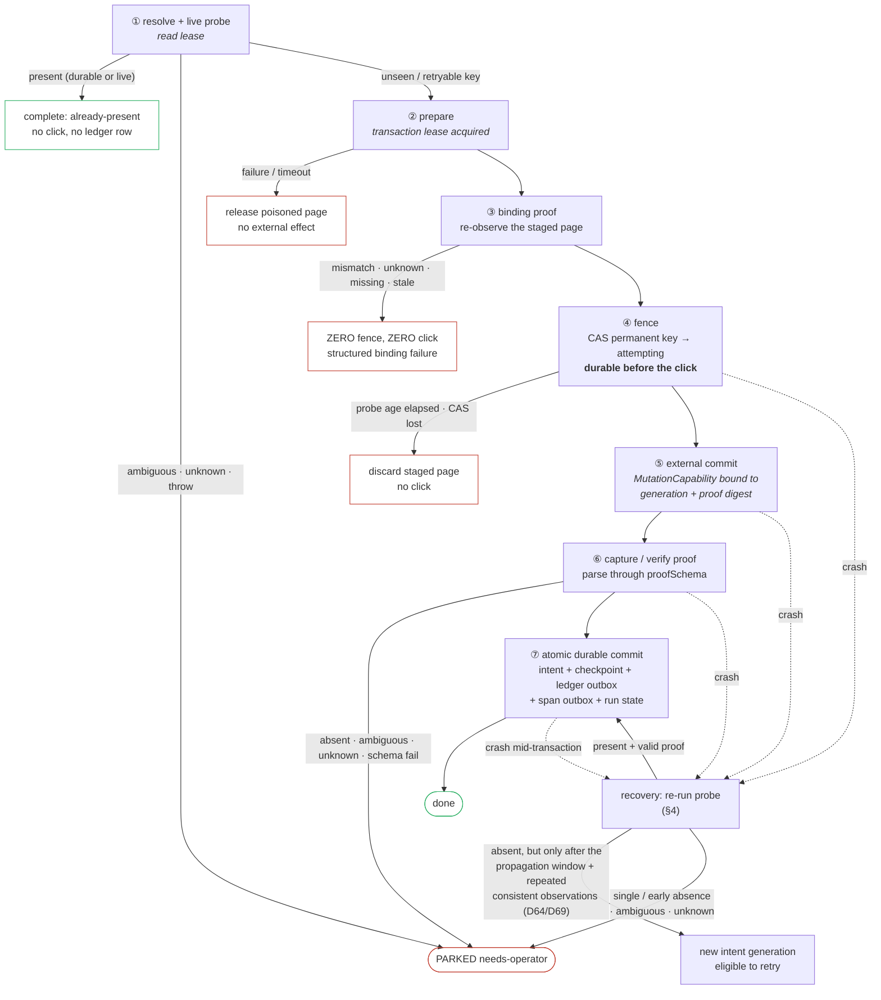

# Write safety — the fence, the seven beats, recovery, and the identity gate

**What this doc is.** The contract that decides whether a real, sometimes irreversible HR
transaction — a UCPath termination, a ServiceNow ticket, a Kuali save, an OnBase filing — can be
attempted at most once and is reported **done only when we are sure it landed**. It is the
highest-stakes contract in the rebuild. The operator's non-negotiable (ref charter §13,
2026-07-18): *"you have to be very sure they were completed"* — completion is **FAIL-CLOSED
everywhere**, and an unknown or unverifiable result is **never** treated as done.

**Status: binding contract, as-built through 2026-08-25.** The kernel write sequence is built and
proven end to end against a real external write (§3.4, D135, 2026-08-04). Three current commit
contracts exist — Kuali finalization and two UCPath writes — after D266 retired the annotation-only
proof contract; their `recoveryAbsence` policies differ on measurement, not convenience (§4.2).
The identity-approval gate is built, live-proved and served through all three
of its ceremonies (§14.9, §14.11). What is NOT proven is per-workflow: **each workflow with a write
owes its own controlled-commit proof at its own migration** (§3.2), and separations owes three of
them (doc 03b).

**The guarantee boundary is stated, not implied.** The permanent key and its CAS guarantee at most
one unattended commit attempt per intent generation, and the kernel converges to `done` from valid
positive proof or to a new generation from contract-valid stabilized negative proof. "Exactly once
against every remote UI regardless of consistency" is not claimed and is not enforceable from a
browser probe (§1).

**Where the evidence lives.** Doc 02 owns the Phase-2 phase record and points here for the numbers;
doc 03b owns separations' own three proofs and their 08-28 target; `docs/migrations/separations.md`
is the as-built migration record. This doc owns the CONTRACT — what every write must declare, what
the kernel does with it, and what may never be substituted for proof.

## Ownership (D1 — this doc owns / this doc references)

| This doc **owns** (siblings reference, never redefine) |
|---|
| The **write-safety contract** — the required `WriteSafety` field on a commit task, typed proof schema for every completion kind, idempotency probe/key, and fail-closed verdict protocol (§2) |
| The **kernel write sequence** — resolve/probe → prepare → subject bind → fence → external commit → proof → durable commit, and its ordering invariant (§3) |
| Fresh write-binding enforcement at the write seam, and the subject-match/unscoped proof retained with the intent and the ledger (§2.1, §3 beat ③) |
| The **crash-window fence** (`write_intents`) and the **crash-recovery replay** — positive proof or stabilized negative proof (§4) |
| Typed, intent-generation-locked operator resolution for parked writes — confirmed present / confirmed absent, and no generic Done/Retry (§4.1) |
| **Double-submit prevention** — idempotency-key derivation and the per-workflow probe-policy knob (ref charter §b) (§5) |
| The **immutable receipt / transaction ledger** — schema, location, ordered actor-attributed projection, never-pruned guarantee, what one entry records; hash-chain/tail-anchor is deferred by D79 (§6) |
| The **controlled-commit criterion** every write workflow must satisfy at its migration (§3.2) |
| The **identity-approval gate** (§14) — the operator-confirmed subject selection that guards the wrong-**person** class, its resolver payload, its packet, its staleness rule, its three ceremonies, and its composition with the subject proof. *(Gate NODE mechanics — park/resume, subscriptions, the command arm — are refs workflow-model/dashboard-surfaces's; this doc owns what this particular gate asks and what its answer authorizes.)* |

| This doc **references** (owner) |
|---|
| `PrepareTaskContract`/`CommitTaskContract`, transaction-scoped dry-run composition, `MutationCapability`, error taxonomy, freshness, stores → **ref task-contract** |
| Transaction nodes, gates + `PARKED(needs-operator)`, checkpoint provenance/fingerprints, the declared dependency DAG, `RunEnvelope`, the claim generation a checkpoint key carries (D214) → **ref workflow-model** |
| Span/note wire schema, isolated `.tracker-rebuild/` layout, the SQLite system-of-record vs projection split (D14), the completion fan-out union, the command families → **ref dashboard-surfaces** |
| The injectable Clock (all timestamps), per-run test/prod instance selection, the config/secrets domain, `configFingerprint` → **ref clock-config-secrets** |
| The fill↔submit pairing guard, the dry-run composition guard, and every guard named in §8 → **ref guards-and-tests** |
| Subject declarations, semantic `ObservationId`, driver evidence/bundles, the evidence receipt this doc's beat ⑦ feeds → **ref task-contract** and **ref operator-trust** |

Amendments at sibling seams (each is a one-owner-per-concept addition, not a redefinition):
- **Ref task-contract §2.2** — `CommitTaskContract` requires `writeSafety`; its shape is owned here.
- **Ref task-contract §6.2** — the mutation primitive requires both `CommitTaskCtx.mutation` and an open fence; the dry-run preview arm is owned there and its beat order here (D215).
- **Ref workflow-model §5.6 #2 / §OQ2 (D17 — ref workflow-model OWNS and adds these).** "Crash-mid-write always parks" becomes **probe-then-park**, and the transaction node gains required `probePolicy` and `probeToFenceMaxMs` fields. Ref workflow-model owns those fields; this doc owns only the recovery-probe *mechanism* they invoke.
- **Ref dashboard-surfaces §2.1 / §2.3 (D21 — ref dashboard-surfaces OWNS and adds these).** The `ledger/` directory (never-pruned retention floor) and the `write_intents` **system-of-record** table live in ref dashboard-surfaces's storage layout; this doc owns their *shape and semantics*, not their placement in the state tree.


## 0. Grounding — what the LEGACY system does, and what this contract had to add

Every row below is live-verified leaf knowledge the charter forbids re-deriving. **Every `file:line`
in this section is in the legacy repository** (`legacy:src/…`, the frozen production reference at
`../hr-automation`) — nothing here is a path in this tree, and nothing here is imported at runtime
(D93/D94). It ports, wrapped, with provenance. The **Verdict** column says what the contract did
with each row; §2.2 and §10 say which of those verdicts have since been discharged.

| System | Confirmation today | Grounding (file:line) | Verdict |
|---|---|---|---|
| **UCPath** | Strong. `waitForTransactionOutcome` polls {error banner} vs {success marker}, error wins ties, and **RETURNS `"timeout"`** when neither appears; its caller **`clickSaveAndSubmit` then throws** *"…PeopleSoft's outcome is unknown, refusing to report success."* (`transaction.ts:855-859` — the throw is the caller's, not the poller's). T-number scraped by a second nav that re-finds the row **by EID (Person ID), not name**, and parses `Transaction ID: T…`; readback failure returns `""` which callers MUST treat as "couldn't read back," never "no transaction." **Amended 2026-08-04 (D130): "Strong" overstated it — the readback is STATUS-BLIND.** The live probe proved a Denied transaction carries a well-formed `T…`, so parsing the number says only that a submit happened; the port must read the approval status alongside it (§13.6). The body-text scrape's last regex arm (`\b(T\d{6,})\b`, `transaction.ts:1319-1328`) is also unanchored — it takes whichever number appears first, and the detail page carries a second one in its approval strip. | `ucpath/transaction.ts:42-66, 835-861, 919-985, 1310-1328`; oath sibling `oath-signature/enter.ts:281-284` | Ported as a **`save-verify`**, not a receipt — the pair `(transactionId, approvalStatus)` read back by `ucpath/verify-termination` (§2.2) |
| **ServiceNow** | Medium. Only truly-positive receipt: `waitForURL` for a changed URL containing `number=`, parse `/^HRC\d{6,}$/`; **throws** *"no number= param in post-submit URL"* if absent. | `oath-upload/fill-form.ts:140-173` | Ports → `receipt` capture |
| **Kuali** | **NONE.** `clickSave` = click + `networkidle(15s)` + 2s sleep + `log.success`. Error detection was **deliberately removed** as false-positive-prone (matched benign DOM). Weakest of all. | `kuali/navigate.ts:634-652`; `kuali/CLAUDE.md` gotchas + 2026-04-10 lesson | **EARNED** — `kuali/verify-timekeeper-annotation` and `kuali/verify-separation-finalization` reload and read back; the first is live-proved (§3.4) |
| **OnBase** | **NONE (negative only).** Success = the import postback landed on a page that is *not* a recognized ASP.NET error (`authenticated` OR `unknown` both pass). No positive "filed" signal. One-app-session-per-identity: never two logins at once. | `onbase/handler.ts:208-217`; `onbase/page-state.ts:149`; `onbase/LESSONS.md:137-176` | **STILL OWED** — no OnBase contract exists, and the `unverifiableByPage` registry is empty (§13 OQ2, order 7) |
| **Idempotency** | No keys, live-page probes, biased **fail-open→SUBMIT**. Onboarding `findExistingHireTransaction` (by name, hires have no EID) skips only on a high-confidence HIR/REH+effdt match; *"a false skip would silently never hire the real person, which is worse than the probe-guarded double-submit."* Separations `findExistingTerminationTransaction` (EID+effdt+"Terminatn"); the REAL guard is the **date-agnostic** `deletePendingTransaction` sweep that clears ALL in-progress Terminat rows for the EID. | onboarding `workflow.ts:488-521`; separations `steps/ucpath-transaction.ts:83-104`, `transaction.ts:1167`; `control/CLAUDE.md:36` ("no idempotency cache") | Ports → probes, **verdict widened to 3-valued** |
| **Crash window** | **oath-upload ONLY.** `submitAttempted:"true"` marker stamped **before** the POST (durable via the next `step=submit` emit); `hasUnverifiedPriorSubmit` refuses+escalates on recovery; `findPriorTicketForSession` (recorded ticket wins). SQLite fast-path + JSONL fallback so a retry's own rows can't mask a prior crash. | `oath-upload/handler.ts:249,273,309,388-454` | **Generalized into the kernel fence + recovery probe** |

**The two incidents this layer exists to make impossible:**
- **Duplicate person** (`ucpath/LESSONS.md:209-216`, 2026-07-01): a single dialog probe read too
  early classified a rehire as a new hire ⇒ onboarding created a duplicate person.
- **Wrong-person termination `T002173685`** (`separations/CLAUDE.md`, 2026-06-29): a name-search
  override date-matched a *different* career employee and filed a real termination against him —
  still needing manual reversal. **Honest scope:** that was a *wrong-data* error, not a duplicate.
  Idempotency prevents **double-filing**. Two distinct wrong-person paths now have distinct guards:
  upstream source/selection ambiguity is blocked by ref workflow-model freshness + the identity-approval gate;
  stale browser state showing a different person after correct selection is blocked here by a fresh
  subject observation on the exact staged page before fencing. The immutable ledger then makes any
  residual wrong-data filing attributable and reversible instead of burying it in row snapshots.

---

## 1. The one-sentence thesis + the fail-closed guarantee boundary
<!-- roadmap: phase-1 -->

<!-- roadmap-status: phase-1 -->
- [x] the four-state `ProbeVerdict` is the mechanism, and it is structural — `present` carries proof, `absent` carries typed evidence, `ambiguous` carries a count and its evidence refs, `unknown` carries a reason and an instant (`src/domain/write-safety-primitives.ts:50-62`)
- [x] the guarantee boundary is STATED rather than implied — at most one unattended attempt per intent generation, never "exactly once against every remote UI" (D64)
> 2026-08-21 | docs-cohesion write-safety | verified against `src/domain/write-safety-primitives.ts` (`probeVerdictSchema`, `NegativeSettlementPolicySchema`); left: nothing — the thesis is the standing rule, and every later section is an instance of it
<!-- /roadmap-status -->

> **Every `effect:"commit"` task declares typed proof-of-landing (a receipt, saved-state proof, or
> uploaded-artifact proof) and an idempotency probe; the kernel drives a fixed resolve/probe →
> prepare → **binding proof** → fence → external commit → proof → durable-commit sequence around it;
> and every "is it done / is it already there?" question is answered by a FOUR-state verdict where
> both positive and negative claims carry evidence and `unknown` blocks — never a boolean that lets
> uncertainty read as success.**

The single mechanism that makes fail-closed structural is the **`ProbeVerdict`**: a probe or verify
read cannot return `true/false`. It returns `present | absent | ambiguous | unknown`, and every arm
carries what a later reader needs to re-check it:

```ts
// src/domain/write-safety-primitives.ts — the browser-safe half (D144); write-safety.ts re-exports it
present   { proof }                                              // the completion arm's own proofSchema
absent    { evidence: AbsentEvidence }                           // key digest, source, source state, observedAt, query digest, evidence ref
ambiguous { matches ≥ 2, observedAt, queryDigest, evidence[≥2] } // WHICH matches, not just how many
unknown   { reason, observedAt }
```

`unknown` and `ambiguous` route to `PARKED(needs-operator)` — never to a submit and never to a
"done." After a fence, even an evidenced `absent` must satisfy §4's propagation/consistency policy
before retry authority exists. This directly dissolves legacy's fail-open dichotomy (onboarding:
*"skip and never hire"* vs *"blind double-submit"*): the third answer is **park and let the operator
decide**, which is strictly safer than both.

**The `ambiguous` and `unknown` arms carry evidence because a park is a message to a human.** A bare
`matches: 4` tells the operator a number and nothing to look at; the arm therefore also retains the
instant, the digest of the query that produced it, and at least two evidence refs — so the park's
sentence can name what the probe saw. This is the same reason `absent` was never allowed to be a
bare boolean.

**Guarantee boundary (D64).** The permanent key/CAS guarantees at most one unattended commit attempt
per intent generation. The kernel automatically converges to done from valid positive proof, or to a
new generation from contract-valid stabilized negative proof. If the external UI cannot
authoritatively prove absence after its propagation window, recovery parks for operator resolution.
That is enforceable. "Exactly once against every remote UI regardless of consistency" is not.

---

## 2. The write-safety contract
<!-- roadmap: p1-authority -->

<!-- roadmap-status: p1-authority -->
- [x] `WriteSafety` is REQUIRED on every `effect:"commit"` contract with no escape hatch, and `defineTaskContract` parses it at definition time (`src/domain/contracts/base.ts:377-404`, `write-safety-contract` guard)
- [x] the closed `SubjectProof | UnscopedBindingProof` union, the reviewed unscoped-reason registry, the Clock-injected negative-settlement evaluator and the permanent intent/attempt schemas all exist (`src/domain/write-safety.ts`)
- [x] the browser-safe half — `SubjectEvidence`, `AbsentEvidence`, `probeVerdictSchema`, `NegativeSettlementPolicy`, `TransactionOutcome`, `TransactionDryRunPreview` — lives in `src/domain/write-safety-primitives.ts` so a descriptor closure can hash it (D144); `write-safety.ts` imports `node:crypto` and re-exports every name, so no address moved
- [x] the authority storage invariants are built and pinned over real temporary SQLite databases — `BEGIN IMMEDIATE` unseen-key fencing, the durable `(system, idempotency_key)` uniqueness constraint, the four-row atomic commit primitive (`permanent-key-dedupe`, `recovery-negative-proof-settlement`, `atomic-write-outbox`)
- [ ] `TransactionDryRunPreviewSchema`'s `subject: { state: "mismatch" }` arm has NO producer and NO consumer — see §2.1's *An arm nothing can reach*
> 2026-08-21 | docs-cohesion write-safety | verified against `src/domain/contracts/write-safety.ts`, `src/domain/write-safety.ts`, `src/domain/write-safety-primitives.ts`, `src/domain/contracts/base.ts`; left: the unreachable preview arm, which is a schema decision rather than a build
<!-- /roadmap-status -->

### 2.1 The `WriteSafety` field (owned here; attached to ref task-contract's `CommitTaskContract`)
<!-- roadmap: p2-proof -->

The field is built and is the shape below. Two things differ from the Phase-0 design and both
tightened it: a probe or verifier is a **`ReadTaskReference`** (`{ taskId, effect: "read" }`) rather
than a bare `TaskId`, so "this must resolve to a read task" is carried by the value instead of only
by a guard; and `unverifiableByPage` carries a required `policy: "always-park"` literal beside its
reason, so the escape hatch cannot be spelled without naming what it does.

```ts
// src/domain/contracts/write-safety.ts — bundle-safe: imports zod + TaskId + the primitives ONLY
export const ReadTaskReferenceSchema = z.strictObject({
  taskId: TaskIdSchema,
  effect: z.literal("read"),
});

interface ProofCheck<Out extends z.ZodType, Proof extends z.ZodType> {
  /** The same parser validates normal commit output and recovery-probe backfill. */
  proofSchema: CanonicalJsonSchema<Proof>;
  proofFromOutput: (output: z.output<Out>) => z.input<Proof>;
  proofFromPresentProbe: (verdict: Extract<ProbeVerdict<Proof>, { state: "present" }>) => z.input<Proof>;
  /** Recovery / preflight-present must reconstruct the node's full typed output; proof alone is
   *  not a substitute for fields downstream nodes consume. Both schemas are parsed. */
  outputFromProof: (proof: z.output<Proof>) => z.input<Out>;
}

/** UCPath / CRM / ServiceNow — an irreversible submit captures a verifiable receipt. */
interface ReceiptCheck      extends ProofCheck { kind: "receipt" }
/** Kuali — typed saved-state proof, read back by a declared verifier. */
interface SaveVerifyCheck   extends ProofCheck { kind: "save-verify";   verify: ReadTaskReference }
/** OnBase — typed artifact proof from a positive read-back. */
interface UploadVerifyCheck extends ProofCheck { kind: "upload-verify"; verify: ReadTaskReference;
  /** Escape hatch (allowlisted + argued): the page genuinely cannot prove landing. The submit then
   *  ALWAYS parks needs-operator for manual confirmation — it never auto-reports done. */
  unverifiableByPage?: { policy: "always-park"; reason: string;
    operatorAttestationExample: z.input<Proof> } }

export interface Idempotency<In extends z.ZodType> {
  /** A read task answering "is THIS exact transaction already present?" → ProbeVerdict. Runs
   *  pre-write AND on crash recovery AND inside a dry-run preview (D215). Declared with zero-age
   *  freshness — always live, never a stale checkpoint. */
  probe: ReadTaskReference;
  /** The natural idempotency KEY — derived from STABLE business identity, NEVER row/position/index
   *  (the doc1/doc2 fix, §5). Pure. */
  key: (input: z.output<In>) => string;
  /** What may turn a post-fence absence into retry authority (D64/D69/D207). Waiting is a scheduler
   *  requeue, never a sleeping task or worker. */
  recoveryAbsence:
    | { kind: "stabilized"; minSinceFenceMs: number; consistentReads: 2 | 3;
        minBetweenReadsMs: number; requireSameSourceState: true }
    | { kind: "operator-only"; reason: string };
}

export interface WriteSafety<In, Out, Proof> {
  completion: CompletionCheck<Out, Proof>;
  idempotency: Idempotency<In>;
}
```

`CommitTaskContract` requires **`writeSafety`**, and there is no optional escape hatch: even a
naturally idempotent external write must declare its key, its proof and its probe. All three
completion arms carry a nontrivial `proofSchema`; recovery and normal commit use the same parser;
and `outputFromProof` must reconstruct a value the commit output schema accepts, because the
preflight-present and recovery paths have no other way to produce the node's typed output. The
kernel then wraps the result in the discriminated `TransactionOutcome`, so downstream code sees
whether **this** run committed or found prior work.

The natural key is authority, not presentation. Its exact bytes stay on the write-intent and ledger
records and continue to drive permanent-key lookup, digest re-derivation and idempotency unchanged.
Diagnostics, receipt warnings, resolution-binding explanations, Archive/Explain output and dashboard
wires expose only `idempotencyKeyDigest` or the bounded `key digest <12>…` reference derived from it.
This projection rule never hashes or replaces the authority key itself. A pre-existing parked message
remains immutable evidence at rest, but a server projection composes typed park code plus the digest
reference instead of replaying that free text.

**The always-park allowlist is a registry, and it is EMPTY.**
`REVIEWED_UNVERIFIABLE_BY_PAGE_POLICY` (`src/domain/contracts/write-safety.ts`) is the reviewed list
of contracts permitted to declare `unverifiableByPage`, and it currently holds zero entries — no
contract in this tree has earned one. An `unverifiableByPage` proof schema must be a discriminated
union with an `operator-attestation` arm carrying operator, `confirmedAt`, the exact
artifact/business identity and a non-empty evidence note; its example is guard-parsed. It may never
be a bare boolean or a generic "mark done." OnBase is the candidate and the reason the arm exists
(§13 OQ2).

**The binding proof, as built.** Every prepare/commit pair carries compatible ref task-contract
`SubjectBindingSpec`s, and the kernel materializes one of two strict proofs. Both gained a `version`
and a `proofId` over the Phase-0 draft, and `SubjectProofSchema` gained a `superRefine` that refuses
a "match" whose `expected` and `observed` are not canonically identical — the one invariant a
`match: "match"` literal could otherwise assert without holding:

```ts
SubjectProof        { kind:"subject-match", version:1, proofId, runId, attempt, leaseId, taskId,
                      observationId, pageStateId, expected, observed, match:"match", observedAt,
                      afterPrepareSpanPath }   // + superRefine: canonical(expected) === canonical(observed)
UnscopedBindingProof{ kind:"unscoped",      version:1, proofId, runId, attempt, leaseId, taskId,
                      pageStateId, reviewedReasonId, observedAt, afterPrepareSpanPath }   // D65
```

`SubjectEvidence` is itself closed — `person` (with `identifierKind: "eid" | "kuali-id" | "email"`, a
binding digest and a 2–32 character display suffix), `artifact`, or `catalog`. Raw sensitive
identifiers are never duplicated into event or ledger files: the normalized comparison happens in
memory and the evidence keeps the digest plus the minimum display-safe suffix a human needs to
diagnose a mismatch. Both digests carry versioned domain separators
(`hrauto:permanent-write-key:v1`, `hrauto:write-binding-proof:v1`), so a key digest and a proof
digest can never collide across purposes.

The proof is valid only for the same run, attempt, lease, task and prepared page state, and only
until the configured probe-to-fence budget. It cannot be reused after navigation, page reset, retry
or lease transfer. A file write binds the artifact digest or document id; a person write binds the
system's displayed EID or another contract-declared strong identifier; a catalog or global write
must explicitly declare `subject.kind:"none"` with a reviewed, allowlisted reason and produces the
unscoped arm. Name-only identity is not a strong write binding unless the system truly exposes no
stronger value — and UCPath's termination commit is exactly that case, which is why it also sits
behind §14's gate (§2.2).

**An arm nothing can reach.** `TransactionDryRunPreviewSchema`'s `outcome.would-prepare.subject`
union declares three arms — `match`, `mismatch`, `unscoped` — and **`mismatch` has no producer and
no consumer** (`src/domain/write-safety-primitives.ts:169-177`). `executeDryRun` builds the binding
proof inside a `try` and re-**throws** on any failure with *"the real write would refuse to fence"*
(`src/core/write-sequencer.ts:1865-1878`), so a preview never emits the arm; nothing in `src/` or
`tests/` reads it. The refusal is the right behaviour — a rehearsal that answered where the
performance stops is the defect D215 fixed from the other side — so the honest repair is to DELETE
the arm rather than to build a producer for it. It is recorded here rather than removed in a docs
pass because a shared schema change is code work with its own gate.

### 2.2 Per-system instantiation (three shapes, one mechanism)
<!-- roadmap: sep-5 -->
<!-- roadmap: order-6 -->
<!-- roadmap: order-7 -->

<!-- roadmap-status: order-6 -->
- [ ] Kronos/PayPath has NO commit contract, no probe and no verifier — order 6 is where `new-kronos` gains its first write family, and every row of this section has to be answered for it from scratch
- [ ] its completion arm is undecided: a Kronos pay-rule save has no receipt anyone has looked for, so the §b questionnaire has to establish whether a positive read-back exists before the shape can be chosen
> 2026-08-21 | docs-cohesion write-safety | verified against the absence of any `kronos` contract under `src/domain/contracts/`; left: the whole order-6 write family
<!-- /roadmap-status -->

<!-- roadmap-status: order-7 -->
- [ ] OnBase has no commit contract and, uniquely, **no positive landing signal at all** — legacy's success test is "the import postback did not land on a recognised ASP.NET error page", which passes on `authenticated` OR `unknown`
- [ ] it is the only candidate for `unverifiableByPage`, and that registry is EMPTY: earning an entry is a reviewed act, and the consequence — every upload parks for manual confirmation — changes the operator's daily workload rather than the safety story (§13 OQ2)
- [ ] ServiceNow's receipt arm is the easy half of the same order (a `waitForURL` for `number=`, parsed `/^HRC\d{6,}$/`) and still has no contract; its propagation window is doc 03c §Live probe status
> 2026-08-21 | docs-cohesion write-safety | verified against `src/domain/contracts/write-safety.ts`'s empty `REVIEWED_UNVERIFIABLE_BY_PAGE_POLICY` and the absence of any `onbase`/`servicenow` contract; left: both write families
<!-- /roadmap-status -->

Three current commit contracts exist. Every row below is read off the contract, not off the design;
the retired annotation contract and its measured window remain §3.4 history.

| contract | completion | probe | key | `recoveryAbsence` |
|---|---|---|---|---|
| `kuali/save-separation-finalization` | `save-verify` → `kuali/verify-separation-finalization` | `kuali/match-separation-finalization` | `kuali:<doc>\|finalization\|<T-number>` | **`stabilized`**, the same numbers, INHERITED under §4.2's mechanism rule (D207) |
| `ucpath/create-termination` | `save-verify` → `ucpath/verify-termination` | `ucpath/match-existing-termination` | `ucpath:termination\|<eid>\|<effectiveDate>` | **`operator-only`** — no UCPath window has ever been measured |
| `ucpath/delete-pending-terminations` | `save-verify` → `ucpath/verify-pending-terminations-cleared` | `ucpath/match-pending-terminations` | `ucpath:pending-terminations-clear\|<eid>` | **`operator-only`** — worse than its sibling: this control DELETES rows |

**UCPath's termination is `save-verify`, not `receipt`, and that is a correction the live probe
forced.** The Phase-0 design drew it as `receipt` on the strength of legacy's `T…` scrape. D130's
2026-08-04 live probe proved a **Denied** transaction carries a perfectly well-formed `T…`, so a
number alone accepts a REFUSED write as proof of landing (§13 OQ6 has the six constraints). The
proof is therefore the pair — `transactionId` **plus** `approvalStatus`, read back from the SS Smart
HR detail page by a declared verifier — which is a `save-verify` shape wearing a receipt's name.
`UcpathTerminationProof` also carries `emplId`, `effectiveDate`, `displayedName` and its `source`
literal, so the read-back is bound to the person it is about.

**Its subject binds on NAME, and that is the weakest binding in the tree.** `create-termination`
declares `subject.match: "normalized-exact-name"` against UCPath's displayed person name, because
the Smart HR wizard page the write is staged on displays no EID. §14's ALWAYS-GATE is what carries
the wrong-person control for that write; the binding proof carries only "the page still shows the
person the gate approved." Neither substitutes for the other (§14.1), and this row is the clearest
case of why.

**Kuali and OnBase are where the contract FORCES proof to exist.** Kuali's legacy save is a click
plus a sleep with its error detection deliberately removed as false-positive-prone (§0), so a
`save-verify` read-back had to be built before any Kuali commit could instantiate a passing
`completion` — it now exists twice, and its reload read-back is the only landing proof either Kuali
contract has. OnBase has no positive "filed" signal at all and no contract yet; it is order 7's
work, and §13 OQ2 is the open question it answers.

**Two shapes have no contract yet, and the doc says so rather than drawing one.** ServiceNow's
receipt arm (a `waitForURL` for `number=` parsed as `/^HRC\d{6,}$/`) and OnBase's upload-verify arm
port at orders 7; Kronos/PayPath gains its first write family at order 6. Until each exists, the
per-system row above is the honest inventory: a designed example that no contract instantiates is
indistinguishable from a built one at a glance, and §0's port inventory already records what legacy
does today.

---

## 3. The kernel write sequence
<!-- roadmap: p1-kernel -->
<!-- roadmap: sep-6b -->

<!-- roadmap-status: p1-kernel -->
- [x] the seven beats are built in `src/core/write-sequencer.ts` behind the interpreter's `WriteSequencer` seam; §4 recovery and the typed resolutions are `src/core/write-recovery.ts` (D111, Phase 1f)
- [x] beats ②–⑥ run inside ONE `sessions.withDriver` exclusive transaction lease, so a navigating probe can never destroy a staged form (`write-sequencer.ts:1492-1514`)
- [x] beat ④'s fence is `writeIntents.fenceAttempt` for an unseen key and `refenceRetryable({expectedVersion, …})` for a retryable one — an optimistic-lock CAS, never a blind update (`write-sequencer.ts:1596-1607`)
- [x] beat ⑤'s `MutationCapability` is minted by this module and nothing else, over a module-private WeakSet, and a driver asserts it before resolving a locator (`src/base/mutation-capability.ts`)
- [x] observed probe/prepare/commit/verify beats use explicit task roles; commit `recordData` is stamped at call time but its fallible emission waits until the callback actually settles, outside fence→external-click; neither task deadline nor parent cancellation can release that lane or its transaction session after `retainAfterFence()`
- [x] beat ⑦ is ONE outer authority transaction over claim revalidation, the four-row primitive, the `TransactionOutcome` checkpoint, both outboxes and the run transition (`executeSequencedWriteCommit`, `write-sequencer.ts:512`)
- [x] the post-fence park raises `WriteParkedError` and the interpreter has its typed arm; recovery has scheduling priority over claim expiry, and D200's lease-as-evidence sweep releases a claim no live process answers for
> 2026-08-21 | docs-cohesion write-safety | verified against `src/core/write-sequencer.ts`, `src/core/write-recovery.ts`, `src/base/mutation-capability.ts`, `src/infra/sqlite/migrations.ts:300-327`; left: nothing in the kernel — what remains is per-workflow (§3.2)
<!-- /roadmap-status -->

<!-- roadmap-status: sep-6b -->
- [x] a checkpoint's durable key is `(workflow, item, node, attempt, claimGeneration?)` — the claim generation is what distinguishes a gate resume's re-execution of an `always-rerun` node from the first execution inside the SAME attempt (D214; ref workflow-model §5.7 owns the key)
- [x] a DRY RUN runs beat ① first, exactly as the real path does, so the ordinary separations subject settles `already-present` before anything is staged instead of refusing in `prepare` (D215; `write-sequencer.ts:1710-1760`)
- [x] `transaction.previewed`'s fourth subject verdict `not-observed` reaches the JSONL wire schema as well as the kernel's union, and `span-events.test.ts:109` enumerates all four (D215; the fork that killed a live worker one emit short of terminal)
- [ ] `probeToFenceMaxMs` is still unmeasured — see §5's *what a settled preview cannot measure*
> 2026-08-21 | docs-cohesion write-safety | verified against `src/core/write-sequencer.ts` (`executeDryRun`), `src/core/span-emitter.ts:155`, `src/events/types.ts:182`, `tests/unit/events/span-events.test.ts:109`; left: the `probeToFenceMaxMs` measurement, which needs a run that fences
<!-- /roadmap-status -->

The kernel drives a fixed seven-beat sequence. It binds and parses the commit input first, from
workflow input plus declared upstream outputs; commit input cannot depend on ephemeral prepare
output. Beat ① uses an ordinary read lease and releases it. Beats ②–⑥ run under one uninterrupted
exclusive transaction lease, so a navigating probe can never destroy a staged form. Beat ③ is
kernel-owned identity binding on the exact staged page — no task callback can skip it. The impl
author cannot reorder the real-write beats.

**A dry run is not "beat ② alone" (D215).** The preview arm `executeDryRun` runs beat ① FIRST —
the durable permanent-key lookup and then the policy-controlled live probe — because that is what
the real path does, and either can settle the node `already-present` before a page is ever staged.
It has no executable fence, commit or mutation capability, and its `already-present` arm REPORTS the
settlement the real path would reach without performing it: zero intent row, zero checkpoint, zero
run transition. Where the real path refuses — mid-submit, parked, ambiguous, unknown, foreign absent
evidence, a present read over a settled-absent durable row — the preview refuses identically. §5
carries the argument.

```
① RESOLVE/PROBE → ② PREPARE → ③ BINDING PROOF → ④ FENCE → ⑤ EXTERNAL COMMIT → ⑥ PROOF → ⑦ DURABLE COMMIT
   read lease      transaction lease ──────────────────────────────────────────────────┘    DB + outboxes
```

**The same sequence with its crash seams and fail-closed exits.** Every ✗ is a park or a refusal,
never a fall-through; the only path to `done` runs the full spine. The seam that matters is between
④ and ⑦: a crash anywhere in there leaves a durable `attempting` intent, which is exactly what
recovery (§4) keys off.



| Beat | What runs | What is DURABLE at end of beat | Fail-closed exit |
|---|---|---|---|
| **① Resolve + live probe** | From the already-parsed stable commit input, derive the key and read the permanent write-intent row by `(system, key)` digest, regardless of status or originating run. `committed` or `observed-present` ⇒ validate and reuse the stored proof + typed output; `attempting` ⇒ recovery / owner check; `parked` ⇒ refuse, only a typed resolution releases it; `retryable` ⇒ eligible generation. Only an eligible unseen or retryable key may run the policy-controlled live probe, on a separate read lease. Record probe completion monotonic time. | one authority transaction records an unseen live `present` permanently as `observed-present`, checkpoints `TransactionOutcome{disposition:"already-present",proofSource:"live-probe"}`, advances run state and enqueues its audit span — but **no write-ledger row** | invalid stored proof/output ⇒ corruption, park; a live `attempting` owner ⇒ fail loud; a stale owner ⇒ recovery first; live `present` ⇒ typed no-click completion; ambiguous, unknown or a throwing probe parks |
| **② Prepare** | Acquire the context-exclusive transaction lease and run the prepare contract. The parsed commit input is already frozen; prepare output is preview and span data only. A retry may restart from beat ① on a fresh or reset lease before any fence. | no write intent | prepare failure or timeout ⇒ release the poisoned page; there is no external side effect to recover |
| **③ Binding proof** | Resolve the commit contract's required `SubjectBindingSpec`. A person or artifact scope executes its semantic observation after preparation on this exact page and builds `SubjectProof`; an explicitly unscoped scope validates the allowlisted reason plus the exact staged page state and builds `UnscopedBindingProof`. Both parse as `WriteBindingProof`, and the digest is derived immediately. | the proof is not yet authority, but is held for the fence transaction and the evidence bundle | mismatch, unknown, a missing or stale observation, an unregistered unscoped reason, the wrong system or page state, or a schema failure ⇒ no fence, no click; close or poison the page and emit a structured binding failure |
| **④ Fence** | Check `probeToFenceMaxMs` against the monotonic clock **and** that the binding proof was created after prepare for this run/attempt/lease. `fenceAttempt` INSERTs the unseen key; `refenceRetryable({expectedVersion, …})` CASes a `retryable` row to `attempting` with `generation + 1` and `version + 1`. The intent record, its immutable attempt row and the `write.attempting` span outbox commit together. The `idempotency_key_digest` UNIQUE constraint is the same-key mutex. | durable intent + attempt + binding proof + span outbox | an elapsed budget throws `StagedPageDiscardedError` — no click; a lost CAS throws `FenceLostRaceError` — no click; there is no generic retry after a won fence |
| **⑤ External commit** | The external-write helper requires the unforgeable `MutationCapability` bound to the open intent generation **and** the binding-proof digest. The sequencer mints it here and nowhere else. Immediately after the durable fence it crosses `withTransactionDriver`'s one-way `retainAfterFence()` boundary. Its bounded invocation retains a separate callback-settlement promise: task deadline and parent cancellation request abort, but cannot release the transaction lease, flush commit observations, or park while a non-cooperative callback is still in flight. | live HR side effect; the intent remains `attempting` throughout an unsettled callback | a missing or mismatched capability, generation or binding digest ⇒ the driver throws BEFORE resolving its locator; a settled timeout/error/cancellation parks, while a callback that never settles remains process-owned until process loss makes §4 recovery the sole owner |
| **⑥ Capture / verify** | Extract `proofFromOutput`, or resolve and bind the declared verifier, open its span, and run it on the retained transaction page; every completion kind parses through its `proofSchema`. The whole verifier setup and execution is already post-fence. | the proof remains in memory | verifier lookup/input binding/start-span emission, absent, ambiguous, unknown, a throw or a schema failure all become `PostFenceWriteFailure` and park intent-first then run (`parked-write`); no arm can escape raw or return unvalidated proof |
| **⑦ Atomic durable commit** | ONE authority transaction revalidates the current run claim and intent generation, marks intent and attempt committed, writes the schema-valid `TransactionOutcome` checkpoint, the immutable ledger outbox row (carrying the binding-proof digest and the exact fenced subject or its explicit absence), the same-trace terminal-span outbox row, any evidence-receipt ref the active trust service requires, and the run transition. The JSONL ledger and span projectors run afterward. | every authority row and outbox durable together | a transaction failure leaves the intent `attempting` and enters recovery; a trace, subject or claim mismatch fails before any mutation; projector lag is repairable and never changes a write outcome |

**Ordering invariant:** stable commit input and the live probe exist before page preparation; a
fresh binding proof follows successful preparation on the same lease; the fence transaction in ④
stores that proof and happens-before the click; the click happens-before landing-proof validation;
proof validation happens-before the single ⑦ transaction. The ledger and span JSONL files are
projections of durable outboxes, not additional commit beats. This generalizes oath-upload's
"marker durable before the POST" (`handler.ts:306-309`) into the kernel.

**Instrumentation does not occupy ④→⑤.** Probe, prepare and verify observations emit synchronously
at `ctx.recordData`. Commit is different because a legal task may record a staged/page fact before
calling `driver.commit`. The collector validates and freezes that batch and reads the Clock once at
the call, but buffers delivery until the whole commit callback settles. Only then does it emit the
prebuilt `transaction.fenced` event, redact and emit commit batches in call order, and end the
commit span. Thus a throwing span writer can park an already-fenced attempt after the external call,
but cannot prevent that call. The event's `observedAt` remains the record instant; the delay is
delivery-only and is the explicit D270 exception. A deadline or parent abort is only a cancellation
request after the fence: the sequencer retains the callback's actual settlement separately and the
session manager's one-way `retainAfterFence()` arm forbids emit, park, return, reset, or close before
that settlement. If a callback ignores abort forever, the live
execution and its lease stay owned rather than detaching uncertain I/O; after process loss, the
durable `attempting` intent is owned by §4 recovery. Dry-run executes only probe + prepare and emits
no fence, commit or verifier beat.

A terminal span failure is always secondary to the task failure it was trying to report. The
sequencer retains both in a primary-first `AggregateError` whose cause is the original task error;
a post-fence `WriteParkedError` carries the `PostFenceWriteFailure` and that aggregate through its
cause chain. This keeps parking fail-loud without rewriting a real browser/task failure as an
instrumentation failure.

**The durable shape, as built.** The three tables are JSON-record tables, not the wide-column sketch
Phase 0 drew (`src/infra/sqlite/migrations.ts:300-327`). What carries the invariants is the schema
the `record_json` is parsed with plus two SQL constraints:

```sql
CREATE TABLE write_intents (
  record_key            TEXT PRIMARY KEY,            -- the writeIntentId
  idempotency_key_digest TEXT NOT NULL UNIQUE,       -- ← the same-key mutex, one row per (system, key)
  status                TEXT NOT NULL,
  record_json           TEXT NOT NULL CHECK (json_valid(record_json)),
  created_at            TEXT NOT NULL
) STRICT;
CREATE TABLE write_attempts (
  record_key TEXT PRIMARY KEY,
  write_intent_id TEXT NOT NULL REFERENCES write_intents(record_key) ON DELETE RESTRICT,
  generation INTEGER NOT NULL CHECK (generation >= 1),
  record_json TEXT NOT NULL CHECK (json_valid(record_json)),
  created_at TEXT NOT NULL,
  UNIQUE (write_intent_id, generation)              -- ← one immutable attempt per generation
) STRICT;
CREATE TABLE durable_outbox (
  record_key TEXT PRIMARY KEY,
  write_intent_id TEXT NOT NULL REFERENCES write_intents(record_key) ON DELETE RESTRICT,
  generation INTEGER NOT NULL CHECK (generation >= 1),
  kind TEXT NOT NULL,
  record_json TEXT NOT NULL CHECK (json_valid(record_json)),
  created_at TEXT NOT NULL
) STRICT;
```

`WriteIntentRecordSchema` is a discriminated union over **five** statuses — `observed-present`,
`attempting`, `committed`, `retryable`, `parked` — and its `superRefine` re-derives BOTH digests
from the row's own fields, so a stored row cannot lie about which key it fences or which proof it
holds. `observed-present` is the arm with no attempt and no binding proof, because nothing was
staged: discovering a transaction is not evidence this automation filed it, and that row writes no
ledger entry while still blocking every later click. `parked` carries a closed
`parkedCode` — `unknown`, `ambiguous`, `present-proof-invalid`, `binding-invalid`,
`operator-required` — and a non-empty message, which is what §4.1's two typed resolutions act on.
Every arm carries a `version`, and that is the optimistic lock a re-fence and an operator resolution
both CAS against.

`write_attempts` contains only generations in which this automation crossed a fence. Committed and
externally-observed-present keys remain forever; a later run with the same business key parses and
reuses the stored proof and cannot create a second fence merely because the earlier row is already
satisfied. There is no operator action that reopens a committed key. Normal recovery from a
proven-absent click moves the same row to `retryable` and the next fence increments its generation
rather than deleting history. If an externally reversed transaction must legitimately be filed
again, its input carries a distinct audited correction identity that derives a NEW natural key;
"void the fence and click again" is not an operation.

### 3.1 Beat ⑦'s checkpoint IS terminal evidence, and it is bound to the envelope (D144, 2026-08-04)
<!-- roadmap: p2-2g -->

<!-- roadmap-status: p2-2g -->
- [x] a transaction node may be named in a descriptor's `flow.result.dependsOn` — the checkpoint row's own schema hash is the `TransactionOutcome` envelope's, and both nested hashes are verified beneath it (D144)
- [x] the interpreter reads back the exact row beat ⑦ committed and refuses if it is absent or does not project to the settlement just reported; it never mints one (`src/core/run-executor.ts`)
- [x] `TransactionOutcomeSchema` lives in the browser-safe half so a descriptor closure can hash it without reaching `node:crypto`
- [x] the evidence receipt derives from authority rather than being minted at settlement, and a gate contributes its own `gate_results` row as evidence (D82, D203, D204 — ref operator-trust owns the receipt)
- [x] the ordered actor-attributed ledger projector is BUILT with its five durable facts and nine closed degraded reasons (D134; §6.1)
- [ ] **and nothing in production calls it** — `createLedgerProjector` has only test callers, so beat ⑦'s `ledger-entry` and `write-committed-span` outbox rows stay `pending` while `createLedgerReadThrough` serves the archive and Activity surfaces over files nothing writes (§6.1)
> 2026-08-21 | docs-cohesion write-safety | verified against `src/domain/write-safety-primitives.ts:88-107`, `src/core/write-sequencer.ts:512-604`, `src/core/run-executor.ts`, and a tree-wide search for `createLedgerProjector`; left: a production tick that drains the ledger outbox, and a health surface for the degraded reasons
<!-- /roadmap-status -->

A transaction node may be named in a descriptor's `flow.result.dependsOn` exactly like a task node.
Two things had to be true for that, and neither weakens D110/D114.

**The checkpoint row carries the DURABLE `TransactionOutcome`'s schema hash, and that is the only
truthful choice.** Beat ⑦ stores the whole outcome envelope as `run_checkpoints.output.value`, so
`output.schemaHash` must be the hash of the schema those bytes were parsed with. Stamping the commit
contract's bare output hash there would describe a value no row holds — and would have required the
sequencer to store something it does not, which D110/D114 forbid outright ("exact stored
dependencies", never a fabricated one). The commit contract's identity is not lost by this: it lives
one level down as `outcome.output.schemaHash`, beside `outcome.proof.schemaHash`, and BOTH are
verified before the stored value is parsed. That nesting is why no composite hash is minted — the
composite already exists, and checking the envelope plus both nested hashes is strictly stronger
than checking either alone. A commit contract whose output or proof schema moves therefore still
fails loud, at the terminal boundary, naming the contract and both hashes.

**A transaction node's terminal scope value is `TypedTransactionOutcome<C>`, not the bare commit
output.** Ref workflow-model §1.1 already says the node output IS the outcome wrapper, and every
descriptor is authored that way (`outputs[node].disposition`, `outputs[node].output.<field>`). The
terminal factory therefore *projects* the durable envelope onto that shape through
`projectTransactionOutcome` (`src/domain/workflow/graph.ts`) before the authored `derive` runs, so
`derive` and a downstream `bind` see the same shape for the same node. "Which schema owns this
node's FIELD PATHS" (a detail's `fieldPath`) stays the commit contract's output and is a different
question; conflating the two is what produced the gap.

**The interpreter registers the row it did not write.** `src/core/run-executor.ts` reads back the
exact `run_checkpoints` row beat ⑦ committed and refuses if it is absent, or if it does not project
to the very settlement the sequencer just reported. It never mints a checkpoint from the value it
was handed. `tests/unit/separations-kuali-finalization-terminal-proof.test.ts` drives the CURRENT
`separations-kuali-finalization` descriptor from authenticated pre-gate fixture checkpoints through
the real approval check, interpreter, Kuali store tasks, write sequencer and authority to terminal
`done`; it then proves both `buildRunEvidenceReceipt` and the authority-backed receipt service derive
the verified read-back obligations from those rows. Independent controls hide beat ⑦'s row from the
interpreter and bypass the interpreter entirely, and both refuse the terminal/receipt claim. The
deleted `tests/unit/transaction-terminal-dependency.test.ts` proof against the retired
`kuali-timekeeper-annotation` workflow is historical pre-D266 evidence, not the current owner.

**Why `TransactionOutcomeSchema` sits in `write-safety-primitives.ts`.** A descriptor's terminal
`build` must hash the schema, and a descriptor closure may not reach a Node built-in;
`write-safety.ts` imports `node:crypto`. The schema therefore lives in the browser-safe half and
`write-safety.ts` re-exports it, so this doc's module stays the address every write-lane caller
reads. `SubjectEvidence`, `AbsentEvidence`, `probeVerdictSchema`, `NegativeSettlementPolicy` and the
dry-run preview travel with it for the same reason.

**D307 — an omitted step never substitutes a transaction node (2026-09-01).** A step folder's
declared omission (ref workflow-model §5.8) may rebuild a TASK node's output from operator-typed
facts; it may never rebuild a transaction. An omitted step's transaction node does not run and mints
no outcome envelope, no `write_intents` row, no `write_attempts` row and no `durable_outbox` row —
D144 stands: the write sequencer's row is the only thing that may say a write happened. A typed
transaction number (separations §4c's UCPath-transaction omission) reaches Kuali finalization as a
typed FACT, consumed by the finalization receipt fold with `disposition: "operator-asserted"`; the
result's `pendingSweep` carries the named `{ state: "omitted", step }` arm
(`OmittedStepResultArmSchema`, `src/domain/workflow/step-omission.ts`) rather than a fabricated
`TransactionOutcome`. Gate nodes in an omitted step still run — ALWAYS-GATE is not a step choice —
so an asserted receipt is approved as typed, never auto-approved.

### 3.2 The controlled-commit criterion — every write workflow owes its own
<!-- roadmap: track-a -->

<!-- roadmap-status: track-a -->
- [x] the criterion is MET once, on the kernel, by `kuali-timekeeper-annotation` (§3.4, D135) — that is what unblocked write-heavy migration
- [ ] separations owes **three** controlled commits — `ucpath/create-termination`, `ucpath/delete-pending-terminations`, `kuali/save-separation-finalization` — each on an operator-approved canary, and they wait for the 08-28 window (doc 03b)
- [ ] chunk 5c's Kuali commit additionally carries D207's named obligation: confirm the transferred 30 s window or move it (§4.2)
- [ ] `probeToFenceMaxMs` per workflow is still unmeasured, and a settled preview cannot measure it (§5)
- [ ] every later migration order owes the same five-part shape at its own migration — orders 4, 6, 7 and 9 name it explicitly (doc 03c)
> 2026-08-21 | docs-cohesion write-safety | verified against `src/domain/contracts/{ucpath,kuali}/*`, `docs/rebuild/03b-finish-separations.md`, `docs/rebuild/03c-migrate-the-remaining-workflows.md` §The seven-step migration playbook step 5; left: all three separations commits and every non-separations write
<!-- /roadmap-status -->

The kernel is proven once. **A store's receipt and probe quality is not proven by that, and never
transfers**, so every workflow with a write owes this criterion at its own migration, against a
configured test instance or a deliberately harmless operator-approved canary. Doc 03c's step 5 is
the process; this is the contract it enforces. Five parts, all five required:

| # | What must be shown | Why it cannot be dropped |
|---|---|---|
| 1 | **a dry run with ZERO durable rows** — no `write_intents`, no `write_attempts`, no `durable_outbox`, no `run_checkpoints`, no minted capability, no commit span | a preview that leaves a row is not a preview; and this is the arm every later test tier is built on |
| 2 | **a forced subject mismatch refused with ZERO fence and ZERO click**, on a page that WAS staged | beat ③ is the only control against a stale or switched page, and the only way to know it fires is to make it fire |
| 3 | **ONE controlled commit** whose proof is the declared read-back PLUS both outbox rows PLUS the terminal span | a green click is not a landing. §3.4's own first attempt returned HTTP `200` with a rendered *Form saved* and persisted nothing |
| 4 | **an idempotent re-run answering `already-present`** with no browser and no second click | the permanent key is the whole double-submit story; an unexercised mutex is an assumption |
| 5 | **the target restored**, each restore proved by the same read-back | a canary you cannot put back is a production edit with a test's name on it |

**Absence of a safe target BLOCKS rebuild-ready — it does not license a substitution.** Doc 03c
states this as a gate and it is a write-safety rule: a dry run alone cannot prove landing, recovery
or dedupe, and converting a green dry run into a write-safety claim is the one substitution this
program forbids. The §b questionnaire records the target, the reversibility, the expected proof and
the stop condition BEFORE the step runs.

**A propagation measurement is a separate, optional sixth part.** A workflow whose contract declares
`recoveryAbsence: {kind:"operator-only"}` owes parts 1–5 and no numbers. A workflow claiming
`stabilized` owes the measurement too, under §4.2's mechanism rule — and if it INHERITED a window,
its controlled commit must confirm or move it.

**Where each proof lives.** The Phase-2 kernel proof is §3.4 below, with doc 02 carrying the phase
record. Separations' three are doc 03b's, with `docs/migrations/separations.md` §6 as the checklist
and its §9.x as the live log; they wait for the operator's 08-28 window. Every later order names its
own in doc 03c. A proof is RECORDED, never re-run: re-running one would be a second real HR write
(ref guards-and-tests §10.1).

### 3.3 As-built — the sequencer's beat-⑦ ratification and the dry-run half (D111 · D122)

**Beat ⑦ is not Phase 1c's storage primitive (D111, 2026-08-02).** The sequencer may reuse the
narrow four-row `commitWriteAttempt` primitive, but that primitive is not itself the kernel's beat
⑦. `executeSequencedWriteCommit` enters ONE outer authority transaction, revalidates the current run
claim generation and the intent/attempt generation, invokes the primitive inside a nested savepoint,
writes the schema-valid `TransactionOutcome` checkpoint, inserts every required ledger and same-trace
terminal-span outbox, attaches a real evidence-receipt ref when the trust service is active, and
transitions the run. The transaction commits once or not at all. A missing receipt ref is
represented as absent and never fabricated. Crash injection after every substep must leave either
the entire accepted bundle or the prior `attempting` state, with no checkpoint, run or outbox
advance.

**Recovery has scheduling priority over claim expiry.** A dead or expired worker claim whose run
owns an unfinished `attempting` intent is routed to §4's probe/settlement state machine before any
generic interrupted→queued transition. Until recovery produces validated present proof, validated
safe-to-retry or confirmed-absent authority, or a parked operator state, ordinary workers cannot
claim that run. A failure to READ or reconcile intent authority is a loud park or refusal, never
evidence that no write is unfinished. D200 later sharpened what may release such a row: the worker
LEASE is the evidence — `workerLeases.start` succeeding proves no other process answers to this id,
so every row still under it is orphaned regardless of heartbeat — and a `claimed` row holding an
`attempting` intent, which has no legal parked-write edge, is refused BY NAME at startup rather than
endured as an unexplained first-poll throw.

**The proving contract, and why it was the right target (D122, 2026-08-04).**
`kuali/save-timekeeper-annotation` writes the `Timekeeper Name:*` field of a Kuali RRSS Separation
Request Form, reached by its `…/build/space/<space>/actions/<actionId>` deep link. It is the
smallest genuinely reversible target the docs authorize: a benign annotation the legacy flow already
fills on drafts, restorable by writing the previous value back (prepare captures and returns it),
and the exact field the operator authorized for the 2026-07-23 write round-trip on doc 4444 (D78).
Its workflow — `kuali-timekeeper-annotation`, one transaction node — is deliberately NOT
separation-class: it files nothing, so §14's ALWAYS-GATE does not attach, and claiming it would
misdescribe what the graph does. §14.8 records that scope and the boundary at which it expires.

**The completion arm can only be `save-verify`.** Kuali's save is UI-silent, so
`kuali/verify-timekeeper-annotation` RELOADS the document and reads the field back; every verdict
but `present` parks (§7 row 6). The commit's own output carries the exact staged state it clicked
Save on — a claim, never proof — and nothing in the kernel promotes it. The verifier is a distinct
contract from the `idempotency.probe` on purpose: a verifier that was the probe would never reload.

**A Kuali `actionId` names a workflow STEP, not a document.** The 2026-07-23 probe recorded the deep
link as stable; re-opening doc 4453's captured action id on 2026-08-04 silently redirected to the
Action List with no form. A run therefore carries the action id AND the document number, and the
driver proves the number from the page's level-1 heading before touching anything.

**The mutation-capability registry lives in `src/base/mutation-capability.ts`.** Beat ⑤ requires the
external-write helper to throw BEFORE the click, and that helper is a `stores/**` driver, which the
layer matrix forbids importing `core`; minting also needs a type assertion, which no
`src/domain/**` boundary source may contain. `src/base/` is the one place both hold.
`src/core/write-sequencer.ts` remains the sole permitted CALLER of `mintMutationCapability`, enforced
mechanically: `task-driver-boundary` fails if any other module names it, and that guard's blanket
"no commit implementations" rule became its real condition — a `commit` implementation is legal only
inside a store driver owner that validates its capability.

**What the dry-run half proves, durably.**
`tests/scenario/kuali-timekeeper-annotation.scenario.test.ts` and
`tests/unit/kuali-transaction-proof.test.ts` drive the REAL sequencer over a REAL temporary
authority database and a deterministic Kuali document. A dry run opens the document, stages the
value, observes the subject — and leaves `write_intents`, `run_checkpoints` and `durable_outbox`
empty, with no minted capability and no commit span. A subject that changes AFTER prepare (the
pooled-page case §2.1 names) produces zero fence and zero click on a page that WAS staged; so does
an unreadable EID, at beat ③ and at beat ①. An expired probe→fence budget discards the staged page.
A UI-silent save that did not persist reads `absent` and parks with the fence durable; a post-fence
throw and a failed read-back both park `unknown`; a parked key refuses every later fence.
Permanent-key dedupe and byte-exact checkpoint replay both prove zero second clicks.

**What the dry-run half did NOT prove, and what closed it.** No external HR write had occurred: the
crash-injection matrix across a REAL commit, the ledger and span projections of a real fenced
attempt, `stabilized` negative settlement with measured numbers, and context cleanup after a real
submit all belonged to the controlled commit, and §3.4 is that record. One item recorded here as
open closed separately — `run-executor` refused a dry run at a transaction node rather than
terminating the run at it, because "a dry run ends the run at the node" (ref task-contract §6.2) had
no durable run-lifecycle arm. **D210 built it**: the preview arm emits a `transaction.previewed`
span and ENDS the run at the node (`src/core/run-executor.ts:1390-1423`), and D237 then stopped a
dry run from wearing `verified-done` — a rehearsal that wrote nothing must not carry the label
reserved for an independently verified real completion (ref operator-trust).

### 3.4 Phase-2 controlled-commit as-built — the evidence of record (D135, 2026-08-04)
<!-- roadmap: p2-proof -->
<!-- roadmap: phase-2 -->

<!-- roadmap-status: p2-proof -->
- [x] §3.2's five parts are ALL met live on `kuali-timekeeper-annotation` — dry run 6.6 s with zero durable rows, a forced mismatch refused at beat ② with zero fence and zero click, ONE commit on real doc **4489** in 16.45 s, an idempotent re-run answering `already-present` in 2 ms with no browser, and both documents restored to `""` with each restore proved by reload read-back (D135)
- [x] the propagation window measured over four operator-authorized write/restore cycles on real doc **4490**, moving `kuali/save-timekeeper-annotation`'s `recoveryAbsence` from `operator-only` to `stabilized`
- [x] D128's "the step does not own the field" conclusion is WITHDRAWN — Kuali's own `ActionPage` query reports that step's `sectionSettings` as `edit`; the two real causes were driver defects in THIS repository (the gadget debounce, and `commit` returning at request time)
- [x] the proof is RECORDED and is not re-runnable — re-running it would be a second real HR write
> 2026-08-25 | D266 reconciliation | the source contract and test workflow are retired; the dated rows in doc 02 and this section remain the immutable evidence of record. Current Kuali proof ownership is `kuali/save-separation-finalization` and its migration (§3.2)
<!-- /roadmap-status -->

This is the evidence doc 02 points at for the measured numbers and the durable row ids. Doc 02 owns
the phase record; this section owns what the numbers CONSTRAIN — D207's propagation transfer (§4.2)
reads its four cycles, and §3.2's five parts are what it demonstrates.

The operator authorized ONE controlled real commit on named sacrificial Kuali
RRSS documents **4489** and **4490**, and confirmed those are the documents they
genuinely work. The first attempt fenced, clicked `Save`, and did not land. The
diagnosis recorded that morning — *"the current workflow step cannot write this
field"* — **was wrong**, and this section replaces it. The write lands. Two
defects in this repository's own driver were hiding it, and both are fixed.

#### What the documents are (confirmed read-only before any write)

| | 4489 | 4490 |
|---|---|---|
| action id | `6a712bf32ff7fb799788a79e` | `6a712d29ca464caf7bd9e633` |
| title | `Form - RRSS Separation Request Form - Kuali` | same |
| H1 / displayed EID | `4489` / `10001828` | `4490` / `10631689` |
| workflow step | `Task 1 - Kristina & TES` | same |
| `Timekeeper Name:*` BEFORE | `""` | `""` |
| `Save` / `Send Back` / `Mark Complete` | exactly 1 each | exactly 1 each |

#### Why the step-ownership diagnosis was wrong

It rested on one true observation — the mutation body did not contain the
timekeeper control — and one unchecked inference. Kuali's own `ActionPage`
query answers the ownership question directly, and it says the opposite:

```
action.details.sectionSettings = { …, "a_Alfq9a2":"edit", "cF6IPyCVw":"edit",
                                   "4WIES6A7P":"hide", "VhuKxRTrN":"hide", … }
```

`BWmkKqx40` (`Timekeeper Name:*`) sits in section `cF6IPyCVw`
(*Timekeeper Tasks - Step 1*) inside `a_Alfq9a2` (*Tasks*) — **both `edit`** at
this step. A zero-write experiment settled it beyond argument: every
`submitDocumentV2` was intercepted and **aborted**, so the payload Kuali *would*
have sent could be read without sending it. Checking the
`Request Acknowledged - In Progress` checkbox **in the same section** put its
formKey in the payload immediately. The step owns the section. The textarea was
the outlier, not the section.

#### Defect 1 — a Kuali text gadget DEBOUNCES into the document model

`submitDocumentV2` serializes the document MODEL, not the DOM. A Kuali Build
`Textarea` is a controlled input over LOCAL state: typing updates the DOM and
the gadget's own React props at once, and only later commits upward. Measured on
doc 4489 with aborted mutations, 16 samples:

| settle after the last keystroke | staged value present in `data` |
|---|---|
| 300 / 400 / 400 / 500 / 500 / 600 / 600 / 600 ms | **0 of 8** |
| 700 / 700 / 750 / 750 / 800 / 800 / 900 / 1000 ms | **8 of 8** |

Neither blur, nor a real `Tab`, nor `fill()`-versus-keystrokes changes this — a
cycle with NO blur at all and a 4 s settle carried the value, and a cycle with a
real `Tab` and no settle did not. The barrier is TIME, and the earlier run
simply fenced and clicked inside the debounce.

A sleep is forbidden in `src/stores` and would be the wrong answer anyway, so
the driver waits for the commit ITSELF. A 3 s attribute-level sample of the
control found exactly one change in the whole window — at **+723 ms** the
control's React props OBJECT IDENTITY was replaced, while its attributes,
classes, DOM value and the surrounding section markup stayed byte-identical.
That replacement is the parent re-render the model update causes, and it is the
only observable this page offers. `stageTimekeeperName` therefore stamps the
current props object and waits (bounded, loud on timeout) for a different one.

#### Defect 2 — `commit` returned at REQUEST time, so the verifier's reload killed the save

With the barrier in place the mutation provably carried
`"QGJ63YrCom":"PROBE-VERIFIED-0804"`, Kuali answered `200` — and the reload
read-back still said `absent`, and the field was still empty minutes later. The
cause was ours: `commit` waited for the `submitDocumentV2` REQUEST and returned,
and beat ⑥ immediately called `page.reload()`, cancelling the in-flight POST
before the server applied it. The same save, given its answer first, persisted
every time.

`commit` now waits for the `submitDocumentV2` RESPONSE, then applies two checks
that are both NEGATIVE by construction:

1. **the wire proof** — the request's `variables.actionId` must be the staged
   action, and `variables.data["QGJ63YrCom"]` must equal the staged value. This
   is what makes the debounce barrier *verified* rather than assumed: if the
   model had not taken the value, the save is reported as a failed write.
2. **the refusal check** — GraphQL answers `200` for refusals too, so the body
   is read for an `errors` array, a `status` other than `Ok`, and a non-null
   `validations`. Passing it means "not refused", never "landed": the mutation
   that dropped the field entirely also answered `{"status":"Ok","validations":null}`.

`QGJ63YrCom` is the gadget's **`formKey`**, read from the app's own form
template; the DOM id `BWmkKqx40` is a different string entirely, and a check
written against the DOM id would silently never match.

#### Measured numbers

Four operator-authorized write/restore cycles on doc 4490, each a real `Save`
and a real reversal, sampling Kuali's own document query at ~250 ms cadence from
the instant the save was answered:

| cycle | staging (open→model commit) | click → response | server state agrees | browser reload agrees |
|---|---|---|---|---|
| write | 3 700 ms | 2 495 ms | +277 ms | +2 971 ms |
| restore | 3 445 ms | 3 036 ms | +283 ms | +2 475 ms |
| write | 3 938 ms | 2 699 ms | +269 ms | +2 418 ms |
| restore | 2 834 ms | 2 459 ms | +270 ms | +2 320 ms |

Propagation after the answer is effectively nil — the ~270 ms is the sampling
query's own round trip, and it agreed on the FIRST sample every time. The cost
is the save. Whole-transaction wall clock on doc 4489, warm session: **16.45 s**
(probe + prepare + subject binding + fence + click + answer + reload read-back +
the beat-⑦ bundle). Live dry run, same document: **6.6 s**.

#### The controlled commit, and the durable rows it left

Doc 4489, EID `10001828`, value `PROBE-VERIFIED-0804`, key
`kuali:4489|6a712bf32ff7fb799788a79e|timekeeper-name|10001828|PROBE-VERIFIED-0804`:

- `write_intents` — ONE row, intent `d1254233-dd33-4bc5-afaf-c2bf52ea693f`,
  generation 1, `fencedAt` `2026-08-04T17:08:48.805Z`, **status `committed`**,
  carrying the full `subject-match` binding proof (EID suffix `5513`, digest
  `d77e42b6…`, page state `kuali.rrss-document.timekeeper-staged`).
- `run_checkpoints` — the transaction checkpoint for `annotate-timekeeper`,
  `disposition:"committed"`, whose proof is the verifier's reload read-back
  (`source:"reload-read-back"`), `confirmedAt` `2026-08-04T17:08:54.867Z`.
- `durable_outbox` — the `ledger-entry` row and the `write-committed-span` row,
  both `pending` for the 2g projector.
- spans: `prepare` started/done, `commit` started/done — exactly one commit span.

**Idempotency, re-proved live.** A brand-new run on the same permanent key
returned `disposition:"already-present"` with `proofSource:"durable-intent"` in
**2 ms**, emitting NO span and opening NO browser session. Zero second clicks.

**Restore.** Both documents were returned to their captured original value
(`""` on both) and each restore was proved by reload read-back:
doc 4489 `"PROBE-VERIFIED-0804"` → `""` (click→response 2 502 ms, payload
`"QGJ63YrCom":""`, `status:"Ok"`), doc 4490 already `""`. Final state on both
documents is byte-identical to the captured original.

#### The parked intent from the failed attempt, and a drift finding

The 2026-08-04 15:13 attempt's intent
(`9545fdf9-…`, key `…|PROBE-DELETE-ME`, generation 1) was released through the
TYPED path and nothing else — a real `run/resolve-write-absent` command on the
real command kernel, which settled it `operator-confirmed-absent` and resumed
the run. No row was hand-edited. The evidence note records five independent
reads of an empty field plus the captured mutation body that carried no entry at
the field's formKey.

That resolution exposed a real design defect, since fixed by **D136** (§4.1):
**a parked write became unresolvable once ANY file in its descriptor's contract
closure changed.** `requireDescriptorMatchesRun` compared the run's stored
`contractFingerprint` with the current descriptor's, and the closure includes 31
files under `src/domain/**` (`src/domain/ids.ts` among them). Resolving
generation 1 required restoring the tree to the exact state the run was created
under. A second park, created later the same day, could NOT be resolved for
exactly this reason — concurrent unrelated work had already touched
`src/domain/ids.ts` — so the successful commit was run under a fresh permanent
key (a different timekeeper value is a different transaction by ref write-safety §5), and
that older intent stayed parked. The guard's message was misleading too: it
printed ids and versions, which matched, and not the fingerprints, which did not.

**Both halves are now fixed and the standing "resolve parked writes BEFORE
touching a contract closure" rule is withdrawn.** §4.1's D136 binding re-verifies
the six named semantic checks directly instead of comparing closure hashes, so an
incidental closure move leaves both typed arms open; the refusal, when a check
genuinely moves, prints the whole check table with both fingerprints and the
moved value. **The still-parked intent from the 15:13 attempt needs no migration
and no hand-edited row**: its workflow, version, transaction node, canonical
input, permanent key and binding proof are all unchanged, so a plain
`run/resolve-write-absent` on the current build resolves it — the same typed
command that released generation 1, with the same evidence-note requirement.

#### Exit-criteria status — §3.2's five parts, on this workflow

| §3.2 part / Phase-2 write criterion | Status |
|---|---|
| dry run: staged preview + subject observation, zero intent/fence/commit/click | **MET live** on doc 4489 (6.6 s; `prepare` returned `previousTimekeeperName:""`; subject `match` on EID suffix `5513`; zero durable rows) |
| forced mismatch: no intent, no click | **MET live** — refused at beat ② with `subject-mismatch`, *"refusing to leave a staged value on another person's document"*, zero durable rows |
| ONE external transaction → committed intent + typed checkpoint + validated proof + ledger entry + terminal span | **MET live** on doc 4489 in 16.45 s — intent `d1254233-…` `committed`, transaction checkpoint, reload-read-back proof, `ledger-entry` + `write-committed-span` outbox rows |
| permanent-key dedupe: a later fresh run performs no second click | **MET live in both forms** — `already-present` from the committed key in 2 ms with no browser; and the parked-key refusal (*"only the typed operator resolutions may release it"*) |
| measured propagation window → `stabilized` | **MET** — n=4 write/restore cycles on doc 4490; `minSinceFenceMs: 30 000` against a ≈3.3 s worst observation |
| restore the original value | **MET and verified** — both documents back to `""`, each proved by reload read-back |
| crash matrix, recovery arms, context cleanup, multi-worker exclusive lease | **MET in repeatable fixtures** over the real Kuali store + a real authority database (`tests/unit/kuali-transaction-proof.test.ts`) |
| ledger projector concurrency / tail-loss | **BUILT AFTERWARDS, and this proof did not cover it.** On 2026-08-04 beat ⑦ wrote the ledger `durable_outbox` row and the serialized ordered JSONL projector did not exist, so there was nothing to test concurrency or tail-loss against and no fixture was allowed to pretend otherwise. D134 built it the same week — §6.1 records the projector, its five ordered durable facts and its nine closed degraded reasons |

#### Two defects this lane found outside the write path (D129 · D133)

1. **Kuali Build is client-rendered, and two probes sampled it once.** The login
   recipe's positive fact and `openDocument`'s heading read both counted a node
   the instant the URL settled. Measured: the space paints zero `[role]` nodes at
   `domcontentloaded` and its menubar ~1 s later; the document route shows
   `["", "Action", "Action List"]` at ~1.5 s and `["4489", …]` at ~3.0 s. Both are
   fixed as BOUNDED WAITS FOR THE SAME FACT — the heading recipe additionally
   NARROWED to a level-1 heading whose accessible name is a bare document number,
   requiring exactly one.
2. **A required config leaf bricked every pre-existing authority database.**
   `timeouts.sessionAcquireMs` (D125) was added to the config schema with a
   default for FRESH configs but no path for already-durable `config_snapshots`
   rows, and those parse strictly at database OPEN. Every rebuild runtime command
   on a pre-D125 `state.db` failed to start. The Phase-1 exit database was
   preserved unmodified at `.tracker-rebuild/phase1-exit-state.db*` and this lane
   ran on a fresh one. **CLOSED by D133, the same day, and the fix is not a
   migration:** `src/domain/config/snapshot-generations.ts` pins the leaf set per
   generation, `StoredConfigSchema` lets exactly the registered post-baseline
   leaves be absent, and reading a stored config applies NO group default. Writing
   `60000` into an old row would claim a bound that run never had — its absence is
   why a dead CRM session burned 262.9 s — and the D109 precedent invalidates such
   rows rather than inventing values. Owner: ref clock-config-secrets.

---

## 4. Crash-window recovery (positive proof or stabilized negative proof)
<!-- roadmap: def-propagation -->

<!-- roadmap-status: def-propagation -->
- [x] the recovery state machine is built (`src/core/write-recovery.ts`) and answers exactly four typed decisions — `backfilled`, `safe-to-retry`, `wait{notBefore, observationsNeeded}`, `parked{code, message}` over the five closed park codes
- [x] the ONE measured window in this program is Kuali's, from D135's four cycles on doc 4490 — `minSinceFenceMs: 30_000`, 2 reads, 5 000 ms apart, same source state
- [ ] **UCPath has no measured window and both its commits stay `operator-only`** — the negative there would authorize a SECOND real termination, so §4.2 criterion 3 fails before the other two are asked
- [ ] **ServiceNow has no measured window and no commit contract yet** — order 7's work; its propagation is doc 03c §Live probe status
- [ ] the deferral's trigger: a controlled commit on each system that can record a save-answer latency, a first agreeing server-side read and a first agreeing reload (doc 04 `{#def-propagation}`)
> 2026-08-21 | docs-cohesion write-safety | verified against `src/core/write-recovery.ts`, `src/domain/contracts/ucpath/{create-termination,delete-pending-terminations}.ts` (both `operator-only`, each with its reason), `src/domain/contracts/kuali/*` (both `stabilized`); left: every non-Kuali window
<!-- /roadmap-status -->

**The guarantee, stated precisely:** for any real commit, after a crash at *any* point recovery
selects exactly one of three outcomes and never retries from a single unproven UI miss:

1. **The write landed** (crash anywhere after ⑤) → recovery's probe returns `present` → the kernel
   runs `completion.proofSchema.parse(completion.proofFromPresentProbe(verdict))`, then
   `commit.output.parse(completion.outputFromProof(proof))` — the SAME validation
   beat ⑥ parsers run; a `present` proof is never trusted blind. On parse **success** it **backfills** the
   full typed `TransactionOutcome{disposition:"committed",proofSource:"recovery-probe"}`, marks the existing attempted intent committed, atomically
   enqueues ledger/span outboxes, and completes `done` (no second
   submit). On parse **failure** it **parks `needs-operator`** (a `present` we cannot validate is
   indeterminate, not done). There is **NO path to `done` with unvalidated proof—recovery
   included.**
2. **The write is proven absent.** One `absent` result is only an observation, not retry authority.
   The kernel validates its `AbsentEvidence` and schedules the **first qualifying** probe no earlier
   than `fencedAt + minSinceFenceMs` using a `not_before` requeue (no sleeping worker). It then obtains
   the configured 2–3 consistent observations separated by `minBetweenReadsMs`. Every counted
   observation—not merely the final one—must have `observedAt >= fencedAt + minSinceFenceMs` and
   bind the same key/query/authoritative source state. Earlier observations remain diagnostic only
   and contribute zero settlement votes (D69). Only then does
   the kernel record a strict `safe-to-retry` resolution and change the same intent to `retryable`;
   history is retained and the next attempt CAS-fences a new generation. A contract whose target
   cannot earn this proof declares `recoveryAbsence.kind:"operator-only"`.
3. **Indeterminate** (probe returns `ambiguous`/`unknown`, throws, returns malformed/different-key
   negative evidence, has not cleared its propagation window, disagrees across reads, or uses an
   `operator-only` policy) → `PARKED(needs-operator)` with generic operator copy naming the key
   digest reference, system and closed park code — the operator verifies in the target system and
   uses one of the typed resolutions below. The authority row separately retains
   `authorityReason { version:1, code, evidence:{kind,digest} }`: a strict classification plus a
   digest of the exact probe/exception/proof/settlement evidence. Never a guess, and never raw
   exception or probe text on a wire.

**Recovery replay (resolves ref workflow-model §OQ2 — replaces "always park"):** on resume, the
kernel first looks for an unfinished intent on the resuming item. A write intent's identity is
`(workflowId, itemId, taskId)` plus the `idempotencyKeyDigest` its row is UNIQUE on — the commit
TASK, not a node id, because a node is a graph position and the same commit contract is what names
the external transaction. If it finds a row with `status:"attempting"`, it **re-runs
`idempotency.probe(key)` FIRST** (before any `startAt` node logic) and routes on the
evidence-qualified protocol above. Only after the probe resolves does
normal resume proceed. A read node with no fence auto-resumes as today (worst case: a repeated
read). This reads durable state from SQLite (system-of-record), never post-crash JSONL, mirroring
oath-upload's SQLite-fast-path recovery (`handler.ts:427-429`).

The same scan is mandatory on the expired-claim sweeper path. Claim expiry alone cannot move a run
with an unfinished intent to the ordinary queue; recovery owns it first, and an authority-read
failure keeps it unclaimable.

**Recovery lease identity (D116, as-built 2026-08-03).** The recovery probe's driver lease runs
outside any worker loop's claimed-run binding, so the recovery service binds the TARGET run's
retained immutable `configFingerprint` (ref clock-config-secrets §4) around the lease itself — sourced from the
authority run row the intent names, never recomputed from current config — and releases it after
the probe. The park/refusal split is deliberate: only a genuine probe failure (throw, `unknown`,
`ambiguous`, malformed evidence) may park as a probe verdict; a *precondition* failure — no
retained fingerprint, or a session host already bound to another run — throws out of recovery
loudly and never converts into a park that reads as a probe verdict. The §4.1 typed operator
resolutions are pure authority work and lease no driver, so no binding applies there.

**The decision is a closed union, and `wait` is a first-class answer.** `recover` returns exactly
one of `backfilled`, `safe-to-retry`, `wait { notBefore, observationsNeeded }`, or
`parked { code, message }` over the five closed codes `unknown` · `ambiguous` ·
`present-proof-invalid` · `binding-invalid` · `operator-required`
(`WriteRecoveryDecisionSchema`). `wait` is what makes "no sleeping worker" structural: the kernel
answers with the instant the next qualifying observation may be taken and how many are still
needed, and the scheduler requeues. The park path writes the intent's `parked` row inside its own
authority transaction, CASing on the intent's `version`, before it returns. New park requests cannot
omit `authorityReason`; the field is optional only on stored intent/attempt schemas so pre-v1 rows
remain readable. Inline recovery also parks a throwing probe as unknown instead of leaving the
existing `attempting` intent behind.

**Pre-settlement observations are process-held, and that is the safe direction.** `recover` accepts
`priorVerdicts` collected earlier in the SAME recovery episode. After a crash they are re-collected
from scratch, which can only delay a retry — never fabricate authority — because D69 counts only
observations that qualify against the fence instant, the spacing and the exact key/query/source
state.

### 4.1 Parked-write resolution is typed and intent-scoped
<!-- roadmap: p1-kernel -->
<!-- roadmap: p2-proof -->

A parked write does not inherit the queue's ordinary Done/Retry actions. The kernel exposes exactly
two intent-scoped resolutions, both requiring the current intent generation and an optimistic-lock
version so a stale browser action cannot race recovery:

1. **Confirmed present.** The operator supplies the exact business/artifact identity and proof. It
   parses through the same `completion.proofSchema`; `unverifiableByPage` uses the schema's typed
   `operator-attestation` arm. Success runs the same atomic beat ⑦ (intent committed + proof
   checkpoint + ledger/span outboxes + run state). Parse failure changes nothing.
2. **Confirmed absent.** The operator supplies a non-empty evidence note after checking the target
   system. SQLite records `{operator, confirmedAt, evidence, priorGeneration}` in `write_attempts`
   and changes the same permanent intent to `retryable`; only the next CAS may create a generation.
   The next generation must perform a fresh prepare+subject observation and writes a new immutable
   attempt proof; no prior `WriteBindingProof` is reused. It never deletes/reopens committed history and
   does not itself click.

Cancel or Hide may change the run/presentation but cannot alter the intent. There is no third “force
done” or “retry anyway” endpoint. Every resolution emits an audited note and is covered by strict
command schema, stale-generation, and double-click tests.

**The confirmed-present arm serves its PROOF CONTRACT, so an operator can compose one (D245,
2026-08-20).** `resolvePresent` refuses any proof whose `schemaHash` is not the commit contract's
`deriveSchemaHash(completion.proofSchema, "output")` and then parses the value through that exact
schema — and the parked-write section served **neither the hash nor the shape**, so no client could
compose either half. The arm was drawn disabled on every parked run in the build
(`proof-contract-unserved`), which left exactly two exits for a write that DID land: record it
**absent**, which is a durable lie that authorizes a second real submit, or leave it parked forever.
The surface's copy also pointed at a CLI resolution path that has never existed; `POST
/api/v1/commands` is the only mutation door in this system.

- **The section now carries `proofContract`.** Its `served` arm names the commit task, the
  completion kind, the exact `schemaHash` a resolution must echo, and the proof schema DESCRIBED as
  an ordered list of typed fields (`describeProofShape`, `src/validation/proof-shape.ts`) — literals
  the schema pins, constrained strings with their own pattern, closed option lists, integers with
  their bounds, booleans, addressed by dot path through one level of nested object.
- **Derived, never authored, and derived ONCE.** Both the hash and the field list come from the
  composition root's descriptor view beside `gateNodes`, for the reason that view already states:
  the BFF queries never reach the descriptor builders, and a query that recomputed a schema hash
  would be a second copy of the contract's identity.
- **A shape this build cannot describe is a NAMED `unavailable` reason, never a half-form and never
  a free-text JSON box.** A proof is schema-bound by construction; a blob the client shapes itself is
  a client authoring a durable record about a real HR transaction. Unregistered workflow, no
  transaction node committing this task, or an undescribable schema each answer with the reason and
  leave the confirmed-ABSENT arm reachable.
- **The form pre-fills NOTHING.** The run holds what it TRIED to write; offering that back as the
  proof would turn an attestation about a live HR system into a click-through of the system's own
  guess, which is §14.6's rubber-stamping shape one control over.
- **What the operator does NOT assert.** A proof schema's literal `source` (`reload-read-back`,
  `ss-smart-hr-detail-read`) states which page shape the FIELDS come from and is pinned by the
  contract, so it is served `fixed` and is not offered as an input. Who vouched for the reading is
  recorded one level up, where it belongs: `buildCommittedSettlement` stamps
  `proofSource: "operator-attestation"` on the transaction outcome and on the ledger entry, and the
  operator's `evidenceNote` is retained in the command journal with the request.
- **Both halves refuse, and only one of them is authoritative.** The surface refuses early over the
  constraints a wire can carry, per field, naming the contract's own pattern or option list; the
  kernel refuses finally. A leaf carrying a `.refine()` cannot be transported, so it is served
  `serverOnlyRules: true` and the surface says the server checks more than the box does rather than
  implying its own tick is the verdict.
- **A proof that does not fit is a typed `rejected`/`schema-mismatch`, not a throw.** Now that an
  operator composes the payload, "the proof does not fit" is an ordinary answer-level mistake:
  thrown, it reached the dialog through the arm reserved for *"the server never answered"*, with no
  code to quote. `executeResolveGate` has answered `schema-mismatch` for the identical situation one
  command over since the gate landed. The rejection unwinds the whole authority transaction exactly
  as the throw did — nothing durable moves either way.

**Cancel is REFUSED while a fenced write is unresolved (D246, 2026-08-20).** "Cannot alter the
intent" is true and was not the whole rule. A cancelled run is terminal;
`executeWriteResolution` refuses every lifecycle that is not `parked-write`, and the parked-write
section is served on exactly that lifecycle — so the instant a cancel landed, **both typed
resolutions became unreachable** and the durable record read "this run is over" about a real HR
transaction nobody had settled. Cancel was not leaving the intent alone; it was orphaning it. The
kernel therefore rejects `cancel` (`invalid-state`) when any run in the cancel's cascade holds a
write intent whose status is `attempting` or `parked`, naming the run, the system, the intent id,
its generation, its status and this subsection, and cancelling **nothing**. The refusal lifts the
moment the write is answered: resolve present or absent, then cancel.

- **Both unresolved statuses are refused, and `attempting` is the worse of the two.** A `parked`
  intent at least has a surface that describes it. An `attempting` one belongs to a run that is not
  `parked-write` at all, so no parked-write section is served for it and a cancel there would strand
  an intent nothing on screen even mentions.
- **The scan covers the whole cascade, not the named run.** A cancelled parent whose delegated child
  holds a fenced write orphans that write identically, and ref dashboard-surfaces §2.4 already rules that a tree the
  kernel cannot cancel coherently cancels nothing.
- **The rejected alternative, and why.** The other exit — keep both resolutions reachable for a
  cancelled-but-parked run — is not a wire change but a contradiction: `resolvePresent` settles
  through beat ⑦ with a `resume-queued` transition and `resolveAbsent` calls `runs.resume`, and both
  are illegal on a terminal run. Making them legal would mean resuming a cancelled run, against doc
  ref dashboard-surfaces §2.4's own "a cancelled run is never resumed, only run again" and against the confirm copy the
  operator agreed to; splitting intent settlement from the run transition instead would let a
  *committed* real HR write land on a run recorded as cancelled, which is a worse record than the one
  this defect produces. Ordering the two acts costs the operator one extra step and keeps every
  durable statement true.
- **This does not make a parked run uncancellable.** Where D136 refuses a resolution because the
  semantic surface moved, its own answer already applies: restore the semantics or re-plan the run.
  A build that cannot resolve a parked write is a build to repair, not a run to quietly close over.
- **Ordering note, stated rather than hidden.** `resolve-write-absent` resumes the run to `queued`,
  so an operator who confirms absence and then wants the run cancelled cancels the queued run — a
  worker may claim it first, and that is the ordinary queue race, not a new one. What is no longer
  possible is settling the RUN while its write stays unanswered.

**Resolvability binds to the semantic surface, not to the contract closure (D136, 2026-08-04).**
A parked write is the one state in this system deliberately built to survive *across* time and code
change: it waits for a human to go look in the target system, and humans are slow. Binding its
resolvability to `descriptor.contractFingerprint` — a hash of the descriptor's whole SOURCE CLOSURE —
made it expire on any edit anywhere in that closure. The person-lookup/Kuali closures span 31 files,
and one unrelated edit to `src/domain/ids.ts` permanently stranded a real parked Kuali intent
(see §3.4). Byte identity of the closure is a *sufficient* proof that
nothing semantic moved; it is nowhere near necessary. Recovery (§4) and both §4.1 arms therefore
state the necessary condition directly, one named check at a time
(`src/core/write-resolution-binding.ts`):

| check | what it proves | may it move? |
|---|---|---|
| `workflow-identity` | the descriptor and the run name the same workflow | **no** |
| `descriptor-version` | a version bump is the author's explicit statement that semantics moved | **no** |
| `transaction-node` | a transaction node still commits this intent's exact task | **no** |
| `canonical-input` | the run's stored input snapshot is bound to the schema this build parses | **no** |
| `permanent-key-identity` | this build re-derives the EXACT fenced key from the exact durable input | **no** |
| `binding-proof-identity` | the retained binding proof still parses and stays bound to this task/run | **no** |
| everything else in the closure | nothing a resolution reads | **yes** |

`permanent-key-identity` is the load-bearing one: it re-runs `commit.bind`, the commit contract's
`input` schema, and `idempotency.key` over the run's canonical input snapshot and its declared
dependency checkpoints, and demands the exact fenced key and digest back. A key that re-derives
differently names a DIFFERENT external transaction, which is the only drift that could make an
operator resolution act on the wrong thing. When the closure is byte-identical the remaining checks
are not re-run — identity already proves them, and re-deriving would only add failure modes (a
pruned dependency checkpoint) to the ordinary path. When re-derivation fails after a closure move,
the result is a closed safe category — `missing-evidence`, `schema-failure`, or `key-drift` — plus
an evidence digest. A missing checkpoint/result cannot be reported as key drift, and a parser error
cannot erase the distinction between absent authority and a genuinely different permanent key.

A refusal prints the WHOLE check table — held rows included — with the two fingerprints, the arm
that was refused, and safe digest references/categories for permanent-key re-derivation (both
canonical-input schema hashes and the task the proof is bound to remain typed facts). `[held]` / `[MOVED]` / `[skip]`
are distinct, and an unevaluated check is never reported as held.

The completion PROOF rules are checked where the proof arrives and are not duplicated here:
confirmed-present compares the operator's attested `proof.schemaHash` against the current
`completion.proofSchema`, and recovery re-parses a present probe through the current parsers and
parks `present-proof-invalid` on failure.

**There is no waiver, override, or force arm, and D136 deliberately does not add one.** When a check
moves, the honest repair is to restore the semantics or re-plan the run — not to resolve a parked
real HR write against a target this build cannot prove is the same one.

**What D136 deliberately does NOT change.** A resolution releases the WRITE; it never re-plans the
run. The run keeps the `contractFingerprint` it was enqueued under, so ref workflow-model §5.3's replay binding
and the interpreter's own descriptor↔run check (`executeClaimedRun`) stay exactly as strict as
before: a resumed run whose closure moved still refuses to execute. That is a separate binding with
a separate owner, and closing it (re-planning a queued run onto a newer closure) is left open rather
than decided here. What D136 guarantees is that the parked *intent* — the durable write-safety
authority, the thing that records whether a real HR transaction exists — always has a typed way out.

### 4.2 A measured propagation window transfers with the MECHANISM, and only under its own proof (D207, 2026-08-14)
<!-- roadmap: sep-5 -->
<!-- roadmap: track-a -->

<!-- roadmap-status: sep-5 -->
- [x] `kuali/save-separation-finalization` exists with its prepare arm `kuali/stage-separation-finalization`, its verifier `kuali/verify-separation-finalization` and its probe `kuali/match-separation-finalization`
- [x] its `recoveryAbsence` is `stabilized` on D135's Kuali numbers, INHERITED under this section's three criteria rather than measured — the same `submitDocumentV2` on the same RRSS form, the same reload of the same document, and a settlement that re-saves the identical staged values
- [x] the staged set is TWELVE fields in one pass, not ten — D217 folded legacy's step-13 date write-backs in; the graph did not move, and both new controls carry `exactly-one-visible` from a read-only pass, NOT D208's `exactly-one-editable`
- [ ] the inheritance is PROVISIONAL: chunk 5c's controlled commit must record the save-answer latency, the first agreeing server-side read and the first agreeing reload, and either confirm the 30 s bound or move it — **the composed workflow may not rely on the stabilized arm in production until it does** (doc 03b; waits for 08-28)
- [ ] five of the twelve staged fields have an ASSERTED payload check and five are recorded-and-named because their `formKey` model shape was never observed; the controlled commit closes them by reading the real payload
> 2026-08-21 | docs-cohesion write-safety | verified against `src/domain/contracts/kuali/save-separation-finalization.ts:117-145`, `docs/migrations/separations.md` §4e/§9.10; left: the controlled commit and the five unasserted payload checks
<!-- /roadmap-status -->

D64/D69 admit `recoveryAbsence.kind:"stabilized"` **only** with a measured propagation window; the
open question this subsection settles is what a measurement is a measurement *of*. **It is a
measurement of the MECHANISM — the request that writes and the read that proves it — not of the
field that happened to be written.** A second contract may reuse an existing window when it names
the same three things:

1. **the same write request**, not merely the same system (`submitDocumentV2` serializing the
   current step's whole section, in Kuali's case);
2. **the same negative read**, the deterministic reload of the same document;
3. **an absence that is safe in the direction it can be wrong** — settling a false negative must
   re-do the *identical* external act, never a second distinguishable one.

Where those hold, the numbers are the mechanism's and copying them states a fact rather than
guessing one. Where any of them fails, the arm is `operator-only` until that contract's own
measurement exists — which is why chunk 4's UCPath termination stays `operator-only` on both
commits: settling a negative there would file a **second real termination**, so criterion 3 fails
before criteria 1 and 2 are even asked.

**The first reuse, and the whole of it.** `kuali/save-separation-finalization` (separations chunk 5,
§4e) takes D135's Kuali window — `minSinceFenceMs: 30 000`, `consistentReads: 2`,
`minBetweenReadsMs: 5 000`, `requireSameSourceState: true`, measured over four operator-authorized
write/restore cycles on real document 4490 against a worst observed fence→trustworthy-negative of
≈3.3 s (§3.4 → *Measured numbers*). All three criteria hold: it is
the same `submitDocumentV2` on the same RRSS form, proved by the same reload of the same document,
and settling a negative re-fences and re-saves the identical ten staged values.

**The obligation this creates, stated as an obligation and not as a note.** A transferred window is
**provisional until that write's OWN controlled-commit proof confirms it** — §3.2's optional sixth
part, gated by doc 03c's step 5. The finalization's proof is separations chunk 5c: its authorized
real commit must record the same three observations D135 recorded — the save's answer latency, the
first agreeing server-side read, and the first agreeing browser reload — and either confirm the 30 s
bound or move it. **The composed separations workflow may not rely on the stabilized arm in
production before that confirmation lands**, and at HEAD it has not: the commit waits for the
operator's 08-28 window (doc 03b). Until then the reuse is a declared, argued inheritance carrying a
named owner, which is exactly the difference between this and a generous placeholder.

**What is `operator-only` today, and why each one is.** Both UCPath commits fail criterion 3 before
the other two are asked — settling a false negative on `ucpath/create-termination` files a SECOND
real termination, and on `ucpath/delete-pending-terminations` it re-runs a control that DELETES
rows, which is worse in the same direction. Each contract carries that argument as its own
`reason` string, so a reader of the code gets the same sentence as a reader of this doc. ServiceNow
and OnBase have no commit contract yet; their windows are order 7's question and doc 03c §Live probe
status is the gate. The standing deferral is doc 04's `{#def-propagation}`.

---

## 5. Double-submit prevention
<!-- roadmap: sep-4 -->
<!-- roadmap: order-9 -->

<!-- roadmap-status: sep-4 -->
- [x] the termination write exists as a transaction pair — `ucpath/stage-termination` → `ucpath/create-termination`, `save-verify` through `ucpath/verify-termination`, probe `ucpath/match-existing-termination`, key `ucpath:termination|<eid>|<effectiveDate>`
- [x] the date-agnostic pending sweep exists as its OWN transaction pair with its own permanent key — `ucpath/stage-pending-termination-sweep` → `ucpath/delete-pending-terminations`, key `ucpath:pending-terminations-clear|<eid>` — composed BEFORE the termination
- [x] both are `recoveryAbsence: operator-only` and both carry their reason in the contract (§4.2)
- [ ] neither has run its §3.2 controlled commit; the sweep's COMMITTED arm additionally has **no witness** — clearing the last pending row removed the only mapped subject that had anything to sweep, so the only honest window is re-running the sweep immediately after the termination files (doc 03b, an operator call for 08-28)
> 2026-08-21 | docs-cohesion write-safety | verified against `src/domain/contracts/ucpath/{create-termination,delete-pending-terminations,stage-termination,stage-pending-termination-sweep}.ts`; left: both controlled commits, and the sweep's committed-arm witness
<!-- /roadmap-status -->

<!-- roadmap-status: order-9 -->
- [ ] onboarding's hire probe has no contract in this tree yet — legacy's `findExistingHireTransaction` matches on name + effdt + jobCode because a pre-hire person has NO EID, and porting it widens the verdict from a fail-open boolean to `ProbeVerdict` with `ambiguous` → park
- [ ] that widening is the safety upgrade this section exists for, and it is the one probe whose key cannot be EID-derived — so its key hygiene (§8's ban on position, index and attempt) has to be argued at the migration rather than assumed
> 2026-08-21 | docs-cohesion write-safety | verified against the absence of any `onboarding`/hire commit contract under `src/domain/contracts/`; left: the whole order-9 write family
<!-- /roadmap-status -->

**Idempotency key from stable identity, never position.** The `key` function takes the parsed
workflow-derived input and returns a natural business key, and every key in the tree today is
system-prefixed so two systems can never collide on one string:

| contract | key |
|---|---|
| `ucpath/create-termination` | `ucpath:termination\|<emplId>\|<effectiveDate>` |
| `ucpath/delete-pending-terminations` | `ucpath:pending-terminations-clear\|<emplId>` |
| `kuali/save-separation-finalization` | `kuali:<documentNumber>\|finalization\|<transactionNumber>` |

A key **never** incorporates run position, attempt number, array index, or the OCR fan-out index —
that is the doc1/doc2 (E2E-015) shared-id fallback, banned in the fan-out
(`buildFanOutItemIdResolver`) and banned here (§8). Two runs for the same person + type + date
derive the same key, so beat ① sees the first run's committed intent and refuses to double-file.
The digest the row is UNIQUE on is `sha256("hrauto:permanent-write-key:v1" ‖ system ‖ key)`, and
`WriteIntentRecordSchema` re-derives it from the row's own fields, so a stored row cannot claim a
key it does not hold.

**Historical D135 note — the retired timekeeper key included the VALUE deliberately.**
`…|timekeeper-name|<eid>|<value>`
means writing a different annotation is a different transaction — which is exactly right for a
benign restorable field, and exactly wrong as a template for a termination. §3.4 records the
consequence: a parked intent from an earlier attempt could not be resolved, so the successful commit
ran under a fresh key rather than reopening the old one. A key that varies with the payload trades
dedupe for reversibility, and only a write whose repetition is harmless may make that trade.

**Two probe kinds are distinct and both are built** (separations taught the difference):
- The **idempotency probe** reads *processed / filed* transactions (a committed `T…` exists) —
  `ucpath/match-existing-termination`, keyed EID + effdt + "Terminatn".
- The **date-agnostic pending sweep** is a *commit cleanup* that deletes ALL in-progress unprocessed
  Terminat rows for the EID regardless of effdt — it catches a stale prior attempt carrying a
  *different* computed effdt that the date-keyed probe misses. It is NOT a probe and NOT a step
  inside the termination: it is its own transaction pair
  (`ucpath/stage-pending-termination-sweep` → `ucpath/delete-pending-terminations`) with its own
  permanent key, its own binding proof and its own typed proof, composed BEFORE the termination.
  Deleting nothing is a validated no-op; the deleted row identities are its proof.

> **A DRY RUN runs these probes too (D215, 2026-08-14; normative text in ref workflow-model §2.1).** `executeDryRun`
> used to evaluate `prepare` with no probe, so it rehearsed a path the real run never takes: the
> date-agnostic pending sweep above settles `already-present` for a subject with nothing pending —
> which is the ordinary separations subject — and the preview instead staged a grid with no row to
> bind and refused. The preview now runs the durable permanent-key lookup and the policy-controlled
> live probe in this section's own order, REPORTS an `already-present` settlement rather than
> performing it (zero intent, zero checkpoint, zero transition), and refuses on exactly the verdicts
> the real path refuses on. `probePolicy` governs the preview's live probe identically; the durable
> lookup is never skipped in either. The preview's own span verdict gained a fourth arm for the
> settled case — `transaction.previewed.subject: "not-observed"`, the honest name for a preview that
> staged nothing and therefore observed no subject. It landed in the kernel's union and NOT in the
> JSONL leaf schema, so the first preview that ever settled killed a live worker one emit short of
> its terminal; both schemas carry all four now and `span-events.test.ts` enumerates the VALUES
> rather than sampling the shapes.

**The per-workflow probe-policy knob (charter §b — decided at migration, NOT defaulted here).** Beat
① (the *pre-write* probe) is governed by a per-workflow knob; the *recovery* probe (§4) is always on
regardless.

```ts
// on the transaction node (ref workflow-model owns the field; semantics owned here)
probePolicy: "always" | "retries-and-recovery-only";   // REQUIRED — no default
probeToFenceMaxMs: number;                              // REQUIRED, >0 — migration-justified
```

- `"always"` — probe before every submit (one extra live read per submit; safest; closes the crash
  window even on the first attempt).
- `"retries-and-recovery-only"` — may skip only the live-page probe when the durable key has never
  existed. Durable lookup is never skipped, committed keys are never exempt, and retries/recovery
  always probe. The trade-off is failure to notice an older external transaction absent from this
  automation's ledger, not permission to repeat one already committed here.

Both fields are **required** — `defineTransaction` throws on a missing or non-positive
`probeToFenceMaxMs` (`src/base/flow.ts:584`) — which forces the §b migration question to answer
policy and maximum preflight age per workflow. There is **no hardcoded default**. The Clock's
MONOTONIC time measures probe completion → fence; expiration throws `StagedPageDiscardedError`,
discards the prepared page and restarts at preflight, and never clicks on an over-age result.

**What a settled preview cannot measure, and why the budgets are still guesses.** Every
`probeToFenceMaxMs` in the tree is an authored bound, not a measured one — 45 000 ms for the two
Kuali writes, 90 000 and 120 000 ms for the UCPath pair
(`src/workflows/*/descriptor.ts`). Separations recorded the measurement twice as "riding on the
preview terminal", and that was never possible: **a preview has no fence**, and a preview that
settles `already-present` emits ONE event with no beat decomposition at all, so reaching it could
not produce the number. The measurement rides with §3.2's controlled commits, which are the only
runs that traverse probe → fence for real. Generalize it past this field: when a blocked measurement
finally unblocks, re-derive what it is a measurement OF before recording that it is met.

---

## 6. The immutable receipt / transaction ledger

**Purpose (ref charter §13):** an immutable record of what real transactions were actually filed,
**never pruned** — it outlives ref dashboard-surfaces's decided base retention (spans 30 d / notes
30 d, D86) and the `clean-tracker` sweep.

```ts
// src/domain/ledger.ts — the append-only at-rest entry. Beat ⑦ writes the PAYLOAD to
// durable_outbox; the projector adds the ordered `seq` and the outbox identity.
LedgerEntry = { outboxId, seq, payload: LedgerEntryPayload }

LedgerEntryPayload = {
  workflowId, itemId, system,                 // ucpath | crm | servicenow | kuali | onbase
  idempotencyKey, idempotencyKeyDigest,       // the natural key (§5) — dedupe + audit join
  writeIntentId, intentGeneration,            // WHICH fenced generation filed it
  proof: SchemaBoundCanonicalValue,           // the parsed proof AND its schema hash, together
  completionKind: "receipt" | "save-verify" | "upload-verify",
  proofSource:    "normal-output" | "recovery-probe" | "operator-attestation",
  bindingProofDigest,                         // the exact subject-match or unscoped proof on the intent
  subject?,                                   // present only for subject/artifact-scoped commits
  runId, traceId, attempt,
  operator, instance: "prod" | "test", configFingerprint,   // ref clock-config-secrets — never fabricated
  dryRun: false,                              // real writes only; a dry run composes no submit
  fencedAt, confirmedAt, externalOccurredAt?, // externalOccurredAt only when the proof supplies a trustworthy time
}
```

This is the authority-only at-rest shape. Ledger read-through validates the complete line, then drops
the natural key and serves `idempotencyKeyDigest` to Archive; no wire or rendered ledger row receives
the raw key. The full key remains available only to storage/audit code that must re-derive or locate the
exact transaction. Receipt composition 1/2 re-derivation may likewise read its retained raw-key
wording only to reproduce immutable authority bytes. A mismatch refusal, service error or HTTP error
identifies movement by closed schema path or row count plus bounded stored/derived evidence digests;
it never serializes either legacy or current sentence.

Two invariants are enforced by the schema itself rather than by a reader: `confirmedAt` may not
precede `fencedAt` — a ledger row cannot claim it was confirmed before the fence that authorized it
— and `idempotencyKeyDigest` is re-derived from the row's own `system` and `idempotencyKey`, so a
stored entry cannot be joined to a key it does not name. The proof and its schema hash travel as ONE
`SchemaBoundCanonicalValue`, so there is no arrangement of the row in which the bytes and the schema
that parsed them can drift apart. There is no unchecked cast from the generic canonical envelope.

- **Location:** `.tracker-rebuild/ledger/<system>-<YYYY-MM-DD>.jsonl` (ref dashboard-surfaces §2.1).
  JSONL so the operator greps it; a per-system-plus-day partition so
  `grep 10001573 .tracker-rebuild/ledger/ucpath-*.jsonl` answers "what did we file for this person?"
  across time.
- **Never pruned (retention floor):** cleanup (which prunes `spans/` and `notes/` at 30 d, D86)
  skips `ledger/` unconditionally, and a ratchet fails if any prune path can reach it. This is the
  "immutable transaction ledger, never pruned" of ref charter §13. The never-pruned floor sits above
  a *settled* number (D21), not a guessed one.
- **Serialized ordered projection.** Executors never append the ledger file. Beat ⑦ writes a unique
  ledger outbox row; one projector holds an authority lease for `(system, date)`, assigns the next
  sequence, appends one canonical actor-attributed line, fsyncs, and marks that outbox projected.
  §6.1 is its as-built.
- **Hash-chain / tail-anchor deferred (D79).** `prevHash`, `ledger_heads` and tamper-evident tail
  verification are not initial single-operator requirements; they return with the multi-user phase or
  a separately ratified compliance need. Never-pruned retention, strict schemas, atomic outboxes, one
  ordered projector, actor attribution, backups and reconciliation remain.
- **Projection is idempotent** by `outboxId`. Recovery audits committed intents against the ledger
  and terminal-span outboxes, creates only missing outboxes in authority, then lets projectors catch
  up.
- **One entry = one filed transaction.** The ledger is the durable superset of the `write.committed`
  span events (gap-audit gap 5: *"receipts ARE the ledger"*). It records a confirmed automation
  attempt, not a claim that `confirmedAt` equals the external filing instant. A preflight probe that
  merely discovers an existing external transaction produces `write.skipped-existing` audit state and
  **no ledger entry** — discovering a transaction is not evidence this automation filed it.

### 6.1 As-built — the projector exists, and nothing in production runs it (D134, 2026-08-04)
<!-- roadmap: p2-2g -->

Phase-1c Stage A shipped the ledger's at-rest *shape* and explicitly claimed no projector; §3.4's
exit-criteria table then recorded the projector as NOT BUILDABLE and refused to fake it. D134 built
it, in `src/infra/ledger/ledger-projector.ts`, and it is the ONLY module that appends `ledger/`.

**`createLedgerProjector` has no production caller.** Every reference in the tree is a test
(`tests/unit/ledger-projector.test.ts`, `tests/unit/architecture/ledger-projector.test.ts`,
`tests/unit/archive-model.test.ts`, `worker-teardown-soak.test.ts`); no composition root, worker
tick or CLI command invokes it. `createLedgerReadThrough` — the archive and Activity reader — IS
wired into both the dashboard and storage compositions, so the surfaces that READ the ledger are
live over files nothing writes. The consequence is concrete and dated: §3.4's controlled commit left
its `ledger-entry` and `write-committed-span` outbox rows `pending`, and they are pending still.
This is D222's shape one lane over — machinery with zero producers, every gate green, because
nothing checks that a durable fact REACHES the file it is supposed to reach. The repair is a
production tick that leases and drains, plus a health surface for the degraded reasons below; it is
code work, named here rather than implied by prose that reads as if the projector were running.

**Five durable facts, in this exact order** — the order is what makes every crash window repairable:

1. take the `(system, date)` lease (`ledger_partitions`, CAS on the exact lease generation);
2. reconcile the file against authority — STOP on any disagreement;
3. assign the next `seq` and store the exact line digest (`ledger_projections`, state `assigned`);
4. append that one line and **`fsync`**;
5. mark the projection `appended` and the outbox `projected`.

The sequence is assigned **before** the append on purpose. A crash between 3 and 4 leaves an
`assigned` row whose bytes are a pure function of the stored outbox payload and the stored `seq`, so
recovery re-derives *the same line* and compares the digest before appending — it repairs, it never
composes. A crash between 4 and 5 leaves a line whose digest matches an `assigned` row, so recovery
appends nothing and only marks; `markAppended` is separately idempotent for exactly that window.

**The partition is derived from the entry, not from now.** `<system>-<date>` uses the UTC date of the
entry's own `confirmedAt`, so a restart hours or days later reconciles into the same file and the
partition of a stored entry never depends on the machine's time zone (the same reason D112 fixes
provider budget windows to UTC). Ref dashboard-surfaces §2.1's spans and notes streams keep their
local append-at-now partitioning; only the ledger is entry-derived, because only the ledger is
replayed.

**Sequences are dense from zero inside a partition**, so `ledger_partitions.next_seq` equals both the
row count and `max(seq) + 1`. That is a boot invariant, not a convention: a gap means a lost or
rewritten entry and degrades the store read-only.

**Degraded is a closed, non-continuable outcome.** `duplicate-sequence`, `duplicate-outbox`,
`sequence-gap`, `sequence-out-of-order`, `malformed-tail`, `line-digest-mismatch`, `unrecorded-line`,
`sequence-authority-mismatch` and `missing-outbox-payload` each stop that partition with a named
reason and a detail string. A degraded partition projects nothing further — including entries that
are waiting and perfectly valid — because continuing past ledger corruption is how history gets
quietly renumbered. Health is recomputed from disk plus authority on every attempt rather than
cached, so it cannot go stale.

**Never pruned, structurally.** `pruneEventStreams` can only see `spans/` and `notes/`
(`EVENT_STREAMS`), and the `ledger-projector` guard fails if any module outside `src/infra/ledger/`
both names `ledger/` and calls a deletion primitive — or if the projector module itself ever calls
one.

---

## 7. Fail-closed everywhere — every place `unknown` could leak into `done`, and its exit
<!-- roadmap: phase-1 -->

The operator's core requirement. Exhaustive:

| # | Where "unknown" could become "done" | Fail-closed exit |
|---|---|---|
| 1 | Pre-write probe (①) can't determine presence | `unknown` verdict ⇒ `PARKED(needs-operator)` — never submit |
| 2 | Pre-write probe finds >1 match | `ambiguous` ⇒ `PARKED` — never guess which is "the" transaction |
| 3 | Probe read **throws** (page/net error) | wrapped as `unknown` (a failed check ≠ "found nothing" — the charter catch-swallow ban) ⇒ `PARKED` |
| 4 | Receipt read-back returns `""` (UCPath) / no `number=` (ServiceNow) | missing/empty receipt ⇒ `PARKED("clicked, cannot prove it landed")` — mirrors today's "refusing to report success" throw |
| 5 | Captured proof fails its `proofSchema` | schema-fail ⇒ `PARKED`, never `done{committed:true}` |
| 6 | Kuali `save-verify` can't confirm the save | any verdict ≠ `present` ⇒ `PARKED` |
| 7 | OnBase `upload-verify` can't confirm the filing | any verdict ≠ `present` ⇒ `PARKED`; `unverifiableByPage` allowlist ⇒ **always** `PARKED` for manual confirm (never auto-done) |
| 8 | Crash mid-write, recovery probe indeterminate | `ambiguous`/`unknown`/throw/malformed absence ⇒ `PARKED`; `present` ⇒ backfill-done only after the arm's `proofSchema`; `absent` becomes retry authority only after every counted observation was captured after the propagation window and clears the repeated-observation policy, otherwise parks (D64/D69) |
| 9 | A commit `run` returns success with no proof | kernel rejects at ⑥ ⇒ `PARKED` |
| 10 | The mutation primitive fired without a fence (a mis-authored submit) | primitive throws (⑤) — corruption, loud |
| 11 | dry-run reaches a transaction node | the preview runs beat ① and may report `already-present`, but composes no fence, no capability and no submit (D215), and ends the run at the node with a `rehearsal` result that can never be `verified-done` (D210/D237) |
| 12 | Live probe aged while the form was prepared | `probeToFenceMaxMs` expires ⇒ discard page and restart at preflight; no fence/click |
| 13 | Operator clicks a stale/generic Done or Retry on a parked write | those actions do not exist; present proof/absent evidence endpoints require intent generation+version and fail on conflict |
| 14 | Staged page shows another person/file, or the identity cannot be read | beat ③ returns mismatch/unknown ⇒ zero fence, zero mutation capability, poisoned/closed lease, structured failure + diagnostic bundle |
| 15 | A commit declares no subject and therefore has nothing to bind to the fence | `subject.kind:"none"` requires an allowlisted reason and a schema-valid unscoped page-state proof; otherwise zero fence. The capability always binds to a `WriteBindingProof` digest (D65) |

The unifying rule: **only schema-valid landing proof plus schema-valid reconstructed/normal
transaction output yields `done`; only an actual fenced automation attempt yields a write-ledger
entry. An absence after a click retries only after schema-valid negative evidence satisfies the
recovery-settlement policy; every other ambiguous, unknown, thrown, empty, early, or inconsistent
outcome parks.** A boolean probe would
collapse #1/#3/#8 into "false ⇒ proceed"; the `ProbeVerdict` type makes that collapse
*unrepresentable*.

---

## 8. Mechanical guards

Ref guards-and-tests owns the guard umbrella and `docs/rebuild/guard-inventory.json` is the
manifest both directions are checked against. Eight ACTIVE guards name this doc as their owner, and
two RETIRED entries name where their invariant went — a guard that simply disappears is
indistinguishable from an accident.

| guard | what it holds |
|---|---|
| **`write-safety-contract`** | every `effect:"commit"` contract declares complete write safety with no escape hatch — a nontrivial `proofSchema`, both extractors, `outputFromProof` reconstruction, and a same-store read probe; the completion union admits `receipt` AND `save-verify`/`upload-verify`; and §4 recovery routes probe-first with a present proof schema-validated before any backfill |
| **`subject-before-fence`** | compatible prepare/commit subject declarations in ONE system, observed after prepare; the live sequencer's ordering prepare-end < subject-observed < fence-commit < mutation-call on one lease; mismatch, unknown or a missing observation ⇒ zero fence, zero click, poisoned page; two EIDs alternating through one pooled page bind DISTINCT digests; every minted `MutationCapability` binds the fenced generation and proof digest |
| **`permanent-key-dedupe`** | one permanent intent per system-scoped natural key and its derived digest, across sequential and independently opened competing connections; `committed` and `observed-present` cannot be reopened; `observed-present` creates no attempt and no ledger/span outbox; any key or digest mismatch fails loud |
| **`recovery-negative-proof-settlement`** | retry authority requires the exact configured number of schema-valid post-window observations at or beyond BOTH injected-Clock boundaries, all bound to the fenced key and the exact authoritative query/source/source-state. Early, single, malformed, future, inconsistent, wrong-boundary, ambiguous, unknown, present and operator-only evidence never becomes retryable |
| **`atomic-write-outbox`** | beat ⑦'s intent + attempt + ledger outbox + terminal-span outbox commit in ONE outer authority transaction; injected failure after every storage step rolls back every change and leaves the authority generation unchanged |
| **`transaction-pairing`** | a transaction pairs prepare and commit arms from one system under one lease, binds the commit key from workflow input and declared upstream outputs only, declares a positive probe-to-fence budget and a dry-run policy, carries a same-system read probe, and no commit contract is reachable as a standalone step anywhere in `src/` |
| **`ledger-projector`** | ONE serialized actor-attributed writer, never pruned: no module outside `src/infra/ledger/` may append the ledger, and no module that can name `ledger/` may call a deletion primitive — both arms against violating fixtures, with `pruneEventStreams` structurally blind to it |
| **`identity-gate-before-commit`** | §14.6 #2 — in a separation-class descriptor BOTH sinks (every transaction node AND the terminal result) are graph-reachable only through the operator gate's own ancestry |

Two more guards carry write-lane invariants under other owners: **`task-driver-boundary`** (ref
operator-trust) refuses a `commit` implementation outside a store driver owner that validates its
capability, refuses any module but `src/core/write-sequencer.ts` from naming `mintMutationCapability`,
and refuses a forged brand anywhere; **`driver-lease-boundary`** (ref execution-and-sessions) holds
the lease discipline beats ②–⑥ run inside.

**Retired, with their successors named.** `commit-routes-through-mutation` retired at **D188**:
`task-driver-boundary` holds it, and the capability became runtime-unforgeable at D127 — a
module-private WeakSet is a stronger statement than an import walk.
`dry-run-composition-submit-free` retired at the same decision into `write-safety-contract` plus the
executable scenario `separations-kuali-finalization/dry-run-preview`. Its T1a arm runs the REAL
sequencer over a REAL authority database and proves no write intent, transaction checkpoint or
write outbox; its sibling T1b manifest declares truthful BEFORE/AFTER deltas of zero for
`write_intents`, `write_attempts` and `durable_outbox` while allowing the ordinary upstream
`run_checkpoints`, gate result and terminal-preview rows a dry run really writes.

**One designed guard was never built, and it is worth naming rather than leaving in a list as if it
were.** "Idempotency key hygiene" — an AST check that an `idempotency.key` body never references
`attempt`, `index`, `runId` or an array position — has no entry in the inventory and no file. The
ban is real (§5) and is currently held by review plus the fact that all four keys read input fields
only. A fifth contract is where that stops being enough.

---

## 9. Composition with the existing docs (no redefinition)

- **Charter §1a (fill/submit split).** Fill is `effect:"prepare"`, submit/save/upload is
  `effect:"commit"`, and one transaction node retains the page lease across both. A dry-run plan
  includes prepare and excludes commit, so no fence/probe/ledger work begins.
- **Ref task-contract §6.2 (mutation primitive).** `stores/common/mutation.ts` accepts only the commit ctx's
  capability bound to the open intent generation + `WriteBindingProof` digest; no boolean dry-run
  branch exists.
- **Ref workflow-model §5.6/§5.7 (checkpoints/resume).** Transaction nodes checkpoint their full
  typed `TransactionOutcome` and retain the validated proof on the permanent intent; a transaction
  whose committed or satisfied key exists reuses its validated proof and output. That checkpoint is
  terminal evidence in its own right — see §3.1 (D144). **The checkpoint key is
  `(workflow, item, node, attempt, claimGeneration?)`** (D214) and the write intent's is
  `(workflowId, itemId, taskId)` + the key digest: they are DIFFERENT identities on purpose, because
  a gate park and its resume are two executions inside one attempt while the external transaction
  they surround is still one. The claim generation is conditional so every historical row keeps a
  byte-identical `record_key`; a WRITER may not adopt that shape. §5.6 #2 is upgraded per §4.
  The freshness walk (D8) is orthogonal and upstream — it keeps *stale read data* out of the fill,
  write-safety keeps duplicate writes out of the commit — and since D203 a gate contributes ONE
  `operator`-sourced fact from its `gate_results` row to that walk, because a gate has no checkpoint
  and never will.
- **Ref workflow-model gates (D5).** `PARKED(needs-operator)` is ref workflow-model's park state; write-safety is one of the
  producers of it. Parking closes browser contexts before releasing exclusive leases; resume reacquires and
  re-enters at the recovery probe.
- **Ref dashboard-surfaces (spans/storage/ledger dir).** `write.attempting` and `write.committed` are two new span
  events (the fence + the commit); subject observation is `subject.observed`, and proof/evidence
  refs ride strict run-detail updates. Per **D21**,
  ref dashboard-surfaces OWNS and adds the `ledger/` dir (never-pruned retention floor) and the `write_intents`
  SQLite **system-of-record** table (added to the D14 set) in its storage layout — this doc
  references them, it does not place them in the `.tracker/` tree.
- **Clock/instance (ref clock-config-secrets).** Every timestamp (`fenced_at`, `committed_at`, ledger `fencedAt` /
  `confirmedAt` / optional `externalOccurredAt`) comes from the
  injectable Clock; `operator` and `instance` (prod/test) come from the config/secrets domain and
  RunEnvelope — all owned by **ref clock-config-secrets** — so the ledger never fabricates a time or lets a test read
  look like a prod filing.

---

## 10. Port inventory (verbatim-wrapped vs newly built)

**Ports verbatim, wrapped in the contract:**
- UCPath `waitForTransactionOutcome` (polls, RETURNS `"timeout"` on neither-signal) + its caller
  `clickSaveAndSubmit`'s "outcome unknown, refusing to report success" throw (`transaction.ts:855-859`)
  + `readLatestTransactionNumber` (`transaction.ts:919-985`) → UCPath submit tasks' `receipt`
  capture (beat ⑥) and the `""`-means-unknown rule (fail-closed #4). The by-EID (not name) row
  re-find ports as-is.
- ServiceNow `submitAndCaptureTicketNumber` + `parseTicketNumberFromUrl` (`fill-form.ts:140-173`) →
  ServiceNow `receipt` capture.
- oath-upload `submitAttempted` + `hasUnverifiedPriorSubmit` + `findPriorTicketForSession` +
  SQLite-fast-path recovery (`handler.ts:249,273,309,388-454`) → the generalized `write_intents`
  fence + the recovery-probe replay (§4).
- Separations `findExistingTerminationTransaction` (`steps/ucpath-transaction.ts:83-104`) → the
  `ucpath/match-existing-termination` probe; `deletePendingTransaction` (`transaction.ts:1167`) →
  the `ucpath/stage-pending-termination-sweep` → `ucpath/delete-pending-terminations` cleanup
  TRANSACTION PAIR with its own permanent key (§5).
- Onboarding `findExistingHireTransaction` + `decideHireDuplicateSkip` (`workflow.ts:488-521`) → the
  hire probe — its verdict widened from boolean fail-open to `ProbeVerdict` (its high-confidence skip
  becomes `present`; its low-confidence "fail open→submit" becomes `absent`; its genuinely-ambiguous
  case becomes `ambiguous`→park, which is the safety upgrade).

**Newly built (mostly the write-ahead layer — the gap audit's "mostly new"):**
- The permanent-key intent table, atomic outboxes, fixed sequencer, `ProbeVerdict`, serialized
  ordered ledger projector, and recovery reconciliation.
- **Kuali's positive `save-verify` read-back — BUILT, twice.** Kuali removed its own error detection
  as false-positive-prone, so a reload read-back had to be built before any Kuali submit could
  instantiate a passing `completion`. It exists as `kuali/verify-timekeeper-annotation` and
  `kuali/verify-separation-finalization`, and the first is live-proved (§3.4). The generic
  `kuali/read-saved-document` this row once named was never built under that name; the two verifiers
  are per-contract, which is what the `SaveVerifyCheck.verify` reference asks for.
- **OnBase `onbase/read-filed-document`** — a positive `upload-verify` read-back replacing today's
  negative "not an error page" (`handler.ts:208-217`). If a reliable positive read proves infeasible,
  the documented `unverifiableByPage` allowlist makes the OnBase submit **always** park for the
  operator's manual confirmation (which the operator already does — §13).

---

## 11. Adversarial self-review — how this could still fail, and residual risk

- **Same-key sequential/concurrent dedupe and positive recovery backfill are closed.** The permanent
  `(system,idempotency_key)` primary key covers attempting and committed states, so a later pristine
  run cannot fence again. Recovery no longer trusts a present proof blind: the completion arm's
  `proofSchema` parses it, parse-fail →
  park, so there is no unvalidated path to `done`. **Honest scope (D20):** this closes
  two unattended generations from arising from one early post-fence miss. It does not create
  distributed exactly-once when a target cannot supply authoritative positive/negative evidence;
  those cases park. Duplicate-*person* remains a separate racy-selection residual (next bullet).
- **The probe/verify read is itself a read that can lie.** A false `present` skips a needed write; a
  false `absent` before a first submit can still permit a duplicate of external work, and no UI
  read can prove distributed exactly-once absolutely. *Guards:* zero-age freshness (never a
  checkpoint); exact-match on the stable key; typed negative evidence; post-fence propagation +
  repeated-read stabilization; `ambiguous`/`unknown` park; a throwing probe is `unknown`, not
  `absent` (charter catch-swallow ban). **Residual:** a
  probe that reads too early (the duplicate-person root cause) could report `absent` on a
  still-rendering page — mitigated only by porting the race-based classifiers
  (`raceNewHireVsRehireSignal`) into the probe impls, a review+live-verify discipline, not a
  mechanical guard. **This is the deepest residual and must be live-verified per probe at migration.**
- **Kuali/OnBase have no machine receipt.** `save-verify`/`upload-verify` reads may themselves be
  weak (Kuali's deleted error-detection was false-positive-prone). **Residual, stated honestly:** if
  a reliable positive read-back can't be built, OnBase falls to `unverifiableByPage`→always-park and
  Kuali's `save-verify` may over-park on benign pages. Over-parking is fail-*closed* (safe but noisy);
  the real risk is a `save-verify` that returns a false `present` and reports a save that didn't land.
  This is the one place the fail-closed guarantee rests on read quality we cannot fully mechanize.
- **Wrong-DATA is only partly covered here.** Fresh subject binding structurally blocks one critical
  subtype: the staged browser page belongs to someone/something other than the expected commit
  subject. It does **not** prove that upstream rules selected the correct real-world person, action,
  effective date, pay data, or document content. Those remain ref workflow-model freshness, typed validation,
  scenario coverage, and identity/operator gates. The ledger makes residual wrong filings
  attributable. Exactly-once plus subject-match is still not correctness of every field.
- **Fence bypass.** A future submit task could fire a raw click outside the mutation primitive.
  *Guard:* tasks have no raw Page/Locator/selector access (refs task-contract/operator-trust);
  submit-capable driver methods require the mutation capability, and that primitive validates the
  fence and subject digest. D22 originally answered this with the `commit-routes-through-mutation`
  import walk; **that guard RETIRED at D188 into something stronger**, not weaker. The capability is
  now runtime-unforgeable — a module-private WeakSet in `src/base/mutation-capability.ts`, so a
  structurally identical literal is refused at the assert rather than at an import graph — and
  `task-driver-boundary` refuses a `commit` implementation outside a capability-validating store
  driver owner, against a checked-in violating fixture. **Residual:** a leaf that reaches a submit
  through a helper that never asks for a capability at all — narrowed to review, not wide open.
- **Probe-policy misconfig.** `"retries-and-recovery-only"` can miss a transaction created outside
  this ledger on a pristine key; it cannot bypass durable committed history. The choice remains a
  required migration decision and should default by review preference to `always`.
- **Ledger damage/loss.** Strict entry parsing, ordered outbox reconciliation, backups, and degraded
  health catch malformed/gapped projection state; hash-chain/tail-anchor tamper evidence is deferred
  to multi-user work (D79), so malicious coherent local rewriting remains out of current scope.

---

## 12. Worked example — a separations termination, with a crash
<!-- roadmap: order-8 -->
<!-- roadmap: sep-6a -->

<!-- roadmap-status: sep-6a -->
- [x] the composition is BUILT — `src/workflows/separations/descriptor.ts` composes twenty nodes ending in three transactions: `clear-pending` → `file-termination` → `finalize-kuali`, all downstream of the `identity-approval` gate
- [x] the gate's packet carries the WRITE PLAN, so the digest an approval binds to covers the dates, the template, the reason code and the department — not only the person (D211; §14.10)
- [x] `identity-gate-before-commit` audits BOTH sinks (every transaction node AND the terminal result) and caught the descriptor's first draft reading the run's product off the pre-gate node (D202)
- [ ] none of the three transactions has run its §3.2 controlled commit — the worked example below is the DESIGN walked against the real node names, not a record of a run
> 2026-08-21 | docs-cohesion write-safety | verified against `src/workflows/separations/descriptor.ts:262-280,528-660` and the four contract files; left: the three controlled commits (doc 03b)
<!-- /roadmap-status -->

<!-- roadmap-status: order-8 -->
- [x] separations is migration order 8's workflow and the first migration this program attempts; its graph, its gate and its three writes exist
- [ ] its §3.2 proofs are what "rebuild-ready" waits on, and they wait on the operator's 08-28 window (doc 03b Track A)
> 2026-08-21 | docs-cohesion write-safety | verified against `src/workflows/separations/descriptor.ts` and `docs/rebuild/03b-finish-separations.md` §Track A; left: everything downstream of the three commits
<!-- /roadmap-status -->

This walks ONE of the composition's three transactions — `file-termination` — with the node and
contract names the descriptor actually uses. It is the design demonstrated, not a run record: the
controlled commit is still owed (§3.2).

Input `{ emplId:"10001573", action:"termination", effectiveDate:"08/01/2026" }`, dry run **off**,
`instance:"prod"`. The graph reaches this node only through the `identity-approval` gate (§14.3),
and the sweep transaction `clear-pending` runs BEFORE it — its own permanent key, its own fence,
its own proof (§5).

**Happy path (seven beats):**
```
bind stable commit input + key = "ucpath:termination|10001573|08/01/2026"
① durable lookup by (system, key) digest → unseen; a separate READ lease runs
   ucpath/match-existing-termination →
   { state:"absent", evidence:{idempotencyKeyDigest, source, sourceState, observedAt,
                               queryDigest, evidenceRef} }
   release the read lease; record the monotonic probe-completion instant
② acquire the exclusive transaction lease; ucpath/stage-termination stages the Smart HR wizard
③ the driver observes UCPath's DISPLAYED PERSON NAME on the staged page — the wizard page shows no
   EID, so this subject binds `normalized-exact-name` against the name the GATE approved; the kernel
   builds WriteBindingProof{kind:"subject-match", version:1, proofId, leaseId, pageStateId,
   observedAt} and derives its digest
④ elapsed < probeToFenceMaxMs (90 000 ms, authored — §5); fenceAttempt INSERTs
   write_intents{status:"attempting", generation:1, version:1, bindingProofDigest} and its immutable
   write_attempts row in one authority transaction → span write.attempting
⑤ ucpath/create-termination clicks Save+Submit through the mutation primitive, which asserts the
   capability was minted for THIS generation and THIS binding digest
⑥ ucpath/verify-termination reads the SS Smart HR detail page back by its keyed deep link and
   returns the PAIR — { transactionId:"T002173999", approvalStatus:"Pending", emplId,
   effectiveDate, displayedName, source:"ss-smart-hr-detail-read" } — parsed through
   UcpathTerminationProofSchema. A `T…` alone would have accepted a DENIED write (D130)
⑦ ONE authority transaction: TransactionOutcome{disposition:"committed",
   proofSource:"normal-output"} checkpoint + write_intents{status:"committed", completionProof} +
   the ledger and terminal-span outbox rows + the run transition
```

**Crash AFTER the click (⑤) but BEFORE capture (⑥).** The executor dies; the Save landed in
PeopleSoft but no receipt was recorded. Lease expiry re-enqueues the run; recovery (§4) runs FIRST:
```
find the unfinished intent for this item → status:"attempting"
re-run ucpath/match-existing-termination for key "ucpath:termination|10001573|08/01/2026"
  → { state:"present", proof:{ transactionId:"T002173999", approvalStatus:"Pending", … } }
⇒ BACKFILL in one authority transaction: committed proof + ledger/span outboxes + done
⇒ NO second Save. The permanent fence and typed positive proof establish convergence without a
  second unattended commit attempt.
```

Had an early recovery probe returned `absent`, **nothing would follow from it** — this contract
declares `recoveryAbsence: {kind:"operator-only"}` (§4.2), because settling a false negative here
files a SECOND real termination. Recovery parks with the `operator-required` code and the operator
uses §4.1's typed confirmed-present or confirmed-absent resolution. The stabilized arm walked
through in earlier drafts of this section belongs to Kuali, not to UCPath, and writing it here would
be the transfer D207 refuses.

Had the probe returned `ambiguous` (two "Terminatn" rows for that EID and date) or `unknown` (the
grid did not render) → `PARKED(needs-operator)` with the count, the instant, the query digest and at
least two evidence refs: *"termination for EID 10001573 effdt 08/01/2026: probe found 2 matches —
verify in UCPath, then resolve present or absent."* Had a `present` proof failed its `proofSchema`
→ parked `present-proof-invalid`, never `done`. Never a guess, never a duplicate `T…`.

**Two runs, same key (D18).** Suppose a second run for the same `{10001573, termination,
08/01/2026}` starts while the first is mid-submit. Its beat ① reads the permanent intent FIRST,
finds the first run's `attempting` row on the same key digest, and **fails loud without fencing or
clicking**. Even if two starters race, the `idempotency_key_digest UNIQUE` constraint means one
INSERT wins. After the commit, any future run finds and reuses the proof. Concurrent and sequential
duplicates are both blocked — and a preview of the same node refuses in the same place, reporting
that the key is mid-submit rather than rehearsing past it (D215).

**Honest scope (D20/D64).** This is how the known double-**FILE** paths are controlled: the
permanent fence and same-key mutex (D18), plus the pre-Save `present` probe and evidence-qualified
recovery, prevent a second unattended click unless a new generation first earns typed
stabilized-negative authority. Every uncertain state parks instead of failing open to SUBMIT. This
is deliberately not a claim of unconditional distributed exactly-once for a UI-only target. The
duplicate-**PERSON** class (§0's too-early racy read that classified a rehire as a new hire) is
**NOT** structurally closed by subject binding: the selected record and the staged page could agree
while the selection itself was wrong. That is what §14's gate is for, and on this write the binding
is name-only (§2.2) — so the gate is carrying more of the wrong-person weight here than anywhere
else in the tree. The fenced-generation guarantee controls duplicate attempts; subject binding means
no commit on an observably different open record; neither alone proves every business choice.

---

## 13. Open questions for the operator / orchestrator
<!-- roadmap: operator-calls -->

<!-- roadmap-status: operator-calls -->
- [x] OQ1 Kuali `save-verify` reliability — RESOLVED by the 2026-07-23 live probe (D78) and then proved by a real commit (§3.4); its four design constraints are requirements on the arm, not trivia
- [x] OQ3 ledger tamper-evidence altitude — ANSWERED by deferral (D79): hash chain and tail anchor return with the multi-user phase or a separately ratified compliance need
- [x] OQ6 UCPath receipt readability — RESOLVED by the 2026-08-04 live probe (D130) WITHOUT spending the operator's authorization for a submit, and the arm as previously specified was wrong (§2.2)
- [!] **OQ2 OnBase positive read-back vs always-park** — BLOCKED, not deferred: no uploadable probe document exists, so the question is gated on the next real upload. If OnBase lands on always-park, its automation degrades to "the operator manually confirms every upload", which changes the daily workload rather than the safety story. Needed before order 7
- [!] **OQ4 probe policy + `probeToFenceMaxMs` per workflow** — asked per workflow at migration, and every budget in the tree is currently authored rather than measured (§5)
- [!] **OQ5 is the pending sweep a standing pre-step on every UCPath create path, or only on separations?** — separations composes it as its own transaction pair, which answers the SHAPE; whether onboarding's create path takes one too is order 9's call
> 2026-08-21 | docs-cohesion write-safety | verified against `src/domain/contracts/ucpath/delete-pending-terminations.ts`, `src/workflows/separations/descriptor.ts:557`, the absence of any OnBase or onboarding commit contract, and `src/workflows/*/descriptor.ts`'s four authored budgets; left: OQ2, OQ4, OQ5 — three operator calls, none blocking at HEAD
<!-- /roadmap-status -->

Three of six are answered and stay here with their answers, because each answer is a constraint on a
built arm. Three are live operator or orchestrator calls, each with the migration that forces it.

1. ~~**Kuali `save-verify` reliability**~~ — **RESOLVED 2026-07-23 by live probe (D78): BUILDABLE.**
   Run under operator authorization on Action List docs 4444/4453 (RRSS Separation Request Forms,
   new/unworked). Doc 4453 **read-only**: every separations-relevant field (name, EID, last day
   worked, separation date, termination type, timekeeper, status) read deterministically by
   **role + exact label** from the accessibility tree, byte-identical across reload. Doc 4444
   **write round-trip**: the timekeeper field (the benign field the legacy flow fills on drafts)
   written `PROBE-DELETE-ME` → Save → reload → value persisted; cleared → Save → reload → empty;
   full-form normalized diff before/after clean, doc restored byte-identically, no workflow buttons
   touched. Evidence: `.screenshots/kuali-probe/` (6 PNGs + 5 a11y dumps).
   **Four design constraints this produced — they are requirements on the `save-verify` arm, not
   trivia:** (a) **save success is UI-silent** — no toast, no banner — so a **reload read-back is
   mandatory** and "clicked without error" may never count as proof (this independently confirms
   the 2026-04-10 lesson that killed Kuali error detection as false-positive-prone); (b) date
   values render as **child text nodes**, so the reader must descend, not read the labelled node's
   own text; (c) **DOM refs change on every reload**, so the verifier anchors on role + exact label
   (literal `*` included) and never on a captured ref; (d) a full fill→save→reload→verify cycle
   costs **~8–10s/doc**, which is the budget the transaction node must carry. The doc URL is a
   stable reload-safe deep link but carries an opaque `actionId` — capture it at open.
2. **OnBase positive read-back vs always-park — BLOCKED, not deferred (D78).** The question is
   unchanged (is a live-verifiable "document filed" read achievable, or does OnBase take the
   `unverifiableByPage` allowlist → always-park for manual confirm, aligned with "operator tracks
   completion manually"?), but it cannot be answered without a target: **no uploadable probe
   document exists today**, so the probe is gated on the next real document upload (operator,
   2026-07-24). Consequence to be explicit about before order 7: if OnBase lands on always-park,
   its automation degrades to "the operator manually confirms every upload," which changes the
   daily workload rather than the safety story. Owner: this doc; gate: doc 03c §Live probe status.
3. ~~Ledger tamper-evidence altitude~~ — **amended by D79:** hash chain + independent tail anchor
   are deferred until multi-user or a separately ratified compliance need. The initial ledger is
   never-pruned, ordered, actor-attributed, strict, backed up, and reconciled from atomic outboxes.
4. **Probe policy + elapsed budget per workflow (§b).** For each migrating workflow: `"always"`
   (safe, +1 round-trip) or `"retries-and-recovery-only"` (cannot detect a prior external write on
   an unseen key), and what justified `probeToFenceMaxMs` bounds preparation after that probe?
   Asked per workflow at migration — this doc sets the mechanism, not the values.
5. **Pending-sweep as write-safety — the SHAPE is settled, the SCOPE is not.** The date-agnostic
   sweep mutates (it deletes rows), so it needed its own fence and ledger treatment, and separations
   answered that by composing it as its own transaction pair
   (`ucpath/stage-pending-termination-sweep` → `ucpath/delete-pending-terminations`, node
   `clear-pending`) with its own permanent key `ucpath:pending-terminations-clear|<eid>`, running
   BEFORE the termination. What is still open is scope: should every UCPath **create** path carry
   one, or only separations? Onboarding (order 9) is the next create path and is where the question
   is answered. One live finding constrains it — clearing the last pending row for a mapped subject
   removed the only witness the sweep's COMMITTED arm had, so whoever answers this also has to say
   how that arm gets exercised (doc 03b).
6. ~~**UCPath `receipt` readability**~~ — **RESOLVED 2026-08-04 by live probe (D130): BUILDABLE, and
   the arm as previously specified was WRONG.** Settled **read-only**, with **no transaction
   created** — the operator's authorization for one real submit was not spent, because the question
   turned out to be answerable better without it (see the constraint (a) reasoning below). Probed
   live against three real transactions spanning three templates and three approval statuses:
   `T002125030` (HIR, Approved, EID 10873698), `T002204014` (REH, **Denied**), `T002204964`
   (XFR, Pending).

   **Where the receipt lives.** Not on the submit, and not on the page that looks like it should
   carry it. The **Smart HR Transaction Status** dashboard (`HR_TBH_STATUS.GBL`) — the natural
   "did my transaction land" screen — has **no Transaction ID column at all** (Template, Effective
   Date, Transaction Status, Person ID, Empl Record, Action, Business Unit, First/Last Name). The
   one surface that displays the number as an addressable field is **SS Smart HR Transactions**
   (`UC_EXTENSIONS.UC_SS_TBH.GBL`), transaction detail.

   **Six design constraints — requirements on the `receipt` arm, not trivia:**
   (a) **A `T…` is NOT proof of success.** A Denied transaction carries a fully-formed receipt
   number, and 300 Denied plus 300 Pending transactions were visible on the day of the probe. The
   completion proof is therefore the **pair** `(transactionNumber, approvalStatus)`; §2.2's
   number-only `proofSchema` is corrected in this pass. Legacy's `interpretPostSubmitTxnReadback`
   (`transaction.ts:1310-1317`) tests only `/^T\d{6,}$/`, so it stamps a refused transaction as a
   successful receipt — a real latent defect, found without writing anything. **This is also why the
   probe did not submit:** a fresh submit could only ever have shown the `Pending` case, so reading
   an already-Denied transaction settled the success/failure question strictly better than creating
   one would have.
   (b) **The bare component URL is not a deep link, and the URL is never state evidence.** Reloading
   a search-drilled detail page silently returns to the Find-an-Existing-Value form while
   `location.href` stays byte-identical. Adding PeopleSoft's search key —
   `?Action=U&UC_TRANSACT_ID=T…` — makes the detail directly addressable **and** reload-stable
   (`T002204014` re-rendered byte-identically across a reload). Runs carry the key, not a URL.
   (c) **An unknown transaction id fails SILENTLY.** The keyed deep link for a nonexistent `T…`
   renders the ordinary search form: no error, no banner, no marker, same URL shape. "The page
   loaded" proves nothing. The reader must assert the receipt field resolved **and** that its text
   equals the requested id; absence is a loud failure, never "no receipt."
   (d) **There is no role+label anchor.** Both values render as bare `<span>`s with no programmatic
   relationship to their labels, so the accessibility tree shows adjacent unnamed generics. The
   anchors are PeopleSoft `RECORD_FIELD` ids — `#UC_SS_TRANSACT_UC_TRANSACT_ID` and
   `#UC_SS_TRANSACT_APPR_STATUS` — each matching exactly one node on all three probed transactions.
   This is the opposite of Kuali's constraint (c), and the two must not be generalized together.
   (e) **This route has no content frame.** Reached by its deep link the component renders with
   **zero** `<iframe>` elements and no `#main_target_win0`. Legacy funnels every UCPath read through
   `getContentFrame(page)`, which here resolves to nothing.
   (f) **Discovery by EID is a guess, so don't build on it.** The results grid renders at most 100
   rows against a server-side maximum of 300 (both `Denied` and `Pending` reported exactly "300
   results", so a count of 300 means *truncated*, not *complete*), it is ordered by the search key
   rather than by recency, and it exposes no submitted-at column. A single-hit search auto-drills to
   the detail while two or more render the grid, so even the landing shape is result-count
   dependent. Positive markers exist and are good — `span#PTS_CRITTEXT_DISP` carries either
   `"N results   -   <Key> \"<value>\""` (echoing the key, so the answer can be bound to the
   question) or `"No matching values were found."` — but the run must carry the `T…` it fenced, and
   use search only as recovery.

   Evidence: `evidence/ui/ucpath/ss-smart-hr.{fixture,live}.json`; registered as
   `ucpath.ss-smart-hr.{receipt-display,approval-status-display,transaction-ready,
   transaction-receipt,approval-status}`. **Still unproven (needs one real submit):** whether the
   post-submit confirmation dialog renders the number inline, and the propagation window between
   submit and searchability. Legacy answers both from its own live mapping — "**Cannot read it from
   the dialog itself**" (`workflows/separations/CLAUDE.md:147`, mapped 2026-04-01) and a 15s
   readback poll (`transaction.ts:947-965`) — and those are ported as legacy knowledge, not as
   rebuild-verified facts. Owner: this doc; gate: doc 03c §Live probe status.

---

## 14. The identity-approval gate — the wrong-PERSON control
<!-- roadmap: phase0-always-gate -->

<!-- roadmap-status: phase0-always-gate -->
- [x] designed in Phase 0 on the operator's ALWAYS-GATE ratification (D77, 2026-07-26) — no auto-approve-on-match mode, both separation types
- [x] BUILT, live-proved and terminal `done` over a real person through the real command endpoint (D202, §14.9)
- [x] the packet carries §14.10's write plan, so the digest an approval binds to covers the values the writes will consume, not only the person (D211)
- [x] all three ceremonies exist and an unrecognised `approvalShape` refuses BY NAME (D226, §14.11)
- [x] the ONE ratified exemption is scoped and its expiry named (D127, §14.8)
- [x] the argument in one line, live: the `T002173685` incident's own name pair classifies as `same`, so a tier-TRIGGERED gate would not have fired on the case it exists for (§14.10)
> 2026-08-21 | docs-cohesion write-safety | verified against `src/domain/separations/identity-evidence.ts` (`deriveApprovalShape`), `src/domain/separations/identity-approval.ts` (the three durable codes), `src/domain/trust/gate-decisions.ts`, `src/dashboard/app/identity-ceremony.ts`, `src/dashboard/surfaces/identity-approve.tsx`, `tests/unit/architecture/identity-gate-before-commit.test.ts`; left: nothing in the design — §14.7's two migration values are still unasked
<!-- /roadmap-status -->

Status: **designed 2026-07-26 (D77); BUILT and live-proved 2026-08-12 (D202), packet widened
2026-08-14 (D211), all three ceremonies shipped 2026-08-19 (D226).** Policy ratified by the operator 2026-07-24: **ALWAYS-GATE**
— manual approval on every separation, for both separation types the operator distinguishes
(**Kuali separations** and **I-9 separations**), with **no auto-approve-on-match mode**. **Scope
(D127, 2026-08-04): §14.8** records the one ratified exemption — `kuali-timekeeper-annotation`,
which resolves no person and files nothing — and the two checkable facts any future exemption must
show. D77 is otherwise unchanged and still binds every commit that consumes an operator-approved
subject.

### 14.1 Why this section exists at all
<!-- roadmap: phase0-always-gate -->

Everything else in this doc guards the *double-file* class. It cannot guard the *wrong-person*
class, and §0 says so: incident `T002173685` was a **wrong-data** error — a name-search override
date-matched a different career employee and filed a real termination against him. A permanent-key
fence would have fenced that write perfectly and filed it anyway, because the key was derived from
the wrong person. The probe would have found no prior termination for that person, correctly, and
authorized the click.

Until this pass the program's design effort was inverted: ~60KB specified the fence that admittedly
cannot prevent the incident, while the control that *can* was one line in the master plan saying it "has no
design yet," deferred to migration order 8 — the very last workflow. The operator's ALWAYS-GATE
ratification made the policy cheap to design, so it is designed here, in Phase 0.

**Two layers, two different questions — both required, neither substitutes for the other:**

| Layer | Question it answers | Failure it catches | Owner |
|---|---|---|---|
| **Identity-approval gate** (this section) | *Is this the right person to act on?* | wrong business selection — a name match that resolved a different real employee | operator decision |
| **Fresh subject binding** (§ binding proof) | *Is the page I am about to click on showing that person?* | correct selection, stale/switched page state | machine observation |

A run must pass both. The gate produces an **approved subject**; the binding proof asserts the
staged page equals that approved subject at the instant of the fence. Neither is inferable from the
other, and the gate's answer is what the binding proof's `expected` side is bound to.

### 14.2 What ports, and what deliberately changes

The legacy implementation is live-verified and ports nearly whole (`src/domain/identity-approval.ts`
+ `src/control/ops/eid-approval.ts` + the dashboard `EidApprovalBanner`): the two-candidate
side-by-side presentation, the per-candidate "Use this EID", the manual 8-digit entry, dismiss, and
the re-queue-with-approved-EID resume are all proven operator UX and stay.

**One thing changes, deliberately: the trigger.** The legacy gate is **mismatch-only** — it fires
only when `classifyNameSimilarity` returns the `different` tier, and `same`/`similar` proceed
silently. ALWAYS-GATE fires on **every** separation regardless of match quality. That is a policy
widening, not a port, and it must be recorded as such because it changes the operator's daily load
and introduces a new failure mode (§14.6).

Three legacy mechanics do **not** port, because the rebuild has real gate nodes:

- the row ending `done` with `data.eidApproval="pending"` (a browser-release artifact that made a
  paused run look completed — ref dashboard-surfaces already lifts this shape as a gate, not a completion);
- `data`-bag string state (`Record<string,string>`) — replaced by a typed gate result (D46/D67);
- the re-queue-as-a-new-run resume — replaced by a real park/resume on one run, so the approval and
  the write live in one trace with one identity.

### 14.3 Where the gate sits in the graph
<!-- roadmap: sep-3 -->
<!-- roadmap: sep-6a -->

```
  read: resolve candidates ─► GATE identity-approval ─► transaction[ prepare ─► bind ─► fence ─► commit ─► proof ]
        (UCPath search +            (operator)               ▲
         roster/input record)                                └─ expected subject := gate result
```

**Before the transaction node, never inside it.** Two reasons, both structural: a gate is a long
wait and D26 forbids any park, checkpoint, or interruption between `prepare` and `commit`; and a
staged wizard page cannot survive an operator lunch break. So the run parks *before* acquiring the
transaction lease, releases its browser sessions (D5), and on resume reacquires and stages fresh.

### 14.4 The resolver — what the operator is actually asked

The gate's result schema is strict and typed (ref workflow-model owns gate-result plumbing; this is the payload
this gate declares):

```ts
IdentityApprovalResult = z.discriminatedUnion("decision", [
  { decision: "approved",  eid: Eid, chosenFrom: "proposed" | "original" | "manual",
    approvedBy: ActorId, approvedAt: Instant, evidenceDigest: Digest },
  { decision: "rejected",  reason: z.string().min(1), rejectedBy: ActorId, rejectedAt: Instant },
])
```

The gate opens carrying a **decision packet** — everything needed to decide *without leaving the
dashboard*, which is the same acceptance standard as the receipt (D82):

- **the input record** as submitted: name, EID if supplied, department, last day worked, source
  (typed / roster row + file digest / OCR record + page);
- **each candidate** UCPath resolved: EID, legal name, department, payroll title, job/appointment
  status, and — decisively for `T002173685` — **whether more than one candidate matched**;
- **why the system proposes this one**: match source, similarity tier, confidence, and the fields
  that agreed vs disagreed;
- **disconfirming evidence first** (§14.6): the fields where input and candidate *differ*, rendered
  before the fields that agree.

Actions: **approve this candidate** · **enter an EID manually** (8-digit, re-validated against a
live read before it can be approved — a typed EID is an assertion, not evidence) · **reject** with
a reason. `rejected` terminalizes the run `cancelled` with the reason on the receipt; it never
falls through to a write.

**Nothing else can resolve it.** Not a retry, not a bump, not a cascade from a parent, not AI
(charter §23 / D60 — AI may not resolve a gate), and not a generic "Done" action (D44's rule for
parked writes applies identically here). The command arm is the typed gate-resolution arm (D67).

### 14.5 Staleness — an approval is an observation, not a permanent fact

An approval made against candidate data read at `t` asserts nothing about the world at `t + 3 days`.
So the gate result carries `approvedAt` and the **`evidenceDigest` of the exact candidate packet
shown**, and the transaction node declares a freshness limit on both (D8/D34 — this is field
provenance, not a special case). On resume the kernel re-reads the candidate and:

- **identical digest, within limit** → proceed to prepare with `expected := approved subject`;
- **within limit but the candidate changed** (new job status, new department, now-ambiguous) →
  **re-open the gate** with the diff highlighted — an approval never survives the disappearance of
  what it approved;
- **outside the limit** → re-open the gate. `Infinity` is illegal here (D8 forbids it for identity
  facts) and there is no field-scoped override arm: identity is on the never-overridable list.

### 14.6 Adversarial self-review — how this control rots

| # | How it fails | Guard |
|---|---|---|
| 1 | **Rubber-stamping — the dominant risk of ALWAYS-GATE.** A gate that fires on every run, and is almost always obviously correct, trains the operator to click approve without reading. The legacy mismatch-only gate was *rare*, so it carried signal; an always-gate carries none by default and could end up strictly worse than the old behaviour | The packet leads with **disconfirming evidence** (differing fields first), and the approve control is **not uniform**: a single unambiguous high-similarity candidate is a one-click approve, while **any** ambiguity — 2+ candidates, a `different` similarity tier, an EID conflict, a manual EID — requires an explicit distinct action (choose-a-candidate, or type the EID). The shape of the decision changes with its risk, so a risky one cannot be dispatched by muscle memory |
| 2 | **The gate is bypassed by a resume/retry path** | Gate resolution is a typed run-state transition owned by ref workflow-model, not a `data` flag. A resumed run whose gate result is missing/expired/digest-mismatched re-opens the gate; a commit whose `expected` subject has no backing approved gate result **cannot fence** — the binding proof has nothing to bind to. Guard: `identity-gate-before-separation-commit` asserts every separation descriptor's commit is graph-reachable only through the gate node |
| 3 | **Approval drifts from the thing approved** | `evidenceDigest` + `approvedAt` + the re-read on resume (§14.5) |
| 4 | **The approved person and the staged page diverge** | not this gate's job — §binding proof re-observes at the fence. The two-layer split is the guard |
| 5 | **Gate result becomes free-form control state** | D67: the span event carries a validated resolution key + payload hash; the payload itself lives in SQLite/checkpoint under this schema |
| 6 | **Who approved is lost** | `approvedBy: ActorId` is a D75 multi-user seam — required from day one, never trimmed, and carried onto the receipt (D82) so the double-check shows the human in the loop |

**Honest residual.** This gate makes a wrong-person termination require a *human* to approve the
wrong person while looking at the disconfirming evidence. It does not make the class impossible —
no local control can, because the operator is the authority on which person is correct. What it
does eliminate is the class of wrong-person write that happened *with no human ever seeing the
candidate*, which is exactly what `T002173685` was.

### 14.7 Open question deliberately left to migration
<!-- roadmap: order-8 -->

The gate is designed here; two values belong to the separations §b questionnaire: the **freshness
limit** on the approval (how long may an approval sit before re-gating — hours, not days), and
whether **I-9 separations** show a different candidate packet than Kuali separations (the operator
distinguishes the two types; the resolver schema is shared either way).


### 14.8 Scope — the Kuali timekeeper-annotation workflow takes NO identity-approval gate (D127)
<!-- roadmap: p2-proof -->

**RETIRED 2026-08-21 (D266).** The workflow this exemption scoped is dismantled (ref workflow-model
§1.2.1); the exemption has no subject and is kept below as the record of why it existed. §3.4's
proof of record and D207's measured window are history and stay cited; nothing re-runs them.

**Ratified by the operator 2026-08-04.** `kuali-timekeeper-annotation` — the Phase-2 transaction
proof (§3.3, D122) — **does not get an identity-approval gate.** Its
wrong-person safety rests entirely on the **machine-verified subject binding**: the write sequencer
reads the EID displayed on the live document and produces **zero fence and zero click** on
mismatch, on an unreadable EID, or on a subject that changed after `prepare`. That is a proven
control in this tree, not an assumption — the dry-run half drives those exact arms at beat ① and
beat ③ over a real authority database.

**Why the gate does not attach, stated as a rule and not as a preference.** §14 exists for the
wrong-**business-selection** class: a run resolves *which human* to act on from a name search or a
roster, and no page observation can catch a correct-looking selection of the wrong person. This
workflow resolves nothing. The operator supplies the document, the run opens that exact document by
its deep link, and the only question left — *is the document in front of me the one I mean?* — is a
question the page can answer, which is precisely what binding does. Adding a gate here would ask
the operator to confirm an identity the machine already verified against the live page, on every
run, which is §14.6 risk 1 (rubber-stamping) manufactured deliberately: gates that carry no signal
train the operator to click through the ones that do.

**This is a SCOPED decision, not a general waiver, and must never be cited as one.** D77's
ALWAYS-GATE policy is untouched and still binds every separation-class workflow, both types. More
generally **D77 still binds any commit that consumes an operator-approved subject**: where a run's
`expected` subject originates in an operator decision, the gate is mandatory, the binding proof
still runs at the fence, and neither layer substitutes for the other (§14.1). The exemption here is
narrow and rests on two facts that are checkable, so a future workflow claiming it must show both:

1. **The subject is not selected by the run.** It arrives as an operator-supplied document/record
   identity, and the run never resolves a person from a search, a name match, or a roster row.
2. **The write files nothing of separation class.** `kuali/save-timekeeper-annotation` writes a
   benign annotation field on a draft, reversible by writing the captured previous value back
   (D122/D78). It does not terminate, hire, pay, or separate anyone.

Lose either fact — the workflow starts resolving a person, or its target widens past the annotation
field — and §14 attaches again. Recording that boundary is the point of writing this down: the
exemption is a property of this graph, and it expires the moment the graph changes.

### 14.9 As-built — the gate is BUILT, and three things changed on contact (D202, 2026-08-12)
<!-- roadmap: sep-3 -->

<!-- roadmap-status: sep-3 -->
- [x] separations chunk 3 builds §14 as `separations-identity-check` — two UCPath reads, a pure comparison producing the decision packet, the operator gate, and a post-gate check; registered, live-proved and terminal `done` over a real person (D202)
- [x] `identity-gate-before-commit` audits BOTH sinks and caught the descriptor's first draft (D202); the same guard pins the registered gate's schema hash to `IdentityApprovalResultSchema`
- [x] a gate has NO checkpoint and never will, so its durable record is the `gate_results` row — and the kernel's freshness walk reads it as ONE `operator`-sourced fact (D203), while the receipt reads it through the DECLARED mapping in `src/domain/trust/gate-decisions.ts` rather than sniffing the payload for a field called `decision` (D204)
- [x] `ucpath/read-job-summary` returns the whole grid VERBATIM and classifies nothing; the disposition is a pure unconditional fold, so a single-employment person who is already terminated is checked rather than skipped (D201)
> 2026-08-21 | docs-cohesion write-safety | verified against `src/domain/separations/identity-approval.ts:83-165`, `src/domain/trust/gate-decisions.ts`, `tests/unit/architecture/identity-gate-before-commit.test.ts`; left: nothing in chunk 3
<!-- /roadmap-status -->

Separations chunk 3 (`docs/migrations/separations.md` §9.5/§9.6) builds §14 as
`separations-identity-check`: two UCPath reads, a pure comparison producing the decision packet, the
operator gate, and a post-gate check — registered, live-proved, and terminal `done` over a real person
through the real command endpoint. D77's ALWAYS-GATE policy is unchanged. Three parts of §14.4/§14.5
landed DIFFERENTLY from the design, each stronger, and this is the ratified record of that.

**1. The result payload carries NO actor and NO instant. Authority does.** §14.4 draws
`approvedBy: ActorId` and `approvedAt: Instant` on the payload. They are not there. The command
kernel writes a `GateResultRecord` whose `resolvedBy` is `request.requestedBy` and whose `resolvedAt`
is the kernel's own `now`, in the SAME transaction that stores the result and resumes the run
(`executeResolveGate`). A caller-supplied `approvedBy` beside that would be a claim sitting next to
authority — schema-valid, unverifiable, and free to disagree with it — which D110/D114 already
settled ("a schema-valid caller-built result is not authority"). What the payload carries is what only
the approver knows: the EID, where it came from, and the evidence digest. **§14.6 risk 6's honest
status:** CLOSED on both halves as of **D204** (ref operator-trust). The durable row answers "who approved", and
the receipt now shows it — a resolved gate emits its payload's leaves as `gate-result`-sourced facts
carrying authority's own `resolvedBy`/`resolvedAt`, one `kind: "gate"` decision naming the approver,
the instant, the resolving command and the bound evidence digest, and a `verified` obligation in
place of the `unknown` a checkpoint-only derivation used to report.

**2. A manually typed EID that the packet never SHOWED cannot be approved here.** §14.4 admits manual
entry "re-validated against a live read before it can be approved". This chunk performs no second live
read, so `verify-identity-approval` refuses an EID outside the packet's `approvableEids` with the
durable code `identity-approval-eid-not-shown`. That is narrower than §14.4 and narrow in the safe
direction: it refuses rather than filing against a person nothing in the run read. The live re-read
that widens it belongs to the chunk that can perform one.

**3. `chosenFrom` is CHECKED, not recorded.** The post-gate node re-derives where the approved EID
actually came from and refuses a label the packet contradicts
(`identity-approval-choice-mismatch`). A receipt that mislabels where an approved identity came from
states something false about the human decision it records — D197's defect, one level up.

**What is enforced structurally, and where.**

| §14 requirement | How it is true |
|---|---|
| ALWAYS-GATE, no mode disables it (§4d/D7) | the graph has NO branch and NO `when`; `dryRun` reaches only the write sequencer, proved by an executable arm that parks a dry run at the gate; a resume past an unresolved gate fails by name |
| the commit/product is reachable only through the gate (§14.6 #2) | `identity-gate-before-commit` now audits BOTH sinks — every transaction node AND the terminal result. A path is gated when it reaches the gate's own ancestry; a node outside that ancestry is data the operator never saw, and a side read feeding the sink is the violation. It caught the descriptor's first draft, which derived the run's product off the pre-gate node |
| only an `IdentityApprovalResult` resolves it (§14.6 #5) | the same guard pins the registered gate's schema hash to `IdentityApprovalResultSchema`; the kernel compares an incoming payload against exactly that value |
| the approval binds to the evidence (§14.5) | the comparison node stores `evidenceDigest` beside the packet; the post-gate node refuses a divergent digest with `identity-approval-evidence-moved` |
| disconfirming evidence first (§14.6 #1) | `comparisons` is sorted disagreements-first by construction |
| the control's shape changes with the risk (§14.6 #1) | `approvalShape` is computed SERVER-side and served on the wire — a frontend free to choose the control could quietly turn every gate into one click |
| rejection never falls through to a write (§14.4) | `rejected` is a terminal `FailureRecord` whose message names the operator's reason AND the disagreements they were shown |

**The wire, which is the whole of the frontend contract.** A `parked-gate` run advertises an
`identity-gate` run-detail section carrying the packet as authority stored it, the evidence digest,
the descriptor's exact gate-result schema hash (so a surface never derives it), the approvable EIDs
each paired with the `chosenFrom` label the post-gate node will verify, `approvalShape`, and both
typed resolutions as action descriptors at the run's CAS version. A command built straight off that
payload parses through `CommandRequestSchema` unchanged. It is the one loopback payload that carries
identity in the CLEAR, and the redaction table says so by name: §14.4's standard is that the operator
decides without leaving the dashboard, and a wrong-person control whose evidence is redacted is a
control that cannot be exercised.

### 14.10 The packet carries the WRITE PLAN, and the digest binds to it (D211, 2026-08-14)
<!-- roadmap: sep-6a -->

§14.4's packet list ends at "the fields that agreed vs disagreed", which is complete for a gate whose
only question is *is this the right person*. Separations chunks 4 and 5 each discovered the other
half and each recorded it as an open item in the same words: a resolved `{template, reasonCode}`, and
a resolved department option, were gate DEPENDENCIES and were **not rendered into the packet** — so
the operator approved an identity while the values that identity's writes would consume sat only in
the graph.

**The composition closes it, and the closing is load-bearing rather than presentational.**
`IdentityEvidencePacketSchema` gains a `plan` block (`src/domain/separations/write-plan.ts`) carrying
what the writes will consume: the termination type and its mapped template and reason code, the empl
record, the effective date and last date worked, the initiator comments text, the Kuali department
option beside UCPath's own spelling of the same department, both payroll titles, the timekeeper, and
the reconciled dates beside the dates the form carried — plus the pay codes the classifier declined
to count, because the operator is the person who would recognise a real holiday the rule missed and
the gate is the one moment they are looking.

Because §14.5 binds an approval to the digest of the exact packet shown, putting the plan INSIDE the
packet makes the approval bind to those values: a reconciled separation date that moves after
approval re-derives a different digest and `verify-identity-approval` refuses with
`identity-approval-evidence-moved`. **An approval of a person is not an approval of a date, and
before this the two were the same click.**

Two shape rules come with it. The `not-composed` arm is **required with a stated reason** rather than
an omitted field — an optional block is one a composition can forget to fill while every gate still
renders and every guard still passes, so a graph that composes no plan says so in a sentence somebody
wrote. And the block's field types are plain: every value is already schema-bound by the node that
produced it, and re-importing those schemas would tie the gate's packet to a whole composition's
import closure for no added strictness. The packet is a PRESENTATION of decisions, not a second
authority over them.

**The live finding that is the argument for ALWAYS-GATE in one line.** The `T002173685` incident's own
name pair — Kuali `Hernandez, Jose Santos` versus the UCPath detail's `Santos Hernandez` — classifies
as **`same`** under the ported tier function, because the token alignment tolerates extra tokens on
the longer side. Legacy fires its wrong-person control only on `different`. A tier-triggered gate would
not have fired on the very case it exists for.

### 14.11 As-built — the THREE CEREMONIES exist, and an unknown shape refuses (D226, 2026-08-19)
<!-- roadmap: track-b -->
<!-- roadmap: sep-dash -->

<!-- roadmap-status: track-b -->
- [x] B1 — all three gate ceremonies are built and the surface renders exactly the one control the server asked for (`src/dashboard/app/identity-ceremony.ts`, `src/dashboard/surfaces/identity-approve.tsx`); the `choose` ceremony selects no default, and an unrecognised `approvalShape` refuses by name in both the type system and at runtime (D226)
- [x] the parity corpus photographs a gated run for each shape, with the shapes DERIVED by `deriveApprovalShape` from real inputs rather than authored
> 2026-08-21 | docs-cohesion write-safety | verified against `src/domain/separations/identity-evidence.ts:208` and the two dashboard modules; left: nothing in B1 — the rest of Track B is ref dashboard-surfaces's and ref frontend-backend-integration's
<!-- /roadmap-status -->

<!-- roadmap-status: sep-dash -->
- [x] wire square 5.1.4, the gate ceremony, is the one square this doc owns: the approval shape is computed SERVER-side and served, and the client may compose no leaf of the result but the operator's own decision
- [ ] the other eight wire squares are ref dashboard-surfaces's, ref frontend-backend-integration's and ref operator-trust's
> 2026-08-21 | docs-cohesion write-safety | verified against `src/dashboard/app/identity-ceremony.ts` (`composeCommandRequest`) and `src/domain/dashboard/run-detail.ts:938-944`; left: nothing this doc owns
<!-- /roadmap-status -->

§14.6 risk 1 requires the **shape of the control to change with the risk**, and §14.9's as-built
records how that is enforced on the server: `approvalShape` is computed in
`deriveApprovalShape` and served on the wire *"precisely so a frontend cannot quietly turn every
gate into one click."* **Until this decision the frontend implemented one of the three shapes.**
`command-dispatch.ts` composed a `one-click` approval from served facts and refused
`choose-a-candidate`, `type-the-eid` and every rejection BY NAME, because each needs a value no
served fact carries. The refusals were correct and the control was, in practice, unusable: a
separations run whose packet is anything but unambiguous had no answer available in the dashboard
at all, and the rejection arm — §14.4's *"`rejected` terminalizes the run; it never falls through
to a write"* — could not be reached from the surface the operator works on.

**All three are built.** The ceremony is derived from the served shape and nothing else
(`src/dashboard/app/identity-ceremony.ts`), and the surface renders exactly the one control the
server asked for (`src/dashboard/surfaces/identity-approve.tsx`):

| served `approvalShape` | the control | what the operator supplies |
|---|---|---|
| `one-click` | the server's own confirm verb over the single named candidate | nothing beyond the press — the served option IS the answer |
| `choose-a-candidate` | every approvable candidate, **with no default selected** | which candidate the separation document means |
| `type-the-eid` | an empty 8-digit field | the EID, stated rather than recognised |
| *(either shape)* `rejected` | a reason field | why this is not the right person |

**No default is selected in the `choose` ceremony, and that is load-bearing rather than styling.** A
pre-selected radio is a one-click approve wearing a radio's clothes, which is the same downgrade
§14.6 risk 1 forbids the server to permit and the client to perform.

**An `approvalShape` this build has no ceremony for REFUSES BY NAME.** It never falls back to the
approve button, never picks the first option, never "defaults" to one click. A surface that met an
unrecognised shape and approved anyway would be §14.6 risk 1 with the server's own guard *removed*,
which is strictly worse than having no guard: the server would still be reporting that it had asked
for a choice while the client answered it. The refusal is stated twice by construction — the arm's
parameter is `never`, so a fourth shape is a compile error in this build, and the runtime arm still
exists because a wire value can outrun a bundle (a server upgraded ahead of an open browser tab).
The same rule covers a packet whose shape and candidate count CONTRADICT each other — a `one-click`
packet naming two candidates, a `choose-a-candidate` packet naming one: the server states both
facts, and when they disagree only the server can say which it meant.

**What the client may and may not compose.** The operator supplies the decision; every other leaf of
the `IdentityApprovalResult` is read off the served section. In particular the `chosenFrom` label
comes from the served option and is never inferred — §14.9 #3 records that the post-gate node
re-derives where the approved EID came from and refuses a label the packet contradicts
(`identity-approval-choice-mismatch`), so a client-invented label would put a false statement on the
receipt. The typed-EID ceremony refuses an EID the packet never showed at the field it is typed into,
naming §14.9 #2's own durable code (`identity-approval-eid-not-shown`), so the run never has to.
Composition stays in `composeCommandRequest` — the ONE place a served control becomes a command —
which now takes the operator's answer as context rather than inventing one.

**What the operator sees before the control.** §14.4's packet is rendered in its own order:
disconfirming evidence first under its own heading (`comparisons` arrives sorted disagreements-first
by construction), then every approvable candidate read ACROSS rather than down, then §14.10's write
plan — because the approval binds to the digest of the exact packet shown, and *an approval of a
person is not an approval of a date.* Rendering the plan is what makes that binding something the
operator actually saw rather than a property of a hash.

**The reference corpus now photographs a gated run.** The parity corpus had served no `identity-gate`
section since it existed, so every `run-open-gate` reference showed a decision card with no way to
answer it and all three ceremonies were unphotographed. Two gated fixtures now serve one each, with
their shapes DERIVED by `deriveApprovalShape` from real inputs rather than authored — a fixture that
asserted the shape would photograph its own opinion of a policy this section makes the server's.
